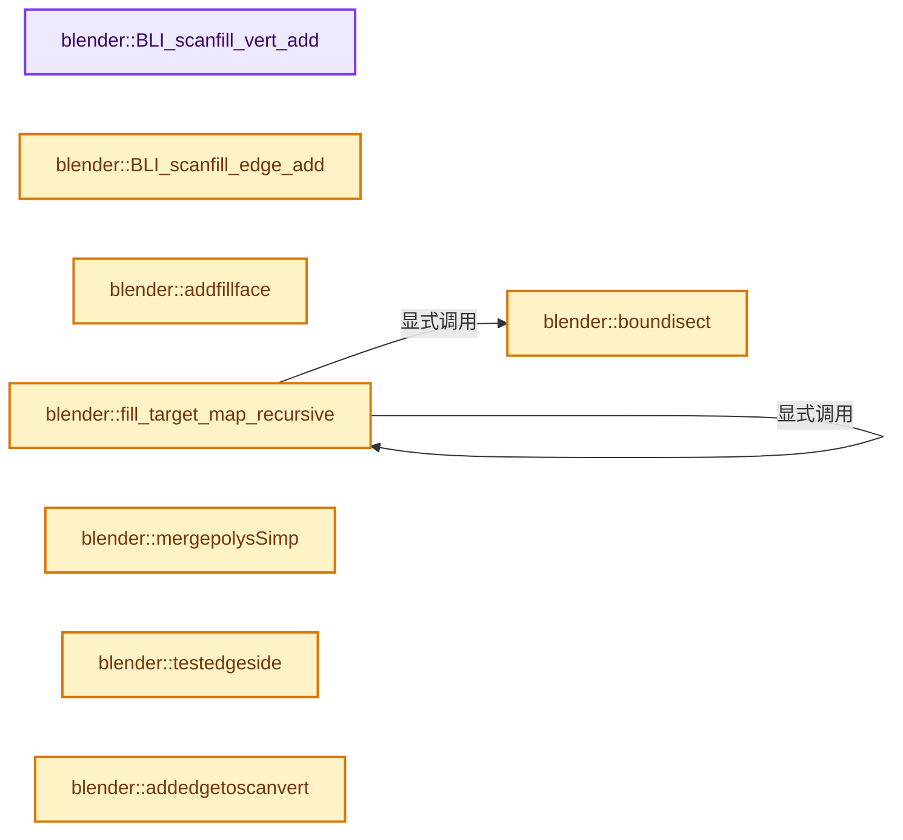
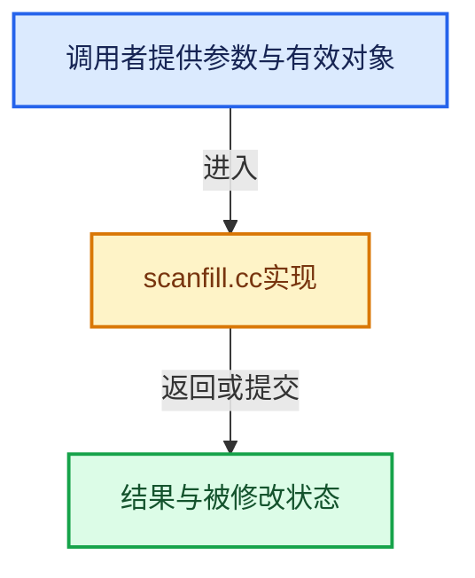

# 实现依赖专题：source/blender/blenlib/intern/scanfill.cc

[方向导航](README.md) · [符号索引](../%E7%AC%A6%E5%8F%B7%E4%BE%9D%E8%B5%96%E4%B8%8E%E5%AE%9E%E7%8E%B0%E7%B4%A2%E5%BC%95.md)

本专题从正文实际调用进入，集中保存共享实现。函数有稳定锚点，可从调用处直接跳到对应完整函数；递归与互相调用通过回链组织。

## 本文件的实现关系






## 完整成员与函数实现

<a id="f-8ea614be8f1d1a91"></a>

### `blender::BLI_scanfill_vert_add`

实现位置：[source/blender/blenlib/intern/scanfill.cc](../../../../../source/blender/blenlib/intern/scanfill.cc) · L105—L125。

接口参数：

- `ScanFillContext *sf_ctx`
- `const float vec[3]`

**教学注释版**

<!-- annotated:8c92100b01e685 -->

```cpp
ScanFillVert *BLI_scanfill_vert_add(ScanFillContext *sf_ctx, const float vec[3])
{
  ScanFillVert *sf_v;

  sf_v = BLI_memarena_alloc<ScanFillVert>(sf_ctx->arena);

  BLI_addtail(&sf_ctx->fillvertbase, sf_v);

  sf_v->tmp.p = nullptr;
  copy_v3_v3(sf_v->co, vec);

  /* just zero out the rest */
  zero_v2(sf_v->xy);
  sf_v->keyindex = 0;
  sf_v->poly_nr = sf_ctx->poly_nr;
  sf_v->edge_count = 0;
  sf_v->f = SF_VERT_NEW;
  sf_v->user_flag = 0;

  return sf_v;
}
```

<details>
<summary>核对原始源码：source/blender/blenlib/intern/scanfill.cc · L105—L125</summary>

<!-- original:8c92100b01e685:source/blender/blenlib/intern/scanfill.cc:105:125 -->

```cpp
ScanFillVert *BLI_scanfill_vert_add(ScanFillContext *sf_ctx, const float vec[3])
{
  ScanFillVert *sf_v;

  sf_v = BLI_memarena_alloc<ScanFillVert>(sf_ctx->arena);

  BLI_addtail(&sf_ctx->fillvertbase, sf_v);

  sf_v->tmp.p = nullptr;
  copy_v3_v3(sf_v->co, vec);

  /* just zero out the rest */
  zero_v2(sf_v->xy);
  sf_v->keyindex = 0;
  sf_v->poly_nr = sf_ctx->poly_nr;
  sf_v->edge_count = 0;
  sf_v->f = SF_VERT_NEW;
  sf_v->user_flag = 0;

  return sf_v;
}
```

</details>

**沿实际写入检查状态**

- `sf_v = BLI_memarena_alloc<ScanFillVert>(sf_ctx->arena);`
- `sf_v->tmp.p = nullptr;`
- `sf_v->keyindex = 0;`
- `sf_v->poly_nr = sf_ctx->poly_nr;`
- `sf_v->edge_count = 0;`
- `sf_v->f = SF_VERT_NEW;`
- `sf_v->user_flag = 0;`

**结果出口**

- `return sf_v;`

**继续追踪实现**

- `BLI_memarena_alloc<ScanFillVert>` → [blender::BLI_memarena_alloc · L125](%E4%BE%9D%E8%B5%96-BLI_memarena-aea32a.md#f-ae79828c3629e134)。
- `BLI_addtail` → [blender::BLI_addtail · L118](%E4%BE%9D%E8%B5%96-listbase-2816d9.md#f-4fb027713fa3115b)。
- `copy_v3_v3` → [blender::copy_v3_v3 · L47](../12-%E7%A9%BA%E9%97%B4%E6%95%B0%E6%8D%AE%E7%BB%93%E6%9E%84%E4%B8%8E%E5%87%A0%E4%BD%95%E7%AE%97%E6%B3%95/%E4%BE%9D%E8%B5%96-math_vector_inline-0c8541.md#f-037a0d5fa5060bd6)。
- `zero_v2` → [blender::zero_v2 · L20](../12-%E7%A9%BA%E9%97%B4%E6%95%B0%E6%8D%AE%E7%BB%93%E6%9E%84%E4%B8%8E%E5%87%A0%E4%BD%95%E7%AE%97%E6%B3%95/%E4%BE%9D%E8%B5%96-math_vector_inline-0c8541.md#f-3f0f4c37141bd4f2)。

<a id="f-ec7e87290e5fd476"></a>

### `blender::BLI_scanfill_edge_add`

实现位置：[source/blender/blenlib/intern/scanfill.cc](../../../../../source/blender/blenlib/intern/scanfill.cc) · L127—L144。

接口参数：

- `ScanFillContext *sf_ctx`
- `ScanFillVert *v1`
- `ScanFillVert *v2`

**教学注释版**

<!-- annotated:9f799fa4b008f9 -->

```cpp
ScanFillEdge *BLI_scanfill_edge_add(ScanFillContext *sf_ctx, ScanFillVert *v1, ScanFillVert *v2)
{
  ScanFillEdge *sf_ed;

  sf_ed = BLI_memarena_alloc<ScanFillEdge>(sf_ctx->arena);
  BLI_addtail(&sf_ctx->filledgebase, sf_ed);

  sf_ed->v1 = v1;
  sf_ed->v2 = v2;

  /* just zero out the rest */
  sf_ed->poly_nr = sf_ctx->poly_nr;
  sf_ed->f = SF_EDGE_NEW;
  sf_ed->user_flag = 0;
  sf_ed->tmp.c = 0;

  return sf_ed;
}
```

<details>
<summary>核对原始源码：source/blender/blenlib/intern/scanfill.cc · L127—L144</summary>

<!-- original:9f799fa4b008f9:source/blender/blenlib/intern/scanfill.cc:127:144 -->

```cpp
ScanFillEdge *BLI_scanfill_edge_add(ScanFillContext *sf_ctx, ScanFillVert *v1, ScanFillVert *v2)
{
  ScanFillEdge *sf_ed;

  sf_ed = BLI_memarena_alloc<ScanFillEdge>(sf_ctx->arena);
  BLI_addtail(&sf_ctx->filledgebase, sf_ed);

  sf_ed->v1 = v1;
  sf_ed->v2 = v2;

  /* just zero out the rest */
  sf_ed->poly_nr = sf_ctx->poly_nr;
  sf_ed->f = SF_EDGE_NEW;
  sf_ed->user_flag = 0;
  sf_ed->tmp.c = 0;

  return sf_ed;
}
```

</details>

**沿实际写入检查状态**

- `sf_ed = BLI_memarena_alloc<ScanFillEdge>(sf_ctx->arena);`
- `sf_ed->v1 = v1;`
- `sf_ed->v2 = v2;`
- `sf_ed->poly_nr = sf_ctx->poly_nr;`
- `sf_ed->f = SF_EDGE_NEW;`
- `sf_ed->user_flag = 0;`
- `sf_ed->tmp.c = 0;`

**结果出口**

- `return sf_ed;`

**继续追踪实现**

- `BLI_memarena_alloc<ScanFillEdge>` → [blender::BLI_memarena_alloc · L125](%E4%BE%9D%E8%B5%96-BLI_memarena-aea32a.md#f-ae79828c3629e134)。
- `BLI_addtail` → [blender::BLI_addtail · L118](%E4%BE%9D%E8%B5%96-listbase-2816d9.md#f-4fb027713fa3115b)。

<a id="f-c2c339c39b25bf52"></a>

### `blender::addfillface`

实现位置：[source/blender/blenlib/intern/scanfill.cc](../../../../../source/blender/blenlib/intern/scanfill.cc) · L146—L160。

接口参数：

- `ScanFillContext *sf_ctx`
- `ScanFillVert *v1`
- `ScanFillVert *v2`
- `ScanFillVert *v3`

**教学注释版**

<!-- annotated:72b9f32614fbb8 -->

```cpp
static void addfillface(ScanFillContext *sf_ctx,
                        ScanFillVert *v1,
                        ScanFillVert *v2,
                        ScanFillVert *v3)
{
  /* does not make edges */
  ScanFillFace *sf_tri;

  sf_tri = BLI_memarena_alloc<ScanFillFace>(sf_ctx->arena);
  BLI_addtail(&sf_ctx->fillfacebase, sf_tri);

  sf_tri->v1 = v1;
  sf_tri->v2 = v2;
  sf_tri->v3 = v3;
}
```

<details>
<summary>核对原始源码：source/blender/blenlib/intern/scanfill.cc · L146—L160</summary>

<!-- original:72b9f32614fbb8:source/blender/blenlib/intern/scanfill.cc:146:160 -->

```cpp
static void addfillface(ScanFillContext *sf_ctx,
                        ScanFillVert *v1,
                        ScanFillVert *v2,
                        ScanFillVert *v3)
{
  /* does not make edges */
  ScanFillFace *sf_tri;

  sf_tri = BLI_memarena_alloc<ScanFillFace>(sf_ctx->arena);
  BLI_addtail(&sf_ctx->fillfacebase, sf_tri);

  sf_tri->v1 = v1;
  sf_tri->v2 = v2;
  sf_tri->v3 = v3;
}
```

</details>

**沿实际写入检查状态**

- `sf_tri = BLI_memarena_alloc<ScanFillFace>(sf_ctx->arena);`
- `sf_tri->v1 = v1;`
- `sf_tri->v2 = v2;`
- `sf_tri->v3 = v3;`

**继续追踪实现**

- `BLI_memarena_alloc<ScanFillFace>` → [blender::BLI_memarena_alloc · L125](%E4%BE%9D%E8%B5%96-BLI_memarena-aea32a.md#f-ae79828c3629e134)。
- `BLI_addtail` → [blender::BLI_addtail · L118](%E4%BE%9D%E8%B5%96-listbase-2816d9.md#f-4fb027713fa3115b)。

<a id="f-3d0660f5fa1d2778"></a>

### `blender::boundisect`

实现位置：[source/blender/blenlib/intern/scanfill.cc](../../../../../source/blender/blenlib/intern/scanfill.cc) · L162—L186。

接口参数：

- `const PolyFill *pf2`
- `const PolyFill *pf1`

**教学注释版**

<!-- annotated:f732f0bc28f3b2 -->

```cpp
static bool boundisect(const PolyFill *pf2, const PolyFill *pf1)
{
  /* has pf2 been touched (intersected) by pf1 ? with bounding box */
  /* test first if polys exist */

  if (pf1->edges == 0 || pf2->edges == 0) {
    return false;
  }

  if (pf2->max_xy[0] < pf1->min_xy[0]) {
    return false;
  }
  if (pf2->max_xy[1] < pf1->min_xy[1]) {
    return false;
  }

  if (pf2->min_xy[0] > pf1->max_xy[0]) {
    return false;
  }
  if (pf2->min_xy[1] > pf1->max_xy[1]) {
    return false;
  }

  return true;
}
```

<details>
<summary>核对原始源码：source/blender/blenlib/intern/scanfill.cc · L162—L186</summary>

<!-- original:f732f0bc28f3b2:source/blender/blenlib/intern/scanfill.cc:162:186 -->

```cpp
static bool boundisect(const PolyFill *pf2, const PolyFill *pf1)
{
  /* has pf2 been touched (intersected) by pf1 ? with bounding box */
  /* test first if polys exist */

  if (pf1->edges == 0 || pf2->edges == 0) {
    return false;
  }

  if (pf2->max_xy[0] < pf1->min_xy[0]) {
    return false;
  }
  if (pf2->max_xy[1] < pf1->min_xy[1]) {
    return false;
  }

  if (pf2->min_xy[0] > pf1->max_xy[0]) {
    return false;
  }
  if (pf2->min_xy[1] > pf1->max_xy[1]) {
    return false;
  }

  return true;
}
```

</details>

**结果出口**

- `return false;`
- `return true;`

**继续追踪实现**

本实现没有需要继续展开的显式调用；检查返回表达式、对象转换和调用者前置条件。

<a id="f-163f33eeff65ef63"></a>

### `blender::fill_target_map_recursive`

实现位置：[source/blender/blenlib/intern/scanfill.cc](../../../../../source/blender/blenlib/intern/scanfill.cc) · L188—L207。

接口参数：

- `const PolyFill *__restrict pf_list`
- `const uint pf_len`
- `const uint pf_target`
- `const uint pf_test`
- `uint *__restrict target_map`

**教学注释版**

<!-- annotated:3a7dc961a0ba0b -->

```cpp
static void fill_target_map_recursive(const PolyFill *__restrict pf_list,
                                      const uint pf_len,
                                      const uint pf_target,
                                      const uint pf_test,
                                      uint *__restrict target_map)
{
  const PolyFill *pf_a = pf_list + pf_test;
  for (uint pf_b_index = pf_target + 1; pf_b_index < pf_len; pf_b_index++) {
    if (target_map[pf_b_index] != pf_b_index) {
      /* All intersections have already been identified for this polygon. */
      continue;
    }
    BLI_assert(pf_b_index != pf_test);
    const PolyFill *pf_b = pf_list + pf_b_index;
    if (boundisect(pf_a, pf_b)) {
      target_map[pf_b_index] = pf_target;
      fill_target_map_recursive(pf_list, pf_len, pf_target, pf_b_index, target_map);
    }
  }
}
```

<details>
<summary>核对原始源码：source/blender/blenlib/intern/scanfill.cc · L188—L207</summary>

<!-- original:3a7dc961a0ba0b:source/blender/blenlib/intern/scanfill.cc:188:207 -->

```cpp
static void fill_target_map_recursive(const PolyFill *__restrict pf_list,
                                      const uint pf_len,
                                      const uint pf_target,
                                      const uint pf_test,
                                      uint *__restrict target_map)
{
  const PolyFill *pf_a = pf_list + pf_test;
  for (uint pf_b_index = pf_target + 1; pf_b_index < pf_len; pf_b_index++) {
    if (target_map[pf_b_index] != pf_b_index) {
      /* All intersections have already been identified for this polygon. */
      continue;
    }
    BLI_assert(pf_b_index != pf_test);
    const PolyFill *pf_b = pf_list + pf_b_index;
    if (boundisect(pf_a, pf_b)) {
      target_map[pf_b_index] = pf_target;
      fill_target_map_recursive(pf_list, pf_len, pf_target, pf_b_index, target_map);
    }
  }
}
```

</details>

**沿实际写入检查状态**

- `target_map[pf_b_index] = pf_target;`

**继续追踪实现**

- `BLI_assert` → [BLI_assert · L48](%E4%BE%9D%E8%B5%96-BLI_assert-cc98e8.md#m-57a88495704d)；[BLI_assert · L63](%E4%BE%9D%E8%B5%96-BLI_assert-cc98e8.md#m-d07050020cb5)。宏定义由构建条件选择。
- `boundisect` → [blender::boundisect · L162](%E4%BE%9D%E8%B5%96-scanfill-ec083a.md#f-3d0660f5fa1d2778)。
- `fill_target_map_recursive` → [blender::fill_target_map_recursive · L188](%E4%BE%9D%E8%B5%96-scanfill-ec083a.md#f-163f33eeff65ef63)。

<a id="f-66e78367756cf9cd"></a>

### `blender::mergepolysSimp`

实现位置：[source/blender/blenlib/intern/scanfill.cc](../../../../../source/blender/blenlib/intern/scanfill.cc) · L210—L239。

接口参数：

- `ScanFillContext *sf_ctx`
- `PolyFill *pf1`
- `PolyFill *pf2`

**教学注释版**

<!-- annotated:52bd8303ea5d9a -->

```cpp
static void mergepolysSimp(ScanFillContext *sf_ctx, PolyFill *pf1, PolyFill *pf2)
{
  /* replace old poly numbers */
  for (ScanFillVert &eve : sf_ctx->fillvertbase) {
    if (eve.poly_nr == pf2->nr) {
      eve.poly_nr = pf1->nr;
    }
  }

  for (ScanFillEdge &eed : sf_ctx->filledgebase) {
    if (eed.poly_nr == pf2->nr) {
      eed.poly_nr = pf1->nr;
    }
  }

  /* Join. */
  pf1->verts += pf2->verts;
  pf1->edges += pf2->edges;

  // [讲解] std::max：按比较关系选取较大值。本讲解中的增长公式同时满足最低请求和几何增长；若保存返回引用，还需注意实参寿命。
  pf1->max_xy[0] = std::max(pf1->max_xy[0], pf2->max_xy[0]);
  pf1->max_xy[1] = std::max(pf1->max_xy[1], pf2->max_xy[1]);

  // [讲解] std::min：按比较关系选取较小值；截断范围时还需先满足非负和可表示范围，min本身不会证明边界安全。
  pf1->min_xy[0] = std::min(pf1->min_xy[0], pf2->min_xy[0]);
  pf1->min_xy[1] = std::min(pf1->min_xy[1], pf2->min_xy[1]);

  pf1->f = (pf1->f | pf2->f);

  /* Clear the other one. */
  pf2->verts = pf2->edges = 0;
}
```

<details>
<summary>核对原始源码：source/blender/blenlib/intern/scanfill.cc · L210—L239</summary>

<!-- original:52bd8303ea5d9a:source/blender/blenlib/intern/scanfill.cc:210:239 -->

```cpp
static void mergepolysSimp(ScanFillContext *sf_ctx, PolyFill *pf1, PolyFill *pf2)
{
  /* replace old poly numbers */
  for (ScanFillVert &eve : sf_ctx->fillvertbase) {
    if (eve.poly_nr == pf2->nr) {
      eve.poly_nr = pf1->nr;
    }
  }

  for (ScanFillEdge &eed : sf_ctx->filledgebase) {
    if (eed.poly_nr == pf2->nr) {
      eed.poly_nr = pf1->nr;
    }
  }

  /* Join. */
  pf1->verts += pf2->verts;
  pf1->edges += pf2->edges;

  pf1->max_xy[0] = std::max(pf1->max_xy[0], pf2->max_xy[0]);
  pf1->max_xy[1] = std::max(pf1->max_xy[1], pf2->max_xy[1]);

  pf1->min_xy[0] = std::min(pf1->min_xy[0], pf2->min_xy[0]);
  pf1->min_xy[1] = std::min(pf1->min_xy[1], pf2->min_xy[1]);

  pf1->f = (pf1->f | pf2->f);

  /* Clear the other one. */
  pf2->verts = pf2->edges = 0;
}
```

</details>

**沿实际写入检查状态**

- `eve.poly_nr = pf1->nr;`
- `eed.poly_nr = pf1->nr;`
- `pf1->verts += pf2->verts;`
- `pf1->edges += pf2->edges;`
- `pf1->max_xy[0] = std::max(pf1->max_xy[0], pf2->max_xy[0]);`
- `pf1->max_xy[1] = std::max(pf1->max_xy[1], pf2->max_xy[1]);`
- `pf1->min_xy[0] = std::min(pf1->min_xy[0], pf2->min_xy[0]);`
- `pf1->min_xy[1] = std::min(pf1->min_xy[1], pf2->min_xy[1]);`
- `pf1->f = (pf1->f | pf2->f);`
- `pf2->verts = pf2->edges = 0;`

**继续追踪实现**

- `std::max` → [外部契约](https://eel.is/c++draft/alg.min.max)：按比较关系选取较大值。本讲解中的增长公式同时满足最低请求和几何增长；若保存返回引用，还需注意实参寿命。
- `std::min` → [外部契约](https://eel.is/c++draft/alg.min.max)：按比较关系选取较小值；截断范围时还需先满足非负和可表示范围，min本身不会证明边界安全。

<a id="f-2efaf5c7c8399f77"></a>

### `blender::testedgeside`

实现位置：[source/blender/blenlib/intern/scanfill.cc](../../../../../source/blender/blenlib/intern/scanfill.cc) · L241—L260。

接口参数：

- `const float v1[2]`
- `const float v2[2]`
- `const float v3[2]`

**教学注释版**

<!-- annotated:23e090d1b73b4c -->

```cpp
static bool testedgeside(const float v1[2], const float v2[2], const float v3[2])
/* is v3 to the right of v1-v2 ? With exception: v3 == v1 || v3 == v2 */
{
  float inp;

  inp = (v2[0] - v1[0]) * (v1[1] - v3[1]) + (v1[1] - v2[1]) * (v1[0] - v3[0]);

  if (inp < 0.0f) {
    return false;
  }
  if (inp == 0.0f) {
    if (v1[0] == v3[0] && v1[1] == v3[1]) {
      return false;
    }
    if (v2[0] == v3[0] && v2[1] == v3[1]) {
      return false;
    }
  }
  return true;
}
```

<details>
<summary>核对原始源码：source/blender/blenlib/intern/scanfill.cc · L241—L260</summary>

<!-- original:23e090d1b73b4c:source/blender/blenlib/intern/scanfill.cc:241:260 -->

```cpp
static bool testedgeside(const float v1[2], const float v2[2], const float v3[2])
/* is v3 to the right of v1-v2 ? With exception: v3 == v1 || v3 == v2 */
{
  float inp;

  inp = (v2[0] - v1[0]) * (v1[1] - v3[1]) + (v1[1] - v2[1]) * (v1[0] - v3[0]);

  if (inp < 0.0f) {
    return false;
  }
  if (inp == 0.0f) {
    if (v1[0] == v3[0] && v1[1] == v3[1]) {
      return false;
    }
    if (v2[0] == v3[0] && v2[1] == v3[1]) {
      return false;
    }
  }
  return true;
}
```

</details>

**沿实际写入检查状态**

- `inp = (v2[0] - v1[0]) * (v1[1] - v3[1]) + (v1[1] - v2[1]) * (v1[0] - v3[0]);`

**结果出口**

- `return false;`
- `return true;`

**继续追踪实现**

本实现没有需要继续展开的显式调用；检查返回表达式、对象转换和调用者前置条件。

<a id="f-07ab908f9397a34f"></a>

### `blender::addedgetoscanvert`

实现位置：[source/blender/blenlib/intern/scanfill.cc](../../../../../source/blender/blenlib/intern/scanfill.cc) · L262—L311。

接口参数：

- `ScanFillVertLink *sc`
- `ScanFillEdge *eed`

**教学注释版**

<!-- annotated:eae8d8b62b79eb -->

```cpp
static bool addedgetoscanvert(ScanFillVertLink *sc, ScanFillEdge *eed)
{
  /* find first edge to the right of eed, and insert eed before that */
  ScanFillEdge *ed;
  float fac, fac1, x, y;

  if (sc->edge_first == nullptr) {
    sc->edge_first = sc->edge_last = eed;
    eed->prev = eed->next = nullptr;
    return true;
  }

  x = eed->v1->xy[0];
  y = eed->v1->xy[1];

  fac1 = eed->v2->xy[1] - y;
  if (fac1 == 0.0f) {
    fac1 = 1.0e10f * (eed->v2->xy[0] - x);
  }
  else {
    fac1 = (x - eed->v2->xy[0]) / fac1;
  }

  for (ed = sc->edge_first; ed; ed = ed->next) {

    if (ed->v2 == eed->v2) {
      return false;
    }

    fac = ed->v2->xy[1] - y;
    if (fac == 0.0f) {
      fac = 1.0e10f * (ed->v2->xy[0] - x);
    }
    else {
      fac = (x - ed->v2->xy[0]) / fac;
    }

    if (fac > fac1) {
      break;
    }
  }
  if (ed) {
    BLI_insertlinkbefore(reinterpret_cast<ListBase *>(&(sc->edge_first)), ed, eed);
  }
  else {
    BLI_addtail(reinterpret_cast<ListBase *>(&(sc->edge_first)), eed);
  }

  return true;
}
```

<details>
<summary>核对原始源码：source/blender/blenlib/intern/scanfill.cc · L262—L311</summary>

<!-- original:eae8d8b62b79eb:source/blender/blenlib/intern/scanfill.cc:262:311 -->

```cpp
static bool addedgetoscanvert(ScanFillVertLink *sc, ScanFillEdge *eed)
{
  /* find first edge to the right of eed, and insert eed before that */
  ScanFillEdge *ed;
  float fac, fac1, x, y;

  if (sc->edge_first == nullptr) {
    sc->edge_first = sc->edge_last = eed;
    eed->prev = eed->next = nullptr;
    return true;
  }

  x = eed->v1->xy[0];
  y = eed->v1->xy[1];

  fac1 = eed->v2->xy[1] - y;
  if (fac1 == 0.0f) {
    fac1 = 1.0e10f * (eed->v2->xy[0] - x);
  }
  else {
    fac1 = (x - eed->v2->xy[0]) / fac1;
  }

  for (ed = sc->edge_first; ed; ed = ed->next) {

    if (ed->v2 == eed->v2) {
      return false;
    }

    fac = ed->v2->xy[1] - y;
    if (fac == 0.0f) {
      fac = 1.0e10f * (ed->v2->xy[0] - x);
    }
    else {
      fac = (x - ed->v2->xy[0]) / fac;
    }

    if (fac > fac1) {
      break;
    }
  }
  if (ed) {
    BLI_insertlinkbefore(reinterpret_cast<ListBase *>(&(sc->edge_first)), ed, eed);
  }
  else {
    BLI_addtail(reinterpret_cast<ListBase *>(&(sc->edge_first)), eed);
  }

  return true;
}
```

</details>

**沿实际写入检查状态**

- `sc->edge_first = sc->edge_last = eed;`
- `eed->prev = eed->next = nullptr;`
- `x = eed->v1->xy[0];`
- `y = eed->v1->xy[1];`
- `fac1 = eed->v2->xy[1] - y;`
- `fac1 = 1.0e10f * (eed->v2->xy[0] - x);`
- `fac1 = (x - eed->v2->xy[0]) / fac1;`
- `fac = ed->v2->xy[1] - y;`
- `fac = 1.0e10f * (ed->v2->xy[0] - x);`
- `fac = (x - ed->v2->xy[0]) / fac;`

**结果出口**

- `return true;`
- `return false;`

**继续追踪实现**

- `BLI_insertlinkbefore` → [blender::BLI_insertlinkbefore · L378](%E4%BE%9D%E8%B5%96-listbase-2816d9.md#f-b9a49151feaf9c08)。
- `BLI_addtail` → [blender::BLI_addtail · L118](%E4%BE%9D%E8%B5%96-listbase-2816d9.md#f-4fb027713fa3115b)。

<a id="f-edf6147b5208e374"></a>

### `blender::addedgetoscanlist`

实现位置：[source/blender/blenlib/intern/scanfill.cc](../../../../../source/blender/blenlib/intern/scanfill.cc) · L313—L346。

接口参数：

- `ScanFillVertLink *scdata`
- `ScanFillEdge *eed`
- `uint len`

**教学注释版**

<!-- annotated:756d2dbda1dd33 -->

```cpp
static ScanFillVertLink *addedgetoscanlist(ScanFillVertLink *scdata, ScanFillEdge *eed, uint len)
{
  /* inserts edge at correct location in ScanFillVertLink list */
  /* returns sc when edge already exists */
  ScanFillVertLink *sc, scsearch;
  ScanFillVert *eve;

  /* which vert is left-top? */
  if (eed->v1->xy[1] == eed->v2->xy[1]) {
    if (eed->v1->xy[0] > eed->v2->xy[0]) {
      eve = eed->v1;
      eed->v1 = eed->v2;
      eed->v2 = eve;
    }
  }
  else if (eed->v1->xy[1] < eed->v2->xy[1]) {
    eve = eed->v1;
    eed->v1 = eed->v2;
    eed->v2 = eve;
  }
  /* find location in list */
  scsearch.vert = eed->v1;
  sc = static_cast<ScanFillVertLink *>(
      bsearch(&scsearch, scdata, len, sizeof(ScanFillVertLink), vergscdata));

  if (sc == nullptr) [[unlikely]] {
    printf("Error in search edge: %p\n", static_cast<void *>(eed));
  }
  else if (addedgetoscanvert(sc, eed) == false) {
    return sc;
  }

  return nullptr;
}
```

<details>
<summary>核对原始源码：source/blender/blenlib/intern/scanfill.cc · L313—L346</summary>

<!-- original:756d2dbda1dd33:source/blender/blenlib/intern/scanfill.cc:313:346 -->

```cpp
static ScanFillVertLink *addedgetoscanlist(ScanFillVertLink *scdata, ScanFillEdge *eed, uint len)
{
  /* inserts edge at correct location in ScanFillVertLink list */
  /* returns sc when edge already exists */
  ScanFillVertLink *sc, scsearch;
  ScanFillVert *eve;

  /* which vert is left-top? */
  if (eed->v1->xy[1] == eed->v2->xy[1]) {
    if (eed->v1->xy[0] > eed->v2->xy[0]) {
      eve = eed->v1;
      eed->v1 = eed->v2;
      eed->v2 = eve;
    }
  }
  else if (eed->v1->xy[1] < eed->v2->xy[1]) {
    eve = eed->v1;
    eed->v1 = eed->v2;
    eed->v2 = eve;
  }
  /* find location in list */
  scsearch.vert = eed->v1;
  sc = static_cast<ScanFillVertLink *>(
      bsearch(&scsearch, scdata, len, sizeof(ScanFillVertLink), vergscdata));

  if (sc == nullptr) [[unlikely]] {
    printf("Error in search edge: %p\n", static_cast<void *>(eed));
  }
  else if (addedgetoscanvert(sc, eed) == false) {
    return sc;
  }

  return nullptr;
}
```

</details>

**沿实际写入检查状态**

- `eve = eed->v1;`
- `eed->v1 = eed->v2;`
- `eed->v2 = eve;`
- `scsearch.vert = eed->v1;`
- `sc = static_cast<ScanFillVertLink *>(`

**结果出口**

- `return sc;`
- `return nullptr;`

**继续追踪实现**

- `bsearch` → [调用协议](../%E6%A8%A1%E6%9D%BF%E5%AE%8F%E4%B8%8E%E5%8A%A8%E6%80%81%E5%88%86%E6%B4%BE%E5%8D%8F%E8%AE%AE.md)：函数指针、局部可调用对象或未展开的宏；必须结合调用者环境。调用位置L336。
- `printf` → [外部契约](https://eel.is/c++draft/)：这个边界按实际表达式及所属类型核对参数、返回值、寿命与失败行为。这里提供接口入口，不声称已解释该第三方版本的内部实现。
- `addedgetoscanvert` → [blender::addedgetoscanvert · L262](%E4%BE%9D%E8%B5%96-scanfill-ec083a.md#f-07ab908f9397a34f)。

<a id="f-e11726b63e1ce5fc"></a>

### `blender::boundinsideEV`

实现位置：[source/blender/blenlib/intern/scanfill.cc](../../../../../source/blender/blenlib/intern/scanfill.cc) · L351—L377。

接口参数：

- `const ScanFillEdge *eed`
- `const ScanFillVert *eve`

**教学注释版**

<!-- annotated:2e44aaf6e7a3d0 -->

```cpp
static bool boundinsideEV(const ScanFillEdge *eed, const ScanFillVert *eve)
{
  float minx, maxx, miny, maxy;

  if (eed->v1->xy[0] < eed->v2->xy[0]) {
    minx = eed->v1->xy[0];
    maxx = eed->v2->xy[0];
  }
  else {
    minx = eed->v2->xy[0];
    maxx = eed->v1->xy[0];
  }
  if (eve->xy[0] >= minx && eve->xy[0] <= maxx) {
    if (eed->v1->xy[1] < eed->v2->xy[1]) {
      miny = eed->v1->xy[1];
      maxy = eed->v2->xy[1];
    }
    else {
      miny = eed->v2->xy[1];
      maxy = eed->v1->xy[1];
    }
    if (eve->xy[1] >= miny && eve->xy[1] <= maxy) {
      return true;
    }
  }
  return false;
}
```

<details>
<summary>核对原始源码：source/blender/blenlib/intern/scanfill.cc · L351—L377</summary>

<!-- original:2e44aaf6e7a3d0:source/blender/blenlib/intern/scanfill.cc:351:377 -->

```cpp
static bool boundinsideEV(const ScanFillEdge *eed, const ScanFillVert *eve)
{
  float minx, maxx, miny, maxy;

  if (eed->v1->xy[0] < eed->v2->xy[0]) {
    minx = eed->v1->xy[0];
    maxx = eed->v2->xy[0];
  }
  else {
    minx = eed->v2->xy[0];
    maxx = eed->v1->xy[0];
  }
  if (eve->xy[0] >= minx && eve->xy[0] <= maxx) {
    if (eed->v1->xy[1] < eed->v2->xy[1]) {
      miny = eed->v1->xy[1];
      maxy = eed->v2->xy[1];
    }
    else {
      miny = eed->v2->xy[1];
      maxy = eed->v1->xy[1];
    }
    if (eve->xy[1] >= miny && eve->xy[1] <= maxy) {
      return true;
    }
  }
  return false;
}
```

</details>

**沿实际写入检查状态**

- `minx = eed->v1->xy[0];`
- `maxx = eed->v2->xy[0];`
- `minx = eed->v2->xy[0];`
- `maxx = eed->v1->xy[0];`
- `miny = eed->v1->xy[1];`
- `maxy = eed->v2->xy[1];`
- `miny = eed->v2->xy[1];`
- `maxy = eed->v1->xy[1];`

**结果出口**

- `return true;`
- `return false;`

**继续追踪实现**

本实现没有需要继续展开的显式调用；检查返回表达式、对象转换和调用者前置条件。

<a id="f-64aa85547e958e4e"></a>

### `blender::testvertexnearedge`

实现位置：[source/blender/blenlib/intern/scanfill.cc](../../../../../source/blender/blenlib/intern/scanfill.cc) · L379—L431。

接口参数：

- `ScanFillContext *sf_ctx`

**教学注释版**

<!-- annotated:6899df50a03e79 -->

```cpp
static void testvertexnearedge(ScanFillContext *sf_ctx)
{
  /* only vertices with (->edge_count == 1) are being tested for
   * being close to an edge, if true insert */

  for (ScanFillVert &eve : sf_ctx->fillvertbase) {
    if (eve.edge_count == 1) {
      /* find the edge which has vertex eve,
       * NOTE: we _know_ this will crash if 'ed1' becomes nullptr
       * but this will never happen. */
      ScanFillEdge *ed1 = sf_ctx->filledgebase.first();
      for (; !(ed1->v1 == &eve || ed1->v2 == &eve); ed1 = ed1->next) {
        /* do nothing */
      }

      if (ed1->v1 == &eve) {
        ed1->v1 = ed1->v2;
        ed1->v2 = &eve;
      }

      for (ScanFillEdge &eed : sf_ctx->filledgebase) {
        if (&eve != eed.v1 && &eve != eed.v2 && eve.poly_nr == eed.poly_nr) {
          if (compare_v2v2(eve.xy, eed.v1->xy, SF_EPSILON)) {
            ed1->v2 = eed.v1;
            eed.v1->edge_count++;
            eve.edge_count = 0;
            break;
          }
          if (compare_v2v2(eve.xy, eed.v2->xy, SF_EPSILON)) {
            ed1->v2 = eed.v2;
            eed.v2->edge_count++;
            eve.edge_count = 0;
            break;
          }

          if (boundinsideEV(&eed, &eve)) {
            const float dist = dist_squared_to_line_v2(eed.v1->xy, eed.v2->xy, eve.xy);
            if (dist < SF_EPSILON_SQ) {
              /* new edge */
              ed1 = BLI_scanfill_edge_add(sf_ctx, eed.v1, &eve);

              // printf("fill: vertex near edge %x\n", eve);
              ed1->poly_nr = eed.poly_nr;
              eed.v1 = &eve;
              eve.edge_count = 3;
              break;
            }
          }
        }
      }
    }
  }
}
```

<details>
<summary>核对原始源码：source/blender/blenlib/intern/scanfill.cc · L379—L431</summary>

<!-- original:6899df50a03e79:source/blender/blenlib/intern/scanfill.cc:379:431 -->

```cpp
static void testvertexnearedge(ScanFillContext *sf_ctx)
{
  /* only vertices with (->edge_count == 1) are being tested for
   * being close to an edge, if true insert */

  for (ScanFillVert &eve : sf_ctx->fillvertbase) {
    if (eve.edge_count == 1) {
      /* find the edge which has vertex eve,
       * NOTE: we _know_ this will crash if 'ed1' becomes nullptr
       * but this will never happen. */
      ScanFillEdge *ed1 = sf_ctx->filledgebase.first();
      for (; !(ed1->v1 == &eve || ed1->v2 == &eve); ed1 = ed1->next) {
        /* do nothing */
      }

      if (ed1->v1 == &eve) {
        ed1->v1 = ed1->v2;
        ed1->v2 = &eve;
      }

      for (ScanFillEdge &eed : sf_ctx->filledgebase) {
        if (&eve != eed.v1 && &eve != eed.v2 && eve.poly_nr == eed.poly_nr) {
          if (compare_v2v2(eve.xy, eed.v1->xy, SF_EPSILON)) {
            ed1->v2 = eed.v1;
            eed.v1->edge_count++;
            eve.edge_count = 0;
            break;
          }
          if (compare_v2v2(eve.xy, eed.v2->xy, SF_EPSILON)) {
            ed1->v2 = eed.v2;
            eed.v2->edge_count++;
            eve.edge_count = 0;
            break;
          }

          if (boundinsideEV(&eed, &eve)) {
            const float dist = dist_squared_to_line_v2(eed.v1->xy, eed.v2->xy, eve.xy);
            if (dist < SF_EPSILON_SQ) {
              /* new edge */
              ed1 = BLI_scanfill_edge_add(sf_ctx, eed.v1, &eve);

              // printf("fill: vertex near edge %x\n", eve);
              ed1->poly_nr = eed.poly_nr;
              eed.v1 = &eve;
              eve.edge_count = 3;
              break;
            }
          }
        }
      }
    }
  }
}
```

</details>

**沿实际写入检查状态**

- `ed1->v1 = ed1->v2;`
- `ed1->v2 = &eve;`
- `ed1->v2 = eed.v1;`
- `eve.edge_count = 0;`
- `ed1->v2 = eed.v2;`
- `ed1 = BLI_scanfill_edge_add(sf_ctx, eed.v1, &eve);`
- `ed1->poly_nr = eed.poly_nr;`
- `eed.v1 = &eve;`
- `eve.edge_count = 3;`

**继续追踪实现**

- `sf_ctx->filledgebase.first` → [调用协议](../%E6%A8%A1%E6%9D%BF%E5%AE%8F%E4%B8%8E%E5%8A%A8%E6%80%81%E5%88%86%E6%B4%BE%E5%8D%8F%E8%AE%AE.md)：接收对象类型依赖auto、返回值或模板实例；不按同名猜测目标。调用位置L389。
- `compare_v2v2` → [blender::compare_v2v2 · L1021](../12-%E7%A9%BA%E9%97%B4%E6%95%B0%E6%8D%AE%E7%BB%93%E6%9E%84%E4%B8%8E%E5%87%A0%E4%BD%95%E7%AE%97%E6%B3%95/%E4%BE%9D%E8%B5%96-math_vector_inline-0c8541.md#f-e883f2cfaa54e771)。
- `boundinsideEV` → [blender::boundinsideEV · L351](%E4%BE%9D%E8%B5%96-scanfill-ec083a.md#f-e11726b63e1ce5fc)。
- `dist_squared_to_line_v2` → [blender::dist_squared_to_line_v2 · L294](../12-%E7%A9%BA%E9%97%B4%E6%95%B0%E6%8D%AE%E7%BB%93%E6%9E%84%E4%B8%8E%E5%87%A0%E4%BD%95%E7%AE%97%E6%B3%95/%E4%BE%9D%E8%B5%96-math_geom-8d91a3.md#f-541701f1759f08b8)。
- `BLI_scanfill_edge_add` → [blender::BLI_scanfill_edge_add · L127](%E4%BE%9D%E8%B5%96-scanfill-ec083a.md#f-ec7e87290e5fd476)。

<a id="f-4b468a17cfee942f"></a>

### `blender::splitlist`

实现位置：[source/blender/blenlib/intern/scanfill.cc](../../../../../source/blender/blenlib/intern/scanfill.cc) · L433—L455。

接口参数：

- `ScanFillContext *sf_ctx`
- `ListBaseT<ScanFillVert> *tempve`
- `ListBaseT<ScanFillEdge> *temped`
- `ushort nr`

**教学注释版**

<!-- annotated:cb13e006687643 -->

```cpp
static void splitlist(ScanFillContext *sf_ctx,
                      ListBaseT<ScanFillVert> *tempve,
                      ListBaseT<ScanFillEdge> *temped,
                      ushort nr)
{
  /* Everything is in temp-list, write only poly nr to fill-list. */
  BLI_movelisttolist(tempve, &sf_ctx->fillvertbase);
  BLI_movelisttolist(temped, &sf_ctx->filledgebase);

  for (ScanFillVert &eve : tempve->items_mutable()) {
    if (eve.poly_nr == nr) {
      BLI_remlink(tempve, &eve);
      BLI_addtail(&sf_ctx->fillvertbase, &eve);
    }
  }

  for (ScanFillEdge &eed : temped->items_mutable()) {
    if (eed.poly_nr == nr) {
      BLI_remlink(temped, &eed);
      BLI_addtail(&sf_ctx->filledgebase, &eed);
    }
  }
}
```

<details>
<summary>核对原始源码：source/blender/blenlib/intern/scanfill.cc · L433—L455</summary>

<!-- original:cb13e006687643:source/blender/blenlib/intern/scanfill.cc:433:455 -->

```cpp
static void splitlist(ScanFillContext *sf_ctx,
                      ListBaseT<ScanFillVert> *tempve,
                      ListBaseT<ScanFillEdge> *temped,
                      ushort nr)
{
  /* Everything is in temp-list, write only poly nr to fill-list. */
  BLI_movelisttolist(tempve, &sf_ctx->fillvertbase);
  BLI_movelisttolist(temped, &sf_ctx->filledgebase);

  for (ScanFillVert &eve : tempve->items_mutable()) {
    if (eve.poly_nr == nr) {
      BLI_remlink(tempve, &eve);
      BLI_addtail(&sf_ctx->fillvertbase, &eve);
    }
  }

  for (ScanFillEdge &eed : temped->items_mutable()) {
    if (eed.poly_nr == nr) {
      BLI_remlink(temped, &eed);
      BLI_addtail(&sf_ctx->filledgebase, &eed);
    }
  }
}
```

</details>

**继续追踪实现**

- `BLI_movelisttolist` → [blender::BLI_movelisttolist · L32](%E4%BE%9D%E8%B5%96-listbase-2816d9.md#f-c7a706073038a4be)。
- `tempve->items_mutable` → [blender::ListBaseT::items_mutable · L163](../05-%E5%87%A0%E4%BD%95%E5%AD%98%E5%82%A8%E4%B8%8E%E6%8B%93%E6%89%91%E6%98%A0%E5%B0%84/%E4%BE%9D%E8%B5%96-DNA_listBase-48dbc9.md#f-cc603252f543d4ad)。
- `BLI_remlink` → [blender::BLI_remlink · L138](%E4%BE%9D%E8%B5%96-listbase-2816d9.md#f-120d80f281ca4cb7)。
- `BLI_addtail` → [blender::BLI_addtail · L118](%E4%BE%9D%E8%B5%96-listbase-2816d9.md#f-4fb027713fa3115b)。
- `temped->items_mutable` → [blender::ListBaseT::items_mutable · L163](../05-%E5%87%A0%E4%BD%95%E5%AD%98%E5%82%A8%E4%B8%8E%E6%8B%93%E6%89%91%E6%98%A0%E5%B0%84/%E4%BE%9D%E8%B5%96-DNA_listBase-48dbc9.md#f-cc603252f543d4ad)。

<a id="f-70ae7f5eb3054987"></a>

### `blender::scanfill`

实现位置：[source/blender/blenlib/intern/scanfill.cc](../../../../../source/blender/blenlib/intern/scanfill.cc) · L457—L782。

接口参数：

- `ScanFillContext *sf_ctx`
- `PolyFill *pf`
- `const int flag`

**教学注释版**

<!-- annotated:ddd31051d075d6 -->

```cpp
static uint scanfill(ScanFillContext *sf_ctx, PolyFill *pf, const int flag)
{
  ScanFillVertLink *scdata;
  ScanFillVertLink *sc = nullptr, *sc1;
  ScanFillVert *v1, *v2, *v3;
  uint a, b, verts, maxface, totface;
  const ushort nr = pf->nr;
  bool twoconnected = false;

  /* PRINTS */
#if 0
  verts = pf->verts;
  for (ScanFillVert &eve : sf_ctx->fillvertbase) {
    printf("vert: %x co: %f %f\n", &eve, eve.xy[0], eve.xy[1]);
  }

  for (ScanFillEdge &eed : sf_ctx->filledgebase) {
    printf("edge: %x  verts: %x %x\n", &eed, eed.v1, eed.v2);
  }
#endif

  /* STEP 0: remove zero sized edges */
  if (flag & BLI_SCANFILL_CALC_REMOVE_DOUBLES) {
    for (ScanFillEdge &eed : sf_ctx->filledgebase) {
      if (equals_v2v2(eed.v1->xy, eed.v2->xy)) {
        if (eed.v1->f == SF_VERT_ZERO_LEN && eed.v2->f != SF_VERT_ZERO_LEN) {
          eed.v2->f = SF_VERT_ZERO_LEN;
          eed.v2->tmp.v = eed.v1->tmp.v;
        }
        else if (eed.v2->f == SF_VERT_ZERO_LEN && eed.v1->f != SF_VERT_ZERO_LEN) {
          eed.v1->f = SF_VERT_ZERO_LEN;
          eed.v1->tmp.v = eed.v2->tmp.v;
        }
        else if (eed.v2->f == SF_VERT_ZERO_LEN && eed.v1->f == SF_VERT_ZERO_LEN) {
          eed.v1->tmp.v = eed.v2->tmp.v;
        }
        else {
          eed.v2->f = SF_VERT_ZERO_LEN;
          eed.v2->tmp.v = eed.v1;
        }
      }
    }
  }

  /* STEP 1: make using FillVert and FillEdge lists a sorted
   * ScanFillVertLink list
   */
  sc = scdata = MEM_new_array_uninitialized<ScanFillVertLink>(pf->verts, "Scanfill1");
  verts = 0;
  for (ScanFillVert &eve : sf_ctx->fillvertbase) {
    if (eve.poly_nr == nr) {
      if (eve.f != SF_VERT_ZERO_LEN) {
        verts++;
        eve.f = SF_VERT_NEW; /* Flag for connect edges later on. */
        sc->vert = &eve;
        sc->edge_first = sc->edge_last = nullptr;
        /* NOTE: debug print only will work for curve poly-fill, union is in use for mesh. */
#if 0
        if (even->tmp.v == nullptr) {
          eve->tmp.u = verts;
        }
#endif
        sc++;
      }
    }
  }

  qsort(scdata, verts, sizeof(ScanFillVertLink), vergscdata);

  if (flag & BLI_SCANFILL_CALC_REMOVE_DOUBLES) {
    for (ScanFillEdge &eed : sf_ctx->filledgebase.items_mutable()) {
      BLI_remlink(&sf_ctx->filledgebase, &eed);
      /* This code is for handling zero-length edges that get
       * collapsed in step 0. It was removed for some time to
       * fix trunk bug #4544, so if that comes back, this code
       * may need some work, or there will have to be a better
       * fix to #4544.
       *
       * warning, this can hang on un-ordered edges, see: #33281.
       * for now disable #BLI_SCANFILL_CALC_REMOVE_DOUBLES for ngons.
       */
      if (eed.v1->f == SF_VERT_ZERO_LEN) {
        v1 = eed.v1;
        while ((eed.v1->f == SF_VERT_ZERO_LEN) && (eed.v1->tmp.v != v1) &&
               (eed.v1 != eed.v1->tmp.v))
        {
          eed.v1 = eed.v1->tmp.v;
        }
      }
      if (eed.v2->f == SF_VERT_ZERO_LEN) {
        v2 = eed.v2;
        while ((eed.v2->f == SF_VERT_ZERO_LEN) && (eed.v2->tmp.v != v2) &&
               (eed.v2 != eed.v2->tmp.v))
        {
          eed.v2 = eed.v2->tmp.v;
        }
      }
      if (eed.v1 != eed.v2) {
        addedgetoscanlist(scdata, &eed, verts);
      }
    }
  }
  else {
    for (ScanFillEdge &eed : sf_ctx->filledgebase.items_mutable()) {
      BLI_remlink(&sf_ctx->filledgebase, &eed);
      if (eed.v1 != eed.v2) {
        addedgetoscanlist(scdata, &eed, verts);
      }
    }
  }
#if 0
  sc = sf_ctx->_scdata;
  for (a = 0; a < verts; a++) {
    printf("\nscvert: %x\n", sc->vert);
    for (eed = sc->edge_first; eed; eed = eed->next) {
      printf(" ed %x %x %x\n", eed, eed->v1, eed->v2);
    }
    sc++;
  }
#endif

  /* STEP 2: FILL LOOP */

  if (pf->f == SF_POLY_NEW) {
    twoconnected = true;
  }

  /* (temporal) security: never much more faces than vertices */
  totface = 0;
  if (flag & BLI_SCANFILL_CALC_HOLES) {
    maxface = 2 * verts; /* 2*verts: based at a filled circle within a triangle */
  }
  else {
    /* when we don't calc any holes, we assume face is a non overlapping loop */
    maxface = verts - 2;
  }

  sc = scdata;
  for (a = 0; a < verts; a++) {
    // printf("VERTEX %d index %d\n", a, sc->vert->tmp.u);
    /* Set connect-flags. */
    ScanFillEdge *ed1, *ed2, *ed3, *eed_next;
    for (ed1 = sc->edge_first; ed1; ed1 = eed_next) {
      eed_next = ed1->next;
      if (ed1->v1->edge_count == 1 || ed1->v2->edge_count == 1) {
        BLI_remlink(reinterpret_cast<ListBase *>(&(sc->edge_first)), ed1);
        BLI_addtail(&sf_ctx->filledgebase, ed1);
        if (ed1->v1->edge_count > 1) {
          ed1->v1->edge_count--;
        }
        if (ed1->v2->edge_count > 1) {
          ed1->v2->edge_count--;
        }
      }
      else {
        ed1->v2->f = SF_VERT_AVAILABLE;
      }
    }
    while (sc->edge_first) { /* for as long there are edges */
      ed1 = sc->edge_first;
      ed2 = ed1->next;

      /* Commented out: the ESC here delivers corrupted memory
       * (and doesn't work during grab). */
#if 0
      if (callLocalInterruptCallBack()){
        break;
      }
#endif
      if (totface >= maxface) {
        // printf("Fill error: endless loop. Escaped at vert %d,  tot: %d.\n", a, verts);
        a = verts;
        break;
      }
      if (ed2 == nullptr) {
        sc->edge_first = sc->edge_last = nullptr;
        // printf("just 1 edge to vert\n");
        BLI_addtail(&sf_ctx->filledgebase, ed1);
        ed1->v2->f = SF_VERT_NEW;
        ed1->v1->edge_count--;
        ed1->v2->edge_count--;
      }
      else {
        /* test rest of vertices */
        ScanFillVertLink *best_sc = nullptr;
        float angle_best_cos = -1.0f;
        float miny;
        bool firsttime = false;

        v1 = ed1->v2;
        v2 = ed1->v1;
        v3 = ed2->v2;

        /* this happens with a serial of overlapping edges */
        if (v1 == v2 || v2 == v3) {
          break;
        }

        // printf("test verts %d %d %d\n", v1->tmp.u, v2->tmp.u, v3->tmp.u);
        miny = min_ff(v1->xy[1], v3->xy[1]);
        sc1 = sc + 1;

        for (b = a + 1; b < verts; b++, sc1++) {
          if (sc1->vert->f == SF_VERT_NEW) {
            if (sc1->vert->xy[1] <= miny) {
              break;
            }
            if (testedgeside(v1->xy, v2->xy, sc1->vert->xy)) {
              if (testedgeside(v2->xy, v3->xy, sc1->vert->xy)) {
                if (testedgeside(v3->xy, v1->xy, sc1->vert->xy)) {
                  /* point is in triangle */

                  /* Because multiple points can be inside triangle
                   * (concave holes) we continue searching and pick the
                   * one with sharpest corner. */
                  if (best_sc == nullptr) {
                    /* even without holes we need to keep checking #35861. */
                    best_sc = sc1;
                  }
                  else {
                    /* Prevent angle calc for the simple cases
                     * only 1 vertex is found. */
                    if (firsttime == false) {
                      angle_best_cos = cos_v2v2v2(v2->xy, v1->xy, best_sc->vert->xy);
                      firsttime = true;
                    }

                    const float angle_test_cos = cos_v2v2v2(v2->xy, v1->xy, sc1->vert->xy);
                    if (angle_test_cos > angle_best_cos) {
                      best_sc = sc1;
                      angle_best_cos = angle_test_cos;
                    }
                  }
                }
              }
            }
          }
        }

        if (best_sc) {
          /* make new edge, and start over */
          // printf("add new edge %d %d and start again\n", v2->tmp.u, best_sc->vert->tmp.u);

          ed3 = BLI_scanfill_edge_add(sf_ctx, v2, best_sc->vert);
          BLI_remlink(&sf_ctx->filledgebase, ed3);
          BLI_insertlinkbefore(reinterpret_cast<ListBase *>(&(sc->edge_first)), ed2, ed3);
          ed3->v2->f = SF_VERT_AVAILABLE;
          ed3->f = SF_EDGE_INTERNAL;
          ed3->v1->edge_count++;
          ed3->v2->edge_count++;
        }
        else {
          /* new triangle */
          // printf("add face %d %d %d\n", v1->tmp.u, v2->tmp.u, v3->tmp.u);
          addfillface(sf_ctx, v1, v2, v3);
          totface++;
          BLI_remlink(reinterpret_cast<ListBase *>(&(sc->edge_first)), ed1);
          BLI_addtail(&sf_ctx->filledgebase, ed1);
          ed1->v2->f = SF_VERT_NEW;
          ed1->v1->edge_count--;
          ed1->v2->edge_count--;
          /* ed2 can be removed when it's a boundary edge */
          if (((ed2->f == SF_EDGE_NEW) && twoconnected) /* || (ed2->f == SF_EDGE_BOUNDARY) */) {
            BLI_remlink(reinterpret_cast<ListBase *>(&(sc->edge_first)), ed2);
            BLI_addtail(&sf_ctx->filledgebase, ed2);
            ed2->v2->f = SF_VERT_NEW;
            ed2->v1->edge_count--;
            ed2->v2->edge_count--;
          }

          /* new edge */
          ed3 = BLI_scanfill_edge_add(sf_ctx, v1, v3);
          BLI_remlink(&sf_ctx->filledgebase, ed3);
          ed3->f = SF_EDGE_INTERNAL;
          ed3->v1->edge_count++;
          ed3->v2->edge_count++;

          // printf("add new edge %x %x\n", v1, v3);
          sc1 = addedgetoscanlist(scdata, ed3, verts);

          if (sc1) { /* ed3 already exists: remove if a boundary */
            // printf("Edge exists\n");
            ed3->v1->edge_count--;
            ed3->v2->edge_count--;

            for (ed3 = sc1->edge_first; ed3; ed3 = ed3->next) {
              if ((ed3->v1 == v1 && ed3->v2 == v3) || (ed3->v1 == v3 && ed3->v2 == v1)) {
                if (twoconnected /* || (ed3->f == SF_EDGE_BOUNDARY) */) {
                  BLI_remlink(reinterpret_cast<ListBase *>(&(sc1->edge_first)), ed3);
                  BLI_addtail(&sf_ctx->filledgebase, ed3);
                  ed3->v1->edge_count--;
                  ed3->v2->edge_count--;
                }
                break;
              }
            }
          }
        }
      }

      /* test for loose edges */
      for (ed1 = sc->edge_first; ed1; ed1 = eed_next) {
        eed_next = ed1->next;
        if (ed1->v1->edge_count < 2 || ed1->v2->edge_count < 2) {
          BLI_remlink(reinterpret_cast<ListBase *>(&(sc->edge_first)), ed1);
          BLI_addtail(&sf_ctx->filledgebase, ed1);
          if (ed1->v1->edge_count > 1) {
            ed1->v1->edge_count--;
          }
          if (ed1->v2->edge_count > 1) {
            ed1->v2->edge_count--;
          }
        }
      }
      /* done with loose edges */
    }

    sc++;
  }

  MEM_delete(scdata);

  BLI_assert(totface <= maxface);

  return totface;
}
```

<details>
<summary>核对原始源码：source/blender/blenlib/intern/scanfill.cc · L457—L782</summary>

<!-- original:ddd31051d075d6:source/blender/blenlib/intern/scanfill.cc:457:782 -->

```cpp
static uint scanfill(ScanFillContext *sf_ctx, PolyFill *pf, const int flag)
{
  ScanFillVertLink *scdata;
  ScanFillVertLink *sc = nullptr, *sc1;
  ScanFillVert *v1, *v2, *v3;
  uint a, b, verts, maxface, totface;
  const ushort nr = pf->nr;
  bool twoconnected = false;

  /* PRINTS */
#if 0
  verts = pf->verts;
  for (ScanFillVert &eve : sf_ctx->fillvertbase) {
    printf("vert: %x co: %f %f\n", &eve, eve.xy[0], eve.xy[1]);
  }

  for (ScanFillEdge &eed : sf_ctx->filledgebase) {
    printf("edge: %x  verts: %x %x\n", &eed, eed.v1, eed.v2);
  }
#endif

  /* STEP 0: remove zero sized edges */
  if (flag & BLI_SCANFILL_CALC_REMOVE_DOUBLES) {
    for (ScanFillEdge &eed : sf_ctx->filledgebase) {
      if (equals_v2v2(eed.v1->xy, eed.v2->xy)) {
        if (eed.v1->f == SF_VERT_ZERO_LEN && eed.v2->f != SF_VERT_ZERO_LEN) {
          eed.v2->f = SF_VERT_ZERO_LEN;
          eed.v2->tmp.v = eed.v1->tmp.v;
        }
        else if (eed.v2->f == SF_VERT_ZERO_LEN && eed.v1->f != SF_VERT_ZERO_LEN) {
          eed.v1->f = SF_VERT_ZERO_LEN;
          eed.v1->tmp.v = eed.v2->tmp.v;
        }
        else if (eed.v2->f == SF_VERT_ZERO_LEN && eed.v1->f == SF_VERT_ZERO_LEN) {
          eed.v1->tmp.v = eed.v2->tmp.v;
        }
        else {
          eed.v2->f = SF_VERT_ZERO_LEN;
          eed.v2->tmp.v = eed.v1;
        }
      }
    }
  }

  /* STEP 1: make using FillVert and FillEdge lists a sorted
   * ScanFillVertLink list
   */
  sc = scdata = MEM_new_array_uninitialized<ScanFillVertLink>(pf->verts, "Scanfill1");
  verts = 0;
  for (ScanFillVert &eve : sf_ctx->fillvertbase) {
    if (eve.poly_nr == nr) {
      if (eve.f != SF_VERT_ZERO_LEN) {
        verts++;
        eve.f = SF_VERT_NEW; /* Flag for connect edges later on. */
        sc->vert = &eve;
        sc->edge_first = sc->edge_last = nullptr;
        /* NOTE: debug print only will work for curve poly-fill, union is in use for mesh. */
#if 0
        if (even->tmp.v == nullptr) {
          eve->tmp.u = verts;
        }
#endif
        sc++;
      }
    }
  }

  qsort(scdata, verts, sizeof(ScanFillVertLink), vergscdata);

  if (flag & BLI_SCANFILL_CALC_REMOVE_DOUBLES) {
    for (ScanFillEdge &eed : sf_ctx->filledgebase.items_mutable()) {
      BLI_remlink(&sf_ctx->filledgebase, &eed);
      /* This code is for handling zero-length edges that get
       * collapsed in step 0. It was removed for some time to
       * fix trunk bug #4544, so if that comes back, this code
       * may need some work, or there will have to be a better
       * fix to #4544.
       *
       * warning, this can hang on un-ordered edges, see: #33281.
       * for now disable #BLI_SCANFILL_CALC_REMOVE_DOUBLES for ngons.
       */
      if (eed.v1->f == SF_VERT_ZERO_LEN) {
        v1 = eed.v1;
        while ((eed.v1->f == SF_VERT_ZERO_LEN) && (eed.v1->tmp.v != v1) &&
               (eed.v1 != eed.v1->tmp.v))
        {
          eed.v1 = eed.v1->tmp.v;
        }
      }
      if (eed.v2->f == SF_VERT_ZERO_LEN) {
        v2 = eed.v2;
        while ((eed.v2->f == SF_VERT_ZERO_LEN) && (eed.v2->tmp.v != v2) &&
               (eed.v2 != eed.v2->tmp.v))
        {
          eed.v2 = eed.v2->tmp.v;
        }
      }
      if (eed.v1 != eed.v2) {
        addedgetoscanlist(scdata, &eed, verts);
      }
    }
  }
  else {
    for (ScanFillEdge &eed : sf_ctx->filledgebase.items_mutable()) {
      BLI_remlink(&sf_ctx->filledgebase, &eed);
      if (eed.v1 != eed.v2) {
        addedgetoscanlist(scdata, &eed, verts);
      }
    }
  }
#if 0
  sc = sf_ctx->_scdata;
  for (a = 0; a < verts; a++) {
    printf("\nscvert: %x\n", sc->vert);
    for (eed = sc->edge_first; eed; eed = eed->next) {
      printf(" ed %x %x %x\n", eed, eed->v1, eed->v2);
    }
    sc++;
  }
#endif

  /* STEP 2: FILL LOOP */

  if (pf->f == SF_POLY_NEW) {
    twoconnected = true;
  }

  /* (temporal) security: never much more faces than vertices */
  totface = 0;
  if (flag & BLI_SCANFILL_CALC_HOLES) {
    maxface = 2 * verts; /* 2*verts: based at a filled circle within a triangle */
  }
  else {
    /* when we don't calc any holes, we assume face is a non overlapping loop */
    maxface = verts - 2;
  }

  sc = scdata;
  for (a = 0; a < verts; a++) {
    // printf("VERTEX %d index %d\n", a, sc->vert->tmp.u);
    /* Set connect-flags. */
    ScanFillEdge *ed1, *ed2, *ed3, *eed_next;
    for (ed1 = sc->edge_first; ed1; ed1 = eed_next) {
      eed_next = ed1->next;
      if (ed1->v1->edge_count == 1 || ed1->v2->edge_count == 1) {
        BLI_remlink(reinterpret_cast<ListBase *>(&(sc->edge_first)), ed1);
        BLI_addtail(&sf_ctx->filledgebase, ed1);
        if (ed1->v1->edge_count > 1) {
          ed1->v1->edge_count--;
        }
        if (ed1->v2->edge_count > 1) {
          ed1->v2->edge_count--;
        }
      }
      else {
        ed1->v2->f = SF_VERT_AVAILABLE;
      }
    }
    while (sc->edge_first) { /* for as long there are edges */
      ed1 = sc->edge_first;
      ed2 = ed1->next;

      /* Commented out: the ESC here delivers corrupted memory
       * (and doesn't work during grab). */
#if 0
      if (callLocalInterruptCallBack()){
        break;
      }
#endif
      if (totface >= maxface) {
        // printf("Fill error: endless loop. Escaped at vert %d,  tot: %d.\n", a, verts);
        a = verts;
        break;
      }
      if (ed2 == nullptr) {
        sc->edge_first = sc->edge_last = nullptr;
        // printf("just 1 edge to vert\n");
        BLI_addtail(&sf_ctx->filledgebase, ed1);
        ed1->v2->f = SF_VERT_NEW;
        ed1->v1->edge_count--;
        ed1->v2->edge_count--;
      }
      else {
        /* test rest of vertices */
        ScanFillVertLink *best_sc = nullptr;
        float angle_best_cos = -1.0f;
        float miny;
        bool firsttime = false;

        v1 = ed1->v2;
        v2 = ed1->v1;
        v3 = ed2->v2;

        /* this happens with a serial of overlapping edges */
        if (v1 == v2 || v2 == v3) {
          break;
        }

        // printf("test verts %d %d %d\n", v1->tmp.u, v2->tmp.u, v3->tmp.u);
        miny = min_ff(v1->xy[1], v3->xy[1]);
        sc1 = sc + 1;

        for (b = a + 1; b < verts; b++, sc1++) {
          if (sc1->vert->f == SF_VERT_NEW) {
            if (sc1->vert->xy[1] <= miny) {
              break;
            }
            if (testedgeside(v1->xy, v2->xy, sc1->vert->xy)) {
              if (testedgeside(v2->xy, v3->xy, sc1->vert->xy)) {
                if (testedgeside(v3->xy, v1->xy, sc1->vert->xy)) {
                  /* point is in triangle */

                  /* Because multiple points can be inside triangle
                   * (concave holes) we continue searching and pick the
                   * one with sharpest corner. */
                  if (best_sc == nullptr) {
                    /* even without holes we need to keep checking #35861. */
                    best_sc = sc1;
                  }
                  else {
                    /* Prevent angle calc for the simple cases
                     * only 1 vertex is found. */
                    if (firsttime == false) {
                      angle_best_cos = cos_v2v2v2(v2->xy, v1->xy, best_sc->vert->xy);
                      firsttime = true;
                    }

                    const float angle_test_cos = cos_v2v2v2(v2->xy, v1->xy, sc1->vert->xy);
                    if (angle_test_cos > angle_best_cos) {
                      best_sc = sc1;
                      angle_best_cos = angle_test_cos;
                    }
                  }
                }
              }
            }
          }
        }

        if (best_sc) {
          /* make new edge, and start over */
          // printf("add new edge %d %d and start again\n", v2->tmp.u, best_sc->vert->tmp.u);

          ed3 = BLI_scanfill_edge_add(sf_ctx, v2, best_sc->vert);
          BLI_remlink(&sf_ctx->filledgebase, ed3);
          BLI_insertlinkbefore(reinterpret_cast<ListBase *>(&(sc->edge_first)), ed2, ed3);
          ed3->v2->f = SF_VERT_AVAILABLE;
          ed3->f = SF_EDGE_INTERNAL;
          ed3->v1->edge_count++;
          ed3->v2->edge_count++;
        }
        else {
          /* new triangle */
          // printf("add face %d %d %d\n", v1->tmp.u, v2->tmp.u, v3->tmp.u);
          addfillface(sf_ctx, v1, v2, v3);
          totface++;
          BLI_remlink(reinterpret_cast<ListBase *>(&(sc->edge_first)), ed1);
          BLI_addtail(&sf_ctx->filledgebase, ed1);
          ed1->v2->f = SF_VERT_NEW;
          ed1->v1->edge_count--;
          ed1->v2->edge_count--;
          /* ed2 can be removed when it's a boundary edge */
          if (((ed2->f == SF_EDGE_NEW) && twoconnected) /* || (ed2->f == SF_EDGE_BOUNDARY) */) {
            BLI_remlink(reinterpret_cast<ListBase *>(&(sc->edge_first)), ed2);
            BLI_addtail(&sf_ctx->filledgebase, ed2);
            ed2->v2->f = SF_VERT_NEW;
            ed2->v1->edge_count--;
            ed2->v2->edge_count--;
          }

          /* new edge */
          ed3 = BLI_scanfill_edge_add(sf_ctx, v1, v3);
          BLI_remlink(&sf_ctx->filledgebase, ed3);
          ed3->f = SF_EDGE_INTERNAL;
          ed3->v1->edge_count++;
          ed3->v2->edge_count++;

          // printf("add new edge %x %x\n", v1, v3);
          sc1 = addedgetoscanlist(scdata, ed3, verts);

          if (sc1) { /* ed3 already exists: remove if a boundary */
            // printf("Edge exists\n");
            ed3->v1->edge_count--;
            ed3->v2->edge_count--;

            for (ed3 = sc1->edge_first; ed3; ed3 = ed3->next) {
              if ((ed3->v1 == v1 && ed3->v2 == v3) || (ed3->v1 == v3 && ed3->v2 == v1)) {
                if (twoconnected /* || (ed3->f == SF_EDGE_BOUNDARY) */) {
                  BLI_remlink(reinterpret_cast<ListBase *>(&(sc1->edge_first)), ed3);
                  BLI_addtail(&sf_ctx->filledgebase, ed3);
                  ed3->v1->edge_count--;
                  ed3->v2->edge_count--;
                }
                break;
              }
            }
          }
        }
      }

      /* test for loose edges */
      for (ed1 = sc->edge_first; ed1; ed1 = eed_next) {
        eed_next = ed1->next;
        if (ed1->v1->edge_count < 2 || ed1->v2->edge_count < 2) {
          BLI_remlink(reinterpret_cast<ListBase *>(&(sc->edge_first)), ed1);
          BLI_addtail(&sf_ctx->filledgebase, ed1);
          if (ed1->v1->edge_count > 1) {
            ed1->v1->edge_count--;
          }
          if (ed1->v2->edge_count > 1) {
            ed1->v2->edge_count--;
          }
        }
      }
      /* done with loose edges */
    }

    sc++;
  }

  MEM_delete(scdata);

  BLI_assert(totface <= maxface);

  return totface;
}
```

</details>

**沿实际写入检查状态**

- `verts = pf->verts;`
- `eed.v2->f = SF_VERT_ZERO_LEN;`
- `eed.v2->tmp.v = eed.v1->tmp.v;`
- `eed.v1->f = SF_VERT_ZERO_LEN;`
- `eed.v1->tmp.v = eed.v2->tmp.v;`
- `eed.v2->tmp.v = eed.v1;`
- `sc = scdata = MEM_new_array_uninitialized<ScanFillVertLink>(pf->verts, "Scanfill1");`
- `verts = 0;`
- `eve.f = SF_VERT_NEW; /* Flag for connect edges later on. */`
- `sc->vert = &eve;`
- `sc->edge_first = sc->edge_last = nullptr;`
- `eve->tmp.u = verts;`
- `v1 = eed.v1;`
- `eed.v1 = eed.v1->tmp.v;`
- `v2 = eed.v2;`
- `eed.v2 = eed.v2->tmp.v;`
- `sc = sf_ctx->_scdata;`
- `twoconnected = true;`
- `totface = 0;`
- `maxface = 2 * verts; /* 2*verts: based at a filled circle within a triangle */`
- `maxface = verts - 2;`
- `sc = scdata;`
- `eed_next = ed1->next;`
- `ed1->v2->f = SF_VERT_AVAILABLE;`
- `ed1 = sc->edge_first;`
- `ed2 = ed1->next;`
- `a = verts;`
- `ed1->v2->f = SF_VERT_NEW;`
- `v1 = ed1->v2;`
- `v2 = ed1->v1;`
- `v3 = ed2->v2;`
- `miny = min_ff(v1->xy[1], v3->xy[1]);`
- `sc1 = sc + 1;`
- `best_sc = sc1;`
- `angle_best_cos = cos_v2v2v2(v2->xy, v1->xy, best_sc->vert->xy);`
- `firsttime = true;`
- `angle_best_cos = angle_test_cos;`
- `ed3 = BLI_scanfill_edge_add(sf_ctx, v2, best_sc->vert);`
- `ed3->v2->f = SF_VERT_AVAILABLE;`
- `ed3->f = SF_EDGE_INTERNAL;`
- `ed2->v2->f = SF_VERT_NEW;`
- `ed3 = BLI_scanfill_edge_add(sf_ctx, v1, v3);`
- `sc1 = addedgetoscanlist(scdata, ed3, verts);`

**结果出口**

- `return totface;`

**继续追踪实现**

- `printf` → [外部契约](https://eel.is/c++draft/)：这个边界按实际表达式及所属类型核对参数、返回值、寿命与失败行为。这里提供接口入口，不声称已解释该第三方版本的内部实现。
- `equals_v2v2` → [blender::equals_v2v2 · L1001](../12-%E7%A9%BA%E9%97%B4%E6%95%B0%E6%8D%AE%E7%BB%93%E6%9E%84%E4%B8%8E%E5%87%A0%E4%BD%95%E7%AE%97%E6%B3%95/%E4%BE%9D%E8%B5%96-math_vector_inline-0c8541.md#f-5cb3944ff2c53ef9)。
- `MEM_new_array_uninitialized<ScanFillVertLink>` → [MEM_new_array_uninitialized · L608](../03-%E5%86%85%E5%AD%98%E5%88%86%E9%85%8D%E4%B8%8E%E8%BF%90%E8%A1%8C%E6%97%B6%E7%B1%BB%E5%9E%8B/%E4%BE%9D%E8%B5%96-MEM_guardedalloc-b54eca.md#f-b7103eae8eb57b05)；[MEM_new_array_uninitialized · L129](../03-%E5%86%85%E5%AD%98%E5%88%86%E9%85%8D%E4%B8%8E%E8%BF%90%E8%A1%8C%E6%97%B6%E7%B1%BB%E5%9E%8B/%E4%BE%9D%E8%B5%96-mallocn-afdcd4.md#f-bf6ef4ddcfb6e5df)。同名重载需按实参类型选择。
- `qsort` → [调用协议](../%E6%A8%A1%E6%9D%BF%E5%AE%8F%E4%B8%8E%E5%8A%A8%E6%80%81%E5%88%86%E6%B4%BE%E5%8D%8F%E8%AE%AE.md)：函数指针、局部可调用对象或未展开的宏；必须结合调用者环境。调用位置L524。
- `sf_ctx->filledgebase.items_mutable` → [调用协议](../%E6%A8%A1%E6%9D%BF%E5%AE%8F%E4%B8%8E%E5%8A%A8%E6%80%81%E5%88%86%E6%B4%BE%E5%8D%8F%E8%AE%AE.md)：接收对象类型依赖auto、返回值或模板实例；不按同名猜测目标。调用位置L527。
- `BLI_remlink` → [blender::BLI_remlink · L138](%E4%BE%9D%E8%B5%96-listbase-2816d9.md#f-120d80f281ca4cb7)。
- `addedgetoscanlist` → [blender::addedgetoscanlist · L313](%E4%BE%9D%E8%B5%96-scanfill-ec083a.md#f-edf6147b5208e374)。
- `BLI_addtail` → [blender::BLI_addtail · L118](%E4%BE%9D%E8%B5%96-listbase-2816d9.md#f-4fb027713fa3115b)。
- `callLocalInterruptCallBack` → [调用协议](../%E6%A8%A1%E6%9D%BF%E5%AE%8F%E4%B8%8E%E5%8A%A8%E6%80%81%E5%88%86%E6%B4%BE%E5%8D%8F%E8%AE%AE.md)：函数指针、局部可调用对象或未展开的宏；必须结合调用者环境。调用位置L622。
- `min_ff` → [blender::min_ff · L321](../12-%E7%A9%BA%E9%97%B4%E6%95%B0%E6%8D%AE%E7%BB%93%E6%9E%84%E4%B8%8E%E5%87%A0%E4%BD%95%E7%AE%97%E6%B3%95/%E4%BE%9D%E8%B5%96-math_base_inline-546b00.md#f-5b8d83d6f191be1a)。
- `testedgeside` → [blender::testedgeside · L241](%E4%BE%9D%E8%B5%96-scanfill-ec083a.md#f-2efaf5c7c8399f77)。
- `cos_v2v2v2` → [blender::cos_v2v2v2 · L302](../12-%E7%A9%BA%E9%97%B4%E6%95%B0%E6%8D%AE%E7%BB%93%E6%9E%84%E4%B8%8E%E5%87%A0%E4%BD%95%E7%AE%97%E6%B3%95/%E4%BE%9D%E8%B5%96-math_vector-5f35fa.md#f-57afca3d17eec1d1)。
- `BLI_scanfill_edge_add` → [blender::BLI_scanfill_edge_add · L127](%E4%BE%9D%E8%B5%96-scanfill-ec083a.md#f-ec7e87290e5fd476)。
- `BLI_insertlinkbefore` → [blender::BLI_insertlinkbefore · L378](%E4%BE%9D%E8%B5%96-listbase-2816d9.md#f-b9a49151feaf9c08)。
- `addfillface` → [blender::addfillface · L146](%E4%BE%9D%E8%B5%96-scanfill-ec083a.md#f-c2c339c39b25bf52)。
- `MEM_delete` → [MEM_delete · L400](../03-%E5%86%85%E5%AD%98%E5%88%86%E9%85%8D%E4%B8%8E%E8%BF%90%E8%A1%8C%E6%97%B6%E7%B1%BB%E5%9E%8B/%E4%BE%9D%E8%B5%96-MEM_guardedalloc-b54eca.md#f-9049ffdd1682887c)。
- `BLI_assert` → [BLI_assert · L48](%E4%BE%9D%E8%B5%96-BLI_assert-cc98e8.md#m-57a88495704d)；[BLI_assert · L63](%E4%BE%9D%E8%B5%96-BLI_assert-cc98e8.md#m-d07050020cb5)。宏定义由构建条件选择。

<a id="f-650b7709facca73e"></a>

### `blender::BLI_scanfill_begin_arena`

实现位置：[source/blender/blenlib/intern/scanfill.cc](../../../../../source/blender/blenlib/intern/scanfill.cc) · L791—L796。

接口参数：

- `ScanFillContext *sf_ctx`
- `MemArena *arena`

**教学注释版**

<!-- annotated:5ecf6ca7985dd4 -->

```cpp
void BLI_scanfill_begin_arena(ScanFillContext *sf_ctx, MemArena *arena)
{
  // [讲解] memset：填充字节，不调用T构造函数，也不保证任意类型的全零表示是合法或期望值。
  memset(sf_ctx, 0, sizeof(*sf_ctx));
  sf_ctx->poly_nr = SF_POLY_UNSET;
  sf_ctx->arena = arena;
}
```

<details>
<summary>核对原始源码：source/blender/blenlib/intern/scanfill.cc · L791—L796</summary>

<!-- original:5ecf6ca7985dd4:source/blender/blenlib/intern/scanfill.cc:791:796 -->

```cpp
void BLI_scanfill_begin_arena(ScanFillContext *sf_ctx, MemArena *arena)
{
  memset(sf_ctx, 0, sizeof(*sf_ctx));
  sf_ctx->poly_nr = SF_POLY_UNSET;
  sf_ctx->arena = arena;
}
```

</details>

**沿实际写入检查状态**

- `sf_ctx->poly_nr = SF_POLY_UNSET;`
- `sf_ctx->arena = arena;`

**继续追踪实现**

- `memset` → [外部契约](https://eel.is/c++draft/cstring.syn)：填充字节，不调用T构造函数，也不保证任意类型的全零表示是合法或期望值。

<a id="f-ba4b9c082aa167e1"></a>

### `blender::BLI_scanfill_end_arena`

实现位置：[source/blender/blenlib/intern/scanfill.cc](../../../../../source/blender/blenlib/intern/scanfill.cc) · L808—L816。

接口参数：

- `ScanFillContext *sf_ctx`
- `MemArena *arena`

**教学注释版**

<!-- annotated:eed9db21459eda -->

```cpp
void BLI_scanfill_end_arena(ScanFillContext *sf_ctx, MemArena *arena)
{
  BLI_memarena_clear(arena);
  BLI_assert(sf_ctx->arena == arena);

  sf_ctx->fillvertbase.clear_no_delete();
  sf_ctx->filledgebase.clear_no_delete();
  sf_ctx->fillfacebase.clear_no_delete();
}
```

<details>
<summary>核对原始源码：source/blender/blenlib/intern/scanfill.cc · L808—L816</summary>

<!-- original:eed9db21459eda:source/blender/blenlib/intern/scanfill.cc:808:816 -->

```cpp
void BLI_scanfill_end_arena(ScanFillContext *sf_ctx, MemArena *arena)
{
  BLI_memarena_clear(arena);
  BLI_assert(sf_ctx->arena == arena);

  sf_ctx->fillvertbase.clear_no_delete();
  sf_ctx->filledgebase.clear_no_delete();
  sf_ctx->fillfacebase.clear_no_delete();
}
```

</details>

**继续追踪实现**

- `BLI_memarena_clear` → [blender::BLI_memarena_clear · L225](%E4%BE%9D%E8%B5%96-BLI_memarena-aea32a.md#f-58102a3c4f840caa)。
- `BLI_assert` → [BLI_assert · L48](%E4%BE%9D%E8%B5%96-BLI_assert-cc98e8.md#m-57a88495704d)；[BLI_assert · L63](%E4%BE%9D%E8%B5%96-BLI_assert-cc98e8.md#m-d07050020cb5)。宏定义由构建条件选择。
- `sf_ctx->fillvertbase.clear_no_delete` → [调用协议](../%E6%A8%A1%E6%9D%BF%E5%AE%8F%E4%B8%8E%E5%8A%A8%E6%80%81%E5%88%86%E6%B4%BE%E5%8D%8F%E8%AE%AE.md)：接收对象类型依赖auto、返回值或模板实例；不按同名猜测目标。调用位置L813。
- `sf_ctx->filledgebase.clear_no_delete` → [调用协议](../%E6%A8%A1%E6%9D%BF%E5%AE%8F%E4%B8%8E%E5%8A%A8%E6%80%81%E5%88%86%E6%B4%BE%E5%8D%8F%E8%AE%AE.md)：接收对象类型依赖auto、返回值或模板实例；不按同名猜测目标。调用位置L814。
- `sf_ctx->fillfacebase.clear_no_delete` → [调用协议](../%E6%A8%A1%E6%9D%BF%E5%AE%8F%E4%B8%8E%E5%8A%A8%E6%80%81%E5%88%86%E6%B4%BE%E5%8D%8F%E8%AE%AE.md)：接收对象类型依赖auto、返回值或模板实例；不按同名猜测目标。调用位置L815。

<a id="f-7c1970563e115591"></a>

### `blender::BLI_scanfill_calc_ex`

实现位置：[source/blender/blenlib/intern/scanfill.cc](../../../../../source/blender/blenlib/intern/scanfill.cc) · L818—L1139。

接口参数：

- `ScanFillContext *sf_ctx`
- `const int flag`
- `const float nor_proj[3]`

**教学注释版**

<!-- annotated:cd648d02fbd4ea -->

```cpp
uint BLI_scanfill_calc_ex(ScanFillContext *sf_ctx, const int flag, const float nor_proj[3])
{
  /*
   * - fill works with its own lists, so create that first (no faces!)
   * - for vertices, put in ->tmp.v the old pointer
   * - struct elements xs en ys are not used here: don't hide stuff in it
   * - edge flag ->f becomes 2 when it's a new edge
   * - mode: & 1 is check for crossings, then create edges (TO DO )
   * - returns number of triangle faces added.
   */
  ListBaseT<ScanFillVert> tempve;
  ListBaseT<ScanFillEdge> temped;
  PolyFill *pflist, *pf;
  float *min_xy_p, *max_xy_p;
  uint totfaces = 0; /* total faces added */
  ushort a, poly = 0;
  bool ok;
  float mat_2d[3][3];

  BLI_assert(!nor_proj || len_squared_v3(nor_proj) > FLT_EPSILON);

#ifndef NDEBUG
  for (ScanFillVert &eve : sf_ctx->fillvertbase) {
    /* These values used to be set,
     * however they should always be zeroed so check instead. */
    BLI_assert(eve.f == 0);
    BLI_assert(sf_ctx->poly_nr || eve.poly_nr == 0);
    BLI_assert(eve.edge_count == 0);
  }
#endif

  /* first test vertices if they are in edges */
  /* including resetting of flags */
  for (ScanFillEdge &eed : sf_ctx->filledgebase) {
    BLI_assert(sf_ctx->poly_nr != SF_POLY_UNSET || eed.poly_nr == SF_POLY_UNSET);
    eed.v1->f = SF_VERT_AVAILABLE;
    eed.v2->f = SF_VERT_AVAILABLE;
  }

  bool vert_available = false;
  for (ScanFillVert &eve : sf_ctx->fillvertbase) {
    if (eve.f == SF_VERT_AVAILABLE) {
      vert_available = true;
      break;
    }
  }

  if (!vert_available) [[unlikely]] {
    return 0;
  }

  float n[3];

  if (nor_proj) {
    copy_v3_v3(n, nor_proj);
  }
  else {
    /* define projection: with 'best' normal */
    /* Newell's Method */
    /* Similar code used elsewhere, but this checks for double ups
     * which historically this function supports so better not change */

    /* WARNING: this only gives stable direction with single polygons,
     * ideally we'd calculate connectivity and each polys normal, see #41047 */
    const float *v_prev;

    zero_v3(n);
    v_prev = sf_ctx->fillvertbase.last()->co;

    for (ScanFillVert &eve : sf_ctx->fillvertbase) {
      if (!compare_v3v3(v_prev, eve.co, SF_EPSILON)) [[likely]] {
        add_newell_cross_v3_v3v3(n, v_prev, eve.co);
        v_prev = eve.co;
      }
    }
  }

  if (normalize_v3(n) == 0.0f) [[unlikely]] {
    return 0;
  }

  axis_dominant_v3_to_m3_negate(mat_2d, n);

  /* STEP 1: COUNT POLYS */
  if (sf_ctx->poly_nr != SF_POLY_UNSET) {
    poly = ushort(sf_ctx->poly_nr + 1);
    sf_ctx->poly_nr = SF_POLY_UNSET;
  }

  if (flag & BLI_SCANFILL_CALC_POLYS && (poly == 0)) {
    for (ScanFillVert &eve : sf_ctx->fillvertbase) {
      mul_v2_m3v3(eve.xy, mat_2d, eve.co);

      /* get first vertex with no poly number */
      if (eve.poly_nr == SF_POLY_UNSET) {
        uint toggle = 0;
        /* now a sort of select connected */
        ok = true;
        eve.poly_nr = poly;

        while (ok) {

          ok = false;

          toggle++;
          ScanFillEdge *eed = (toggle & 1) ? sf_ctx->filledgebase.first() :
                                             sf_ctx->filledgebase.last();
          for (; eed; eed = (toggle & 1) ? eed->next : eed->prev) {
            if (eed->v1->poly_nr == SF_POLY_UNSET && eed->v2->poly_nr == poly) {
              eed->v1->poly_nr = poly;
              eed->poly_nr = poly;
              ok = true;
            }
            else if (eed->v2->poly_nr == SF_POLY_UNSET && eed->v1->poly_nr == poly) {
              eed->v2->poly_nr = poly;
              eed->poly_nr = poly;
              ok = true;
            }
            else if (eed->poly_nr == SF_POLY_UNSET) {
              if (eed->v1->poly_nr == poly && eed->v2->poly_nr == poly) {
                eed->poly_nr = poly;
                ok = true;
              }
            }
          }
        }

        poly++;
      }
    }
    // printf("amount of poly's: %d\n", poly);
  }
  else if (poly) {
    /* we pre-calculated poly_nr */
    for (ScanFillVert &eve : sf_ctx->fillvertbase) {
      mul_v2_m3v3(eve.xy, mat_2d, eve.co);
    }
  }
  else {
    poly = 1;

    for (ScanFillVert &eve : sf_ctx->fillvertbase) {
      mul_v2_m3v3(eve.xy, mat_2d, eve.co);
      eve.poly_nr = 0;
    }

    for (ScanFillEdge &eed : sf_ctx->filledgebase) {
      eed.poly_nr = 0;
    }
  }

  /* STEP 2: remove loose edges and strings of edges */
  if (flag & BLI_SCANFILL_CALC_LOOSE) {
    uint toggle = 0;
    for (ScanFillEdge &eed : sf_ctx->filledgebase) {
      if ((eed.v1->edge_count++ > 250) || (eed.v2->edge_count++ > 250)) {
        /* otherwise it's impossible to be sure you can clear vertices */
#ifndef NDEBUG
        printf("No vertices with 250 edges allowed!\n");
#endif
        return 0;
      }
    }

    /* does it only for vertices with (->edge_count == 1) */
    testvertexnearedge(sf_ctx);

    ok = true;
    while (ok) {
      ok = false;

      toggle++;

      ScanFillEdge *eed = (toggle & 1) ? sf_ctx->filledgebase.first() :
                                         sf_ctx->filledgebase.last();
      ScanFillEdge *eed_next;
      for (; eed; eed = eed_next) {
        eed_next = (toggle & 1) ? eed->next : eed->prev;
        if (eed->v1->edge_count == 1) {
          eed->v2->edge_count--;
          BLI_remlink(&sf_ctx->fillvertbase, eed->v1);
          BLI_remlink(&sf_ctx->filledgebase, eed);
          ok = true;
        }
        else if (eed->v2->edge_count == 1) {
          eed->v1->edge_count--;
          BLI_remlink(&sf_ctx->fillvertbase, eed->v2);
          BLI_remlink(&sf_ctx->filledgebase, eed);
          ok = true;
        }
      }
    }
    if (sf_ctx->filledgebase.is_empty()) {
      // printf("All edges removed\n");
      return 0;
    }
  }
  else {
    /* skip checks for loose edges */
    for (ScanFillEdge &eed : sf_ctx->filledgebase) {
      eed.v1->edge_count++;
      eed.v2->edge_count++;
    }
#ifndef NDEBUG
    /* ensure we're right! */
    for (ScanFillEdge &eed : sf_ctx->filledgebase) {
      BLI_assert(eed.v1->edge_count != 1);
      BLI_assert(eed.v2->edge_count != 1);
    }
#endif
  }

  /* CURRENT STATUS:
   * - `eve->f`:        1 = available in edges.
   * - `eve->poly_nr`:  poly-number.
   * - `eve->edge_count`: amount of edges connected to vertex.
   * - `eve->tmp.v`:    store! original vertex number.
   *
   * - `eed->f`:        1 = boundary edge (optionally set by caller).
   * - `eed->poly_nr`:  poly number.
   */

  /* STEP 3: MAKE POLYFILL STRUCT */
  pflist = MEM_new_array_uninitialized<PolyFill>(size_t(poly), "edgefill");
  pf = pflist;
  for (a = 0; a < poly; a++) {
    pf->edges = pf->verts = 0;
    pf->min_xy[0] = pf->min_xy[1] = 1.0e20f;
    pf->max_xy[0] = pf->max_xy[1] = -1.0e20f;
    pf->f = SF_POLY_NEW;
    pf->nr = a;
    pf++;
  }
  for (ScanFillEdge &eed : sf_ctx->filledgebase) {
    pflist[eed.poly_nr].edges++;
  }

  for (ScanFillVert &eve : sf_ctx->fillvertbase) {
    pflist[eve.poly_nr].verts++;
    min_xy_p = pflist[eve.poly_nr].min_xy;
    max_xy_p = pflist[eve.poly_nr].max_xy;

    min_xy_p[0] = (min_xy_p[0]) < (eve.xy[0]) ? (min_xy_p[0]) : (eve.xy[0]);
    min_xy_p[1] = (min_xy_p[1]) < (eve.xy[1]) ? (min_xy_p[1]) : (eve.xy[1]);
    max_xy_p[0] = (max_xy_p[0]) > (eve.xy[0]) ? (max_xy_p[0]) : (eve.xy[0]);
    max_xy_p[1] = (max_xy_p[1]) > (eve.xy[1]) ? (max_xy_p[1]) : (eve.xy[1]);
    if (eve.edge_count > 2) {
      pflist[eve.poly_nr].f = SF_POLY_VALID;
    }
  }

  /* STEP 4: FIND HOLES OR BOUNDS, JOIN THEM
   *  ( bounds just to divide it in pieces for optimization,
   *    the edgefill itself has good auto-hole detection). */

  if ((flag & BLI_SCANFILL_CALC_HOLES) && (poly > 1)) {
#if 0
    pf = pflist;
    for (a = 0; a < poly; a++) {
      printf("poly:%d edges:%d verts:%d flag: %d\n", a, pf->edges, pf->verts, pf->f);
      PRINT2(f, f, pf->min[0], pf->min[1]);
      pf++;
    }
#endif

    uint *target_map = MEM_new_array<uint>(poly, "polycache");
    array_utils::fill_index_range<uint>({target_map, poly});

    for (a = 0; a < poly; a++) {
      if (target_map[a] != a) {
        continue;
      }
      fill_target_map_recursive(pflist, poly, a, a, target_map);
    }

    /* Join polygons. */
    for (a = 0; a < poly; a++) {
      if (target_map[a] != a) {
        PolyFill *pf_src = pflist + a;
        PolyFill *pf_dst = pflist + target_map[a];
        mergepolysSimp(sf_ctx, pf_dst, pf_src);
      }
    }

    MEM_delete(target_map);
  }

#if 0
  printf("after merge\n");
  pf = pflist;
  for (a = 0; a < poly; a++) {
    printf("poly:%d edges:%d verts:%d flag: %d\n", a, pf->edges, pf->verts, pf->f);
    pf++;
  }
#endif

  /* STEP 5: MAKE TRIANGLES */

  tempve.first_ = sf_ctx->fillvertbase.first();
  tempve.last_ = sf_ctx->fillvertbase.last();
  temped.first_ = sf_ctx->filledgebase.first();
  temped.last_ = sf_ctx->filledgebase.last();
  sf_ctx->fillvertbase.clear_no_delete();
  sf_ctx->filledgebase.clear_no_delete();

  pf = pflist;
  for (a = 0; a < poly; a++) {
    if (pf->edges > 1) {
      splitlist(sf_ctx, &tempve, &temped, pf->nr);
      totfaces += scanfill(sf_ctx, pf, flag);
    }
    pf++;
  }
  BLI_movelisttolist(&sf_ctx->fillvertbase, &tempve);
  BLI_movelisttolist(&sf_ctx->filledgebase, &temped);

  /* FREE */

  MEM_delete(pflist);

  return totfaces;
}
```

<details>
<summary>核对原始源码：source/blender/blenlib/intern/scanfill.cc · L818—L1139</summary>

<!-- original:cd648d02fbd4ea:source/blender/blenlib/intern/scanfill.cc:818:1139 -->

```cpp
uint BLI_scanfill_calc_ex(ScanFillContext *sf_ctx, const int flag, const float nor_proj[3])
{
  /*
   * - fill works with its own lists, so create that first (no faces!)
   * - for vertices, put in ->tmp.v the old pointer
   * - struct elements xs en ys are not used here: don't hide stuff in it
   * - edge flag ->f becomes 2 when it's a new edge
   * - mode: & 1 is check for crossings, then create edges (TO DO )
   * - returns number of triangle faces added.
   */
  ListBaseT<ScanFillVert> tempve;
  ListBaseT<ScanFillEdge> temped;
  PolyFill *pflist, *pf;
  float *min_xy_p, *max_xy_p;
  uint totfaces = 0; /* total faces added */
  ushort a, poly = 0;
  bool ok;
  float mat_2d[3][3];

  BLI_assert(!nor_proj || len_squared_v3(nor_proj) > FLT_EPSILON);

#ifndef NDEBUG
  for (ScanFillVert &eve : sf_ctx->fillvertbase) {
    /* These values used to be set,
     * however they should always be zeroed so check instead. */
    BLI_assert(eve.f == 0);
    BLI_assert(sf_ctx->poly_nr || eve.poly_nr == 0);
    BLI_assert(eve.edge_count == 0);
  }
#endif

  /* first test vertices if they are in edges */
  /* including resetting of flags */
  for (ScanFillEdge &eed : sf_ctx->filledgebase) {
    BLI_assert(sf_ctx->poly_nr != SF_POLY_UNSET || eed.poly_nr == SF_POLY_UNSET);
    eed.v1->f = SF_VERT_AVAILABLE;
    eed.v2->f = SF_VERT_AVAILABLE;
  }

  bool vert_available = false;
  for (ScanFillVert &eve : sf_ctx->fillvertbase) {
    if (eve.f == SF_VERT_AVAILABLE) {
      vert_available = true;
      break;
    }
  }

  if (!vert_available) [[unlikely]] {
    return 0;
  }

  float n[3];

  if (nor_proj) {
    copy_v3_v3(n, nor_proj);
  }
  else {
    /* define projection: with 'best' normal */
    /* Newell's Method */
    /* Similar code used elsewhere, but this checks for double ups
     * which historically this function supports so better not change */

    /* WARNING: this only gives stable direction with single polygons,
     * ideally we'd calculate connectivity and each polys normal, see #41047 */
    const float *v_prev;

    zero_v3(n);
    v_prev = sf_ctx->fillvertbase.last()->co;

    for (ScanFillVert &eve : sf_ctx->fillvertbase) {
      if (!compare_v3v3(v_prev, eve.co, SF_EPSILON)) [[likely]] {
        add_newell_cross_v3_v3v3(n, v_prev, eve.co);
        v_prev = eve.co;
      }
    }
  }

  if (normalize_v3(n) == 0.0f) [[unlikely]] {
    return 0;
  }

  axis_dominant_v3_to_m3_negate(mat_2d, n);

  /* STEP 1: COUNT POLYS */
  if (sf_ctx->poly_nr != SF_POLY_UNSET) {
    poly = ushort(sf_ctx->poly_nr + 1);
    sf_ctx->poly_nr = SF_POLY_UNSET;
  }

  if (flag & BLI_SCANFILL_CALC_POLYS && (poly == 0)) {
    for (ScanFillVert &eve : sf_ctx->fillvertbase) {
      mul_v2_m3v3(eve.xy, mat_2d, eve.co);

      /* get first vertex with no poly number */
      if (eve.poly_nr == SF_POLY_UNSET) {
        uint toggle = 0;
        /* now a sort of select connected */
        ok = true;
        eve.poly_nr = poly;

        while (ok) {

          ok = false;

          toggle++;
          ScanFillEdge *eed = (toggle & 1) ? sf_ctx->filledgebase.first() :
                                             sf_ctx->filledgebase.last();
          for (; eed; eed = (toggle & 1) ? eed->next : eed->prev) {
            if (eed->v1->poly_nr == SF_POLY_UNSET && eed->v2->poly_nr == poly) {
              eed->v1->poly_nr = poly;
              eed->poly_nr = poly;
              ok = true;
            }
            else if (eed->v2->poly_nr == SF_POLY_UNSET && eed->v1->poly_nr == poly) {
              eed->v2->poly_nr = poly;
              eed->poly_nr = poly;
              ok = true;
            }
            else if (eed->poly_nr == SF_POLY_UNSET) {
              if (eed->v1->poly_nr == poly && eed->v2->poly_nr == poly) {
                eed->poly_nr = poly;
                ok = true;
              }
            }
          }
        }

        poly++;
      }
    }
    // printf("amount of poly's: %d\n", poly);
  }
  else if (poly) {
    /* we pre-calculated poly_nr */
    for (ScanFillVert &eve : sf_ctx->fillvertbase) {
      mul_v2_m3v3(eve.xy, mat_2d, eve.co);
    }
  }
  else {
    poly = 1;

    for (ScanFillVert &eve : sf_ctx->fillvertbase) {
      mul_v2_m3v3(eve.xy, mat_2d, eve.co);
      eve.poly_nr = 0;
    }

    for (ScanFillEdge &eed : sf_ctx->filledgebase) {
      eed.poly_nr = 0;
    }
  }

  /* STEP 2: remove loose edges and strings of edges */
  if (flag & BLI_SCANFILL_CALC_LOOSE) {
    uint toggle = 0;
    for (ScanFillEdge &eed : sf_ctx->filledgebase) {
      if ((eed.v1->edge_count++ > 250) || (eed.v2->edge_count++ > 250)) {
        /* otherwise it's impossible to be sure you can clear vertices */
#ifndef NDEBUG
        printf("No vertices with 250 edges allowed!\n");
#endif
        return 0;
      }
    }

    /* does it only for vertices with (->edge_count == 1) */
    testvertexnearedge(sf_ctx);

    ok = true;
    while (ok) {
      ok = false;

      toggle++;

      ScanFillEdge *eed = (toggle & 1) ? sf_ctx->filledgebase.first() :
                                         sf_ctx->filledgebase.last();
      ScanFillEdge *eed_next;
      for (; eed; eed = eed_next) {
        eed_next = (toggle & 1) ? eed->next : eed->prev;
        if (eed->v1->edge_count == 1) {
          eed->v2->edge_count--;
          BLI_remlink(&sf_ctx->fillvertbase, eed->v1);
          BLI_remlink(&sf_ctx->filledgebase, eed);
          ok = true;
        }
        else if (eed->v2->edge_count == 1) {
          eed->v1->edge_count--;
          BLI_remlink(&sf_ctx->fillvertbase, eed->v2);
          BLI_remlink(&sf_ctx->filledgebase, eed);
          ok = true;
        }
      }
    }
    if (sf_ctx->filledgebase.is_empty()) {
      // printf("All edges removed\n");
      return 0;
    }
  }
  else {
    /* skip checks for loose edges */
    for (ScanFillEdge &eed : sf_ctx->filledgebase) {
      eed.v1->edge_count++;
      eed.v2->edge_count++;
    }
#ifndef NDEBUG
    /* ensure we're right! */
    for (ScanFillEdge &eed : sf_ctx->filledgebase) {
      BLI_assert(eed.v1->edge_count != 1);
      BLI_assert(eed.v2->edge_count != 1);
    }
#endif
  }

  /* CURRENT STATUS:
   * - `eve->f`:        1 = available in edges.
   * - `eve->poly_nr`:  poly-number.
   * - `eve->edge_count`: amount of edges connected to vertex.
   * - `eve->tmp.v`:    store! original vertex number.
   *
   * - `eed->f`:        1 = boundary edge (optionally set by caller).
   * - `eed->poly_nr`:  poly number.
   */

  /* STEP 3: MAKE POLYFILL STRUCT */
  pflist = MEM_new_array_uninitialized<PolyFill>(size_t(poly), "edgefill");
  pf = pflist;
  for (a = 0; a < poly; a++) {
    pf->edges = pf->verts = 0;
    pf->min_xy[0] = pf->min_xy[1] = 1.0e20f;
    pf->max_xy[0] = pf->max_xy[1] = -1.0e20f;
    pf->f = SF_POLY_NEW;
    pf->nr = a;
    pf++;
  }
  for (ScanFillEdge &eed : sf_ctx->filledgebase) {
    pflist[eed.poly_nr].edges++;
  }

  for (ScanFillVert &eve : sf_ctx->fillvertbase) {
    pflist[eve.poly_nr].verts++;
    min_xy_p = pflist[eve.poly_nr].min_xy;
    max_xy_p = pflist[eve.poly_nr].max_xy;

    min_xy_p[0] = (min_xy_p[0]) < (eve.xy[0]) ? (min_xy_p[0]) : (eve.xy[0]);
    min_xy_p[1] = (min_xy_p[1]) < (eve.xy[1]) ? (min_xy_p[1]) : (eve.xy[1]);
    max_xy_p[0] = (max_xy_p[0]) > (eve.xy[0]) ? (max_xy_p[0]) : (eve.xy[0]);
    max_xy_p[1] = (max_xy_p[1]) > (eve.xy[1]) ? (max_xy_p[1]) : (eve.xy[1]);
    if (eve.edge_count > 2) {
      pflist[eve.poly_nr].f = SF_POLY_VALID;
    }
  }

  /* STEP 4: FIND HOLES OR BOUNDS, JOIN THEM
   *  ( bounds just to divide it in pieces for optimization,
   *    the edgefill itself has good auto-hole detection). */

  if ((flag & BLI_SCANFILL_CALC_HOLES) && (poly > 1)) {
#if 0
    pf = pflist;
    for (a = 0; a < poly; a++) {
      printf("poly:%d edges:%d verts:%d flag: %d\n", a, pf->edges, pf->verts, pf->f);
      PRINT2(f, f, pf->min[0], pf->min[1]);
      pf++;
    }
#endif

    uint *target_map = MEM_new_array<uint>(poly, "polycache");
    array_utils::fill_index_range<uint>({target_map, poly});

    for (a = 0; a < poly; a++) {
      if (target_map[a] != a) {
        continue;
      }
      fill_target_map_recursive(pflist, poly, a, a, target_map);
    }

    /* Join polygons. */
    for (a = 0; a < poly; a++) {
      if (target_map[a] != a) {
        PolyFill *pf_src = pflist + a;
        PolyFill *pf_dst = pflist + target_map[a];
        mergepolysSimp(sf_ctx, pf_dst, pf_src);
      }
    }

    MEM_delete(target_map);
  }

#if 0
  printf("after merge\n");
  pf = pflist;
  for (a = 0; a < poly; a++) {
    printf("poly:%d edges:%d verts:%d flag: %d\n", a, pf->edges, pf->verts, pf->f);
    pf++;
  }
#endif

  /* STEP 5: MAKE TRIANGLES */

  tempve.first_ = sf_ctx->fillvertbase.first();
  tempve.last_ = sf_ctx->fillvertbase.last();
  temped.first_ = sf_ctx->filledgebase.first();
  temped.last_ = sf_ctx->filledgebase.last();
  sf_ctx->fillvertbase.clear_no_delete();
  sf_ctx->filledgebase.clear_no_delete();

  pf = pflist;
  for (a = 0; a < poly; a++) {
    if (pf->edges > 1) {
      splitlist(sf_ctx, &tempve, &temped, pf->nr);
      totfaces += scanfill(sf_ctx, pf, flag);
    }
    pf++;
  }
  BLI_movelisttolist(&sf_ctx->fillvertbase, &tempve);
  BLI_movelisttolist(&sf_ctx->filledgebase, &temped);

  /* FREE */

  MEM_delete(pflist);

  return totfaces;
}
```

</details>

**沿实际写入检查状态**

- `eed.v1->f = SF_VERT_AVAILABLE;`
- `eed.v2->f = SF_VERT_AVAILABLE;`
- `vert_available = true;`
- `v_prev = sf_ctx->fillvertbase.last()->co;`
- `v_prev = eve.co;`
- `poly = ushort(sf_ctx->poly_nr + 1);`
- `sf_ctx->poly_nr = SF_POLY_UNSET;`
- `ok = true;`
- `eve.poly_nr = poly;`
- `ok = false;`
- `eed->v1->poly_nr = poly;`
- `eed->poly_nr = poly;`
- `eed->v2->poly_nr = poly;`
- `poly = 1;`
- `eve.poly_nr = 0;`
- `eed.poly_nr = 0;`
- `eed_next = (toggle & 1) ? eed->next : eed->prev;`
- `pflist = MEM_new_array_uninitialized<PolyFill>(size_t(poly), "edgefill");`
- `pf = pflist;`
- `pf->edges = pf->verts = 0;`
- `pf->min_xy[0] = pf->min_xy[1] = 1.0e20f;`
- `pf->max_xy[0] = pf->max_xy[1] = -1.0e20f;`
- `pf->f = SF_POLY_NEW;`
- `pf->nr = a;`
- `min_xy_p = pflist[eve.poly_nr].min_xy;`
- `max_xy_p = pflist[eve.poly_nr].max_xy;`
- `min_xy_p[0] = (min_xy_p[0]) < (eve.xy[0]) ? (min_xy_p[0]) : (eve.xy[0]);`
- `min_xy_p[1] = (min_xy_p[1]) < (eve.xy[1]) ? (min_xy_p[1]) : (eve.xy[1]);`
- `max_xy_p[0] = (max_xy_p[0]) > (eve.xy[0]) ? (max_xy_p[0]) : (eve.xy[0]);`
- `max_xy_p[1] = (max_xy_p[1]) > (eve.xy[1]) ? (max_xy_p[1]) : (eve.xy[1]);`
- `pflist[eve.poly_nr].f = SF_POLY_VALID;`
- `tempve.first_ = sf_ctx->fillvertbase.first();`
- `tempve.last_ = sf_ctx->fillvertbase.last();`
- `temped.first_ = sf_ctx->filledgebase.first();`
- `temped.last_ = sf_ctx->filledgebase.last();`
- `totfaces += scanfill(sf_ctx, pf, flag);`

**结果出口**

- `return 0;`
- `return totfaces;`

**继续追踪实现**

- `BLI_assert` → [BLI_assert · L48](%E4%BE%9D%E8%B5%96-BLI_assert-cc98e8.md#m-57a88495704d)；[BLI_assert · L63](%E4%BE%9D%E8%B5%96-BLI_assert-cc98e8.md#m-d07050020cb5)。宏定义由构建条件选择。
- `len_squared_v3` → [blender::len_squared_v3 · L724](../12-%E7%A9%BA%E9%97%B4%E6%95%B0%E6%8D%AE%E7%BB%93%E6%9E%84%E4%B8%8E%E5%87%A0%E4%BD%95%E7%AE%97%E6%B3%95/%E4%BE%9D%E8%B5%96-math_vector_inline-0c8541.md#f-089409f6f09f82ef)。
- `copy_v3_v3` → [blender::copy_v3_v3 · L47](../12-%E7%A9%BA%E9%97%B4%E6%95%B0%E6%8D%AE%E7%BB%93%E6%9E%84%E4%B8%8E%E5%87%A0%E4%BD%95%E7%AE%97%E6%B3%95/%E4%BE%9D%E8%B5%96-math_vector_inline-0c8541.md#f-037a0d5fa5060bd6)。
- `zero_v3` → [blender::zero_v3 · L26](../12-%E7%A9%BA%E9%97%B4%E6%95%B0%E6%8D%AE%E7%BB%93%E6%9E%84%E4%B8%8E%E5%87%A0%E4%BD%95%E7%AE%97%E6%B3%95/%E4%BE%9D%E8%B5%96-math_vector_inline-0c8541.md#f-13235b08fdecb098)。
- `sf_ctx->fillvertbase.last` → [调用协议](../%E6%A8%A1%E6%9D%BF%E5%AE%8F%E4%B8%8E%E5%8A%A8%E6%80%81%E5%88%86%E6%B4%BE%E5%8D%8F%E8%AE%AE.md)：接收对象类型依赖auto、返回值或模板实例；不按同名猜测目标。调用位置L885。
- `compare_v3v3` → [blender::compare_v3v3 · L1026](../12-%E7%A9%BA%E9%97%B4%E6%95%B0%E6%8D%AE%E7%BB%93%E6%9E%84%E4%B8%8E%E5%87%A0%E4%BD%95%E7%AE%97%E6%B3%95/%E4%BE%9D%E8%B5%96-math_vector_inline-0c8541.md#f-201177e3ff1f8b64)。
- `add_newell_cross_v3_v3v3` → [blender::add_newell_cross_v3_v3v3 · L706](../12-%E7%A9%BA%E9%97%B4%E6%95%B0%E6%8D%AE%E7%BB%93%E6%9E%84%E4%B8%8E%E5%87%A0%E4%BD%95%E7%AE%97%E6%B3%95/%E4%BE%9D%E8%B5%96-math_vector_inline-0c8541.md#f-71334c1ecc57f554)。
- `normalize_v3` → [blender::normalize_v3 · L933](../12-%E7%A9%BA%E9%97%B4%E6%95%B0%E6%8D%AE%E7%BB%93%E6%9E%84%E4%B8%8E%E5%87%A0%E4%BD%95%E7%AE%97%E6%B3%95/%E4%BE%9D%E8%B5%96-math_vector_inline-0c8541.md#f-5f3257e657ef732c)。
- `axis_dominant_v3_to_m3_negate` → [blender::axis_dominant_v3_to_m3_negate · L3719](../12-%E7%A9%BA%E9%97%B4%E6%95%B0%E6%8D%AE%E7%BB%93%E6%9E%84%E4%B8%8E%E5%87%A0%E4%BD%95%E7%AE%97%E6%B3%95/%E4%BE%9D%E8%B5%96-math_geom-8d91a3.md#f-a179811fe7db7a80)。
- `ushort` → [调用协议](../%E6%A8%A1%E6%9D%BF%E5%AE%8F%E4%B8%8E%E5%8A%A8%E6%80%81%E5%88%86%E6%B4%BE%E5%8D%8F%E8%AE%AE.md)：函数指针、局部可调用对象或未展开的宏；必须结合调用者环境。调用位置L903。
- `mul_v2_m3v3` → [blender::mul_v2_m3v3 · L844](../12-%E7%A9%BA%E9%97%B4%E6%95%B0%E6%8D%AE%E7%BB%93%E6%9E%84%E4%B8%8E%E5%87%A0%E4%BD%95%E7%AE%97%E6%B3%95/%E4%BE%9D%E8%B5%96-math_matrix_c-004123.md#f-2550a487d003ca6b)。
- `sf_ctx->filledgebase.first` → [调用协议](../%E6%A8%A1%E6%9D%BF%E5%AE%8F%E4%B8%8E%E5%8A%A8%E6%80%81%E5%88%86%E6%B4%BE%E5%8D%8F%E8%AE%AE.md)：接收对象类型依赖auto、返回值或模板实例；不按同名猜测目标。调用位置L923。
- `sf_ctx->filledgebase.last` → [调用协议](../%E6%A8%A1%E6%9D%BF%E5%AE%8F%E4%B8%8E%E5%8A%A8%E6%80%81%E5%88%86%E6%B4%BE%E5%8D%8F%E8%AE%AE.md)：接收对象类型依赖auto、返回值或模板实例；不按同名猜测目标。调用位置L924。
- `printf` → [外部契约](https://eel.is/c++draft/)：这个边界按实际表达式及所属类型核对参数、返回值、寿命与失败行为。这里提供接口入口，不声称已解释该第三方版本的内部实现。
- `testvertexnearedge` → [blender::testvertexnearedge · L379](%E4%BE%9D%E8%B5%96-scanfill-ec083a.md#f-64aa85547e958e4e)。
- `BLI_remlink` → [blender::BLI_remlink · L138](%E4%BE%9D%E8%B5%96-listbase-2816d9.md#f-120d80f281ca4cb7)。
- `sf_ctx->filledgebase.is_empty` → [调用协议](../%E6%A8%A1%E6%9D%BF%E5%AE%8F%E4%B8%8E%E5%8A%A8%E6%80%81%E5%88%86%E6%B4%BE%E5%8D%8F%E8%AE%AE.md)：接收对象类型依赖auto、返回值或模板实例；不按同名猜测目标。调用位置L1010。
- `MEM_new_array_uninitialized<PolyFill>` → [MEM_new_array_uninitialized · L608](../03-%E5%86%85%E5%AD%98%E5%88%86%E9%85%8D%E4%B8%8E%E8%BF%90%E8%A1%8C%E6%97%B6%E7%B1%BB%E5%9E%8B/%E4%BE%9D%E8%B5%96-MEM_guardedalloc-b54eca.md#f-b7103eae8eb57b05)；[MEM_new_array_uninitialized · L129](../03-%E5%86%85%E5%AD%98%E5%88%86%E9%85%8D%E4%B8%8E%E8%BF%90%E8%A1%8C%E6%97%B6%E7%B1%BB%E5%9E%8B/%E4%BE%9D%E8%B5%96-mallocn-afdcd4.md#f-bf6ef4ddcfb6e5df)。同名重载需按实参类型选择。
- `PRINT2` → [调用协议](../%E6%A8%A1%E6%9D%BF%E5%AE%8F%E4%B8%8E%E5%8A%A8%E6%80%81%E5%88%86%E6%B4%BE%E5%8D%8F%E8%AE%AE.md)：函数指针、局部可调用对象或未展开的宏；必须结合调用者环境。调用位置L1078。
- `MEM_new_array<uint>` → [MEM_new_array · L372](../03-%E5%86%85%E5%AD%98%E5%88%86%E9%85%8D%E4%B8%8E%E8%BF%90%E8%A1%8C%E6%97%B6%E7%B1%BB%E5%9E%8B/%E4%BE%9D%E8%B5%96-MEM_guardedalloc-b54eca.md#f-56b8fe3d391af460)。
- `array_utils::fill_index_range<uint>` → [blender::array_utils::fill_index_range · L434](../05-%E5%87%A0%E4%BD%95%E5%AD%98%E5%82%A8%E4%B8%8E%E6%8B%93%E6%89%91%E6%98%A0%E5%B0%84/07-%E5%88%86%E7%BB%84%E8%AE%BF%E9%97%AE%E4%B8%8E%E5%8F%8D%E5%90%91%E7%B4%A2%E5%BC%95.md#f-f8128b104d76df0f)；[blender::array_utils::fill_index_range · L439](../05-%E5%87%A0%E4%BD%95%E5%AD%98%E5%82%A8%E4%B8%8E%E6%8B%93%E6%89%91%E6%98%A0%E5%B0%84/07-%E5%88%86%E7%BB%84%E8%AE%BF%E9%97%AE%E4%B8%8E%E5%8F%8D%E5%90%91%E7%B4%A2%E5%BC%95.md#f-95ca84458bfc7e7e)；[blender::array_utils::fill_index_range · L445](../05-%E5%87%A0%E4%BD%95%E5%AD%98%E5%82%A8%E4%B8%8E%E6%8B%93%E6%89%91%E6%98%A0%E5%B0%84/07-%E5%88%86%E7%BB%84%E8%AE%BF%E9%97%AE%E4%B8%8E%E5%8F%8D%E5%90%91%E7%B4%A2%E5%BC%95.md#f-c11b114c213cd61a)。同名重载需按实参类型选择。
- `fill_target_map_recursive` → [blender::fill_target_map_recursive · L188](%E4%BE%9D%E8%B5%96-scanfill-ec083a.md#f-163f33eeff65ef63)。
- `mergepolysSimp` → [blender::mergepolysSimp · L210](%E4%BE%9D%E8%B5%96-scanfill-ec083a.md#f-66e78367756cf9cd)。
- `MEM_delete` → [MEM_delete · L400](../03-%E5%86%85%E5%AD%98%E5%88%86%E9%85%8D%E4%B8%8E%E8%BF%90%E8%A1%8C%E6%97%B6%E7%B1%BB%E5%9E%8B/%E4%BE%9D%E8%B5%96-MEM_guardedalloc-b54eca.md#f-9049ffdd1682887c)。
- `sf_ctx->fillvertbase.first` → [调用协议](../%E6%A8%A1%E6%9D%BF%E5%AE%8F%E4%B8%8E%E5%8A%A8%E6%80%81%E5%88%86%E6%B4%BE%E5%8D%8F%E8%AE%AE.md)：接收对象类型依赖auto、返回值或模板实例；不按同名猜测目标。调用位置L1116。
- `sf_ctx->fillvertbase.clear_no_delete` → [调用协议](../%E6%A8%A1%E6%9D%BF%E5%AE%8F%E4%B8%8E%E5%8A%A8%E6%80%81%E5%88%86%E6%B4%BE%E5%8D%8F%E8%AE%AE.md)：接收对象类型依赖auto、返回值或模板实例；不按同名猜测目标。调用位置L1120。
- `sf_ctx->filledgebase.clear_no_delete` → [调用协议](../%E6%A8%A1%E6%9D%BF%E5%AE%8F%E4%B8%8E%E5%8A%A8%E6%80%81%E5%88%86%E6%B4%BE%E5%8D%8F%E8%AE%AE.md)：接收对象类型依赖auto、返回值或模板实例；不按同名猜测目标。调用位置L1121。
- `splitlist` → [blender::splitlist · L433](%E4%BE%9D%E8%B5%96-scanfill-ec083a.md#f-4b468a17cfee942f)。
- `scanfill` → [blender::scanfill · L457](%E4%BE%9D%E8%B5%96-scanfill-ec083a.md#f-70ae7f5eb3054987)。
- `BLI_movelisttolist` → [blender::BLI_movelisttolist · L32](%E4%BE%9D%E8%B5%96-listbase-2816d9.md#f-c7a706073038a4be)。
