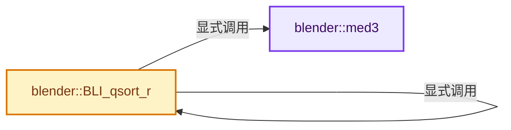
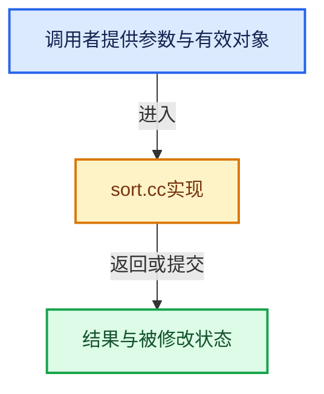

# 实现依赖专题：source/blender/blenlib/intern/sort.cc

[方向导航](README.md) · [符号索引](../%E7%AC%A6%E5%8F%B7%E4%BE%9D%E8%B5%96%E4%B8%8E%E5%AE%9E%E7%8E%B0%E7%B4%A2%E5%BC%95.md)

本专题从正文实际调用进入，集中保存共享实现。函数有稳定锚点，可从调用处直接跳到对应完整函数；递归与互相调用通过回链组织。

## 本文件的实现关系






<a id="m-d8ff5d6169c0"></a>

## 宏 `min`

<!-- annotated:e79f8d4ef9278b -->

```cpp
#define min(a, b)   (a) < (b) ? (a) : (b)
#define swapcode(TYPE, parmi, parmj, n)     \
```

<details>
<summary>核对原始源码：source/blender/blenlib/intern/sort.cc · L38—L39</summary>

<!-- original:e79f8d4ef9278b:source/blender/blenlib/intern/sort.cc:38:39 -->

```cpp
#define min(a, b)   (a) < (b) ? (a) : (b)
#define swapcode(TYPE, parmi, parmj, n)     \
```

</details>

宏在预处理阶段展开，参数替换、重复求值和条件编译应直接从该定义检查。与普通函数不同，宏不会自动提供参数类型检查；构建配置选择哪个定义需结合外围条件。

<a id="m-98edf14bc8c8"></a>

## 宏 `SWAPINIT`

<!-- annotated:f7e686986df625 -->

```cpp
#define SWAPINIT(a, es) swaptype = ((char *)a - (char *)0) % sizeof(long) || \
  es % sizeof(long) ? 2 : es == sizeof(long)? 0 : 1;

```

<details>
<summary>核对原始源码：source/blender/blenlib/intern/sort.cc · L50—L52</summary>

<!-- original:f7e686986df625:source/blender/blenlib/intern/sort.cc:50:52 -->

```cpp
#define SWAPINIT(a, es) swaptype = ((char *)a - (char *)0) % sizeof(long) || \
  es % sizeof(long) ? 2 : es == sizeof(long)? 0 : 1;

```

</details>

宏在预处理阶段展开，参数替换、重复求值和条件编译应直接从该定义检查。与普通函数不同，宏不会自动提供参数类型检查；构建配置选择哪个定义需结合外围条件。

<a id="m-43784d4732ac"></a>

## 宏 `swap`

<!-- annotated:001d2904322861 -->

```cpp
#define swap(a, b)                  \
  if (swaptype == 0) {            \
    long t = *(long *)(a);      \
    *(long *)(a) = *(long *)(b);\
    *(long *)(b) = t;           \
  } else                          \
    swapfunc(a, b, es, swaptype)

```

<details>
<summary>核对原始源码：source/blender/blenlib/intern/sort.cc · L61—L68</summary>

<!-- original:001d2904322861:source/blender/blenlib/intern/sort.cc:61:68 -->

```cpp
#define swap(a, b)                  \
  if (swaptype == 0) {            \
    long t = *(long *)(a);      \
    *(long *)(a) = *(long *)(b);\
    *(long *)(b) = t;           \
  } else                          \
    swapfunc(a, b, es, swaptype)

```

</details>

宏在预处理阶段展开，参数替换、重复求值和条件编译应直接从该定义检查。与普通函数不同，宏不会自动提供参数类型检查；构建配置选择哪个定义需结合外围条件。

<a id="m-015ecb3b0137"></a>

## 宏 `vecswap`

<!-- annotated:22ddcd49220f21 -->

```cpp
#define vecswap(a, b, n)    if ((n) > 0) swapfunc(a, b, n, swaptype)
#define CMP(t, x, y) (cmp((x), (y), (t)))
```

<details>
<summary>核对原始源码：source/blender/blenlib/intern/sort.cc · L69—L70</summary>

<!-- original:22ddcd49220f21:source/blender/blenlib/intern/sort.cc:69:70 -->

```cpp
#define vecswap(a, b, n)    if ((n) > 0) swapfunc(a, b, n, swaptype)
#define CMP(t, x, y) (cmp((x), (y), (t)))
```

</details>

宏在预处理阶段展开，参数替换、重复求值和条件编译应直接从该定义检查。与普通函数不同，宏不会自动提供参数类型检查；构建配置选择哪个定义需结合外围条件。

<a id="m-6b437f116e0c"></a>

## 宏 `CMP`

<!-- annotated:afddcb94c1320d -->

```cpp
#define CMP(t, x, y) (cmp((x), (y), (t)))

```

<details>
<summary>核对原始源码：source/blender/blenlib/intern/sort.cc · L70—L71</summary>

<!-- original:afddcb94c1320d:source/blender/blenlib/intern/sort.cc:70:71 -->

```cpp
#define CMP(t, x, y) (cmp((x), (y), (t)))

```

</details>

宏在预处理阶段展开，参数替换、重复求值和条件编译应直接从该定义检查。与普通函数不同，宏不会自动提供参数类型检查；构建配置选择哪个定义需结合外围条件。

## 完整成员与函数实现

<a id="f-74c1231202d6c563"></a>

### `blender::med3`

实现位置：[source/blender/blenlib/intern/sort.cc](../../../../../source/blender/blenlib/intern/sort.cc) · L72—L77。

接口参数：

- `char *a`
- `char *b`
- `char *c`
- `BLI_sort_cmp_t cmp`
- `void *thunk`

**教学注释版**

<!-- annotated:4f2c36f73a2e18 -->

```cpp
inline char *med3(char *a, char *b, char *c, BLI_sort_cmp_t cmp, void *thunk)
{
  return  CMP(thunk, a, b) < 0 ?
         (CMP(thunk, b, c) < 0 ? b : (CMP(thunk, a, c) < 0 ? c : a )) :
         (CMP(thunk, b, c) > 0 ? b : (CMP(thunk, a, c) < 0 ? a : c ));
}
```

<details>
<summary>核对原始源码：source/blender/blenlib/intern/sort.cc · L72—L77</summary>

<!-- original:4f2c36f73a2e18:source/blender/blenlib/intern/sort.cc:72:77 -->

```cpp
inline char *med3(char *a, char *b, char *c, BLI_sort_cmp_t cmp, void *thunk)
{
  return  CMP(thunk, a, b) < 0 ?
         (CMP(thunk, b, c) < 0 ? b : (CMP(thunk, a, c) < 0 ? c : a )) :
         (CMP(thunk, b, c) > 0 ? b : (CMP(thunk, a, c) < 0 ? a : c ));
}
```

</details>

**结果出口**

- `return  CMP(thunk, a, b) < 0 ?`

**继续追踪实现**

- `CMP` → [CMP · L70](%E4%BE%9D%E8%B5%96-sort-db51c6.md#m-6b437f116e0c)。宏定义由构建条件选择。

<a id="f-d3c955dfd6a91345"></a>

### `blender::BLI_qsort_r`

实现位置：[source/blender/blenlib/intern/sort.cc](../../../../../source/blender/blenlib/intern/sort.cc) · L79—L165。

接口参数：

- `void *a`
- `size_t n`
- `size_t es`
- `BLI_sort_cmp_t cmp`
- `void *thunk`

**教学注释版**

<!-- annotated:b7d05aedf7088c -->

```cpp
void BLI_qsort_r(void *a, size_t n, size_t es, BLI_sort_cmp_t cmp, void *thunk)
{
  char *pa, *pb, *pc, *pd, *pl, *pm, *pn;
  int d, r, swaptype, swap_cnt;

loop:
  SWAPINIT(a, es);
  swap_cnt = 0;
  if (n < 7) {
    for (pm = static_cast<char *>(a) + es; pm < static_cast<char *>(a) + n * es; pm += es) {
      for (pl = pm;
           pl > static_cast<char *>(a) && CMP(thunk, pl - es, pl) > 0;
           pl -= es)
      {
        swap(pl, pl - es);
      }
    }
    return;
  }
  pm = static_cast<char *>(a) + (n / 2) * es;
  if (n > 7) {
    pl = static_cast<char *>(a);
    pn = static_cast<char *>(a) + (n - 1) * es;
    if (n > 40) {
      d = (n / 8) * es;
      pl = med3(pl, pl + d, pl + 2 * d, cmp, thunk);
      pm = med3(pm - d, pm, pm + d, cmp, thunk);
      pn = med3(pn - 2 * d, pn - d, pn, cmp, thunk);
    }
    pm = med3(pl, pm, pn, cmp, thunk);
  }
  swap((char *)a, pm);
  pa = pb = static_cast<char *>(a) + es;

  pc = pd = static_cast<char *>(a) + (n - 1) * es;
  for (;;) {
    while (pb <= pc && (r = CMP(thunk, pb, a)) <= 0) {
      if (r == 0) {
        swap_cnt = 1;
        swap(pa, pb);
        pa += es;
      }
      pb += es;
    }
    while (pb <= pc && (r = CMP(thunk, pc, a)) >= 0) {
      if (r == 0) {
        swap_cnt = 1;
        swap(pc, pd);
        pd -= es;
      }
      pc -= es;
    }
    if (pb > pc) {
      break;
    }
    swap(pb, pc);
    swap_cnt = 1;
    pb += es;
    pc -= es;
  }
  if (swap_cnt == 0) {  /* Switch to insertion sort */
    for (pm = static_cast<char *>(a) + es; pm < static_cast<char *>(a) + n * es; pm += es) {
      for (pl = pm;
           pl > static_cast<char *>(a) && CMP(thunk, pl - es, pl) > 0;
           pl -= es)
      {
        swap(pl, pl - es);
      }
    }
    return;
  }

  pn = static_cast<char *>(a) + n * es;
  r = min(pa - (char *)a, pb - pa);
  vecswap((char *)a, pb - r, r);
  r = min(pd - pc, pn - pd - es);
  vecswap(pb, pn - r, r);
  if ((r = pb - pa) > es) {
    BLI_qsort_r(a, r / es, es, cmp, thunk);
  }
  if ((r = pd - pc) > es) {
    /* Iterate rather than recurse to save stack space */
    a = pn - r;
    n = r / es;
    goto loop;
  }
}
```

<details>
<summary>核对原始源码：source/blender/blenlib/intern/sort.cc · L79—L165</summary>

<!-- original:b7d05aedf7088c:source/blender/blenlib/intern/sort.cc:79:165 -->

```cpp
void BLI_qsort_r(void *a, size_t n, size_t es, BLI_sort_cmp_t cmp, void *thunk)
{
  char *pa, *pb, *pc, *pd, *pl, *pm, *pn;
  int d, r, swaptype, swap_cnt;

loop:
  SWAPINIT(a, es);
  swap_cnt = 0;
  if (n < 7) {
    for (pm = static_cast<char *>(a) + es; pm < static_cast<char *>(a) + n * es; pm += es) {
      for (pl = pm;
           pl > static_cast<char *>(a) && CMP(thunk, pl - es, pl) > 0;
           pl -= es)
      {
        swap(pl, pl - es);
      }
    }
    return;
  }
  pm = static_cast<char *>(a) + (n / 2) * es;
  if (n > 7) {
    pl = static_cast<char *>(a);
    pn = static_cast<char *>(a) + (n - 1) * es;
    if (n > 40) {
      d = (n / 8) * es;
      pl = med3(pl, pl + d, pl + 2 * d, cmp, thunk);
      pm = med3(pm - d, pm, pm + d, cmp, thunk);
      pn = med3(pn - 2 * d, pn - d, pn, cmp, thunk);
    }
    pm = med3(pl, pm, pn, cmp, thunk);
  }
  swap((char *)a, pm);
  pa = pb = static_cast<char *>(a) + es;

  pc = pd = static_cast<char *>(a) + (n - 1) * es;
  for (;;) {
    while (pb <= pc && (r = CMP(thunk, pb, a)) <= 0) {
      if (r == 0) {
        swap_cnt = 1;
        swap(pa, pb);
        pa += es;
      }
      pb += es;
    }
    while (pb <= pc && (r = CMP(thunk, pc, a)) >= 0) {
      if (r == 0) {
        swap_cnt = 1;
        swap(pc, pd);
        pd -= es;
      }
      pc -= es;
    }
    if (pb > pc) {
      break;
    }
    swap(pb, pc);
    swap_cnt = 1;
    pb += es;
    pc -= es;
  }
  if (swap_cnt == 0) {  /* Switch to insertion sort */
    for (pm = static_cast<char *>(a) + es; pm < static_cast<char *>(a) + n * es; pm += es) {
      for (pl = pm;
           pl > static_cast<char *>(a) && CMP(thunk, pl - es, pl) > 0;
           pl -= es)
      {
        swap(pl, pl - es);
      }
    }
    return;
  }

  pn = static_cast<char *>(a) + n * es;
  r = min(pa - (char *)a, pb - pa);
  vecswap((char *)a, pb - r, r);
  r = min(pd - pc, pn - pd - es);
  vecswap(pb, pn - r, r);
  if ((r = pb - pa) > es) {
    BLI_qsort_r(a, r / es, es, cmp, thunk);
  }
  if ((r = pd - pc) > es) {
    /* Iterate rather than recurse to save stack space */
    a = pn - r;
    n = r / es;
    goto loop;
  }
}
```

</details>

**沿实际写入检查状态**

- `swap_cnt = 0;`
- `pl -= es)`
- `pm = static_cast<char *>(a) + (n / 2) * es;`
- `pl = static_cast<char *>(a);`
- `pn = static_cast<char *>(a) + (n - 1) * es;`
- `d = (n / 8) * es;`
- `pl = med3(pl, pl + d, pl + 2 * d, cmp, thunk);`
- `pm = med3(pm - d, pm, pm + d, cmp, thunk);`
- `pn = med3(pn - 2 * d, pn - d, pn, cmp, thunk);`
- `pm = med3(pl, pm, pn, cmp, thunk);`
- `pa = pb = static_cast<char *>(a) + es;`
- `pc = pd = static_cast<char *>(a) + (n - 1) * es;`
- `swap_cnt = 1;`
- `pa += es;`
- `pb += es;`
- `pd -= es;`
- `pc -= es;`
- `pn = static_cast<char *>(a) + n * es;`
- `r = min(pa - (char *)a, pb - pa);`
- `r = min(pd - pc, pn - pd - es);`
- `a = pn - r;`
- `n = r / es;`

**继续追踪实现**

- `SWAPINIT` → [SWAPINIT · L50](%E4%BE%9D%E8%B5%96-sort-db51c6.md#m-98edf14bc8c8)。宏定义由构建条件选择。
- `CMP` → [CMP · L70](%E4%BE%9D%E8%B5%96-sort-db51c6.md#m-6b437f116e0c)。宏定义由构建条件选择。
- `swap` → [swap · L61](%E4%BE%9D%E8%B5%96-sort-db51c6.md#m-43784d4732ac)。宏定义由构建条件选择。
- `med3` → [blender::med3 · L72](%E4%BE%9D%E8%B5%96-sort-db51c6.md#f-74c1231202d6c563)。
- `min` → [min · L38](%E4%BE%9D%E8%B5%96-sort-db51c6.md#m-d8ff5d6169c0)。宏定义由构建条件选择。
- `vecswap` → [vecswap · L69](%E4%BE%9D%E8%B5%96-sort-db51c6.md#m-015ecb3b0137)。宏定义由构建条件选择。
- `BLI_qsort_r` → [blender::BLI_qsort_r · L79](%E4%BE%9D%E8%B5%96-sort-db51c6.md#f-d3c955dfd6a91345)。
