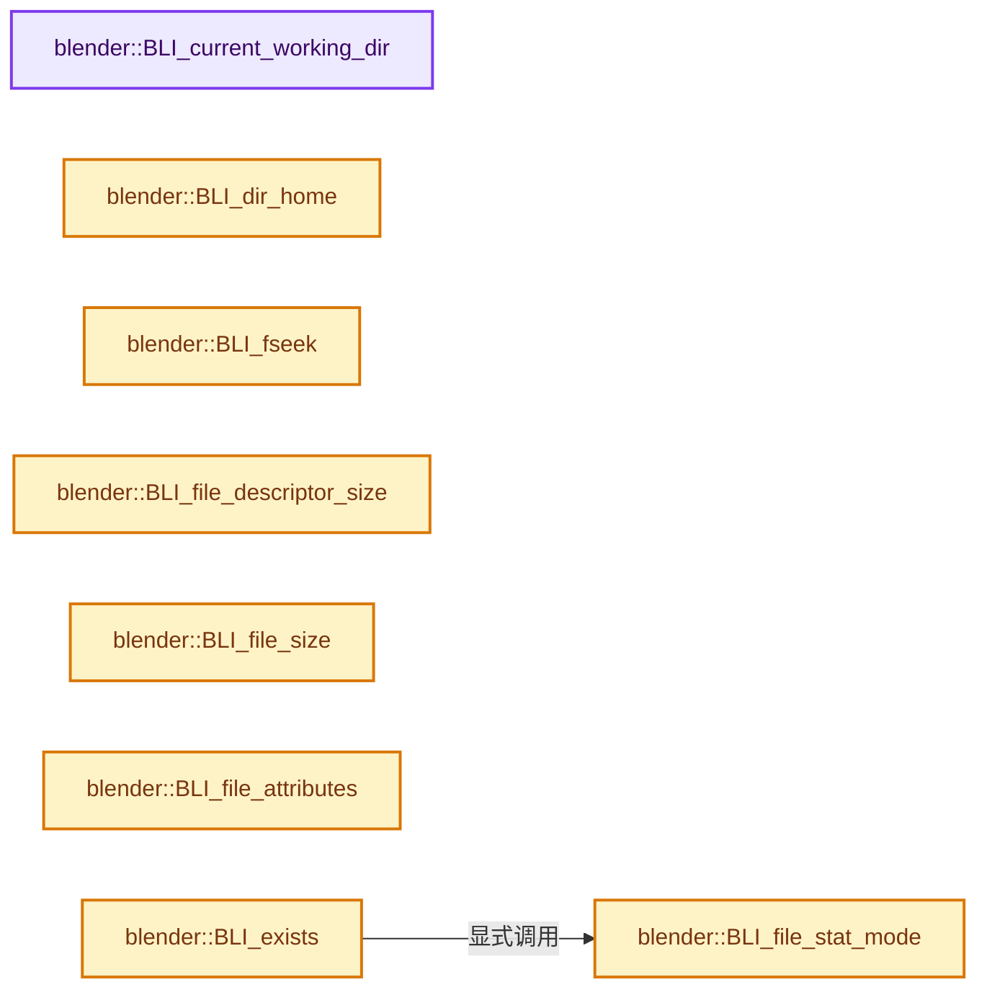
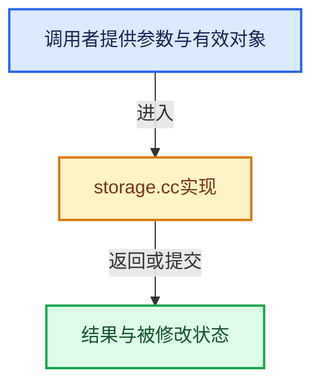

# 实现依赖专题：source/blender/blenlib/intern/storage.cc

[方向导航](README.md) · [符号索引](../%E7%AC%A6%E5%8F%B7%E4%BE%9D%E8%B5%96%E4%B8%8E%E5%AE%9E%E7%8E%B0%E7%B4%A2%E5%BC%95.md)

本专题从正文实际调用进入，集中保存共享实现。函数有稳定锚点，可从调用处直接跳到对应完整函数；递归与互相调用通过回链组织。

## 本文件的实现关系






## 完整成员与函数实现

<a id="f-eedb786f547bc889"></a>

### `blender::BLI_current_working_dir`

实现位置：[source/blender/blenlib/intern/storage.cc](../../../../../source/blender/blenlib/intern/storage.cc) · L83—L96。

接口参数：

- `char *dir`
- `const size_t maxncpy`

**教学注释版**

<!-- annotated:751b8d8cc8113d -->

```cpp
char *BLI_current_working_dir(char *dir, const size_t maxncpy)
{
#  if defined(WIN32)
  wchar_t path[MAX_PATH];
  if (_wgetcwd(path, MAX_PATH)) {
    if (BLI_strncpy_wchar_as_utf8(dir, path, maxncpy) != maxncpy) {
      return dir;
    }
  }
  return nullptr;
#  else
  return getcwd(dir, maxncpy);
#  endif
}
```

<details>
<summary>核对原始源码：source/blender/blenlib/intern/storage.cc · L83—L96</summary>

<!-- original:751b8d8cc8113d:source/blender/blenlib/intern/storage.cc:83:96 -->

```cpp
char *BLI_current_working_dir(char *dir, const size_t maxncpy)
{
#  if defined(WIN32)
  wchar_t path[MAX_PATH];
  if (_wgetcwd(path, MAX_PATH)) {
    if (BLI_strncpy_wchar_as_utf8(dir, path, maxncpy) != maxncpy) {
      return dir;
    }
  }
  return nullptr;
#  else
  return getcwd(dir, maxncpy);
#  endif
}
```

</details>

**结果出口**

- `return dir;`
- `return nullptr;`
- `return getcwd(dir, maxncpy);`

**继续追踪实现**

- `_wgetcwd` → [调用协议](../%E6%A8%A1%E6%9D%BF%E5%AE%8F%E4%B8%8E%E5%8A%A8%E6%80%81%E5%88%86%E6%B4%BE%E5%8D%8F%E8%AE%AE.md)：函数指针、局部可调用对象或未展开的宏；必须结合调用者环境。调用位置L87。
- `BLI_strncpy_wchar_as_utf8` → [blender::BLI_strncpy_wchar_as_utf8 · L441](%E4%BE%9D%E8%B5%96-string_utf8-3c62ca.md#f-d7cec6244a141b70)。
- `getcwd` → [调用协议](../%E6%A8%A1%E6%9D%BF%E5%AE%8F%E4%B8%8E%E5%8A%A8%E6%80%81%E5%88%86%E6%B4%BE%E5%8D%8F%E8%AE%AE.md)：函数指针、局部可调用对象或未展开的宏；必须结合调用者环境。调用位置L94。

<a id="f-ecbf67fd9338348e"></a>

### `blender::BLI_dir_home`

实现位置：[source/blender/blenlib/intern/storage.cc](../../../../../source/blender/blenlib/intern/storage.cc) · L99—L121。

**教学注释版**

<!-- annotated:812b41caa64333 -->

```cpp
const char *BLI_dir_home()
{
  const char *home_dir;

#ifdef WIN32
  home_dir = BLI_getenv("userprofile");
#else
  /* Return the users home directory with a fallback when the environment variable isn't set.
   * Failure to access `$HOME` is rare but possible, see: #2931.
   *
   * Any errors accessing home is likely caused by a broken/unsupported configuration,
   * nevertheless, failing to null check would crash which makes the error difficult
   * for users troubleshoot. */
  home_dir = BLI_getenv("HOME");
  if (home_dir == nullptr) {
    if (const passwd *pwuser = getpwuid(getuid())) {
      home_dir = pwuser->pw_dir;
    }
  }
#endif

  return home_dir;
}
```

<details>
<summary>核对原始源码：source/blender/blenlib/intern/storage.cc · L99—L121</summary>

<!-- original:812b41caa64333:source/blender/blenlib/intern/storage.cc:99:121 -->

```cpp
const char *BLI_dir_home()
{
  const char *home_dir;

#ifdef WIN32
  home_dir = BLI_getenv("userprofile");
#else
  /* Return the users home directory with a fallback when the environment variable isn't set.
   * Failure to access `$HOME` is rare but possible, see: #2931.
   *
   * Any errors accessing home is likely caused by a broken/unsupported configuration,
   * nevertheless, failing to null check would crash which makes the error difficult
   * for users troubleshoot. */
  home_dir = BLI_getenv("HOME");
  if (home_dir == nullptr) {
    if (const passwd *pwuser = getpwuid(getuid())) {
      home_dir = pwuser->pw_dir;
    }
  }
#endif

  return home_dir;
}
```

</details>

**沿实际写入检查状态**

- `home_dir = BLI_getenv("userprofile");`
- `home_dir = BLI_getenv("HOME");`
- `home_dir = pwuser->pw_dir;`

**结果出口**

- `return home_dir;`

**继续追踪实现**

- `BLI_getenv` → [BLI_getenv · L1435](%E4%BE%9D%E8%B5%96-path_utils-b4d26a.md#f-c6a0b8b917e9ef4c)。
- `getpwuid` → [调用协议](../%E6%A8%A1%E6%9D%BF%E5%AE%8F%E4%B8%8E%E5%8A%A8%E6%80%81%E5%88%86%E6%B4%BE%E5%8D%8F%E8%AE%AE.md)：函数指针、局部可调用对象或未展开的宏；必须结合调用者环境。调用位置L114。
- `getuid` → [调用协议](../%E6%A8%A1%E6%9D%BF%E5%AE%8F%E4%B8%8E%E5%8A%A8%E6%80%81%E5%88%86%E6%B4%BE%E5%8D%8F%E8%AE%AE.md)：函数指针、局部可调用对象或未展开的宏；必须结合调用者环境。调用位置L114。

<a id="f-66c5f3581da90506"></a>

### `blender::BLI_fseek`

实现位置：[source/blender/blenlib/intern/storage.cc](../../../../../source/blender/blenlib/intern/storage.cc) · L201—L208。

接口参数：

- `FILE *stream`
- `int64_t offset`
- `int whence`

**教学注释版**

<!-- annotated:80158b849f9b04 -->

```cpp
int BLI_fseek(FILE *stream, int64_t offset, int whence)
{
#ifdef WIN32
  return _fseeki64(stream, offset, whence);
#else
  return fseek(stream, offset, whence);
#endif
}
```

<details>
<summary>核对原始源码：source/blender/blenlib/intern/storage.cc · L201—L208</summary>

<!-- original:80158b849f9b04:source/blender/blenlib/intern/storage.cc:201:208 -->

```cpp
int BLI_fseek(FILE *stream, int64_t offset, int whence)
{
#ifdef WIN32
  return _fseeki64(stream, offset, whence);
#else
  return fseek(stream, offset, whence);
#endif
}
```

</details>

**结果出口**

- `return _fseeki64(stream, offset, whence);`
- `return fseek(stream, offset, whence);`

**继续追踪实现**

- `_fseeki64` → [调用协议](../%E6%A8%A1%E6%9D%BF%E5%AE%8F%E4%B8%8E%E5%8A%A8%E6%80%81%E5%88%86%E6%B4%BE%E5%8D%8F%E8%AE%AE.md)：函数指针、局部可调用对象或未展开的宏；必须结合调用者环境。调用位置L204。
- `fseek` → [调用协议](../%E6%A8%A1%E6%9D%BF%E5%AE%8F%E4%B8%8E%E5%8A%A8%E6%80%81%E5%88%86%E6%B4%BE%E5%8D%8F%E8%AE%AE.md)：函数指针、局部可调用对象或未展开的宏；必须结合调用者环境。调用位置L206。

<a id="f-d5e4fd24e28790db"></a>

### `blender::BLI_file_descriptor_size`

实现位置：[source/blender/blenlib/intern/storage.cc](../../../../../source/blender/blenlib/intern/storage.cc) · L219—L226。

接口参数：

- `int file`

**教学注释版**

<!-- annotated:9423512dcf90df -->

```cpp
size_t BLI_file_descriptor_size(int file)
{
  BLI_stat_t st;
  if ((file < 0) || (BLI_fstat(file, &st) == -1)) {
    return -1;
  }
  return st.st_size;
}
```

<details>
<summary>核对原始源码：source/blender/blenlib/intern/storage.cc · L219—L226</summary>

<!-- original:9423512dcf90df:source/blender/blenlib/intern/storage.cc:219:226 -->

```cpp
size_t BLI_file_descriptor_size(int file)
{
  BLI_stat_t st;
  if ((file < 0) || (BLI_fstat(file, &st) == -1)) {
    return -1;
  }
  return st.st_size;
}
```

</details>

**结果出口**

- `return -1;`
- `return st.st_size;`

**继续追踪实现**

- `BLI_fstat` → [blender::BLI_fstat · L417](%E4%BE%9D%E8%B5%96-storage-bda15e.md#f-50c9125dbf327a22)；[blender::BLI_fstat · L446](%E4%BE%9D%E8%B5%96-storage-bda15e.md#f-d25d1218f6b9b27e)。同名重载需按实参类型选择。

<a id="f-146df239545e9b10"></a>

### `blender::BLI_file_size`

实现位置：[source/blender/blenlib/intern/storage.cc](../../../../../source/blender/blenlib/intern/storage.cc) · L228—L235。

接口参数：

- `const char *path`

**教学注释版**

<!-- annotated:cc60ece2898ebb -->

```cpp
size_t BLI_file_size(const char *path)
{
  BLI_stat_t stats;
  if (BLI_stat(path, &stats) == -1) {
    return -1;
  }
  return stats.st_size;
}
```

<details>
<summary>核对原始源码：source/blender/blenlib/intern/storage.cc · L228—L235</summary>

<!-- original:cc60ece2898ebb:source/blender/blenlib/intern/storage.cc:228:235 -->

```cpp
size_t BLI_file_size(const char *path)
{
  BLI_stat_t stats;
  if (BLI_stat(path, &stats) == -1) {
    return -1;
  }
  return stats.st_size;
}
```

</details>

**结果出口**

- `return -1;`
- `return stats.st_size;`

**继续追踪实现**

- `BLI_stat` → [blender::BLI_stat · L426](%E4%BE%9D%E8%B5%96-storage-bda15e.md#f-5b88a35ccd1bc680)；[blender::BLI_stat · L451](%E4%BE%9D%E8%B5%96-storage-bda15e.md#f-50297595484d5bcc)。同名重载需按实参类型选择。

<a id="f-da8c29da07c40711"></a>

### `blender::BLI_file_attributes`

实现位置：[source/blender/blenlib/intern/storage.cc](../../../../../source/blender/blenlib/intern/storage.cc) · L239—L304。

接口参数：

- `const char *path`

**教学注释版**

<!-- annotated:1b3f58fcd672ad -->

```cpp
eFileAttributes BLI_file_attributes(const char *path)
{
  int ret = 0;

#  ifdef WIN32

  if (BLI_path_extension_check(path, ".lnk")) {
    return FILE_ATTR_ALIAS;
  }

  WCHAR wline[FILE_MAXDIR];
  if (conv_utf_8_to_16(path, wline, ARRAY_SIZE(wline)) != 0) {
    return eFileAttributes(ret);
  }

  DWORD attr = GetFileAttributesW(wline);
  if (attr == INVALID_FILE_ATTRIBUTES) {
    BLI_assert_msg(GetLastError() != ERROR_FILE_NOT_FOUND,
                   "BLI_file_attributes should only be called on existing files.");
    return eFileAttributes(ret);
  }

  if (attr & FILE_ATTRIBUTE_READONLY) {
    ret |= FILE_ATTR_READONLY;
  }
  if (attr & FILE_ATTRIBUTE_HIDDEN) {
    ret |= FILE_ATTR_HIDDEN;
  }
  if (attr & FILE_ATTRIBUTE_SYSTEM) {
    ret |= FILE_ATTR_SYSTEM;
  }
  if (attr & FILE_ATTRIBUTE_ARCHIVE) {
    ret |= FILE_ATTR_ARCHIVE;
  }
  if (attr & FILE_ATTRIBUTE_COMPRESSED) {
    ret |= FILE_ATTR_COMPRESSED;
  }
  if (attr & FILE_ATTRIBUTE_ENCRYPTED) {
    ret |= FILE_ATTR_ENCRYPTED;
  }
  if (attr & FILE_ATTRIBUTE_TEMPORARY) {
    ret |= FILE_ATTR_TEMPORARY;
  }
  if (attr & FILE_ATTRIBUTE_SPARSE_FILE) {
    ret |= FILE_ATTR_SPARSE_FILE;
  }
  if (attr & FILE_ATTRIBUTE_OFFLINE || attr & FILE_ATTRIBUTE_RECALL_ON_OPEN ||
      attr & FILE_ATTRIBUTE_RECALL_ON_DATA_ACCESS)
  {
    ret |= FILE_ATTR_OFFLINE;
  }
  if (attr & FILE_ATTRIBUTE_REPARSE_POINT) {
    ret |= FILE_ATTR_REPARSE_POINT;
  }

#  else

  UNUSED_VARS(path);

  /* TODO:
   * If Immutable set FILE_ATTR_READONLY
   * If Archived set FILE_ATTR_ARCHIVE
   */
#  endif
  return eFileAttributes(ret);
}
```

<details>
<summary>核对原始源码：source/blender/blenlib/intern/storage.cc · L239—L304</summary>

<!-- original:1b3f58fcd672ad:source/blender/blenlib/intern/storage.cc:239:304 -->

```cpp
eFileAttributes BLI_file_attributes(const char *path)
{
  int ret = 0;

#  ifdef WIN32

  if (BLI_path_extension_check(path, ".lnk")) {
    return FILE_ATTR_ALIAS;
  }

  WCHAR wline[FILE_MAXDIR];
  if (conv_utf_8_to_16(path, wline, ARRAY_SIZE(wline)) != 0) {
    return eFileAttributes(ret);
  }

  DWORD attr = GetFileAttributesW(wline);
  if (attr == INVALID_FILE_ATTRIBUTES) {
    BLI_assert_msg(GetLastError() != ERROR_FILE_NOT_FOUND,
                   "BLI_file_attributes should only be called on existing files.");
    return eFileAttributes(ret);
  }

  if (attr & FILE_ATTRIBUTE_READONLY) {
    ret |= FILE_ATTR_READONLY;
  }
  if (attr & FILE_ATTRIBUTE_HIDDEN) {
    ret |= FILE_ATTR_HIDDEN;
  }
  if (attr & FILE_ATTRIBUTE_SYSTEM) {
    ret |= FILE_ATTR_SYSTEM;
  }
  if (attr & FILE_ATTRIBUTE_ARCHIVE) {
    ret |= FILE_ATTR_ARCHIVE;
  }
  if (attr & FILE_ATTRIBUTE_COMPRESSED) {
    ret |= FILE_ATTR_COMPRESSED;
  }
  if (attr & FILE_ATTRIBUTE_ENCRYPTED) {
    ret |= FILE_ATTR_ENCRYPTED;
  }
  if (attr & FILE_ATTRIBUTE_TEMPORARY) {
    ret |= FILE_ATTR_TEMPORARY;
  }
  if (attr & FILE_ATTRIBUTE_SPARSE_FILE) {
    ret |= FILE_ATTR_SPARSE_FILE;
  }
  if (attr & FILE_ATTRIBUTE_OFFLINE || attr & FILE_ATTRIBUTE_RECALL_ON_OPEN ||
      attr & FILE_ATTRIBUTE_RECALL_ON_DATA_ACCESS)
  {
    ret |= FILE_ATTR_OFFLINE;
  }
  if (attr & FILE_ATTRIBUTE_REPARSE_POINT) {
    ret |= FILE_ATTR_REPARSE_POINT;
  }

#  else

  UNUSED_VARS(path);

  /* TODO:
   * If Immutable set FILE_ATTR_READONLY
   * If Archived set FILE_ATTR_ARCHIVE
   */
#  endif
  return eFileAttributes(ret);
}
```

</details>

**沿实际写入检查状态**

- `ret |= FILE_ATTR_READONLY;`
- `ret |= FILE_ATTR_HIDDEN;`
- `ret |= FILE_ATTR_SYSTEM;`
- `ret |= FILE_ATTR_ARCHIVE;`
- `ret |= FILE_ATTR_COMPRESSED;`
- `ret |= FILE_ATTR_ENCRYPTED;`
- `ret |= FILE_ATTR_TEMPORARY;`
- `ret |= FILE_ATTR_SPARSE_FILE;`
- `ret |= FILE_ATTR_OFFLINE;`
- `ret |= FILE_ATTR_REPARSE_POINT;`

**结果出口**

- `return FILE_ATTR_ALIAS;`
- `return eFileAttributes(ret);`

**继续追踪实现**

- `BLI_path_extension_check` → [BLI_path_extension_check · L1478](%E4%BE%9D%E8%B5%96-path_utils-b4d26a.md#f-592869c7e73e0de7)。
- `conv_utf_8_to_16` → [conv_utf_8_to_16 · L182](../05-%E5%87%A0%E4%BD%95%E5%AD%98%E5%82%A8%E4%B8%8E%E6%8B%93%E6%89%91%E6%98%A0%E5%B0%84/%E4%BE%9D%E8%B5%96-utfconv-434070.md#f-b75f8d137a0839e4)。
- `ARRAY_SIZE` → [blender::ARRAY_SIZE · L608](%E4%BE%9D%E8%B5%96-BLI_utildefines-293a0a.md#f-eaec3a7e47b85c7c)。
- `eFileAttributes` → [blender::eFileAttributes](%E4%BE%9D%E8%B5%96-BLI_fileops-fa4e3e.md#t-96dba0398930)。
- `GetFileAttributesW` → [调用协议](../%E6%A8%A1%E6%9D%BF%E5%AE%8F%E4%B8%8E%E5%8A%A8%E6%80%81%E5%88%86%E6%B4%BE%E5%8D%8F%E8%AE%AE.md)：函数指针、局部可调用对象或未展开的宏；必须结合调用者环境。调用位置L254。
- `BLI_assert_msg` → [BLI_assert_msg · L55](%E4%BE%9D%E8%B5%96-BLI_assert-cc98e8.md#m-695eed20dceb)；[BLI_assert_msg · L64](%E4%BE%9D%E8%B5%96-BLI_assert-cc98e8.md#m-7de5563de4db)。宏定义由构建条件选择。
- `GetLastError` → [调用协议](../%E6%A8%A1%E6%9D%BF%E5%AE%8F%E4%B8%8E%E5%8A%A8%E6%80%81%E5%88%86%E6%B4%BE%E5%8D%8F%E8%AE%AE.md)：函数指针、局部可调用对象或未展开的宏；必须结合调用者环境。调用位置L256。
- `UNUSED_VARS` → [UNUSED_VARS · L522](%E4%BE%9D%E8%B5%96-BLI_utildefines-293a0a.md#m-013582537634)；[UNUSED_VARS · L41](../05-%E5%87%A0%E4%BD%95%E5%AD%98%E5%82%A8%E4%B8%8E%E6%8B%93%E6%89%91%E6%98%A0%E5%B0%84/%E4%BE%9D%E8%B5%96-GPU_shader_shared_utils-0adda3.md#m-05d9d7a33da0)；[UNUSED_VARS · L62](../05-%E5%87%A0%E4%BD%95%E5%AD%98%E5%82%A8%E4%B8%8E%E6%8B%93%E6%89%91%E6%98%A0%E5%B0%84/%E4%BE%9D%E8%B5%96-GPU_shader_shared_utils-0adda3.md#m-e12c683a4aca)。宏定义由构建条件选择。

<a id="f-15c3e43aa155e679"></a>

### `blender::BLI_file_stat_mode`

实现位置：[source/blender/blenlib/intern/storage.cc](../../../../../source/blender/blenlib/intern/storage.cc) · L362—L402。

接口参数：

- `const char *path`

**教学注释版**

<!-- annotated:b7623885d0ada1 -->

```cpp
int BLI_file_stat_mode(const char *path)
{
#if defined(WIN32)
  BLI_stat_t st;
  wchar_t *tmp_16 = alloc_utf16_from_8(path, 1);
  int len, res;

  len = wcslen(tmp_16);
  /* in Windows #stat doesn't recognize dir ending on a slash
   * so we remove it here */
  if ((len > 3) && ELEM(tmp_16[len - 1], L'\\', L'/')) {
    tmp_16[len - 1] = '\0';
  }
  /* two special cases where the trailing slash is needed:
   * 1. after the share part of a UNC path
   * 2. after the C:\ when the path is the volume only
   */
  if ((len >= 3) && (tmp_16[0] == L'\\') && (tmp_16[1] == L'\\')) {
    BLI_path_normalize_unc_16(tmp_16);
  }

  if ((tmp_16[1] == L':') && (tmp_16[2] == L'\0')) {
    tmp_16[2] = L'\\';
    tmp_16[3] = L'\0';
  }

  res = BLI_wstat(tmp_16, &st);

  // [讲解] free：归还相匹配的C分配存储，不自动执行C++析构；不可用于Windows的_aligned_malloc结果。
  free(tmp_16);
  if (res == -1) {
    return 0;
  }
#else
  struct stat st;
  BLI_assert(!BLI_path_is_rel(path));
  if (stat(path, &st)) {
    return 0;
  }
#endif
  return (st.st_mode);
}
```

<details>
<summary>核对原始源码：source/blender/blenlib/intern/storage.cc · L362—L402</summary>

<!-- original:b7623885d0ada1:source/blender/blenlib/intern/storage.cc:362:402 -->

```cpp
int BLI_file_stat_mode(const char *path)
{
#if defined(WIN32)
  BLI_stat_t st;
  wchar_t *tmp_16 = alloc_utf16_from_8(path, 1);
  int len, res;

  len = wcslen(tmp_16);
  /* in Windows #stat doesn't recognize dir ending on a slash
   * so we remove it here */
  if ((len > 3) && ELEM(tmp_16[len - 1], L'\\', L'/')) {
    tmp_16[len - 1] = '\0';
  }
  /* two special cases where the trailing slash is needed:
   * 1. after the share part of a UNC path
   * 2. after the C:\ when the path is the volume only
   */
  if ((len >= 3) && (tmp_16[0] == L'\\') && (tmp_16[1] == L'\\')) {
    BLI_path_normalize_unc_16(tmp_16);
  }

  if ((tmp_16[1] == L':') && (tmp_16[2] == L'\0')) {
    tmp_16[2] = L'\\';
    tmp_16[3] = L'\0';
  }

  res = BLI_wstat(tmp_16, &st);

  free(tmp_16);
  if (res == -1) {
    return 0;
  }
#else
  struct stat st;
  BLI_assert(!BLI_path_is_rel(path));
  if (stat(path, &st)) {
    return 0;
  }
#endif
  return (st.st_mode);
}
```

</details>

**沿实际写入检查状态**

- `len = wcslen(tmp_16);`
- `tmp_16[2] = L'\\';`
- `tmp_16[3] = L'\0';`
- `res = BLI_wstat(tmp_16, &st);`

**结果出口**

- `return 0;`
- `return (st.st_mode);`

**继续追踪实现**

- `alloc_utf16_from_8` → [alloc_utf16_from_8 · L294](../05-%E5%87%A0%E4%BD%95%E5%AD%98%E5%82%A8%E4%B8%8E%E6%8B%93%E6%89%91%E6%98%A0%E5%B0%84/%E4%BE%9D%E8%B5%96-utfconv-434070.md#f-78e5de8a178cdc83)。
- `wcslen` → [调用协议](../%E6%A8%A1%E6%9D%BF%E5%AE%8F%E4%B8%8E%E5%8A%A8%E6%80%81%E5%88%86%E6%B4%BE%E5%8D%8F%E8%AE%AE.md)：函数指针、局部可调用对象或未展开的宏；必须结合调用者环境。调用位置L369。
- `ELEM` → [ELEM · L88](../05-%E5%87%A0%E4%BD%95%E5%AD%98%E5%82%A8%E4%B8%8E%E6%8B%93%E6%89%91%E6%98%A0%E5%B0%84/%E4%BE%9D%E8%B5%96-GHOST_utildefines-34b996.md#m-d28724a15928)；[ELEM · L135](%E4%BE%9D%E8%B5%96-BLI_utildefines-293a0a.md#m-d6572de7cae0)。宏定义由构建条件选择。
- `BLI_path_normalize_unc_16` → [BLI_path_normalize_unc_16 · L665](%E4%BE%9D%E8%B5%96-path_utils-b4d26a.md#f-422d4494cef122db)。
- `BLI_wstat` → [blender::BLI_wstat · L437](%E4%BE%9D%E8%B5%96-storage-bda15e.md#f-4438ff3351316212)。
- `free` → [外部契约](https://eel.is/c++draft/c.malloc)：归还相匹配的C分配存储，不自动执行C++析构；不可用于Windows的_aligned_malloc结果。
- `BLI_assert` → [BLI_assert · L48](%E4%BE%9D%E8%B5%96-BLI_assert-cc98e8.md#m-57a88495704d)；[BLI_assert · L63](%E4%BE%9D%E8%B5%96-BLI_assert-cc98e8.md#m-d07050020cb5)。宏定义由构建条件选择。
- `BLI_path_is_rel` → [BLI_path_is_rel · L536](%E4%BE%9D%E8%B5%96-path_utils-b4d26a.md#f-d938443d331ba72c)。
- `stat` → [blender::direntry::stat](%E4%BE%9D%E8%B5%96-BLI_fileops_types-50ea8d.md#t-9cdf6868e88d)；[blender::stat](%E4%BE%9D%E8%B5%96-BLI_fileops-fa4e3e.md#t-8f8cd852c002)；[blender::stat](%E4%BE%9D%E8%B5%96-BLI_fileops-fa4e3e.md#t-95e827294f0d)；[blender::stat](%E4%BE%9D%E8%B5%96-BLI_fileops-fa4e3e.md#t-dd2cbfd6bf28)；[blender::stat](%E4%BE%9D%E8%B5%96-BLI_fileops-fa4e3e.md#t-c2bddf329a3c)；[stat](../05-%E5%87%A0%E4%BD%95%E5%AD%98%E5%82%A8%E4%B8%8E%E6%8B%93%E6%89%91%E6%98%A0%E5%B0%84/%E4%BE%9D%E8%B5%96-path-126dbb.md#t-353b468dec58)。

<a id="f-a84afb14d0277334"></a>

### `blender::BLI_exists`

实现位置：[source/blender/blenlib/intern/storage.cc](../../../../../source/blender/blenlib/intern/storage.cc) · L404—L414。

接口参数：

- `const char *path`

**教学注释版**

<!-- annotated:57a9612953d5ca -->

```cpp
bool BLI_exists(const char *path)
{
#ifdef WIN32
  wchar_t *path_16 = alloc_utf16_from_8(path, 0);
  const bool exists = (GetFileAttributesW(path_16) != INVALID_FILE_ATTRIBUTES);
  // [讲解] free：归还相匹配的C分配存储，不自动执行C++析构；不可用于Windows的_aligned_malloc结果。
  free(path_16);
  return exists;
#else
  return BLI_file_stat_mode(path) != 0;
#endif
}
```

<details>
<summary>核对原始源码：source/blender/blenlib/intern/storage.cc · L404—L414</summary>

<!-- original:57a9612953d5ca:source/blender/blenlib/intern/storage.cc:404:414 -->

```cpp
bool BLI_exists(const char *path)
{
#ifdef WIN32
  wchar_t *path_16 = alloc_utf16_from_8(path, 0);
  const bool exists = (GetFileAttributesW(path_16) != INVALID_FILE_ATTRIBUTES);
  free(path_16);
  return exists;
#else
  return BLI_file_stat_mode(path) != 0;
#endif
}
```

</details>

**结果出口**

- `return exists;`
- `return BLI_file_stat_mode(path) != 0;`

**继续追踪实现**

- `alloc_utf16_from_8` → [alloc_utf16_from_8 · L294](../05-%E5%87%A0%E4%BD%95%E5%AD%98%E5%82%A8%E4%B8%8E%E6%8B%93%E6%89%91%E6%98%A0%E5%B0%84/%E4%BE%9D%E8%B5%96-utfconv-434070.md#f-78e5de8a178cdc83)。
- `GetFileAttributesW` → [调用协议](../%E6%A8%A1%E6%9D%BF%E5%AE%8F%E4%B8%8E%E5%8A%A8%E6%80%81%E5%88%86%E6%B4%BE%E5%8D%8F%E8%AE%AE.md)：函数指针、局部可调用对象或未展开的宏；必须结合调用者环境。调用位置L408。
- `free` → [外部契约](https://eel.is/c++draft/c.malloc)：归还相匹配的C分配存储，不自动执行C++析构；不可用于Windows的_aligned_malloc结果。
- `BLI_file_stat_mode` → [blender::BLI_file_stat_mode · L362](%E4%BE%9D%E8%B5%96-storage-bda15e.md#f-15c3e43aa155e679)。

<a id="f-50c9125dbf327a22"></a>

### `blender::BLI_fstat`

实现位置：[source/blender/blenlib/intern/storage.cc](../../../../../source/blender/blenlib/intern/storage.cc) · L417—L424。

接口参数：

- `int fd`
- `BLI_stat_t *buffer`

**教学注释版**

<!-- annotated:b490eeca17f31c -->

```cpp
int BLI_fstat(int fd, BLI_stat_t *buffer)
{
#  if defined(_MSC_VER)
  return _fstat64(fd, buffer);
#  else
  return _fstat(fd, buffer);
#  endif
}
```

<details>
<summary>核对原始源码：source/blender/blenlib/intern/storage.cc · L417—L424</summary>

<!-- original:b490eeca17f31c:source/blender/blenlib/intern/storage.cc:417:424 -->

```cpp
int BLI_fstat(int fd, BLI_stat_t *buffer)
{
#  if defined(_MSC_VER)
  return _fstat64(fd, buffer);
#  else
  return _fstat(fd, buffer);
#  endif
}
```

</details>

**结果出口**

- `return _fstat64(fd, buffer);`
- `return _fstat(fd, buffer);`

**继续追踪实现**

- `_fstat64` → [调用协议](../%E6%A8%A1%E6%9D%BF%E5%AE%8F%E4%B8%8E%E5%8A%A8%E6%80%81%E5%88%86%E6%B4%BE%E5%8D%8F%E8%AE%AE.md)：函数指针、局部可调用对象或未展开的宏；必须结合调用者环境。调用位置L420。
- `_fstat` → [调用协议](../%E6%A8%A1%E6%9D%BF%E5%AE%8F%E4%B8%8E%E5%8A%A8%E6%80%81%E5%88%86%E6%B4%BE%E5%8D%8F%E8%AE%AE.md)：函数指针、局部可调用对象或未展开的宏；必须结合调用者环境。调用位置L422。

<a id="f-5b88a35ccd1bc680"></a>

### `blender::BLI_stat`

实现位置：[source/blender/blenlib/intern/storage.cc](../../../../../source/blender/blenlib/intern/storage.cc) · L426—L435。

接口参数：

- `const char *path`
- `BLI_stat_t *buffer`

**教学注释版**

<!-- annotated:bc618cd0ec1bc6 -->

```cpp
int BLI_stat(const char *path, BLI_stat_t *buffer)
{
  int r;
  UTF16_ENCODE(path);

  r = BLI_wstat(path_16, buffer);

  UTF16_UN_ENCODE(path);
  return r;
}
```

<details>
<summary>核对原始源码：source/blender/blenlib/intern/storage.cc · L426—L435</summary>

<!-- original:bc618cd0ec1bc6:source/blender/blenlib/intern/storage.cc:426:435 -->

```cpp
int BLI_stat(const char *path, BLI_stat_t *buffer)
{
  int r;
  UTF16_ENCODE(path);

  r = BLI_wstat(path_16, buffer);

  UTF16_UN_ENCODE(path);
  return r;
}
```

</details>

**沿实际写入检查状态**

- `r = BLI_wstat(path_16, buffer);`

**结果出口**

- `return r;`

**继续追踪实现**

- `UTF16_ENCODE` → [UTF16_ENCODE · L80](../05-%E5%87%A0%E4%BD%95%E5%AD%98%E5%82%A8%E4%B8%8E%E6%8B%93%E6%89%91%E6%98%A0%E5%B0%84/%E4%BE%9D%E8%B5%96-utfconv-431f5d.md#m-525fa4c6da9a)。宏定义由构建条件选择。
- `BLI_wstat` → [blender::BLI_wstat · L437](%E4%BE%9D%E8%B5%96-storage-bda15e.md#f-4438ff3351316212)。
- `UTF16_UN_ENCODE` → [UTF16_UN_ENCODE · L84](../05-%E5%87%A0%E4%BD%95%E5%AD%98%E5%82%A8%E4%B8%8E%E6%8B%93%E6%89%91%E6%98%A0%E5%B0%84/%E4%BE%9D%E8%B5%96-utfconv-431f5d.md#m-0b666190cfed)。宏定义由构建条件选择。

<a id="f-4438ff3351316212"></a>

### `blender::BLI_wstat`

实现位置：[source/blender/blenlib/intern/storage.cc](../../../../../source/blender/blenlib/intern/storage.cc) · L437—L444。

接口参数：

- `const wchar_t *path`
- `BLI_stat_t *buffer`

**教学注释版**

<!-- annotated:959bdc3136156e -->

```cpp
int BLI_wstat(const wchar_t *path, BLI_stat_t *buffer)
{
#  if defined(_MSC_VER)
  return _wstat64(path, buffer);
#  else
  return _wstat(path, buffer);
#  endif
}
```

<details>
<summary>核对原始源码：source/blender/blenlib/intern/storage.cc · L437—L444</summary>

<!-- original:959bdc3136156e:source/blender/blenlib/intern/storage.cc:437:444 -->

```cpp
int BLI_wstat(const wchar_t *path, BLI_stat_t *buffer)
{
#  if defined(_MSC_VER)
  return _wstat64(path, buffer);
#  else
  return _wstat(path, buffer);
#  endif
}
```

</details>

**结果出口**

- `return _wstat64(path, buffer);`
- `return _wstat(path, buffer);`

**继续追踪实现**

- `_wstat64` → [调用协议](../%E6%A8%A1%E6%9D%BF%E5%AE%8F%E4%B8%8E%E5%8A%A8%E6%80%81%E5%88%86%E6%B4%BE%E5%8D%8F%E8%AE%AE.md)：函数指针、局部可调用对象或未展开的宏；必须结合调用者环境。调用位置L440。
- `_wstat` → [调用协议](../%E6%A8%A1%E6%9D%BF%E5%AE%8F%E4%B8%8E%E5%8A%A8%E6%80%81%E5%88%86%E6%B4%BE%E5%8D%8F%E8%AE%AE.md)：函数指针、局部可调用对象或未展开的宏；必须结合调用者环境。调用位置L442。

<a id="f-d25d1218f6b9b27e"></a>

### `blender::BLI_fstat`

实现位置：[source/blender/blenlib/intern/storage.cc](../../../../../source/blender/blenlib/intern/storage.cc) · L446—L449。

接口参数：

- `int fd`
- `struct stat *buffer`

**教学注释版**

<!-- annotated:250996c7ed1f0e -->

```cpp
int BLI_fstat(int fd, struct stat *buffer)
{
  return fstat(fd, buffer);
}
```

<details>
<summary>核对原始源码：source/blender/blenlib/intern/storage.cc · L446—L449</summary>

<!-- original:250996c7ed1f0e:source/blender/blenlib/intern/storage.cc:446:449 -->

```cpp
int BLI_fstat(int fd, struct stat *buffer)
{
  return fstat(fd, buffer);
}
```

</details>

**结果出口**

- `return fstat(fd, buffer);`

**继续追踪实现**

- `fstat` → [调用协议](../%E6%A8%A1%E6%9D%BF%E5%AE%8F%E4%B8%8E%E5%8A%A8%E6%80%81%E5%88%86%E6%B4%BE%E5%8D%8F%E8%AE%AE.md)：函数指针、局部可调用对象或未展开的宏；必须结合调用者环境。调用位置L448。

<a id="f-50297595484d5bcc"></a>

### `blender::BLI_stat`

实现位置：[source/blender/blenlib/intern/storage.cc](../../../../../source/blender/blenlib/intern/storage.cc) · L451—L454。

接口参数：

- `const char *path`
- `struct stat *buffer`

**教学注释版**

<!-- annotated:ac56072bc5a513 -->

```cpp
int BLI_stat(const char *path, struct stat *buffer)
{
  return stat(path, buffer);
}
```

<details>
<summary>核对原始源码：source/blender/blenlib/intern/storage.cc · L451—L454</summary>

<!-- original:ac56072bc5a513:source/blender/blenlib/intern/storage.cc:451:454 -->

```cpp
int BLI_stat(const char *path, struct stat *buffer)
{
  return stat(path, buffer);
}
```

</details>

**结果出口**

- `return stat(path, buffer);`

**继续追踪实现**

- `stat` → [blender::direntry::stat](%E4%BE%9D%E8%B5%96-BLI_fileops_types-50ea8d.md#t-9cdf6868e88d)；[blender::stat](%E4%BE%9D%E8%B5%96-BLI_fileops-fa4e3e.md#t-8f8cd852c002)；[blender::stat](%E4%BE%9D%E8%B5%96-BLI_fileops-fa4e3e.md#t-95e827294f0d)；[blender::stat](%E4%BE%9D%E8%B5%96-BLI_fileops-fa4e3e.md#t-dd2cbfd6bf28)；[blender::stat](%E4%BE%9D%E8%B5%96-BLI_fileops-fa4e3e.md#t-c2bddf329a3c)；[stat](../05-%E5%87%A0%E4%BD%95%E5%AD%98%E5%82%A8%E4%B8%8E%E6%8B%93%E6%89%91%E6%98%A0%E5%B0%84/%E4%BE%9D%E8%B5%96-path-126dbb.md#t-353b468dec58)。

<a id="f-eedeb1fd6a515977"></a>

### `blender::BLI_is_dir`

实现位置：[source/blender/blenlib/intern/storage.cc](../../../../../source/blender/blenlib/intern/storage.cc) · L457—L467。

接口参数：

- `const char *path`

**教学注释版**

<!-- annotated:a26c9fa112f8c5 -->

```cpp
bool BLI_is_dir(const char *path)
{
#ifdef WIN32
  wchar_t *tmp_16 = alloc_utf16_from_8(path, 1);
  const DWORD attr = GetFileAttributesW(tmp_16);
  // [讲解] free：归还相匹配的C分配存储，不自动执行C++析构；不可用于Windows的_aligned_malloc结果。
  free(tmp_16);
  return (attr != INVALID_FILE_ATTRIBUTES && (attr & FILE_ATTRIBUTE_DIRECTORY));
#else
  return S_ISDIR(BLI_file_stat_mode(path));
#endif
}
```

<details>
<summary>核对原始源码：source/blender/blenlib/intern/storage.cc · L457—L467</summary>

<!-- original:a26c9fa112f8c5:source/blender/blenlib/intern/storage.cc:457:467 -->

```cpp
bool BLI_is_dir(const char *path)
{
#ifdef WIN32
  wchar_t *tmp_16 = alloc_utf16_from_8(path, 1);
  const DWORD attr = GetFileAttributesW(tmp_16);
  free(tmp_16);
  return (attr != INVALID_FILE_ATTRIBUTES && (attr & FILE_ATTRIBUTE_DIRECTORY));
#else
  return S_ISDIR(BLI_file_stat_mode(path));
#endif
}
```

</details>

**结果出口**

- `return (attr != INVALID_FILE_ATTRIBUTES && (attr & FILE_ATTRIBUTE_DIRECTORY));`
- `return S_ISDIR(BLI_file_stat_mode(path));`

**继续追踪实现**

- `alloc_utf16_from_8` → [alloc_utf16_from_8 · L294](../05-%E5%87%A0%E4%BD%95%E5%AD%98%E5%82%A8%E4%B8%8E%E6%8B%93%E6%89%91%E6%98%A0%E5%B0%84/%E4%BE%9D%E8%B5%96-utfconv-434070.md#f-78e5de8a178cdc83)。
- `GetFileAttributesW` → [调用协议](../%E6%A8%A1%E6%9D%BF%E5%AE%8F%E4%B8%8E%E5%8A%A8%E6%80%81%E5%88%86%E6%B4%BE%E5%8D%8F%E8%AE%AE.md)：函数指针、局部可调用对象或未展开的宏；必须结合调用者环境。调用位置L461。
- `free` → [外部契约](https://eel.is/c++draft/c.malloc)：归还相匹配的C分配存储，不自动执行C++析构；不可用于Windows的_aligned_malloc结果。
- `S_ISDIR` → [S_ISDIR · L55](../05-%E5%87%A0%E4%BD%95%E5%AD%98%E5%82%A8%E4%B8%8E%E6%8B%93%E6%89%91%E6%98%A0%E5%B0%84/%E4%BE%9D%E8%B5%96-path-126dbb.md#m-a2912a12b5f6)；[S_ISDIR · L41](%E4%BE%9D%E8%B5%96-BLI_winstuff-71eba1.md#m-de05ffa6850f)。宏定义由构建条件选择。
- `BLI_file_stat_mode` → [blender::BLI_file_stat_mode · L362](%E4%BE%9D%E8%B5%96-storage-bda15e.md#f-15c3e43aa155e679)。

<a id="f-6a62623bad8d76d2"></a>

### `blender::BLI_is_file`

实现位置：[source/blender/blenlib/intern/storage.cc](../../../../../source/blender/blenlib/intern/storage.cc) · L469—L480。

接口参数：

- `const char *path`

**教学注释版**

<!-- annotated:dc06e2183028b0 -->

```cpp
bool BLI_is_file(const char *path)
{
#ifdef WIN32
  wchar_t *tmp_16 = alloc_utf16_from_8(path, 1);
  const DWORD attr = GetFileAttributesW(tmp_16);
  // [讲解] free：归还相匹配的C分配存储，不自动执行C++析构；不可用于Windows的_aligned_malloc结果。
  free(tmp_16);
  return (attr != INVALID_FILE_ATTRIBUTES && !(attr & FILE_ATTRIBUTE_DIRECTORY));
#else
  const int mode = BLI_file_stat_mode(path);
  return (mode && !S_ISDIR(mode));
#endif
}
```

<details>
<summary>核对原始源码：source/blender/blenlib/intern/storage.cc · L469—L480</summary>

<!-- original:dc06e2183028b0:source/blender/blenlib/intern/storage.cc:469:480 -->

```cpp
bool BLI_is_file(const char *path)
{
#ifdef WIN32
  wchar_t *tmp_16 = alloc_utf16_from_8(path, 1);
  const DWORD attr = GetFileAttributesW(tmp_16);
  free(tmp_16);
  return (attr != INVALID_FILE_ATTRIBUTES && !(attr & FILE_ATTRIBUTE_DIRECTORY));
#else
  const int mode = BLI_file_stat_mode(path);
  return (mode && !S_ISDIR(mode));
#endif
}
```

</details>

**结果出口**

- `return (attr != INVALID_FILE_ATTRIBUTES && !(attr & FILE_ATTRIBUTE_DIRECTORY));`
- `return (mode && !S_ISDIR(mode));`

**继续追踪实现**

- `alloc_utf16_from_8` → [alloc_utf16_from_8 · L294](../05-%E5%87%A0%E4%BD%95%E5%AD%98%E5%82%A8%E4%B8%8E%E6%8B%93%E6%89%91%E6%98%A0%E5%B0%84/%E4%BE%9D%E8%B5%96-utfconv-434070.md#f-78e5de8a178cdc83)。
- `GetFileAttributesW` → [调用协议](../%E6%A8%A1%E6%9D%BF%E5%AE%8F%E4%B8%8E%E5%8A%A8%E6%80%81%E5%88%86%E6%B4%BE%E5%8D%8F%E8%AE%AE.md)：函数指针、局部可调用对象或未展开的宏；必须结合调用者环境。调用位置L473。
- `free` → [外部契约](https://eel.is/c++draft/c.malloc)：归还相匹配的C分配存储，不自动执行C++析构；不可用于Windows的_aligned_malloc结果。
- `BLI_file_stat_mode` → [blender::BLI_file_stat_mode · L362](%E4%BE%9D%E8%B5%96-storage-bda15e.md#f-15c3e43aa155e679)。
- `S_ISDIR` → [S_ISDIR · L55](../05-%E5%87%A0%E4%BD%95%E5%AD%98%E5%82%A8%E4%B8%8E%E6%8B%93%E6%89%91%E6%98%A0%E5%B0%84/%E4%BE%9D%E8%B5%96-path-126dbb.md#m-a2912a12b5f6)；[S_ISDIR · L41](%E4%BE%9D%E8%B5%96-BLI_winstuff-71eba1.md#m-de05ffa6850f)。宏定义由构建条件选择。

<a id="f-56ec67c60a630401"></a>

### `blender::BLI_file_older`

实现位置：[source/blender/blenlib/intern/storage.cc](../../../../../source/blender/blenlib/intern/storage.cc) · L642—L652。

接口参数：

- `const char *file1`
- `const char *file2`

**教学注释版**

<!-- annotated:54db0163bf3a8c -->

```cpp
bool BLI_file_older(const char *file1, const char *file2)
{
  BLI_stat_t st1, st2;
  if (BLI_stat(file1, &st1)) {
    return false;
  }
  if (BLI_stat(file2, &st2)) {
    return false;
  }
  return (st1.st_mtime < st2.st_mtime);
}
```

<details>
<summary>核对原始源码：source/blender/blenlib/intern/storage.cc · L642—L652</summary>

<!-- original:54db0163bf3a8c:source/blender/blenlib/intern/storage.cc:642:652 -->

```cpp
bool BLI_file_older(const char *file1, const char *file2)
{
  BLI_stat_t st1, st2;
  if (BLI_stat(file1, &st1)) {
    return false;
  }
  if (BLI_stat(file2, &st2)) {
    return false;
  }
  return (st1.st_mtime < st2.st_mtime);
}
```

</details>

**结果出口**

- `return false;`
- `return (st1.st_mtime < st2.st_mtime);`

**继续追踪实现**

- `BLI_stat` → [blender::BLI_stat · L426](%E4%BE%9D%E8%B5%96-storage-bda15e.md#f-5b88a35ccd1bc680)；[blender::BLI_stat · L451](%E4%BE%9D%E8%B5%96-storage-bda15e.md#f-50297595484d5bcc)。同名重载需按实参类型选择。
