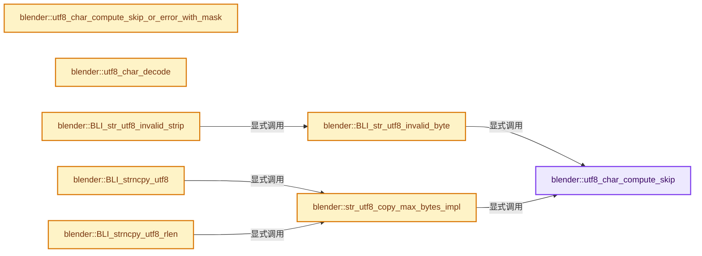
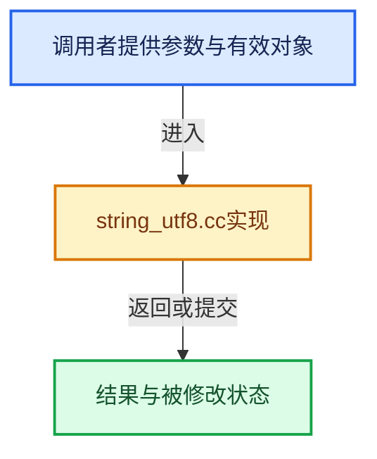

# 实现依赖专题：source/blender/blenlib/intern/string_utf8.cc

[方向导航](README.md) · [符号索引](../%E7%AC%A6%E5%8F%B7%E4%BE%9D%E8%B5%96%E4%B8%8E%E5%AE%9E%E7%8E%B0%E7%B4%A2%E5%BC%95.md)

本专题从正文实际调用进入，集中保存共享实现。函数有稳定锚点，可从调用处直接跳到对应完整函数；递归与互相调用通过回链组织。

## 本文件的实现关系






<a id="m-2b3263e105d6"></a>

## 宏 `UTF8_VARS_FROM_CHAR32`

<!-- annotated:70df1c3a235c26 -->

```cpp
#define UTF8_VARS_FROM_CHAR32(Char, First, Len) \
  if (Char < 0x80) { \
    First = 0; \
    Len = 1; \
  } \
  else if (Char < 0x800) { \
    First = 0xc0; \
    Len = 2; \
  } \
  else if (Char < 0x10000) { \
    First = 0xe0; \
    Len = 3; \
  } \
  else if (Char < 0x200000) { \
    First = 0xf0; \
    Len = 4; \
  } \
  else if (Char < 0x4000000) { \
    First = 0xf8; \
    Len = 5; \
  } \
  else { \
    First = 0xfc; \
    Len = 6; \
  } \
  (void)0

```

<details>
<summary>核对原始源码：source/blender/blenlib/intern/string_utf8.cc · L1153—L1179</summary>

<!-- original:70df1c3a235c26:source/blender/blenlib/intern/string_utf8.cc:1153:1179 -->

```cpp
#define UTF8_VARS_FROM_CHAR32(Char, First, Len) \
  if (Char < 0x80) { \
    First = 0; \
    Len = 1; \
  } \
  else if (Char < 0x800) { \
    First = 0xc0; \
    Len = 2; \
  } \
  else if (Char < 0x10000) { \
    First = 0xe0; \
    Len = 3; \
  } \
  else if (Char < 0x200000) { \
    First = 0xf0; \
    Len = 4; \
  } \
  else if (Char < 0x4000000) { \
    First = 0xf8; \
    Len = 5; \
  } \
  else { \
    First = 0xfc; \
    Len = 6; \
  } \
  (void)0

```

</details>

宏在预处理阶段展开，参数替换、重复求值和条件编译应直接从该定义检查。与普通函数不同，宏不会自动提供参数类型检查；构建配置选择哪个定义需结合外围条件。

## 完整成员与函数实现

<a id="f-4404baa0ba666cfb"></a>

### `blender::utf8_char_compute_skip`

实现位置：[source/blender/blenlib/intern/string_utf8.cc](../../../../../source/blender/blenlib/intern/string_utf8.cc) · L60—L80。

接口参数：

- `const char c`

**教学注释版**

<!-- annotated:b47f1d9afbf11d -->

```cpp
BLI_INLINE int utf8_char_compute_skip(const char c)
{
  if (c >= 192) [[unlikely]] {
    if ((c & 0xe0) == 0xc0) {
      return 2;
    }
    if ((c & 0xf0) == 0xe0) {
      return 3;
    }
    if ((c & 0xf8) == 0xf0) {
      return 4;
    }
    if ((c & 0xfc) == 0xf8) {
      return 5;
    }
    if ((c & 0xfe) == 0xfc) {
      return 6;
    }
  }
  return 1;
}
```

<details>
<summary>核对原始源码：source/blender/blenlib/intern/string_utf8.cc · L60—L80</summary>

<!-- original:b47f1d9afbf11d:source/blender/blenlib/intern/string_utf8.cc:60:80 -->

```cpp
BLI_INLINE int utf8_char_compute_skip(const char c)
{
  if (c >= 192) [[unlikely]] {
    if ((c & 0xe0) == 0xc0) {
      return 2;
    }
    if ((c & 0xf0) == 0xe0) {
      return 3;
    }
    if ((c & 0xf8) == 0xf0) {
      return 4;
    }
    if ((c & 0xfc) == 0xf8) {
      return 5;
    }
    if ((c & 0xfe) == 0xfc) {
      return 6;
    }
  }
  return 1;
}
```

</details>

**结果出口**

- `return 2;`
- `return 3;`
- `return 4;`
- `return 5;`
- `return 6;`
- `return 1;`

**继续追踪实现**

本实现没有需要继续展开的显式调用；检查返回表达式、对象转换和调用者前置条件。

<a id="f-eade0fb38902d0d5"></a>

### `blender::utf8_char_compute_skip_or_error_with_mask`

实现位置：[source/blender/blenlib/intern/string_utf8.cc](../../../../../source/blender/blenlib/intern/string_utf8.cc) · L105—L133。

接口参数：

- `const char c`
- `char *r_mask`

**教学注释版**

<!-- annotated:5747228668d7ae -->

```cpp
BLI_INLINE int utf8_char_compute_skip_or_error_with_mask(const char c, char *r_mask)
{
  /* Originally from GLIB `UTF8_COMPUTE` macro. */
  if (c < 128) {
    *r_mask = 0x7f;
    return 1;
  }
  if ((c & 0xe0) == 0xc0) {
    *r_mask = 0x1f;
    return 2;
  }
  if ((c & 0xf0) == 0xe0) {
    *r_mask = 0x0f;
    return 3;
  }
  if ((c & 0xf8) == 0xf0) {
    *r_mask = 0x07;
    return 4;
  }
  if ((c & 0xfc) == 0xf8) {
    *r_mask = 0x03;
    return 5;
  }
  if ((c & 0xfe) == 0xfc) {
    *r_mask = 0x01;
    return 6;
  }
  return -1;
}
```

<details>
<summary>核对原始源码：source/blender/blenlib/intern/string_utf8.cc · L105—L133</summary>

<!-- original:5747228668d7ae:source/blender/blenlib/intern/string_utf8.cc:105:133 -->

```cpp
BLI_INLINE int utf8_char_compute_skip_or_error_with_mask(const char c, char *r_mask)
{
  /* Originally from GLIB `UTF8_COMPUTE` macro. */
  if (c < 128) {
    *r_mask = 0x7f;
    return 1;
  }
  if ((c & 0xe0) == 0xc0) {
    *r_mask = 0x1f;
    return 2;
  }
  if ((c & 0xf0) == 0xe0) {
    *r_mask = 0x0f;
    return 3;
  }
  if ((c & 0xf8) == 0xf0) {
    *r_mask = 0x07;
    return 4;
  }
  if ((c & 0xfc) == 0xf8) {
    *r_mask = 0x03;
    return 5;
  }
  if ((c & 0xfe) == 0xfc) {
    *r_mask = 0x01;
    return 6;
  }
  return -1;
}
```

</details>

**结果出口**

- `return 1;`
- `return 2;`
- `return 3;`
- `return 4;`
- `return 5;`
- `return 6;`
- `return -1;`

**继续追踪实现**

本实现没有需要继续展开的显式调用；检查返回表达式、对象转换和调用者前置条件。

<a id="f-9d14f37d532550bf"></a>

### `blender::utf8_char_decode`

实现位置：[source/blender/blenlib/intern/string_utf8.cc](../../../../../source/blender/blenlib/intern/string_utf8.cc) · L138—L150。

接口参数：

- `const char *p`
- `const char mask`
- `const int len`
- `const uint err`

**教学注释版**

<!-- annotated:df2fea8273eb89 -->

```cpp
BLI_INLINE uint utf8_char_decode(const char *p, const char mask, const int len, const uint err)
{
  /* Originally from GLIB `UTF8_GET` macro, added an 'err' argument. */
  uint result = p[0] & mask;
  for (int count = 1; count < len; count++) {
    if ((p[count] & 0xc0) != 0x80) {
      return err;
    }
    result <<= 6;
    result |= p[count] & 0x3f;
  }
  return result;
}
```

<details>
<summary>核对原始源码：source/blender/blenlib/intern/string_utf8.cc · L138—L150</summary>

<!-- original:df2fea8273eb89:source/blender/blenlib/intern/string_utf8.cc:138:150 -->

```cpp
BLI_INLINE uint utf8_char_decode(const char *p, const char mask, const int len, const uint err)
{
  /* Originally from GLIB `UTF8_GET` macro, added an 'err' argument. */
  uint result = p[0] & mask;
  for (int count = 1; count < len; count++) {
    if ((p[count] & 0xc0) != 0x80) {
      return err;
    }
    result <<= 6;
    result |= p[count] & 0x3f;
  }
  return result;
}
```

</details>

**沿实际写入检查状态**

- `result |= p[count] & 0x3f;`

**结果出口**

- `return err;`
- `return result;`

**继续追踪实现**

本实现没有需要继续展开的显式调用；检查返回表达式、对象转换和调用者前置条件。

<a id="f-070246b555fffcce"></a>

### `blender::BLI_str_utf8_invalid_byte`

实现位置：[source/blender/blenlib/intern/string_utf8.cc](../../../../../source/blender/blenlib/intern/string_utf8.cc) · L154—L287。

接口参数：

- `const char *str`
- `size_t str_len`

**教学注释版**

<!-- annotated:3153791e0b65ce -->

```cpp
ptrdiff_t BLI_str_utf8_invalid_byte(const char *str, size_t str_len)
{
  /* NOTE(@ideasman42): from libswish3, originally called `u8_isvalid()`,
   * modified to return the index of the bad character (byte index not UTF).
   * http://svn.swish-e.org/libswish3/trunk/src/libswish3/utf8.c r3044.
   *
   * Comment from code in: `libswish3`.
   * Based on the `valid_utf8` routine from the PCRE library by Philip Hazel
   *
   * length is in bytes, since without knowing whether the string is valid
   * it's hard to know how many characters there are! */

  const uchar *p, *perr, *pend = reinterpret_cast<const uchar *>(str) + str_len;
  uchar c;
  int ab;

  for (p = reinterpret_cast<const uchar *>(str); p < pend; p++, str_len--) {
    c = *p;
    perr = p; /* Erroneous char is always the first of an invalid UTF8 sequence... */
    if (ELEM(c, 0xfe, 0xff, 0x00)) {
      /* Those three values are not allowed in UTF8 string. */
      goto utf8_error;
    }
    if (c < 128) {
      continue;
    }
    if ((c & 0xc0) != 0xc0) {
      goto utf8_error;
    }

    /* Note that since we always increase p (and decrease length) by one byte in main loop,
     * we only add/subtract extra UTF8 bytes in code below
     * (ab number, aka number of bytes remaining in the UTF8 sequence after the initial one). */
    ab = utf8_char_compute_skip(c) - 1;
    if (str_len <= size_t(ab)) {
      goto utf8_error;
    }

    /* Check top bits in the second byte */
    p++;
    str_len--;
    if ((*p & 0xc0) != 0x80) {
      goto utf8_error;
    }

    /* Check for overlong sequences for each different length */
    switch (ab) {
      case 1:
        /* Check for: `XX00 000X`. */
        if ((c & 0x3e) == 0) {
          goto utf8_error;
        }
        continue; /* We know there aren't any more bytes to check */

      case 2:
        /* Check for: `1110 0000, XX0X XXXX`. */
        if (c == 0xe0 && (*p & 0x20) == 0) {
          goto utf8_error;
        }
        /* Some special cases, see section 5 of UTF8 decoder stress-test by Markus Kuhn
         * (https://www.cl.cam.ac.uk/~mgk25/ucs/examples/UTF-8-test.txt). */
        /* From section 5.1 (and 5.2) */
        if (c == 0xed) {
          if (*p == 0xa0 && *(p + 1) == 0x80) {
            goto utf8_error;
          }
          if (*p == 0xad && *(p + 1) == 0xbf) {
            goto utf8_error;
          }
          if (*p == 0xae && *(p + 1) == 0x80) {
            goto utf8_error;
          }
          if (*p == 0xaf && *(p + 1) == 0xbf) {
            goto utf8_error;
          }
          if (*p == 0xb0 && *(p + 1) == 0x80) {
            goto utf8_error;
          }
          if (*p == 0xbe && *(p + 1) == 0x80) {
            goto utf8_error;
          }
          if (*p == 0xbf && *(p + 1) == 0xbf) {
            goto utf8_error;
          }
        }
        /* From section 5.3 */
        if (c == 0xef) {
          if (*p == 0xbf && *(p + 1) == 0xbe) {
            goto utf8_error;
          }
          if (*p == 0xbf && *(p + 1) == 0xbf) {
            goto utf8_error;
          }
        }
        break;

      case 3:
        /* Check for: `1111 0000, XX00 XXXX`. */
        if (c == 0xf0 && (*p & 0x30) == 0) {
          goto utf8_error;
        }
        break;

      case 4:
        /* Check for `1111 1000, XX00 0XXX`. */
        if (c == 0xf8 && (*p & 0x38) == 0) {
          goto utf8_error;
        }
        break;

      case 5:
        /* Check for: `1111 1100, XX00 00XX`. */
        if (c == 0xfc && (*p & 0x3c) == 0) {
          goto utf8_error;
        }
        break;
    }

    /* Check for valid bytes after the 2nd, if any; all must start 10. */
    while (--ab > 0) {
      p++;
      str_len--;
      if ((*p & 0xc0) != 0x80) {
        goto utf8_error;
      }
    }
  }

  return -1;

utf8_error:

  return (reinterpret_cast<const char *>(perr) - static_cast<const char *>(str));
}
```

<details>
<summary>核对原始源码：source/blender/blenlib/intern/string_utf8.cc · L154—L287</summary>

<!-- original:3153791e0b65ce:source/blender/blenlib/intern/string_utf8.cc:154:287 -->

```cpp
ptrdiff_t BLI_str_utf8_invalid_byte(const char *str, size_t str_len)
{
  /* NOTE(@ideasman42): from libswish3, originally called `u8_isvalid()`,
   * modified to return the index of the bad character (byte index not UTF).
   * http://svn.swish-e.org/libswish3/trunk/src/libswish3/utf8.c r3044.
   *
   * Comment from code in: `libswish3`.
   * Based on the `valid_utf8` routine from the PCRE library by Philip Hazel
   *
   * length is in bytes, since without knowing whether the string is valid
   * it's hard to know how many characters there are! */

  const uchar *p, *perr, *pend = reinterpret_cast<const uchar *>(str) + str_len;
  uchar c;
  int ab;

  for (p = reinterpret_cast<const uchar *>(str); p < pend; p++, str_len--) {
    c = *p;
    perr = p; /* Erroneous char is always the first of an invalid UTF8 sequence... */
    if (ELEM(c, 0xfe, 0xff, 0x00)) {
      /* Those three values are not allowed in UTF8 string. */
      goto utf8_error;
    }
    if (c < 128) {
      continue;
    }
    if ((c & 0xc0) != 0xc0) {
      goto utf8_error;
    }

    /* Note that since we always increase p (and decrease length) by one byte in main loop,
     * we only add/subtract extra UTF8 bytes in code below
     * (ab number, aka number of bytes remaining in the UTF8 sequence after the initial one). */
    ab = utf8_char_compute_skip(c) - 1;
    if (str_len <= size_t(ab)) {
      goto utf8_error;
    }

    /* Check top bits in the second byte */
    p++;
    str_len--;
    if ((*p & 0xc0) != 0x80) {
      goto utf8_error;
    }

    /* Check for overlong sequences for each different length */
    switch (ab) {
      case 1:
        /* Check for: `XX00 000X`. */
        if ((c & 0x3e) == 0) {
          goto utf8_error;
        }
        continue; /* We know there aren't any more bytes to check */

      case 2:
        /* Check for: `1110 0000, XX0X XXXX`. */
        if (c == 0xe0 && (*p & 0x20) == 0) {
          goto utf8_error;
        }
        /* Some special cases, see section 5 of UTF8 decoder stress-test by Markus Kuhn
         * (https://www.cl.cam.ac.uk/~mgk25/ucs/examples/UTF-8-test.txt). */
        /* From section 5.1 (and 5.2) */
        if (c == 0xed) {
          if (*p == 0xa0 && *(p + 1) == 0x80) {
            goto utf8_error;
          }
          if (*p == 0xad && *(p + 1) == 0xbf) {
            goto utf8_error;
          }
          if (*p == 0xae && *(p + 1) == 0x80) {
            goto utf8_error;
          }
          if (*p == 0xaf && *(p + 1) == 0xbf) {
            goto utf8_error;
          }
          if (*p == 0xb0 && *(p + 1) == 0x80) {
            goto utf8_error;
          }
          if (*p == 0xbe && *(p + 1) == 0x80) {
            goto utf8_error;
          }
          if (*p == 0xbf && *(p + 1) == 0xbf) {
            goto utf8_error;
          }
        }
        /* From section 5.3 */
        if (c == 0xef) {
          if (*p == 0xbf && *(p + 1) == 0xbe) {
            goto utf8_error;
          }
          if (*p == 0xbf && *(p + 1) == 0xbf) {
            goto utf8_error;
          }
        }
        break;

      case 3:
        /* Check for: `1111 0000, XX00 XXXX`. */
        if (c == 0xf0 && (*p & 0x30) == 0) {
          goto utf8_error;
        }
        break;

      case 4:
        /* Check for `1111 1000, XX00 0XXX`. */
        if (c == 0xf8 && (*p & 0x38) == 0) {
          goto utf8_error;
        }
        break;

      case 5:
        /* Check for: `1111 1100, XX00 00XX`. */
        if (c == 0xfc && (*p & 0x3c) == 0) {
          goto utf8_error;
        }
        break;
    }

    /* Check for valid bytes after the 2nd, if any; all must start 10. */
    while (--ab > 0) {
      p++;
      str_len--;
      if ((*p & 0xc0) != 0x80) {
        goto utf8_error;
      }
    }
  }

  return -1;

utf8_error:

  return (reinterpret_cast<const char *>(perr) - static_cast<const char *>(str));
}
```

</details>

**沿实际写入检查状态**

- `c = *p;`
- `perr = p; /* Erroneous char is always the first of an invalid UTF8 sequence... */`
- `ab = utf8_char_compute_skip(c) - 1;`

**结果出口**

- `return -1;`
- `return (reinterpret_cast<const char *>(perr) - static_cast<const char *>(str));`

**继续追踪实现**

- `ELEM` → [ELEM · L88](../05-%E5%87%A0%E4%BD%95%E5%AD%98%E5%82%A8%E4%B8%8E%E6%8B%93%E6%89%91%E6%98%A0%E5%B0%84/%E4%BE%9D%E8%B5%96-GHOST_utildefines-34b996.md#m-d28724a15928)；[ELEM · L135](%E4%BE%9D%E8%B5%96-BLI_utildefines-293a0a.md#m-d6572de7cae0)。宏定义由构建条件选择。
- `utf8_char_compute_skip` → [blender::utf8_char_compute_skip · L60](%E4%BE%9D%E8%B5%96-string_utf8-3c62ca.md#f-4404baa0ba666cfb)。

<a id="f-1870ea2045c820fa"></a>

### `blender::BLI_str_utf8_invalid_strip`

实现位置：[source/blender/blenlib/intern/string_utf8.cc](../../../../../source/blender/blenlib/intern/string_utf8.cc) · L289—L312。

接口参数：

- `char *str`
- `size_t str_len`

**教学注释版**

<!-- annotated:cedcbe7600c952 -->

```cpp
int BLI_str_utf8_invalid_strip(char *str, size_t str_len)
{
  ptrdiff_t bad_char;
  int tot = 0;

  BLI_assert(str[str_len] == '\0');

  while ((bad_char = BLI_str_utf8_invalid_byte(str, str_len)) != -1) {
    str += bad_char;
    str_len -= size_t(bad_char + 1);

    if (str_len == 0) {
      /* last character bad, strip it */
      *str = '\0';
      tot++;
      break;
    }
    /* strip, keep looking */
    // [讲解] memmove：复制可能重叠的字节区间；允许字节重叠不代表自动满足任意C++对象的移动构造契约。
    memmove(str, str + 1, str_len + 1); /* +1 for null char! */
    tot++;
  }

  return tot;
}
```

<details>
<summary>核对原始源码：source/blender/blenlib/intern/string_utf8.cc · L289—L312</summary>

<!-- original:cedcbe7600c952:source/blender/blenlib/intern/string_utf8.cc:289:312 -->

```cpp
int BLI_str_utf8_invalid_strip(char *str, size_t str_len)
{
  ptrdiff_t bad_char;
  int tot = 0;

  BLI_assert(str[str_len] == '\0');

  while ((bad_char = BLI_str_utf8_invalid_byte(str, str_len)) != -1) {
    str += bad_char;
    str_len -= size_t(bad_char + 1);

    if (str_len == 0) {
      /* last character bad, strip it */
      *str = '\0';
      tot++;
      break;
    }
    /* strip, keep looking */
    memmove(str, str + 1, str_len + 1); /* +1 for null char! */
    tot++;
  }

  return tot;
}
```

</details>

**沿实际写入检查状态**

- `str += bad_char;`
- `str_len -= size_t(bad_char + 1);`

**结果出口**

- `return tot;`

**继续追踪实现**

- `BLI_assert` → [BLI_assert · L48](%E4%BE%9D%E8%B5%96-BLI_assert-cc98e8.md#m-57a88495704d)；[BLI_assert · L63](%E4%BE%9D%E8%B5%96-BLI_assert-cc98e8.md#m-d07050020cb5)。宏定义由构建条件选择。
- `BLI_str_utf8_invalid_byte` → [blender::BLI_str_utf8_invalid_byte · L154](%E4%BE%9D%E8%B5%96-string_utf8-3c62ca.md#f-070246b555fffcce)。
- `memmove` → [外部契约](https://eel.is/c++draft/cstring.syn)：复制可能重叠的字节区间；允许字节重叠不代表自动满足任意C++对象的移动构造契约。

<a id="f-0f979ec8cc077fbb"></a>

### `blender::str_utf8_copy_max_bytes_impl`

实现位置：[source/blender/blenlib/intern/string_utf8.cc](../../../../../source/blender/blenlib/intern/string_utf8.cc) · L380—L402。

接口参数：

- `char *dst`
- `const char *src`
- `size_t dst_maxncpy`

**教学注释版**

<!-- annotated:03715d27e8a9d2 -->

```cpp
BLI_INLINE char *str_utf8_copy_max_bytes_impl(char *dst, const char *src, size_t dst_maxncpy)
{
  /* Cast to `uint8_t` is a no-op, quiets array subscript of type `char` warning.
   * No need to check `src` points to a nil byte as this will return from the switch statement. */
  size_t utf8_size;
  while ((utf8_size = size_t(utf8_char_compute_skip(*src))) <= dst_maxncpy) {
    dst_maxncpy -= utf8_size;
    /* Prefer more compact block. */
    /* NOLINTBEGIN: bugprone-assignment-in-if-condition */
    /* clang-format off */
    switch (utf8_size) {
      case 6: if (!(*dst = *src++)) [[unlikely]] { return dst; } dst++; ATTR_FALLTHROUGH;
      case 5: if (!(*dst = *src++)) [[unlikely]] { return dst; } dst++; ATTR_FALLTHROUGH;
      case 4: if (!(*dst = *src++)) [[unlikely]] { return dst; } dst++; ATTR_FALLTHROUGH;
      case 3: if (!(*dst = *src++)) [[unlikely]] { return dst; } dst++; ATTR_FALLTHROUGH;
      case 2: if (!(*dst = *src++)) [[unlikely]] { return dst; } dst++; ATTR_FALLTHROUGH;
      case 1: if (!(*dst = *src++)) [[unlikely]] { return dst; } dst++;
    }
    /* clang-format on */
    /* NOLINTEND: bugprone-assignment-in-if-condition */
  }
  return dst;
}
```

<details>
<summary>核对原始源码：source/blender/blenlib/intern/string_utf8.cc · L380—L402</summary>

<!-- original:03715d27e8a9d2:source/blender/blenlib/intern/string_utf8.cc:380:402 -->

```cpp
BLI_INLINE char *str_utf8_copy_max_bytes_impl(char *dst, const char *src, size_t dst_maxncpy)
{
  /* Cast to `uint8_t` is a no-op, quiets array subscript of type `char` warning.
   * No need to check `src` points to a nil byte as this will return from the switch statement. */
  size_t utf8_size;
  while ((utf8_size = size_t(utf8_char_compute_skip(*src))) <= dst_maxncpy) {
    dst_maxncpy -= utf8_size;
    /* Prefer more compact block. */
    /* NOLINTBEGIN: bugprone-assignment-in-if-condition */
    /* clang-format off */
    switch (utf8_size) {
      case 6: if (!(*dst = *src++)) [[unlikely]] { return dst; } dst++; ATTR_FALLTHROUGH;
      case 5: if (!(*dst = *src++)) [[unlikely]] { return dst; } dst++; ATTR_FALLTHROUGH;
      case 4: if (!(*dst = *src++)) [[unlikely]] { return dst; } dst++; ATTR_FALLTHROUGH;
      case 3: if (!(*dst = *src++)) [[unlikely]] { return dst; } dst++; ATTR_FALLTHROUGH;
      case 2: if (!(*dst = *src++)) [[unlikely]] { return dst; } dst++; ATTR_FALLTHROUGH;
      case 1: if (!(*dst = *src++)) [[unlikely]] { return dst; } dst++;
    }
    /* clang-format on */
    /* NOLINTEND: bugprone-assignment-in-if-condition */
  }
  return dst;
}
```

</details>

**沿实际写入检查状态**

- `dst_maxncpy -= utf8_size;`

**结果出口**

- `return dst;`

**继续追踪实现**

- `utf8_char_compute_skip` → [blender::utf8_char_compute_skip · L60](%E4%BE%9D%E8%B5%96-string_utf8-3c62ca.md#f-4404baa0ba666cfb)。

<a id="f-ff7c5f28742085a0"></a>

### `blender::BLI_strncpy_utf8`

实现位置：[source/blender/blenlib/intern/string_utf8.cc](../../../../../source/blender/blenlib/intern/string_utf8.cc) · L404—L412。

接口参数：

- `char *__restrict dst`
- `const char *__restrict src`
- `size_t dst_maxncpy`

**教学注释版**

<!-- annotated:a9676db728f804 -->

```cpp
char *BLI_strncpy_utf8(char *__restrict dst, const char *__restrict src, size_t dst_maxncpy)
{
  BLI_assert(dst_maxncpy != 0);
  BLI_string_debug_size(dst, dst_maxncpy);

  char *dst_end = str_utf8_copy_max_bytes_impl(dst, src, dst_maxncpy - 1);
  *dst_end = '\0';
  return dst;
}
```

<details>
<summary>核对原始源码：source/blender/blenlib/intern/string_utf8.cc · L404—L412</summary>

<!-- original:a9676db728f804:source/blender/blenlib/intern/string_utf8.cc:404:412 -->

```cpp
char *BLI_strncpy_utf8(char *__restrict dst, const char *__restrict src, size_t dst_maxncpy)
{
  BLI_assert(dst_maxncpy != 0);
  BLI_string_debug_size(dst, dst_maxncpy);

  char *dst_end = str_utf8_copy_max_bytes_impl(dst, src, dst_maxncpy - 1);
  *dst_end = '\0';
  return dst;
}
```

</details>

**结果出口**

- `return dst;`

**继续追踪实现**

- `BLI_assert` → [BLI_assert · L48](%E4%BE%9D%E8%B5%96-BLI_assert-cc98e8.md#m-57a88495704d)；[BLI_assert · L63](%E4%BE%9D%E8%B5%96-BLI_assert-cc98e8.md#m-d07050020cb5)。宏定义由构建条件选择。
- `BLI_string_debug_size` → [BLI_string_debug_size · L666](%E4%BE%9D%E8%B5%96-BLI_string-b43058.md#m-b560dcb5e1df)；[BLI_string_debug_size · L673](%E4%BE%9D%E8%B5%96-BLI_string-b43058.md#m-6b2ed5aaa6e2)。宏定义由构建条件选择。
- `str_utf8_copy_max_bytes_impl` → [blender::str_utf8_copy_max_bytes_impl · L380](%E4%BE%9D%E8%B5%96-string_utf8-3c62ca.md#f-0f979ec8cc077fbb)。

<a id="f-7e04b018fd7a0802"></a>

### `blender::BLI_strncpy_utf8_rlen`

实现位置：[source/blender/blenlib/intern/string_utf8.cc](../../../../../source/blender/blenlib/intern/string_utf8.cc) · L414—L424。

接口参数：

- `char *__restrict dst`
- `const char *__restrict src`
- `size_t dst_maxncpy`

**教学注释版**

<!-- annotated:1dfad1130d07f2 -->

```cpp
size_t BLI_strncpy_utf8_rlen(char *__restrict dst, const char *__restrict src, size_t dst_maxncpy)
{
  BLI_assert(dst_maxncpy != 0);
  BLI_string_debug_size(dst, dst_maxncpy);

  char *r_dst = dst;
  dst = str_utf8_copy_max_bytes_impl(dst, src, dst_maxncpy - 1);
  *dst = '\0';

  return size_t(dst - r_dst);
}
```

<details>
<summary>核对原始源码：source/blender/blenlib/intern/string_utf8.cc · L414—L424</summary>

<!-- original:1dfad1130d07f2:source/blender/blenlib/intern/string_utf8.cc:414:424 -->

```cpp
size_t BLI_strncpy_utf8_rlen(char *__restrict dst, const char *__restrict src, size_t dst_maxncpy)
{
  BLI_assert(dst_maxncpy != 0);
  BLI_string_debug_size(dst, dst_maxncpy);

  char *r_dst = dst;
  dst = str_utf8_copy_max_bytes_impl(dst, src, dst_maxncpy - 1);
  *dst = '\0';

  return size_t(dst - r_dst);
}
```

</details>

**沿实际写入检查状态**

- `dst = str_utf8_copy_max_bytes_impl(dst, src, dst_maxncpy - 1);`

**结果出口**

- `return size_t(dst - r_dst);`

**继续追踪实现**

- `BLI_assert` → [BLI_assert · L48](%E4%BE%9D%E8%B5%96-BLI_assert-cc98e8.md#m-57a88495704d)；[BLI_assert · L63](%E4%BE%9D%E8%B5%96-BLI_assert-cc98e8.md#m-d07050020cb5)。宏定义由构建条件选择。
- `BLI_string_debug_size` → [BLI_string_debug_size · L666](%E4%BE%9D%E8%B5%96-BLI_string-b43058.md#m-b560dcb5e1df)；[BLI_string_debug_size · L673](%E4%BE%9D%E8%B5%96-BLI_string-b43058.md#m-6b2ed5aaa6e2)。宏定义由构建条件选择。
- `str_utf8_copy_max_bytes_impl` → [blender::str_utf8_copy_max_bytes_impl · L380](%E4%BE%9D%E8%B5%96-string_utf8-3c62ca.md#f-0f979ec8cc077fbb)。

<a id="f-397d44fc26b55aad"></a>

### `blender::BLI_strncpy_utf8_rlen_unterminated`

实现位置：[source/blender/blenlib/intern/string_utf8.cc](../../../../../source/blender/blenlib/intern/string_utf8.cc) · L426—L436。

接口参数：

- `char *__restrict dst`
- `const char *__restrict src`
- `size_t dst_maxncpy`

**教学注释版**

<!-- annotated:5f0d9639aacb4d -->

```cpp
size_t BLI_strncpy_utf8_rlen_unterminated(char *__restrict dst,
                                          const char *__restrict src,
                                          size_t dst_maxncpy)
{
  BLI_string_debug_size(dst, dst_maxncpy);

  char *r_dst = dst;
  dst = str_utf8_copy_max_bytes_impl(dst, src, dst_maxncpy);

  return size_t(dst - r_dst);
}
```

<details>
<summary>核对原始源码：source/blender/blenlib/intern/string_utf8.cc · L426—L436</summary>

<!-- original:5f0d9639aacb4d:source/blender/blenlib/intern/string_utf8.cc:426:436 -->

```cpp
size_t BLI_strncpy_utf8_rlen_unterminated(char *__restrict dst,
                                          const char *__restrict src,
                                          size_t dst_maxncpy)
{
  BLI_string_debug_size(dst, dst_maxncpy);

  char *r_dst = dst;
  dst = str_utf8_copy_max_bytes_impl(dst, src, dst_maxncpy);

  return size_t(dst - r_dst);
}
```

</details>

**沿实际写入检查状态**

- `dst = str_utf8_copy_max_bytes_impl(dst, src, dst_maxncpy);`

**结果出口**

- `return size_t(dst - r_dst);`

**继续追踪实现**

- `BLI_string_debug_size` → [BLI_string_debug_size · L666](%E4%BE%9D%E8%B5%96-BLI_string-b43058.md#m-b560dcb5e1df)；[BLI_string_debug_size · L673](%E4%BE%9D%E8%B5%96-BLI_string-b43058.md#m-6b2ed5aaa6e2)。宏定义由构建条件选择。
- `str_utf8_copy_max_bytes_impl` → [blender::str_utf8_copy_max_bytes_impl · L380](%E4%BE%9D%E8%B5%96-string_utf8-3c62ca.md#f-0f979ec8cc077fbb)。

<a id="f-d7cec6244a141b70"></a>

### `blender::BLI_strncpy_wchar_as_utf8`

实现位置：[source/blender/blenlib/intern/string_utf8.cc](../../../../../source/blender/blenlib/intern/string_utf8.cc) · L441—L458。

接口参数：

- `char *__restrict dst`
- `const wchar_t *__restrict src`
- `const size_t dst_maxncpy`

**教学注释版**

<!-- annotated:46a7ff2e510b25 -->

```cpp
size_t BLI_strncpy_wchar_as_utf8(char *__restrict dst,
                                 const wchar_t *__restrict src,
                                 const size_t dst_maxncpy)
{
  BLI_assert(dst_maxncpy != 0);
  BLI_string_debug_size(dst, dst_maxncpy);

  size_t len = 0;
  while (*src && len < dst_maxncpy) {
    len += BLI_str_utf8_from_unicode(uint(*src++), dst + len, dst_maxncpy - len);
  }
  dst[len] = '\0';
  /* Return the correct length when part of the final byte did not fit into the string. */
  while ((len > 0) && UNLIKELY(dst[len - 1] == '\0')) {
    len--;
  }
  return len;
}
```

<details>
<summary>核对原始源码：source/blender/blenlib/intern/string_utf8.cc · L441—L458</summary>

<!-- original:46a7ff2e510b25:source/blender/blenlib/intern/string_utf8.cc:441:458 -->

```cpp
size_t BLI_strncpy_wchar_as_utf8(char *__restrict dst,
                                 const wchar_t *__restrict src,
                                 const size_t dst_maxncpy)
{
  BLI_assert(dst_maxncpy != 0);
  BLI_string_debug_size(dst, dst_maxncpy);

  size_t len = 0;
  while (*src && len < dst_maxncpy) {
    len += BLI_str_utf8_from_unicode(uint(*src++), dst + len, dst_maxncpy - len);
  }
  dst[len] = '\0';
  /* Return the correct length when part of the final byte did not fit into the string. */
  while ((len > 0) && UNLIKELY(dst[len - 1] == '\0')) {
    len--;
  }
  return len;
}
```

</details>

**沿实际写入检查状态**

- `len += BLI_str_utf8_from_unicode(uint(*src++), dst + len, dst_maxncpy - len);`
- `dst[len] = '\0';`

**结果出口**

- `return len;`

**继续追踪实现**

- `BLI_assert` → [BLI_assert · L48](%E4%BE%9D%E8%B5%96-BLI_assert-cc98e8.md#m-57a88495704d)；[BLI_assert · L63](%E4%BE%9D%E8%B5%96-BLI_assert-cc98e8.md#m-d07050020cb5)。宏定义由构建条件选择。
- `BLI_string_debug_size` → [BLI_string_debug_size · L666](%E4%BE%9D%E8%B5%96-BLI_string-b43058.md#m-b560dcb5e1df)；[BLI_string_debug_size · L673](%E4%BE%9D%E8%B5%96-BLI_string-b43058.md#m-6b2ed5aaa6e2)。宏定义由构建条件选择。
- `BLI_str_utf8_from_unicode` → [blender::BLI_str_utf8_from_unicode · L1192](%E4%BE%9D%E8%B5%96-string_utf8-3c62ca.md#f-db61cf3be6e543e0)。
- `UNLIKELY` → [UNLIKELY · L52](../03-%E5%86%85%E5%AD%98%E5%88%86%E9%85%8D%E4%B8%8E%E8%BF%90%E8%A1%8C%E6%97%B6%E7%B1%BB%E5%9E%8B/%E4%BE%9D%E8%B5%96-mallocn_intern-e4d317.md#m-b66d81651173)；[UNLIKELY · L55](../03-%E5%86%85%E5%AD%98%E5%88%86%E9%85%8D%E4%B8%8E%E8%BF%90%E8%A1%8C%E6%97%B6%E7%B1%BB%E5%9E%8B/%E4%BE%9D%E8%B5%96-mallocn_intern-e4d317.md#m-43069123e9fe)；[UNLIKELY · L108](../05-%E5%87%A0%E4%BD%95%E5%AD%98%E5%82%A8%E4%B8%8E%E6%8B%93%E6%89%91%E6%98%A0%E5%B0%84/%E4%BE%9D%E8%B5%96-defines-cd82f8.md#m-c50729f638e8)；[UNLIKELY · L111](../05-%E5%87%A0%E4%BD%95%E5%AD%98%E5%82%A8%E4%B8%8E%E6%8B%93%E6%89%91%E6%98%A0%E5%B0%84/%E4%BE%9D%E8%B5%96-defines-cd82f8.md#m-08e633831622)；[UNLIKELY · L25](../12-%E7%A9%BA%E9%97%B4%E6%95%B0%E6%8D%AE%E7%BB%93%E6%9E%84%E4%B8%8E%E5%87%A0%E4%BD%95%E7%AE%97%E6%B3%95/%E4%BE%9D%E8%B5%96-math_base_inline-546b00.md#m-beab6e34c61e)；[UNLIKELY · L27](../12-%E7%A9%BA%E9%97%B4%E6%95%B0%E6%8D%AE%E7%BB%93%E6%9E%84%E4%B8%8E%E5%87%A0%E4%BD%95%E7%AE%97%E6%B3%95/%E4%BE%9D%E8%B5%96-math_base_inline-546b00.md#m-9b279ffdd95b)；[UNLIKELY · L544](%E4%BE%9D%E8%B5%96-BLI_utildefines-293a0a.md#m-74644b8209a0)；[UNLIKELY · L547](%E4%BE%9D%E8%B5%96-BLI_utildefines-293a0a.md#m-3a47ebab6298)。宏定义由构建条件选择。

<a id="f-1937d1f92ba2a3d6"></a>

### `blender::BLI_strlen_utf8_ex`

实现位置：[source/blender/blenlib/intern/string_utf8.cc](../../../../../source/blender/blenlib/intern/string_utf8.cc) · L471—L494。

接口参数：

- `const char *strc`
- `size_t *r_len_bytes`

**教学注释版**

<!-- annotated:d9d25f3c516ff3 -->

```cpp
size_t BLI_strlen_utf8_ex(const char *strc, size_t *r_len_bytes)
{
  size_t len = 0;
  const char *strc_orig = strc;

  while (*strc) {
    int step = BLI_str_utf8_size_safe(strc);

    /* Detect null bytes within multi-byte sequences.
     * This matches the behavior of #BLI_strncpy_utf8 for incomplete byte sequences. */
    for (int i = 1; i < step; i++) {
      if (strc[i] == '\0') [[unlikely]] {
        step = i;
        break;
      }
    }

    strc += step;
    len++;
  }

  *r_len_bytes = size_t(strc - strc_orig);
  return len;
}
```

<details>
<summary>核对原始源码：source/blender/blenlib/intern/string_utf8.cc · L471—L494</summary>

<!-- original:d9d25f3c516ff3:source/blender/blenlib/intern/string_utf8.cc:471:494 -->

```cpp
size_t BLI_strlen_utf8_ex(const char *strc, size_t *r_len_bytes)
{
  size_t len = 0;
  const char *strc_orig = strc;

  while (*strc) {
    int step = BLI_str_utf8_size_safe(strc);

    /* Detect null bytes within multi-byte sequences.
     * This matches the behavior of #BLI_strncpy_utf8 for incomplete byte sequences. */
    for (int i = 1; i < step; i++) {
      if (strc[i] == '\0') [[unlikely]] {
        step = i;
        break;
      }
    }

    strc += step;
    len++;
  }

  *r_len_bytes = size_t(strc - strc_orig);
  return len;
}
```

</details>

**沿实际写入检查状态**

- `step = i;`
- `strc += step;`

**结果出口**

- `return len;`

**继续追踪实现**

- `BLI_str_utf8_size_safe` → [blender::BLI_str_utf8_size_safe · L1086](%E4%BE%9D%E8%B5%96-string_utf8-3c62ca.md#f-e7f7516484b0e7cd)。

<a id="f-bc30e6eb8f81798c"></a>

### `blender::BLI_strlen_utf8`

实现位置：[source/blender/blenlib/intern/string_utf8.cc](../../../../../source/blender/blenlib/intern/string_utf8.cc) · L496—L500。

接口参数：

- `const char *strc`

**教学注释版**

<!-- annotated:d3987868b0d53b -->

```cpp
size_t BLI_strlen_utf8(const char *strc)
{
  size_t len_bytes;
  return BLI_strlen_utf8_ex(strc, &len_bytes);
}
```

<details>
<summary>核对原始源码：source/blender/blenlib/intern/string_utf8.cc · L496—L500</summary>

<!-- original:d3987868b0d53b:source/blender/blenlib/intern/string_utf8.cc:496:500 -->

```cpp
size_t BLI_strlen_utf8(const char *strc)
{
  size_t len_bytes;
  return BLI_strlen_utf8_ex(strc, &len_bytes);
}
```

</details>

**结果出口**

- `return BLI_strlen_utf8_ex(strc, &len_bytes);`

**继续追踪实现**

- `BLI_strlen_utf8_ex` → [blender::BLI_strlen_utf8_ex · L471](%E4%BE%9D%E8%B5%96-string_utf8-3c62ca.md#f-1937d1f92ba2a3d6)。

<a id="f-34bad4608dd19d65"></a>

### `blender::BLI_strnlen_utf8_ex`

实现位置：[source/blender/blenlib/intern/string_utf8.cc](../../../../../source/blender/blenlib/intern/string_utf8.cc) · L502—L528。

接口参数：

- `const char *strc`
- `const size_t strc_maxlen`
- `size_t *r_len_bytes`

**教学注释版**

<!-- annotated:8e05c2bf3685f4 -->

```cpp
size_t BLI_strnlen_utf8_ex(const char *strc, const size_t strc_maxlen, size_t *r_len_bytes)
{
  size_t len = 0;
  const char *strc_orig = strc;
  const char *strc_end = strc + strc_maxlen;

  while (*strc) {
    int step = BLI_str_utf8_size_safe(strc);
    if (strc + step > strc_end) {
      break;
    }

    /* Detect null bytes within multi-byte sequences.
     * This matches the behavior of #BLI_strncpy_utf8 for incomplete byte sequences. */
    for (int i = 1; i < step; i++) {
      if (strc[i] == '\0') [[unlikely]] {
        step = i;
        break;
      }
    }
    strc += step;
    len++;
  }

  *r_len_bytes = size_t(strc - strc_orig);
  return len;
}
```

<details>
<summary>核对原始源码：source/blender/blenlib/intern/string_utf8.cc · L502—L528</summary>

<!-- original:8e05c2bf3685f4:source/blender/blenlib/intern/string_utf8.cc:502:528 -->

```cpp
size_t BLI_strnlen_utf8_ex(const char *strc, const size_t strc_maxlen, size_t *r_len_bytes)
{
  size_t len = 0;
  const char *strc_orig = strc;
  const char *strc_end = strc + strc_maxlen;

  while (*strc) {
    int step = BLI_str_utf8_size_safe(strc);
    if (strc + step > strc_end) {
      break;
    }

    /* Detect null bytes within multi-byte sequences.
     * This matches the behavior of #BLI_strncpy_utf8 for incomplete byte sequences. */
    for (int i = 1; i < step; i++) {
      if (strc[i] == '\0') [[unlikely]] {
        step = i;
        break;
      }
    }
    strc += step;
    len++;
  }

  *r_len_bytes = size_t(strc - strc_orig);
  return len;
}
```

</details>

**沿实际写入检查状态**

- `step = i;`
- `strc += step;`

**结果出口**

- `return len;`

**继续追踪实现**

- `BLI_str_utf8_size_safe` → [blender::BLI_str_utf8_size_safe · L1086](%E4%BE%9D%E8%B5%96-string_utf8-3c62ca.md#f-e7f7516484b0e7cd)。

<a id="f-208947d9b3303d64"></a>

### `blender::BLI_strnlen_utf8`

实现位置：[source/blender/blenlib/intern/string_utf8.cc](../../../../../source/blender/blenlib/intern/string_utf8.cc) · L530—L534。

接口参数：

- `const char *strc`
- `const size_t strc_maxlen`

**教学注释版**

<!-- annotated:064a7a165203db -->

```cpp
size_t BLI_strnlen_utf8(const char *strc, const size_t strc_maxlen)
{
  size_t len_bytes;
  return BLI_strnlen_utf8_ex(strc, strc_maxlen, &len_bytes);
}
```

<details>
<summary>核对原始源码：source/blender/blenlib/intern/string_utf8.cc · L530—L534</summary>

<!-- original:064a7a165203db:source/blender/blenlib/intern/string_utf8.cc:530:534 -->

```cpp
size_t BLI_strnlen_utf8(const char *strc, const size_t strc_maxlen)
{
  size_t len_bytes;
  return BLI_strnlen_utf8_ex(strc, strc_maxlen, &len_bytes);
}
```

</details>

**结果出口**

- `return BLI_strnlen_utf8_ex(strc, strc_maxlen, &len_bytes);`

**继续追踪实现**

- `BLI_strnlen_utf8_ex` → [blender::BLI_strnlen_utf8_ex · L502](%E4%BE%9D%E8%B5%96-string_utf8-3c62ca.md#f-34bad4608dd19d65)。

<a id="f-37d121d05f85c3cb"></a>

### `blender::BLI_vsnprintf_utf8`

实现位置：[source/blender/blenlib/intern/string_utf8.cc](../../../../../source/blender/blenlib/intern/string_utf8.cc) · L553—L574。

接口参数：

- `char *__restrict dst`
- `size_t dst_maxncpy`
- `const char *__restrict format`
- `va_list arg`

**教学注释版**

<!-- annotated:eff64a7dcc40a0 -->

```cpp
size_t BLI_vsnprintf_utf8(char *__restrict dst,
                          size_t dst_maxncpy,
                          const char *__restrict format,
                          va_list arg)
{
  /* NOTE: a clone of #BLI_vsnprintf that trims the end. */
  BLI_string_debug_size(dst, dst_maxncpy);

  BLI_assert(dst != nullptr);
  BLI_assert(dst_maxncpy > 0);
  BLI_assert(format != nullptr);

  const size_t n = size_t(vsnprintf(dst, dst_maxncpy, format, arg));
  if (n < dst_maxncpy) {
    dst[n] = '\0';
  }
  else {
    str_utf8_truncate_at_size_unchecked(dst, dst_maxncpy);
  }

  return n;
}
```

<details>
<summary>核对原始源码：source/blender/blenlib/intern/string_utf8.cc · L553—L574</summary>

<!-- original:eff64a7dcc40a0:source/blender/blenlib/intern/string_utf8.cc:553:574 -->

```cpp
size_t BLI_vsnprintf_utf8(char *__restrict dst,
                          size_t dst_maxncpy,
                          const char *__restrict format,
                          va_list arg)
{
  /* NOTE: a clone of #BLI_vsnprintf that trims the end. */
  BLI_string_debug_size(dst, dst_maxncpy);

  BLI_assert(dst != nullptr);
  BLI_assert(dst_maxncpy > 0);
  BLI_assert(format != nullptr);

  const size_t n = size_t(vsnprintf(dst, dst_maxncpy, format, arg));
  if (n < dst_maxncpy) {
    dst[n] = '\0';
  }
  else {
    str_utf8_truncate_at_size_unchecked(dst, dst_maxncpy);
  }

  return n;
}
```

</details>

**沿实际写入检查状态**

- `dst[n] = '\0';`

**结果出口**

- `return n;`

**继续追踪实现**

- `BLI_string_debug_size` → [BLI_string_debug_size · L666](%E4%BE%9D%E8%B5%96-BLI_string-b43058.md#m-b560dcb5e1df)；[BLI_string_debug_size · L673](%E4%BE%9D%E8%B5%96-BLI_string-b43058.md#m-6b2ed5aaa6e2)。宏定义由构建条件选择。
- `BLI_assert` → [BLI_assert · L48](%E4%BE%9D%E8%B5%96-BLI_assert-cc98e8.md#m-57a88495704d)；[BLI_assert · L63](%E4%BE%9D%E8%B5%96-BLI_assert-cc98e8.md#m-d07050020cb5)。宏定义由构建条件选择。
- `vsnprintf` → [外部契约](https://eel.is/c++draft/)：这个边界按实际表达式及所属类型核对参数、返回值、寿命与失败行为。这里提供接口入口，不声称已解释该第三方版本的内部实现。
- `str_utf8_truncate_at_size_unchecked` → [blender::str_utf8_truncate_at_size_unchecked · L1385](%E4%BE%9D%E8%B5%96-string_utf8-3c62ca.md#f-9e3b238b723ad053)。

<a id="f-38bcbca801e46757"></a>

### `blender::BLI_vsnprintf_utf8_rlen`

实现位置：[source/blender/blenlib/intern/string_utf8.cc](../../../../../source/blender/blenlib/intern/string_utf8.cc) · L576—L595。

接口参数：

- `char *__restrict dst`
- `size_t dst_maxncpy`
- `const char *__restrict format`
- `va_list arg`

**教学注释版**

<!-- annotated:4dde3cfed449b1 -->

```cpp
size_t BLI_vsnprintf_utf8_rlen(char *__restrict dst,
                               size_t dst_maxncpy,
                               const char *__restrict format,
                               va_list arg)
{
  BLI_string_debug_size(dst, dst_maxncpy);

  BLI_assert(dst != nullptr);
  BLI_assert(dst_maxncpy > 0);
  BLI_assert(format != nullptr);

  size_t n = size_t(vsnprintf(dst, dst_maxncpy, format, arg));
  if (n < dst_maxncpy) {
    dst[n] = '\0';
  }
  else {
    n = str_utf8_truncate_at_size_unchecked(dst, dst_maxncpy);
  }
  return n;
}
```

<details>
<summary>核对原始源码：source/blender/blenlib/intern/string_utf8.cc · L576—L595</summary>

<!-- original:4dde3cfed449b1:source/blender/blenlib/intern/string_utf8.cc:576:595 -->

```cpp
size_t BLI_vsnprintf_utf8_rlen(char *__restrict dst,
                               size_t dst_maxncpy,
                               const char *__restrict format,
                               va_list arg)
{
  BLI_string_debug_size(dst, dst_maxncpy);

  BLI_assert(dst != nullptr);
  BLI_assert(dst_maxncpy > 0);
  BLI_assert(format != nullptr);

  size_t n = size_t(vsnprintf(dst, dst_maxncpy, format, arg));
  if (n < dst_maxncpy) {
    dst[n] = '\0';
  }
  else {
    n = str_utf8_truncate_at_size_unchecked(dst, dst_maxncpy);
  }
  return n;
}
```

</details>

**沿实际写入检查状态**

- `dst[n] = '\0';`
- `n = str_utf8_truncate_at_size_unchecked(dst, dst_maxncpy);`

**结果出口**

- `return n;`

**继续追踪实现**

- `BLI_string_debug_size` → [BLI_string_debug_size · L666](%E4%BE%9D%E8%B5%96-BLI_string-b43058.md#m-b560dcb5e1df)；[BLI_string_debug_size · L673](%E4%BE%9D%E8%B5%96-BLI_string-b43058.md#m-6b2ed5aaa6e2)。宏定义由构建条件选择。
- `BLI_assert` → [BLI_assert · L48](%E4%BE%9D%E8%B5%96-BLI_assert-cc98e8.md#m-57a88495704d)；[BLI_assert · L63](%E4%BE%9D%E8%B5%96-BLI_assert-cc98e8.md#m-d07050020cb5)。宏定义由构建条件选择。
- `vsnprintf` → [外部契约](https://eel.is/c++draft/)：这个边界按实际表达式及所属类型核对参数、返回值、寿命与失败行为。这里提供接口入口，不声称已解释该第三方版本的内部实现。
- `str_utf8_truncate_at_size_unchecked` → [blender::str_utf8_truncate_at_size_unchecked · L1385](%E4%BE%9D%E8%B5%96-string_utf8-3c62ca.md#f-9e3b238b723ad053)。

<a id="f-47c5b052ec665ff6"></a>

### `blender::BLI_snprintf_utf8`

实现位置：[source/blender/blenlib/intern/string_utf8.cc](../../../../../source/blender/blenlib/intern/string_utf8.cc) · L597—L610。

接口参数：

- `char *__restrict dst`
- `size_t dst_maxncpy`
- `const char *__restrict format`

**教学注释版**

<!-- annotated:d0439711f48003 -->

```cpp
size_t BLI_snprintf_utf8(char *__restrict dst,
                         size_t dst_maxncpy,
                         const char *__restrict format,
                         ...)
{
  BLI_string_debug_size(dst, dst_maxncpy);

  va_list arg;
  va_start(arg, format);
  const size_t n = BLI_vsnprintf_utf8(dst, dst_maxncpy, format, arg);
  va_end(arg);

  return n;
}
```

<details>
<summary>核对原始源码：source/blender/blenlib/intern/string_utf8.cc · L597—L610</summary>

<!-- original:d0439711f48003:source/blender/blenlib/intern/string_utf8.cc:597:610 -->

```cpp
size_t BLI_snprintf_utf8(char *__restrict dst,
                         size_t dst_maxncpy,
                         const char *__restrict format,
                         ...)
{
  BLI_string_debug_size(dst, dst_maxncpy);

  va_list arg;
  va_start(arg, format);
  const size_t n = BLI_vsnprintf_utf8(dst, dst_maxncpy, format, arg);
  va_end(arg);

  return n;
}
```

</details>

**结果出口**

- `return n;`

**继续追踪实现**

- `BLI_string_debug_size` → [BLI_string_debug_size · L666](%E4%BE%9D%E8%B5%96-BLI_string-b43058.md#m-b560dcb5e1df)；[BLI_string_debug_size · L673](%E4%BE%9D%E8%B5%96-BLI_string-b43058.md#m-6b2ed5aaa6e2)。宏定义由构建条件选择。
- `va_start` → [调用协议](../%E6%A8%A1%E6%9D%BF%E5%AE%8F%E4%B8%8E%E5%8A%A8%E6%80%81%E5%88%86%E6%B4%BE%E5%8D%8F%E8%AE%AE.md)：函数指针、局部可调用对象或未展开的宏；必须结合调用者环境。调用位置L605。
- `BLI_vsnprintf_utf8` → [blender::BLI_vsnprintf_utf8 · L553](%E4%BE%9D%E8%B5%96-string_utf8-3c62ca.md#f-37d121d05f85c3cb)。
- `va_end` → [调用协议](../%E6%A8%A1%E6%9D%BF%E5%AE%8F%E4%B8%8E%E5%8A%A8%E6%80%81%E5%88%86%E6%B4%BE%E5%8D%8F%E8%AE%AE.md)：函数指针、局部可调用对象或未展开的宏；必须结合调用者环境。调用位置L607。

<a id="f-b6486dd9f346e964"></a>

### `blender::BLI_snprintf_utf8_rlen`

实现位置：[source/blender/blenlib/intern/string_utf8.cc](../../../../../source/blender/blenlib/intern/string_utf8.cc) · L612—L625。

接口参数：

- `char *__restrict dst`
- `size_t dst_maxncpy`
- `const char *__restrict format`

**教学注释版**

<!-- annotated:34ce79e9413514 -->

```cpp
size_t BLI_snprintf_utf8_rlen(char *__restrict dst,
                              size_t dst_maxncpy,
                              const char *__restrict format,
                              ...)
{
  BLI_string_debug_size(dst, dst_maxncpy);

  va_list arg;
  va_start(arg, format);
  const size_t n = BLI_vsnprintf_utf8_rlen(dst, dst_maxncpy, format, arg);
  va_end(arg);

  return n;
}
```

<details>
<summary>核对原始源码：source/blender/blenlib/intern/string_utf8.cc · L612—L625</summary>

<!-- original:34ce79e9413514:source/blender/blenlib/intern/string_utf8.cc:612:625 -->

```cpp
size_t BLI_snprintf_utf8_rlen(char *__restrict dst,
                              size_t dst_maxncpy,
                              const char *__restrict format,
                              ...)
{
  BLI_string_debug_size(dst, dst_maxncpy);

  va_list arg;
  va_start(arg, format);
  const size_t n = BLI_vsnprintf_utf8_rlen(dst, dst_maxncpy, format, arg);
  va_end(arg);

  return n;
}
```

</details>

**结果出口**

- `return n;`

**继续追踪实现**

- `BLI_string_debug_size` → [BLI_string_debug_size · L666](%E4%BE%9D%E8%B5%96-BLI_string-b43058.md#m-b560dcb5e1df)；[BLI_string_debug_size · L673](%E4%BE%9D%E8%B5%96-BLI_string-b43058.md#m-6b2ed5aaa6e2)。宏定义由构建条件选择。
- `va_start` → [调用协议](../%E6%A8%A1%E6%9D%BF%E5%AE%8F%E4%B8%8E%E5%8A%A8%E6%80%81%E5%88%86%E6%B4%BE%E5%8D%8F%E8%AE%AE.md)：函数指针、局部可调用对象或未展开的宏；必须结合调用者环境。调用位置L620。
- `BLI_vsnprintf_utf8_rlen` → [blender::BLI_vsnprintf_utf8_rlen · L576](%E4%BE%9D%E8%B5%96-string_utf8-3c62ca.md#f-38bcbca801e46757)。
- `va_end` → [调用协议](../%E6%A8%A1%E6%9D%BF%E5%AE%8F%E4%B8%8E%E5%8A%A8%E6%80%81%E5%88%86%E6%B4%BE%E5%8D%8F%E8%AE%AE.md)：函数指针、局部可调用对象或未展开的宏；必须结合调用者环境。调用位置L622。

<a id="f-cbf3fdea0d578194"></a>

### `blender::BLI_wcwidth_or_error`

实现位置：[source/blender/blenlib/intern/string_utf8.cc](../../../../../source/blender/blenlib/intern/string_utf8.cc) · L627—L634。

接口参数：

- `char32_t ucs`

**教学注释版**

<!-- annotated:b97c91407703b5 -->

```cpp
int BLI_wcwidth_or_error(char32_t ucs)
{
  /* Treat private use areas (icon fonts), symbols, and emoticons as double-width. */
  if (ucs >= 0xf0000 || (ucs >= 0xe000 && ucs < 0xf8ff) || (ucs >= 0x1f300 && ucs < 0x1fbff)) {
    return 2;
  }
  return mk_wcwidth(ucs);
}
```

<details>
<summary>核对原始源码：source/blender/blenlib/intern/string_utf8.cc · L627—L634</summary>

<!-- original:b97c91407703b5:source/blender/blenlib/intern/string_utf8.cc:627:634 -->

```cpp
int BLI_wcwidth_or_error(char32_t ucs)
{
  /* Treat private use areas (icon fonts), symbols, and emoticons as double-width. */
  if (ucs >= 0xf0000 || (ucs >= 0xe000 && ucs < 0xf8ff) || (ucs >= 0x1f300 && ucs < 0x1fbff)) {
    return 2;
  }
  return mk_wcwidth(ucs);
}
```

</details>

**结果出口**

- `return 2;`
- `return mk_wcwidth(ucs);`

**继续追踪实现**

- `mk_wcwidth` → [调用协议](../%E6%A8%A1%E6%9D%BF%E5%AE%8F%E4%B8%8E%E5%8A%A8%E6%80%81%E5%88%86%E6%B4%BE%E5%8D%8F%E8%AE%AE.md)：函数指针、局部可调用对象或未展开的宏；必须结合调用者环境。调用位置L633。

<a id="f-0ee28402fda78152"></a>

### `blender::BLI_str_utf8_char_width_or_error`

实现位置：[source/blender/blenlib/intern/string_utf8.cc](../../../../../source/blender/blenlib/intern/string_utf8.cc) · L650—L658。

接口参数：

- `const char *p`

**教学注释版**

<!-- annotated:190aa77658d380 -->

```cpp
int BLI_str_utf8_char_width_or_error(const char *p)
{
  uint unicode = BLI_str_utf8_as_unicode_or_error(p);
  if (unicode == BLI_UTF8_ERR) {
    return -1;
  }

  return BLI_wcwidth_or_error(char32_t(unicode));
}
```

<details>
<summary>核对原始源码：source/blender/blenlib/intern/string_utf8.cc · L650—L658</summary>

<!-- original:190aa77658d380:source/blender/blenlib/intern/string_utf8.cc:650:658 -->

```cpp
int BLI_str_utf8_char_width_or_error(const char *p)
{
  uint unicode = BLI_str_utf8_as_unicode_or_error(p);
  if (unicode == BLI_UTF8_ERR) {
    return -1;
  }

  return BLI_wcwidth_or_error(char32_t(unicode));
}
```

</details>

**结果出口**

- `return -1;`
- `return BLI_wcwidth_or_error(char32_t(unicode));`

**继续追踪实现**

- `BLI_str_utf8_as_unicode_or_error` → [blender::BLI_str_utf8_as_unicode_or_error · L1091](%E4%BE%9D%E8%B5%96-string_utf8-3c62ca.md#f-282c9fcc5d8b855c)。
- `BLI_wcwidth_or_error` → [blender::BLI_wcwidth_or_error · L627](%E4%BE%9D%E8%B5%96-string_utf8-3c62ca.md#f-cbf3fdea0d578194)。
- `char32_t` → [调用协议](../%E6%A8%A1%E6%9D%BF%E5%AE%8F%E4%B8%8E%E5%8A%A8%E6%80%81%E5%88%86%E6%B4%BE%E5%8D%8F%E8%AE%AE.md)：函数指针、局部可调用对象或未展开的宏；必须结合调用者环境。调用位置L657。

<a id="f-52d849a9d1651d83"></a>

### `blender::BLI_str_utf32_char_is_breaking_space`

实现位置：[source/blender/blenlib/intern/string_utf8.cc](../../../../../source/blender/blenlib/intern/string_utf8.cc) · L906—L926。

接口参数：

- `char32_t codepoint`

**教学注释版**

<!-- annotated:28e24acf8ee66d -->

```cpp
bool BLI_str_utf32_char_is_breaking_space(char32_t codepoint)
{
  /* Invisible (and so can be removed at end of wrapped line) spacing characters
   * according to the Unicode Line Breaking Algorithm (Standard Annex #14). Note
   * to always ignore U+200B (zero-width space) and U+2060 (word joiner). */
  return ELEM(codepoint,
              ' ',     /* Space. */
              0x1680,  /* Ogham space mark. */
              0x2000,  /* En quad. */
              0x2001,  /* Em quad. */
              0x2002,  /* En space. */
              0x2003,  /* Em space. */
              0x2004,  /* Three-per-em space. */
              0x2005,  /* Four-per-em space. */
              0x2006,  /* Six-per-em space. */
              0x2008,  /* Punctuation space. */
              0x2009,  /* Thin space. */
              0x200A,  /* Hair space. */
              0x205F,  /* Medium mathematical space. */
              0x3000); /* Ideographic space. */
}
```

<details>
<summary>核对原始源码：source/blender/blenlib/intern/string_utf8.cc · L906—L926</summary>

<!-- original:28e24acf8ee66d:source/blender/blenlib/intern/string_utf8.cc:906:926 -->

```cpp
bool BLI_str_utf32_char_is_breaking_space(char32_t codepoint)
{
  /* Invisible (and so can be removed at end of wrapped line) spacing characters
   * according to the Unicode Line Breaking Algorithm (Standard Annex #14). Note
   * to always ignore U+200B (zero-width space) and U+2060 (word joiner). */
  return ELEM(codepoint,
              ' ',     /* Space. */
              0x1680,  /* Ogham space mark. */
              0x2000,  /* En quad. */
              0x2001,  /* Em quad. */
              0x2002,  /* En space. */
              0x2003,  /* Em space. */
              0x2004,  /* Three-per-em space. */
              0x2005,  /* Four-per-em space. */
              0x2006,  /* Six-per-em space. */
              0x2008,  /* Punctuation space. */
              0x2009,  /* Thin space. */
              0x200A,  /* Hair space. */
              0x205F,  /* Medium mathematical space. */
              0x3000); /* Ideographic space. */
}
```

</details>

**结果出口**

- `return ELEM(codepoint,`

**继续追踪实现**

- `ELEM` → [ELEM · L88](../05-%E5%87%A0%E4%BD%95%E5%AD%98%E5%82%A8%E4%B8%8E%E6%8B%93%E6%89%91%E6%98%A0%E5%B0%84/%E4%BE%9D%E8%B5%96-GHOST_utildefines-34b996.md#m-d28724a15928)；[ELEM · L135](%E4%BE%9D%E8%B5%96-BLI_utildefines-293a0a.md#m-d6572de7cae0)。宏定义由构建条件选择。

<a id="f-74c7407fe2d35ceb"></a>

### `blender::BLI_str_utf32_char_is_optional_break_after`

实现位置：[source/blender/blenlib/intern/string_utf8.cc](../../../../../source/blender/blenlib/intern/string_utf8.cc) · L928—L967。

接口参数：

- `char32_t codepoint`
- `char32_t codepoint_prev`

**教学注释版**

<!-- annotated:42cad41e6376ae -->

```cpp
bool BLI_str_utf32_char_is_optional_break_after(char32_t codepoint, char32_t codepoint_prev)
{
  /* Subset of the characters that are line breaking opportunities
   * according to the Unicode Line Breaking Algorithm (Standard Annex #14).
   * Can be expanded but please no rules that differ by language. */

  /* Punctuation. Backslash can be used as path separator */
  if (ELEM(codepoint, '\\', '_')) {
    return true;
  }

  /* Do not break on solidus if previous is a number. */
  if (codepoint == '/' && !(codepoint_prev >= '0' && codepoint_prev <= '9')) {
    return true;
  }

  /* Do not break on dash, hyphen, em dash if previous is space */
  if (ELEM(codepoint, '-', 0x2010, 0x2014) &&
      !BLI_str_utf32_char_is_breaking_space(codepoint_prev))
  {
    return true;
  }

  if ((codepoint >= 0x2E80 && codepoint <= 0x2FFF) || /* CJK, Kangxi Radicals. */
      (codepoint >= 0x3040 && codepoint <= 0x309F) || /* Hiragana (except small characters). */
      (codepoint >= 0x30A2 && codepoint <= 0x30FA) || /* Katakana (except small characters). */
      (codepoint >= 0x3400 && codepoint <= 0x4DBF) || /* CJK Unified Ideographs Extension A. */
      (codepoint >= 0x4E00 && codepoint <= 0x9FFF) || /* CJK Unified Ideographs. */
      (codepoint >= 0x3040 && codepoint <= 0x309F) || /* CJK Unified Ideographs. */
      (codepoint >= 0x3130 && codepoint <= 0x318F))   /* Hangul Compatibility Jamo. */
  {
    return true;
  }

  if (ELEM(codepoint, 0x0F0D, 0x0F0B)) {
    return true; /* Tibetan shad mark and intersyllabic tsheg. */
  }

  return false;
}
```

<details>
<summary>核对原始源码：source/blender/blenlib/intern/string_utf8.cc · L928—L967</summary>

<!-- original:42cad41e6376ae:source/blender/blenlib/intern/string_utf8.cc:928:967 -->

```cpp
bool BLI_str_utf32_char_is_optional_break_after(char32_t codepoint, char32_t codepoint_prev)
{
  /* Subset of the characters that are line breaking opportunities
   * according to the Unicode Line Breaking Algorithm (Standard Annex #14).
   * Can be expanded but please no rules that differ by language. */

  /* Punctuation. Backslash can be used as path separator */
  if (ELEM(codepoint, '\\', '_')) {
    return true;
  }

  /* Do not break on solidus if previous is a number. */
  if (codepoint == '/' && !(codepoint_prev >= '0' && codepoint_prev <= '9')) {
    return true;
  }

  /* Do not break on dash, hyphen, em dash if previous is space */
  if (ELEM(codepoint, '-', 0x2010, 0x2014) &&
      !BLI_str_utf32_char_is_breaking_space(codepoint_prev))
  {
    return true;
  }

  if ((codepoint >= 0x2E80 && codepoint <= 0x2FFF) || /* CJK, Kangxi Radicals. */
      (codepoint >= 0x3040 && codepoint <= 0x309F) || /* Hiragana (except small characters). */
      (codepoint >= 0x30A2 && codepoint <= 0x30FA) || /* Katakana (except small characters). */
      (codepoint >= 0x3400 && codepoint <= 0x4DBF) || /* CJK Unified Ideographs Extension A. */
      (codepoint >= 0x4E00 && codepoint <= 0x9FFF) || /* CJK Unified Ideographs. */
      (codepoint >= 0x3040 && codepoint <= 0x309F) || /* CJK Unified Ideographs. */
      (codepoint >= 0x3130 && codepoint <= 0x318F))   /* Hangul Compatibility Jamo. */
  {
    return true;
  }

  if (ELEM(codepoint, 0x0F0D, 0x0F0B)) {
    return true; /* Tibetan shad mark and intersyllabic tsheg. */
  }

  return false;
}
```

</details>

**结果出口**

- `return true;`
- `return true; /* Tibetan shad mark and intersyllabic tsheg. */`
- `return false;`

**继续追踪实现**

- `ELEM` → [ELEM · L88](../05-%E5%87%A0%E4%BD%95%E5%AD%98%E5%82%A8%E4%B8%8E%E6%8B%93%E6%89%91%E6%98%A0%E5%B0%84/%E4%BE%9D%E8%B5%96-GHOST_utildefines-34b996.md#m-d28724a15928)；[ELEM · L135](%E4%BE%9D%E8%B5%96-BLI_utildefines-293a0a.md#m-d6572de7cae0)。宏定义由构建条件选择。
- `BLI_str_utf32_char_is_breaking_space` → [blender::BLI_str_utf32_char_is_breaking_space · L906](%E4%BE%9D%E8%B5%96-string_utf8-3c62ca.md#f-52d849a9d1651d83)。

<a id="f-7f95283c9c41a28c"></a>

### `blender::BLI_str_utf32_char_is_optional_break_before`

实现位置：[source/blender/blenlib/intern/string_utf8.cc](../../../../../source/blender/blenlib/intern/string_utf8.cc) · L969—L1032。

接口参数：

- `char32_t codepoint`
- `char32_t codepoint_prev`

**教学注释版**

<!-- annotated:8b1a9753f8fbce -->

```cpp
bool BLI_str_utf32_char_is_optional_break_before(char32_t codepoint, char32_t codepoint_prev)
{
  /* Do not break on any of these if a space follows. */
  if (BLI_str_utf32_char_is_breaking_space(codepoint)) {
    return false;
  }

  /* Infix Numeric Separators. Allow break on these if not numbers afterward. */
  if (ELEM(codepoint_prev,
           ',',    /* Comma. */
           ':',    /* Colon. */
           ';',    /* Semicolon. */
           0x037E, /* Greek question mark. */
           0x0589, /* Armenian full stop. */
           0x060C, /* Arabic comma. */
           0x060D, /* Arabic date separator. */
           0x07F8, /* N'Ko comma. */
           0x2044) /* Fraction slash. */
      && !(codepoint >= '0' && codepoint <= '9'))
  {
    return true;
  }

  /* Break on full stop only if not followed by another, or by a number. */
  if (codepoint_prev == '.' && codepoint != '.' && !(codepoint >= '0' && codepoint <= '9')) {
    return true;
  }

  /* Close punctuation. */
  if (ELEM(codepoint_prev,
           0x3001,  /* Ideographic comma. */
           0x3002,  /* Ideographic full stop. */
           0xFE10,  /* Presentation form for vertical ideographic comma. */
           0xFE11,  /* Presentation form for vertical ideographic full stop. */
           0xFE12,  /* Presentation form for vertical ideographic colon. */
           0xFE50,  /* Small comma. */
           0xFE52,  /* Small full stop. */
           0xFF0C,  /* Full-width comma. */
           0xFF0E,  /* Full-width full stop. */
           0XFF61,  /* Half-width ideographic full stop. */
           0Xff64)) /* Half-width ideographic comma. */
  {
    return true;
  }

  /* Exclamation/Interrogation. */
  if (ELEM(codepoint_prev,
           '!',     /* Exclamation mark. */
           '?',     /* Question mark. */
           0x05C6,  /* Hebrew punctuation `maqaf`. */
           0x061B,  /* Arabic semicolon. */
           0x061E,  /* Arabic triple dot. */
           0x061F,  /* Arabic question mark. */
           0x06D4,  /* Arabic full stop. */
           0x07F9,  /* N'Ko question mark. */
           0x0F0D,  /* Tibetan shad mark. */
           0xFF01,  /* Full-width exclamation mark. */
           0xff1f)) /* full-width question mark. */
  {
    return true;
  }

  return false;
}
```

<details>
<summary>核对原始源码：source/blender/blenlib/intern/string_utf8.cc · L969—L1032</summary>

<!-- original:8b1a9753f8fbce:source/blender/blenlib/intern/string_utf8.cc:969:1032 -->

```cpp
bool BLI_str_utf32_char_is_optional_break_before(char32_t codepoint, char32_t codepoint_prev)
{
  /* Do not break on any of these if a space follows. */
  if (BLI_str_utf32_char_is_breaking_space(codepoint)) {
    return false;
  }

  /* Infix Numeric Separators. Allow break on these if not numbers afterward. */
  if (ELEM(codepoint_prev,
           ',',    /* Comma. */
           ':',    /* Colon. */
           ';',    /* Semicolon. */
           0x037E, /* Greek question mark. */
           0x0589, /* Armenian full stop. */
           0x060C, /* Arabic comma. */
           0x060D, /* Arabic date separator. */
           0x07F8, /* N'Ko comma. */
           0x2044) /* Fraction slash. */
      && !(codepoint >= '0' && codepoint <= '9'))
  {
    return true;
  }

  /* Break on full stop only if not followed by another, or by a number. */
  if (codepoint_prev == '.' && codepoint != '.' && !(codepoint >= '0' && codepoint <= '9')) {
    return true;
  }

  /* Close punctuation. */
  if (ELEM(codepoint_prev,
           0x3001,  /* Ideographic comma. */
           0x3002,  /* Ideographic full stop. */
           0xFE10,  /* Presentation form for vertical ideographic comma. */
           0xFE11,  /* Presentation form for vertical ideographic full stop. */
           0xFE12,  /* Presentation form for vertical ideographic colon. */
           0xFE50,  /* Small comma. */
           0xFE52,  /* Small full stop. */
           0xFF0C,  /* Full-width comma. */
           0xFF0E,  /* Full-width full stop. */
           0XFF61,  /* Half-width ideographic full stop. */
           0Xff64)) /* Half-width ideographic comma. */
  {
    return true;
  }

  /* Exclamation/Interrogation. */
  if (ELEM(codepoint_prev,
           '!',     /* Exclamation mark. */
           '?',     /* Question mark. */
           0x05C6,  /* Hebrew punctuation `maqaf`. */
           0x061B,  /* Arabic semicolon. */
           0x061E,  /* Arabic triple dot. */
           0x061F,  /* Arabic question mark. */
           0x06D4,  /* Arabic full stop. */
           0x07F9,  /* N'Ko question mark. */
           0x0F0D,  /* Tibetan shad mark. */
           0xFF01,  /* Full-width exclamation mark. */
           0xff1f)) /* full-width question mark. */
  {
    return true;
  }

  return false;
}
```

</details>

**结果出口**

- `return false;`
- `return true;`

**继续追踪实现**

- `BLI_str_utf32_char_is_breaking_space` → [blender::BLI_str_utf32_char_is_breaking_space · L906](%E4%BE%9D%E8%B5%96-string_utf8-3c62ca.md#f-52d849a9d1651d83)。
- `ELEM` → [ELEM · L88](../05-%E5%87%A0%E4%BD%95%E5%AD%98%E5%82%A8%E4%B8%8E%E6%8B%93%E6%89%91%E6%98%A0%E5%B0%84/%E4%BE%9D%E8%B5%96-GHOST_utildefines-34b996.md#m-d28724a15928)；[ELEM · L135](%E4%BE%9D%E8%B5%96-BLI_utildefines-293a0a.md#m-d6572de7cae0)。宏定义由构建条件选择。

<a id="f-e7f7516484b0e7cd"></a>

### `blender::BLI_str_utf8_size_safe`

实现位置：[source/blender/blenlib/intern/string_utf8.cc](../../../../../source/blender/blenlib/intern/string_utf8.cc) · L1086—L1089。

接口参数：

- `const char *p`

**教学注释版**

<!-- annotated:1d7acc0d851e63 -->

```cpp
int BLI_str_utf8_size_safe(const char *p)
{
  return utf8_char_compute_skip(*p);
}
```

<details>
<summary>核对原始源码：source/blender/blenlib/intern/string_utf8.cc · L1086—L1089</summary>

<!-- original:1d7acc0d851e63:source/blender/blenlib/intern/string_utf8.cc:1086:1089 -->

```cpp
int BLI_str_utf8_size_safe(const char *p)
{
  return utf8_char_compute_skip(*p);
}
```

</details>

**结果出口**

- `return utf8_char_compute_skip(*p);`

**继续追踪实现**

- `utf8_char_compute_skip` → [blender::utf8_char_compute_skip · L60](%E4%BE%9D%E8%B5%96-string_utf8-3c62ca.md#f-4404baa0ba666cfb)。

<a id="f-282c9fcc5d8b855c"></a>

### `blender::BLI_str_utf8_as_unicode_or_error`

实现位置：[source/blender/blenlib/intern/string_utf8.cc](../../../../../source/blender/blenlib/intern/string_utf8.cc) · L1091—L1103。

接口参数：

- `const char *p`

**教学注释版**

<!-- annotated:d8e7e4e7a834d2 -->

```cpp
uint BLI_str_utf8_as_unicode_or_error(const char *p)
{
  /* Originally `g_utf8_get_char` in GLIB. */

  const uchar c = uchar(*p);

  char mask = 0;
  const int len = utf8_char_compute_skip_or_error_with_mask(c, &mask);
  if (len == -1) [[unlikely]] {
    return BLI_UTF8_ERR;
  }
  return utf8_char_decode(p, mask, len, BLI_UTF8_ERR);
}
```

<details>
<summary>核对原始源码：source/blender/blenlib/intern/string_utf8.cc · L1091—L1103</summary>

<!-- original:d8e7e4e7a834d2:source/blender/blenlib/intern/string_utf8.cc:1091:1103 -->

```cpp
uint BLI_str_utf8_as_unicode_or_error(const char *p)
{
  /* Originally `g_utf8_get_char` in GLIB. */

  const uchar c = uchar(*p);

  char mask = 0;
  const int len = utf8_char_compute_skip_or_error_with_mask(c, &mask);
  if (len == -1) [[unlikely]] {
    return BLI_UTF8_ERR;
  }
  return utf8_char_decode(p, mask, len, BLI_UTF8_ERR);
}
```

</details>

**结果出口**

- `return BLI_UTF8_ERR;`
- `return utf8_char_decode(p, mask, len, BLI_UTF8_ERR);`

**继续追踪实现**

- `uchar` → [调用协议](../%E6%A8%A1%E6%9D%BF%E5%AE%8F%E4%B8%8E%E5%8A%A8%E6%80%81%E5%88%86%E6%B4%BE%E5%8D%8F%E8%AE%AE.md)：函数指针、局部可调用对象或未展开的宏；必须结合调用者环境。调用位置L1095。
- `utf8_char_compute_skip_or_error_with_mask` → [blender::utf8_char_compute_skip_or_error_with_mask · L105](%E4%BE%9D%E8%B5%96-string_utf8-3c62ca.md#f-eade0fb38902d0d5)。
- `utf8_char_decode` → [blender::utf8_char_decode · L138](%E4%BE%9D%E8%B5%96-string_utf8-3c62ca.md#f-9d14f37d532550bf)。

<a id="f-384d343348fb3f24"></a>

### `blender::BLI_str_utf8_as_unicode_safe`

实现位置：[source/blender/blenlib/intern/string_utf8.cc](../../../../../source/blender/blenlib/intern/string_utf8.cc) · L1105—L1112。

接口参数：

- `const char *p`

**教学注释版**

<!-- annotated:937378bf7a8380 -->

```cpp
uint BLI_str_utf8_as_unicode_safe(const char *p)
{
  const uint result = BLI_str_utf8_as_unicode_or_error(p);
  if (result == BLI_UTF8_ERR) [[unlikely]] {
    return *p;
  }
  return result;
}
```

<details>
<summary>核对原始源码：source/blender/blenlib/intern/string_utf8.cc · L1105—L1112</summary>

<!-- original:937378bf7a8380:source/blender/blenlib/intern/string_utf8.cc:1105:1112 -->

```cpp
uint BLI_str_utf8_as_unicode_safe(const char *p)
{
  const uint result = BLI_str_utf8_as_unicode_or_error(p);
  if (result == BLI_UTF8_ERR) [[unlikely]] {
    return *p;
  }
  return result;
}
```

</details>

**结果出口**

- `return *p;`
- `return result;`

**继续追踪实现**

- `BLI_str_utf8_as_unicode_or_error` → [blender::BLI_str_utf8_as_unicode_or_error · L1091](%E4%BE%9D%E8%B5%96-string_utf8-3c62ca.md#f-282c9fcc5d8b855c)。

<a id="f-0fb7bbb2ddf116e9"></a>

### `blender::BLI_str_utf8_as_unicode_step_or_error`

实现位置：[source/blender/blenlib/intern/string_utf8.cc](../../../../../source/blender/blenlib/intern/string_utf8.cc) · L1114—L1136。

接口参数：

- `const char *__restrict p`
- `const size_t p_len`
- `size_t *__restrict index`

**教学注释版**

<!-- annotated:6dc8dc84a4a09f -->

```cpp
uint BLI_str_utf8_as_unicode_step_or_error(const char *__restrict p,
                                           const size_t p_len,
                                           size_t *__restrict index)
{
  const uchar c = uchar(*(p += *index));

  BLI_assert(*index < p_len);
  BLI_assert(c != '\0');

  char mask = 0;
  const int len = utf8_char_compute_skip_or_error_with_mask(c, &mask);
  if (UNLIKELY(len == -1) || (*index + size_t(len) > p_len)) {
    return BLI_UTF8_ERR;
  }

  const uint result = utf8_char_decode(p, mask, len, BLI_UTF8_ERR);
  if (result == BLI_UTF8_ERR) [[unlikely]] {
    return BLI_UTF8_ERR;
  }
  *index += size_t(len);
  BLI_assert(*index <= p_len);
  return result;
}
```

<details>
<summary>核对原始源码：source/blender/blenlib/intern/string_utf8.cc · L1114—L1136</summary>

<!-- original:6dc8dc84a4a09f:source/blender/blenlib/intern/string_utf8.cc:1114:1136 -->

```cpp
uint BLI_str_utf8_as_unicode_step_or_error(const char *__restrict p,
                                           const size_t p_len,
                                           size_t *__restrict index)
{
  const uchar c = uchar(*(p += *index));

  BLI_assert(*index < p_len);
  BLI_assert(c != '\0');

  char mask = 0;
  const int len = utf8_char_compute_skip_or_error_with_mask(c, &mask);
  if (UNLIKELY(len == -1) || (*index + size_t(len) > p_len)) {
    return BLI_UTF8_ERR;
  }

  const uint result = utf8_char_decode(p, mask, len, BLI_UTF8_ERR);
  if (result == BLI_UTF8_ERR) [[unlikely]] {
    return BLI_UTF8_ERR;
  }
  *index += size_t(len);
  BLI_assert(*index <= p_len);
  return result;
}
```

</details>

**结果出口**

- `return BLI_UTF8_ERR;`
- `return result;`

**继续追踪实现**

- `uchar` → [调用协议](../%E6%A8%A1%E6%9D%BF%E5%AE%8F%E4%B8%8E%E5%8A%A8%E6%80%81%E5%88%86%E6%B4%BE%E5%8D%8F%E8%AE%AE.md)：函数指针、局部可调用对象或未展开的宏；必须结合调用者环境。调用位置L1118。
- `BLI_assert` → [BLI_assert · L48](%E4%BE%9D%E8%B5%96-BLI_assert-cc98e8.md#m-57a88495704d)；[BLI_assert · L63](%E4%BE%9D%E8%B5%96-BLI_assert-cc98e8.md#m-d07050020cb5)。宏定义由构建条件选择。
- `utf8_char_compute_skip_or_error_with_mask` → [blender::utf8_char_compute_skip_or_error_with_mask · L105](%E4%BE%9D%E8%B5%96-string_utf8-3c62ca.md#f-eade0fb38902d0d5)。
- `UNLIKELY` → [UNLIKELY · L52](../03-%E5%86%85%E5%AD%98%E5%88%86%E9%85%8D%E4%B8%8E%E8%BF%90%E8%A1%8C%E6%97%B6%E7%B1%BB%E5%9E%8B/%E4%BE%9D%E8%B5%96-mallocn_intern-e4d317.md#m-b66d81651173)；[UNLIKELY · L55](../03-%E5%86%85%E5%AD%98%E5%88%86%E9%85%8D%E4%B8%8E%E8%BF%90%E8%A1%8C%E6%97%B6%E7%B1%BB%E5%9E%8B/%E4%BE%9D%E8%B5%96-mallocn_intern-e4d317.md#m-43069123e9fe)；[UNLIKELY · L108](../05-%E5%87%A0%E4%BD%95%E5%AD%98%E5%82%A8%E4%B8%8E%E6%8B%93%E6%89%91%E6%98%A0%E5%B0%84/%E4%BE%9D%E8%B5%96-defines-cd82f8.md#m-c50729f638e8)；[UNLIKELY · L111](../05-%E5%87%A0%E4%BD%95%E5%AD%98%E5%82%A8%E4%B8%8E%E6%8B%93%E6%89%91%E6%98%A0%E5%B0%84/%E4%BE%9D%E8%B5%96-defines-cd82f8.md#m-08e633831622)；[UNLIKELY · L25](../12-%E7%A9%BA%E9%97%B4%E6%95%B0%E6%8D%AE%E7%BB%93%E6%9E%84%E4%B8%8E%E5%87%A0%E4%BD%95%E7%AE%97%E6%B3%95/%E4%BE%9D%E8%B5%96-math_base_inline-546b00.md#m-beab6e34c61e)；[UNLIKELY · L27](../12-%E7%A9%BA%E9%97%B4%E6%95%B0%E6%8D%AE%E7%BB%93%E6%9E%84%E4%B8%8E%E5%87%A0%E4%BD%95%E7%AE%97%E6%B3%95/%E4%BE%9D%E8%B5%96-math_base_inline-546b00.md#m-9b279ffdd95b)；[UNLIKELY · L544](%E4%BE%9D%E8%B5%96-BLI_utildefines-293a0a.md#m-74644b8209a0)；[UNLIKELY · L547](%E4%BE%9D%E8%B5%96-BLI_utildefines-293a0a.md#m-3a47ebab6298)。宏定义由构建条件选择。
- `utf8_char_decode` → [blender::utf8_char_decode · L138](%E4%BE%9D%E8%B5%96-string_utf8-3c62ca.md#f-9d14f37d532550bf)。

<a id="f-9cd1556ac128b983"></a>

### `blender::BLI_str_utf8_as_unicode_step_safe`

实现位置：[source/blender/blenlib/intern/string_utf8.cc](../../../../../source/blender/blenlib/intern/string_utf8.cc) · L1138—L1149。

接口参数：

- `const char *__restrict p`
- `const size_t p_len`
- `size_t *__restrict index`

**教学注释版**

<!-- annotated:4fc5301f140282 -->

```cpp
uint BLI_str_utf8_as_unicode_step_safe(const char *__restrict p,
                                       const size_t p_len,
                                       size_t *__restrict index)
{
  uint result = BLI_str_utf8_as_unicode_step_or_error(p, p_len, index);
  if (result == BLI_UTF8_ERR) [[unlikely]] {
    result = uint(p[*index]);
    *index += 1;
  }
  BLI_assert(*index <= p_len);
  return result;
}
```

<details>
<summary>核对原始源码：source/blender/blenlib/intern/string_utf8.cc · L1138—L1149</summary>

<!-- original:4fc5301f140282:source/blender/blenlib/intern/string_utf8.cc:1138:1149 -->

```cpp
uint BLI_str_utf8_as_unicode_step_safe(const char *__restrict p,
                                       const size_t p_len,
                                       size_t *__restrict index)
{
  uint result = BLI_str_utf8_as_unicode_step_or_error(p, p_len, index);
  if (result == BLI_UTF8_ERR) [[unlikely]] {
    result = uint(p[*index]);
    *index += 1;
  }
  BLI_assert(*index <= p_len);
  return result;
}
```

</details>

**沿实际写入检查状态**

- `result = uint(p[*index]);`

**结果出口**

- `return result;`

**继续追踪实现**

- `BLI_str_utf8_as_unicode_step_or_error` → [blender::BLI_str_utf8_as_unicode_step_or_error · L1114](%E4%BE%9D%E8%B5%96-string_utf8-3c62ca.md#f-0fb7bbb2ddf116e9)。
- `BLI_assert` → [BLI_assert · L48](%E4%BE%9D%E8%B5%96-BLI_assert-cc98e8.md#m-57a88495704d)；[BLI_assert · L63](%E4%BE%9D%E8%B5%96-BLI_assert-cc98e8.md#m-d07050020cb5)。宏定义由构建条件选择。

<a id="f-c8c0b6ff63769def"></a>

### `blender::BLI_str_utf8_from_unicode_len`

实现位置：[source/blender/blenlib/intern/string_utf8.cc](../../../../../source/blender/blenlib/intern/string_utf8.cc) · L1180—L1190。

接口参数：

- `const uint c`

**教学注释版**

<!-- annotated:fe220d84d87e0c -->

```cpp
size_t BLI_str_utf8_from_unicode_len(const uint c)
{
  /* If this gets modified, also update the copy in g_string_insert_unichar() */
  uint len = 0;
  uint first;

  UTF8_VARS_FROM_CHAR32(c, first, len);
  (void)first;

  return len;
}
```

<details>
<summary>核对原始源码：source/blender/blenlib/intern/string_utf8.cc · L1180—L1190</summary>

<!-- original:fe220d84d87e0c:source/blender/blenlib/intern/string_utf8.cc:1180:1190 -->

```cpp
size_t BLI_str_utf8_from_unicode_len(const uint c)
{
  /* If this gets modified, also update the copy in g_string_insert_unichar() */
  uint len = 0;
  uint first;

  UTF8_VARS_FROM_CHAR32(c, first, len);
  (void)first;

  return len;
}
```

</details>

**结果出口**

- `return len;`

**继续追踪实现**

- `UTF8_VARS_FROM_CHAR32` → [UTF8_VARS_FROM_CHAR32 · L1153](%E4%BE%9D%E8%B5%96-string_utf8-3c62ca.md#m-2b3263e105d6)。宏定义由构建条件选择。

<a id="f-db61cf3be6e543e0"></a>

### `blender::BLI_str_utf8_from_unicode`

实现位置：[source/blender/blenlib/intern/string_utf8.cc](../../../../../source/blender/blenlib/intern/string_utf8.cc) · L1192—L1216。

接口参数：

- `uint c`
- `char *dst`
- `const size_t dst_maxncpy`

**教学注释版**

<!-- annotated:6964854c59d237 -->

```cpp
size_t BLI_str_utf8_from_unicode(uint c, char *dst, const size_t dst_maxncpy)

{
  BLI_string_debug_size(dst, dst_maxncpy);

  /* If this gets modified, also update the copy in g_string_insert_unichar() */
  uint len = 0;
  uint first;

  UTF8_VARS_FROM_CHAR32(c, first, len);

  if (dst_maxncpy < len) [[unlikely]] {
    /* Null terminate instead of writing a partial byte. */
    // [讲解] memset：填充字节，不调用T构造函数，也不保证任意类型的全零表示是合法或期望值。
    memset(dst, 0x0, dst_maxncpy);
    return dst_maxncpy;
  }

  for (uint i = len - 1; i > 0; i--) {
    dst[i] = char((c & 0x3f) | 0x80);
    c >>= 6;
  }
  dst[0] = char(c | first);

  return len;
}
```

<details>
<summary>核对原始源码：source/blender/blenlib/intern/string_utf8.cc · L1192—L1216</summary>

<!-- original:6964854c59d237:source/blender/blenlib/intern/string_utf8.cc:1192:1216 -->

```cpp
size_t BLI_str_utf8_from_unicode(uint c, char *dst, const size_t dst_maxncpy)

{
  BLI_string_debug_size(dst, dst_maxncpy);

  /* If this gets modified, also update the copy in g_string_insert_unichar() */
  uint len = 0;
  uint first;

  UTF8_VARS_FROM_CHAR32(c, first, len);

  if (dst_maxncpy < len) [[unlikely]] {
    /* Null terminate instead of writing a partial byte. */
    memset(dst, 0x0, dst_maxncpy);
    return dst_maxncpy;
  }

  for (uint i = len - 1; i > 0; i--) {
    dst[i] = char((c & 0x3f) | 0x80);
    c >>= 6;
  }
  dst[0] = char(c | first);

  return len;
}
```

</details>

**沿实际写入检查状态**

- `dst[i] = char((c & 0x3f) | 0x80);`
- `dst[0] = char(c | first);`

**结果出口**

- `return dst_maxncpy;`
- `return len;`

**继续追踪实现**

- `BLI_string_debug_size` → [BLI_string_debug_size · L666](%E4%BE%9D%E8%B5%96-BLI_string-b43058.md#m-b560dcb5e1df)；[BLI_string_debug_size · L673](%E4%BE%9D%E8%B5%96-BLI_string-b43058.md#m-6b2ed5aaa6e2)。宏定义由构建条件选择。
- `UTF8_VARS_FROM_CHAR32` → [UTF8_VARS_FROM_CHAR32 · L1153](%E4%BE%9D%E8%B5%96-string_utf8-3c62ca.md#m-2b3263e105d6)。宏定义由构建条件选择。
- `memset` → [外部契约](https://eel.is/c++draft/cstring.syn)：填充字节，不调用T构造函数，也不保证任意类型的全零表示是合法或期望值。

<a id="f-554db35784e2b8f6"></a>

### `blender::BLI_str_utf8_as_utf32`

实现位置：[source/blender/blenlib/intern/string_utf8.cc](../../../../../source/blender/blenlib/intern/string_utf8.cc) · L1218—L1248。

接口参数：

- `char32_t *__restrict dst_w`
- `const char *__restrict src_c`
- `const size_t dst_w_maxncpy`

**教学注释版**

<!-- annotated:2ff942316c4f70 -->

```cpp
size_t BLI_str_utf8_as_utf32(char32_t *__restrict dst_w,
                             const char *__restrict src_c,
                             const size_t dst_w_maxncpy)
{
  BLI_assert(dst_w_maxncpy != 0);
  BLI_string_debug_size(dst_w, dst_w_maxncpy);

  const size_t maxlen = dst_w_maxncpy - 1;
  size_t len = 0;

  const size_t src_c_len = strlen(src_c);
  const char *src_c_end = src_c + src_c_len;
  size_t index = 0;
  while ((index < src_c_len) && (len != maxlen)) {
    const uint unicode = BLI_str_utf8_as_unicode_step_or_error(src_c, src_c_len, &index);
    if (unicode != BLI_UTF8_ERR) {
      *dst_w = unicode;
    }
    else {
      *dst_w = '?';
      const char *src_c_next = BLI_str_find_next_char_utf8(src_c + index, src_c_end);
      index = size_t(src_c_next - src_c);
    }
    dst_w++;
    len++;
  }

  *dst_w = 0;

  return len;
}
```

<details>
<summary>核对原始源码：source/blender/blenlib/intern/string_utf8.cc · L1218—L1248</summary>

<!-- original:2ff942316c4f70:source/blender/blenlib/intern/string_utf8.cc:1218:1248 -->

```cpp
size_t BLI_str_utf8_as_utf32(char32_t *__restrict dst_w,
                             const char *__restrict src_c,
                             const size_t dst_w_maxncpy)
{
  BLI_assert(dst_w_maxncpy != 0);
  BLI_string_debug_size(dst_w, dst_w_maxncpy);

  const size_t maxlen = dst_w_maxncpy - 1;
  size_t len = 0;

  const size_t src_c_len = strlen(src_c);
  const char *src_c_end = src_c + src_c_len;
  size_t index = 0;
  while ((index < src_c_len) && (len != maxlen)) {
    const uint unicode = BLI_str_utf8_as_unicode_step_or_error(src_c, src_c_len, &index);
    if (unicode != BLI_UTF8_ERR) {
      *dst_w = unicode;
    }
    else {
      *dst_w = '?';
      const char *src_c_next = BLI_str_find_next_char_utf8(src_c + index, src_c_end);
      index = size_t(src_c_next - src_c);
    }
    dst_w++;
    len++;
  }

  *dst_w = 0;

  return len;
}
```

</details>

**沿实际写入检查状态**

- `index = size_t(src_c_next - src_c);`

**结果出口**

- `return len;`

**继续追踪实现**

- `BLI_assert` → [BLI_assert · L48](%E4%BE%9D%E8%B5%96-BLI_assert-cc98e8.md#m-57a88495704d)；[BLI_assert · L63](%E4%BE%9D%E8%B5%96-BLI_assert-cc98e8.md#m-d07050020cb5)。宏定义由构建条件选择。
- `BLI_string_debug_size` → [BLI_string_debug_size · L666](%E4%BE%9D%E8%B5%96-BLI_string-b43058.md#m-b560dcb5e1df)；[BLI_string_debug_size · L673](%E4%BE%9D%E8%B5%96-BLI_string-b43058.md#m-6b2ed5aaa6e2)。宏定义由构建条件选择。
- `strlen` → [外部契约](https://eel.is/c++draft/)：这个边界按实际表达式及所属类型核对参数、返回值、寿命与失败行为。这里提供接口入口，不声称已解释该第三方版本的内部实现。
- `BLI_str_utf8_as_unicode_step_or_error` → [blender::BLI_str_utf8_as_unicode_step_or_error · L1114](%E4%BE%9D%E8%B5%96-string_utf8-3c62ca.md#f-0fb7bbb2ddf116e9)。
- `BLI_str_find_next_char_utf8` → [blender::BLI_str_find_next_char_utf8 · L1307](%E4%BE%9D%E8%B5%96-string_utf8-3c62ca.md#f-3b613eab29a8a503)。

<a id="f-d91f9e45917dd05c"></a>

### `blender::BLI_str_find_prev_char_utf8`

实现位置：[source/blender/blenlib/intern/string_utf8.cc](../../../../../source/blender/blenlib/intern/string_utf8.cc) · L1292—L1305。

接口参数：

- `const char *p`
- `const char *str_start`

**教学注释版**

<!-- annotated:8a45071c7a088f -->

```cpp
const char *BLI_str_find_prev_char_utf8(const char *p, const char *str_start)
{
  /* Originally `g_utf8_find_prev_char` in GLIB. */

  BLI_assert(p >= str_start);
  if (str_start < p) {
    for (--p; p >= str_start; p--) {
      if ((*p & 0xc0) != 0x80) {
        return const_cast<char *>(p);
      }
    }
  }
  return p;
}
```

<details>
<summary>核对原始源码：source/blender/blenlib/intern/string_utf8.cc · L1292—L1305</summary>

<!-- original:8a45071c7a088f:source/blender/blenlib/intern/string_utf8.cc:1292:1305 -->

```cpp
const char *BLI_str_find_prev_char_utf8(const char *p, const char *str_start)
{
  /* Originally `g_utf8_find_prev_char` in GLIB. */

  BLI_assert(p >= str_start);
  if (str_start < p) {
    for (--p; p >= str_start; p--) {
      if ((*p & 0xc0) != 0x80) {
        return const_cast<char *>(p);
      }
    }
  }
  return p;
}
```

</details>

**结果出口**

- `return const_cast<char *>(p);`
- `return p;`

**继续追踪实现**

- `BLI_assert` → [BLI_assert · L48](%E4%BE%9D%E8%B5%96-BLI_assert-cc98e8.md#m-57a88495704d)；[BLI_assert · L63](%E4%BE%9D%E8%B5%96-BLI_assert-cc98e8.md#m-d07050020cb5)。宏定义由构建条件选择。

<a id="f-3b613eab29a8a503"></a>

### `blender::BLI_str_find_next_char_utf8`

实现位置：[source/blender/blenlib/intern/string_utf8.cc](../../../../../source/blender/blenlib/intern/string_utf8.cc) · L1307—L1318。

接口参数：

- `const char *p`
- `const char *str_end`

**教学注释版**

<!-- annotated:e5594e3fb11e6f -->

```cpp
const char *BLI_str_find_next_char_utf8(const char *p, const char *str_end)
{
  /* Originally `g_utf8_find_next_char` in GLIB. */

  BLI_assert(p <= str_end);
  if ((p < str_end) && (*p != '\0')) {
    for (++p; p < str_end && (*p & 0xc0) == 0x80; p++) {
      /* do nothing */
    }
  }
  return p;
}
```

<details>
<summary>核对原始源码：source/blender/blenlib/intern/string_utf8.cc · L1307—L1318</summary>

<!-- original:e5594e3fb11e6f:source/blender/blenlib/intern/string_utf8.cc:1307:1318 -->

```cpp
const char *BLI_str_find_next_char_utf8(const char *p, const char *str_end)
{
  /* Originally `g_utf8_find_next_char` in GLIB. */

  BLI_assert(p <= str_end);
  if ((p < str_end) && (*p != '\0')) {
    for (++p; p < str_end && (*p & 0xc0) == 0x80; p++) {
      /* do nothing */
    }
  }
  return p;
}
```

</details>

**结果出口**

- `return p;`

**继续追踪实现**

- `BLI_assert` → [BLI_assert · L48](%E4%BE%9D%E8%B5%96-BLI_assert-cc98e8.md#m-57a88495704d)；[BLI_assert · L63](%E4%BE%9D%E8%B5%96-BLI_assert-cc98e8.md#m-d07050020cb5)。宏定义由构建条件选择。

<a id="f-9e3b238b723ad053"></a>

### `blender::str_utf8_truncate_at_size_unchecked`

实现位置：[source/blender/blenlib/intern/string_utf8.cc](../../../../../source/blender/blenlib/intern/string_utf8.cc) · L1385—L1393。

接口参数：

- `char *str`
- `const size_t str_size`

**教学注释版**

<!-- annotated:d2b712fc0011e5 -->

```cpp
static size_t str_utf8_truncate_at_size_unchecked(char *str, const size_t str_size)
{
  BLI_assert(str_size > 0);
  BLI_assert(!std::memchr(str, '\0', str_size - 1));
  size_t str_len_trim;
  BLI_strnlen_utf8_ex(str, str_size - 1, &str_len_trim);
  str[str_len_trim] = '\0';
  return str_len_trim;
}
```

<details>
<summary>核对原始源码：source/blender/blenlib/intern/string_utf8.cc · L1385—L1393</summary>

<!-- original:d2b712fc0011e5:source/blender/blenlib/intern/string_utf8.cc:1385:1393 -->

```cpp
static size_t str_utf8_truncate_at_size_unchecked(char *str, const size_t str_size)
{
  BLI_assert(str_size > 0);
  BLI_assert(!std::memchr(str, '\0', str_size - 1));
  size_t str_len_trim;
  BLI_strnlen_utf8_ex(str, str_size - 1, &str_len_trim);
  str[str_len_trim] = '\0';
  return str_len_trim;
}
```

</details>

**沿实际写入检查状态**

- `str[str_len_trim] = '\0';`

**结果出口**

- `return str_len_trim;`

**继续追踪实现**

- `BLI_assert` → [BLI_assert · L48](%E4%BE%9D%E8%B5%96-BLI_assert-cc98e8.md#m-57a88495704d)；[BLI_assert · L63](%E4%BE%9D%E8%B5%96-BLI_assert-cc98e8.md#m-d07050020cb5)。宏定义由构建条件选择。
- `std::memchr` → [外部契约](https://eel.is/c++draft/)：这个边界按实际表达式及所属类型核对参数、返回值、寿命与失败行为。这里提供接口入口，不声称已解释该第三方版本的内部实现。
- `BLI_strnlen_utf8_ex` → [blender::BLI_strnlen_utf8_ex · L502](%E4%BE%9D%E8%B5%96-string_utf8-3c62ca.md#f-34bad4608dd19d65)。

<a id="f-98a181fb66a04fca"></a>

### `blender::BLI_str_utf8_truncate_at_size`

实现位置：[source/blender/blenlib/intern/string_utf8.cc](../../../../../source/blender/blenlib/intern/string_utf8.cc) · L1395—L1404。

接口参数：

- `char *str`
- `const size_t str_size`

**教学注释版**

<!-- annotated:a0d468512b17b5 -->

```cpp
bool BLI_str_utf8_truncate_at_size(char *str, const size_t str_size)
{
  BLI_assert(str_size > 0);
  if (std::memchr(str, '\0', str_size)) {
    return false;
  }

  str_utf8_truncate_at_size_unchecked(str, str_size);
  return true;
}
```

<details>
<summary>核对原始源码：source/blender/blenlib/intern/string_utf8.cc · L1395—L1404</summary>

<!-- original:a0d468512b17b5:source/blender/blenlib/intern/string_utf8.cc:1395:1404 -->

```cpp
bool BLI_str_utf8_truncate_at_size(char *str, const size_t str_size)
{
  BLI_assert(str_size > 0);
  if (std::memchr(str, '\0', str_size)) {
    return false;
  }

  str_utf8_truncate_at_size_unchecked(str, str_size);
  return true;
}
```

</details>

**结果出口**

- `return false;`
- `return true;`

**继续追踪实现**

- `BLI_assert` → [BLI_assert · L48](%E4%BE%9D%E8%B5%96-BLI_assert-cc98e8.md#m-57a88495704d)；[BLI_assert · L63](%E4%BE%9D%E8%B5%96-BLI_assert-cc98e8.md#m-d07050020cb5)。宏定义由构建条件选择。
- `std::memchr` → [外部契约](https://eel.is/c++draft/)：这个边界按实际表达式及所属类型核对参数、返回值、寿命与失败行为。这里提供接口入口，不声称已解释该第三方版本的内部实现。
- `str_utf8_truncate_at_size_unchecked` → [blender::str_utf8_truncate_at_size_unchecked · L1385](%E4%BE%9D%E8%B5%96-string_utf8-3c62ca.md#f-9e3b238b723ad053)。
