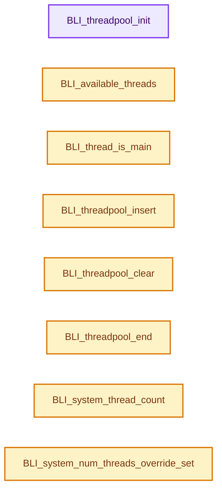
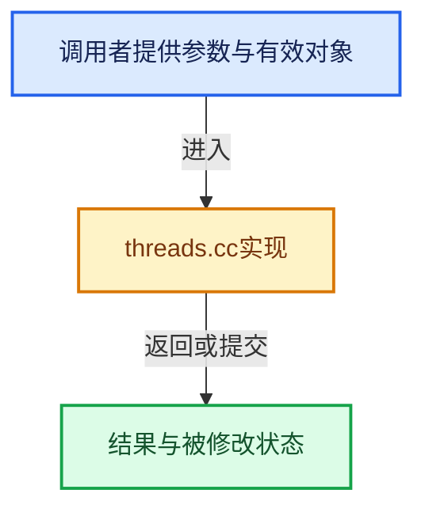

# 实现依赖专题：source/blender/blenlib/intern/threads.cc

[方向导航](README.md) · [符号索引](../%E7%AC%A6%E5%8F%B7%E4%BE%9D%E8%B5%96%E4%B8%8E%E5%AE%9E%E7%8E%B0%E7%B4%A2%E5%BC%95.md)

本专题从正文实际调用进入，集中保存共享实现。函数有稳定锚点，可从调用处直接跳到对应完整函数；递归与互相调用通过回链组织。

## 本文件的实现关系






## 完整成员与函数实现

<a id="f-8cd7d1cb805be904"></a>

### `BLI_threadpool_init`

实现位置：[source/blender/blenlib/intern/threads.cc](../../../../../source/blender/blenlib/intern/threads.cc) · L123—L146。

接口参数：

- `ListBaseT<ThreadSlot> *threadbase`
- `void *(*do_thread)(void *)`
- `void *`
- `int tot`

**教学注释版**

<!-- annotated:ce1173030ac0f7 -->

```cpp
void BLI_threadpool_init(ListBaseT<ThreadSlot> *threadbase, void *(*do_thread)(void *), int tot)
{
  int a;

  if (threadbase != nullptr && tot > 0) {
    threadbase->clear_no_delete();

    if (tot > RE_MAX_THREAD) {
      tot = RE_MAX_THREAD;
    }
    else if (tot < 1) {
      tot = 1;
    }

    for (a = 0; a < tot; a++) {
      ThreadSlot *tslot = MEM_new_zeroed<ThreadSlot>("threadslot");
      BLI_addtail(threadbase, tslot);
      tslot->do_thread = do_thread;
      tslot->avail = 1;
    }
  }

  atomic_fetch_and_add_u(&thread_levels, 1);
}
```

<details>
<summary>核对原始源码：source/blender/blenlib/intern/threads.cc · L123—L146</summary>

<!-- original:ce1173030ac0f7:source/blender/blenlib/intern/threads.cc:123:146 -->

```cpp
void BLI_threadpool_init(ListBaseT<ThreadSlot> *threadbase, void *(*do_thread)(void *), int tot)
{
  int a;

  if (threadbase != nullptr && tot > 0) {
    threadbase->clear_no_delete();

    if (tot > RE_MAX_THREAD) {
      tot = RE_MAX_THREAD;
    }
    else if (tot < 1) {
      tot = 1;
    }

    for (a = 0; a < tot; a++) {
      ThreadSlot *tslot = MEM_new_zeroed<ThreadSlot>("threadslot");
      BLI_addtail(threadbase, tslot);
      tslot->do_thread = do_thread;
      tslot->avail = 1;
    }
  }

  atomic_fetch_and_add_u(&thread_levels, 1);
}
```

</details>

**沿实际写入检查状态**

- `tot = RE_MAX_THREAD;`
- `tot = 1;`
- `tslot->do_thread = do_thread;`
- `tslot->avail = 1;`

**继续追踪实现**

- `threadbase->clear_no_delete` → [blender::ListBaseT::clear_no_delete · L68](../05-%E5%87%A0%E4%BD%95%E5%AD%98%E5%82%A8%E4%B8%8E%E6%8B%93%E6%89%91%E6%98%A0%E5%B0%84/%E4%BE%9D%E8%B5%96-DNA_listBase-48dbc9.md#f-431defdf189ae643)。
- `MEM_new_zeroed<ThreadSlot>` → [MEM_new_zeroed · L550](../03-%E5%86%85%E5%AD%98%E5%88%86%E9%85%8D%E4%B8%8E%E8%BF%90%E8%A1%8C%E6%97%B6%E7%B1%BB%E5%9E%8B/%E4%BE%9D%E8%B5%96-MEM_guardedalloc-b54eca.md#f-eeb1e2a7f57dd231)；[MEM_new_zeroed · L114](../03-%E5%86%85%E5%AD%98%E5%88%86%E9%85%8D%E4%B8%8E%E8%BF%90%E8%A1%8C%E6%97%B6%E7%B1%BB%E5%9E%8B/%E4%BE%9D%E8%B5%96-mallocn-afdcd4.md#f-e04cf01c64c8b180)。同名重载需按实参类型选择。
- `BLI_addtail` → [blender::BLI_addtail · L118](%E4%BE%9D%E8%B5%96-listbase-2816d9.md#f-4fb027713fa3115b)。
- `atomic_fetch_and_add_u` → [atomic_fetch_and_add_u · L155](../05-%E5%87%A0%E4%BD%95%E5%AD%98%E5%82%A8%E4%B8%8E%E6%8B%93%E6%89%91%E6%98%A0%E5%B0%84/%E4%BE%9D%E8%B5%96-atomic_ops_ext-271a62.md#f-91b4f2c7355f5f6d)。

<a id="f-3be0fe91623a6b7d"></a>

### `BLI_available_threads`

实现位置：[source/blender/blenlib/intern/threads.cc](../../../../../source/blender/blenlib/intern/threads.cc) · L148—L159。

接口参数：

- `ListBaseT<ThreadSlot> *threadbase`

**教学注释版**

<!-- annotated:8e0b0bba6d8820 -->

```cpp
int BLI_available_threads(ListBaseT<ThreadSlot> *threadbase)
{
  int counter = 0;

  for (ThreadSlot &tslot : *threadbase) {
    if (tslot.avail) {
      counter++;
    }
  }

  return counter;
}
```

<details>
<summary>核对原始源码：source/blender/blenlib/intern/threads.cc · L148—L159</summary>

<!-- original:8e0b0bba6d8820:source/blender/blenlib/intern/threads.cc:148:159 -->

```cpp
int BLI_available_threads(ListBaseT<ThreadSlot> *threadbase)
{
  int counter = 0;

  for (ThreadSlot &tslot : *threadbase) {
    if (tslot.avail) {
      counter++;
    }
  }

  return counter;
}
```

</details>

**结果出口**

- `return counter;`

**继续追踪实现**

本实现没有需要继续展开的显式调用；检查返回表达式、对象转换和调用者前置条件。

<a id="f-da304af4327defdc"></a>

### `BLI_thread_is_main`

实现位置：[source/blender/blenlib/intern/threads.cc](../../../../../source/blender/blenlib/intern/threads.cc) · L184—L187。

**教学注释版**

<!-- annotated:62a841d5ff248f -->

```cpp
int BLI_thread_is_main()
{
  return pthread_equal(pthread_self(), mainid);
}
```

<details>
<summary>核对原始源码：source/blender/blenlib/intern/threads.cc · L184—L187</summary>

<!-- original:62a841d5ff248f:source/blender/blenlib/intern/threads.cc:184:187 -->

```cpp
int BLI_thread_is_main()
{
  return pthread_equal(pthread_self(), mainid);
}
```

</details>

**结果出口**

- `return pthread_equal(pthread_self(), mainid);`

**继续追踪实现**

- `pthread_equal` → [调用协议](../%E6%A8%A1%E6%9D%BF%E5%AE%8F%E4%B8%8E%E5%8A%A8%E6%80%81%E5%88%86%E6%B4%BE%E5%8D%8F%E8%AE%AE.md)：函数指针、局部可调用对象或未展开的宏；必须结合调用者环境。调用位置L186。
- `pthread_self` → [调用协议](../%E6%A8%A1%E6%9D%BF%E5%AE%8F%E4%B8%8E%E5%8A%A8%E6%80%81%E5%88%86%E6%B4%BE%E5%8D%8F%E8%AE%AE.md)：函数指针、局部可调用对象或未展开的宏；必须结合调用者环境。调用位置L186。

<a id="f-e28be3630192cc51"></a>

### `BLI_threadpool_insert`

实现位置：[source/blender/blenlib/intern/threads.cc](../../../../../source/blender/blenlib/intern/threads.cc) · L189—L200。

接口参数：

- `ListBaseT<ThreadSlot> *threadbase`
- `void *callerdata`

**教学注释版**

<!-- annotated:4edae98bd6a0a4 -->

```cpp
void BLI_threadpool_insert(ListBaseT<ThreadSlot> *threadbase, void *callerdata)
{
  for (ThreadSlot &tslot : *threadbase) {
    if (tslot.avail) {
      tslot.avail = 0;
      tslot.callerdata = callerdata;
      pthread_create(&tslot.pthread, nullptr, tslot_thread_start, &tslot);
      return;
    }
  }
  printf("ERROR: could not insert thread slot\n");
}
```

<details>
<summary>核对原始源码：source/blender/blenlib/intern/threads.cc · L189—L200</summary>

<!-- original:4edae98bd6a0a4:source/blender/blenlib/intern/threads.cc:189:200 -->

```cpp
void BLI_threadpool_insert(ListBaseT<ThreadSlot> *threadbase, void *callerdata)
{
  for (ThreadSlot &tslot : *threadbase) {
    if (tslot.avail) {
      tslot.avail = 0;
      tslot.callerdata = callerdata;
      pthread_create(&tslot.pthread, nullptr, tslot_thread_start, &tslot);
      return;
    }
  }
  printf("ERROR: could not insert thread slot\n");
}
```

</details>

**沿实际写入检查状态**

- `tslot.avail = 0;`
- `tslot.callerdata = callerdata;`

**继续追踪实现**

- `pthread_create` → [调用协议](../%E6%A8%A1%E6%9D%BF%E5%AE%8F%E4%B8%8E%E5%8A%A8%E6%80%81%E5%88%86%E6%B4%BE%E5%8D%8F%E8%AE%AE.md)：函数指针、局部可调用对象或未展开的宏；必须结合调用者环境。调用位置L195。
- `printf` → [外部契约](https://eel.is/c++draft/)：这个边界按实际表达式及所属类型核对参数、返回值、寿命与失败行为。这里提供接口入口，不声称已解释该第三方版本的内部实现。

<a id="f-97161668e0bb7165"></a>

### `BLI_threadpool_clear`

实现位置：[source/blender/blenlib/intern/threads.cc](../../../../../source/blender/blenlib/intern/threads.cc) · L228—L237。

接口参数：

- `ListBaseT<ThreadSlot> *threadbase`

**教学注释版**

<!-- annotated:1a7c69a97b7673 -->

```cpp
void BLI_threadpool_clear(ListBaseT<ThreadSlot> *threadbase)
{
  for (ThreadSlot &tslot : *threadbase) {
    if (tslot.avail == 0) {
      pthread_join(tslot.pthread, nullptr);
      tslot.callerdata = nullptr;
      tslot.avail = 1;
    }
  }
}
```

<details>
<summary>核对原始源码：source/blender/blenlib/intern/threads.cc · L228—L237</summary>

<!-- original:1a7c69a97b7673:source/blender/blenlib/intern/threads.cc:228:237 -->

```cpp
void BLI_threadpool_clear(ListBaseT<ThreadSlot> *threadbase)
{
  for (ThreadSlot &tslot : *threadbase) {
    if (tslot.avail == 0) {
      pthread_join(tslot.pthread, nullptr);
      tslot.callerdata = nullptr;
      tslot.avail = 1;
    }
  }
}
```

</details>

**沿实际写入检查状态**

- `tslot.callerdata = nullptr;`
- `tslot.avail = 1;`

**继续追踪实现**

- `pthread_join` → [调用协议](../%E6%A8%A1%E6%9D%BF%E5%AE%8F%E4%B8%8E%E5%8A%A8%E6%80%81%E5%88%86%E6%B4%BE%E5%8D%8F%E8%AE%AE.md)：函数指针、局部可调用对象或未展开的宏；必须结合调用者环境。调用位置L232。

<a id="f-e4be8f92ee41d794"></a>

### `BLI_threadpool_end`

实现位置：[source/blender/blenlib/intern/threads.cc](../../../../../source/blender/blenlib/intern/threads.cc) · L239—L254。

接口参数：

- `ListBaseT<ThreadSlot> *threadbase`

**教学注释版**

<!-- annotated:15dab2e071e0e3 -->

```cpp
void BLI_threadpool_end(ListBaseT<ThreadSlot> *threadbase)
{

  /* Only needed if there's actually some stuff to end
   * this way we don't end up decrementing thread_levels on an empty `threadbase`. */
  if (threadbase == nullptr || threadbase->is_empty()) {
    return;
  }

  for (ThreadSlot &tslot : *threadbase) {
    if (tslot.avail == 0) {
      pthread_join(tslot.pthread, nullptr);
    }
  }
  threadbase->free_no_destruct();
}
```

<details>
<summary>核对原始源码：source/blender/blenlib/intern/threads.cc · L239—L254</summary>

<!-- original:15dab2e071e0e3:source/blender/blenlib/intern/threads.cc:239:254 -->

```cpp
void BLI_threadpool_end(ListBaseT<ThreadSlot> *threadbase)
{

  /* Only needed if there's actually some stuff to end
   * this way we don't end up decrementing thread_levels on an empty `threadbase`. */
  if (threadbase == nullptr || threadbase->is_empty()) {
    return;
  }

  for (ThreadSlot &tslot : *threadbase) {
    if (tslot.avail == 0) {
      pthread_join(tslot.pthread, nullptr);
    }
  }
  threadbase->free_no_destruct();
}
```

</details>

**继续追踪实现**

- `threadbase->is_empty` → [blender::ListBaseT::is_empty · L54](../05-%E5%87%A0%E4%BD%95%E5%AD%98%E5%82%A8%E4%B8%8E%E6%8B%93%E6%89%91%E6%98%A0%E5%B0%84/%E4%BE%9D%E8%B5%96-DNA_listBase-48dbc9.md#f-189938e5bf0f989b)。
- `pthread_join` → [调用协议](../%E6%A8%A1%E6%9D%BF%E5%AE%8F%E4%B8%8E%E5%8A%A8%E6%80%81%E5%88%86%E6%B4%BE%E5%8D%8F%E8%AE%AE.md)：函数指针、局部可调用对象或未展开的宏；必须结合调用者环境。调用位置L250。
- `threadbase->free_no_destruct` → [blender::ListBaseT::free_no_destruct · L78](../05-%E5%87%A0%E4%BD%95%E5%AD%98%E5%82%A8%E4%B8%8E%E6%8B%93%E6%89%91%E6%98%A0%E5%B0%84/%E4%BE%9D%E8%B5%96-DNA_listBase-48dbc9.md#f-8656670edd0f6b7e)。

<a id="f-12aff71a24fecec4"></a>

### `BLI_system_thread_count`

实现位置：[source/blender/blenlib/intern/threads.cc](../../../../../source/blender/blenlib/intern/threads.cc) · L258—L292。

**教学注释版**

<!-- annotated:e621d33907ef41 -->

```cpp
int BLI_system_thread_count()
{
  static int t = -1;

  if (threads_override_num != 0) {
    return threads_override_num;
  }
  if (t != -1) [[likely]] {
    return t;
  }

  {
#ifdef WIN32
    SYSTEM_INFO info;
    GetSystemInfo(&info);
    t = int(info.dwNumberOfProcessors);
#else
#  ifdef __APPLE__
    int mib[2];
    size_t len;

    mib[0] = CTL_HW;
    mib[1] = HW_NCPU;
    len = sizeof(t);
    sysctl(mib, 2, &t, &len, nullptr, 0);
#  else
    t = int(sysconf(_SC_NPROCESSORS_ONLN));
#  endif
#endif
  }

  CLAMP(t, 1, RE_MAX_THREAD);

  return t;
}
```

<details>
<summary>核对原始源码：source/blender/blenlib/intern/threads.cc · L258—L292</summary>

<!-- original:e621d33907ef41:source/blender/blenlib/intern/threads.cc:258:292 -->

```cpp
int BLI_system_thread_count()
{
  static int t = -1;

  if (threads_override_num != 0) {
    return threads_override_num;
  }
  if (t != -1) [[likely]] {
    return t;
  }

  {
#ifdef WIN32
    SYSTEM_INFO info;
    GetSystemInfo(&info);
    t = int(info.dwNumberOfProcessors);
#else
#  ifdef __APPLE__
    int mib[2];
    size_t len;

    mib[0] = CTL_HW;
    mib[1] = HW_NCPU;
    len = sizeof(t);
    sysctl(mib, 2, &t, &len, nullptr, 0);
#  else
    t = int(sysconf(_SC_NPROCESSORS_ONLN));
#  endif
#endif
  }

  CLAMP(t, 1, RE_MAX_THREAD);

  return t;
}
```

</details>

**沿实际写入检查状态**

- `t = int(info.dwNumberOfProcessors);`
- `mib[0] = CTL_HW;`
- `mib[1] = HW_NCPU;`
- `len = sizeof(t);`
- `t = int(sysconf(_SC_NPROCESSORS_ONLN));`

**结果出口**

- `return threads_override_num;`
- `return t;`

**继续追踪实现**

- `GetSystemInfo` → [调用协议](../%E6%A8%A1%E6%9D%BF%E5%AE%8F%E4%B8%8E%E5%8A%A8%E6%80%81%E5%88%86%E6%B4%BE%E5%8D%8F%E8%AE%AE.md)：函数指针、局部可调用对象或未展开的宏；必须结合调用者环境。调用位置L272。
- `sysctl` → [调用协议](../%E6%A8%A1%E6%9D%BF%E5%AE%8F%E4%B8%8E%E5%8A%A8%E6%80%81%E5%88%86%E6%B4%BE%E5%8D%8F%E8%AE%AE.md)：函数指针、局部可调用对象或未展开的宏；必须结合调用者环境。调用位置L282。
- `sysconf` → [调用协议](../%E6%A8%A1%E6%9D%BF%E5%AE%8F%E4%B8%8E%E5%8A%A8%E6%80%81%E5%88%86%E6%B4%BE%E5%8D%8F%E8%AE%AE.md)：函数指针、局部可调用对象或未展开的宏；必须结合调用者环境。调用位置L284。
- `CLAMP` → [CLAMP · L200](%E4%BE%9D%E8%B5%96-BLI_utildefines-293a0a.md#m-69703e497120)。宏定义由构建条件选择。

<a id="f-fd90b4e312efe1bc"></a>

### `BLI_system_num_threads_override_set`

实现位置：[source/blender/blenlib/intern/threads.cc](../../../../../source/blender/blenlib/intern/threads.cc) · L294—L297。

接口参数：

- `int num`

**教学注释版**

<!-- annotated:2686d8e6b585d3 -->

```cpp
void BLI_system_num_threads_override_set(int num)
{
  threads_override_num = num;
}
```

<details>
<summary>核对原始源码：source/blender/blenlib/intern/threads.cc · L294—L297</summary>

<!-- original:2686d8e6b585d3:source/blender/blenlib/intern/threads.cc:294:297 -->

```cpp
void BLI_system_num_threads_override_set(int num)
{
  threads_override_num = num;
}
```

</details>

**沿实际写入检查状态**

- `threads_override_num = num;`

**继续追踪实现**

本实现没有需要继续展开的显式调用；检查返回表达式、对象转换和调用者前置条件。

<a id="f-60300d2554231109"></a>

### `BLI_system_num_threads_override_get`

实现位置：[source/blender/blenlib/intern/threads.cc](../../../../../source/blender/blenlib/intern/threads.cc) · L299—L302。

**教学注释版**

<!-- annotated:1148136ad2d5aa -->

```cpp
int BLI_system_num_threads_override_get()
{
  return threads_override_num;
}
```

<details>
<summary>核对原始源码：source/blender/blenlib/intern/threads.cc · L299—L302</summary>

<!-- original:1148136ad2d5aa:source/blender/blenlib/intern/threads.cc:299:302 -->

```cpp
int BLI_system_num_threads_override_get()
{
  return threads_override_num;
}
```

</details>

**结果出口**

- `return threads_override_num;`

**继续追踪实现**

本实现没有需要继续展开的显式调用；检查返回表达式、对象转换和调用者前置条件。

<a id="f-0c8c9374e3b836b9"></a>

### `global_mutex_from_type`

实现位置：[source/blender/blenlib/intern/threads.cc](../../../../../source/blender/blenlib/intern/threads.cc) · L306—L329。

接口参数：

- `const int type`

**教学注释版**

<!-- annotated:7b17349ae3c931 -->

```cpp
static ThreadMutex *global_mutex_from_type(const int type)
{
  switch (type) {
    case LOCK_IMAGE:
      return &_image_lock;
    case LOCK_DRAW_IMAGE:
      return &_image_draw_lock;
    case LOCK_VIEWER:
      return &_viewer_lock;
    case LOCK_CUSTOM1:
      return &_custom1_lock;
    case LOCK_NODES:
      return &_nodes_lock;
    case LOCK_MOVIECLIP:
      return &_movieclip_lock;
    case LOCK_FFTW:
      return &_fftw_lock;
    case LOCK_VIEW3D:
      return &_view3d_lock;
    default:
      BLI_assert_unreachable();
      return nullptr;
  }
}
```

<details>
<summary>核对原始源码：source/blender/blenlib/intern/threads.cc · L306—L329</summary>

<!-- original:7b17349ae3c931:source/blender/blenlib/intern/threads.cc:306:329 -->

```cpp
static ThreadMutex *global_mutex_from_type(const int type)
{
  switch (type) {
    case LOCK_IMAGE:
      return &_image_lock;
    case LOCK_DRAW_IMAGE:
      return &_image_draw_lock;
    case LOCK_VIEWER:
      return &_viewer_lock;
    case LOCK_CUSTOM1:
      return &_custom1_lock;
    case LOCK_NODES:
      return &_nodes_lock;
    case LOCK_MOVIECLIP:
      return &_movieclip_lock;
    case LOCK_FFTW:
      return &_fftw_lock;
    case LOCK_VIEW3D:
      return &_view3d_lock;
    default:
      BLI_assert_unreachable();
      return nullptr;
  }
}
```

</details>

**结果出口**

- `return &_image_lock;`
- `return &_image_draw_lock;`
- `return &_viewer_lock;`
- `return &_custom1_lock;`
- `return &_nodes_lock;`
- `return &_movieclip_lock;`
- `return &_fftw_lock;`
- `return &_view3d_lock;`
- `return nullptr;`

**继续追踪实现**

- `BLI_assert_unreachable` → [BLI_assert_unreachable · L77](%E4%BE%9D%E8%B5%96-BLI_assert-cc98e8.md#m-7a2d91a67d8e)。宏定义由构建条件选择。

<a id="f-a612114dd9e0cb82"></a>

### `BLI_thread_lock`

实现位置：[source/blender/blenlib/intern/threads.cc](../../../../../source/blender/blenlib/intern/threads.cc) · L331—L334。

接口参数：

- `int type`

**教学注释版**

<!-- annotated:33f226da03be47 -->

```cpp
void BLI_thread_lock(int type)
{
  pthread_mutex_lock(global_mutex_from_type(type));
}
```

<details>
<summary>核对原始源码：source/blender/blenlib/intern/threads.cc · L331—L334</summary>

<!-- original:33f226da03be47:source/blender/blenlib/intern/threads.cc:331:334 -->

```cpp
void BLI_thread_lock(int type)
{
  pthread_mutex_lock(global_mutex_from_type(type));
}
```

</details>

**继续追踪实现**

- `pthread_mutex_lock` → [调用协议](../%E6%A8%A1%E6%9D%BF%E5%AE%8F%E4%B8%8E%E5%8A%A8%E6%80%81%E5%88%86%E6%B4%BE%E5%8D%8F%E8%AE%AE.md)：函数指针、局部可调用对象或未展开的宏；必须结合调用者环境。调用位置L333。
- `global_mutex_from_type` → [global_mutex_from_type · L306](%E4%BE%9D%E8%B5%96-threads-a036bf.md#f-0c8c9374e3b836b9)。

<a id="f-d747c2de72664b3f"></a>

### `BLI_thread_unlock`

实现位置：[source/blender/blenlib/intern/threads.cc](../../../../../source/blender/blenlib/intern/threads.cc) · L336—L339。

接口参数：

- `int type`

**教学注释版**

<!-- annotated:f87c8a6f26a2c0 -->

```cpp
void BLI_thread_unlock(int type)
{
  pthread_mutex_unlock(global_mutex_from_type(type));
}
```

<details>
<summary>核对原始源码：source/blender/blenlib/intern/threads.cc · L336—L339</summary>

<!-- original:f87c8a6f26a2c0:source/blender/blenlib/intern/threads.cc:336:339 -->

```cpp
void BLI_thread_unlock(int type)
{
  pthread_mutex_unlock(global_mutex_from_type(type));
}
```

</details>

**继续追踪实现**

- `pthread_mutex_unlock` → [调用协议](../%E6%A8%A1%E6%9D%BF%E5%AE%8F%E4%B8%8E%E5%8A%A8%E6%80%81%E5%88%86%E6%B4%BE%E5%8D%8F%E8%AE%AE.md)：函数指针、局部可调用对象或未展开的宏；必须结合调用者环境。调用位置L338。
- `global_mutex_from_type` → [global_mutex_from_type · L306](%E4%BE%9D%E8%B5%96-threads-a036bf.md#f-0c8c9374e3b836b9)。

<a id="f-7d065be18920fb3a"></a>

### `BLI_mutex_init`

实现位置：[source/blender/blenlib/intern/threads.cc](../../../../../source/blender/blenlib/intern/threads.cc) · L343—L346。

接口参数：

- `ThreadMutex *mutex`

**教学注释版**

<!-- annotated:04e0e0021cdffc -->

```cpp
void BLI_mutex_init(ThreadMutex *mutex)
{
  pthread_mutex_init(mutex, nullptr);
}
```

<details>
<summary>核对原始源码：source/blender/blenlib/intern/threads.cc · L343—L346</summary>

<!-- original:04e0e0021cdffc:source/blender/blenlib/intern/threads.cc:343:346 -->

```cpp
void BLI_mutex_init(ThreadMutex *mutex)
{
  pthread_mutex_init(mutex, nullptr);
}
```

</details>

**继续追踪实现**

- `pthread_mutex_init` → [调用协议](../%E6%A8%A1%E6%9D%BF%E5%AE%8F%E4%B8%8E%E5%8A%A8%E6%80%81%E5%88%86%E6%B4%BE%E5%8D%8F%E8%AE%AE.md)：函数指针、局部可调用对象或未展开的宏；必须结合调用者环境。调用位置L345。

<a id="f-825ea5a7ea897c32"></a>

### `BLI_mutex_lock`

实现位置：[source/blender/blenlib/intern/threads.cc](../../../../../source/blender/blenlib/intern/threads.cc) · L348—L351。

接口参数：

- `ThreadMutex *mutex`

**教学注释版**

<!-- annotated:a6f44a41e3609f -->

```cpp
void BLI_mutex_lock(ThreadMutex *mutex)
{
  pthread_mutex_lock(mutex);
}
```

<details>
<summary>核对原始源码：source/blender/blenlib/intern/threads.cc · L348—L351</summary>

<!-- original:a6f44a41e3609f:source/blender/blenlib/intern/threads.cc:348:351 -->

```cpp
void BLI_mutex_lock(ThreadMutex *mutex)
{
  pthread_mutex_lock(mutex);
}
```

</details>

**继续追踪实现**

- `pthread_mutex_lock` → [调用协议](../%E6%A8%A1%E6%9D%BF%E5%AE%8F%E4%B8%8E%E5%8A%A8%E6%80%81%E5%88%86%E6%B4%BE%E5%8D%8F%E8%AE%AE.md)：函数指针、局部可调用对象或未展开的宏；必须结合调用者环境。调用位置L350。

<a id="f-e8638af1addfc8a4"></a>

### `BLI_mutex_unlock`

实现位置：[source/blender/blenlib/intern/threads.cc](../../../../../source/blender/blenlib/intern/threads.cc) · L353—L356。

接口参数：

- `ThreadMutex *mutex`

**教学注释版**

<!-- annotated:a8ed74a6409e6e -->

```cpp
void BLI_mutex_unlock(ThreadMutex *mutex)
{
  pthread_mutex_unlock(mutex);
}
```

<details>
<summary>核对原始源码：source/blender/blenlib/intern/threads.cc · L353—L356</summary>

<!-- original:a8ed74a6409e6e:source/blender/blenlib/intern/threads.cc:353:356 -->

```cpp
void BLI_mutex_unlock(ThreadMutex *mutex)
{
  pthread_mutex_unlock(mutex);
}
```

</details>

**继续追踪实现**

- `pthread_mutex_unlock` → [调用协议](../%E6%A8%A1%E6%9D%BF%E5%AE%8F%E4%B8%8E%E5%8A%A8%E6%80%81%E5%88%86%E6%B4%BE%E5%8D%8F%E8%AE%AE.md)：函数指针、局部可调用对象或未展开的宏；必须结合调用者环境。调用位置L355。

<a id="f-dd8453f55f028ed4"></a>

### `BLI_mutex_end`

实现位置：[source/blender/blenlib/intern/threads.cc](../../../../../source/blender/blenlib/intern/threads.cc) · L363—L366。

接口参数：

- `ThreadMutex *mutex`

**教学注释版**

<!-- annotated:568dcbf9539d71 -->

```cpp
void BLI_mutex_end(ThreadMutex *mutex)
{
  pthread_mutex_destroy(mutex);
}
```

<details>
<summary>核对原始源码：source/blender/blenlib/intern/threads.cc · L363—L366</summary>

<!-- original:568dcbf9539d71:source/blender/blenlib/intern/threads.cc:363:366 -->

```cpp
void BLI_mutex_end(ThreadMutex *mutex)
{
  pthread_mutex_destroy(mutex);
}
```

</details>

**继续追踪实现**

- `pthread_mutex_destroy` → [调用协议](../%E6%A8%A1%E6%9D%BF%E5%AE%8F%E4%B8%8E%E5%8A%A8%E6%80%81%E5%88%86%E6%B4%BE%E5%8D%8F%E8%AE%AE.md)：函数指针、局部可调用对象或未展开的宏；必须结合调用者环境。调用位置L365。

<a id="f-88efa6ca03760b8b"></a>

### `tbb_spin_mutex_cast`

实现位置：[source/blender/blenlib/intern/threads.cc](../../../../../source/blender/blenlib/intern/threads.cc) · L384—L391。

接口参数：

- `SpinLock *spin`

**教学注释版**

<!-- annotated:1a6b57df9dbf96 -->

```cpp
static tbb::spin_mutex *tbb_spin_mutex_cast(SpinLock *spin)
{
  static_assert(sizeof(SpinLock) >= sizeof(tbb::spin_mutex),
                "SpinLock must match tbb::spin_mutex");
  static_assert(alignof(SpinLock) % alignof(tbb::spin_mutex) == 0,
                "SpinLock must be aligned same as tbb::spin_mutex");
  return reinterpret_cast<tbb::spin_mutex *>(spin);
}
```

<details>
<summary>核对原始源码：source/blender/blenlib/intern/threads.cc · L384—L391</summary>

<!-- original:1a6b57df9dbf96:source/blender/blenlib/intern/threads.cc:384:391 -->

```cpp
static tbb::spin_mutex *tbb_spin_mutex_cast(SpinLock *spin)
{
  static_assert(sizeof(SpinLock) >= sizeof(tbb::spin_mutex),
                "SpinLock must match tbb::spin_mutex");
  static_assert(alignof(SpinLock) % alignof(tbb::spin_mutex) == 0,
                "SpinLock must be aligned same as tbb::spin_mutex");
  return reinterpret_cast<tbb::spin_mutex *>(spin);
}
```

</details>

**结果出口**

- `return reinterpret_cast<tbb::spin_mutex *>(spin);`

**继续追踪实现**

本实现没有需要继续展开的显式调用；检查返回表达式、对象转换和调用者前置条件。

<a id="f-f9c0cc546138420c"></a>

### `BLI_spin_init`

实现位置：[source/blender/blenlib/intern/threads.cc](../../../../../source/blender/blenlib/intern/threads.cc) · L394—L406。

接口参数：

- `SpinLock *spin`

**教学注释版**

<!-- annotated:b7c27f0ba8a6a7 -->

```cpp
void BLI_spin_init(SpinLock *spin)
{
#ifdef WITH_TBB
  tbb::spin_mutex *spin_mutex = tbb_spin_mutex_cast(spin);
  new (spin_mutex) tbb::spin_mutex();
#elif defined(__APPLE__)
  BLI_mutex_init(spin);
#elif defined(_MSC_VER)
  *spin = 0;
#else
  pthread_spin_init(spin, 0);
#endif
}
```

<details>
<summary>核对原始源码：source/blender/blenlib/intern/threads.cc · L394—L406</summary>

<!-- original:b7c27f0ba8a6a7:source/blender/blenlib/intern/threads.cc:394:406 -->

```cpp
void BLI_spin_init(SpinLock *spin)
{
#ifdef WITH_TBB
  tbb::spin_mutex *spin_mutex = tbb_spin_mutex_cast(spin);
  new (spin_mutex) tbb::spin_mutex();
#elif defined(__APPLE__)
  BLI_mutex_init(spin);
#elif defined(_MSC_VER)
  *spin = 0;
#else
  pthread_spin_init(spin, 0);
#endif
}
```

</details>

**继续追踪实现**

- `tbb_spin_mutex_cast` → [tbb_spin_mutex_cast · L384](%E4%BE%9D%E8%B5%96-threads-a036bf.md#f-88efa6ca03760b8b)。
- `BLI_mutex_init` → [BLI_mutex_init · L343](%E4%BE%9D%E8%B5%96-threads-a036bf.md#f-7d065be18920fb3a)。
- `pthread_spin_init` → [调用协议](../%E6%A8%A1%E6%9D%BF%E5%AE%8F%E4%B8%8E%E5%8A%A8%E6%80%81%E5%88%86%E6%B4%BE%E5%8D%8F%E8%AE%AE.md)：函数指针、局部可调用对象或未展开的宏；必须结合调用者环境。调用位置L404。

<a id="f-ded25214a4593256"></a>

### `BLI_spin_unlock`

实现位置：[source/blender/blenlib/intern/threads.cc](../../../../../source/blender/blenlib/intern/threads.cc) · L433—L446。

接口参数：

- `SpinLock *spin`

**教学注释版**

<!-- annotated:92e9f0f5719c0f -->

```cpp
void BLI_spin_unlock(SpinLock *spin)
{
#ifdef WITH_TBB
  tbb::spin_mutex *spin_mutex = tbb_spin_mutex_cast(spin);
  spin_mutex->unlock();
#elif defined(__APPLE__)
  BLI_mutex_unlock(spin);
#elif defined(_MSC_VER)
  _ReadWriteBarrier();
  *spin = 0;
#else
  pthread_spin_unlock(spin);
#endif
}
```

<details>
<summary>核对原始源码：source/blender/blenlib/intern/threads.cc · L433—L446</summary>

<!-- original:92e9f0f5719c0f:source/blender/blenlib/intern/threads.cc:433:446 -->

```cpp
void BLI_spin_unlock(SpinLock *spin)
{
#ifdef WITH_TBB
  tbb::spin_mutex *spin_mutex = tbb_spin_mutex_cast(spin);
  spin_mutex->unlock();
#elif defined(__APPLE__)
  BLI_mutex_unlock(spin);
#elif defined(_MSC_VER)
  _ReadWriteBarrier();
  *spin = 0;
#else
  pthread_spin_unlock(spin);
#endif
}
```

</details>

**继续追踪实现**

- `tbb_spin_mutex_cast` → [tbb_spin_mutex_cast · L384](%E4%BE%9D%E8%B5%96-threads-a036bf.md#f-88efa6ca03760b8b)。
- `spin_mutex->unlock` → [外部契约](https://eel.is/c++draft/)：这个边界按实际表达式及所属类型核对参数、返回值、寿命与失败行为。这里提供接口入口，不声称已解释该第三方版本的内部实现。
- `BLI_mutex_unlock` → [BLI_mutex_unlock · L353](%E4%BE%9D%E8%B5%96-threads-a036bf.md#f-e8638af1addfc8a4)。
- `_ReadWriteBarrier` → [调用协议](../%E6%A8%A1%E6%9D%BF%E5%AE%8F%E4%B8%8E%E5%8A%A8%E6%80%81%E5%88%86%E6%B4%BE%E5%8D%8F%E8%AE%AE.md)：函数指针、局部可调用对象或未展开的宏；必须结合调用者环境。调用位置L441。
- `pthread_spin_unlock` → [调用协议](../%E6%A8%A1%E6%9D%BF%E5%AE%8F%E4%B8%8E%E5%8A%A8%E6%80%81%E5%88%86%E6%B4%BE%E5%8D%8F%E8%AE%AE.md)：函数指针、局部可调用对象或未展开的宏；必须结合调用者环境。调用位置L444。

<a id="f-13c8e3908b9b32bd"></a>

### `BLI_spin_end`

实现位置：[source/blender/blenlib/intern/threads.cc](../../../../../source/blender/blenlib/intern/threads.cc) · L448—L461。

接口参数：

- `SpinLock *spin`

**教学注释版**

<!-- annotated:9c0ad8b65baa3a -->

```cpp
void BLI_spin_end(SpinLock *spin)
{
#ifdef WITH_TBB
  tbb::spin_mutex *spin_mutex = tbb_spin_mutex_cast(spin);
  spin_mutex->~spin_mutex();
#elif defined(__APPLE__)
  BLI_mutex_end(spin);
#elif defined(_MSC_VER)
  /* Nothing to do, spin is a simple integer type. */
  UNUSED_VARS(spin);
#else
  pthread_spin_destroy(spin);
#endif
}
```

<details>
<summary>核对原始源码：source/blender/blenlib/intern/threads.cc · L448—L461</summary>

<!-- original:9c0ad8b65baa3a:source/blender/blenlib/intern/threads.cc:448:461 -->

```cpp
void BLI_spin_end(SpinLock *spin)
{
#ifdef WITH_TBB
  tbb::spin_mutex *spin_mutex = tbb_spin_mutex_cast(spin);
  spin_mutex->~spin_mutex();
#elif defined(__APPLE__)
  BLI_mutex_end(spin);
#elif defined(_MSC_VER)
  /* Nothing to do, spin is a simple integer type. */
  UNUSED_VARS(spin);
#else
  pthread_spin_destroy(spin);
#endif
}
```

</details>

**继续追踪实现**

- `tbb_spin_mutex_cast` → [tbb_spin_mutex_cast · L384](%E4%BE%9D%E8%B5%96-threads-a036bf.md#f-88efa6ca03760b8b)。
- `spin_mutex->~spin_mutex` → [外部契约](https://eel.is/c++draft/)：这个边界按实际表达式及所属类型核对参数、返回值、寿命与失败行为。这里提供接口入口，不声称已解释该第三方版本的内部实现。
- `BLI_mutex_end` → [BLI_mutex_end · L363](%E4%BE%9D%E8%B5%96-threads-a036bf.md#f-dd8453f55f028ed4)。
- `UNUSED_VARS` → [UNUSED_VARS · L522](%E4%BE%9D%E8%B5%96-BLI_utildefines-293a0a.md#m-013582537634)；[UNUSED_VARS · L41](../05-%E5%87%A0%E4%BD%95%E5%AD%98%E5%82%A8%E4%B8%8E%E6%8B%93%E6%89%91%E6%98%A0%E5%B0%84/%E4%BE%9D%E8%B5%96-GPU_shader_shared_utils-0adda3.md#m-05d9d7a33da0)；[UNUSED_VARS · L62](../05-%E5%87%A0%E4%BD%95%E5%AD%98%E5%82%A8%E4%B8%8E%E6%8B%93%E6%89%91%E6%98%A0%E5%B0%84/%E4%BE%9D%E8%B5%96-GPU_shader_shared_utils-0adda3.md#m-e12c683a4aca)。宏定义由构建条件选择。
- `pthread_spin_destroy` → [调用协议](../%E6%A8%A1%E6%9D%BF%E5%AE%8F%E4%B8%8E%E5%8A%A8%E6%80%81%E5%88%86%E6%B4%BE%E5%8D%8F%E8%AE%AE.md)：函数指针、局部可调用对象或未展开的宏；必须结合调用者环境。调用位置L459。

<a id="f-8dee1f89b3d86ffa"></a>

### `BLI_rw_mutex_init`

实现位置：[source/blender/blenlib/intern/threads.cc](../../../../../source/blender/blenlib/intern/threads.cc) · L465—L468。

接口参数：

- `ThreadRWMutex *mutex`

**教学注释版**

<!-- annotated:ced61b4c1fbe49 -->

```cpp
void BLI_rw_mutex_init(ThreadRWMutex *mutex)
{
  pthread_rwlock_init(mutex, nullptr);
}
```

<details>
<summary>核对原始源码：source/blender/blenlib/intern/threads.cc · L465—L468</summary>

<!-- original:ced61b4c1fbe49:source/blender/blenlib/intern/threads.cc:465:468 -->

```cpp
void BLI_rw_mutex_init(ThreadRWMutex *mutex)
{
  pthread_rwlock_init(mutex, nullptr);
}
```

</details>

**继续追踪实现**

- `pthread_rwlock_init` → [调用协议](../%E6%A8%A1%E6%9D%BF%E5%AE%8F%E4%B8%8E%E5%8A%A8%E6%80%81%E5%88%86%E6%B4%BE%E5%8D%8F%E8%AE%AE.md)：函数指针、局部可调用对象或未展开的宏；必须结合调用者环境。调用位置L467。

<a id="f-567e78db2b1a0d53"></a>

### `BLI_rw_mutex_lock`

实现位置：[source/blender/blenlib/intern/threads.cc](../../../../../source/blender/blenlib/intern/threads.cc) · L470—L478。

接口参数：

- `ThreadRWMutex *mutex`
- `int mode`

**教学注释版**

<!-- annotated:e7265de7f628d5 -->

```cpp
void BLI_rw_mutex_lock(ThreadRWMutex *mutex, int mode)
{
  if (mode == THREAD_LOCK_READ) {
    pthread_rwlock_rdlock(mutex);
  }
  else {
    pthread_rwlock_wrlock(mutex);
  }
}
```

<details>
<summary>核对原始源码：source/blender/blenlib/intern/threads.cc · L470—L478</summary>

<!-- original:e7265de7f628d5:source/blender/blenlib/intern/threads.cc:470:478 -->

```cpp
void BLI_rw_mutex_lock(ThreadRWMutex *mutex, int mode)
{
  if (mode == THREAD_LOCK_READ) {
    pthread_rwlock_rdlock(mutex);
  }
  else {
    pthread_rwlock_wrlock(mutex);
  }
}
```

</details>

**继续追踪实现**

- `pthread_rwlock_rdlock` → [调用协议](../%E6%A8%A1%E6%9D%BF%E5%AE%8F%E4%B8%8E%E5%8A%A8%E6%80%81%E5%88%86%E6%B4%BE%E5%8D%8F%E8%AE%AE.md)：函数指针、局部可调用对象或未展开的宏；必须结合调用者环境。调用位置L473。
- `pthread_rwlock_wrlock` → [调用协议](../%E6%A8%A1%E6%9D%BF%E5%AE%8F%E4%B8%8E%E5%8A%A8%E6%80%81%E5%88%86%E6%B4%BE%E5%8D%8F%E8%AE%AE.md)：函数指针、局部可调用对象或未展开的宏；必须结合调用者环境。调用位置L476。

<a id="f-2b8f406eaca6d7b7"></a>

### `BLI_rw_mutex_unlock`

实现位置：[source/blender/blenlib/intern/threads.cc](../../../../../source/blender/blenlib/intern/threads.cc) · L480—L483。

接口参数：

- `ThreadRWMutex *mutex`

**教学注释版**

<!-- annotated:c40b6b12f11977 -->

```cpp
void BLI_rw_mutex_unlock(ThreadRWMutex *mutex)
{
  pthread_rwlock_unlock(mutex);
}
```

<details>
<summary>核对原始源码：source/blender/blenlib/intern/threads.cc · L480—L483</summary>

<!-- original:c40b6b12f11977:source/blender/blenlib/intern/threads.cc:480:483 -->

```cpp
void BLI_rw_mutex_unlock(ThreadRWMutex *mutex)
{
  pthread_rwlock_unlock(mutex);
}
```

</details>

**继续追踪实现**

- `pthread_rwlock_unlock` → [调用协议](../%E6%A8%A1%E6%9D%BF%E5%AE%8F%E4%B8%8E%E5%8A%A8%E6%80%81%E5%88%86%E6%B4%BE%E5%8D%8F%E8%AE%AE.md)：函数指针、局部可调用对象或未展开的宏；必须结合调用者环境。调用位置L482。

<a id="f-7adb9555d0e9fd6b"></a>

### `BLI_rw_mutex_end`

实现位置：[source/blender/blenlib/intern/threads.cc](../../../../../source/blender/blenlib/intern/threads.cc) · L485—L488。

接口参数：

- `ThreadRWMutex *mutex`

**教学注释版**

<!-- annotated:9c7e50ef39f269 -->

```cpp
void BLI_rw_mutex_end(ThreadRWMutex *mutex)
{
  pthread_rwlock_destroy(mutex);
}
```

<details>
<summary>核对原始源码：source/blender/blenlib/intern/threads.cc · L485—L488</summary>

<!-- original:9c7e50ef39f269:source/blender/blenlib/intern/threads.cc:485:488 -->

```cpp
void BLI_rw_mutex_end(ThreadRWMutex *mutex)
{
  pthread_rwlock_destroy(mutex);
}
```

</details>

**继续追踪实现**

- `pthread_rwlock_destroy` → [调用协议](../%E6%A8%A1%E6%9D%BF%E5%AE%8F%E4%B8%8E%E5%8A%A8%E6%80%81%E5%88%86%E6%B4%BE%E5%8D%8F%E8%AE%AE.md)：函数指针、局部可调用对象或未展开的宏；必须结合调用者环境。调用位置L487。

<a id="f-a19b42cf96696ce4"></a>

### `BLI_ticket_mutex_alloc`

实现位置：[source/blender/blenlib/intern/threads.cc](../../../../../source/blender/blenlib/intern/threads.cc) · L513—L521。

**教学注释版**

<!-- annotated:49564ccecedeea -->

```cpp
TicketMutex *BLI_ticket_mutex_alloc()
{
  TicketMutex *ticket = MEM_new_zeroed<TicketMutex>("TicketMutex");

  pthread_cond_init(&ticket->cond, nullptr);
  pthread_mutex_init(&ticket->mutex, nullptr);

  return ticket;
}
```

<details>
<summary>核对原始源码：source/blender/blenlib/intern/threads.cc · L513—L521</summary>

<!-- original:49564ccecedeea:source/blender/blenlib/intern/threads.cc:513:521 -->

```cpp
TicketMutex *BLI_ticket_mutex_alloc()
{
  TicketMutex *ticket = MEM_new_zeroed<TicketMutex>("TicketMutex");

  pthread_cond_init(&ticket->cond, nullptr);
  pthread_mutex_init(&ticket->mutex, nullptr);

  return ticket;
}
```

</details>

**结果出口**

- `return ticket;`

**继续追踪实现**

- `MEM_new_zeroed<TicketMutex>` → [MEM_new_zeroed · L550](../03-%E5%86%85%E5%AD%98%E5%88%86%E9%85%8D%E4%B8%8E%E8%BF%90%E8%A1%8C%E6%97%B6%E7%B1%BB%E5%9E%8B/%E4%BE%9D%E8%B5%96-MEM_guardedalloc-b54eca.md#f-eeb1e2a7f57dd231)；[MEM_new_zeroed · L114](../03-%E5%86%85%E5%AD%98%E5%88%86%E9%85%8D%E4%B8%8E%E8%BF%90%E8%A1%8C%E6%97%B6%E7%B1%BB%E5%9E%8B/%E4%BE%9D%E8%B5%96-mallocn-afdcd4.md#f-e04cf01c64c8b180)。同名重载需按实参类型选择。
- `pthread_cond_init` → [调用协议](../%E6%A8%A1%E6%9D%BF%E5%AE%8F%E4%B8%8E%E5%8A%A8%E6%80%81%E5%88%86%E6%B4%BE%E5%8D%8F%E8%AE%AE.md)：函数指针、局部可调用对象或未展开的宏；必须结合调用者环境。调用位置L517。
- `pthread_mutex_init` → [调用协议](../%E6%A8%A1%E6%9D%BF%E5%AE%8F%E4%B8%8E%E5%8A%A8%E6%80%81%E5%88%86%E6%B4%BE%E5%8D%8F%E8%AE%AE.md)：函数指针、局部可调用对象或未展开的宏；必须结合调用者环境。调用位置L518。

<a id="f-a4994dce7ba3c984"></a>

### `BLI_ticket_mutex_free`

实现位置：[source/blender/blenlib/intern/threads.cc](../../../../../source/blender/blenlib/intern/threads.cc) · L523—L528。

接口参数：

- `TicketMutex *ticket`

**教学注释版**

<!-- annotated:df091265805e7b -->

```cpp
void BLI_ticket_mutex_free(TicketMutex *ticket)
{
  pthread_mutex_destroy(&ticket->mutex);
  pthread_cond_destroy(&ticket->cond);
  MEM_delete(ticket);
}
```

<details>
<summary>核对原始源码：source/blender/blenlib/intern/threads.cc · L523—L528</summary>

<!-- original:df091265805e7b:source/blender/blenlib/intern/threads.cc:523:528 -->

```cpp
void BLI_ticket_mutex_free(TicketMutex *ticket)
{
  pthread_mutex_destroy(&ticket->mutex);
  pthread_cond_destroy(&ticket->cond);
  MEM_delete(ticket);
}
```

</details>

**继续追踪实现**

- `pthread_mutex_destroy` → [调用协议](../%E6%A8%A1%E6%9D%BF%E5%AE%8F%E4%B8%8E%E5%8A%A8%E6%80%81%E5%88%86%E6%B4%BE%E5%8D%8F%E8%AE%AE.md)：函数指针、局部可调用对象或未展开的宏；必须结合调用者环境。调用位置L525。
- `pthread_cond_destroy` → [调用协议](../%E6%A8%A1%E6%9D%BF%E5%AE%8F%E4%B8%8E%E5%8A%A8%E6%80%81%E5%88%86%E6%B4%BE%E5%8D%8F%E8%AE%AE.md)：函数指针、局部可调用对象或未展开的宏；必须结合调用者环境。调用位置L526。
- `MEM_delete` → [MEM_delete · L400](../03-%E5%86%85%E5%AD%98%E5%88%86%E9%85%8D%E4%B8%8E%E8%BF%90%E8%A1%8C%E6%97%B6%E7%B1%BB%E5%9E%8B/%E4%BE%9D%E8%B5%96-MEM_guardedalloc-b54eca.md#f-9049ffdd1682887c)。

<a id="f-8211abb267672838"></a>

### `ticket_mutex_lock`

实现位置：[source/blender/blenlib/intern/threads.cc](../../../../../source/blender/blenlib/intern/threads.cc) · L530—L553。

接口参数：

- `TicketMutex *ticket`
- `const bool check_recursive`

**教学注释版**

<!-- annotated:ccf39ff74f59df -->

```cpp
static bool ticket_mutex_lock(TicketMutex *ticket, const bool check_recursive)
{
  uint queue_me;

  pthread_mutex_lock(&ticket->mutex);

  /* Check for recursive locks, for debugging only. */
  if (check_recursive && ticket->has_owner && pthread_equal(pthread_self(), ticket->owner)) {
    pthread_mutex_unlock(&ticket->mutex);
    return false;
  }

  queue_me = ticket->queue_tail++;

  while (queue_me != ticket->queue_head) {
    pthread_cond_wait(&ticket->cond, &ticket->mutex);
  }

  ticket->owner = pthread_self();
  ticket->has_owner = true;

  pthread_mutex_unlock(&ticket->mutex);
  return true;
}
```

<details>
<summary>核对原始源码：source/blender/blenlib/intern/threads.cc · L530—L553</summary>

<!-- original:ccf39ff74f59df:source/blender/blenlib/intern/threads.cc:530:553 -->

```cpp
static bool ticket_mutex_lock(TicketMutex *ticket, const bool check_recursive)
{
  uint queue_me;

  pthread_mutex_lock(&ticket->mutex);

  /* Check for recursive locks, for debugging only. */
  if (check_recursive && ticket->has_owner && pthread_equal(pthread_self(), ticket->owner)) {
    pthread_mutex_unlock(&ticket->mutex);
    return false;
  }

  queue_me = ticket->queue_tail++;

  while (queue_me != ticket->queue_head) {
    pthread_cond_wait(&ticket->cond, &ticket->mutex);
  }

  ticket->owner = pthread_self();
  ticket->has_owner = true;

  pthread_mutex_unlock(&ticket->mutex);
  return true;
}
```

</details>

**沿实际写入检查状态**

- `queue_me = ticket->queue_tail++;`
- `ticket->owner = pthread_self();`
- `ticket->has_owner = true;`

**结果出口**

- `return false;`
- `return true;`

**继续追踪实现**

- `pthread_mutex_lock` → [调用协议](../%E6%A8%A1%E6%9D%BF%E5%AE%8F%E4%B8%8E%E5%8A%A8%E6%80%81%E5%88%86%E6%B4%BE%E5%8D%8F%E8%AE%AE.md)：函数指针、局部可调用对象或未展开的宏；必须结合调用者环境。调用位置L534。
- `pthread_equal` → [调用协议](../%E6%A8%A1%E6%9D%BF%E5%AE%8F%E4%B8%8E%E5%8A%A8%E6%80%81%E5%88%86%E6%B4%BE%E5%8D%8F%E8%AE%AE.md)：函数指针、局部可调用对象或未展开的宏；必须结合调用者环境。调用位置L537。
- `pthread_self` → [调用协议](../%E6%A8%A1%E6%9D%BF%E5%AE%8F%E4%B8%8E%E5%8A%A8%E6%80%81%E5%88%86%E6%B4%BE%E5%8D%8F%E8%AE%AE.md)：函数指针、局部可调用对象或未展开的宏；必须结合调用者环境。调用位置L537。
- `pthread_mutex_unlock` → [调用协议](../%E6%A8%A1%E6%9D%BF%E5%AE%8F%E4%B8%8E%E5%8A%A8%E6%80%81%E5%88%86%E6%B4%BE%E5%8D%8F%E8%AE%AE.md)：函数指针、局部可调用对象或未展开的宏；必须结合调用者环境。调用位置L538。
- `pthread_cond_wait` → [调用协议](../%E6%A8%A1%E6%9D%BF%E5%AE%8F%E4%B8%8E%E5%8A%A8%E6%80%81%E5%88%86%E6%B4%BE%E5%8D%8F%E8%AE%AE.md)：函数指针、局部可调用对象或未展开的宏；必须结合调用者环境。调用位置L545。

<a id="f-0636d5a04033b13b"></a>

### `BLI_ticket_mutex_lock`

实现位置：[source/blender/blenlib/intern/threads.cc](../../../../../source/blender/blenlib/intern/threads.cc) · L555—L558。

接口参数：

- `TicketMutex *ticket`

**教学注释版**

<!-- annotated:71fa9f341f2c29 -->

```cpp
void BLI_ticket_mutex_lock(TicketMutex *ticket)
{
  ticket_mutex_lock(ticket, false);
}
```

<details>
<summary>核对原始源码：source/blender/blenlib/intern/threads.cc · L555—L558</summary>

<!-- original:71fa9f341f2c29:source/blender/blenlib/intern/threads.cc:555:558 -->

```cpp
void BLI_ticket_mutex_lock(TicketMutex *ticket)
{
  ticket_mutex_lock(ticket, false);
}
```

</details>

**继续追踪实现**

- `ticket_mutex_lock` → [ticket_mutex_lock · L530](%E4%BE%9D%E8%B5%96-threads-a036bf.md#f-8211abb267672838)。

<a id="f-3d903ff338e26395"></a>

### `BLI_ticket_mutex_lock_check_recursive`

实现位置：[source/blender/blenlib/intern/threads.cc](../../../../../source/blender/blenlib/intern/threads.cc) · L560—L563。

接口参数：

- `TicketMutex *ticket`

**教学注释版**

<!-- annotated:7ef4a7c235919f -->

```cpp
bool BLI_ticket_mutex_lock_check_recursive(TicketMutex *ticket)
{
  return ticket_mutex_lock(ticket, true);
}
```

<details>
<summary>核对原始源码：source/blender/blenlib/intern/threads.cc · L560—L563</summary>

<!-- original:7ef4a7c235919f:source/blender/blenlib/intern/threads.cc:560:563 -->

```cpp
bool BLI_ticket_mutex_lock_check_recursive(TicketMutex *ticket)
{
  return ticket_mutex_lock(ticket, true);
}
```

</details>

**结果出口**

- `return ticket_mutex_lock(ticket, true);`

**继续追踪实现**

- `ticket_mutex_lock` → [ticket_mutex_lock · L530](%E4%BE%9D%E8%B5%96-threads-a036bf.md#f-8211abb267672838)。

<a id="f-75799cbeb37c97e5"></a>

### `BLI_ticket_mutex_unlock`

实现位置：[source/blender/blenlib/intern/threads.cc](../../../../../source/blender/blenlib/intern/threads.cc) · L565—L572。

接口参数：

- `TicketMutex *ticket`

**教学注释版**

<!-- annotated:8ca0b1ac732f6f -->

```cpp
void BLI_ticket_mutex_unlock(TicketMutex *ticket)
{
  pthread_mutex_lock(&ticket->mutex);
  ticket->queue_head++;
  ticket->has_owner = false;
  pthread_cond_broadcast(&ticket->cond);
  pthread_mutex_unlock(&ticket->mutex);
}
```

<details>
<summary>核对原始源码：source/blender/blenlib/intern/threads.cc · L565—L572</summary>

<!-- original:8ca0b1ac732f6f:source/blender/blenlib/intern/threads.cc:565:572 -->

```cpp
void BLI_ticket_mutex_unlock(TicketMutex *ticket)
{
  pthread_mutex_lock(&ticket->mutex);
  ticket->queue_head++;
  ticket->has_owner = false;
  pthread_cond_broadcast(&ticket->cond);
  pthread_mutex_unlock(&ticket->mutex);
}
```

</details>

**沿实际写入检查状态**

- `ticket->has_owner = false;`

**继续追踪实现**

- `pthread_mutex_lock` → [调用协议](../%E6%A8%A1%E6%9D%BF%E5%AE%8F%E4%B8%8E%E5%8A%A8%E6%80%81%E5%88%86%E6%B4%BE%E5%8D%8F%E8%AE%AE.md)：函数指针、局部可调用对象或未展开的宏；必须结合调用者环境。调用位置L567。
- `pthread_cond_broadcast` → [调用协议](../%E6%A8%A1%E6%9D%BF%E5%AE%8F%E4%B8%8E%E5%8A%A8%E6%80%81%E5%88%86%E6%B4%BE%E5%8D%8F%E8%AE%AE.md)：函数指针、局部可调用对象或未展开的宏；必须结合调用者环境。调用位置L570。
- `pthread_mutex_unlock` → [调用协议](../%E6%A8%A1%E6%9D%BF%E5%AE%8F%E4%B8%8E%E5%8A%A8%E6%80%81%E5%88%86%E6%B4%BE%E5%8D%8F%E8%AE%AE.md)：函数指针、局部可调用对象或未展开的宏；必须结合调用者环境。调用位置L571。

<a id="f-ffe6a8907735c65f"></a>

### `BLI_condition_init`

实现位置：[source/blender/blenlib/intern/threads.cc](../../../../../source/blender/blenlib/intern/threads.cc) · L578—L581。

接口参数：

- `ThreadCondition *cond`

**教学注释版**

<!-- annotated:15125fd9e3f6cc -->

```cpp
void BLI_condition_init(ThreadCondition *cond)
{
  pthread_cond_init(cond, nullptr);
}
```

<details>
<summary>核对原始源码：source/blender/blenlib/intern/threads.cc · L578—L581</summary>

<!-- original:15125fd9e3f6cc:source/blender/blenlib/intern/threads.cc:578:581 -->

```cpp
void BLI_condition_init(ThreadCondition *cond)
{
  pthread_cond_init(cond, nullptr);
}
```

</details>

**继续追踪实现**

- `pthread_cond_init` → [调用协议](../%E6%A8%A1%E6%9D%BF%E5%AE%8F%E4%B8%8E%E5%8A%A8%E6%80%81%E5%88%86%E6%B4%BE%E5%8D%8F%E8%AE%AE.md)：函数指针、局部可调用对象或未展开的宏；必须结合调用者环境。调用位置L580。

<a id="f-8764b981d6e8f714"></a>

### `BLI_condition_wait_global_mutex`

实现位置：[source/blender/blenlib/intern/threads.cc](../../../../../source/blender/blenlib/intern/threads.cc) · L588—L591。

接口参数：

- `ThreadCondition *cond`
- `const int type`

**教学注释版**

<!-- annotated:c54a325c4cd963 -->

```cpp
void BLI_condition_wait_global_mutex(ThreadCondition *cond, const int type)
{
  pthread_cond_wait(cond, global_mutex_from_type(type));
}
```

<details>
<summary>核对原始源码：source/blender/blenlib/intern/threads.cc · L588—L591</summary>

<!-- original:c54a325c4cd963:source/blender/blenlib/intern/threads.cc:588:591 -->

```cpp
void BLI_condition_wait_global_mutex(ThreadCondition *cond, const int type)
{
  pthread_cond_wait(cond, global_mutex_from_type(type));
}
```

</details>

**继续追踪实现**

- `pthread_cond_wait` → [调用协议](../%E6%A8%A1%E6%9D%BF%E5%AE%8F%E4%B8%8E%E5%8A%A8%E6%80%81%E5%88%86%E6%B4%BE%E5%8D%8F%E8%AE%AE.md)：函数指针、局部可调用对象或未展开的宏；必须结合调用者环境。调用位置L590。
- `global_mutex_from_type` → [global_mutex_from_type · L306](%E4%BE%9D%E8%B5%96-threads-a036bf.md#f-0c8c9374e3b836b9)。

<a id="f-fcd9b7e3f6c5587d"></a>

### `BLI_condition_notify_one`

实现位置：[source/blender/blenlib/intern/threads.cc](../../../../../source/blender/blenlib/intern/threads.cc) · L593—L596。

接口参数：

- `ThreadCondition *cond`

**教学注释版**

<!-- annotated:e980ff9ef8f4c7 -->

```cpp
void BLI_condition_notify_one(ThreadCondition *cond)
{
  pthread_cond_signal(cond);
}
```

<details>
<summary>核对原始源码：source/blender/blenlib/intern/threads.cc · L593—L596</summary>

<!-- original:e980ff9ef8f4c7:source/blender/blenlib/intern/threads.cc:593:596 -->

```cpp
void BLI_condition_notify_one(ThreadCondition *cond)
{
  pthread_cond_signal(cond);
}
```

</details>

**继续追踪实现**

- `pthread_cond_signal` → [调用协议](../%E6%A8%A1%E6%9D%BF%E5%AE%8F%E4%B8%8E%E5%8A%A8%E6%80%81%E5%88%86%E6%B4%BE%E5%8D%8F%E8%AE%AE.md)：函数指针、局部可调用对象或未展开的宏；必须结合调用者环境。调用位置L595。

<a id="f-a97daa12aca80165"></a>

### `BLI_condition_notify_all`

实现位置：[source/blender/blenlib/intern/threads.cc](../../../../../source/blender/blenlib/intern/threads.cc) · L598—L601。

接口参数：

- `ThreadCondition *cond`

**教学注释版**

<!-- annotated:1e6960dded6b30 -->

```cpp
void BLI_condition_notify_all(ThreadCondition *cond)
{
  pthread_cond_broadcast(cond);
}
```

<details>
<summary>核对原始源码：source/blender/blenlib/intern/threads.cc · L598—L601</summary>

<!-- original:1e6960dded6b30:source/blender/blenlib/intern/threads.cc:598:601 -->

```cpp
void BLI_condition_notify_all(ThreadCondition *cond)
{
  pthread_cond_broadcast(cond);
}
```

</details>

**继续追踪实现**

- `pthread_cond_broadcast` → [调用协议](../%E6%A8%A1%E6%9D%BF%E5%AE%8F%E4%B8%8E%E5%8A%A8%E6%80%81%E5%88%86%E6%B4%BE%E5%8D%8F%E8%AE%AE.md)：函数指针、局部可调用对象或未展开的宏；必须结合调用者环境。调用位置L600。

<a id="f-2f1ccde4ad01672e"></a>

### `BLI_condition_end`

实现位置：[source/blender/blenlib/intern/threads.cc](../../../../../source/blender/blenlib/intern/threads.cc) · L603—L606。

接口参数：

- `ThreadCondition *cond`

**教学注释版**

<!-- annotated:6107bd52839adf -->

```cpp
void BLI_condition_end(ThreadCondition *cond)
{
  pthread_cond_destroy(cond);
}
```

<details>
<summary>核对原始源码：source/blender/blenlib/intern/threads.cc · L603—L606</summary>

<!-- original:6107bd52839adf:source/blender/blenlib/intern/threads.cc:603:606 -->

```cpp
void BLI_condition_end(ThreadCondition *cond)
{
  pthread_cond_destroy(cond);
}
```

</details>

**继续追踪实现**

- `pthread_cond_destroy` → [调用协议](../%E6%A8%A1%E6%9D%BF%E5%AE%8F%E4%B8%8E%E5%8A%A8%E6%80%81%E5%88%86%E6%B4%BE%E5%8D%8F%E8%AE%AE.md)：函数指针、局部可调用对象或未展开的宏；必须结合调用者环境。调用位置L605。

<a id="f-898f4610019583c0"></a>

### `BLI_thread_queue_init`

实现位置：[source/blender/blenlib/intern/threads.cc](../../../../../source/blender/blenlib/intern/threads.cc) · L627—L636。

**教学注释版**

<!-- annotated:1a94c3fcb07827 -->

```cpp
ThreadQueue *BLI_thread_queue_init()
{
  ThreadQueue *queue = MEM_new<ThreadQueue>(__func__);

  pthread_mutex_init(&queue->mutex, nullptr);
  pthread_cond_init(&queue->push_cond, nullptr);
  pthread_cond_init(&queue->finish_cond, nullptr);

  return queue;
}
```

<details>
<summary>核对原始源码：source/blender/blenlib/intern/threads.cc · L627—L636</summary>

<!-- original:1a94c3fcb07827:source/blender/blenlib/intern/threads.cc:627:636 -->

```cpp
ThreadQueue *BLI_thread_queue_init()
{
  ThreadQueue *queue = MEM_new<ThreadQueue>(__func__);

  pthread_mutex_init(&queue->mutex, nullptr);
  pthread_cond_init(&queue->push_cond, nullptr);
  pthread_cond_init(&queue->finish_cond, nullptr);

  return queue;
}
```

</details>

**结果出口**

- `return queue;`

**继续追踪实现**

- `MEM_new<ThreadQueue>` → [MEM_new · L351](../03-%E5%86%85%E5%AD%98%E5%88%86%E9%85%8D%E4%B8%8E%E8%BF%90%E8%A1%8C%E6%97%B6%E7%B1%BB%E5%9E%8B/%E4%BE%9D%E8%B5%96-MEM_guardedalloc-b54eca.md#f-115f9b6784f89912)。
- `pthread_mutex_init` → [调用协议](../%E6%A8%A1%E6%9D%BF%E5%AE%8F%E4%B8%8E%E5%8A%A8%E6%80%81%E5%88%86%E6%B4%BE%E5%8D%8F%E8%AE%AE.md)：函数指针、局部可调用对象或未展开的宏；必须结合调用者环境。调用位置L631。
- `pthread_cond_init` → [调用协议](../%E6%A8%A1%E6%9D%BF%E5%AE%8F%E4%B8%8E%E5%8A%A8%E6%80%81%E5%88%86%E6%B4%BE%E5%8D%8F%E8%AE%AE.md)：函数指针、局部可调用对象或未展开的宏；必须结合调用者环境。调用位置L632。

<a id="f-dbd52ce351a51b00"></a>

### `BLI_thread_queue_free`

实现位置：[source/blender/blenlib/intern/threads.cc](../../../../../source/blender/blenlib/intern/threads.cc) · L638—L646。

接口参数：

- `ThreadQueue *queue`

**教学注释版**

<!-- annotated:2342aeaeec2a93 -->

```cpp
void BLI_thread_queue_free(ThreadQueue *queue)
{
  /* destroy everything, assumes no one is using queue anymore */
  pthread_cond_destroy(&queue->finish_cond);
  pthread_cond_destroy(&queue->push_cond);
  pthread_mutex_destroy(&queue->mutex);

  MEM_delete(queue);
}
```

<details>
<summary>核对原始源码：source/blender/blenlib/intern/threads.cc · L638—L646</summary>

<!-- original:2342aeaeec2a93:source/blender/blenlib/intern/threads.cc:638:646 -->

```cpp
void BLI_thread_queue_free(ThreadQueue *queue)
{
  /* destroy everything, assumes no one is using queue anymore */
  pthread_cond_destroy(&queue->finish_cond);
  pthread_cond_destroy(&queue->push_cond);
  pthread_mutex_destroy(&queue->mutex);

  MEM_delete(queue);
}
```

</details>

**继续追踪实现**

- `pthread_cond_destroy` → [调用协议](../%E6%A8%A1%E6%9D%BF%E5%AE%8F%E4%B8%8E%E5%8A%A8%E6%80%81%E5%88%86%E6%B4%BE%E5%8D%8F%E8%AE%AE.md)：函数指针、局部可调用对象或未展开的宏；必须结合调用者环境。调用位置L641。
- `pthread_mutex_destroy` → [调用协议](../%E6%A8%A1%E6%9D%BF%E5%AE%8F%E4%B8%8E%E5%8A%A8%E6%80%81%E5%88%86%E6%B4%BE%E5%8D%8F%E8%AE%AE.md)：函数指针、局部可调用对象或未展开的宏；必须结合调用者环境。调用位置L643。
- `MEM_delete` → [MEM_delete · L400](../03-%E5%86%85%E5%AD%98%E5%88%86%E9%85%8D%E4%B8%8E%E8%BF%90%E8%A1%8C%E6%97%B6%E7%B1%BB%E5%9E%8B/%E4%BE%9D%E8%B5%96-MEM_guardedalloc-b54eca.md#f-9049ffdd1682887c)。

<a id="f-07282fc3aa368002"></a>

### `BLI_thread_queue_push`

实现位置：[source/blender/blenlib/intern/threads.cc](../../../../../source/blender/blenlib/intern/threads.cc) · L648—L675。

接口参数：

- `ThreadQueue *queue`
- `void *work`
- `ThreadQueueWorkPriority priority`

**教学注释版**

<!-- annotated:73e9a24793b7e0 -->

```cpp
uint64_t BLI_thread_queue_push(ThreadQueue *queue, void *work, ThreadQueueWorkPriority priority)
{
  BLI_assert(work);

  pthread_mutex_lock(&queue->mutex);

  ThreadQueueWork work_reference;
  work_reference.work = work;
  work_reference.id = ++queue->current_id;

  switch (priority) {
    case BLI_THREAD_QUEUE_WORK_PRIORITY_LOW:
      queue->queue_low_priority.push_back(work_reference);
      break;
    case BLI_THREAD_QUEUE_WORK_PRIORITY_NORMAL:
      queue->queue_normal_priority.push_back(work_reference);
      break;
    case BLI_THREAD_QUEUE_WORK_PRIORITY_HIGH:
      queue->queue_high_priority.push_back(work_reference);
      break;
  }

  /* signal threads waiting to pop */
  pthread_cond_signal(&queue->push_cond);
  pthread_mutex_unlock(&queue->mutex);

  return work_reference.id;
}
```

<details>
<summary>核对原始源码：source/blender/blenlib/intern/threads.cc · L648—L675</summary>

<!-- original:73e9a24793b7e0:source/blender/blenlib/intern/threads.cc:648:675 -->

```cpp
uint64_t BLI_thread_queue_push(ThreadQueue *queue, void *work, ThreadQueueWorkPriority priority)
{
  BLI_assert(work);

  pthread_mutex_lock(&queue->mutex);

  ThreadQueueWork work_reference;
  work_reference.work = work;
  work_reference.id = ++queue->current_id;

  switch (priority) {
    case BLI_THREAD_QUEUE_WORK_PRIORITY_LOW:
      queue->queue_low_priority.push_back(work_reference);
      break;
    case BLI_THREAD_QUEUE_WORK_PRIORITY_NORMAL:
      queue->queue_normal_priority.push_back(work_reference);
      break;
    case BLI_THREAD_QUEUE_WORK_PRIORITY_HIGH:
      queue->queue_high_priority.push_back(work_reference);
      break;
  }

  /* signal threads waiting to pop */
  pthread_cond_signal(&queue->push_cond);
  pthread_mutex_unlock(&queue->mutex);

  return work_reference.id;
}
```

</details>

**沿实际写入检查状态**

- `work_reference.work = work;`
- `work_reference.id = ++queue->current_id;`

**结果出口**

- `return work_reference.id;`

**继续追踪实现**

- `BLI_assert` → [BLI_assert · L48](%E4%BE%9D%E8%B5%96-BLI_assert-cc98e8.md#m-57a88495704d)；[BLI_assert · L63](%E4%BE%9D%E8%B5%96-BLI_assert-cc98e8.md#m-d07050020cb5)。宏定义由构建条件选择。
- `pthread_mutex_lock` → [调用协议](../%E6%A8%A1%E6%9D%BF%E5%AE%8F%E4%B8%8E%E5%8A%A8%E6%80%81%E5%88%86%E6%B4%BE%E5%8D%8F%E8%AE%AE.md)：函数指针、局部可调用对象或未展开的宏；必须结合调用者环境。调用位置L652。
- `queue->queue_low_priority.push_back` → [调用协议](../%E6%A8%A1%E6%9D%BF%E5%AE%8F%E4%B8%8E%E5%8A%A8%E6%80%81%E5%88%86%E6%B4%BE%E5%8D%8F%E8%AE%AE.md)：接收对象类型依赖auto、返回值或模板实例；不按同名猜测目标。调用位置L660。
- `queue->queue_normal_priority.push_back` → [调用协议](../%E6%A8%A1%E6%9D%BF%E5%AE%8F%E4%B8%8E%E5%8A%A8%E6%80%81%E5%88%86%E6%B4%BE%E5%8D%8F%E8%AE%AE.md)：接收对象类型依赖auto、返回值或模板实例；不按同名猜测目标。调用位置L663。
- `queue->queue_high_priority.push_back` → [调用协议](../%E6%A8%A1%E6%9D%BF%E5%AE%8F%E4%B8%8E%E5%8A%A8%E6%80%81%E5%88%86%E6%B4%BE%E5%8D%8F%E8%AE%AE.md)：接收对象类型依赖auto、返回值或模板实例；不按同名猜测目标。调用位置L666。
- `pthread_cond_signal` → [调用协议](../%E6%A8%A1%E6%9D%BF%E5%AE%8F%E4%B8%8E%E5%8A%A8%E6%80%81%E5%88%86%E6%B4%BE%E5%8D%8F%E8%AE%AE.md)：函数指针、局部可调用对象或未展开的宏；必须结合调用者环境。调用位置L671。
- `pthread_mutex_unlock` → [调用协议](../%E6%A8%A1%E6%9D%BF%E5%AE%8F%E4%B8%8E%E5%8A%A8%E6%80%81%E5%88%86%E6%B4%BE%E5%8D%8F%E8%AE%AE.md)：函数指针、局部可调用对象或未展开的宏；必须结合调用者环境。调用位置L672。

<a id="f-33f2c55863928a04"></a>

### `check_finalization`

实现位置：[source/blender/blenlib/intern/threads.cc](../../../../../source/blender/blenlib/intern/threads.cc) · L678—L685。

接口参数：

- `ThreadQueue *queue`

**教学注释版**

<!-- annotated:1513fdd25c27a8 -->

```cpp
static void check_finalization(ThreadQueue *queue)
{
  if (queue->queue_low_priority.empty() && queue->queue_normal_priority.empty() &&
      queue->queue_high_priority.empty())
  {
    pthread_cond_signal(&queue->finish_cond);
  }
}
```

<details>
<summary>核对原始源码：source/blender/blenlib/intern/threads.cc · L678—L685</summary>

<!-- original:1513fdd25c27a8:source/blender/blenlib/intern/threads.cc:678:685 -->

```cpp
static void check_finalization(ThreadQueue *queue)
{
  if (queue->queue_low_priority.empty() && queue->queue_normal_priority.empty() &&
      queue->queue_high_priority.empty())
  {
    pthread_cond_signal(&queue->finish_cond);
  }
}
```

</details>

**继续追踪实现**

- `queue->queue_low_priority.empty` → [调用协议](../%E6%A8%A1%E6%9D%BF%E5%AE%8F%E4%B8%8E%E5%8A%A8%E6%80%81%E5%88%86%E6%B4%BE%E5%8D%8F%E8%AE%AE.md)：接收对象类型依赖auto、返回值或模板实例；不按同名猜测目标。调用位置L680。
- `queue->queue_normal_priority.empty` → [调用协议](../%E6%A8%A1%E6%9D%BF%E5%AE%8F%E4%B8%8E%E5%8A%A8%E6%80%81%E5%88%86%E6%B4%BE%E5%8D%8F%E8%AE%AE.md)：接收对象类型依赖auto、返回值或模板实例；不按同名猜测目标。调用位置L680。
- `queue->queue_high_priority.empty` → [调用协议](../%E6%A8%A1%E6%9D%BF%E5%AE%8F%E4%B8%8E%E5%8A%A8%E6%80%81%E5%88%86%E6%B4%BE%E5%8D%8F%E8%AE%AE.md)：接收对象类型依赖auto、返回值或模板实例；不按同名猜测目标。调用位置L681。
- `pthread_cond_signal` → [调用协议](../%E6%A8%A1%E6%9D%BF%E5%AE%8F%E4%B8%8E%E5%8A%A8%E6%80%81%E5%88%86%E6%B4%BE%E5%8D%8F%E8%AE%AE.md)：函数指针、局部可调用对象或未展开的宏；必须结合调用者环境。调用位置L683。

<a id="f-6378c352bb86ccd7"></a>

### `BLI_thread_queue_pop`

实现位置：[source/blender/blenlib/intern/threads.cc](../../../../../source/blender/blenlib/intern/threads.cc) · L717—L750。

接口参数：

- `ThreadQueue *queue`

**教学注释版**

<!-- annotated:2a70960d9ec2a2 -->

```cpp
void *BLI_thread_queue_pop(ThreadQueue *queue)
{
  ThreadQueueWork work_reference = {nullptr};

  /* wait until there is work */
  pthread_mutex_lock(&queue->mutex);
  while (!queue->nowait && queue->queue_low_priority.empty() &&
         queue->queue_normal_priority.empty() && queue->queue_high_priority.empty())
  {
    pthread_cond_wait(&queue->push_cond, &queue->mutex);
  }

  /* if we have something, pop it */
  for (std::deque<ThreadQueueWork> *sub_queue :
       {&queue->queue_high_priority, &queue->queue_normal_priority, &queue->queue_low_priority})
  {
    if (sub_queue->empty()) {
      continue;
    }
    work_reference = sub_queue->front();
    sub_queue->pop_front();

    /* Don't pop more than one work. */
    break;
  }

  if (work_reference.work) {
    check_finalization(queue);
  }

  pthread_mutex_unlock(&queue->mutex);

  return work_reference.work;
}
```

<details>
<summary>核对原始源码：source/blender/blenlib/intern/threads.cc · L717—L750</summary>

<!-- original:2a70960d9ec2a2:source/blender/blenlib/intern/threads.cc:717:750 -->

```cpp
void *BLI_thread_queue_pop(ThreadQueue *queue)
{
  ThreadQueueWork work_reference = {nullptr};

  /* wait until there is work */
  pthread_mutex_lock(&queue->mutex);
  while (!queue->nowait && queue->queue_low_priority.empty() &&
         queue->queue_normal_priority.empty() && queue->queue_high_priority.empty())
  {
    pthread_cond_wait(&queue->push_cond, &queue->mutex);
  }

  /* if we have something, pop it */
  for (std::deque<ThreadQueueWork> *sub_queue :
       {&queue->queue_high_priority, &queue->queue_normal_priority, &queue->queue_low_priority})
  {
    if (sub_queue->empty()) {
      continue;
    }
    work_reference = sub_queue->front();
    sub_queue->pop_front();

    /* Don't pop more than one work. */
    break;
  }

  if (work_reference.work) {
    check_finalization(queue);
  }

  pthread_mutex_unlock(&queue->mutex);

  return work_reference.work;
}
```

</details>

**沿实际写入检查状态**

- `work_reference = sub_queue->front();`

**结果出口**

- `return work_reference.work;`

**继续追踪实现**

- `pthread_mutex_lock` → [调用协议](../%E6%A8%A1%E6%9D%BF%E5%AE%8F%E4%B8%8E%E5%8A%A8%E6%80%81%E5%88%86%E6%B4%BE%E5%8D%8F%E8%AE%AE.md)：函数指针、局部可调用对象或未展开的宏；必须结合调用者环境。调用位置L722。
- `queue->queue_low_priority.empty` → [调用协议](../%E6%A8%A1%E6%9D%BF%E5%AE%8F%E4%B8%8E%E5%8A%A8%E6%80%81%E5%88%86%E6%B4%BE%E5%8D%8F%E8%AE%AE.md)：接收对象类型依赖auto、返回值或模板实例；不按同名猜测目标。调用位置L723。
- `queue->queue_normal_priority.empty` → [调用协议](../%E6%A8%A1%E6%9D%BF%E5%AE%8F%E4%B8%8E%E5%8A%A8%E6%80%81%E5%88%86%E6%B4%BE%E5%8D%8F%E8%AE%AE.md)：接收对象类型依赖auto、返回值或模板实例；不按同名猜测目标。调用位置L724。
- `queue->queue_high_priority.empty` → [调用协议](../%E6%A8%A1%E6%9D%BF%E5%AE%8F%E4%B8%8E%E5%8A%A8%E6%80%81%E5%88%86%E6%B4%BE%E5%8D%8F%E8%AE%AE.md)：接收对象类型依赖auto、返回值或模板实例；不按同名猜测目标。调用位置L724。
- `pthread_cond_wait` → [调用协议](../%E6%A8%A1%E6%9D%BF%E5%AE%8F%E4%B8%8E%E5%8A%A8%E6%80%81%E5%88%86%E6%B4%BE%E5%8D%8F%E8%AE%AE.md)：函数指针、局部可调用对象或未展开的宏；必须结合调用者环境。调用位置L726。
- `sub_queue->empty` → [调用协议](../%E6%A8%A1%E6%9D%BF%E5%AE%8F%E4%B8%8E%E5%8A%A8%E6%80%81%E5%88%86%E6%B4%BE%E5%8D%8F%E8%AE%AE.md)：接收对象类型依赖auto、返回值或模板实例；不按同名猜测目标。调用位置L733。
- `sub_queue->front` → [调用协议](../%E6%A8%A1%E6%9D%BF%E5%AE%8F%E4%B8%8E%E5%8A%A8%E6%80%81%E5%88%86%E6%B4%BE%E5%8D%8F%E8%AE%AE.md)：接收对象类型依赖auto、返回值或模板实例；不按同名猜测目标。调用位置L736。
- `sub_queue->pop_front` → [调用协议](../%E6%A8%A1%E6%9D%BF%E5%AE%8F%E4%B8%8E%E5%8A%A8%E6%80%81%E5%88%86%E6%B4%BE%E5%8D%8F%E8%AE%AE.md)：接收对象类型依赖auto、返回值或模板实例；不按同名猜测目标。调用位置L737。
- `check_finalization` → [check_finalization · L678](%E4%BE%9D%E8%B5%96-threads-a036bf.md#f-33f2c55863928a04)。
- `pthread_mutex_unlock` → [调用协议](../%E6%A8%A1%E6%9D%BF%E5%AE%8F%E4%B8%8E%E5%8A%A8%E6%80%81%E5%88%86%E6%B4%BE%E5%8D%8F%E8%AE%AE.md)：函数指针、局部可调用对象或未展开的宏；必须结合调用者环境。调用位置L747。

<a id="f-95bf7a38e3b4e49c"></a>

### `wait_timeout`

实现位置：[source/blender/blenlib/intern/threads.cc](../../../../../source/blender/blenlib/intern/threads.cc) · L752—L785。

接口参数：

- `timespec *timeout`
- `int ms`

**教学注释版**

<!-- annotated:2be73bb9e89d43 -->

```cpp
static void wait_timeout(timespec *timeout, int ms)
{
  ldiv_t div_result;
  long sec, usec, x;

#ifdef WIN32
  {
    struct _timeb now;
    _ftime(&now);
    sec = now.time;
    usec = now.millitm * 1000; /* microsecond precision would be better */
  }
#else
  {
    timeval now;
    gettimeofday(&now, nullptr);
    sec = now.tv_sec;
    usec = now.tv_usec;
  }
#endif

  /* add current time + millisecond offset */
  div_result = ldiv(ms, 1000);
  timeout->tv_sec = sec + div_result.quot;

  x = usec + (div_result.rem * 1000);

  if (x >= 1000000) {
    timeout->tv_sec++;
    x -= 1000000;
  }

  timeout->tv_nsec = x * 1000;
}
```

<details>
<summary>核对原始源码：source/blender/blenlib/intern/threads.cc · L752—L785</summary>

<!-- original:2be73bb9e89d43:source/blender/blenlib/intern/threads.cc:752:785 -->

```cpp
static void wait_timeout(timespec *timeout, int ms)
{
  ldiv_t div_result;
  long sec, usec, x;

#ifdef WIN32
  {
    struct _timeb now;
    _ftime(&now);
    sec = now.time;
    usec = now.millitm * 1000; /* microsecond precision would be better */
  }
#else
  {
    timeval now;
    gettimeofday(&now, nullptr);
    sec = now.tv_sec;
    usec = now.tv_usec;
  }
#endif

  /* add current time + millisecond offset */
  div_result = ldiv(ms, 1000);
  timeout->tv_sec = sec + div_result.quot;

  x = usec + (div_result.rem * 1000);

  if (x >= 1000000) {
    timeout->tv_sec++;
    x -= 1000000;
  }

  timeout->tv_nsec = x * 1000;
}
```

</details>

**沿实际写入检查状态**

- `sec = now.time;`
- `usec = now.millitm * 1000; /* microsecond precision would be better */`
- `sec = now.tv_sec;`
- `usec = now.tv_usec;`
- `div_result = ldiv(ms, 1000);`
- `timeout->tv_sec = sec + div_result.quot;`
- `x = usec + (div_result.rem * 1000);`
- `x -= 1000000;`
- `timeout->tv_nsec = x * 1000;`

**继续追踪实现**

- `_ftime` → [调用协议](../%E6%A8%A1%E6%9D%BF%E5%AE%8F%E4%B8%8E%E5%8A%A8%E6%80%81%E5%88%86%E6%B4%BE%E5%8D%8F%E8%AE%AE.md)：函数指针、局部可调用对象或未展开的宏；必须结合调用者环境。调用位置L760。
- `gettimeofday` → [调用协议](../%E6%A8%A1%E6%9D%BF%E5%AE%8F%E4%B8%8E%E5%8A%A8%E6%80%81%E5%88%86%E6%B4%BE%E5%8D%8F%E8%AE%AE.md)：函数指针、局部可调用对象或未展开的宏；必须结合调用者环境。调用位置L767。
- `ldiv` → [调用协议](../%E6%A8%A1%E6%9D%BF%E5%AE%8F%E4%B8%8E%E5%8A%A8%E6%80%81%E5%88%86%E6%B4%BE%E5%8D%8F%E8%AE%AE.md)：函数指针、局部可调用对象或未展开的宏；必须结合调用者环境。调用位置L774。

<a id="f-6ed3dc73fc73dc9a"></a>

### `BLI_thread_queue_pop_timeout`

实现位置：[source/blender/blenlib/intern/threads.cc](../../../../../source/blender/blenlib/intern/threads.cc) · L787—L830。

接口参数：

- `ThreadQueue *queue`
- `int ms`

**教学注释版**

<!-- annotated:6a168270ea72f7 -->

```cpp
void *BLI_thread_queue_pop_timeout(ThreadQueue *queue, int ms)
{
  double t;
  ThreadQueueWork work_reference = {nullptr};
  timespec timeout;

  t = BLI_time_now_seconds();
  wait_timeout(&timeout, ms);

  /* wait until there is work */
  pthread_mutex_lock(&queue->mutex);
  while (!queue->nowait && queue->queue_low_priority.empty() &&
         queue->queue_normal_priority.empty() && queue->queue_high_priority.empty())
  {
    if (pthread_cond_timedwait(&queue->push_cond, &queue->mutex, &timeout) == ETIMEDOUT) {
      break;
    }
    if (BLI_time_now_seconds() - t >= ms * 0.001) {
      break;
    }
  }

  /* if we have something, pop it */
  for (std::deque<ThreadQueueWork> *sub_queue :
       {&queue->queue_high_priority, &queue->queue_normal_priority, &queue->queue_low_priority})
  {
    if (sub_queue->empty()) {
      continue;
    }
    work_reference = sub_queue->front();
    sub_queue->pop_front();

    /* Don't pop more than one work. */
    break;
  }

  if (work_reference.work) {
    check_finalization(queue);
  }

  pthread_mutex_unlock(&queue->mutex);

  return work_reference.work;
}
```

<details>
<summary>核对原始源码：source/blender/blenlib/intern/threads.cc · L787—L830</summary>

<!-- original:6a168270ea72f7:source/blender/blenlib/intern/threads.cc:787:830 -->

```cpp
void *BLI_thread_queue_pop_timeout(ThreadQueue *queue, int ms)
{
  double t;
  ThreadQueueWork work_reference = {nullptr};
  timespec timeout;

  t = BLI_time_now_seconds();
  wait_timeout(&timeout, ms);

  /* wait until there is work */
  pthread_mutex_lock(&queue->mutex);
  while (!queue->nowait && queue->queue_low_priority.empty() &&
         queue->queue_normal_priority.empty() && queue->queue_high_priority.empty())
  {
    if (pthread_cond_timedwait(&queue->push_cond, &queue->mutex, &timeout) == ETIMEDOUT) {
      break;
    }
    if (BLI_time_now_seconds() - t >= ms * 0.001) {
      break;
    }
  }

  /* if we have something, pop it */
  for (std::deque<ThreadQueueWork> *sub_queue :
       {&queue->queue_high_priority, &queue->queue_normal_priority, &queue->queue_low_priority})
  {
    if (sub_queue->empty()) {
      continue;
    }
    work_reference = sub_queue->front();
    sub_queue->pop_front();

    /* Don't pop more than one work. */
    break;
  }

  if (work_reference.work) {
    check_finalization(queue);
  }

  pthread_mutex_unlock(&queue->mutex);

  return work_reference.work;
}
```

</details>

**沿实际写入检查状态**

- `t = BLI_time_now_seconds();`
- `work_reference = sub_queue->front();`

**结果出口**

- `return work_reference.work;`

**继续追踪实现**

- `BLI_time_now_seconds` → [blender::BLI_time_now_seconds · L30](%E4%BE%9D%E8%B5%96-time-be4317.md#f-78479f031bcc3c53)。
- `wait_timeout` → [wait_timeout · L752](%E4%BE%9D%E8%B5%96-threads-a036bf.md#f-95bf7a38e3b4e49c)。
- `pthread_mutex_lock` → [调用协议](../%E6%A8%A1%E6%9D%BF%E5%AE%8F%E4%B8%8E%E5%8A%A8%E6%80%81%E5%88%86%E6%B4%BE%E5%8D%8F%E8%AE%AE.md)：函数指针、局部可调用对象或未展开的宏；必须结合调用者环境。调用位置L797。
- `queue->queue_low_priority.empty` → [调用协议](../%E6%A8%A1%E6%9D%BF%E5%AE%8F%E4%B8%8E%E5%8A%A8%E6%80%81%E5%88%86%E6%B4%BE%E5%8D%8F%E8%AE%AE.md)：接收对象类型依赖auto、返回值或模板实例；不按同名猜测目标。调用位置L798。
- `queue->queue_normal_priority.empty` → [调用协议](../%E6%A8%A1%E6%9D%BF%E5%AE%8F%E4%B8%8E%E5%8A%A8%E6%80%81%E5%88%86%E6%B4%BE%E5%8D%8F%E8%AE%AE.md)：接收对象类型依赖auto、返回值或模板实例；不按同名猜测目标。调用位置L799。
- `queue->queue_high_priority.empty` → [调用协议](../%E6%A8%A1%E6%9D%BF%E5%AE%8F%E4%B8%8E%E5%8A%A8%E6%80%81%E5%88%86%E6%B4%BE%E5%8D%8F%E8%AE%AE.md)：接收对象类型依赖auto、返回值或模板实例；不按同名猜测目标。调用位置L799。
- `pthread_cond_timedwait` → [调用协议](../%E6%A8%A1%E6%9D%BF%E5%AE%8F%E4%B8%8E%E5%8A%A8%E6%80%81%E5%88%86%E6%B4%BE%E5%8D%8F%E8%AE%AE.md)：函数指针、局部可调用对象或未展开的宏；必须结合调用者环境。调用位置L801。
- `sub_queue->empty` → [调用协议](../%E6%A8%A1%E6%9D%BF%E5%AE%8F%E4%B8%8E%E5%8A%A8%E6%80%81%E5%88%86%E6%B4%BE%E5%8D%8F%E8%AE%AE.md)：接收对象类型依赖auto、返回值或模板实例；不按同名猜测目标。调用位置L813。
- `sub_queue->front` → [调用协议](../%E6%A8%A1%E6%9D%BF%E5%AE%8F%E4%B8%8E%E5%8A%A8%E6%80%81%E5%88%86%E6%B4%BE%E5%8D%8F%E8%AE%AE.md)：接收对象类型依赖auto、返回值或模板实例；不按同名猜测目标。调用位置L816。
- `sub_queue->pop_front` → [调用协议](../%E6%A8%A1%E6%9D%BF%E5%AE%8F%E4%B8%8E%E5%8A%A8%E6%80%81%E5%88%86%E6%B4%BE%E5%8D%8F%E8%AE%AE.md)：接收对象类型依赖auto、返回值或模板实例；不按同名猜测目标。调用位置L817。
- `check_finalization` → [check_finalization · L678](%E4%BE%9D%E8%B5%96-threads-a036bf.md#f-33f2c55863928a04)。
- `pthread_mutex_unlock` → [调用协议](../%E6%A8%A1%E6%9D%BF%E5%AE%8F%E4%B8%8E%E5%8A%A8%E6%80%81%E5%88%86%E6%B4%BE%E5%8D%8F%E8%AE%AE.md)：函数指针、局部可调用对象或未展开的宏；必须结合调用者环境。调用位置L827。

<a id="f-7f9f746976877f5b"></a>

### `BLI_thread_queue_is_empty`

实现位置：[source/blender/blenlib/intern/threads.cc](../../../../../source/blender/blenlib/intern/threads.cc) · L844—L854。

接口参数：

- `ThreadQueue *queue`

**教学注释版**

<!-- annotated:9c4705ca0a43b1 -->

```cpp
bool BLI_thread_queue_is_empty(ThreadQueue *queue)
{
  bool is_empty;

  pthread_mutex_lock(&queue->mutex);
  is_empty = queue->queue_low_priority.empty() && queue->queue_normal_priority.empty() &&
             queue->queue_high_priority.empty();
  pthread_mutex_unlock(&queue->mutex);

  return is_empty;
}
```

<details>
<summary>核对原始源码：source/blender/blenlib/intern/threads.cc · L844—L854</summary>

<!-- original:9c4705ca0a43b1:source/blender/blenlib/intern/threads.cc:844:854 -->

```cpp
bool BLI_thread_queue_is_empty(ThreadQueue *queue)
{
  bool is_empty;

  pthread_mutex_lock(&queue->mutex);
  is_empty = queue->queue_low_priority.empty() && queue->queue_normal_priority.empty() &&
             queue->queue_high_priority.empty();
  pthread_mutex_unlock(&queue->mutex);

  return is_empty;
}
```

</details>

**沿实际写入检查状态**

- `is_empty = queue->queue_low_priority.empty() && queue->queue_normal_priority.empty() &&`

**结果出口**

- `return is_empty;`

**继续追踪实现**

- `pthread_mutex_lock` → [调用协议](../%E6%A8%A1%E6%9D%BF%E5%AE%8F%E4%B8%8E%E5%8A%A8%E6%80%81%E5%88%86%E6%B4%BE%E5%8D%8F%E8%AE%AE.md)：函数指针、局部可调用对象或未展开的宏；必须结合调用者环境。调用位置L848。
- `queue->queue_low_priority.empty` → [调用协议](../%E6%A8%A1%E6%9D%BF%E5%AE%8F%E4%B8%8E%E5%8A%A8%E6%80%81%E5%88%86%E6%B4%BE%E5%8D%8F%E8%AE%AE.md)：接收对象类型依赖auto、返回值或模板实例；不按同名猜测目标。调用位置L849。
- `queue->queue_normal_priority.empty` → [调用协议](../%E6%A8%A1%E6%9D%BF%E5%AE%8F%E4%B8%8E%E5%8A%A8%E6%80%81%E5%88%86%E6%B4%BE%E5%8D%8F%E8%AE%AE.md)：接收对象类型依赖auto、返回值或模板实例；不按同名猜测目标。调用位置L849。
- `queue->queue_high_priority.empty` → [调用协议](../%E6%A8%A1%E6%9D%BF%E5%AE%8F%E4%B8%8E%E5%8A%A8%E6%80%81%E5%88%86%E6%B4%BE%E5%8D%8F%E8%AE%AE.md)：接收对象类型依赖auto、返回值或模板实例；不按同名猜测目标。调用位置L850。
- `pthread_mutex_unlock` → [调用协议](../%E6%A8%A1%E6%9D%BF%E5%AE%8F%E4%B8%8E%E5%8A%A8%E6%80%81%E5%88%86%E6%B4%BE%E5%8D%8F%E8%AE%AE.md)：函数指针、局部可调用对象或未展开的宏；必须结合调用者环境。调用位置L851。

<a id="f-3291008250d7df5a"></a>

### `BLI_thread_queue_nowait`

实现位置：[source/blender/blenlib/intern/threads.cc](../../../../../source/blender/blenlib/intern/threads.cc) · L856—L865。

接口参数：

- `ThreadQueue *queue`

**教学注释版**

<!-- annotated:f0a1e09644e25f -->

```cpp
void BLI_thread_queue_nowait(ThreadQueue *queue)
{
  pthread_mutex_lock(&queue->mutex);

  queue->nowait = 1;

  /* signal threads waiting to pop */
  pthread_cond_broadcast(&queue->push_cond);
  pthread_mutex_unlock(&queue->mutex);
}
```

<details>
<summary>核对原始源码：source/blender/blenlib/intern/threads.cc · L856—L865</summary>

<!-- original:f0a1e09644e25f:source/blender/blenlib/intern/threads.cc:856:865 -->

```cpp
void BLI_thread_queue_nowait(ThreadQueue *queue)
{
  pthread_mutex_lock(&queue->mutex);

  queue->nowait = 1;

  /* signal threads waiting to pop */
  pthread_cond_broadcast(&queue->push_cond);
  pthread_mutex_unlock(&queue->mutex);
}
```

</details>

**沿实际写入检查状态**

- `queue->nowait = 1;`

**继续追踪实现**

- `pthread_mutex_lock` → [调用协议](../%E6%A8%A1%E6%9D%BF%E5%AE%8F%E4%B8%8E%E5%8A%A8%E6%80%81%E5%88%86%E6%B4%BE%E5%8D%8F%E8%AE%AE.md)：函数指针、局部可调用对象或未展开的宏；必须结合调用者环境。调用位置L858。
- `pthread_cond_broadcast` → [调用协议](../%E6%A8%A1%E6%9D%BF%E5%AE%8F%E4%B8%8E%E5%8A%A8%E6%80%81%E5%88%86%E6%B4%BE%E5%8D%8F%E8%AE%AE.md)：函数指针、局部可调用对象或未展开的宏；必须结合调用者环境。调用位置L863。
- `pthread_mutex_unlock` → [调用协议](../%E6%A8%A1%E6%9D%BF%E5%AE%8F%E4%B8%8E%E5%8A%A8%E6%80%81%E5%88%86%E6%B4%BE%E5%8D%8F%E8%AE%AE.md)：函数指针、局部可调用对象或未展开的宏；必须结合调用者环境。调用位置L864。

<a id="f-42cdeb752361f274"></a>

### `BLI_thread_queue_wait_finish`

实现位置：[source/blender/blenlib/intern/threads.cc](../../../../../source/blender/blenlib/intern/threads.cc) · L867—L879。

接口参数：

- `ThreadQueue *queue`

**教学注释版**

<!-- annotated:e16c5c9692ccc2 -->

```cpp
void BLI_thread_queue_wait_finish(ThreadQueue *queue)
{
  /* wait for finish condition */
  pthread_mutex_lock(&queue->mutex);

  while (!queue->queue_low_priority.empty() || !queue->queue_normal_priority.empty() ||
         !queue->queue_high_priority.empty())
  {
    pthread_cond_wait(&queue->finish_cond, &queue->mutex);
  }

  pthread_mutex_unlock(&queue->mutex);
}
```

<details>
<summary>核对原始源码：source/blender/blenlib/intern/threads.cc · L867—L879</summary>

<!-- original:e16c5c9692ccc2:source/blender/blenlib/intern/threads.cc:867:879 -->

```cpp
void BLI_thread_queue_wait_finish(ThreadQueue *queue)
{
  /* wait for finish condition */
  pthread_mutex_lock(&queue->mutex);

  while (!queue->queue_low_priority.empty() || !queue->queue_normal_priority.empty() ||
         !queue->queue_high_priority.empty())
  {
    pthread_cond_wait(&queue->finish_cond, &queue->mutex);
  }

  pthread_mutex_unlock(&queue->mutex);
}
```

</details>

**继续追踪实现**

- `pthread_mutex_lock` → [调用协议](../%E6%A8%A1%E6%9D%BF%E5%AE%8F%E4%B8%8E%E5%8A%A8%E6%80%81%E5%88%86%E6%B4%BE%E5%8D%8F%E8%AE%AE.md)：函数指针、局部可调用对象或未展开的宏；必须结合调用者环境。调用位置L870。
- `queue->queue_low_priority.empty` → [调用协议](../%E6%A8%A1%E6%9D%BF%E5%AE%8F%E4%B8%8E%E5%8A%A8%E6%80%81%E5%88%86%E6%B4%BE%E5%8D%8F%E8%AE%AE.md)：接收对象类型依赖auto、返回值或模板实例；不按同名猜测目标。调用位置L872。
- `queue->queue_normal_priority.empty` → [调用协议](../%E6%A8%A1%E6%9D%BF%E5%AE%8F%E4%B8%8E%E5%8A%A8%E6%80%81%E5%88%86%E6%B4%BE%E5%8D%8F%E8%AE%AE.md)：接收对象类型依赖auto、返回值或模板实例；不按同名猜测目标。调用位置L872。
- `queue->queue_high_priority.empty` → [调用协议](../%E6%A8%A1%E6%9D%BF%E5%AE%8F%E4%B8%8E%E5%8A%A8%E6%80%81%E5%88%86%E6%B4%BE%E5%8D%8F%E8%AE%AE.md)：接收对象类型依赖auto、返回值或模板实例；不按同名猜测目标。调用位置L873。
- `pthread_cond_wait` → [调用协议](../%E6%A8%A1%E6%9D%BF%E5%AE%8F%E4%B8%8E%E5%8A%A8%E6%80%81%E5%88%86%E6%B4%BE%E5%8D%8F%E8%AE%AE.md)：函数指针、局部可调用对象或未展开的宏；必须结合调用者环境。调用位置L875。
- `pthread_mutex_unlock` → [调用协议](../%E6%A8%A1%E6%9D%BF%E5%AE%8F%E4%B8%8E%E5%8A%A8%E6%80%81%E5%88%86%E6%B4%BE%E5%8D%8F%E8%AE%AE.md)：函数指针、局部可调用对象或未展开的宏；必须结合调用者环境。调用位置L878。
