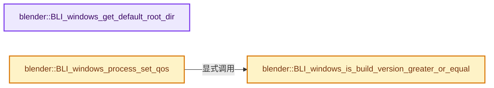
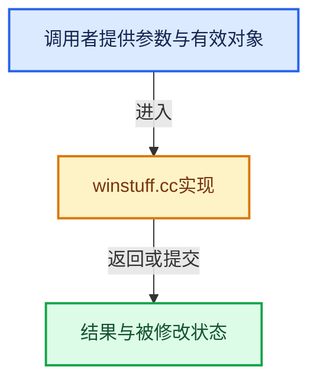

# 实现依赖专题：source/blender/blenlib/intern/winstuff.cc

[方向导航](README.md) · [符号索引](../%E7%AC%A6%E5%8F%B7%E4%BE%9D%E8%B5%96%E4%B8%8E%E5%AE%9E%E7%8E%B0%E7%B4%A2%E5%BC%95.md)

本专题从正文实际调用进入，集中保存共享实现。函数有稳定锚点，可从调用处直接跳到对应完整函数；递归与互相调用通过回链组织。

## 本文件的实现关系






## 完整成员与函数实现

<a id="f-270063fa979e5338"></a>

### `blender::BLI_windows_get_default_root_dir`

实现位置：[source/blender/blenlib/intern/winstuff.cc](../../../../../source/blender/blenlib/intern/winstuff.cc) · L437—L492。

接口参数：

- `char root[4]`

**教学注释版**

<!-- annotated:c1b8dfcbbc5377 -->

```cpp
void BLI_windows_get_default_root_dir(char root[4])
{
  char str[MAX_PATH + 1];

  /* the default drive to resolve a directory without a specified drive
   * should be the Windows installation drive, since this was what the OS
   * assumes. */
  if (GetWindowsDirectory(str, MAX_PATH + 1)) {
    root[0] = str[0];
    root[1] = ':';
    root[2] = '\\';
    root[3] = '\0';
  }
  else {
    /* if GetWindowsDirectory fails, something has probably gone wrong,
     * we are trying the blender install dir though */
    if (GetModuleFileName(nullptr, str, MAX_PATH + 1)) {
      printf(
          "Error! Could not get the Windows Directory - "
          "Defaulting to Blender installation Dir!\n");
      root[0] = str[0];
      root[1] = ':';
      root[2] = '\\';
      root[3] = '\0';
    }
    else {
      DWORD tmp;
      int i;
      int rc = 0;
      /* now something has gone really wrong - still trying our best guess */
      printf(
          "Error! Could not get the Windows Directory - "
          "Defaulting to first valid drive! Path might be invalid!\n");
      tmp = GetLogicalDrives();
      for (i = 2; i < 26; i++) {
        if ((tmp >> i) & 1) {
          root[0] = 'a' + i;
          root[1] = ':';
          root[2] = '\\';
          root[3] = '\0';
          if (GetFileAttributes(root) != 0xFFFFFFFF) {
            rc = i;
            break;
          }
        }
      }
      if (0 == rc) {
        printf("ERROR in 'BLI_windows_get_default_root_dir': cannot find a valid drive!\n");
        root[0] = 'C';
        root[1] = ':';
        root[2] = '\\';
        root[3] = '\0';
      }
    }
  }
}
```

<details>
<summary>核对原始源码：source/blender/blenlib/intern/winstuff.cc · L437—L492</summary>

<!-- original:c1b8dfcbbc5377:source/blender/blenlib/intern/winstuff.cc:437:492 -->

```cpp
void BLI_windows_get_default_root_dir(char root[4])
{
  char str[MAX_PATH + 1];

  /* the default drive to resolve a directory without a specified drive
   * should be the Windows installation drive, since this was what the OS
   * assumes. */
  if (GetWindowsDirectory(str, MAX_PATH + 1)) {
    root[0] = str[0];
    root[1] = ':';
    root[2] = '\\';
    root[3] = '\0';
  }
  else {
    /* if GetWindowsDirectory fails, something has probably gone wrong,
     * we are trying the blender install dir though */
    if (GetModuleFileName(nullptr, str, MAX_PATH + 1)) {
      printf(
          "Error! Could not get the Windows Directory - "
          "Defaulting to Blender installation Dir!\n");
      root[0] = str[0];
      root[1] = ':';
      root[2] = '\\';
      root[3] = '\0';
    }
    else {
      DWORD tmp;
      int i;
      int rc = 0;
      /* now something has gone really wrong - still trying our best guess */
      printf(
          "Error! Could not get the Windows Directory - "
          "Defaulting to first valid drive! Path might be invalid!\n");
      tmp = GetLogicalDrives();
      for (i = 2; i < 26; i++) {
        if ((tmp >> i) & 1) {
          root[0] = 'a' + i;
          root[1] = ':';
          root[2] = '\\';
          root[3] = '\0';
          if (GetFileAttributes(root) != 0xFFFFFFFF) {
            rc = i;
            break;
          }
        }
      }
      if (0 == rc) {
        printf("ERROR in 'BLI_windows_get_default_root_dir': cannot find a valid drive!\n");
        root[0] = 'C';
        root[1] = ':';
        root[2] = '\\';
        root[3] = '\0';
      }
    }
  }
}
```

</details>

**沿实际写入检查状态**

- `root[0] = str[0];`
- `root[1] = ':';`
- `root[2] = '\\';`
- `root[3] = '\0';`
- `tmp = GetLogicalDrives();`
- `root[0] = 'a' + i;`
- `rc = i;`
- `root[0] = 'C';`

**继续追踪实现**

- `GetWindowsDirectory` → [调用协议](../%E6%A8%A1%E6%9D%BF%E5%AE%8F%E4%B8%8E%E5%8A%A8%E6%80%81%E5%88%86%E6%B4%BE%E5%8D%8F%E8%AE%AE.md)：函数指针、局部可调用对象或未展开的宏；必须结合调用者环境。调用位置L444。
- `GetModuleFileName` → [调用协议](../%E6%A8%A1%E6%9D%BF%E5%AE%8F%E4%B8%8E%E5%8A%A8%E6%80%81%E5%88%86%E6%B4%BE%E5%8D%8F%E8%AE%AE.md)：函数指针、局部可调用对象或未展开的宏；必须结合调用者环境。调用位置L453。
- `printf` → [外部契约](https://eel.is/c++draft/)：这个边界按实际表达式及所属类型核对参数、返回值、寿命与失败行为。这里提供接口入口，不声称已解释该第三方版本的内部实现。
- `GetLogicalDrives` → [调用协议](../%E6%A8%A1%E6%9D%BF%E5%AE%8F%E4%B8%8E%E5%8A%A8%E6%80%81%E5%88%86%E6%B4%BE%E5%8D%8F%E8%AE%AE.md)：函数指针、局部可调用对象或未展开的宏；必须结合调用者环境。调用位置L470。
- `GetFileAttributes` → [调用协议](../%E6%A8%A1%E6%9D%BF%E5%AE%8F%E4%B8%8E%E5%8A%A8%E6%80%81%E5%88%86%E6%B4%BE%E5%8D%8F%E8%AE%AE.md)：函数指针、局部可调用对象或未展开的宏；必须结合调用者环境。调用位置L477。

<a id="f-2ca5e8e1d71ac9eb"></a>

### `blender::BLI_windows_is_build_version_greater_or_equal`

实现位置：[source/blender/blenlib/intern/winstuff.cc](../../../../../source/blender/blenlib/intern/winstuff.cc) · L558—L587。

接口参数：

- `DWORD majorVersion`
- `DWORD minorVersion`
- `DWORD buildNumber`

**教学注释版**

<!-- annotated:98080302da6b8e -->

```cpp
bool BLI_windows_is_build_version_greater_or_equal(DWORD majorVersion,
                                                   DWORD minorVersion,
                                                   DWORD buildNumber)
{
  HMODULE hMod = ::GetModuleHandleW(L"ntdll.dll");
  if (hMod == 0) {
    return false;
  }

  typedef NTSTATUS(WINAPI * RtlGetVersionPtr)(PRTL_OSVERSIONINFOW);
  RtlGetVersionPtr rtl_get_version = (RtlGetVersionPtr)::GetProcAddress(hMod, "RtlGetVersion");
  if (rtl_get_version == nullptr) {
    fprintf(stderr, "BLI_windows_is_build_version_greater_or_equal: RtlGetVersion not found.");
    return false;
  }

  RTL_OSVERSIONINFOW osVersioninfo{};
  osVersioninfo.dwOSVersionInfoSize = sizeof(RTL_OSVERSIONINFOW);
  if (rtl_get_version(&osVersioninfo) != 0) {
    fprintf(stderr, "BLI_windows_is_build_version_greater_or_equal: RtlGetVersion failed.");
    return false;
  }
  if (majorVersion != osVersioninfo.dwMajorVersion) {
    return osVersioninfo.dwMajorVersion > majorVersion;
  }
  if (minorVersion != osVersioninfo.dwMinorVersion) {
    return osVersioninfo.dwMajorVersion > minorVersion;
  }
  return osVersioninfo.dwBuildNumber >= buildNumber;
}
```

<details>
<summary>核对原始源码：source/blender/blenlib/intern/winstuff.cc · L558—L587</summary>

<!-- original:98080302da6b8e:source/blender/blenlib/intern/winstuff.cc:558:587 -->

```cpp
bool BLI_windows_is_build_version_greater_or_equal(DWORD majorVersion,
                                                   DWORD minorVersion,
                                                   DWORD buildNumber)
{
  HMODULE hMod = ::GetModuleHandleW(L"ntdll.dll");
  if (hMod == 0) {
    return false;
  }

  typedef NTSTATUS(WINAPI * RtlGetVersionPtr)(PRTL_OSVERSIONINFOW);
  RtlGetVersionPtr rtl_get_version = (RtlGetVersionPtr)::GetProcAddress(hMod, "RtlGetVersion");
  if (rtl_get_version == nullptr) {
    fprintf(stderr, "BLI_windows_is_build_version_greater_or_equal: RtlGetVersion not found.");
    return false;
  }

  RTL_OSVERSIONINFOW osVersioninfo{};
  osVersioninfo.dwOSVersionInfoSize = sizeof(RTL_OSVERSIONINFOW);
  if (rtl_get_version(&osVersioninfo) != 0) {
    fprintf(stderr, "BLI_windows_is_build_version_greater_or_equal: RtlGetVersion failed.");
    return false;
  }
  if (majorVersion != osVersioninfo.dwMajorVersion) {
    return osVersioninfo.dwMajorVersion > majorVersion;
  }
  if (minorVersion != osVersioninfo.dwMinorVersion) {
    return osVersioninfo.dwMajorVersion > minorVersion;
  }
  return osVersioninfo.dwBuildNumber >= buildNumber;
}
```

</details>

**沿实际写入检查状态**

- `osVersioninfo.dwOSVersionInfoSize = sizeof(RTL_OSVERSIONINFOW);`

**结果出口**

- `return false;`
- `return osVersioninfo.dwMajorVersion > majorVersion;`
- `return osVersioninfo.dwMajorVersion > minorVersion;`
- `return osVersioninfo.dwBuildNumber >= buildNumber;`

**继续追踪实现**

- `::GetModuleHandleW` → [调用协议](../%E6%A8%A1%E6%9D%BF%E5%AE%8F%E4%B8%8E%E5%8A%A8%E6%80%81%E5%88%86%E6%B4%BE%E5%8D%8F%E8%AE%AE.md)：函数指针、局部可调用对象或未展开的宏；必须结合调用者环境。调用位置L562。
- `::GetProcAddress` → [调用协议](../%E6%A8%A1%E6%9D%BF%E5%AE%8F%E4%B8%8E%E5%8A%A8%E6%80%81%E5%88%86%E6%B4%BE%E5%8D%8F%E8%AE%AE.md)：函数指针、局部可调用对象或未展开的宏；必须结合调用者环境。调用位置L568。
- `fprintf` → [外部契约](https://eel.is/c++draft/)：这个边界按实际表达式及所属类型核对参数、返回值、寿命与失败行为。这里提供接口入口，不声称已解释该第三方版本的内部实现。
- `rtl_get_version` → [调用协议](../%E6%A8%A1%E6%9D%BF%E5%AE%8F%E4%B8%8E%E5%8A%A8%E6%80%81%E5%88%86%E6%B4%BE%E5%8D%8F%E8%AE%AE.md)：局部可调用对象，须结合其初始化与捕获环境。调用位置L576。

<a id="f-b763684d36142e21"></a>

### `blender::BLI_windows_process_set_qos`

实现位置：[source/blender/blenlib/intern/winstuff.cc](../../../../../source/blender/blenlib/intern/winstuff.cc) · L589—L631。

接口参数：

- `QoSMode qos_mode`
- `QoSPrecedence qos_precedence`

**教学注释版**

<!-- annotated:3ff58e19d7f56b -->

```cpp
void BLI_windows_process_set_qos(QoSMode qos_mode, QoSPrecedence qos_precedence)
{
  static QoSPrecedence qos_precedence_last = QoSPrecedence::JOB;
  if (int(qos_precedence) < int(qos_precedence_last)) {
    return;
  }

  /* Only supported on Windows build >= 10.0.22000, i.e., Windows 11 21H2:
   * https://learn.microsoft.com/en-us/windows/win32/api/processthreadsapi/ne-processthreadsapi-process_information_class
   */
  if (!BLI_windows_is_build_version_greater_or_equal(10, 0, 22000)) {
    return;
  }

  PROCESS_POWER_THROTTLING_STATE processPowerThrottlingState{};
  processPowerThrottlingState.Version = PROCESS_POWER_THROTTLING_CURRENT_VERSION;
  switch (qos_mode) {
    case QoSMode::DEFAULT:
      processPowerThrottlingState.ControlMask = 0;
      processPowerThrottlingState.StateMask = 0;
      break;
    case QoSMode::HIGH:
      processPowerThrottlingState.ControlMask = PROCESS_POWER_THROTTLING_EXECUTION_SPEED;
      processPowerThrottlingState.StateMask = 0;
      break;
    case QoSMode::ECO:
      processPowerThrottlingState.ControlMask = PROCESS_POWER_THROTTLING_EXECUTION_SPEED;
      processPowerThrottlingState.StateMask = PROCESS_POWER_THROTTLING_EXECUTION_SPEED;
      break;
  }
  HANDLE hProcess = GetCurrentProcess();
  if (!SetProcessInformation(hProcess,
                             ProcessPowerThrottling,
                             &processPowerThrottlingState,
                             sizeof(PROCESS_POWER_THROTTLING_STATE)))
  {
    fprintf(stderr,
            "BLI_windows_set_process_qos: SetProcessInformation failed: %lx\n",
            GetLastError());
    return;
  }
  qos_precedence_last = qos_precedence;
}
```

<details>
<summary>核对原始源码：source/blender/blenlib/intern/winstuff.cc · L589—L631</summary>

<!-- original:3ff58e19d7f56b:source/blender/blenlib/intern/winstuff.cc:589:631 -->

```cpp
void BLI_windows_process_set_qos(QoSMode qos_mode, QoSPrecedence qos_precedence)
{
  static QoSPrecedence qos_precedence_last = QoSPrecedence::JOB;
  if (int(qos_precedence) < int(qos_precedence_last)) {
    return;
  }

  /* Only supported on Windows build >= 10.0.22000, i.e., Windows 11 21H2:
   * https://learn.microsoft.com/en-us/windows/win32/api/processthreadsapi/ne-processthreadsapi-process_information_class
   */
  if (!BLI_windows_is_build_version_greater_or_equal(10, 0, 22000)) {
    return;
  }

  PROCESS_POWER_THROTTLING_STATE processPowerThrottlingState{};
  processPowerThrottlingState.Version = PROCESS_POWER_THROTTLING_CURRENT_VERSION;
  switch (qos_mode) {
    case QoSMode::DEFAULT:
      processPowerThrottlingState.ControlMask = 0;
      processPowerThrottlingState.StateMask = 0;
      break;
    case QoSMode::HIGH:
      processPowerThrottlingState.ControlMask = PROCESS_POWER_THROTTLING_EXECUTION_SPEED;
      processPowerThrottlingState.StateMask = 0;
      break;
    case QoSMode::ECO:
      processPowerThrottlingState.ControlMask = PROCESS_POWER_THROTTLING_EXECUTION_SPEED;
      processPowerThrottlingState.StateMask = PROCESS_POWER_THROTTLING_EXECUTION_SPEED;
      break;
  }
  HANDLE hProcess = GetCurrentProcess();
  if (!SetProcessInformation(hProcess,
                             ProcessPowerThrottling,
                             &processPowerThrottlingState,
                             sizeof(PROCESS_POWER_THROTTLING_STATE)))
  {
    fprintf(stderr,
            "BLI_windows_set_process_qos: SetProcessInformation failed: %lx\n",
            GetLastError());
    return;
  }
  qos_precedence_last = qos_precedence;
}
```

</details>

**沿实际写入检查状态**

- `processPowerThrottlingState.Version = PROCESS_POWER_THROTTLING_CURRENT_VERSION;`
- `processPowerThrottlingState.ControlMask = 0;`
- `processPowerThrottlingState.StateMask = 0;`
- `processPowerThrottlingState.ControlMask = PROCESS_POWER_THROTTLING_EXECUTION_SPEED;`
- `processPowerThrottlingState.StateMask = PROCESS_POWER_THROTTLING_EXECUTION_SPEED;`
- `qos_precedence_last = qos_precedence;`

**继续追踪实现**

- `BLI_windows_is_build_version_greater_or_equal` → [blender::BLI_windows_is_build_version_greater_or_equal · L558](%E4%BE%9D%E8%B5%96-winstuff-500d85.md#f-2ca5e8e1d71ac9eb)。
- `GetCurrentProcess` → [调用协议](../%E6%A8%A1%E6%9D%BF%E5%AE%8F%E4%B8%8E%E5%8A%A8%E6%80%81%E5%88%86%E6%B4%BE%E5%8D%8F%E8%AE%AE.md)：函数指针、局部可调用对象或未展开的宏；必须结合调用者环境。调用位置L619。
- `SetProcessInformation` → [调用协议](../%E6%A8%A1%E6%9D%BF%E5%AE%8F%E4%B8%8E%E5%8A%A8%E6%80%81%E5%88%86%E6%B4%BE%E5%8D%8F%E8%AE%AE.md)：函数指针、局部可调用对象或未展开的宏；必须结合调用者环境。调用位置L620。
- `fprintf` → [外部契约](https://eel.is/c++draft/)：这个边界按实际表达式及所属类型核对参数、返回值、寿命与失败行为。这里提供接口入口，不声称已解释该第三方版本的内部实现。
- `GetLastError` → [调用协议](../%E6%A8%A1%E6%9D%BF%E5%AE%8F%E4%B8%8E%E5%8A%A8%E6%80%81%E5%88%86%E6%B4%BE%E5%8D%8F%E8%AE%AE.md)：函数指针、局部可调用对象或未展开的宏；必须结合调用者环境。调用位置L627。
