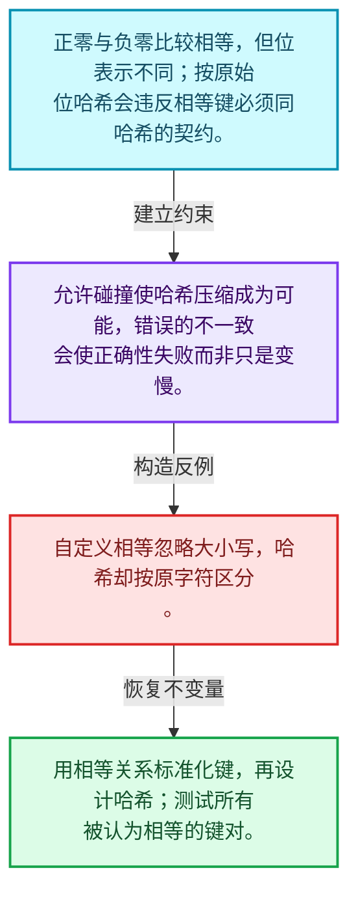
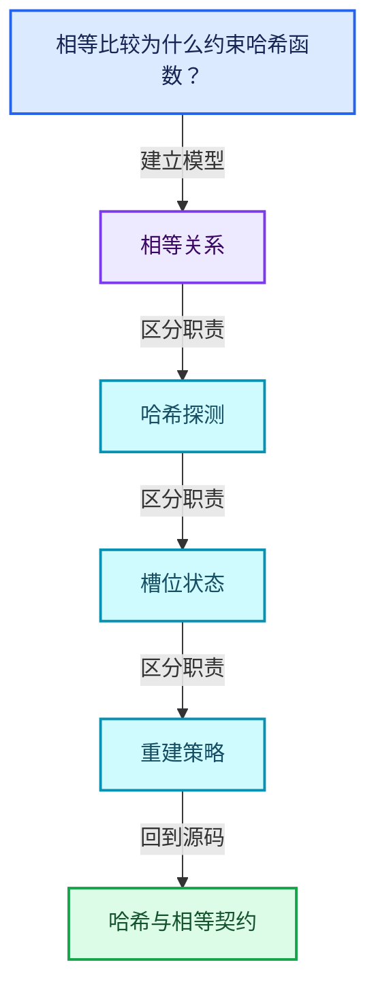
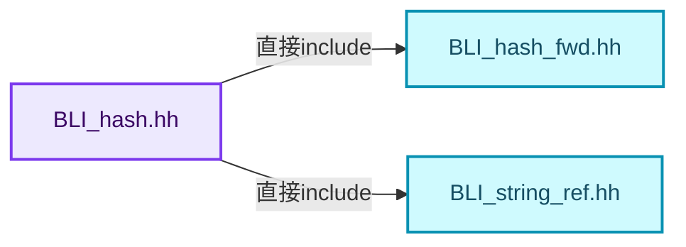
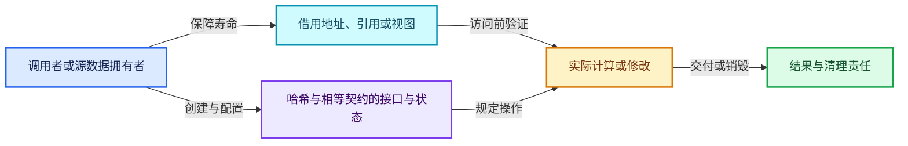
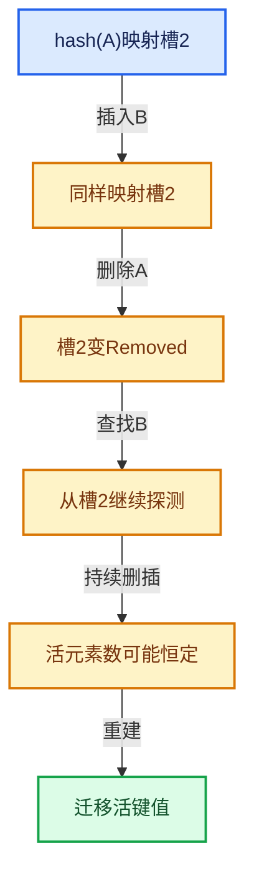

# 02-01 哈希与相等契约

[方向导航](README.md) · [总目录](../README.md) · [覆盖索引](../%E6%BA%90%E7%A0%81%E7%89%88%E6%9C%AC%E4%B8%8E%E8%A6%86%E7%9B%96%E7%B4%A2%E5%BC%95.md)

> 阅读顺序：问题与数据模型 → 语法与类型 → 源码逐行 → 调用线索 → 历史与取舍 → 推演和练习。

- 基准 HEAD：`cbda6b96c26c0dee3c3b5cbb93960c4ac06a6b30`。
- 记录日期：2026-10-14。
- 教学示例状态：正文中的推演不是本机性能实测；已运行练习见验收报告。

## 一、从问题到设计

相等比较为什么约束哈希函数？

a等于b必须推出hash相等，反向不成立；碰撞合法，错误的不一致会让存在的键查找失败。

本篇把语法、数据语义和系统取舍连接起来。相等与哈希是基础契约；探测、删除和增长共同决定复杂度。

### 本篇独立模型与设计推理

正零与负零比较相等，但位表示不同；按原始位哈希会违反相等键必须同哈希的契约。

设计取舍：允许碰撞使哈希压缩成为可能，错误的不一致会使正确性失败而非只是变慢。

最小反例：自定义相等忽略大小写，哈希却按原字符区分。

推导与处理：用相等关系标准化键，再设计哈希；测试所有被认为相等的键对。



### 源码范围与相邻篇章

| 文件 | 本篇逐行范围 | 基准SHA-256 |
|---|---|---|
| [source/blender/blenlib/BLI_hash.hh](../../../../../source/blender/blenlib/BLI_hash.hh) | L1—L295 | `0cc2c7e426dfbed9483fe86d818f23fbb7c92c97dcd675864d67d05326e529bf` |

同一主讲文件可能分多篇覆盖；超出本篇范围的符号通过覆盖索引定位。空行与纯注释保留在源码摘录中，逐行表解释有效语句与语法边界；许可证头统一保留。

后篇：[Map总体布局](02-Map%E6%80%BB%E4%BD%93%E5%B8%83%E5%B1%80.md).

## 二、类型、数据与阅读地图



这是概念依赖图，边表示阅读关系，不声称是运行时调用顺序。

### 直接编译依赖



箭头只表示头文件包含关系；完整调用线索见后面的符号定位表。

## 三、关键词、语法与类型角色

### 模板 template

模板把类型或常量作为生成实现的参数。读声明时先列出类型参数、非类型参数和默认值，再看使用者实际实例化了什么。模板声明本身不意味着每种T都支持其全部成员。

具体检查：把T替换为int、string、只能移动的类型，分别检查每个被调用操作是否成立。

### 依赖名称 typename

typename既可引入类型模板参数，也可告诉编译器某个依赖名称是类型。它不创建运行时对象；解析期确认语法类别与实例化期检查具体类型是不同阶段。

具体检查：区分typename T::value_type和T::size()，前者标记类型，后者是表达式。

### 约束 requires

requires表达式或requires子句限制模板参与重载的条件。它提供编译期可用性检查，不是运行时if，不能指望输入到达程序后再被这一机制验证。

具体检查：构造满足和不满足约束的两个类型，观察候选被排除而不是在函数内返回错误。

### 常量求值 constexpr

constexpr声明允许相应实体参与常量求值，但constexpr函数仍可以在运行时执行。是否常量求值由调用场景和表达式合法性共同决定。

具体检查：比较constexpr变量初始化和从运行时输入调用同一函数。

### 只读限定 const

const约束当前访问路径可做的修改。const指针、指向const的指针、const视图对象、const元素是不同位置的限定；其他别名可能仍可修改原对象。

具体检查：分别写T* const、const T*与const T* const，并画出不可修改的层次。

### 异常边界 try与catch

try定义异常传播的局部边界。失败路径需要销毁已经成功构造的部分并释放相应存储；未构造的对象不能被析构。

具体检查：在第k次构造失败，列出已经存在的对象集合与待释放缓冲。

### 表示层转换 reinterpret_cast

reinterpret_cast不能自动开始任意对象的生命周期，也不能豁免对齐和别名规则。读这类代码需要追溯原始分配与实际构造操作。

具体检查：分别检查大小、对齐、生命周期和可访问类型，四项不能互相替代。

### 对象表示 sizeof

sizeof给出对象表示大小，不是其引用的所有堆内存总量。sizeof视图很小并不说明底层数组很小。

具体检查：分别统计容器对象、容量字节和元素拥有的间接资源。

### 内部断言 assert

断言表达开发者预期成立的内部契约，发布构建可能关闭。它不能替代对不可信输入的完整错误处理，也不保证后续操作被运行时保护。

具体检查：对每条断言构造违反条件的输入，区分调用者错误与应向用户报告的错误。

### 编译期分支 if constexpr

条件在实例化时决定被保留的分支，这常用于不同类型的合法操作选择。它与运行时if有不同的实例化检查规则。

具体检查：找出每个分支依赖哪些类型特征，再使用满足与不满足条件的类型。

### 独占拥有 unique_ptr

unique_ptr通过移动转移拥有关系，默认删除策略必须与资源来源匹配。get返回借用指针，release交出责任而不销毁。

具体检查：区分move、get、release和reset后谁负责销毁。

### 共享拥有 shared_ptr

shared_ptr让控制块跟踪共享寿命，不自动使被指向对象的读写线程安全；循环拥有可能阻止销毁。

具体检查：画出强引用环并考虑是否应改变所有权方向或引入弱引用。

### 类型别名 using

类型别名为已有类型建立名字，不创建运行期对象。它常把模板内部使用的类型统一暴露给泛型调用者。

具体检查：展开别名直到基础类型，区分类型别名和变量声明。

### 枚举与状态模型 enum

枚举把有限状态命名；enum class避免许多隐式整数转换。状态机正确性还依赖允许的转移，不能只看有哪些枚举项。

具体检查：列出每个状态的进入条件和离开条件，检查终止状态是否仍可能被调度。

## 四、真实源码与逐行讲解

源码块保持原行内容，原始行号由小节标题及逐行表给出。表中的调用定位是静态阅读辅助；重载、模板实例化、宏展开和虚调用需结合完整声明，不能仅凭词法出现证明动态调用。

### BLI_hash.hh：L1—L64

<!-- source:source/blender/blenlib/BLI_hash.hh:1:64 -->

```cpp
/* SPDX-FileCopyrightText: 2023 Blender Authors
 *
 * SPDX-License-Identifier: GPL-2.0-or-later */

#pragma once

/** \file
 * \ingroup bli
 *
 * A specialization of `DefaultHash<T>` provides a hash function for values of type T.
 * This hash function is used by default in hash table implementations in blenlib.
 *
 * The actual hash function is in the `operator()` method of `DefaultHash<T>`. The following code
 * computes the hash of some value using DefaultHash.
 *
 *   T value = ...;
 *   DefaultHash<T> hash_function;
 *   uint32_t hash = hash_function(value);
 *
 * Hash table implementations like Set support heterogeneous key lookups. That means that
 * one can do a lookup with a key of type A in a hash table that stores keys of type B. This is
 * commonly done when B is std::string, because the conversion from e.g. a #StringRef to
 * std::string can be costly and is unnecessary. To make this work, values of type A and B that
 * compare equal have to have the same hash value. This is achieved by defining potentially
 * multiple `operator()` in a specialization of #DefaultHash. All those methods have to compute the
 * same hash for values that compare equal.
 *
 * The computed hash is an unsigned 64 bit integer. Ideally, the hash function would generate
 * uniformly random hash values for a set of keys. However, in many cases trivial hash functions
 * are faster and produce a good enough distribution. In general it is better when more information
 * is in the lower bits of the hash. By choosing a good probing strategy, the effects of a bad hash
 * function are less noticeable though. In this context a good probing strategy is one that takes
 * all bits of the hash into account eventually. One has to check on a case by case basis to see if
 * a better but more expensive or trivial hash function works better.
 *
 * There are three main ways to provide a hash table implementation with a custom hash function.
 *
 * - When you want to provide a default hash function for your own custom type: Add a `hash()`
 *   member function to it. The function should return `uint64_t` and take no arguments. This
 *   method will be called by the default implementation of #DefaultHash. It will automatically be
 *   used by hash table implementations.
 *
 * - When you want to provide a default hash function for a type that you cannot modify: Add a new
 *   specialization to the #DefaultHash struct. This can be done by writing code like below in
 *   either global or `blender` namespace.
 *
 *     template<> struct DefaultHash<TheType> {
 *       uint64_t operator()(const TheType &value) const {
 *         return ...;
 *       }
 *     };
 *
 * - When you want to provide a different hash function for a type that already has a default hash
 *   function: Implement a struct like the one below and pass it as template parameter to the hash
 *   table explicitly.
 *
 *     struct MyCustomHash {
 *       uint64_t operator()(const TheType &value) const {
 *         return ...;
 *       }
 *     };
 */

#include <bit>
```

| 原始行 | 语义、约束与检查 |
|---|---|
| L5 | 防止同一头文件在一个翻译单元中重复展开；不控制多个源文件之间的链接或对象寿命。 |
| L64 | 引入编译依赖 <bit>；这是声明可见性关系，不表示运行时一定调用该文件的所有接口。 |

### BLI_hash.hh：L65—L112

<!-- source:source/blender/blenlib/BLI_hash.hh:65:112 -->

```cpp
#include <memory>
#include <string>
#include <utility>

#include "BLI_hash_fwd.hh"
#include "BLI_string_ref.hh"

namespace blender {

/**
 * If there is no other specialization of #DefaultHash for a given type, look for a hash function
 * on the type itself. Implementing a `hash()` method on a type is often significantly easier than
 * specializing #DefaultHash. As a fallback, it also tries to use the #hash_value function which
 * some libraries implement for their types.
 *
 * To support heterogeneous lookup, a type can also implement a static `hash_as(const OtherType &)`
 * function.
 *
 * In the case of an enum type, the default hash is just to cast the enum value to an integer.
 */
template<typename T> struct DefaultHash {
  constexpr uint64_t operator()(const T &value) const
  {
    if constexpr (std::is_enum_v<T>) {
      /* For enums use the value as hash directly. */
      return uint64_t(value);
    }
    else if constexpr (requires {
                         { value.hash() } -> std::convertible_to<uint64_t>;
                       })
    {
      /* When the type has a hash method directly. */
      return value.hash();
    }
    else if constexpr (requires(const T &v) {
                         { hash_value(v) } -> std::convertible_to<uint64_t>;
                       })
    {
      /* When the type has an overload of the #hash_value which is standard popularized by boost.
       * https://www.boost.org/doc/libs/latest/libs/container_hash/doc/html/hash.html
       * This works e.g. for the pxr::SdfPath type. */
      return hash_value(value);
    }
    else {
      /* No hash function for the type has been found. */
      BLI_assert_unreachable_static_t(T);
    }
  }
```

| 原始行 | 语义、约束与检查 |
|---|---|
| L65 | 引入编译依赖 <memory>；这是声明可见性关系，不表示运行时一定调用该文件的所有接口。 |
| L66 | 引入编译依赖 <string>；这是声明可见性关系，不表示运行时一定调用该文件的所有接口。 |
| L67 | 引入编译依赖 <utility>；这是声明可见性关系，不表示运行时一定调用该文件的所有接口。 |
| L69 | 引入编译依赖 "BLI_hash_fwd.hh"；这是声明可见性关系，不表示运行时一定调用该文件的所有接口。 |
| L70 | 引入编译依赖 "BLI_string_ref.hh"；这是声明可见性关系，不表示运行时一定调用该文件的所有接口。 |
| L72 | 把后续声明放入 blender 命名空间，影响名称查找和符号归属，不创建运行时对象。 |
| L85 | 声明模板参数 `template<typename T> struct DefaultHash {`。类型参数决定生成操作的类型，非类型参数可决定内嵌容量或编译期分支。 |
| L86 | 运算符重载声明、定义或显式调用：`constexpr uint64_t operator()(const T &value) const`。结合参数和返回类型判断是赋值、索引、比较还是转换；operator=声明中的等号不是在给名为operator的变量赋值。 |
| L87 | 连接上一行的声明或控制结构与其语句块；后续行在这个作用域中执行或声明。 |
| L88 | 编译期条件分支 `if constexpr (std::is_enum_v<T>)`。按实例化类型选择相应实现；被舍弃分支和运行期if具有不同检查规则，不能当作运行时输入验证。 |
| L90 | 返回表达式 `uint64_t(value)`。 |
| L91 | 结束当前语法单元。局部自动对象在离开其作用域时按规则销毁；这不等于所有被引用的外部数据也被释放。 |
| L92 | 约束模板可用性：`else if constexpr (requires {`。条件在编译期检查，不替代运行期的地址、长度和类型一致性验证。 |
| L93 | 出现调用或函数声明 `hash`，对应表达式为 `{ value.hash() } -> std::convertible_to<uint64_t>;`。参数求值、返回类型与重载需结合前后完整语句；静态文本引用不能证明动态目标。 |
| L94 | 结束当前语法单元。局部自动对象在离开其作用域时按规则销毁；这不等于所有被引用的外部数据也被释放。 |
| L95 | 连接上一行的声明或控制结构与其语句块；后续行在这个作用域中执行或声明。 |
| L97 | 返回表达式 `value.hash()`。 |
| L98 | 结束当前语法单元。局部自动对象在离开其作用域时按规则销毁；这不等于所有被引用的外部数据也被释放。 |
| L99 | 约束模板可用性：`else if constexpr (requires(const T &v) {`。条件在编译期检查，不替代运行期的地址、长度和类型一致性验证。 |
| L100 | 出现调用或函数声明 `hash_value`，对应表达式为 `{ hash_value(v) } -> std::convertible_to<uint64_t>;`。参数求值、返回类型与重载需结合前后完整语句；静态文本引用不能证明动态目标。 |
| L101 | 结束当前语法单元。局部自动对象在离开其作用域时按规则销毁；这不等于所有被引用的外部数据也被释放。 |
| L102 | 连接上一行的声明或控制结构与其语句块；后续行在这个作用域中执行或声明。 |
| L106 | 返回表达式 `hash_value(value)`。 |
| L107 | 结束当前语法单元。局部自动对象在离开其作用域时按规则销毁；这不等于所有被引用的外部数据也被释放。 |
| L108 | 处理前一条件不成立的互补路径。比较两条路径最后是否恢复同一不变量，以及是否产生不同的资源责任。 |
| L110 | 断言约束 `BLI_assert_unreachable_static_t(T);`。条件是后续访问的内部前置条件；发布构建可能不执行，不能把断言当作输入修复。 |
| L111 | 结束当前语法单元。局部自动对象在离开其作用域时按规则销毁；这不等于所有被引用的外部数据也被释放。 |
| L112 | 结束当前语法单元。局部自动对象在离开其作用域时按规则销毁；这不等于所有被引用的外部数据也被释放。 |

### BLI_hash.hh：L113—L162

<!-- source:source/blender/blenlib/BLI_hash.hh:113:162 -->

```cpp

  template<typename U> constexpr uint64_t operator()(const U &value) const
  {
    /* Try calling the static `T::hash_as(value)` function with the given value. The returned hash
     * should be "compatible" with `T::hash()`. Usually that means that if `value` is converted to
     * `T` its hash does not change. */
    /* If this results in a compiler error, no hash function for the heterogeneous lookup has been
     * found. */
    return T::hash_as(value);
  }
};

/**
 * Use the same hash function for const and non const variants of a type.
 */
template<typename T> struct DefaultHash<const T> {
  constexpr uint64_t operator()(const T &value) const
  {
    return DefaultHash<T>{}(value);
  }
};

/**
 * We cannot make any assumptions about the distribution of keys, so use a trivial hash function by
 * default. The default probing strategy is designed to take all bits of the hash into account
 * to avoid worst case behavior when the lower bits are all zero. Special hash functions can be
 * implemented when more knowledge about a specific key distribution is available.
 */
template<typename T>
  requires(std::is_integral_v<T> && !std::is_same_v<T, bool>)
struct DefaultHash<T> {
  constexpr uint64_t operator()(const T &value) const
  {
    return uint64_t(value);
  }
};

/**
 * One should try to avoid using floats as keys in hash tables, but sometimes it is convenient.
 */
template<> struct DefaultHash<float> {
  constexpr uint64_t operator()(const float value) const
  {
    /* Make sure +0 and -0 hash to the same value. */
    if (value == 0.0f) {
      return 0;
    }
    /* Explicit `uint64_t` cast to suppress CPPCHECK warning. */
    return uint64_t(std::bit_cast<uint32_t>(value));
  }
```

本段语义重点：

- 分支证据 `value == 0.0f)`：分别推演条件成立与不成立，核对相同出口处的状态。

| 原始行 | 语义、约束与检查 |
|---|---|
| L114 | 运算符重载声明、定义或显式调用：`template<typename U> constexpr uint64_t operator()(const U &value) const`。结合参数和返回类型判断是赋值、索引、比较还是转换；operator=声明中的等号不是在给名为operator的变量赋值。 |
| L115 | 连接上一行的声明或控制结构与其语句块；后续行在这个作用域中执行或声明。 |
| L121 | 返回表达式 `T::hash_as(value)`。 |
| L122 | 结束当前语法单元。局部自动对象在离开其作用域时按规则销毁；这不等于所有被引用的外部数据也被释放。 |
| L123 | 结束当前语法单元。局部自动对象在离开其作用域时按规则销毁；这不等于所有被引用的外部数据也被释放。 |
| L128 | 声明模板参数 `template<typename T> struct DefaultHash<const T> {`。类型参数决定生成操作的类型，非类型参数可决定内嵌容量或编译期分支。 |
| L129 | 运算符重载声明、定义或显式调用：`constexpr uint64_t operator()(const T &value) const`。结合参数和返回类型判断是赋值、索引、比较还是转换；operator=声明中的等号不是在给名为operator的变量赋值。 |
| L130 | 连接上一行的声明或控制结构与其语句块；后续行在这个作用域中执行或声明。 |
| L131 | 返回表达式 `DefaultHash<T>{}(value)`。 |
| L132 | 结束当前语法单元。局部自动对象在离开其作用域时按规则销毁；这不等于所有被引用的外部数据也被释放。 |
| L133 | 结束当前语法单元。局部自动对象在离开其作用域时按规则销毁；这不等于所有被引用的外部数据也被释放。 |
| L141 | 声明模板参数 `template<typename T>`。类型参数决定生成操作的类型，非类型参数可决定内嵌容量或编译期分支。 |
| L142 | 约束模板可用性：`requires(std::is_integral_v<T> && !std::is_same_v<T, bool>)`。条件在编译期检查，不替代运行期的地址、长度和类型一致性验证。 |
| L143 | 声明或定义类型 `struct DefaultHash<T>`。结合继承、访问权限和成员布局确认接口与拥有关系；前向声明本身没有完整对象布局。 |
| L144 | 运算符重载声明、定义或显式调用：`constexpr uint64_t operator()(const T &value) const`。结合参数和返回类型判断是赋值、索引、比较还是转换；operator=声明中的等号不是在给名为operator的变量赋值。 |
| L145 | 连接上一行的声明或控制结构与其语句块；后续行在这个作用域中执行或声明。 |
| L146 | 返回表达式 `uint64_t(value)`。 |
| L147 | 结束当前语法单元。局部自动对象在离开其作用域时按规则销毁；这不等于所有被引用的外部数据也被释放。 |
| L148 | 结束当前语法单元。局部自动对象在离开其作用域时按规则销毁；这不等于所有被引用的外部数据也被释放。 |
| L153 | 声明模板参数 `template<> struct DefaultHash<float> {`。类型参数决定生成操作的类型，非类型参数可决定内嵌容量或编译期分支。 |
| L154 | 运算符重载声明、定义或显式调用：`constexpr uint64_t operator()(const float value) const`。结合参数和返回类型判断是赋值、索引、比较还是转换；operator=声明中的等号不是在给名为operator的变量赋值。 |
| L155 | 连接上一行的声明或控制结构与其语句块；后续行在这个作用域中执行或声明。 |
| L157 | 判断 `value == 0.0f`，成立时进入本分支，否则继续后续路径。 |
| L158 | 返回表达式 `0`。 |
| L159 | 结束当前语法单元。局部自动对象在离开其作用域时按规则销毁；这不等于所有被引用的外部数据也被释放。 |
| L161 | 返回表达式 `uint64_t(std::bit_cast<uint32_t>(value))`。 |
| L162 | 结束当前语法单元。局部自动对象在离开其作用域时按规则销毁；这不等于所有被引用的外部数据也被释放。 |

### BLI_hash.hh：L163—L208

<!-- source:source/blender/blenlib/BLI_hash.hh:163:208 -->

```cpp
};

template<> struct DefaultHash<double> {
  constexpr uint64_t operator()(const double value) const
  {
    /* Make sure +0 and -0 hash to the same value. */
    if (value == 0.0) {
      return 0;
    }
    return std::bit_cast<uint64_t>(value);
  }
};

template<> struct DefaultHash<bool> {
  constexpr uint64_t operator()(bool value) const
  {
    return uint64_t((value != false) * 1298191);
  }
};

constexpr uint64_t hash_string(StringRef str)
{
  uint64_t hash = 5381;
  for (char c : str) {
    hash = hash * 33 + c;
  }
  return hash;
}

template<> struct DefaultHash<std::string> {
  /**
   * Take a #StringRef as parameter to support heterogeneous lookups in hash table implementations
   * when std::string is used as key.
   */
  constexpr uint64_t operator()(StringRef value) const
  {
    return hash_string(value);
  }
};

template<> struct DefaultHash<StringRef> {
  constexpr uint64_t operator()(StringRef value) const
  {
    return hash_string(value);
  }
};
```

本段语义重点：

- 分支证据 `value == 0.0)`：分别推演条件成立与不成立，核对相同出口处的状态。

| 原始行 | 语义、约束与检查 |
|---|---|
| L163 | 结束当前语法单元。局部自动对象在离开其作用域时按规则销毁；这不等于所有被引用的外部数据也被释放。 |
| L165 | 声明模板参数 `template<> struct DefaultHash<double> {`。类型参数决定生成操作的类型，非类型参数可决定内嵌容量或编译期分支。 |
| L166 | 运算符重载声明、定义或显式调用：`constexpr uint64_t operator()(const double value) const`。结合参数和返回类型判断是赋值、索引、比较还是转换；operator=声明中的等号不是在给名为operator的变量赋值。 |
| L167 | 连接上一行的声明或控制结构与其语句块；后续行在这个作用域中执行或声明。 |
| L169 | 判断 `value == 0.0`，成立时进入本分支，否则继续后续路径。 |
| L170 | 返回表达式 `0`。 |
| L171 | 结束当前语法单元。局部自动对象在离开其作用域时按规则销毁；这不等于所有被引用的外部数据也被释放。 |
| L172 | 返回表达式 `std::bit_cast<uint64_t>(value)`。 |
| L173 | 结束当前语法单元。局部自动对象在离开其作用域时按规则销毁；这不等于所有被引用的外部数据也被释放。 |
| L174 | 结束当前语法单元。局部自动对象在离开其作用域时按规则销毁；这不等于所有被引用的外部数据也被释放。 |
| L176 | 声明模板参数 `template<> struct DefaultHash<bool> {`。类型参数决定生成操作的类型，非类型参数可决定内嵌容量或编译期分支。 |
| L177 | 运算符重载声明、定义或显式调用：`constexpr uint64_t operator()(bool value) const`。结合参数和返回类型判断是赋值、索引、比较还是转换；operator=声明中的等号不是在给名为operator的变量赋值。 |
| L178 | 连接上一行的声明或控制结构与其语句块；后续行在这个作用域中执行或声明。 |
| L179 | 返回表达式 `uint64_t((value != false) * 1298191)`。 |
| L180 | 结束当前语法单元。局部自动对象在离开其作用域时按规则销毁；这不等于所有被引用的外部数据也被释放。 |
| L181 | 结束当前语法单元。局部自动对象在离开其作用域时按规则销毁；这不等于所有被引用的外部数据也被释放。 |
| L183 | 出现调用或函数声明 `hash_string`，对应表达式为 `constexpr uint64_t hash_string(StringRef str)`。参数求值、返回类型与重载需结合前后完整语句；静态文本引用不能证明动态目标。 |
| L184 | 连接上一行的声明或控制结构与其语句块；后续行在这个作用域中执行或声明。 |
| L185 | 把右侧 `5381` 用于初始化或更新左侧 `uint64_t hash`。声明初始化与已有对象赋值应按上下文区分；有资源的类型会调用相应特殊成员。 |
| L186 | 按 `for (char c : str)` 指定的范围或条件重复执行。对照循环变量与真实元素编号；循环内调用成本乘以实际迭代次数。 |
| L187 | 把右侧 `hash * 33 + c` 用于初始化或更新左侧 `hash`。声明初始化与已有对象赋值应按上下文区分；有资源的类型会调用相应特殊成员。 |
| L188 | 结束当前语法单元。局部自动对象在离开其作用域时按规则销毁；这不等于所有被引用的外部数据也被释放。 |
| L189 | 返回表达式 `hash`。 |
| L190 | 结束当前语法单元。局部自动对象在离开其作用域时按规则销毁；这不等于所有被引用的外部数据也被释放。 |
| L192 | 声明模板参数 `template<> struct DefaultHash<std::string> {`。类型参数决定生成操作的类型，非类型参数可决定内嵌容量或编译期分支。 |
| L197 | 运算符重载声明、定义或显式调用：`constexpr uint64_t operator()(StringRef value) const`。结合参数和返回类型判断是赋值、索引、比较还是转换；operator=声明中的等号不是在给名为operator的变量赋值。 |
| L198 | 连接上一行的声明或控制结构与其语句块；后续行在这个作用域中执行或声明。 |
| L199 | 返回表达式 `hash_string(value)`。 |
| L200 | 结束当前语法单元。局部自动对象在离开其作用域时按规则销毁；这不等于所有被引用的外部数据也被释放。 |
| L201 | 结束当前语法单元。局部自动对象在离开其作用域时按规则销毁；这不等于所有被引用的外部数据也被释放。 |
| L203 | 声明模板参数 `template<> struct DefaultHash<StringRef> {`。类型参数决定生成操作的类型，非类型参数可决定内嵌容量或编译期分支。 |
| L204 | 运算符重载声明、定义或显式调用：`constexpr uint64_t operator()(StringRef value) const`。结合参数和返回类型判断是赋值、索引、比较还是转换；operator=声明中的等号不是在给名为operator的变量赋值。 |
| L205 | 连接上一行的声明或控制结构与其语句块；后续行在这个作用域中执行或声明。 |
| L206 | 返回表达式 `hash_string(value)`。 |
| L207 | 结束当前语法单元。局部自动对象在离开其作用域时按规则销毁；这不等于所有被引用的外部数据也被释放。 |
| L208 | 结束当前语法单元。局部自动对象在离开其作用域时按规则销毁；这不等于所有被引用的外部数据也被释放。 |

### BLI_hash.hh：L209—L257

<!-- source:source/blender/blenlib/BLI_hash.hh:209:257 -->

```cpp

template<> struct DefaultHash<StringRefNull> {
  constexpr uint64_t operator()(StringRef value) const
  {
    return hash_string(value);
  }
};

template<> struct DefaultHash<std::string_view> {
  constexpr uint64_t operator()(StringRef value) const
  {
    return hash_string(value);
  }
};

/**
 * While we cannot guarantee that the lower 4 bits of a pointer are zero, it is often the case.
 */
template<typename T> struct DefaultHash<T *> {
  constexpr uint64_t operator()(const T *value) const
  {
    uintptr_t ptr = uintptr_t(value);
    uint64_t hash = uint64_t(ptr >> 4);
    return hash;
  }
};

namespace blenlib_detail {
static constexpr std::array<uint64_t, 5> default_hash_factors = {
    19349669, 83492791, 3632623, 8789800933, 7235126189};

template<size_t... I, typename... Args>
constexpr uint64_t get_default_hash_array(std::index_sequence<I...> /*indices*/,
                                          const Args &...args)
{
  static_assert(sizeof...(Args) == sizeof...(I));
  static_assert(sizeof...(Args) <= default_hash_factors.size());
  return (0 ^ ... ^ (default_hash_factors[I] * DefaultHash<std::decay_t<Args>>{}(args)));
}

}  // namespace blenlib_detail

template<typename T, typename... Args>
constexpr uint64_t get_default_hash(const T &v, const Args &...args)
{
  return DefaultHash<std::decay_t<T>>{}(v) ^
         blenlib_detail::get_default_hash_array(std::make_index_sequence<sizeof...(Args)>(),
                                                args...);
}
```

| 原始行 | 语义、约束与检查 |
|---|---|
| L210 | 声明模板参数 `template<> struct DefaultHash<StringRefNull> {`。类型参数决定生成操作的类型，非类型参数可决定内嵌容量或编译期分支。 |
| L211 | 运算符重载声明、定义或显式调用：`constexpr uint64_t operator()(StringRef value) const`。结合参数和返回类型判断是赋值、索引、比较还是转换；operator=声明中的等号不是在给名为operator的变量赋值。 |
| L212 | 连接上一行的声明或控制结构与其语句块；后续行在这个作用域中执行或声明。 |
| L213 | 返回表达式 `hash_string(value)`。 |
| L214 | 结束当前语法单元。局部自动对象在离开其作用域时按规则销毁；这不等于所有被引用的外部数据也被释放。 |
| L215 | 结束当前语法单元。局部自动对象在离开其作用域时按规则销毁；这不等于所有被引用的外部数据也被释放。 |
| L217 | 声明模板参数 `template<> struct DefaultHash<std::string_view> {`。类型参数决定生成操作的类型，非类型参数可决定内嵌容量或编译期分支。 |
| L218 | 运算符重载声明、定义或显式调用：`constexpr uint64_t operator()(StringRef value) const`。结合参数和返回类型判断是赋值、索引、比较还是转换；operator=声明中的等号不是在给名为operator的变量赋值。 |
| L219 | 连接上一行的声明或控制结构与其语句块；后续行在这个作用域中执行或声明。 |
| L220 | 返回表达式 `hash_string(value)`。 |
| L221 | 结束当前语法单元。局部自动对象在离开其作用域时按规则销毁；这不等于所有被引用的外部数据也被释放。 |
| L222 | 结束当前语法单元。局部自动对象在离开其作用域时按规则销毁；这不等于所有被引用的外部数据也被释放。 |
| L227 | 声明模板参数 `template<typename T> struct DefaultHash<T *> {`。类型参数决定生成操作的类型，非类型参数可决定内嵌容量或编译期分支。 |
| L228 | 运算符重载声明、定义或显式调用：`constexpr uint64_t operator()(const T *value) const`。结合参数和返回类型判断是赋值、索引、比较还是转换；operator=声明中的等号不是在给名为operator的变量赋值。 |
| L229 | 连接上一行的声明或控制结构与其语句块；后续行在这个作用域中执行或声明。 |
| L230 | 把右侧 `uintptr_t(value)` 用于初始化或更新左侧 `uintptr_t ptr`。声明初始化与已有对象赋值应按上下文区分；有资源的类型会调用相应特殊成员。 |
| L231 | 把右侧 `uint64_t(ptr >> 4)` 用于初始化或更新左侧 `uint64_t hash`。声明初始化与已有对象赋值应按上下文区分；有资源的类型会调用相应特殊成员。 |
| L232 | 返回表达式 `hash`。 |
| L233 | 结束当前语法单元。局部自动对象在离开其作用域时按规则销毁；这不等于所有被引用的外部数据也被释放。 |
| L234 | 结束当前语法单元。局部自动对象在离开其作用域时按规则销毁；这不等于所有被引用的外部数据也被释放。 |
| L236 | 把后续声明放入 blenlib_detail 命名空间，影响名称查找和符号归属，不创建运行时对象。 |
| L237 | 把右侧 `{` 用于初始化或更新左侧 `static constexpr std::array<uint64_t, 5> default_hash_factors`。声明初始化与已有对象赋值应按上下文区分；有资源的类型会调用相应特殊成员。 |
| L238 | 声明成员、局部对象或完成语句 `19349669, 83492791, 3632623, 8789800933, 7235126189}`。若为指针或引用，它本身不说明拥有；若为值对象，其构造析构由所在作用域或外层对象管理。 |
| L240 | 声明模板参数 `template<size_t... I, typename... Args>`。类型参数决定生成操作的类型，非类型参数可决定内嵌容量或编译期分支。 |
| L241 | 出现调用或函数声明 `get_default_hash_array`，对应表达式为 `constexpr uint64_t get_default_hash_array(std::index_sequence<I...> ,`。参数求值、返回类型与重载需结合前后完整语句；静态文本引用不能证明动态目标。 |
| L242 | 本行是连续声明或表达式的一部分：`const Args &...args)`。与本段前后行合读；逗号、括号和限定符决定它属于参数、初始化列表还是实际计算。 |
| L243 | 连接上一行的声明或控制结构与其语句块；后续行在这个作用域中执行或声明。 |
| L244 | 在编译期检查 `static_assert(sizeof...(Args) == sizeof...(I));`；条件失败导致编译错误，不存在运行时错误恢复路径。 |
| L245 | 显式采用编译器生成的特殊成员行为：`static_assert(sizeof...(Args) <= default_hash_factors.size());`。成员和基类的性质决定该操作是否可用、是否被删除及异常约定，不表示运行时给对象赋值为default。 |
| L246 | 返回表达式 `(0 ^ ... ^ (default_hash_factors[I] * DefaultHash<std::decay_t<Args>>{}(args)))`。 |
| L247 | 结束当前语法单元。局部自动对象在离开其作用域时按规则销毁；这不等于所有被引用的外部数据也被释放。 |
| L249 | 结束当前语法单元。局部自动对象在离开其作用域时按规则销毁；这不等于所有被引用的外部数据也被释放。 |
| L251 | 声明模板参数 `template<typename T, typename... Args>`。类型参数决定生成操作的类型，非类型参数可决定内嵌容量或编译期分支。 |
| L252 | 出现调用或函数声明 `get_default_hash`，对应表达式为 `constexpr uint64_t get_default_hash(const T &v, const Args &...args)`。参数求值、返回类型与重载需结合前后完整语句；静态文本引用不能证明动态目标。 |
| L253 | 连接上一行的声明或控制结构与其语句块；后续行在这个作用域中执行或声明。 |
| L254 | 返回表达式 `DefaultHash<std::decay_t<T>>{}(v) ^`。 |
| L255 | 出现调用或函数声明 `blenlib_detail::get_default_hash_array`，对应表达式为 `blenlib_detail::get_default_hash_array(std::make_index_sequence<sizeof...(Args)>(),`。参数求值、返回类型与重载需结合前后完整语句；静态文本引用不能证明动态目标。 |
| L256 | 声明成员、局部对象或完成语句 `args...)`。若为指针或引用，它本身不说明拥有；若为值对象，其构造析构由所在作用域或外层对象管理。 |
| L257 | 结束当前语法单元。局部自动对象在离开其作用域时按规则销毁；这不等于所有被引用的外部数据也被释放。 |

### BLI_hash.hh：L258—L295

<!-- source:source/blender/blenlib/BLI_hash.hh:258:295 -->

```cpp

/** Support hashing different kinds of pointer types. */
template<typename T> struct PointerHashes {
  template<typename U> constexpr uint64_t operator()(const U &value) const
  {
    return get_default_hash(&*value);
  }
};

template<typename T> struct DefaultHash<std::unique_ptr<T>> : public PointerHashes<T> {};
template<typename T> struct DefaultHash<std::shared_ptr<T>> : public PointerHashes<T> {};

template<typename T> struct DefaultHash<std::reference_wrapper<T>> {
  constexpr uint64_t operator()(const std::reference_wrapper<T> &value) const
  {
    return get_default_hash(value.get());
  }
};

template<typename T1, typename T2> struct DefaultHash<std::pair<T1, T2>> {
  constexpr uint64_t operator()(const std::pair<T1, T2> &value) const
  {
    return get_default_hash(value.first, value.second);
  }
};

/**
 * Special overload for function pointers to avoid adding const to them which causes a warning with
 * MSVC.
 */
template<typename Ret, typename... Args> struct DefaultHash<Ret (*)(Args...)> {
  constexpr uint64_t operator()(Ret (*fn)(Args...)) const
  {
    return get_default_hash(reinterpret_cast<const void *>(fn));
  }
};

}  // namespace blender
```

| 原始行 | 语义、约束与检查 |
|---|---|
| L260 | 声明模板参数 `template<typename T> struct PointerHashes {`。类型参数决定生成操作的类型，非类型参数可决定内嵌容量或编译期分支。 |
| L261 | 运算符重载声明、定义或显式调用：`template<typename U> constexpr uint64_t operator()(const U &value) const`。结合参数和返回类型判断是赋值、索引、比较还是转换；operator=声明中的等号不是在给名为operator的变量赋值。 |
| L262 | 连接上一行的声明或控制结构与其语句块；后续行在这个作用域中执行或声明。 |
| L263 | 返回表达式 `get_default_hash(&*value)`。 |
| L264 | 结束当前语法单元。局部自动对象在离开其作用域时按规则销毁；这不等于所有被引用的外部数据也被释放。 |
| L265 | 结束当前语法单元。局部自动对象在离开其作用域时按规则销毁；这不等于所有被引用的外部数据也被释放。 |
| L267 | 声明模板参数 `template<typename T> struct DefaultHash<std::unique_ptr<T>> : public PointerHashes<T> {};`。类型参数决定生成操作的类型，非类型参数可决定内嵌容量或编译期分支。 |
| L268 | 声明模板参数 `template<typename T> struct DefaultHash<std::shared_ptr<T>> : public PointerHashes<T> {};`。类型参数决定生成操作的类型，非类型参数可决定内嵌容量或编译期分支。 |
| L270 | 声明模板参数 `template<typename T> struct DefaultHash<std::reference_wrapper<T>> {`。类型参数决定生成操作的类型，非类型参数可决定内嵌容量或编译期分支。 |
| L271 | 运算符重载声明、定义或显式调用：`constexpr uint64_t operator()(const std::reference_wrapper<T> &value) const`。结合参数和返回类型判断是赋值、索引、比较还是转换；operator=声明中的等号不是在给名为operator的变量赋值。 |
| L272 | 连接上一行的声明或控制结构与其语句块；后续行在这个作用域中执行或声明。 |
| L273 | 返回表达式 `get_default_hash(value.get())`。 |
| L274 | 结束当前语法单元。局部自动对象在离开其作用域时按规则销毁；这不等于所有被引用的外部数据也被释放。 |
| L275 | 结束当前语法单元。局部自动对象在离开其作用域时按规则销毁；这不等于所有被引用的外部数据也被释放。 |
| L277 | 声明模板参数 `template<typename T1, typename T2> struct DefaultHash<std::pair<T1, T2>> {`。类型参数决定生成操作的类型，非类型参数可决定内嵌容量或编译期分支。 |
| L278 | 运算符重载声明、定义或显式调用：`constexpr uint64_t operator()(const std::pair<T1, T2> &value) const`。结合参数和返回类型判断是赋值、索引、比较还是转换；operator=声明中的等号不是在给名为operator的变量赋值。 |
| L279 | 连接上一行的声明或控制结构与其语句块；后续行在这个作用域中执行或声明。 |
| L280 | 返回表达式 `get_default_hash(value.first, value.second)`。 |
| L281 | 结束当前语法单元。局部自动对象在离开其作用域时按规则销毁；这不等于所有被引用的外部数据也被释放。 |
| L282 | 结束当前语法单元。局部自动对象在离开其作用域时按规则销毁；这不等于所有被引用的外部数据也被释放。 |
| L288 | 声明模板参数 `template<typename Ret, typename... Args> struct DefaultHash<Ret (*)(Args...)> {`。类型参数决定生成操作的类型，非类型参数可决定内嵌容量或编译期分支。 |
| L289 | 运算符重载声明、定义或显式调用：`constexpr uint64_t operator()(Ret (*fn)(Args...)) const`。结合参数和返回类型判断是赋值、索引、比较还是转换；operator=声明中的等号不是在给名为operator的变量赋值。 |
| L290 | 连接上一行的声明或控制结构与其语句块；后续行在这个作用域中执行或声明。 |
| L291 | 返回表达式 `get_default_hash(reinterpret_cast<const void *>(fn))`。 |
| L292 | 结束当前语法单元。局部自动对象在离开其作用域时按规则销毁；这不等于所有被引用的外部数据也被释放。 |
| L293 | 结束当前语法单元。局部自动对象在离开其作用域时按规则销毁；这不等于所有被引用的外部数据也被释放。 |
| L295 | 结束当前语法单元。局部自动对象在离开其作用域时按规则销毁；这不等于所有被引用的外部数据也被释放。 |

## 五、接口定位、调用线索与生命周期

### 本篇声明与实现入口

| 源码位置 | 实际声明片段 |
|---|---|
| [BLI_hash.hh:L85](../../../../../source/blender/blenlib/BLI_hash.hh#L85) | `template<typename T> struct DefaultHash` |
| [BLI_hash.hh:L86](../../../../../source/blender/blenlib/BLI_hash.hh#L86) | `constexpr uint64_t operator()(const T &value) const` |
| [BLI_hash.hh:L92](../../../../../source/blender/blenlib/BLI_hash.hh#L92) | `else if constexpr (requires` |
| [BLI_hash.hh:L99](../../../../../source/blender/blenlib/BLI_hash.hh#L99) | `else if constexpr (requires(const T &v)` |
| [BLI_hash.hh:L114](../../../../../source/blender/blenlib/BLI_hash.hh#L114) | `template<typename U> constexpr uint64_t operator()(const U &value) const` |
| [BLI_hash.hh:L128](../../../../../source/blender/blenlib/BLI_hash.hh#L128) | `template<typename T> struct DefaultHash<const T>` |
| [BLI_hash.hh:L129](../../../../../source/blender/blenlib/BLI_hash.hh#L129) | `constexpr uint64_t operator()(const T &value) const` |
| [BLI_hash.hh:L143](../../../../../source/blender/blenlib/BLI_hash.hh#L143) | `struct DefaultHash<T>` |
| [BLI_hash.hh:L144](../../../../../source/blender/blenlib/BLI_hash.hh#L144) | `constexpr uint64_t operator()(const T &value) const` |
| [BLI_hash.hh:L153](../../../../../source/blender/blenlib/BLI_hash.hh#L153) | `template<> struct DefaultHash<float>` |
| [BLI_hash.hh:L154](../../../../../source/blender/blenlib/BLI_hash.hh#L154) | `constexpr uint64_t operator()(const float value) const` |
| [BLI_hash.hh:L165](../../../../../source/blender/blenlib/BLI_hash.hh#L165) | `template<> struct DefaultHash<double>` |
| [BLI_hash.hh:L166](../../../../../source/blender/blenlib/BLI_hash.hh#L166) | `constexpr uint64_t operator()(const double value) const` |
| [BLI_hash.hh:L176](../../../../../source/blender/blenlib/BLI_hash.hh#L176) | `template<> struct DefaultHash<bool>` |
| [BLI_hash.hh:L177](../../../../../source/blender/blenlib/BLI_hash.hh#L177) | `constexpr uint64_t operator()(bool value) const` |
| [BLI_hash.hh:L183](../../../../../source/blender/blenlib/BLI_hash.hh#L183) | `constexpr uint64_t hash_string(StringRef str)` |
| [BLI_hash.hh:L192](../../../../../source/blender/blenlib/BLI_hash.hh#L192) | `template<> struct DefaultHash<std::string>` |
| [BLI_hash.hh:L197](../../../../../source/blender/blenlib/BLI_hash.hh#L197) | `constexpr uint64_t operator()(StringRef value) const` |
| [BLI_hash.hh:L203](../../../../../source/blender/blenlib/BLI_hash.hh#L203) | `template<> struct DefaultHash<StringRef>` |
| [BLI_hash.hh:L204](../../../../../source/blender/blenlib/BLI_hash.hh#L204) | `constexpr uint64_t operator()(StringRef value) const` |
| [BLI_hash.hh:L210](../../../../../source/blender/blenlib/BLI_hash.hh#L210) | `template<> struct DefaultHash<StringRefNull>` |
| [BLI_hash.hh:L211](../../../../../source/blender/blenlib/BLI_hash.hh#L211) | `constexpr uint64_t operator()(StringRef value) const` |
| [BLI_hash.hh:L217](../../../../../source/blender/blenlib/BLI_hash.hh#L217) | `template<> struct DefaultHash<std::string_view>` |
| [BLI_hash.hh:L218](../../../../../source/blender/blenlib/BLI_hash.hh#L218) | `constexpr uint64_t operator()(StringRef value) const` |
| [BLI_hash.hh:L227](../../../../../source/blender/blenlib/BLI_hash.hh#L227) | `template<typename T> struct DefaultHash<T *>` |
| [BLI_hash.hh:L228](../../../../../source/blender/blenlib/BLI_hash.hh#L228) | `constexpr uint64_t operator()(const T *value) const` |
| [BLI_hash.hh:L241](../../../../../source/blender/blenlib/BLI_hash.hh#L241) | `constexpr uint64_t get_default_hash_array(std::index_sequence<I...> /*indices*/,` |
| [BLI_hash.hh:L252](../../../../../source/blender/blenlib/BLI_hash.hh#L252) | `constexpr uint64_t get_default_hash(const T &v, const Args &...args)` |
| [BLI_hash.hh:L260](../../../../../source/blender/blenlib/BLI_hash.hh#L260) | `template<typename T> struct PointerHashes` |
| [BLI_hash.hh:L261](../../../../../source/blender/blenlib/BLI_hash.hh#L261) | `template<typename U> constexpr uint64_t operator()(const U &value) const` |
| [BLI_hash.hh:L267](../../../../../source/blender/blenlib/BLI_hash.hh#L267) | `template<typename T> struct DefaultHash<std::unique_ptr<T>> : public PointerHashes<T> {};` |
| [BLI_hash.hh:L268](../../../../../source/blender/blenlib/BLI_hash.hh#L268) | `template<typename T> struct DefaultHash<std::shared_ptr<T>> : public PointerHashes<T> {};` |
| [BLI_hash.hh:L270](../../../../../source/blender/blenlib/BLI_hash.hh#L270) | `template<typename T> struct DefaultHash<std::reference_wrapper<T>>` |
| [BLI_hash.hh:L271](../../../../../source/blender/blenlib/BLI_hash.hh#L271) | `constexpr uint64_t operator()(const std::reference_wrapper<T> &value) const` |
| [BLI_hash.hh:L277](../../../../../source/blender/blenlib/BLI_hash.hh#L277) | `template<typename T1, typename T2> struct DefaultHash<std::pair<T1, T2>>` |
| [BLI_hash.hh:L278](../../../../../source/blender/blenlib/BLI_hash.hh#L278) | `constexpr uint64_t operator()(const std::pair<T1, T2> &value) const` |
| [BLI_hash.hh:L288](../../../../../source/blender/blenlib/BLI_hash.hh#L288) | `template<typename Ret, typename... Args> struct DefaultHash<Ret (*)(Args...)>` |
| [BLI_hash.hh:L289](../../../../../source/blender/blenlib/BLI_hash.hh#L289) | `constexpr uint64_t operator()(Ret (*fn)(Args...)) const` |

### 同名符号出现位置

以下表提供跨文件阅读入口，包含声明、调用或测试使用；没有经过完整C++名称解析，不把它命名为已证明的运行时调用图。

| 符号 | 位置 | 文本证据 |
|---|---|---|
| `operator` | [BKE_attribute_storage.hh:L127](../../../../../source/blender/blenkernel/BKE_attribute_storage.hh#L127) | `StringRef operator()(const std::unique_ptr<Attribute> &value) const` |
| `operator` | [BLI_cpp_type.hh:L441](../../../../../source/blender/blenlib/BLI_cpp_type.hh#L441) | `fn.template operator()<T>();` |
| `operator` | [BLI_function_ref.hh:L147](../../../../../source/blender/blenlib/BLI_function_ref.hh#L147) | `Ret operator()(Params... params) const` |
| `constexpr` | [BKE_curves.hh:L846](../../../../../source/blender/blenkernel/BKE_curves.hh#L846) | `if constexpr (is_same_any_v<T, float, float2, float3>) {` |
| `constexpr` | [BLI_any.hh:L156](../../../../../source/blender/blenlib/BLI_any.hh#L156) | `if constexpr (is_inline_v<DecayT>) {` |
| `constexpr` | [BLI_any.hh:L244](../../../../../source/blender/blenlib/BLI_any.hh#L244) | `if constexpr (is_same_any_v<T>) {` |
| `get_default_hash` | [BKE_geometry_set.hh:L473](../../../../../source/blender/blenkernel/BKE_geometry_set.hh#L473) | `return get_default_hash(Span(components_), name_, bundle_.get());` |
| `get_default_hash` | [BLI_cpp_type.hh:L750](../../../../../source/blender/blenlib/BLI_cpp_type.hh#L750) | `return get_default_hash(this);` |
| `get_default_hash` | [BLI_cpp_type_make.hh:L322](../../../../../source/blender/blenlib/BLI_cpp_type_make.hh#L322) | `return get_default_hash(value_);` |
| `Ret` | [BLI_function_ref.hh:L74](../../../../../source/blender/blenlib/BLI_function_ref.hh#L74) | `template<typename Ret, typename... Params> class FunctionRef<Ret(Params...)> {` |
| `Ret` | [BLI_function_ref.hh:L79](../../../../../source/blender/blenlib/BLI_function_ref.hh#L79) | `Ret (*callback_)(intptr_t callable, Params... params) = nullptr;` |

### 生命周期推理图



这是审查生命周期的通用模型。具体类是否拥有数据由本篇成员、构造、析构和调用者一起证明；任何箭头都不自动代表shared_ptr。

## 六、把代码放进具体数据中推演

本方向的共同数值模型如下。本篇的专门检查是：用正负零、自定义相等键和高碰撞键测试契约。

| 步骤 | 数据或状态 | 为什么需要这一步 |
|---|---|---|
| 插入A | hash(A)映射槽2 | 槽2变Occupied |
| 插入B | 同样映射槽2 | 沿探测序列找到后续空槽 |
| 删除A | 槽2变Removed | B仍须可达 |
| 查找B | 从槽2继续探测 | Removed不能当作Empty终止 |
| 持续删插 | 活元素数可能恒定 | 墓碑和探测长度仍可能增长 |
| 重建 | 迁移活键值 | 去掉旧删除状态并恢复足够空间 |



图是教学推演模型；精确分支与状态更新以本篇摘录及调用契约为准。

### 本篇独立练习与参考思路

用正负零、自定义相等键和高碰撞键测试契约。

参考思路：a等于b必须推出hash相等，反向不成立；碰撞合法，错误的不一致会让存在的键查找失败。

将输入、预期结果和资源责任分成三张清单。先用最直接的实现给出可核对的答案，再替换成对应源码使用的表示；比较结果不变的条件，而不是只比较接口名字。

验收依据：每个活键从其探测起点可达；不存在的键可终止；析构仅命中占用状态的真实对象。

## 七、复杂度、设计取舍与其他基础库

对比std::unordered_map、Abseil flat_hash_map与node_hash_map时，优先比较地址稳定性、键值搬移要求和删除行为；不同实现的平均常数及负载策略需要测量。

本篇的具体取舍：a等于b必须推出hash相等，反向不成立；碰撞合法，错误的不一致会让存在的键查找失败。

| 观察维度 | 从源码取得证据的方法 | 本篇要避免的误判 |
|---|---|---|
| 时间 | 对循环次数、分派次数和重建频率分别计数 | 看到单次常数操作就断定整个操作序列是常数成本 |
| 内存 | 区分对象本体、容量存储、间接资源和共享控制块 | 用sizeof代替总内存 |
| 安全 | 沿构造、失败回滚、销毁与失效逐路径检查 | 把断言或非空指针当作完整安全证明 |
| 并发 | 逐字段确认锁、发布顺序和借用寿命 | 把引用计数线程安全等同数据读写线程安全 |

相关一手资料：

- [C++公开工作草案](https://eel.is/c++draft/)：持续更新的工作草案；语言与标准库语义以相应章节为准。
- [Abseil Containers](https://abseil.io/docs/cpp/guides/container)：在线版，2026-10-14查阅；引用失效按具体容器契约检查。

资料用于核对契约和进一步阅读；这里没有声称外部库与Blender实现相同，也没有把上游性能数字当作本机实测。

## 八、历史提交与设计演化

### 2026-06-04 · Jacques Lucke

[Fix: BLI: ensure that +0.0 and -0.0 hash to the same value](https://projects.blender.org/blender/blender/commit/79ef927ea93304a1e270bedbee4c38afc5945f9f)

完整哈希：`79ef927ea93304a1e270bedbee4c38afc5945f9f`。提交标题与作者日期来自本地Git对象。

提交说明原文（历史证据，不能直接作为当前API说明）：

```text
Fix: BLI: ensure that +0.0 and -0.0 hash to the same value

Floating point representation has the special case that `+0.0` and `-0.0` exist.
They compare equal but do not have the same bit representation. This implies
that a `bit_cast` does not work to get a hash from the number. It breaks the one
rule for these hashes: if two values compare equal, they have to have the same
hash.

Floating point values have other special values but they don't need the same
treatment:
* `+inf` and `-inf` have unique representations.
* `nan` has many different representation, all of which never compare equal to
  each other, even if the bit pattern is the same.

The fix is to add this special case in the core hashing functions and to make
sure that hashing functions of vectors, matrices, etc. derive from that.

Unique hashing is updated to properly handle this too.

This also fixes #158701.

Pull Request: https://projects.blender.org/blender/blender/pulls/159547
```

阅读任务：先根据说明复述旧问题，提出一个自己的修复方案，再对照diff。结合本篇重点“相等比较为什么约束哈希函数？”判断方案改变的是表示、接口、生命周期还是调度。

## 九、反例、测试入口与掌握标准

需要实际构造的反例：

- 空输入或没有结果需求：确认接口允许的空状态与不允许访问的操作。
- 边界位置和退化结构：把长度为1、末尾位置、重复值或深链代入真实分支。
- 生命周期结束或修改之后：检查保存的指针、引用、结果视图是否仍有效。
- 与本篇核心不变量相冲突的输入：用正负零、自定义相等键和高碰撞键测试契约。

### 可运行的教学参考程序

[reference_exercises.cc](../_tools/reference_exercises.cc)包含独立于Blender的C++20参考检查：视图、简化SmallVector、异常回滚、哈希碰撞与删除、偏移数组、拓扑映射、共享缓存、表达式、惰性分支、闭包和暴力最近邻。

参考程序有意省略生产实现的完整能力。例如SmallVector禁止复制移动容器，不支持只能移动的元素，并禁止append参数别名到自身元素；TinyMap固定8槽，不提供增长。程序通过不能替代Blender实现测试。实际运行结果、编译器与命令见验收报告。

掌握标准：离开源码解释“相等比较为什么约束哈希函数？”；独立完成上述练习；能指出一个会破坏相等关系相关约束的最小反例，并用具体代码行说明检查或修复应放在哪里。
