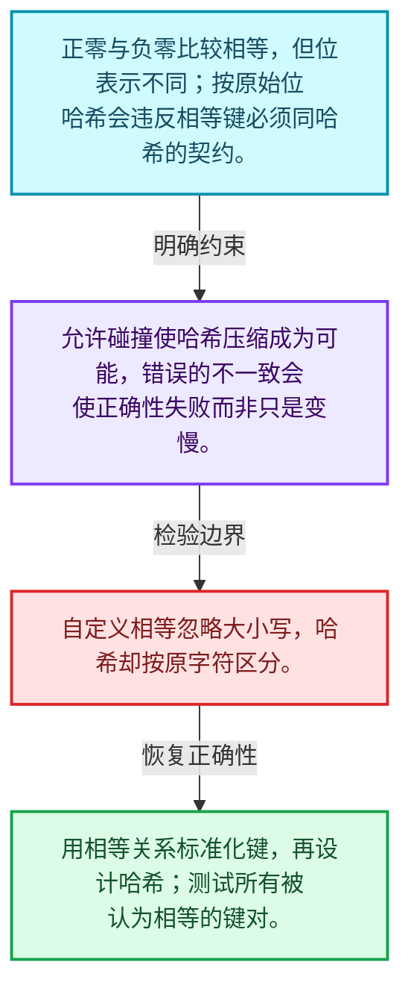
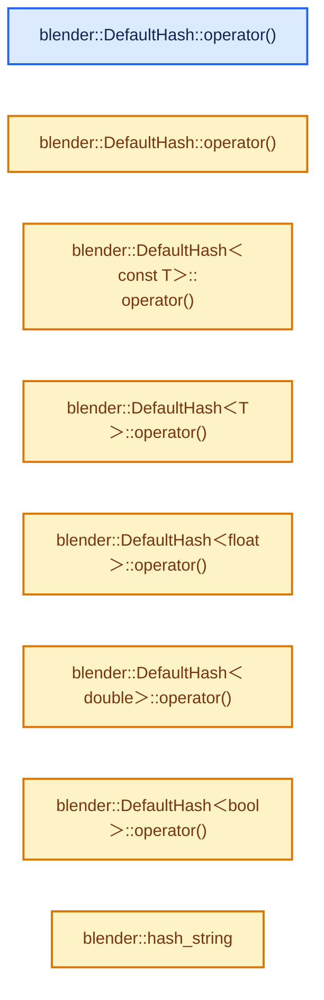
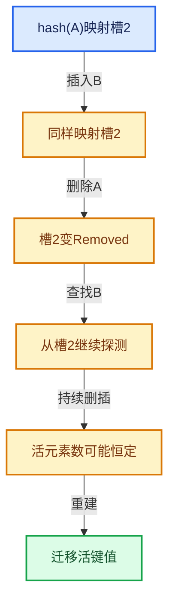

# 02-01 哈希与相等契约

[方向导航](README.md) · [总目录](../README.md) · [实现索引](../%E7%AC%A6%E5%8F%B7%E4%BE%9D%E8%B5%96%E4%B8%8E%E5%AE%9E%E7%8E%B0%E7%B4%A2%E5%BC%95.md)

## 从问题到实现

相等比较为什么约束哈希函数？

a等于b必须推出hash相等，反向不成立；碰撞合法，错误的不一致会让存在的键查找失败。

**数据模型**

正零与负零比较相等，但位表示不同；按原始位哈希会违反相等键必须同哈希的契约。

**设计取舍**

允许碰撞使哈希压缩成为可能，错误的不一致会使正确性失败而非只是变慢。

**最小反例**

自定义相等忽略大小写，哈希却按原字符区分。

**推导**

用相等关系标准化键，再设计哈希；测试所有被认为相等的键对。

## 阅读地图与执行推演








图中的数值推演是本方向的教学模型；实际函数之间的调用边与概念分析边分别标注，不能把概念关系当作运行时调度顺序。

## 完整源码单元与就地讲解

中文讲解直接放在相关代码旁，复杂机制在代码下展开。原文折叠区保留基准行号；不需要在行号表和函数之间来回查找。类布局可分段展示，函数实现不按固定行数切开。

### 类型布局、声明与编译条件 · BLI_hash.hh L1—L85

<a id="t-c47605fe76aa"></a>

<!-- annotated:0b53c3522c7b98 -->

```cpp
/* SPDX-FileCopyrightText: 2023 Blender Authors
 *
 * SPDX-License-Identifier: GPL-2.0-or-later */

#pragma once

/** \file
 * \ingroup bli
 *
 * A specialization of `DefaultHash<T>` provides a hash function for values of type T.
 * This hash function is used by default in hash table implementations in blenlib.
 *
 * The actual hash function is in the `operator()` method of `DefaultHash<T>`. The following code
 * computes the hash of some value using DefaultHash.
 *
 *   T value = ...;
 *   DefaultHash<T> hash_function;
 *   uint32_t hash = hash_function(value);
 *
 * Hash table implementations like Set support heterogeneous key lookups. That means that
 * one can do a lookup with a key of type A in a hash table that stores keys of type B. This is
 * commonly done when B is std::string, because the conversion from e.g. a #StringRef to
 * std::string can be costly and is unnecessary. To make this work, values of type A and B that
 * compare equal have to have the same hash value. This is achieved by defining potentially
 * multiple `operator()` in a specialization of #DefaultHash. All those methods have to compute the
 * same hash for values that compare equal.
 *
 * The computed hash is an unsigned 64 bit integer. Ideally, the hash function would generate
 * uniformly random hash values for a set of keys. However, in many cases trivial hash functions
 * are faster and produce a good enough distribution. In general it is better when more information
 * is in the lower bits of the hash. By choosing a good probing strategy, the effects of a bad hash
 * function are less noticeable though. In this context a good probing strategy is one that takes
 * all bits of the hash into account eventually. One has to check on a case by case basis to see if
 * a better but more expensive or trivial hash function works better.
 *
 * There are three main ways to provide a hash table implementation with a custom hash function.
 *
 * - When you want to provide a default hash function for your own custom type: Add a `hash()`
 *   member function to it. The function should return `uint64_t` and take no arguments. This
 *   method will be called by the default implementation of #DefaultHash. It will automatically be
 *   used by hash table implementations.
 *
 * - When you want to provide a default hash function for a type that you cannot modify: Add a new
 *   specialization to the #DefaultHash struct. This can be done by writing code like below in
 *   either global or `blender` namespace.
 *
 *     template<> struct DefaultHash<TheType> {
 *       uint64_t operator()(const TheType &value) const {
 *         return ...;
 *       }
 *     };
 *
 * - When you want to provide a different hash function for a type that already has a default hash
 *   function: Implement a struct like the one below and pass it as template parameter to the hash
 *   table explicitly.
 *
 *     struct MyCustomHash {
 *       uint64_t operator()(const TheType &value) const {
 *         return ...;
 *       }
 *     };
 */

#include <bit>
#include <memory>
#include <string>
#include <utility>

#include "BLI_hash_fwd.hh"
#include "BLI_string_ref.hh"

namespace blender {

/**
 * If there is no other specialization of #DefaultHash for a given type, look for a hash function
 * on the type itself. Implementing a `hash()` method on a type is often significantly easier than
 * specializing #DefaultHash. As a fallback, it also tries to use the #hash_value function which
 * some libraries implement for their types.
 *
 * To support heterogeneous lookup, a type can also implement a static `hash_as(const OtherType &)`
 * function.
 *
 * In the case of an enum type, the default hash is just to cast the enum value to an integer.
 */
template<typename T> struct DefaultHash {
```

<details>
<summary>核对原始源码：source/blender/blenlib/BLI_hash.hh · L1—L85</summary>

<!-- original:0b53c3522c7b98:source/blender/blenlib/BLI_hash.hh:1:85 -->

```cpp
/* SPDX-FileCopyrightText: 2023 Blender Authors
 *
 * SPDX-License-Identifier: GPL-2.0-or-later */

#pragma once

/** \file
 * \ingroup bli
 *
 * A specialization of `DefaultHash<T>` provides a hash function for values of type T.
 * This hash function is used by default in hash table implementations in blenlib.
 *
 * The actual hash function is in the `operator()` method of `DefaultHash<T>`. The following code
 * computes the hash of some value using DefaultHash.
 *
 *   T value = ...;
 *   DefaultHash<T> hash_function;
 *   uint32_t hash = hash_function(value);
 *
 * Hash table implementations like Set support heterogeneous key lookups. That means that
 * one can do a lookup with a key of type A in a hash table that stores keys of type B. This is
 * commonly done when B is std::string, because the conversion from e.g. a #StringRef to
 * std::string can be costly and is unnecessary. To make this work, values of type A and B that
 * compare equal have to have the same hash value. This is achieved by defining potentially
 * multiple `operator()` in a specialization of #DefaultHash. All those methods have to compute the
 * same hash for values that compare equal.
 *
 * The computed hash is an unsigned 64 bit integer. Ideally, the hash function would generate
 * uniformly random hash values for a set of keys. However, in many cases trivial hash functions
 * are faster and produce a good enough distribution. In general it is better when more information
 * is in the lower bits of the hash. By choosing a good probing strategy, the effects of a bad hash
 * function are less noticeable though. In this context a good probing strategy is one that takes
 * all bits of the hash into account eventually. One has to check on a case by case basis to see if
 * a better but more expensive or trivial hash function works better.
 *
 * There are three main ways to provide a hash table implementation with a custom hash function.
 *
 * - When you want to provide a default hash function for your own custom type: Add a `hash()`
 *   member function to it. The function should return `uint64_t` and take no arguments. This
 *   method will be called by the default implementation of #DefaultHash. It will automatically be
 *   used by hash table implementations.
 *
 * - When you want to provide a default hash function for a type that you cannot modify: Add a new
 *   specialization to the #DefaultHash struct. This can be done by writing code like below in
 *   either global or `blender` namespace.
 *
 *     template<> struct DefaultHash<TheType> {
 *       uint64_t operator()(const TheType &value) const {
 *         return ...;
 *       }
 *     };
 *
 * - When you want to provide a different hash function for a type that already has a default hash
 *   function: Implement a struct like the one below and pass it as template parameter to the hash
 *   table explicitly.
 *
 *     struct MyCustomHash {
 *       uint64_t operator()(const TheType &value) const {
 *         return ...;
 *       }
 *     };
 */

#include <bit>
#include <memory>
#include <string>
#include <utility>

#include "BLI_hash_fwd.hh"
#include "BLI_string_ref.hh"

namespace blender {

/**
 * If there is no other specialization of #DefaultHash for a given type, look for a hash function
 * on the type itself. Implementing a `hash()` method on a type is often significantly easier than
 * specializing #DefaultHash. As a fallback, it also tries to use the #hash_value function which
 * some libraries implement for their types.
 *
 * To support heterogeneous lookup, a type can also implement a static `hash_as(const OtherType &)`
 * function.
 *
 * In the case of an enum type, the default hash is just to cast the enum value to an integer.
 */
template<typename T> struct DefaultHash {
```

</details>

<a id="f-6ee983ba28dfb7a8"></a>

### `blender::DefaultHash::operator()`

实现位置：[source/blender/blenlib/BLI_hash.hh](../../../../../source/blender/blenlib/BLI_hash.hh) · L86—L112。

接口参数：

- `const T &value`

**教学注释版**

<!-- annotated:775261e462a920 -->

```cpp
  constexpr uint64_t operator()(const T &value) const
  {
    if constexpr (std::is_enum_v<T>) {
      /* For enums use the value as hash directly. */
      return uint64_t(value);
    }
    else if constexpr (requires {
                         { value.hash() } -> std::convertible_to<uint64_t>;
                       })
    {
      /* When the type has a hash method directly. */
      return value.hash();
    }
    else if constexpr (requires(const T &v) {
                         { hash_value(v) } -> std::convertible_to<uint64_t>;
                       })
    {
      /* When the type has an overload of the #hash_value which is standard popularized by boost.
       * https://www.boost.org/doc/libs/latest/libs/container_hash/doc/html/hash.html
       * This works e.g. for the pxr::SdfPath type. */
      return hash_value(value);
    }
    else {
      /* No hash function for the type has been found. */
      BLI_assert_unreachable_static_t(T);
    }
  }
```

<details>
<summary>核对原始源码：source/blender/blenlib/BLI_hash.hh · L86—L112</summary>

<!-- original:775261e462a920:source/blender/blenlib/BLI_hash.hh:86:112 -->

```cpp
  constexpr uint64_t operator()(const T &value) const
  {
    if constexpr (std::is_enum_v<T>) {
      /* For enums use the value as hash directly. */
      return uint64_t(value);
    }
    else if constexpr (requires {
                         { value.hash() } -> std::convertible_to<uint64_t>;
                       })
    {
      /* When the type has a hash method directly. */
      return value.hash();
    }
    else if constexpr (requires(const T &v) {
                         { hash_value(v) } -> std::convertible_to<uint64_t>;
                       })
    {
      /* When the type has an overload of the #hash_value which is standard popularized by boost.
       * https://www.boost.org/doc/libs/latest/libs/container_hash/doc/html/hash.html
       * This works e.g. for the pxr::SdfPath type. */
      return hash_value(value);
    }
    else {
      /* No hash function for the type has been found. */
      BLI_assert_unreachable_static_t(T);
    }
  }
```

</details>

**结果出口**

- `return uint64_t(value);`
- `return value.hash();`
- `return hash_value(value);`

**继续追踪实现**

- `value.hash` → [调用协议](../%E6%A8%A1%E6%9D%BF%E5%AE%8F%E4%B8%8E%E5%8A%A8%E6%80%81%E5%88%86%E6%B4%BE%E5%8D%8F%E8%AE%AE.md)：T模板参数提供的操作协议。调用位置L93。
- `hash_value` → [调用协议](../%E6%A8%A1%E6%9D%BF%E5%AE%8F%E4%B8%8E%E5%8A%A8%E6%80%81%E5%88%86%E6%B4%BE%E5%8D%8F%E8%AE%AE.md)：函数指针、局部可调用对象或未展开的宏；必须结合调用者环境。调用位置L100。
- `BLI_assert_unreachable_static_t` → [BLI_assert_unreachable_static_t · L99](../01-%E5%9F%BA%E7%A1%80%E5%AE%B9%E5%99%A8%E4%B8%8E%E7%8E%B0%E4%BB%A3CPP/%E4%BE%9D%E8%B5%96-BLI_assert-cc98e8.md#m-368120c7952b)。宏定义由构建条件选择。

<!-- annotated:dd36e703067e14 -->

```cpp

```

<details>
<summary>核对原始源码：source/blender/blenlib/BLI_hash.hh · L113—L113</summary>

<!-- original:dd36e703067e14:source/blender/blenlib/BLI_hash.hh:113:113 -->

```cpp

```

</details>

<a id="f-28d94d8c82f04e12"></a>

### `blender::DefaultHash::operator()`

实现位置：[source/blender/blenlib/BLI_hash.hh](../../../../../source/blender/blenlib/BLI_hash.hh) · L114—L122。

接口参数：

- `const U &value`

**教学注释版**

<!-- annotated:a1d03b29cc0095 -->

```cpp
  template<typename U> constexpr uint64_t operator()(const U &value) const
  {
    /* Try calling the static `T::hash_as(value)` function with the given value. The returned hash
     * should be "compatible" with `T::hash()`. Usually that means that if `value` is converted to
     * `T` its hash does not change. */
    /* If this results in a compiler error, no hash function for the heterogeneous lookup has been
     * found. */
    return T::hash_as(value);
  }
```

<details>
<summary>核对原始源码：source/blender/blenlib/BLI_hash.hh · L114—L122</summary>

<!-- original:a1d03b29cc0095:source/blender/blenlib/BLI_hash.hh:114:122 -->

```cpp
  template<typename U> constexpr uint64_t operator()(const U &value) const
  {
    /* Try calling the static `T::hash_as(value)` function with the given value. The returned hash
     * should be "compatible" with `T::hash()`. Usually that means that if `value` is converted to
     * `T` its hash does not change. */
    /* If this results in a compiler error, no hash function for the heterogeneous lookup has been
     * found. */
    return T::hash_as(value);
  }
```

</details>

**结果出口**

- `return T::hash_as(value);`

**继续追踪实现**

- `T::hash_as` → [调用协议](../%E6%A8%A1%E6%9D%BF%E5%AE%8F%E4%B8%8E%E5%8A%A8%E6%80%81%E5%88%86%E6%B4%BE%E5%8D%8F%E8%AE%AE.md)：函数指针、局部可调用对象或未展开的宏；必须结合调用者环境。调用位置L121。

### 类型布局、声明与编译条件 · BLI_hash.hh L123—L128

<a id="t-346ffafbe4fa"></a>

<!-- annotated:2a26529246a69d -->

```cpp
};

/**
 * Use the same hash function for const and non const variants of a type.
 */
template<typename T> struct DefaultHash<const T> {
```

<details>
<summary>核对原始源码：source/blender/blenlib/BLI_hash.hh · L123—L128</summary>

<!-- original:2a26529246a69d:source/blender/blenlib/BLI_hash.hh:123:128 -->

```cpp
};

/**
 * Use the same hash function for const and non const variants of a type.
 */
template<typename T> struct DefaultHash<const T> {
```

</details>

<a id="f-b7c2254390d8af0f"></a>

### `blender::DefaultHash<const T>::operator()`

实现位置：[source/blender/blenlib/BLI_hash.hh](../../../../../source/blender/blenlib/BLI_hash.hh) · L129—L132。

接口参数：

- `const T &value`

**教学注释版**

<!-- annotated:217f0fe0b19d7e -->

```cpp
  constexpr uint64_t operator()(const T &value) const
  {
    return DefaultHash<T>{}(value);
  }
```

<details>
<summary>核对原始源码：source/blender/blenlib/BLI_hash.hh · L129—L132</summary>

<!-- original:217f0fe0b19d7e:source/blender/blenlib/BLI_hash.hh:129:132 -->

```cpp
  constexpr uint64_t operator()(const T &value) const
  {
    return DefaultHash<T>{}(value);
  }
```

</details>

**结果出口**

- `return DefaultHash<T>{}(value);`

**继续追踪实现**

- `DefaultHash<T>{}` → [blender::DefaultHash](%E4%BE%9D%E8%B5%96-BLI_hash-574293.md#t-c47605fe76aa)。

### 类型布局、声明与编译条件 · BLI_hash.hh L133—L143

<a id="t-3e8fa2dcbd61"></a>

<!-- annotated:b1b20d5c433834 -->

```cpp
};

/**
 * We cannot make any assumptions about the distribution of keys, so use a trivial hash function by
 * default. The default probing strategy is designed to take all bits of the hash into account
 * to avoid worst case behavior when the lower bits are all zero. Special hash functions can be
 * implemented when more knowledge about a specific key distribution is available.
 */
template<typename T>
  requires(std::is_integral_v<T> && !std::is_same_v<T, bool>)
struct DefaultHash<T> {
```

<details>
<summary>核对原始源码：source/blender/blenlib/BLI_hash.hh · L133—L143</summary>

<!-- original:b1b20d5c433834:source/blender/blenlib/BLI_hash.hh:133:143 -->

```cpp
};

/**
 * We cannot make any assumptions about the distribution of keys, so use a trivial hash function by
 * default. The default probing strategy is designed to take all bits of the hash into account
 * to avoid worst case behavior when the lower bits are all zero. Special hash functions can be
 * implemented when more knowledge about a specific key distribution is available.
 */
template<typename T>
  requires(std::is_integral_v<T> && !std::is_same_v<T, bool>)
struct DefaultHash<T> {
```

</details>

<a id="f-e435fb712e91ce00"></a>

### `blender::DefaultHash<T>::operator()`

实现位置：[source/blender/blenlib/BLI_hash.hh](../../../../../source/blender/blenlib/BLI_hash.hh) · L144—L147。

接口参数：

- `const T &value`

**教学注释版**

<!-- annotated:b94c390d8314f4 -->

```cpp
  constexpr uint64_t operator()(const T &value) const
  {
    return uint64_t(value);
  }
```

<details>
<summary>核对原始源码：source/blender/blenlib/BLI_hash.hh · L144—L147</summary>

<!-- original:b94c390d8314f4:source/blender/blenlib/BLI_hash.hh:144:147 -->

```cpp
  constexpr uint64_t operator()(const T &value) const
  {
    return uint64_t(value);
  }
```

</details>

**结果出口**

- `return uint64_t(value);`

**继续追踪实现**

本实现没有需要继续展开的显式调用；检查返回表达式、对象转换和调用者前置条件。

### 类型布局、声明与编译条件 · BLI_hash.hh L148—L153

<a id="t-b0a2b78875b3"></a>

<!-- annotated:d71e8214b6876c -->

```cpp
};

/**
 * One should try to avoid using floats as keys in hash tables, but sometimes it is convenient.
 */
template<> struct DefaultHash<float> {
```

<details>
<summary>核对原始源码：source/blender/blenlib/BLI_hash.hh · L148—L153</summary>

<!-- original:d71e8214b6876c:source/blender/blenlib/BLI_hash.hh:148:153 -->

```cpp
};

/**
 * One should try to avoid using floats as keys in hash tables, but sometimes it is convenient.
 */
template<> struct DefaultHash<float> {
```

</details>

<a id="f-b7fa50aaf0aa2b9e"></a>

### `blender::DefaultHash<float>::operator()`

实现位置：[source/blender/blenlib/BLI_hash.hh](../../../../../source/blender/blenlib/BLI_hash.hh) · L154—L162。

接口参数：

- `const float value`

**教学注释版**

<!-- annotated:3923e54459a680 -->

```cpp
  constexpr uint64_t operator()(const float value) const
  {
    /* Make sure +0 and -0 hash to the same value. */
    if (value == 0.0f) {
      return 0;
    }
    /* Explicit `uint64_t` cast to suppress CPPCHECK warning. */
    return uint64_t(std::bit_cast<uint32_t>(value));
  }
```

<details>
<summary>核对原始源码：source/blender/blenlib/BLI_hash.hh · L154—L162</summary>

<!-- original:3923e54459a680:source/blender/blenlib/BLI_hash.hh:154:162 -->

```cpp
  constexpr uint64_t operator()(const float value) const
  {
    /* Make sure +0 and -0 hash to the same value. */
    if (value == 0.0f) {
      return 0;
    }
    /* Explicit `uint64_t` cast to suppress CPPCHECK warning. */
    return uint64_t(std::bit_cast<uint32_t>(value));
  }
```

</details>

**结果出口**

- `return 0;`
- `return uint64_t(std::bit_cast<uint32_t>(value));`

**继续追踪实现**

- `std::bit_cast<uint32_t>` → [外部契约](https://eel.is/c++draft/)：这个边界按实际表达式及所属类型核对参数、返回值、寿命与失败行为。这里提供接口入口，不声称已解释该第三方版本的内部实现。

### 类型布局、声明与编译条件 · BLI_hash.hh L163—L165

<a id="t-6a88cc55ddd7"></a>

<!-- annotated:5fa6a5e369c1fa -->

```cpp
};

template<> struct DefaultHash<double> {
```

<details>
<summary>核对原始源码：source/blender/blenlib/BLI_hash.hh · L163—L165</summary>

<!-- original:5fa6a5e369c1fa:source/blender/blenlib/BLI_hash.hh:163:165 -->

```cpp
};

template<> struct DefaultHash<double> {
```

</details>

<a id="f-11b59b4c6d9a224c"></a>

### `blender::DefaultHash<double>::operator()`

实现位置：[source/blender/blenlib/BLI_hash.hh](../../../../../source/blender/blenlib/BLI_hash.hh) · L166—L173。

接口参数：

- `const double value`

**教学注释版**

<!-- annotated:fcc4b92f945129 -->

```cpp
  constexpr uint64_t operator()(const double value) const
  {
    /* Make sure +0 and -0 hash to the same value. */
    if (value == 0.0) {
      return 0;
    }
    return std::bit_cast<uint64_t>(value);
  }
```

<details>
<summary>核对原始源码：source/blender/blenlib/BLI_hash.hh · L166—L173</summary>

<!-- original:fcc4b92f945129:source/blender/blenlib/BLI_hash.hh:166:173 -->

```cpp
  constexpr uint64_t operator()(const double value) const
  {
    /* Make sure +0 and -0 hash to the same value. */
    if (value == 0.0) {
      return 0;
    }
    return std::bit_cast<uint64_t>(value);
  }
```

</details>

**结果出口**

- `return 0;`
- `return std::bit_cast<uint64_t>(value);`

**继续追踪实现**

- `std::bit_cast<uint64_t>` → [外部契约](https://eel.is/c++draft/)：这个边界按实际表达式及所属类型核对参数、返回值、寿命与失败行为。这里提供接口入口，不声称已解释该第三方版本的内部实现。

### 类型布局、声明与编译条件 · BLI_hash.hh L174—L176

<a id="t-4910832b213d"></a>

<!-- annotated:6da37039fe9807 -->

```cpp
};

template<> struct DefaultHash<bool> {
```

<details>
<summary>核对原始源码：source/blender/blenlib/BLI_hash.hh · L174—L176</summary>

<!-- original:6da37039fe9807:source/blender/blenlib/BLI_hash.hh:174:176 -->

```cpp
};

template<> struct DefaultHash<bool> {
```

</details>

<a id="f-cb5269bad90e566f"></a>

### `blender::DefaultHash<bool>::operator()`

实现位置：[source/blender/blenlib/BLI_hash.hh](../../../../../source/blender/blenlib/BLI_hash.hh) · L177—L180。

接口参数：

- `bool value`

**教学注释版**

<!-- annotated:420606d726c635 -->

```cpp
  constexpr uint64_t operator()(bool value) const
  {
    return uint64_t((value != false) * 1298191);
  }
```

<details>
<summary>核对原始源码：source/blender/blenlib/BLI_hash.hh · L177—L180</summary>

<!-- original:420606d726c635:source/blender/blenlib/BLI_hash.hh:177:180 -->

```cpp
  constexpr uint64_t operator()(bool value) const
  {
    return uint64_t((value != false) * 1298191);
  }
```

</details>

**结果出口**

- `return uint64_t((value != false) * 1298191);`

**继续追踪实现**

本实现没有需要继续展开的显式调用；检查返回表达式、对象转换和调用者前置条件。

### 类型布局、声明与编译条件 · BLI_hash.hh L181—L182

<!-- annotated:d9df4170b44165 -->

```cpp
};

```

<details>
<summary>核对原始源码：source/blender/blenlib/BLI_hash.hh · L181—L182</summary>

<!-- original:d9df4170b44165:source/blender/blenlib/BLI_hash.hh:181:182 -->

```cpp
};

```

</details>

<a id="f-38851336c213d83a"></a>

### `blender::hash_string`

实现位置：[source/blender/blenlib/BLI_hash.hh](../../../../../source/blender/blenlib/BLI_hash.hh) · L183—L190。

接口参数：

- `StringRef str`

**教学注释版**

<!-- annotated:b8afbe6b832007 -->

```cpp
constexpr uint64_t hash_string(StringRef str)
{
  uint64_t hash = 5381;
  for (char c : str) {
    hash = hash * 33 + c;
  }
  return hash;
}
```

<details>
<summary>核对原始源码：source/blender/blenlib/BLI_hash.hh · L183—L190</summary>

<!-- original:b8afbe6b832007:source/blender/blenlib/BLI_hash.hh:183:190 -->

```cpp
constexpr uint64_t hash_string(StringRef str)
{
  uint64_t hash = 5381;
  for (char c : str) {
    hash = hash * 33 + c;
  }
  return hash;
}
```

</details>

**沿实际写入检查状态**

- `hash = hash * 33 + c;`

**结果出口**

- `return hash;`

**继续追踪实现**

本实现没有需要继续展开的显式调用；检查返回表达式、对象转换和调用者前置条件。

### 类型布局、声明与编译条件 · BLI_hash.hh L191—L196

<a id="t-b6bc60518de9"></a>

<!-- annotated:63701669305f22 -->

```cpp

template<> struct DefaultHash<std::string> {
  /**
   * Take a #StringRef as parameter to support heterogeneous lookups in hash table implementations
   * when std::string is used as key.
   */
```

<details>
<summary>核对原始源码：source/blender/blenlib/BLI_hash.hh · L191—L196</summary>

<!-- original:63701669305f22:source/blender/blenlib/BLI_hash.hh:191:196 -->

```cpp

template<> struct DefaultHash<std::string> {
  /**
   * Take a #StringRef as parameter to support heterogeneous lookups in hash table implementations
   * when std::string is used as key.
   */
```

</details>

<a id="f-8d477810b8ce08df"></a>

### `blender::DefaultHash<std::string>::operator()`

实现位置：[source/blender/blenlib/BLI_hash.hh](../../../../../source/blender/blenlib/BLI_hash.hh) · L197—L200。

接口参数：

- `StringRef value`

**教学注释版**

<!-- annotated:b40a02764e0f29 -->

```cpp
  constexpr uint64_t operator()(StringRef value) const
  {
    return hash_string(value);
  }
```

<details>
<summary>核对原始源码：source/blender/blenlib/BLI_hash.hh · L197—L200</summary>

<!-- original:b40a02764e0f29:source/blender/blenlib/BLI_hash.hh:197:200 -->

```cpp
  constexpr uint64_t operator()(StringRef value) const
  {
    return hash_string(value);
  }
```

</details>

**结果出口**

- `return hash_string(value);`

**继续追踪实现**

- `hash_string` → [blender::hash_string · L183](01-%E5%93%88%E5%B8%8C%E4%B8%8E%E7%9B%B8%E7%AD%89%E5%A5%91%E7%BA%A6.md#f-38851336c213d83a)。

### 类型布局、声明与编译条件 · BLI_hash.hh L201—L203

<a id="t-222a31a9aa3a"></a>

<!-- annotated:bb3c5e76bc8360 -->

```cpp
};

template<> struct DefaultHash<StringRef> {
```

<details>
<summary>核对原始源码：source/blender/blenlib/BLI_hash.hh · L201—L203</summary>

<!-- original:bb3c5e76bc8360:source/blender/blenlib/BLI_hash.hh:201:203 -->

```cpp
};

template<> struct DefaultHash<StringRef> {
```

</details>

<a id="f-fe0e6e987196538f"></a>

### `blender::DefaultHash<StringRef>::operator()`

实现位置：[source/blender/blenlib/BLI_hash.hh](../../../../../source/blender/blenlib/BLI_hash.hh) · L204—L207。

接口参数：

- `StringRef value`

**教学注释版**

<!-- annotated:00f45e04732663 -->

```cpp
  constexpr uint64_t operator()(StringRef value) const
  {
    return hash_string(value);
  }
```

<details>
<summary>核对原始源码：source/blender/blenlib/BLI_hash.hh · L204—L207</summary>

<!-- original:00f45e04732663:source/blender/blenlib/BLI_hash.hh:204:207 -->

```cpp
  constexpr uint64_t operator()(StringRef value) const
  {
    return hash_string(value);
  }
```

</details>

**结果出口**

- `return hash_string(value);`

**继续追踪实现**

- `hash_string` → [blender::hash_string · L183](01-%E5%93%88%E5%B8%8C%E4%B8%8E%E7%9B%B8%E7%AD%89%E5%A5%91%E7%BA%A6.md#f-38851336c213d83a)。

### 类型布局、声明与编译条件 · BLI_hash.hh L208—L210

<a id="t-9cba2d5ba782"></a>

<!-- annotated:0c6d6e98a34329 -->

```cpp
};

template<> struct DefaultHash<StringRefNull> {
```

<details>
<summary>核对原始源码：source/blender/blenlib/BLI_hash.hh · L208—L210</summary>

<!-- original:0c6d6e98a34329:source/blender/blenlib/BLI_hash.hh:208:210 -->

```cpp
};

template<> struct DefaultHash<StringRefNull> {
```

</details>

<a id="f-fcf19434152c7ec8"></a>

### `blender::DefaultHash<StringRefNull>::operator()`

实现位置：[source/blender/blenlib/BLI_hash.hh](../../../../../source/blender/blenlib/BLI_hash.hh) · L211—L214。

接口参数：

- `StringRef value`

**教学注释版**

<!-- annotated:360ac67e7b981f -->

```cpp
  constexpr uint64_t operator()(StringRef value) const
  {
    return hash_string(value);
  }
```

<details>
<summary>核对原始源码：source/blender/blenlib/BLI_hash.hh · L211—L214</summary>

<!-- original:360ac67e7b981f:source/blender/blenlib/BLI_hash.hh:211:214 -->

```cpp
  constexpr uint64_t operator()(StringRef value) const
  {
    return hash_string(value);
  }
```

</details>

**结果出口**

- `return hash_string(value);`

**继续追踪实现**

- `hash_string` → [blender::hash_string · L183](01-%E5%93%88%E5%B8%8C%E4%B8%8E%E7%9B%B8%E7%AD%89%E5%A5%91%E7%BA%A6.md#f-38851336c213d83a)。

### 类型布局、声明与编译条件 · BLI_hash.hh L215—L217

<a id="t-0dcb7614e9c2"></a>

<!-- annotated:ec226b4b2313db -->

```cpp
};

template<> struct DefaultHash<std::string_view> {
```

<details>
<summary>核对原始源码：source/blender/blenlib/BLI_hash.hh · L215—L217</summary>

<!-- original:ec226b4b2313db:source/blender/blenlib/BLI_hash.hh:215:217 -->

```cpp
};

template<> struct DefaultHash<std::string_view> {
```

</details>

<a id="f-3611383aad8cf2e7"></a>

### `blender::DefaultHash<std::string_view>::operator()`

实现位置：[source/blender/blenlib/BLI_hash.hh](../../../../../source/blender/blenlib/BLI_hash.hh) · L218—L221。

接口参数：

- `StringRef value`

**教学注释版**

<!-- annotated:90939f08cc5948 -->

```cpp
  constexpr uint64_t operator()(StringRef value) const
  {
    return hash_string(value);
  }
```

<details>
<summary>核对原始源码：source/blender/blenlib/BLI_hash.hh · L218—L221</summary>

<!-- original:90939f08cc5948:source/blender/blenlib/BLI_hash.hh:218:221 -->

```cpp
  constexpr uint64_t operator()(StringRef value) const
  {
    return hash_string(value);
  }
```

</details>

**结果出口**

- `return hash_string(value);`

**继续追踪实现**

- `hash_string` → [blender::hash_string · L183](01-%E5%93%88%E5%B8%8C%E4%B8%8E%E7%9B%B8%E7%AD%89%E5%A5%91%E7%BA%A6.md#f-38851336c213d83a)。

### 类型布局、声明与编译条件 · BLI_hash.hh L222—L227

<a id="t-ccecfc54f69c"></a>

<!-- annotated:e4a83b31c0bde5 -->

```cpp
};

/**
 * While we cannot guarantee that the lower 4 bits of a pointer are zero, it is often the case.
 */
template<typename T> struct DefaultHash<T *> {
```

<details>
<summary>核对原始源码：source/blender/blenlib/BLI_hash.hh · L222—L227</summary>

<!-- original:e4a83b31c0bde5:source/blender/blenlib/BLI_hash.hh:222:227 -->

```cpp
};

/**
 * While we cannot guarantee that the lower 4 bits of a pointer are zero, it is often the case.
 */
template<typename T> struct DefaultHash<T *> {
```

</details>

<a id="f-77aa2fff6a83a82d"></a>

### `blender::DefaultHash<T *>::operator()`

实现位置：[source/blender/blenlib/BLI_hash.hh](../../../../../source/blender/blenlib/BLI_hash.hh) · L228—L233。

接口参数：

- `const T *value`

**教学注释版**

<!-- annotated:4457974b5e4c6a -->

```cpp
  constexpr uint64_t operator()(const T *value) const
  {
    uintptr_t ptr = uintptr_t(value);
    uint64_t hash = uint64_t(ptr >> 4);
    return hash;
  }
```

<details>
<summary>核对原始源码：source/blender/blenlib/BLI_hash.hh · L228—L233</summary>

<!-- original:4457974b5e4c6a:source/blender/blenlib/BLI_hash.hh:228:233 -->

```cpp
  constexpr uint64_t operator()(const T *value) const
  {
    uintptr_t ptr = uintptr_t(value);
    uint64_t hash = uint64_t(ptr >> 4);
    return hash;
  }
```

</details>

**结果出口**

- `return hash;`

**继续追踪实现**

本实现没有需要继续展开的显式调用；检查返回表达式、对象转换和调用者前置条件。

### 类型布局、声明与编译条件 · BLI_hash.hh L234—L239

<!-- annotated:956db4e36dbd5f -->

```cpp
};

namespace blenlib_detail {
static constexpr std::array<uint64_t, 5> default_hash_factors = {
    19349669, 83492791, 3632623, 8789800933, 7235126189};

```

<details>
<summary>核对原始源码：source/blender/blenlib/BLI_hash.hh · L234—L239</summary>

<!-- original:956db4e36dbd5f:source/blender/blenlib/BLI_hash.hh:234:239 -->

```cpp
};

namespace blenlib_detail {
static constexpr std::array<uint64_t, 5> default_hash_factors = {
    19349669, 83492791, 3632623, 8789800933, 7235126189};

```

</details>

<a id="f-3122b929123a2695"></a>

### `blender::blenlib_detail::get_default_hash_array`

实现位置：[source/blender/blenlib/BLI_hash.hh](../../../../../source/blender/blenlib/BLI_hash.hh) · L240—L247。

接口参数：

- `std::index_sequence<I...>`

**教学注释版**

<!-- annotated:22dfe211b0bcee -->

```cpp
template<size_t... I, typename... Args>
constexpr uint64_t get_default_hash_array(std::index_sequence<I...> /*indices*/,
                                          const Args &...args)
{
  static_assert(sizeof...(Args) == sizeof...(I));
  static_assert(sizeof...(Args) <= default_hash_factors.size());
  return (0 ^ ... ^ (default_hash_factors[I] * DefaultHash<std::decay_t<Args>>{}(args)));
}
```

<details>
<summary>核对原始源码：source/blender/blenlib/BLI_hash.hh · L240—L247</summary>

<!-- original:22dfe211b0bcee:source/blender/blenlib/BLI_hash.hh:240:247 -->

```cpp
template<size_t... I, typename... Args>
constexpr uint64_t get_default_hash_array(std::index_sequence<I...> /*indices*/,
                                          const Args &...args)
{
  static_assert(sizeof...(Args) == sizeof...(I));
  static_assert(sizeof...(Args) <= default_hash_factors.size());
  return (0 ^ ... ^ (default_hash_factors[I] * DefaultHash<std::decay_t<Args>>{}(args)));
}
```

</details>

**结果出口**

- `return (0 ^ ... ^ (default_hash_factors[I] * DefaultHash<std::decay_t<Args>>{}(args)));`

**继续追踪实现**

- `default_hash_factors.size` → [调用协议](../%E6%A8%A1%E6%9D%BF%E5%AE%8F%E4%B8%8E%E5%8A%A8%E6%80%81%E5%88%86%E6%B4%BE%E5%8D%8F%E8%AE%AE.md)：接收对象类型依赖auto、返回值或模板实例；不按同名猜测目标。调用位置L245。
- `DefaultHash<std::decay_t<Args>>{}` → [blender::DefaultHash](%E4%BE%9D%E8%B5%96-BLI_hash-574293.md#t-c47605fe76aa)。

### 类型布局、声明与编译条件 · BLI_hash.hh L248—L250

<!-- annotated:5afeef63432d4e -->

```cpp

}  // namespace blenlib_detail

```

<details>
<summary>核对原始源码：source/blender/blenlib/BLI_hash.hh · L248—L250</summary>

<!-- original:5afeef63432d4e:source/blender/blenlib/BLI_hash.hh:248:250 -->

```cpp

}  // namespace blenlib_detail

```

</details>

<a id="f-5f2c246aedf3dc0a"></a>

### `blender::get_default_hash`

实现位置：[source/blender/blenlib/BLI_hash.hh](../../../../../source/blender/blenlib/BLI_hash.hh) · L251—L257。

接口参数：

- `const T &v`

**教学注释版**

<!-- annotated:11ce4e14dff6b7 -->

```cpp
template<typename T, typename... Args>
constexpr uint64_t get_default_hash(const T &v, const Args &...args)
{
  return DefaultHash<std::decay_t<T>>{}(v) ^
         blenlib_detail::get_default_hash_array(std::make_index_sequence<sizeof...(Args)>(),
                                                args...);
}
```

<details>
<summary>核对原始源码：source/blender/blenlib/BLI_hash.hh · L251—L257</summary>

<!-- original:11ce4e14dff6b7:source/blender/blenlib/BLI_hash.hh:251:257 -->

```cpp
template<typename T, typename... Args>
constexpr uint64_t get_default_hash(const T &v, const Args &...args)
{
  return DefaultHash<std::decay_t<T>>{}(v) ^
         blenlib_detail::get_default_hash_array(std::make_index_sequence<sizeof...(Args)>(),
                                                args...);
}
```

</details>

**结果出口**

- `return DefaultHash<std::decay_t<T>>{}(v) ^`

**继续追踪实现**

- `DefaultHash<std::decay_t<T>>{}` → [blender::DefaultHash](%E4%BE%9D%E8%B5%96-BLI_hash-574293.md#t-c47605fe76aa)。
- `blenlib_detail::get_default_hash_array` → [blender::blenlib_detail::get_default_hash_array · L240](01-%E5%93%88%E5%B8%8C%E4%B8%8E%E7%9B%B8%E7%AD%89%E5%A5%91%E7%BA%A6.md#f-3122b929123a2695)。
- `std::make_index_sequence<sizeof...(Args)>` → [外部契约](https://eel.is/c++draft/)：这个边界按实际表达式及所属类型核对参数、返回值、寿命与失败行为。这里提供接口入口，不声称已解释该第三方版本的内部实现。

### 类型布局、声明与编译条件 · BLI_hash.hh L258—L260

<a id="t-0a8a4a74defe"></a>

<!-- annotated:82ba2b266776f9 -->

```cpp

/** Support hashing different kinds of pointer types. */
template<typename T> struct PointerHashes {
```

<details>
<summary>核对原始源码：source/blender/blenlib/BLI_hash.hh · L258—L260</summary>

<!-- original:82ba2b266776f9:source/blender/blenlib/BLI_hash.hh:258:260 -->

```cpp

/** Support hashing different kinds of pointer types. */
template<typename T> struct PointerHashes {
```

</details>

<a id="f-6b996743fbbb4e50"></a>

### `blender::PointerHashes::operator()`

实现位置：[source/blender/blenlib/BLI_hash.hh](../../../../../source/blender/blenlib/BLI_hash.hh) · L261—L264。

接口参数：

- `const U &value`

**教学注释版**

<!-- annotated:14d51446f1bfe5 -->

```cpp
  template<typename U> constexpr uint64_t operator()(const U &value) const
  {
    return get_default_hash(&*value);
  }
```

<details>
<summary>核对原始源码：source/blender/blenlib/BLI_hash.hh · L261—L264</summary>

<!-- original:14d51446f1bfe5:source/blender/blenlib/BLI_hash.hh:261:264 -->

```cpp
  template<typename U> constexpr uint64_t operator()(const U &value) const
  {
    return get_default_hash(&*value);
  }
```

</details>

**结果出口**

- `return get_default_hash(&*value);`

**继续追踪实现**

- `get_default_hash` → [blender::get_default_hash · L251](01-%E5%93%88%E5%B8%8C%E4%B8%8E%E7%9B%B8%E7%AD%89%E5%A5%91%E7%BA%A6.md#f-5f2c246aedf3dc0a)。

### 类型布局、声明与编译条件 · BLI_hash.hh L265—L270

<a id="t-20ba31691dbb"></a>

<a id="t-779f44e24e03"></a>

<a id="t-c6b89a93aea2"></a>

<!-- annotated:4e7113887e96c5 -->

```cpp
};

template<typename T> struct DefaultHash<std::unique_ptr<T>> : public PointerHashes<T> {};
template<typename T> struct DefaultHash<std::shared_ptr<T>> : public PointerHashes<T> {};

template<typename T> struct DefaultHash<std::reference_wrapper<T>> {
```

<details>
<summary>核对原始源码：source/blender/blenlib/BLI_hash.hh · L265—L270</summary>

<!-- original:4e7113887e96c5:source/blender/blenlib/BLI_hash.hh:265:270 -->

```cpp
};

template<typename T> struct DefaultHash<std::unique_ptr<T>> : public PointerHashes<T> {};
template<typename T> struct DefaultHash<std::shared_ptr<T>> : public PointerHashes<T> {};

template<typename T> struct DefaultHash<std::reference_wrapper<T>> {
```

</details>

<a id="f-0e4032c79ba660d4"></a>

### `blender::DefaultHash<std::reference_wrapper<T>>::operator()`

实现位置：[source/blender/blenlib/BLI_hash.hh](../../../../../source/blender/blenlib/BLI_hash.hh) · L271—L274。

接口参数：

- `const std::reference_wrapper<T> &value`

**教学注释版**

<!-- annotated:f49f3db23cfc83 -->

```cpp
  constexpr uint64_t operator()(const std::reference_wrapper<T> &value) const
  {
    return get_default_hash(value.get());
  }
```

<details>
<summary>核对原始源码：source/blender/blenlib/BLI_hash.hh · L271—L274</summary>

<!-- original:f49f3db23cfc83:source/blender/blenlib/BLI_hash.hh:271:274 -->

```cpp
  constexpr uint64_t operator()(const std::reference_wrapper<T> &value) const
  {
    return get_default_hash(value.get());
  }
```

</details>

**结果出口**

- `return get_default_hash(value.get());`

**继续追踪实现**

- `get_default_hash` → [blender::get_default_hash · L251](01-%E5%93%88%E5%B8%8C%E4%B8%8E%E7%9B%B8%E7%AD%89%E5%A5%91%E7%BA%A6.md#f-5f2c246aedf3dc0a)。
- `value.get` → [外部契约](https://eel.is/c++draft/)：这个边界按实际表达式及所属类型核对参数、返回值、寿命与失败行为。这里提供接口入口，不声称已解释该第三方版本的内部实现。

### 类型布局、声明与编译条件 · BLI_hash.hh L275—L277

<a id="t-fef961eb533d"></a>

<!-- annotated:c73068b429c9bf -->

```cpp
};

template<typename T1, typename T2> struct DefaultHash<std::pair<T1, T2>> {
```

<details>
<summary>核对原始源码：source/blender/blenlib/BLI_hash.hh · L275—L277</summary>

<!-- original:c73068b429c9bf:source/blender/blenlib/BLI_hash.hh:275:277 -->

```cpp
};

template<typename T1, typename T2> struct DefaultHash<std::pair<T1, T2>> {
```

</details>

<a id="f-aea745251c7deb63"></a>

### `blender::DefaultHash<std::pair<T1, T2>>::operator()`

实现位置：[source/blender/blenlib/BLI_hash.hh](../../../../../source/blender/blenlib/BLI_hash.hh) · L278—L281。

接口参数：

- `const std::pair<T1, T2> &value`

**教学注释版**

<!-- annotated:70a1a9d757663f -->

```cpp
  constexpr uint64_t operator()(const std::pair<T1, T2> &value) const
  {
    return get_default_hash(value.first, value.second);
  }
```

<details>
<summary>核对原始源码：source/blender/blenlib/BLI_hash.hh · L278—L281</summary>

<!-- original:70a1a9d757663f:source/blender/blenlib/BLI_hash.hh:278:281 -->

```cpp
  constexpr uint64_t operator()(const std::pair<T1, T2> &value) const
  {
    return get_default_hash(value.first, value.second);
  }
```

</details>

**结果出口**

- `return get_default_hash(value.first, value.second);`

**继续追踪实现**

- `get_default_hash` → [blender::get_default_hash · L251](01-%E5%93%88%E5%B8%8C%E4%B8%8E%E7%9B%B8%E7%AD%89%E5%A5%91%E7%BA%A6.md#f-5f2c246aedf3dc0a)。

### 类型布局、声明与编译条件 · BLI_hash.hh L282—L288

<a id="t-54307fee74a8"></a>

<!-- annotated:22fcd12814df67 -->

```cpp
};

/**
 * Special overload for function pointers to avoid adding const to them which causes a warning with
 * MSVC.
 */
template<typename Ret, typename... Args> struct DefaultHash<Ret (*)(Args...)> {
```

<details>
<summary>核对原始源码：source/blender/blenlib/BLI_hash.hh · L282—L288</summary>

<!-- original:22fcd12814df67:source/blender/blenlib/BLI_hash.hh:282:288 -->

```cpp
};

/**
 * Special overload for function pointers to avoid adding const to them which causes a warning with
 * MSVC.
 */
template<typename Ret, typename... Args> struct DefaultHash<Ret (*)(Args...)> {
```

</details>

<a id="f-f88ac9a65be60154"></a>

### `blender::DefaultHash<Ret (*)(Args...)>::operator()`

实现位置：[source/blender/blenlib/BLI_hash.hh](../../../../../source/blender/blenlib/BLI_hash.hh) · L289—L292。

接口参数：

- `Ret (*fn)(Args...)`

**教学注释版**

<!-- annotated:8e494f195ea5b2 -->

```cpp
  constexpr uint64_t operator()(Ret (*fn)(Args...)) const
  {
    return get_default_hash(reinterpret_cast<const void *>(fn));
  }
```

<details>
<summary>核对原始源码：source/blender/blenlib/BLI_hash.hh · L289—L292</summary>

<!-- original:8e494f195ea5b2:source/blender/blenlib/BLI_hash.hh:289:292 -->

```cpp
  constexpr uint64_t operator()(Ret (*fn)(Args...)) const
  {
    return get_default_hash(reinterpret_cast<const void *>(fn));
  }
```

</details>

**结果出口**

- `return get_default_hash(reinterpret_cast<const void *>(fn));`

**继续追踪实现**

- `get_default_hash` → [blender::get_default_hash · L251](01-%E5%93%88%E5%B8%8C%E4%B8%8E%E7%9B%B8%E7%AD%89%E5%A5%91%E7%BA%A6.md#f-5f2c246aedf3dc0a)。

### 类型布局、声明与编译条件 · BLI_hash.hh L293—L295

<!-- annotated:3f91d259abb835 -->

```cpp
};

}  // namespace blender
```

<details>
<summary>核对原始源码：source/blender/blenlib/BLI_hash.hh · L293—L295</summary>

<!-- original:3f91d259abb835:source/blender/blenlib/BLI_hash.hh:293:295 -->

```cpp
};

}  // namespace blender
```

</details>

## 语法与相关类型

### 模板 template

模板把类型或常量作为生成实现的参数。读声明时先列出类型参数、非类型参数和默认值，再看使用者实际实例化了什么。模板声明本身不意味着每种T都支持其全部成员。

把T替换为int、string、只能移动的类型，分别检查每个被调用操作是否成立。

### 依赖名称 typename

typename既可引入类型模板参数，也可告诉编译器某个依赖名称是类型。它不创建运行时对象；解析期确认语法类别与实例化期检查具体类型是不同阶段。

区分typename T::value_type和T::size()，前者标记类型，后者是表达式。

### 约束 requires

requires表达式或requires子句限制模板参与重载的条件。它提供编译期可用性检查，不是运行时if，不能指望输入到达程序后再被这一机制验证。

构造满足和不满足约束的两个类型，观察候选被排除而不是在函数内返回错误。

### 常量求值 constexpr

constexpr声明允许相应实体参与常量求值，但constexpr函数仍可以在运行时执行。是否常量求值由调用场景和表达式合法性共同决定。

比较constexpr变量初始化和从运行时输入调用同一函数。

### 只读限定 const

const约束当前访问路径可做的修改。const指针、指向const的指针、const视图对象、const元素是不同位置的限定；其他别名可能仍可修改原对象。

分别写T* const、const T*与const T* const，并画出不可修改的层次。

### 异常边界 try与catch

try定义异常传播的局部边界。失败路径需要销毁已经成功构造的部分并释放相应存储；未构造的对象不能被析构。

在第k次构造失败，列出已经存在的对象集合与待释放缓冲。

### 表示层转换 reinterpret_cast

reinterpret_cast不能自动开始任意对象的生命周期，也不能豁免对齐和别名规则。读这类代码需要追溯原始分配与实际构造操作。

分别检查大小、对齐、生命周期和可访问类型，四项不能互相替代。

### 对象表示 sizeof

sizeof给出对象表示大小，不是其引用的所有堆内存总量。sizeof视图很小并不说明底层数组很小。

分别统计容器对象、容量字节和元素拥有的间接资源。

### 内部断言 assert

断言表达开发者预期成立的内部契约，发布构建可能关闭。它不能替代对不可信输入的完整错误处理，也不保证后续操作被运行时保护。

对每条断言构造违反条件的输入，区分调用者错误与应向用户报告的错误。

### 编译期分支 if constexpr

条件在实例化时决定被保留的分支，这常用于不同类型的合法操作选择。它与运行时if有不同的实例化检查规则。

找出每个分支依赖哪些类型特征，再使用满足与不满足条件的类型。

### 独占拥有 unique_ptr

unique_ptr通过移动转移拥有关系，默认删除策略必须与资源来源匹配。get返回借用指针，release交出责任而不销毁。

区分move、get、release和reset后谁负责销毁。

### 共享拥有 shared_ptr

shared_ptr让控制块跟踪共享寿命，不自动使被指向对象的读写线程安全；循环拥有可能阻止销毁。

画出强引用环并考虑是否应改变所有权方向或引入弱引用。

### 类型别名 using

类型别名为已有类型建立名字，不创建运行期对象。它常把模板内部使用的类型统一暴露给泛型调用者。

展开别名直到基础类型，区分类型别名和变量声明。

### 枚举与状态模型 enum

枚举把有限状态命名；enum class避免许多隐式整数转换。状态机正确性还依赖允许的转移，不能只看有哪些枚举项。

列出每个状态的进入条件和离开条件，检查终止状态是否仍可能被调度。

## 实现练习与验证

用正负零、自定义相等键和高碰撞键测试契约。

参考推理：用相等关系标准化键，再设计哈希；测试所有被认为相等的键对。

每个活键从其探测起点可达；不存在的键可终止；析构仅命中占用状态的真实对象。

## 历史、跨库比较与证据

对比std::unordered_map、Abseil flat_hash_map与node_hash_map时，优先比较地址稳定性、键值搬移要求和删除行为；不同实现的平均常数及负载策略需要测量。

[历史提交索引](../%E5%8E%86%E5%8F%B2%E6%8F%90%E4%BA%A4%E4%B8%8E%E8%AE%BE%E8%AE%A1%E6%BC%94%E5%8C%96%E7%B4%A2%E5%BC%95.md) · [源码基准](../%E6%BA%90%E7%A0%81%E7%89%88%E6%9C%AC%E4%B8%8E%E8%A6%86%E7%9B%96%E7%B4%A2%E5%BC%95.md) · [验收报告](../%E9%AA%8C%E6%94%B6%E6%8A%A5%E5%91%8A.md)
