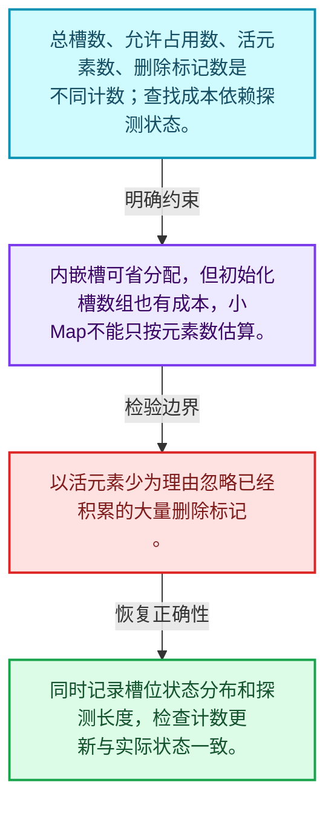
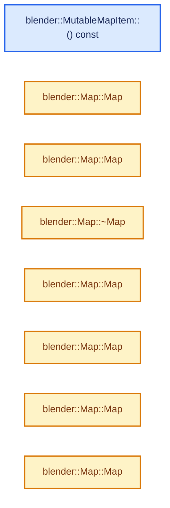
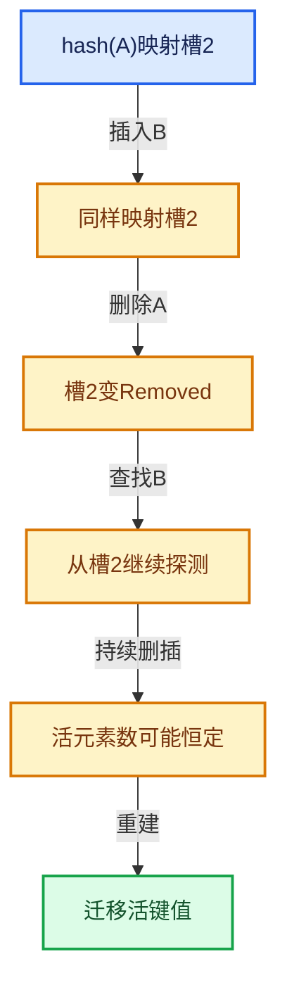

# 02-02 Map总体布局

[方向导航](README.md) · [总目录](../README.md) · [实现索引](../00-课程指南/02-源码与提交索引/符号依赖与实现索引.md)

## 从问题到实现

键值存储、槽位数量和元素数量如何关联？

开放寻址把探测放在槽位数组中；负载和删除标记共同影响查找，容量不能只由活元素数判断。

**数据模型**

总槽数、允许占用数、活元素数、删除标记数是不同计数；查找成本依赖探测状态。

**设计取舍**

内嵌槽可省分配，但初始化槽数组也有成本，小Map不能只按元素数估算。

**最小反例**

以活元素少为理由忽略已经积累的大量删除标记。

**推导**

同时记录槽位状态分布和探测长度，检查计数更新与实际状态一致。

## 阅读地图与执行推演








图中的数值推演是本方向的教学模型；实际函数之间的调用边与概念分析边分别标注，不能把概念关系当作运行时调度顺序。

## 完整源码单元与就地讲解

中文讲解直接放在相关代码旁，复杂机制在代码下展开。原文折叠区保留基准行号；不需要在行号表和函数之间来回查找。类布局可分段展示，函数实现不按固定行数切开。

### 类型布局、声明与编译条件 · BLI_map.hh L1—L80

<a id="t-1566df4633bd"></a>

`MapItem`在这里声明的数据成员：

- `Key key`
- `Value value`

<a id="t-553d0ad0739e"></a>

`MutableMapItem`在这里声明的数据成员：

- `Key key`
- `Value value`

<!-- annotated:62e46df1cf0107 -->

```cpp
/* SPDX-FileCopyrightText: 2023 Blender Authors
 *
 * SPDX-License-Identifier: GPL-2.0-or-later */

#pragma once

/** \file
 * \ingroup bli
 *
 * A `Map<Key, Value>` is an unordered associative container that stores key-value pairs.
 * The keys have to be unique. It is designed to be a more convenient and efficient replacement for
 * `std::unordered_map`. All core operations (add, lookup, remove and contains) can be done in O(1)
 * amortized expected time.
 *
 * Your default choice for a hash map in Blender should be `Map`.
 *
 * Map is implemented using open addressing in a slot array with a power-of-two size.
 * Every slot is in one of three states: empty, occupied or removed. If a slot is occupied, it
 * contains a Key and Value instance.
 *
 * Benchmarking and comparing hash tables is hard, because many factors influence the result. The
 * performance of a hash table depends on the combination of the hash function, probing strategy,
 * max load factor, data types, slot type and data distribution. This implementation is designed to
 * be relatively fast by default in all cases. However, it also offers many customization points
 * that allow it to be optimized for a specific use case.
 *
 * A rudimentary benchmark can be found in BLI_map_test.cc. The results of that benchmark are there
 * as well. The numbers show that in this specific case Map outperforms std::unordered_map
 * consistently by a good amount.
 *
 * Some noteworthy information:
 * - Key and Value must be movable types.
 * - Pointers to keys and values might be invalidated when the map is changed or moved.
 * - The hash function can be customized. See BLI_hash.hh for details.
 * - The probing strategy can be customized. See BLI_probing_strategies.hh for details.
 * - The slot type can be customized. See BLI_map_slots.hh for details.
 * - Small buffer optimization is enabled by default, if Key and Value are not too large.
 * - The methods `add_new` and `remove_contained` should be used instead of `add` and `remove`
 *   whenever appropriate. Assumptions and intention are described better this way.
 * - There are multiple methods to add and lookup keys for different use cases.
 * - You cannot use a range-for loop on the map directly. Instead use the keys(), values() and
 *   items() iterators. If your map is non-const, you can also change the values through those
 *   iterators (but not the keys).
 * - Lookups can be performed using types other than Key without conversion. For that use the
 *   methods ending with `_as`. The template parameters Hash and IsEqual have to support the other
 *   key type. This can greatly improve performance when the map uses strings as keys.
 * - The default constructor is cheap, even when a large InlineBufferCapacity is used. A large
 *   slot array will only be initialized when the first element is added.
 * - The `print_stats` method can be used to get information about the distribution of keys and
 *   memory usage of the map.
 * - The method names don't follow the std::unordered_map names in many cases. Searching for such
 *   names in this file will usually let you discover the new name.
 */

#include <optional>

#include "BLI_array.hh"
#include "BLI_hash.hh"
#include "BLI_hash_tables.hh"
#include "BLI_map_slots.hh"
#include "BLI_probing_strategies.hh"

namespace blender {

/**
 * A key-value-pair stored in a #Map. This is used when looping over Map.items().
 */
template<typename Key, typename Value> struct MapItem {
  const Key &key;
  const Value &value;
};

/**
 * Same as #MapItem, but the value is mutable. The key is still const because changing it might
 * change its hash value which would lead to undefined behavior in the #Map.
 */
template<typename Key, typename Value> struct MutableMapItem {
  const Key &key;
  Value &value;

```

<details>
<summary>核对原始源码：source/blender/blenlib/BLI_map.hh · L1—L80</summary>

<!-- original:62e46df1cf0107:source/blender/blenlib/BLI_map.hh:1:80 -->

```cpp
/* SPDX-FileCopyrightText: 2023 Blender Authors
 *
 * SPDX-License-Identifier: GPL-2.0-or-later */

#pragma once

/** \file
 * \ingroup bli
 *
 * A `Map<Key, Value>` is an unordered associative container that stores key-value pairs.
 * The keys have to be unique. It is designed to be a more convenient and efficient replacement for
 * `std::unordered_map`. All core operations (add, lookup, remove and contains) can be done in O(1)
 * amortized expected time.
 *
 * Your default choice for a hash map in Blender should be `Map`.
 *
 * Map is implemented using open addressing in a slot array with a power-of-two size.
 * Every slot is in one of three states: empty, occupied or removed. If a slot is occupied, it
 * contains a Key and Value instance.
 *
 * Benchmarking and comparing hash tables is hard, because many factors influence the result. The
 * performance of a hash table depends on the combination of the hash function, probing strategy,
 * max load factor, data types, slot type and data distribution. This implementation is designed to
 * be relatively fast by default in all cases. However, it also offers many customization points
 * that allow it to be optimized for a specific use case.
 *
 * A rudimentary benchmark can be found in BLI_map_test.cc. The results of that benchmark are there
 * as well. The numbers show that in this specific case Map outperforms std::unordered_map
 * consistently by a good amount.
 *
 * Some noteworthy information:
 * - Key and Value must be movable types.
 * - Pointers to keys and values might be invalidated when the map is changed or moved.
 * - The hash function can be customized. See BLI_hash.hh for details.
 * - The probing strategy can be customized. See BLI_probing_strategies.hh for details.
 * - The slot type can be customized. See BLI_map_slots.hh for details.
 * - Small buffer optimization is enabled by default, if Key and Value are not too large.
 * - The methods `add_new` and `remove_contained` should be used instead of `add` and `remove`
 *   whenever appropriate. Assumptions and intention are described better this way.
 * - There are multiple methods to add and lookup keys for different use cases.
 * - You cannot use a range-for loop on the map directly. Instead use the keys(), values() and
 *   items() iterators. If your map is non-const, you can also change the values through those
 *   iterators (but not the keys).
 * - Lookups can be performed using types other than Key without conversion. For that use the
 *   methods ending with `_as`. The template parameters Hash and IsEqual have to support the other
 *   key type. This can greatly improve performance when the map uses strings as keys.
 * - The default constructor is cheap, even when a large InlineBufferCapacity is used. A large
 *   slot array will only be initialized when the first element is added.
 * - The `print_stats` method can be used to get information about the distribution of keys and
 *   memory usage of the map.
 * - The method names don't follow the std::unordered_map names in many cases. Searching for such
 *   names in this file will usually let you discover the new name.
 */

#include <optional>

#include "BLI_array.hh"
#include "BLI_hash.hh"
#include "BLI_hash_tables.hh"
#include "BLI_map_slots.hh"
#include "BLI_probing_strategies.hh"

namespace blender {

/**
 * A key-value-pair stored in a #Map. This is used when looping over Map.items().
 */
template<typename Key, typename Value> struct MapItem {
  const Key &key;
  const Value &value;
};

/**
 * Same as #MapItem, but the value is mutable. The key is still const because changing it might
 * change its hash value which would lead to undefined behavior in the #Map.
 */
template<typename Key, typename Value> struct MutableMapItem {
  const Key &key;
  Value &value;

```

</details>

<a id="f-dadd5c6bb0ccd9f7"></a>

### `blender::MutableMapItem::() const`

实现位置：[source/blender/blenlib/BLI_map.hh](../../../../../source/blender/blenlib/BLI_map.hh) · L81—L84。

**教学注释版**

<!-- annotated:305df24e01d104 -->

```cpp
  operator MapItem<Key, Value>() const
  {
    return {this->key, this->value};
  }
```

<details>
<summary>核对原始源码：source/blender/blenlib/BLI_map.hh · L81—L84</summary>

<!-- original:305df24e01d104:source/blender/blenlib/BLI_map.hh:81:84 -->

```cpp
  operator MapItem<Key, Value>() const
  {
    return {this->key, this->value};
  }
```

</details>

**结果出口**

- `return {this->key, this->value};`

**继续追踪实现**

本实现没有需要继续展开的显式调用；检查返回表达式、对象转换和调用者前置条件。

### 类型布局、声明与编译条件 · BLI_map.hh L85—L185

<a id="t-8ea0b6bed282"></a>

`Map`在这里声明的数据成员：

- `int64_t removed_slots_`：更新删除槽计数；重建后旧墓碑不再保留。
- `int64_t occupied_and_removed_slots_`：更新占用与删除槽合计，不能把它当作纯活元素数。
- `int64_t usable_slots_`：同步受负载策略限制的可用槽数量。
- `uint64_t slot_mask_`：提交槽位寻址掩码，必须与新槽数组容量对应。
- `BLI_NO_UNIQUE_ADDRESS hash_`
- `BLI_NO_UNIQUE_ADDRESS is_equal_`
- `LoadFactor max_load_factor_`
- `SlotArray slots_`

<!-- annotated:362ec0836da323 -->

```cpp
};

template<
    /**
     * Type of the keys stored in the map. Keys have to be movable. Furthermore, the hash and
     * is-equal functions have to support it.
     */
    typename Key,
    /**
     * Type of the value that is stored per key. It has to be movable as well.
     */
    typename Value,
    /**
     * The minimum number of elements that can be stored in this Map without doing a heap
     * allocation. This is useful when you expect to have many small maps. However, keep in mind
     * that (unlike vector) initializing a map has a O(n) cost in the number of slots.
     */
    int64_t InlineBufferCapacity = default_inline_buffer_capacity(sizeof(Key) + sizeof(Value)),
    /**
     * The strategy used to deal with collisions. They are defined in BLI_probing_strategies.hh.
     */
    typename ProbingStrategy = DefaultProbingStrategy,
    /**
     * The hash function used to hash the keys. There is a default for many types. See BLI_hash.hh
     * for examples on how to define a custom hash function.
     */
    typename Hash = DefaultHash<Key>,
    /**
     * The equality operator used to compare keys. By default it will simply compare keys using the
     * `==` operator.
     */
    typename IsEqual = DefaultEquality<Key>,
    /**
     * This is what will actually be stored in the hash table array. At a minimum a slot has to be
     * able to hold a key, a value and information about whether the slot is empty, occupied or
     * removed. Using a non-standard slot type can improve performance or reduce the memory
     * footprint for some types. Slot types are defined in BLI_map_slots.hh
     */
    typename Slot = typename DefaultMapSlot<Key, Value>::type,
    /**
     * The allocator used by this map. Should rarely be changed, except when you don't want that
     * MEM_* is used internally.
     */
    typename Allocator = GuardedAllocator>
class Map {
 public:
  using size_type = int64_t;
  using Item = MapItem<Key, Value>;
  using MutableItem = MutableMapItem<Key, Value>;

 private:
  /**
   * Slots are either empty, occupied or removed. The number of occupied slots can be computed by
   * subtracting the removed slots from the occupied-and-removed slots.
   */
  int64_t removed_slots_;
  int64_t occupied_and_removed_slots_;

  /**
   * The maximum number of slots that can be used (either occupied or removed) until the set has to
   * grow. This is the total number of slots times the max load factor.
   */
  int64_t usable_slots_;

  /**
   * The number of slots minus one. This is a bit mask that can be used to turn any integer into a
   * valid slot index efficiently.
   */
  uint64_t slot_mask_;

  /** This is called to hash incoming keys. */
  BLI_NO_UNIQUE_ADDRESS Hash hash_;

  /** This is called to check equality of two keys. */
  BLI_NO_UNIQUE_ADDRESS IsEqual is_equal_;

  /** The max load factor is 1/2 = 50% by default. */
#define LOAD_FACTOR 1, 2
  static constexpr LoadFactor max_load_factor_ = LoadFactor(LOAD_FACTOR);
  using SlotArray =
      Array<Slot, LoadFactor::compute_total_slots(InlineBufferCapacity, LOAD_FACTOR), Allocator>;
#undef LOAD_FACTOR

  /**
   * This is the array that contains the actual slots. There is always at least one empty slot and
   * the size of the array is a power of two.
   */
  SlotArray slots_;

  /** Iterate over a slot index sequence for a given hash. */
#define MAP_SLOT_PROBING_BEGIN(HASH, R_SLOT) \
  SLOT_PROBING_BEGIN (ProbingStrategy, HASH, slot_mask_, SLOT_INDEX) \
    auto &R_SLOT = slots_[SLOT_INDEX];
#define MAP_SLOT_PROBING_END() SLOT_PROBING_END()

 public:
  /**
   * Initialize an empty map. This is a cheap operation no matter how large the inline buffer is.
   * This is necessary to avoid a high cost when no elements are added at all. An optimized grow
   * operation is performed on the first insertion.
   */
```

<details>
<summary>核对原始源码：source/blender/blenlib/BLI_map.hh · L85—L185</summary>

<!-- original:362ec0836da323:source/blender/blenlib/BLI_map.hh:85:185 -->

```cpp
};

template<
    /**
     * Type of the keys stored in the map. Keys have to be movable. Furthermore, the hash and
     * is-equal functions have to support it.
     */
    typename Key,
    /**
     * Type of the value that is stored per key. It has to be movable as well.
     */
    typename Value,
    /**
     * The minimum number of elements that can be stored in this Map without doing a heap
     * allocation. This is useful when you expect to have many small maps. However, keep in mind
     * that (unlike vector) initializing a map has a O(n) cost in the number of slots.
     */
    int64_t InlineBufferCapacity = default_inline_buffer_capacity(sizeof(Key) + sizeof(Value)),
    /**
     * The strategy used to deal with collisions. They are defined in BLI_probing_strategies.hh.
     */
    typename ProbingStrategy = DefaultProbingStrategy,
    /**
     * The hash function used to hash the keys. There is a default for many types. See BLI_hash.hh
     * for examples on how to define a custom hash function.
     */
    typename Hash = DefaultHash<Key>,
    /**
     * The equality operator used to compare keys. By default it will simply compare keys using the
     * `==` operator.
     */
    typename IsEqual = DefaultEquality<Key>,
    /**
     * This is what will actually be stored in the hash table array. At a minimum a slot has to be
     * able to hold a key, a value and information about whether the slot is empty, occupied or
     * removed. Using a non-standard slot type can improve performance or reduce the memory
     * footprint for some types. Slot types are defined in BLI_map_slots.hh
     */
    typename Slot = typename DefaultMapSlot<Key, Value>::type,
    /**
     * The allocator used by this map. Should rarely be changed, except when you don't want that
     * MEM_* is used internally.
     */
    typename Allocator = GuardedAllocator>
class Map {
 public:
  using size_type = int64_t;
  using Item = MapItem<Key, Value>;
  using MutableItem = MutableMapItem<Key, Value>;

 private:
  /**
   * Slots are either empty, occupied or removed. The number of occupied slots can be computed by
   * subtracting the removed slots from the occupied-and-removed slots.
   */
  int64_t removed_slots_;
  int64_t occupied_and_removed_slots_;

  /**
   * The maximum number of slots that can be used (either occupied or removed) until the set has to
   * grow. This is the total number of slots times the max load factor.
   */
  int64_t usable_slots_;

  /**
   * The number of slots minus one. This is a bit mask that can be used to turn any integer into a
   * valid slot index efficiently.
   */
  uint64_t slot_mask_;

  /** This is called to hash incoming keys. */
  BLI_NO_UNIQUE_ADDRESS Hash hash_;

  /** This is called to check equality of two keys. */
  BLI_NO_UNIQUE_ADDRESS IsEqual is_equal_;

  /** The max load factor is 1/2 = 50% by default. */
#define LOAD_FACTOR 1, 2
  static constexpr LoadFactor max_load_factor_ = LoadFactor(LOAD_FACTOR);
  using SlotArray =
      Array<Slot, LoadFactor::compute_total_slots(InlineBufferCapacity, LOAD_FACTOR), Allocator>;
#undef LOAD_FACTOR

  /**
   * This is the array that contains the actual slots. There is always at least one empty slot and
   * the size of the array is a power of two.
   */
  SlotArray slots_;

  /** Iterate over a slot index sequence for a given hash. */
#define MAP_SLOT_PROBING_BEGIN(HASH, R_SLOT) \
  SLOT_PROBING_BEGIN (ProbingStrategy, HASH, slot_mask_, SLOT_INDEX) \
    auto &R_SLOT = slots_[SLOT_INDEX];
#define MAP_SLOT_PROBING_END() SLOT_PROBING_END()

 public:
  /**
   * Initialize an empty map. This is a cheap operation no matter how large the inline buffer is.
   * This is necessary to avoid a high cost when no elements are added at all. An optimized grow
   * operation is performed on the first insertion.
   */
```

</details>

<a id="f-e0d8c5a779bf1fe6"></a>

### `blender::Map::Map`

实现位置：[source/blender/blenlib/BLI_map.hh](../../../../../source/blender/blenlib/BLI_map.hh) · L186—L195。

接口参数：

- `Allocator allocator = {}`

**教学注释版**

<!-- annotated:e409b6faf0e1d9 -->

```cpp
  Map(Allocator allocator = {}) noexcept
      : removed_slots_(0),
        occupied_and_removed_slots_(0),
        usable_slots_(0),
        slot_mask_(0),
        hash_(),
        is_equal_(),
        slots_(1, allocator)
  {
  }
```

<details>
<summary>核对原始源码：source/blender/blenlib/BLI_map.hh · L186—L195</summary>

<!-- original:e409b6faf0e1d9:source/blender/blenlib/BLI_map.hh:186:195 -->

```cpp
  Map(Allocator allocator = {}) noexcept
      : removed_slots_(0),
        occupied_and_removed_slots_(0),
        usable_slots_(0),
        slot_mask_(0),
        hash_(),
        is_equal_(),
        slots_(1, allocator)
  {
  }
```

</details>

**继续追踪实现**

本实现没有需要继续展开的显式调用；检查返回表达式、对象转换和调用者前置条件。

<!-- annotated:a4b7826ef732fe -->

```cpp

```

<details>
<summary>核对原始源码：source/blender/blenlib/BLI_map.hh · L196—L196</summary>

<!-- original:a4b7826ef732fe:source/blender/blenlib/BLI_map.hh:196:196 -->

```cpp

```

</details>

<a id="f-4aa903cac6e09717"></a>

### `blender::Map::Map`

实现位置：[source/blender/blenlib/BLI_map.hh](../../../../../source/blender/blenlib/BLI_map.hh) · L197—L197。

接口参数：

- `NoExceptConstructor`
- `Allocator allocator = {}`

**教学注释版**

<!-- annotated:a3e4cf98c6997f -->

```cpp
  Map(NoExceptConstructor, Allocator allocator = {}) noexcept : Map(allocator) {}
```

<details>
<summary>核对原始源码：source/blender/blenlib/BLI_map.hh · L197—L197</summary>

<!-- original:a3e4cf98c6997f:source/blender/blenlib/BLI_map.hh:197:197 -->

```cpp
  Map(NoExceptConstructor, Allocator allocator = {}) noexcept : Map(allocator) {}
```

</details>

**继续追踪实现**

本实现没有需要继续展开的显式调用；检查返回表达式、对象转换和调用者前置条件。

<!-- annotated:6326a5b052d768 -->

```cpp

```

<details>
<summary>核对原始源码：source/blender/blenlib/BLI_map.hh · L198—L198</summary>

<!-- original:6326a5b052d768:source/blender/blenlib/BLI_map.hh:198:198 -->

```cpp

```

</details>

<a id="f-03613363e331638a"></a>

### `blender::Map::~Map`

实现位置：[source/blender/blenlib/BLI_map.hh](../../../../../source/blender/blenlib/BLI_map.hh) · L199—L199。

**教学注释版**

<!-- annotated:df23d9390167b7 -->

```cpp
  ~Map() = default;
```

<details>
<summary>核对原始源码：source/blender/blenlib/BLI_map.hh · L199—L199</summary>

<!-- original:df23d9390167b7:source/blender/blenlib/BLI_map.hh:199:199 -->

```cpp
  ~Map() = default;
```

</details>

**继续追踪实现**

本实现没有需要继续展开的显式调用；检查返回表达式、对象转换和调用者前置条件。

<!-- annotated:75e40f27819298 -->

```cpp

```

<details>
<summary>核对原始源码：source/blender/blenlib/BLI_map.hh · L200—L200</summary>

<!-- original:75e40f27819298:source/blender/blenlib/BLI_map.hh:200:200 -->

```cpp

```

</details>

<a id="f-0f3e34c689337809"></a>

### `blender::Map::Map`

实现位置：[source/blender/blenlib/BLI_map.hh](../../../../../source/blender/blenlib/BLI_map.hh) · L201—L201。

接口参数：

- `const Map &other`

**教学注释版**

<!-- annotated:cac4ba2ddbecfe -->

```cpp
  Map(const Map &other) = default;
```

<details>
<summary>核对原始源码：source/blender/blenlib/BLI_map.hh · L201—L201</summary>

<!-- original:cac4ba2ddbecfe:source/blender/blenlib/BLI_map.hh:201:201 -->

```cpp
  Map(const Map &other) = default;
```

</details>

**继续追踪实现**

本实现没有需要继续展开的显式调用；检查返回表达式、对象转换和调用者前置条件。

<!-- annotated:bfe96fce2c4cae -->

```cpp

```

<details>
<summary>核对原始源码：source/blender/blenlib/BLI_map.hh · L202—L202</summary>

<!-- original:bfe96fce2c4cae:source/blender/blenlib/BLI_map.hh:202:202 -->

```cpp

```

</details>

<a id="f-87609e28f3c023fe"></a>

### `blender::Map::Map`

实现位置：[source/blender/blenlib/BLI_map.hh](../../../../../source/blender/blenlib/BLI_map.hh) · L203—L225。

接口参数：

- `Map &&other`

**教学注释版**

<!-- annotated:4c9a3f2d2cd362 -->

```cpp
  Map(Map &&other) noexcept(std::is_nothrow_move_constructible_v<SlotArray>)
      : Map(NoExceptConstructor(), other.slots_.allocator())
  {
    if constexpr (std::is_nothrow_move_constructible_v<SlotArray>) {
      // [讲解] std::move：把表达式转换成可供移动重载选择的值类别；不保证真的移动，不结束源对象寿命，对const值可能选择复制。
      slots_ = std::move(other.slots_);
    }
    else {
      try {
        slots_ = std::move(other.slots_);
      }
      catch (...) {
        other.noexcept_reset();
        throw;
      }
    }
    // [讲解] 更新删除槽计数；重建后旧墓碑不再保留。
    removed_slots_ = other.removed_slots_;
    // [讲解] 更新占用与删除槽合计，不能把它当作纯活元素数。
    occupied_and_removed_slots_ = other.occupied_and_removed_slots_;
    // [讲解] 同步受负载策略限制的可用槽数量。
    usable_slots_ = other.usable_slots_;
    // [讲解] 提交槽位寻址掩码，必须与新槽数组容量对应。
    slot_mask_ = other.slot_mask_;
    hash_ = std::move(other.hash_);
    is_equal_ = std::move(other.is_equal_);
    other.noexcept_reset();
  }
```

<details>
<summary>核对原始源码：source/blender/blenlib/BLI_map.hh · L203—L225</summary>

<!-- original:4c9a3f2d2cd362:source/blender/blenlib/BLI_map.hh:203:225 -->

```cpp
  Map(Map &&other) noexcept(std::is_nothrow_move_constructible_v<SlotArray>)
      : Map(NoExceptConstructor(), other.slots_.allocator())
  {
    if constexpr (std::is_nothrow_move_constructible_v<SlotArray>) {
      slots_ = std::move(other.slots_);
    }
    else {
      try {
        slots_ = std::move(other.slots_);
      }
      catch (...) {
        other.noexcept_reset();
        throw;
      }
    }
    removed_slots_ = other.removed_slots_;
    occupied_and_removed_slots_ = other.occupied_and_removed_slots_;
    usable_slots_ = other.usable_slots_;
    slot_mask_ = other.slot_mask_;
    hash_ = std::move(other.hash_);
    is_equal_ = std::move(other.is_equal_);
    other.noexcept_reset();
  }
```

</details>

**沿实际写入检查状态**

- `slots_ = std::move(other.slots_);`
- `removed_slots_ = other.removed_slots_;`：更新删除槽计数；重建后旧墓碑不再保留。
- `occupied_and_removed_slots_ = other.occupied_and_removed_slots_;`：更新占用与删除槽合计，不能把它当作纯活元素数。
- `usable_slots_ = other.usable_slots_;`：同步受负载策略限制的可用槽数量。
- `slot_mask_ = other.slot_mask_;`：提交槽位寻址掩码，必须与新槽数组容量对应。
- `hash_ = std::move(other.hash_);`
- `is_equal_ = std::move(other.is_equal_);`

**继续追踪实现**

- `std::move` → [外部契约](https://eel.is/c++draft/utility.forward)：把表达式转换成可供移动重载选择的值类别；不保证真的移动，不结束源对象寿命，对const值可能选择复制。
- `other.noexcept_reset` → [blender::Map::noexcept_reset · L1164](07-重建与摊还复杂度.md#f-2bfb0182821f0fbc)。

### 类型布局、声明与编译条件 · BLI_map.hh L226—L234

<!-- annotated:6608331915ca73 -->

```cpp

  /**
   * Initializes the Map based on some key-value-pairs:
   *   `Map<int, std::string> map = {{1, "where"}, {3, "when"}, {5, "why"}};`
   *
   * If the same key appears multiple times, only the first one is used and the others are ignored.
   * Note that keys and values are copied. Use the `add_*` functions after the constructor to move
   * keys and values into the map.
   */
```

<details>
<summary>核对原始源码：source/blender/blenlib/BLI_map.hh · L226—L234</summary>

<!-- original:6608331915ca73:source/blender/blenlib/BLI_map.hh:226:234 -->

```cpp

  /**
   * Initializes the Map based on some key-value-pairs:
   *   `Map<int, std::string> map = {{1, "where"}, {3, "when"}, {5, "why"}};`
   *
   * If the same key appears multiple times, only the first one is used and the others are ignored.
   * Note that keys and values are copied. Use the `add_*` functions after the constructor to move
   * keys and values into the map.
   */
```

</details>

<a id="f-4fe292ed2a65a919"></a>

### `blender::Map::Map`

实现位置：[source/blender/blenlib/BLI_map.hh](../../../../../source/blender/blenlib/BLI_map.hh) · L235—L240。

接口参数：

- `const Span<std::pair<Key, Value>> items`
- `Allocator allocator = {}`

**教学注释版**

<!-- annotated:4d6336d1ddef93 -->

```cpp
  Map(const Span<std::pair<Key, Value>> items, Allocator allocator = {}) : Map(allocator)
  {
    for (const std::pair<Key, Value> &item : items) {
      // [讲解] this->add：按哈希与相等关系加入键或键值。
      this->add(item.first, item.second);
    }
  }
```

<details>
<summary>核对原始源码：source/blender/blenlib/BLI_map.hh · L235—L240</summary>

<!-- original:4d6336d1ddef93:source/blender/blenlib/BLI_map.hh:235:240 -->

```cpp
  Map(const Span<std::pair<Key, Value>> items, Allocator allocator = {}) : Map(allocator)
  {
    for (const std::pair<Key, Value> &item : items) {
      this->add(item.first, item.second);
    }
  }
```

</details>

**继续追踪实现**

- `this->add` → [blender::Map::add · L295](04-Map查找与键访问.md#f-8d38101abf162f88)；[blender::Map::add · L299](04-Map查找与键访问.md#f-1f59510cdfbd9f87)；[blender::Map::add · L303](04-Map查找与键访问.md#f-645e0522347aa018)；[blender::Map::add · L307](04-Map查找与键访问.md#f-03405db0730cedc0)。同名重载需按实参类型选择。

### 类型布局、声明与编译条件 · BLI_map.hh L241—L245

<!-- annotated:adc878b1b3aede -->

```cpp

  /**
   * This is pretty much the same as the constructor with a #Span above. It helps with type
   * inferencing when initializer lists are used.
   */
```

<details>
<summary>核对原始源码：source/blender/blenlib/BLI_map.hh · L241—L245</summary>

<!-- original:adc878b1b3aede:source/blender/blenlib/BLI_map.hh:241:245 -->

```cpp

  /**
   * This is pretty much the same as the constructor with a #Span above. It helps with type
   * inferencing when initializer lists are used.
   */
```

</details>

<a id="f-7a8f9a7fb1f1a947"></a>

### `blender::Map::Map`

实现位置：[source/blender/blenlib/BLI_map.hh](../../../../../source/blender/blenlib/BLI_map.hh) · L246—L249。

接口参数：

- `const std::initializer_list<std::pair<Key, Value>> items`
- `Allocator allocator = {}`

**教学注释版**

<!-- annotated:ec888f32b7ed95 -->

```cpp
  Map(const std::initializer_list<std::pair<Key, Value>> items, Allocator allocator = {})
      : Map(Span(items), allocator)
  {
  }
```

<details>
<summary>核对原始源码：source/blender/blenlib/BLI_map.hh · L246—L249</summary>

<!-- original:ec888f32b7ed95:source/blender/blenlib/BLI_map.hh:246:249 -->

```cpp
  Map(const std::initializer_list<std::pair<Key, Value>> items, Allocator allocator = {})
      : Map(Span(items), allocator)
  {
  }
```

</details>

**继续追踪实现**

本实现没有需要继续展开的显式调用；检查返回表达式、对象转换和调用者前置条件。

<!-- annotated:10a4886be388fb -->

```cpp

```

<details>
<summary>核对原始源码：source/blender/blenlib/BLI_map.hh · L250—L250</summary>

<!-- original:10a4886be388fb:source/blender/blenlib/BLI_map.hh:250:250 -->

```cpp

```

</details>

<a id="f-53c620c0fbf02ae3"></a>

### `blender::Map::operator=`

实现位置：[source/blender/blenlib/BLI_map.hh](../../../../../source/blender/blenlib/BLI_map.hh) · L251—L254。

接口参数：

- `const Map &other`

**教学注释版**

<!-- annotated:0fcf715a1a9dbc -->

```cpp
  Map &operator=(const Map &other)
  {
    return copy_assign_container(*this, other);
  }
```

<details>
<summary>核对原始源码：source/blender/blenlib/BLI_map.hh · L251—L254</summary>

<!-- original:0fcf715a1a9dbc:source/blender/blenlib/BLI_map.hh:251:254 -->

```cpp
  Map &operator=(const Map &other)
  {
    return copy_assign_container(*this, other);
  }
```

</details>

**结果出口**

- `return copy_assign_container(*this, other);`

**继续追踪实现**

- `copy_assign_container` → [blender::copy_assign_container · L284](../03-内存分配与运行时类型/01-对齐与未初始化存储.md#f-546a45b4d8b5ab44)。

<!-- annotated:81812591de6ccf -->

```cpp

```

<details>
<summary>核对原始源码：source/blender/blenlib/BLI_map.hh · L255—L255</summary>

<!-- original:81812591de6ccf:source/blender/blenlib/BLI_map.hh:255:255 -->

```cpp

```

</details>

<a id="f-7326ff2df9f69f6a"></a>

### `blender::Map::operator=`

实现位置：[source/blender/blenlib/BLI_map.hh](../../../../../source/blender/blenlib/BLI_map.hh) · L256—L259。

接口参数：

- `Map &&other`

**教学注释版**

<!-- annotated:a460dbc9178851 -->

```cpp
  Map &operator=(Map &&other)
  {
    // [讲解] std::move：把表达式转换成可供移动重载选择的值类别；不保证真的移动，不结束源对象寿命，对const值可能选择复制。
    return move_assign_container(*this, std::move(other));
  }
```

<details>
<summary>核对原始源码：source/blender/blenlib/BLI_map.hh · L256—L259</summary>

<!-- original:a460dbc9178851:source/blender/blenlib/BLI_map.hh:256:259 -->

```cpp
  Map &operator=(Map &&other)
  {
    return move_assign_container(*this, std::move(other));
  }
```

</details>

**结果出口**

- `return move_assign_container(*this, std::move(other));`

**继续追踪实现**

- `move_assign_container` → [blender::move_assign_container · L300](../03-内存分配与运行时类型/01-对齐与未初始化存储.md#f-5144b56be86e6f42)。
- `std::move` → [外部契约](https://eel.is/c++draft/utility.forward)：把表达式转换成可供移动重载选择的值类别；不保证真的移动，不结束源对象寿命，对const值可能选择复制。

### 类型布局、声明与编译条件 · BLI_map.hh L260—L264

<!-- annotated:d3257dbe5fb992 -->

```cpp

  /**
   * Insert a new key-value-pair into the map. This invokes undefined behavior when the key is in
   * the map already.
   */
```

<details>
<summary>核对原始源码：source/blender/blenlib/BLI_map.hh · L260—L264</summary>

<!-- original:d3257dbe5fb992:source/blender/blenlib/BLI_map.hh:260:264 -->

```cpp

  /**
   * Insert a new key-value-pair into the map. This invokes undefined behavior when the key is in
   * the map already.
   */
```

</details>

<a id="f-521ff0865e8229d0"></a>

### `blender::Map::add_new`

按哈希与相等关系加入键或键值。

实现位置：[source/blender/blenlib/BLI_map.hh](../../../../../source/blender/blenlib/BLI_map.hh) · L265—L268。

接口参数：

- `const Key &key`
- `const Value &value`

**教学注释版**

<!-- annotated:6ba5bc478023af -->

```cpp
  void add_new(const Key &key, const Value &value)
  {
    this->add_new_as(key, value);
  }
```

<details>
<summary>核对原始源码：source/blender/blenlib/BLI_map.hh · L265—L268</summary>

<!-- original:6ba5bc478023af:source/blender/blenlib/BLI_map.hh:265:268 -->

```cpp
  void add_new(const Key &key, const Value &value)
  {
    this->add_new_as(key, value);
  }
```

</details>

**接口与不变量**

存在键与不存在键的接口承诺不同；add_new需要调用者保证键尚不存在。

**继续追踪实现**

- `this->add_new_as` → [blender::Map::add_new_as · L281](04-Map查找与键访问.md#f-f556b7e3fb7de063)。

<a id="f-d89cee0e3d2848a0"></a>

### `blender::Map::add_new`

按哈希与相等关系加入键或键值。

实现位置：[source/blender/blenlib/BLI_map.hh](../../../../../source/blender/blenlib/BLI_map.hh) · L269—L272。

接口参数：

- `const Key &key`
- `Value &&value`

**教学注释版**

<!-- annotated:90d5cb60f4cdd9 -->

```cpp
  void add_new(const Key &key, Value &&value)
  {
    // [讲解] std::move：把表达式转换成可供移动重载选择的值类别；不保证真的移动，不结束源对象寿命，对const值可能选择复制。
    this->add_new_as(key, std::move(value));
  }
```

<details>
<summary>核对原始源码：source/blender/blenlib/BLI_map.hh · L269—L272</summary>

<!-- original:90d5cb60f4cdd9:source/blender/blenlib/BLI_map.hh:269:272 -->

```cpp
  void add_new(const Key &key, Value &&value)
  {
    this->add_new_as(key, std::move(value));
  }
```

</details>

**接口与不变量**

存在键与不存在键的接口承诺不同；add_new需要调用者保证键尚不存在。

**继续追踪实现**

- `this->add_new_as` → [blender::Map::add_new_as · L281](04-Map查找与键访问.md#f-f556b7e3fb7de063)。
- `std::move` → [外部契约](https://eel.is/c++draft/utility.forward)：把表达式转换成可供移动重载选择的值类别；不保证真的移动，不结束源对象寿命，对const值可能选择复制。

<a id="f-c13142c32e703ebd"></a>

### `blender::Map::add_new`

按哈希与相等关系加入键或键值。

实现位置：[source/blender/blenlib/BLI_map.hh](../../../../../source/blender/blenlib/BLI_map.hh) · L273—L276。

接口参数：

- `Key &&key`
- `const Value &value`

**教学注释版**

<!-- annotated:3c932cd52e3a0c -->

```cpp
  void add_new(Key &&key, const Value &value)
  {
    // [讲解] std::move：把表达式转换成可供移动重载选择的值类别；不保证真的移动，不结束源对象寿命，对const值可能选择复制。
    this->add_new_as(std::move(key), value);
  }
```

<details>
<summary>核对原始源码：source/blender/blenlib/BLI_map.hh · L273—L276</summary>

<!-- original:3c932cd52e3a0c:source/blender/blenlib/BLI_map.hh:273:276 -->

```cpp
  void add_new(Key &&key, const Value &value)
  {
    this->add_new_as(std::move(key), value);
  }
```

</details>

**接口与不变量**

存在键与不存在键的接口承诺不同；add_new需要调用者保证键尚不存在。

**继续追踪实现**

- `this->add_new_as` → [blender::Map::add_new_as · L281](04-Map查找与键访问.md#f-f556b7e3fb7de063)。
- `std::move` → [外部契约](https://eel.is/c++draft/utility.forward)：把表达式转换成可供移动重载选择的值类别；不保证真的移动，不结束源对象寿命，对const值可能选择复制。

## 语法与相关类型

### 模板 template

模板把类型或常量作为生成实现的参数。读声明时先列出类型参数、非类型参数和默认值，再看使用者实际实例化了什么。模板声明本身不意味着每种T都支持其全部成员。

把T替换为int、string、只能移动的类型，分别检查每个被调用操作是否成立。

### 依赖名称 typename

typename既可引入类型模板参数，也可告诉编译器某个依赖名称是类型。它不创建运行时对象；解析期确认语法类别与实例化期检查具体类型是不同阶段。

区分typename T::value_type和T::size()，前者标记类型，后者是表达式。

### 常量求值 constexpr

constexpr声明允许相应实体参与常量求值，但constexpr函数仍可以在运行时执行。是否常量求值由调用场景和表达式合法性共同决定。

比较constexpr变量初始化和从运行时输入调用同一函数。

### 只读限定 const

const约束当前访问路径可做的修改。const指针、指向const的指针、const视图对象、const元素是不同位置的限定；其他别名可能仍可修改原对象。

分别写T* const、const T*与const T* const，并画出不可修改的层次。

### 移动转换 std::move

std::move把表达式转换为可供移动重载选择的值类别，实际资源转移发生在被选中的构造或赋值中。对const对象move可能仍调用复制，对视图move也不会获得底层数据所有权。

记录移动构造调用次数，不用变量名或std::move的出现次数替代测量。

### 异常约定 noexcept

noexcept表达式可以依赖类型特征。违反不抛异常约定会终止程序；它不是自动捕获异常，也不是资源回滚代码。

找出声明的条件与实际可能抛出的分配、构造操作是否一致。

### 异常边界 try与catch

try定义异常传播的局部边界。失败路径需要销毁已经成功构造的部分并释放相应存储；未构造的对象不能被析构。

在第k次构造失败，列出已经存在的对象集合与待释放缓冲。

### 对象表示 sizeof

sizeof给出对象表示大小，不是其引用的所有堆内存总量。sizeof视图很小并不说明底层数组很小。

分别统计容器对象、容量字节和元素拥有的间接资源。

### 构造与new表达式

普通new可能分配并构造；placement new在给定地址构造，存储由其他机制提供。失败回滚应区分两类责任。

追踪地址来自哪里、构造何时成功、由谁析构、由谁释放。

### 编译期分支 if constexpr

条件在实例化时决定被保留的分支，这常用于不同类型的合法操作选择。它与运行时if有不同的实例化检查规则。

找出每个分支依赖哪些类型特征，再使用满足与不满足条件的类型。

### 类型别名 using

类型别名为已有类型建立名字，不创建运行期对象。它常把模板内部使用的类型统一暴露给泛型调用者。

展开别名直到基础类型，区分类型别名和变量声明。

## 实现练习与验证

画出8槽位插入3个碰撞键后的布局并标出可终止探测的位置。

参考推理：同时记录槽位状态分布和探测长度，检查计数更新与实际状态一致。

每个活键从其探测起点可达；不存在的键可终止；析构仅命中占用状态的真实对象。

## 历史、跨库比较与证据

对比std::unordered_map、Abseil flat_hash_map与node_hash_map时，优先比较地址稳定性、键值搬移要求和删除行为；不同实现的平均常数及负载策略需要测量。

[历史提交索引](../00-课程指南/02-源码与提交索引/历史提交与设计演化索引.md) · [源码基准](../00-课程指南/02-源码与提交索引/源码版本与覆盖索引.md) · [验收报告](../00-课程指南/03-验收报告/验收报告.md)
