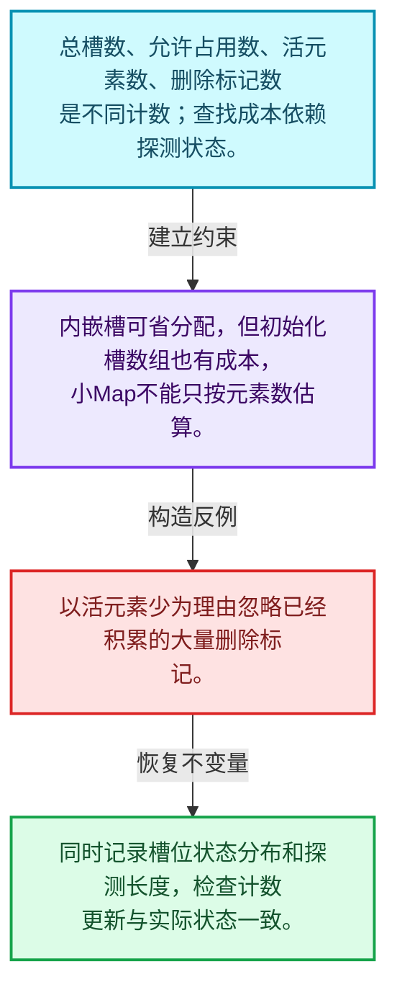
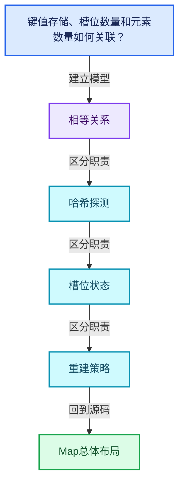
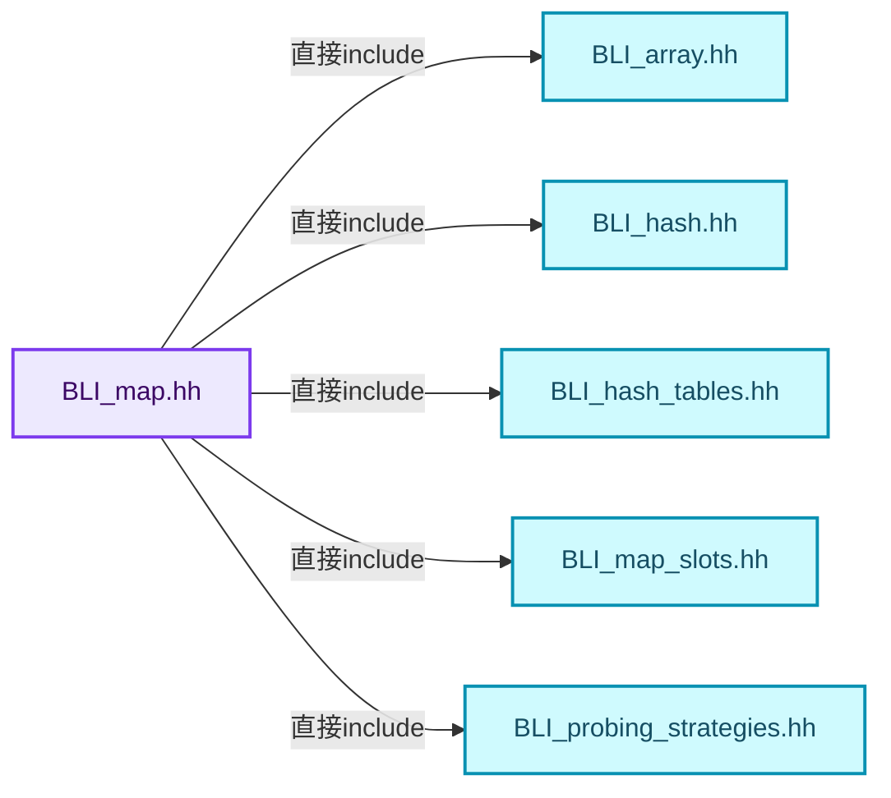
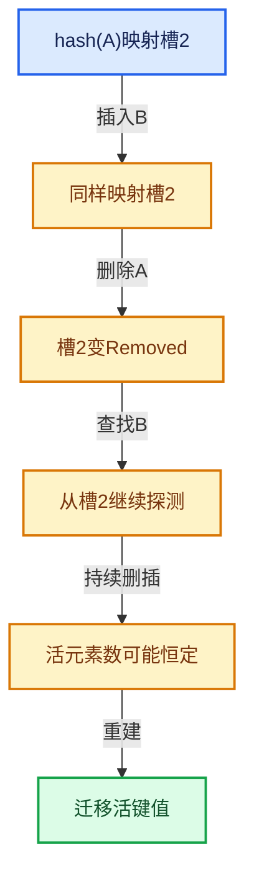

# 02-02 Map总体布局

[方向导航](README.md) · [总目录](../README.md) · [覆盖索引](../%E6%BA%90%E7%A0%81%E7%89%88%E6%9C%AC%E4%B8%8E%E8%A6%86%E7%9B%96%E7%B4%A2%E5%BC%95.md)

> 阅读顺序：问题与数据模型 → 语法与类型 → 源码逐行 → 调用线索 → 历史与取舍 → 推演和练习。

- 基准 HEAD：`cbda6b96c26c0dee3c3b5cbb93960c4ac06a6b30`。
- 记录日期：2026-10-14。
- 教学示例状态：正文中的推演不是本机性能实测；已运行练习见验收报告。

## 一、从问题到设计

键值存储、槽位数量和元素数量如何关联？

开放寻址把探测放在槽位数组中；负载和删除标记共同影响查找，容量不能只由活元素数判断。

本篇把语法、数据语义和系统取舍连接起来。相等与哈希是基础契约；探测、删除和增长共同决定复杂度。

### 本篇独立模型与设计推理

总槽数、允许占用数、活元素数、删除标记数是不同计数；查找成本依赖探测状态。

设计取舍：内嵌槽可省分配，但初始化槽数组也有成本，小Map不能只按元素数估算。

最小反例：以活元素少为理由忽略已经积累的大量删除标记。

推导与处理：同时记录槽位状态分布和探测长度，检查计数更新与实际状态一致。



### 源码范围与相邻篇章

| 文件 | 本篇逐行范围 | 基准SHA-256 |
|---|---|---|
| [source/blender/blenlib/BLI_map.hh](../../../../../source/blender/blenlib/BLI_map.hh) | L1—L276 | `236ceadf1c36a6e452538529f550bb9a61c4d2efc16cbb8419861fdd638bd5c7` |

同一主讲文件可能分多篇覆盖；超出本篇范围的符号通过覆盖索引定位。空行与纯注释保留在源码摘录中，逐行表解释有效语句与语法边界；许可证头统一保留。

前篇：[哈希与相等契约](01-%E5%93%88%E5%B8%8C%E4%B8%8E%E7%9B%B8%E7%AD%89%E5%A5%91%E7%BA%A6.md).

后篇：[槽位状态与探测](03-%E6%A7%BD%E4%BD%8D%E7%8A%B6%E6%80%81%E4%B8%8E%E6%8E%A2%E6%B5%8B.md).

## 二、类型、数据与阅读地图



这是概念依赖图，边表示阅读关系，不声称是运行时调用顺序。

### 直接编译依赖



箭头只表示头文件包含关系；完整调用线索见后面的符号定位表。

## 三、关键词、语法与类型角色

### 模板 template

模板把类型或常量作为生成实现的参数。读声明时先列出类型参数、非类型参数和默认值，再看使用者实际实例化了什么。模板声明本身不意味着每种T都支持其全部成员。

具体检查：把T替换为int、string、只能移动的类型，分别检查每个被调用操作是否成立。

### 依赖名称 typename

typename既可引入类型模板参数，也可告诉编译器某个依赖名称是类型。它不创建运行时对象；解析期确认语法类别与实例化期检查具体类型是不同阶段。

具体检查：区分typename T::value_type和T::size()，前者标记类型，后者是表达式。

### 常量求值 constexpr

constexpr声明允许相应实体参与常量求值，但constexpr函数仍可以在运行时执行。是否常量求值由调用场景和表达式合法性共同决定。

具体检查：比较constexpr变量初始化和从运行时输入调用同一函数。

### 只读限定 const

const约束当前访问路径可做的修改。const指针、指向const的指针、const视图对象、const元素是不同位置的限定；其他别名可能仍可修改原对象。

具体检查：分别写T* const、const T*与const T* const，并画出不可修改的层次。

### 移动转换 std::move

std::move把表达式转换为可供移动重载选择的值类别，实际资源转移发生在被选中的构造或赋值中。对const对象move可能仍调用复制，对视图move也不会获得底层数据所有权。

具体检查：记录移动构造调用次数，不用变量名或std::move的出现次数替代测量。

### 异常约定 noexcept

noexcept表达式可以依赖类型特征。违反不抛异常约定会终止程序；它不是自动捕获异常，也不是资源回滚代码。

具体检查：找出声明的条件与实际可能抛出的分配、构造操作是否一致。

### 异常边界 try与catch

try定义异常传播的局部边界。失败路径需要销毁已经成功构造的部分并释放相应存储；未构造的对象不能被析构。

具体检查：在第k次构造失败，列出已经存在的对象集合与待释放缓冲。

### 对象表示 sizeof

sizeof给出对象表示大小，不是其引用的所有堆内存总量。sizeof视图很小并不说明底层数组很小。

具体检查：分别统计容器对象、容量字节和元素拥有的间接资源。

### 构造与new表达式

普通new可能分配并构造；placement new在给定地址构造，存储由其他机制提供。失败回滚应区分两类责任。

具体检查：追踪地址来自哪里、构造何时成功、由谁析构、由谁释放。

### 编译期分支 if constexpr

条件在实例化时决定被保留的分支，这常用于不同类型的合法操作选择。它与运行时if有不同的实例化检查规则。

具体检查：找出每个分支依赖哪些类型特征，再使用满足与不满足条件的类型。

### 类型别名 using

类型别名为已有类型建立名字，不创建运行期对象。它常把模板内部使用的类型统一暴露给泛型调用者。

具体检查：展开别名直到基础类型，区分类型别名和变量声明。

## 四、真实源码与逐行讲解

源码块保持原行内容，原始行号由小节标题及逐行表给出。表中的调用定位是静态阅读辅助；重载、模板实例化、宏展开和虚调用需结合完整声明，不能仅凭词法出现证明动态调用。

### BLI_map.hh：L1—L55

<!-- source:source/blender/blenlib/BLI_map.hh:1:55 -->

```cpp
/* SPDX-FileCopyrightText: 2023 Blender Authors
 *
 * SPDX-License-Identifier: GPL-2.0-or-later */

#pragma once

/** \file
 * \ingroup bli
 *
 * A `Map<Key, Value>` is an unordered associative container that stores key-value pairs.
 * The keys have to be unique. It is designed to be a more convenient and efficient replacement for
 * `std::unordered_map`. All core operations (add, lookup, remove and contains) can be done in O(1)
 * amortized expected time.
 *
 * Your default choice for a hash map in Blender should be `Map`.
 *
 * Map is implemented using open addressing in a slot array with a power-of-two size.
 * Every slot is in one of three states: empty, occupied or removed. If a slot is occupied, it
 * contains a Key and Value instance.
 *
 * Benchmarking and comparing hash tables is hard, because many factors influence the result. The
 * performance of a hash table depends on the combination of the hash function, probing strategy,
 * max load factor, data types, slot type and data distribution. This implementation is designed to
 * be relatively fast by default in all cases. However, it also offers many customization points
 * that allow it to be optimized for a specific use case.
 *
 * A rudimentary benchmark can be found in BLI_map_test.cc. The results of that benchmark are there
 * as well. The numbers show that in this specific case Map outperforms std::unordered_map
 * consistently by a good amount.
 *
 * Some noteworthy information:
 * - Key and Value must be movable types.
 * - Pointers to keys and values might be invalidated when the map is changed or moved.
 * - The hash function can be customized. See BLI_hash.hh for details.
 * - The probing strategy can be customized. See BLI_probing_strategies.hh for details.
 * - The slot type can be customized. See BLI_map_slots.hh for details.
 * - Small buffer optimization is enabled by default, if Key and Value are not too large.
 * - The methods `add_new` and `remove_contained` should be used instead of `add` and `remove`
 *   whenever appropriate. Assumptions and intention are described better this way.
 * - There are multiple methods to add and lookup keys for different use cases.
 * - You cannot use a range-for loop on the map directly. Instead use the keys(), values() and
 *   items() iterators. If your map is non-const, you can also change the values through those
 *   iterators (but not the keys).
 * - Lookups can be performed using types other than Key without conversion. For that use the
 *   methods ending with `_as`. The template parameters Hash and IsEqual have to support the other
 *   key type. This can greatly improve performance when the map uses strings as keys.
 * - The default constructor is cheap, even when a large InlineBufferCapacity is used. A large
 *   slot array will only be initialized when the first element is added.
 * - The `print_stats` method can be used to get information about the distribution of keys and
 *   memory usage of the map.
 * - The method names don't follow the std::unordered_map names in many cases. Searching for such
 *   names in this file will usually let you discover the new name.
 */

#include <optional>
```

| 原始行 | 语义、约束与检查 |
|---|---|
| L5 | 防止同一头文件在一个翻译单元中重复展开；不控制多个源文件之间的链接或对象寿命。 |
| L55 | 引入编译依赖 <optional>；这是声明可见性关系，不表示运行时一定调用该文件的所有接口。 |

### BLI_map.hh：L56—L85

<!-- source:source/blender/blenlib/BLI_map.hh:56:85 -->

```cpp

#include "BLI_array.hh"
#include "BLI_hash.hh"
#include "BLI_hash_tables.hh"
#include "BLI_map_slots.hh"
#include "BLI_probing_strategies.hh"

namespace blender {

/**
 * A key-value-pair stored in a #Map. This is used when looping over Map.items().
 */
template<typename Key, typename Value> struct MapItem {
  const Key &key;
  const Value &value;
};

/**
 * Same as #MapItem, but the value is mutable. The key is still const because changing it might
 * change its hash value which would lead to undefined behavior in the #Map.
 */
template<typename Key, typename Value> struct MutableMapItem {
  const Key &key;
  Value &value;

  operator MapItem<Key, Value>() const
  {
    return {this->key, this->value};
  }
};
```

| 原始行 | 语义、约束与检查 |
|---|---|
| L57 | 引入编译依赖 "BLI_array.hh"；这是声明可见性关系，不表示运行时一定调用该文件的所有接口。 |
| L58 | 引入编译依赖 "BLI_hash.hh"；这是声明可见性关系，不表示运行时一定调用该文件的所有接口。 |
| L59 | 引入编译依赖 "BLI_hash_tables.hh"；这是声明可见性关系，不表示运行时一定调用该文件的所有接口。 |
| L60 | 引入编译依赖 "BLI_map_slots.hh"；这是声明可见性关系，不表示运行时一定调用该文件的所有接口。 |
| L61 | 引入编译依赖 "BLI_probing_strategies.hh"；这是声明可见性关系，不表示运行时一定调用该文件的所有接口。 |
| L63 | 把后续声明放入 blender 命名空间，影响名称查找和符号归属，不创建运行时对象。 |
| L68 | 声明模板参数 `template<typename Key, typename Value> struct MapItem {`。类型参数决定生成操作的类型，非类型参数可决定内嵌容量或编译期分支。 |
| L69 | 声明成员、局部对象或完成语句 `const Key &key`。若为指针或引用，它本身不说明拥有；若为值对象，其构造析构由所在作用域或外层对象管理。 |
| L70 | 声明成员、局部对象或完成语句 `const Value &value`。若为指针或引用，它本身不说明拥有；若为值对象，其构造析构由所在作用域或外层对象管理。 |
| L71 | 结束当前语法单元。局部自动对象在离开其作用域时按规则销毁；这不等于所有被引用的外部数据也被释放。 |
| L77 | 声明模板参数 `template<typename Key, typename Value> struct MutableMapItem {`。类型参数决定生成操作的类型，非类型参数可决定内嵌容量或编译期分支。 |
| L78 | 声明成员、局部对象或完成语句 `const Key &key`。若为指针或引用，它本身不说明拥有；若为值对象，其构造析构由所在作用域或外层对象管理。 |
| L79 | 声明成员、局部对象或完成语句 `Value &value`。若为指针或引用，它本身不说明拥有；若为值对象，其构造析构由所在作用域或外层对象管理。 |
| L81 | 运算符重载声明、定义或显式调用：`operator MapItem<Key, Value>() const`。结合参数和返回类型判断是赋值、索引、比较还是转换；operator=声明中的等号不是在给名为operator的变量赋值。 |
| L82 | 连接上一行的声明或控制结构与其语句块；后续行在这个作用域中执行或声明。 |
| L83 | 返回表达式 `{this->key, this->value}`。 |
| L84 | 结束当前语法单元。局部自动对象在离开其作用域时按规则销毁；这不等于所有被引用的外部数据也被释放。 |
| L85 | 结束当前语法单元。局部自动对象在离开其作用域时按规则销毁；这不等于所有被引用的外部数据也被释放。 |

### BLI_map.hh：L86—L133

<!-- source:source/blender/blenlib/BLI_map.hh:86:133 -->

```cpp

template<
    /**
     * Type of the keys stored in the map. Keys have to be movable. Furthermore, the hash and
     * is-equal functions have to support it.
     */
    typename Key,
    /**
     * Type of the value that is stored per key. It has to be movable as well.
     */
    typename Value,
    /**
     * The minimum number of elements that can be stored in this Map without doing a heap
     * allocation. This is useful when you expect to have many small maps. However, keep in mind
     * that (unlike vector) initializing a map has a O(n) cost in the number of slots.
     */
    int64_t InlineBufferCapacity = default_inline_buffer_capacity(sizeof(Key) + sizeof(Value)),
    /**
     * The strategy used to deal with collisions. They are defined in BLI_probing_strategies.hh.
     */
    typename ProbingStrategy = DefaultProbingStrategy,
    /**
     * The hash function used to hash the keys. There is a default for many types. See BLI_hash.hh
     * for examples on how to define a custom hash function.
     */
    typename Hash = DefaultHash<Key>,
    /**
     * The equality operator used to compare keys. By default it will simply compare keys using the
     * `==` operator.
     */
    typename IsEqual = DefaultEquality<Key>,
    /**
     * This is what will actually be stored in the hash table array. At a minimum a slot has to be
     * able to hold a key, a value and information about whether the slot is empty, occupied or
     * removed. Using a non-standard slot type can improve performance or reduce the memory
     * footprint for some types. Slot types are defined in BLI_map_slots.hh
     */
    typename Slot = typename DefaultMapSlot<Key, Value>::type,
    /**
     * The allocator used by this map. Should rarely be changed, except when you don't want that
     * MEM_* is used internally.
     */
    typename Allocator = GuardedAllocator>
class Map {
 public:
  using size_type = int64_t;
  using Item = MapItem<Key, Value>;
  using MutableItem = MutableMapItem<Key, Value>;
```

| 原始行 | 语义、约束与检查 |
|---|---|
| L87 | 声明模板参数 `template<`。类型参数决定生成操作的类型，非类型参数可决定内嵌容量或编译期分支。 |
| L92 | 本行是连续声明或表达式的一部分：`typename Key,`。与本段前后行合读；逗号、括号和限定符决定它属于参数、初始化列表还是实际计算。 |
| L96 | 本行是连续声明或表达式的一部分：`typename Value,`。与本段前后行合读；逗号、括号和限定符决定它属于参数、初始化列表还是实际计算。 |
| L102 | 显式采用编译器生成的特殊成员行为：`int64_t InlineBufferCapacity = default_inline_buffer_capacity(sizeof(Key) + sizeof(Value)),`。成员和基类的性质决定该操作是否可用、是否被删除及异常约定，不表示运行时给对象赋值为default。 |
| L106 | 把右侧 `DefaultProbingStrategy,` 用于初始化或更新左侧 `typename ProbingStrategy`。声明初始化与已有对象赋值应按上下文区分；有资源的类型会调用相应特殊成员。 |
| L111 | 把右侧 `DefaultHash<Key>,` 用于初始化或更新左侧 `typename Hash`。声明初始化与已有对象赋值应按上下文区分；有资源的类型会调用相应特殊成员。 |
| L116 | 把右侧 `DefaultEquality<Key>,` 用于初始化或更新左侧 `typename IsEqual`。声明初始化与已有对象赋值应按上下文区分；有资源的类型会调用相应特殊成员。 |
| L123 | 把右侧 `typename DefaultMapSlot<Key, Value>::type,` 用于初始化或更新左侧 `typename Slot`。声明初始化与已有对象赋值应按上下文区分；有资源的类型会调用相应特殊成员。 |
| L128 | 把右侧 `GuardedAllocator>` 用于初始化或更新左侧 `typename Allocator`。声明初始化与已有对象赋值应按上下文区分；有资源的类型会调用相应特殊成员。 |
| L129 | 声明或定义类型 `class Map`。结合继承、访问权限和成员布局确认接口与拥有关系；前向声明本身没有完整对象布局。 |
| L130 | 切换成员访问权限为 public；它是编译期接口边界，不是线程同步或内存保护。 |
| L131 | 定义类型别名 `using size_type = int64_t`，为模板接口或内部实现统一命名；本行不分配该类型对象。 |
| L132 | 定义类型别名 `using Item = MapItem<Key, Value>`，为模板接口或内部实现统一命名；本行不分配该类型对象。 |
| L133 | 定义类型别名 `using MutableItem = MutableMapItem<Key, Value>`，为模板接口或内部实现统一命名；本行不分配该类型对象。 |

### BLI_map.hh：L134—L180

<!-- source:source/blender/blenlib/BLI_map.hh:134:180 -->

```cpp

 private:
  /**
   * Slots are either empty, occupied or removed. The number of occupied slots can be computed by
   * subtracting the removed slots from the occupied-and-removed slots.
   */
  int64_t removed_slots_;
  int64_t occupied_and_removed_slots_;

  /**
   * The maximum number of slots that can be used (either occupied or removed) until the set has to
   * grow. This is the total number of slots times the max load factor.
   */
  int64_t usable_slots_;

  /**
   * The number of slots minus one. This is a bit mask that can be used to turn any integer into a
   * valid slot index efficiently.
   */
  uint64_t slot_mask_;

  /** This is called to hash incoming keys. */
  BLI_NO_UNIQUE_ADDRESS Hash hash_;

  /** This is called to check equality of two keys. */
  BLI_NO_UNIQUE_ADDRESS IsEqual is_equal_;

  /** The max load factor is 1/2 = 50% by default. */
#define LOAD_FACTOR 1, 2
  static constexpr LoadFactor max_load_factor_ = LoadFactor(LOAD_FACTOR);
  using SlotArray =
      Array<Slot, LoadFactor::compute_total_slots(InlineBufferCapacity, LOAD_FACTOR), Allocator>;
#undef LOAD_FACTOR

  /**
   * This is the array that contains the actual slots. There is always at least one empty slot and
   * the size of the array is a power of two.
   */
  SlotArray slots_;

  /** Iterate over a slot index sequence for a given hash. */
#define MAP_SLOT_PROBING_BEGIN(HASH, R_SLOT) \
  SLOT_PROBING_BEGIN (ProbingStrategy, HASH, slot_mask_, SLOT_INDEX) \
    auto &R_SLOT = slots_[SLOT_INDEX];
#define MAP_SLOT_PROBING_END() SLOT_PROBING_END()

 public:
```

本段语义重点：

- `removed_slots_`：删除标记计数，影响重建判断及探测长度。
- `occupied_and_removed_slots_`：占用与删除状态总量，不能替代活元素数量。
- `usable_slots_`：受负载约束允许使用的槽位数，与物理总槽数不同。
- `slot_mask_`：槽位寻址掩码；其有效性依赖容量布局约定。
- `slots_`：哈希槽数组，其中对象存活与槽位状态必须一致。

| 原始行 | 语义、约束与检查 |
|---|---|
| L135 | 切换成员访问权限为 private；它是编译期接口边界，不是线程同步或内存保护。 |
| L140 | 本行涉及 `removed_slots_`：删除标记计数，影响重建判断及探测长度。按此语义解读 `int64_t removed_slots_`，不要把地址、数量或状态混用。 |
| L141 | 本行涉及 `occupied_and_removed_slots_`：占用与删除状态总量，不能替代活元素数量。按此语义解读 `int64_t occupied_and_removed_slots_`，不要把地址、数量或状态混用。 |
| L147 | 本行涉及 `usable_slots_`：受负载约束允许使用的槽位数，与物理总槽数不同。按此语义解读 `int64_t usable_slots_`，不要把地址、数量或状态混用。 |
| L153 | 本行涉及 `slot_mask_`：槽位寻址掩码；其有效性依赖容量布局约定。按此语义解读 `uint64_t slot_mask_`，不要把地址、数量或状态混用。 |
| L156 | 声明成员、局部对象或完成语句 `BLI_NO_UNIQUE_ADDRESS Hash hash_`。若为指针或引用，它本身不说明拥有；若为值对象，其构造析构由所在作用域或外层对象管理。 |
| L159 | 声明成员、局部对象或完成语句 `BLI_NO_UNIQUE_ADDRESS IsEqual is_equal_`。若为指针或引用，它本身不说明拥有；若为值对象，其构造析构由所在作用域或外层对象管理。 |
| L162 | 预处理阶段处理 #define LOAD_FACTOR 1, 2。它决定哪些代码进入编译，不是运行时分支；阅读行为时必须结合实际构建宏。 |
| L163 | 把右侧 `LoadFactor(LOAD_FACTOR)` 用于初始化或更新左侧 `static constexpr LoadFactor max_load_factor_`。声明初始化与已有对象赋值应按上下文区分；有资源的类型会调用相应特殊成员。 |
| L164 | 定义类型别名 `using SlotArray =`，为模板接口或内部实现统一命名；本行不分配该类型对象。 |
| L165 | 出现调用或函数声明 `LoadFactor::compute_total_slots`，对应表达式为 `Array<Slot, LoadFactor::compute_total_slots(InlineBufferCapacity, LOAD_FACTOR), Allocator>;`。参数求值、返回类型与重载需结合前后完整语句；静态文本引用不能证明动态目标。 |
| L166 | 预处理阶段处理 #undef LOAD_FACTOR。它决定哪些代码进入编译，不是运行时分支；阅读行为时必须结合实际构建宏。 |
| L172 | 本行涉及 `slots_`：哈希槽数组，其中对象存活与槽位状态必须一致。按此语义解读 `SlotArray slots_`，不要把地址、数量或状态混用。 |
| L175 | 预处理阶段处理 #define MAP_SLOT_PROBING_BEGIN(HASH, R_SLOT) \。它决定哪些代码进入编译，不是运行时分支；阅读行为时必须结合实际构建宏。 |
| L176 | 本行涉及 `slot_mask_`：槽位寻址掩码；其有效性依赖容量布局约定。按此语义解读 `SLOT_PROBING_BEGIN (ProbingStrategy, HASH, slot_mask_, SLOT_INDEX) \`，不要把地址、数量或状态混用。 |
| L177 | 建立或更新 `slots_`：哈希槽数组，其中对象存活与槽位状态必须一致。本行的具体值关系为 `auto &R_SLOT = slots_[SLOT_INDEX]`；对照更新前后相应范围或状态是否一致。 |
| L178 | 预处理阶段处理 #define MAP_SLOT_PROBING_END() SLOT_PROBING_END()。它决定哪些代码进入编译，不是运行时分支；阅读行为时必须结合实际构建宏。 |
| L180 | 切换成员访问权限为 public；它是编译期接口边界，不是线程同步或内存保护。 |

### BLI_map.hh：L181—L225

<!-- source:source/blender/blenlib/BLI_map.hh:181:225 -->

```cpp
  /**
   * Initialize an empty map. This is a cheap operation no matter how large the inline buffer is.
   * This is necessary to avoid a high cost when no elements are added at all. An optimized grow
   * operation is performed on the first insertion.
   */
  Map(Allocator allocator = {}) noexcept
      : removed_slots_(0),
        occupied_and_removed_slots_(0),
        usable_slots_(0),
        slot_mask_(0),
        hash_(),
        is_equal_(),
        slots_(1, allocator)
  {
  }

  Map(NoExceptConstructor, Allocator allocator = {}) noexcept : Map(allocator) {}

  ~Map() = default;

  Map(const Map &other) = default;

  Map(Map &&other) noexcept(std::is_nothrow_move_constructible_v<SlotArray>)
      : Map(NoExceptConstructor(), other.slots_.allocator())
  {
    if constexpr (std::is_nothrow_move_constructible_v<SlotArray>) {
      slots_ = std::move(other.slots_);
    }
    else {
      try {
        slots_ = std::move(other.slots_);
      }
      catch (...) {
        other.noexcept_reset();
        throw;
      }
    }
    removed_slots_ = other.removed_slots_;
    occupied_and_removed_slots_ = other.occupied_and_removed_slots_;
    usable_slots_ = other.usable_slots_;
    slot_mask_ = other.slot_mask_;
    hash_ = std::move(other.hash_);
    is_equal_ = std::move(other.is_equal_);
    other.noexcept_reset();
  }
```

本段语义重点：

- `removed_slots_`：删除标记计数，影响重建判断及探测长度。
- `occupied_and_removed_slots_`：占用与删除状态总量，不能替代活元素数量。
- `usable_slots_`：受负载约束允许使用的槽位数，与物理总槽数不同。
- `slot_mask_`：槽位寻址掩码；其有效性依赖容量布局约定。
- `slots_`：哈希槽数组，其中对象存活与槽位状态必须一致。

| 原始行 | 语义、约束与检查 |
|---|---|
| L186 | 把右侧 `{}) noexcept` 用于初始化或更新左侧 `Map(Allocator allocator`。声明初始化与已有对象赋值应按上下文区分；有资源的类型会调用相应特殊成员。 |
| L187 | 本行涉及 `removed_slots_`：删除标记计数，影响重建判断及探测长度。按此语义解读 `: removed_slots_(0),`，不要把地址、数量或状态混用。 |
| L188 | 本行涉及 `occupied_and_removed_slots_`：占用与删除状态总量，不能替代活元素数量。按此语义解读 `occupied_and_removed_slots_(0),`，不要把地址、数量或状态混用。 |
| L189 | 本行涉及 `usable_slots_`：受负载约束允许使用的槽位数，与物理总槽数不同。按此语义解读 `usable_slots_(0),`，不要把地址、数量或状态混用。 |
| L190 | 本行涉及 `slot_mask_`：槽位寻址掩码；其有效性依赖容量布局约定。按此语义解读 `slot_mask_(0),`，不要把地址、数量或状态混用。 |
| L191 | 出现调用或函数声明 `hash_`，对应表达式为 `hash_(),`。参数求值、返回类型与重载需结合前后完整语句；静态文本引用不能证明动态目标。 |
| L192 | 出现调用或函数声明 `is_equal_`，对应表达式为 `is_equal_(),`。参数求值、返回类型与重载需结合前后完整语句；静态文本引用不能证明动态目标。 |
| L193 | 本行涉及 `slots_`：哈希槽数组，其中对象存活与槽位状态必须一致。按此语义解读 `slots_(1, allocator)`，不要把地址、数量或状态混用。 |
| L194 | 连接上一行的声明或控制结构与其语句块；后续行在这个作用域中执行或声明。 |
| L195 | 结束当前语法单元。局部自动对象在离开其作用域时按规则销毁；这不等于所有被引用的外部数据也被释放。 |
| L197 | 把右侧 `{}) noexcept : Map(allocator) {}` 用于初始化或更新左侧 `Map(NoExceptConstructor, Allocator allocator`。声明初始化与已有对象赋值应按上下文区分；有资源的类型会调用相应特殊成员。 |
| L199 | 显式采用编译器生成的特殊成员行为：`~Map() = default;`。成员和基类的性质决定该操作是否可用、是否被删除及异常约定，不表示运行时给对象赋值为default。 |
| L201 | 显式采用编译器生成的特殊成员行为：`Map(const Map &other) = default;`。成员和基类的性质决定该操作是否可用、是否被删除及异常约定，不表示运行时给对象赋值为default。 |
| L203 | 出现调用或函数声明 `Map`，对应表达式为 `Map(Map &&other) noexcept(std::is_nothrow_move_constructible_v<SlotArray>)`。参数求值、返回类型与重载需结合前后完整语句；静态文本引用不能证明动态目标。 |
| L204 | 本行涉及 `slots_`：哈希槽数组，其中对象存活与槽位状态必须一致。按此语义解读 `: Map(NoExceptConstructor(), other.slots_.allocator())`，不要把地址、数量或状态混用。 |
| L205 | 连接上一行的声明或控制结构与其语句块；后续行在这个作用域中执行或声明。 |
| L206 | 编译期条件分支 `if constexpr (std::is_nothrow_move_constructible_v<SlotArray>)`。按实例化类型选择相应实现；被舍弃分支和运行期if具有不同检查规则，不能当作运行时输入验证。 |
| L207 | 建立或更新 `slots_`：哈希槽数组，其中对象存活与槽位状态必须一致。本行的具体值关系为 `slots_ = std::move(other.slots_)`；对照更新前后相应范围或状态是否一致。 |
| L208 | 结束当前语法单元。局部自动对象在离开其作用域时按规则销毁；这不等于所有被引用的外部数据也被释放。 |
| L209 | 处理前一条件不成立的互补路径。比较两条路径最后是否恢复同一不变量，以及是否产生不同的资源责任。 |
| L210 | 开始可能抛异常的操作区间；下面catch负责局部回滚，需精确区分已经构造和尚未构造对象。 |
| L211 | 建立或更新 `slots_`：哈希槽数组，其中对象存活与槽位状态必须一致。本行的具体值关系为 `slots_ = std::move(other.slots_)`；对照更新前后相应范围或状态是否一致。 |
| L212 | 结束当前语法单元。局部自动对象在离开其作用域时按规则销毁；这不等于所有被引用的外部数据也被释放。 |
| L213 | 进入异常清理路径；随后应释放本路径新取得的资源，同时遵守源对象已经发生的状态变化。 |
| L214 | 出现调用或函数声明 `noexcept_reset`，对应表达式为 `other.noexcept_reset();`。参数求值、返回类型与重载需结合前后完整语句；静态文本引用不能证明动态目标。 |
| L215 | 继续传播异常或抛出新异常；在执行前必须完成本层负责的资源清理。 |
| L216 | 结束当前语法单元。局部自动对象在离开其作用域时按规则销毁；这不等于所有被引用的外部数据也被释放。 |
| L217 | 结束当前语法单元。局部自动对象在离开其作用域时按规则销毁；这不等于所有被引用的外部数据也被释放。 |
| L218 | 建立或更新 `removed_slots_`：删除标记计数，影响重建判断及探测长度。本行的具体值关系为 `removed_slots_ = other.removed_slots_`；对照更新前后相应范围或状态是否一致。 |
| L219 | 建立或更新 `occupied_and_removed_slots_`：占用与删除状态总量，不能替代活元素数量。本行的具体值关系为 `occupied_and_removed_slots_ = other.occupied_and_removed_slots_`；对照更新前后相应范围或状态是否一致。 |
| L220 | 建立或更新 `usable_slots_`：受负载约束允许使用的槽位数，与物理总槽数不同。本行的具体值关系为 `usable_slots_ = other.usable_slots_`；对照更新前后相应范围或状态是否一致。 |
| L221 | 建立或更新 `slot_mask_`：槽位寻址掩码；其有效性依赖容量布局约定。本行的具体值关系为 `slot_mask_ = other.slot_mask_`；对照更新前后相应范围或状态是否一致。 |
| L222 | 把右侧 `std::move(other.hash_)` 用于初始化或更新左侧 `hash_`。声明初始化与已有对象赋值应按上下文区分；有资源的类型会调用相应特殊成员。 |
| L223 | 把右侧 `std::move(other.is_equal_)` 用于初始化或更新左侧 `is_equal_`。声明初始化与已有对象赋值应按上下文区分；有资源的类型会调用相应特殊成员。 |
| L224 | 出现调用或函数声明 `noexcept_reset`，对应表达式为 `other.noexcept_reset();`。参数求值、返回类型与重载需结合前后完整语句；静态文本引用不能证明动态目标。 |
| L225 | 结束当前语法单元。局部自动对象在离开其作用域时按规则销毁；这不等于所有被引用的外部数据也被释放。 |

### BLI_map.hh：L226—L276

<!-- source:source/blender/blenlib/BLI_map.hh:226:276 -->

```cpp

  /**
   * Initializes the Map based on some key-value-pairs:
   *   `Map<int, std::string> map = {{1, "where"}, {3, "when"}, {5, "why"}};`
   *
   * If the same key appears multiple times, only the first one is used and the others are ignored.
   * Note that keys and values are copied. Use the `add_*` functions after the constructor to move
   * keys and values into the map.
   */
  Map(const Span<std::pair<Key, Value>> items, Allocator allocator = {}) : Map(allocator)
  {
    for (const std::pair<Key, Value> &item : items) {
      this->add(item.first, item.second);
    }
  }

  /**
   * This is pretty much the same as the constructor with a #Span above. It helps with type
   * inferencing when initializer lists are used.
   */
  Map(const std::initializer_list<std::pair<Key, Value>> items, Allocator allocator = {})
      : Map(Span(items), allocator)
  {
  }

  Map &operator=(const Map &other)
  {
    return copy_assign_container(*this, other);
  }

  Map &operator=(Map &&other)
  {
    return move_assign_container(*this, std::move(other));
  }

  /**
   * Insert a new key-value-pair into the map. This invokes undefined behavior when the key is in
   * the map already.
   */
  void add_new(const Key &key, const Value &value)
  {
    this->add_new_as(key, value);
  }
  void add_new(const Key &key, Value &&value)
  {
    this->add_new_as(key, std::move(value));
  }
  void add_new(Key &&key, const Value &value)
  {
    this->add_new_as(std::move(key), value);
  }
```

| 原始行 | 语义、约束与检查 |
|---|---|
| L235 | 把右侧 `{}) : Map(allocator)` 用于初始化或更新左侧 `Map(const Span<std::pair<Key, Value>> items, Allocator allocator`。声明初始化与已有对象赋值应按上下文区分；有资源的类型会调用相应特殊成员。 |
| L236 | 连接上一行的声明或控制结构与其语句块；后续行在这个作用域中执行或声明。 |
| L237 | 按 `for (const std::pair<Key, Value> &item : items)` 指定的范围或条件重复执行。对照循环变量与真实元素编号；循环内调用成本乘以实际迭代次数。 |
| L238 | 出现调用或函数声明 `add`，对应表达式为 `this->add(item.first, item.second);`。参数求值、返回类型与重载需结合前后完整语句；静态文本引用不能证明动态目标。 |
| L239 | 结束当前语法单元。局部自动对象在离开其作用域时按规则销毁；这不等于所有被引用的外部数据也被释放。 |
| L240 | 结束当前语法单元。局部自动对象在离开其作用域时按规则销毁；这不等于所有被引用的外部数据也被释放。 |
| L246 | 把右侧 `{})` 用于初始化或更新左侧 `Map(const std::initializer_list<std::pair<Key, Value>> items, Allocator allocator`。声明初始化与已有对象赋值应按上下文区分；有资源的类型会调用相应特殊成员。 |
| L247 | 出现调用或函数声明 `Map`，对应表达式为 `: Map(Span(items), allocator)`。参数求值、返回类型与重载需结合前后完整语句；静态文本引用不能证明动态目标。 |
| L248 | 连接上一行的声明或控制结构与其语句块；后续行在这个作用域中执行或声明。 |
| L249 | 结束当前语法单元。局部自动对象在离开其作用域时按规则销毁；这不等于所有被引用的外部数据也被释放。 |
| L251 | 运算符重载声明、定义或显式调用：`Map &operator=(const Map &other)`。结合参数和返回类型判断是赋值、索引、比较还是转换；operator=声明中的等号不是在给名为operator的变量赋值。 |
| L252 | 连接上一行的声明或控制结构与其语句块；后续行在这个作用域中执行或声明。 |
| L253 | 返回表达式 `copy_assign_container(*this, other)`。 |
| L254 | 结束当前语法单元。局部自动对象在离开其作用域时按规则销毁；这不等于所有被引用的外部数据也被释放。 |
| L256 | 运算符重载声明、定义或显式调用：`Map &operator=(Map &&other)`。结合参数和返回类型判断是赋值、索引、比较还是转换；operator=声明中的等号不是在给名为operator的变量赋值。 |
| L257 | 连接上一行的声明或控制结构与其语句块；后续行在这个作用域中执行或声明。 |
| L258 | 返回表达式 `move_assign_container(*this, std::move(other))`。 |
| L259 | 结束当前语法单元。局部自动对象在离开其作用域时按规则销毁；这不等于所有被引用的外部数据也被释放。 |
| L265 | 出现调用或函数声明 `add_new`，对应表达式为 `void add_new(const Key &key, const Value &value)`。参数求值、返回类型与重载需结合前后完整语句；静态文本引用不能证明动态目标。 |
| L266 | 连接上一行的声明或控制结构与其语句块；后续行在这个作用域中执行或声明。 |
| L267 | 出现调用或函数声明 `add_new_as`，对应表达式为 `this->add_new_as(key, value);`。参数求值、返回类型与重载需结合前后完整语句；静态文本引用不能证明动态目标。 |
| L268 | 结束当前语法单元。局部自动对象在离开其作用域时按规则销毁；这不等于所有被引用的外部数据也被释放。 |
| L269 | 出现调用或函数声明 `add_new`，对应表达式为 `void add_new(const Key &key, Value &&value)`。参数求值、返回类型与重载需结合前后完整语句；静态文本引用不能证明动态目标。 |
| L270 | 连接上一行的声明或控制结构与其语句块；后续行在这个作用域中执行或声明。 |
| L271 | 出现调用或函数声明 `add_new_as`，对应表达式为 `this->add_new_as(key, std::move(value));`。参数求值、返回类型与重载需结合前后完整语句；静态文本引用不能证明动态目标。 |
| L272 | 结束当前语法单元。局部自动对象在离开其作用域时按规则销毁；这不等于所有被引用的外部数据也被释放。 |
| L273 | 出现调用或函数声明 `add_new`，对应表达式为 `void add_new(Key &&key, const Value &value)`。参数求值、返回类型与重载需结合前后完整语句；静态文本引用不能证明动态目标。 |
| L274 | 连接上一行的声明或控制结构与其语句块；后续行在这个作用域中执行或声明。 |
| L275 | 出现调用或函数声明 `add_new_as`，对应表达式为 `this->add_new_as(std::move(key), value);`。参数求值、返回类型与重载需结合前后完整语句；静态文本引用不能证明动态目标。 |
| L276 | 结束当前语法单元。局部自动对象在离开其作用域时按规则销毁；这不等于所有被引用的外部数据也被释放。 |

## 五、接口定位、调用线索与生命周期

### 本篇声明与实现入口

| 源码位置 | 实际声明片段 |
|---|---|
| [BLI_map.hh:L68](../../../../../source/blender/blenlib/BLI_map.hh#L68) | `template<typename Key, typename Value> struct MapItem` |
| [BLI_map.hh:L77](../../../../../source/blender/blenlib/BLI_map.hh#L77) | `template<typename Key, typename Value> struct MutableMapItem` |
| [BLI_map.hh:L129](../../../../../source/blender/blenlib/BLI_map.hh#L129) | `class Map` |
| [BLI_map.hh:L176](../../../../../source/blender/blenlib/BLI_map.hh#L176) | `SLOT_PROBING_BEGIN (ProbingStrategy, HASH, slot_mask_, SLOT_INDEX) \` |
| [BLI_map.hh:L186](../../../../../source/blender/blenlib/BLI_map.hh#L186) | `Map(Allocator allocator = {}) noexcept` |
| [BLI_map.hh:L187](../../../../../source/blender/blenlib/BLI_map.hh#L187) | `: removed_slots_(0),` |
| [BLI_map.hh:L197](../../../../../source/blender/blenlib/BLI_map.hh#L197) | `Map(NoExceptConstructor, Allocator allocator = {}) noexcept : Map(allocator) {}` |
| [BLI_map.hh:L201](../../../../../source/blender/blenlib/BLI_map.hh#L201) | `Map(const Map &other) = default;` |
| [BLI_map.hh:L203](../../../../../source/blender/blenlib/BLI_map.hh#L203) | `Map(Map &&other) noexcept(std::is_nothrow_move_constructible_v<SlotArray>)` |
| [BLI_map.hh:L204](../../../../../source/blender/blenlib/BLI_map.hh#L204) | `: Map(NoExceptConstructor(), other.slots_.allocator())` |
| [BLI_map.hh:L235](../../../../../source/blender/blenlib/BLI_map.hh#L235) | `Map(const Span<std::pair<Key, Value>> items, Allocator allocator = {}) : Map(allocator)` |
| [BLI_map.hh:L246](../../../../../source/blender/blenlib/BLI_map.hh#L246) | `Map(const std::initializer_list<std::pair<Key, Value>> items, Allocator allocator = {})` |
| [BLI_map.hh:L247](../../../../../source/blender/blenlib/BLI_map.hh#L247) | `: Map(Span(items), allocator)` |
| [BLI_map.hh:L265](../../../../../source/blender/blenlib/BLI_map.hh#L265) | `void add_new(const Key &key, const Value &value)` |
| [BLI_map.hh:L269](../../../../../source/blender/blenlib/BLI_map.hh#L269) | `void add_new(const Key &key, Value &&value)` |
| [BLI_map.hh:L273](../../../../../source/blender/blenlib/BLI_map.hh#L273) | `void add_new(Key &&key, const Value &value)` |

### 同名符号出现位置

以下表提供跨文件阅读入口，包含声明、调用或测试使用；没有经过完整C++名称解析，不把它命名为已证明的运行时调用图。

| 符号 | 位置 | 文本证据 |
|---|---|---|
| `SLOT_PROBING_BEGIN` | [BLI_set.hh:L158](../../../../../source/blender/blenlib/BLI_set.hh#L158) | `SLOT_PROBING_BEGIN (ProbingStrategy, HASH, slot_mask_, SLOT_INDEX) \` |
| `SLOT_PROBING_BEGIN` | [BLI_set.hh:L765](../../../../../source/blender/blenlib/BLI_set.hh#L765) | `SLOT_PROBING_BEGIN (ProbingStrategy, hash, new_slot_mask, slot_index) {` |
| `SLOT_PROBING_BEGIN` | [BLI_vector_set.hh:L155](../../../../../source/blender/blenlib/BLI_vector_set.hh#L155) | `SLOT_PROBING_BEGIN (ProbingStrategy, HASH, slot_mask_, SLOT_INDEX) \` |
| `removed_slots_` | [BLI_set.hh:L169](../../../../../source/blender/blenlib/BLI_set.hh#L169) | `: removed_slots_(0),` |
| `removed_slots_` | [BLI_vector_set.hh:L179](../../../../../source/blender/blenlib/BLI_vector_set.hh#L179) | `: removed_slots_(0),` |
| `removed_slots_` | [BLI_vector_set.hh:L248](../../../../../source/blender/blenlib/BLI_vector_set.hh#L248) | `: removed_slots_(other.removed_slots_),` |
| `add_new` | [mesh.cc:L1313](../../../../../source/blender/blenkernel/intern/mesh.cc#L1313) | `names.add_new(iter.name);` |
| `add_new` | [mesh.cc:L2045](../../../../../source/blender/blenkernel/intern/mesh.cc#L2045) | `r_data.add_new(i);` |
| `add_new` | [BLI_set.hh:L233](../../../../../source/blender/blenlib/BLI_set.hh#L233) | `void add_new(const Key &key)` |

### 生命周期推理图


这是审查生命周期的通用模型。具体类是否拥有数据由本篇成员、构造、析构和调用者一起证明；任何箭头都不自动代表shared_ptr。

## 六、把代码放进具体数据中推演

本方向的共同数值模型如下。本篇的专门检查是：画出8槽位插入3个碰撞键后的布局并标出可终止探测的位置。

| 步骤 | 数据或状态 | 为什么需要这一步 |
|---|---|---|
| 插入A | hash(A)映射槽2 | 槽2变Occupied |
| 插入B | 同样映射槽2 | 沿探测序列找到后续空槽 |
| 删除A | 槽2变Removed | B仍须可达 |
| 查找B | 从槽2继续探测 | Removed不能当作Empty终止 |
| 持续删插 | 活元素数可能恒定 | 墓碑和探测长度仍可能增长 |
| 重建 | 迁移活键值 | 去掉旧删除状态并恢复足够空间 |



图是教学推演模型；精确分支与状态更新以本篇摘录及调用契约为准。

### 本篇独立练习与参考思路

画出8槽位插入3个碰撞键后的布局并标出可终止探测的位置。

参考思路：开放寻址把探测放在槽位数组中；负载和删除标记共同影响查找，容量不能只由活元素数判断。

将输入、预期结果和资源责任分成三张清单。先用最直接的实现给出可核对的答案，再替换成对应源码使用的表示；比较结果不变的条件，而不是只比较接口名字。

验收依据：每个活键从其探测起点可达；不存在的键可终止；析构仅命中占用状态的真实对象。

## 七、复杂度、设计取舍与其他基础库

对比std::unordered_map、Abseil flat_hash_map与node_hash_map时，优先比较地址稳定性、键值搬移要求和删除行为；不同实现的平均常数及负载策略需要测量。

本篇的具体取舍：开放寻址把探测放在槽位数组中；负载和删除标记共同影响查找，容量不能只由活元素数判断。

| 观察维度 | 从源码取得证据的方法 | 本篇要避免的误判 |
|---|---|---|
| 时间 | 对循环次数、分派次数和重建频率分别计数 | 看到单次常数操作就断定整个操作序列是常数成本 |
| 内存 | 区分对象本体、容量存储、间接资源和共享控制块 | 用sizeof代替总内存 |
| 安全 | 沿构造、失败回滚、销毁与失效逐路径检查 | 把断言或非空指针当作完整安全证明 |
| 并发 | 逐字段确认锁、发布顺序和借用寿命 | 把引用计数线程安全等同数据读写线程安全 |

相关一手资料：

- [C++公开工作草案](https://eel.is/c++draft/)：持续更新的工作草案；语言与标准库语义以相应章节为准。
- [Abseil Containers](https://abseil.io/docs/cpp/guides/container)：在线版，2026-10-14查阅；引用失效按具体容器契约检查。

资料用于核对契约和进一步阅读；这里没有声称外部库与Blender实现相同，也没有把上游性能数字当作本机实测。

## 八、历史提交与设计演化

### 2025-12-12 · Jacques Lucke

[Fix: BLI: bad performance edge case in hash table implementations](https://projects.blender.org/blender/blender/commit/b242c618450e3c0011914112c3ffe31ae2e96028)

完整哈希：`b242c618450e3c0011914112c3ffe31ae2e96028`。提交标题与作者日期来自本地Git对象。

提交说明原文（历史证据，不能直接作为当前API说明）：

```text
Fix: BLI: bad performance edge case in hash table implementations

The issue happened when the hash table (e.g. Map) has close to a power of two
number of elements and repeatedly deletes and adds values. In this case the map
is rebuild more often than is necessary, and in the worst case a rebuild happens
each time something is removed and added again.

The fix here is to make sure that each call to `realloc_and_reinsert` is
actually worth it by making it grow the map in some cases where it previously
wouldn't. A similar optimization already exists in
`Vector::realloc_to_at_least`.

An alternative would be to support overriding removed-slots in `Map::add`, but
that has negative performance implications for the most common case when no
elements are ever removed.

This brings back performance to the same level before #150009:
`60k_cubes_same_mesh.blend: old: 11.3s, main: 70s, this patch: 11.3s`

Pull Request: https://projects.blender.org/blender/blender/pulls/151502
```

阅读任务：先根据说明复述旧问题，提出一个自己的修复方案，再对照diff。结合本篇重点“键值存储、槽位数量和元素数量如何关联？”判断方案改变的是表示、接口、生命周期还是调度。

### 2026-06-11 · Jacques Lucke

[BLI: assert on hash table keys not comparing equal to themselves](https://projects.blender.org/blender/blender/commit/44a1dc7055466e153b4ab66628034d8561f540bf)

完整哈希：`44a1dc7055466e153b4ab66628034d8561f540bf`。提交标题与作者日期来自本地Git对象。

提交说明原文（历史证据，不能直接作为当前API说明）：

```text
BLI: assert on hash table keys not comparing equal to themselves

This helps finding issues with bad data (especially nan values) earlier.

Pull Request: https://projects.blender.org/blender/blender/pulls/159974
```

阅读任务：先根据说明复述旧问题，提出一个自己的修复方案，再对照diff。结合本篇重点“键值存储、槽位数量和元素数量如何关联？”判断方案改变的是表示、接口、生命周期还是调度。

## 九、反例、测试入口与掌握标准

仓库测试入口：

- [BLI_map_test.cc](../../../../../source/blender/blenlib/tests/BLI_map_test.cc)：阅读输入、断言与覆盖边界；本篇不把“存在测试”写成“本轮已运行”。

需要实际构造的反例：

- 空输入或没有结果需求：确认接口允许的空状态与不允许访问的操作。
- 边界位置和退化结构：把长度为1、末尾位置、重复值或深链代入真实分支。
- 生命周期结束或修改之后：检查保存的指针、引用、结果视图是否仍有效。
- 与本篇核心不变量相冲突的输入：画出8槽位插入3个碰撞键后的布局并标出可终止探测的位置。

### 可运行的教学参考程序

[reference_exercises.cc](../_tools/reference_exercises.cc)包含独立于Blender的C++20参考检查：视图、简化SmallVector、异常回滚、哈希碰撞与删除、偏移数组、拓扑映射、共享缓存、表达式、惰性分支、闭包和暴力最近邻。

参考程序有意省略生产实现的完整能力。例如SmallVector禁止复制移动容器，不支持只能移动的元素，并禁止append参数别名到自身元素；TinyMap固定8槽，不提供增长。程序通过不能替代Blender实现测试。实际运行结果、编译器与命令见验收报告。

掌握标准：离开源码解释“键值存储、槽位数量和元素数量如何关联？”；独立完成上述练习；能指出一个会破坏相等关系相关约束的最小反例，并用具体代码行说明检查或修复应放在哪里。
