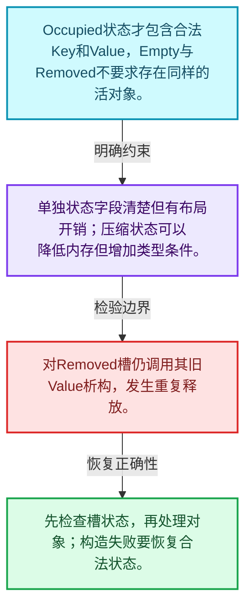
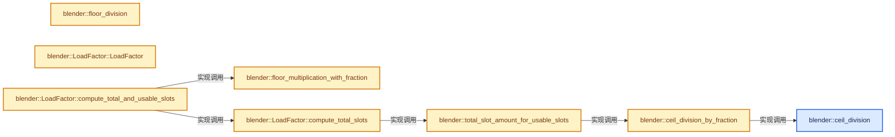
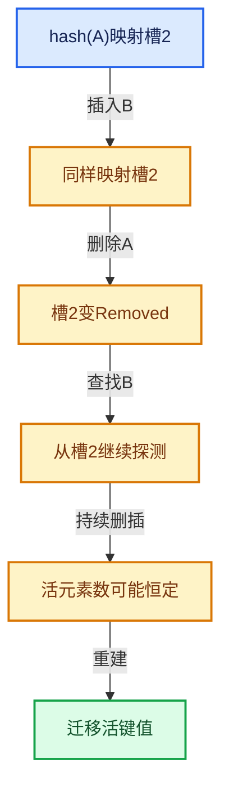

# 02-03 槽位状态与探测

[方向导航](README.md) · [总目录](../README.md) · [实现索引](../%E7%AC%A6%E5%8F%B7%E4%BE%9D%E8%B5%96%E4%B8%8E%E5%AE%9E%E7%8E%B0%E7%B4%A2%E5%BC%95.md)

## 从问题到实现

空槽和删除槽为什么语义不同？

真正空槽能够终止某些查找链，删除槽不能破坏后续碰撞键的可达性。

**数据模型**

Occupied状态才包含合法Key和Value，Empty与Removed不要求存在同样的活对象。

**设计取舍**

单独状态字段清楚但有布局开销；压缩状态可以降低内存但增加类型条件。

**最小反例**

对Removed槽仍调用其旧Value析构，发生重复释放。

**推导**

先检查槽状态，再处理对象；构造失败要恢复合法状态。

## 阅读地图与执行推演








图中的数值推演是本方向的教学模型；实际函数之间的调用边与概念分析边分别标注，不能把概念关系当作运行时调度顺序。

## 完整源码单元与就地讲解

中文讲解直接放在相关代码旁，复杂机制在代码下展开。原文折叠区保留基准行号；不需要在行号表和函数之间来回查找。类布局可分段展示，函数实现不按固定行数切开。

### 类型布局、声明与编译条件 · BLI_hash_tables.hh L1—L25

<!-- annotated:2f51cefe8130c7 -->

```cpp
/* SPDX-FileCopyrightText: 2023 Blender Authors
 *
 * SPDX-License-Identifier: GPL-2.0-or-later */

#pragma once

/** \file
 * \ingroup bli
 *
 * This file contains code that can be shared between different hash table implementations.
 */

#include <algorithm>

#include "BLI_utildefines.hh"
#include "BLI_vector.hh"

namespace blender {

/* -------------------------------------------------------------------- */
/** \name Constexpr Utility Functions
 *
 * Those should eventually be de-duplicated with functions in BLI_math_base_c.hh.
 * \{ */

```

<details>
<summary>核对原始源码：source/blender/blenlib/BLI_hash_tables.hh · L1—L25</summary>

<!-- original:2f51cefe8130c7:source/blender/blenlib/BLI_hash_tables.hh:1:25 -->

```cpp
/* SPDX-FileCopyrightText: 2023 Blender Authors
 *
 * SPDX-License-Identifier: GPL-2.0-or-later */

#pragma once

/** \file
 * \ingroup bli
 *
 * This file contains code that can be shared between different hash table implementations.
 */

#include <algorithm>

#include "BLI_utildefines.hh"
#include "BLI_vector.hh"

namespace blender {

/* -------------------------------------------------------------------- */
/** \name Constexpr Utility Functions
 *
 * Those should eventually be de-duplicated with functions in BLI_math_base_c.hh.
 * \{ */

```

</details>

<a id="f-cd004b286ff3d156"></a>

### `blender::ceil_division`

实现位置：[source/blender/blenlib/BLI_hash_tables.hh](../../../../../source/blender/blenlib/BLI_hash_tables.hh) · L26—L31。

接口参数：

- `const IntT x`
- `const IntT y`

**教学注释版**

<!-- annotated:aa0aeaa4f16d3f -->

```cpp
template<typename IntT> constexpr IntT ceil_division(const IntT x, const IntT y)
{
  BLI_assert(x >= 0);
  BLI_assert(y >= 0);
  return x / y + ((x % y) != 0);
}
```

<details>
<summary>核对原始源码：source/blender/blenlib/BLI_hash_tables.hh · L26—L31</summary>

<!-- original:aa0aeaa4f16d3f:source/blender/blenlib/BLI_hash_tables.hh:26:31 -->

```cpp
template<typename IntT> constexpr IntT ceil_division(const IntT x, const IntT y)
{
  BLI_assert(x >= 0);
  BLI_assert(y >= 0);
  return x / y + ((x % y) != 0);
}
```

</details>

**结果出口**

- `return x / y + ((x % y) != 0);`

**继续追踪实现**

- `BLI_assert` → [BLI_assert · L48](../01-%E5%9F%BA%E7%A1%80%E5%AE%B9%E5%99%A8%E4%B8%8E%E7%8E%B0%E4%BB%A3CPP/%E4%BE%9D%E8%B5%96-BLI_assert-cc98e8.md#m-57a88495704d)；[BLI_assert · L63](../01-%E5%9F%BA%E7%A1%80%E5%AE%B9%E5%99%A8%E4%B8%8E%E7%8E%B0%E4%BB%A3CPP/%E4%BE%9D%E8%B5%96-BLI_assert-cc98e8.md#m-d07050020cb5)。宏定义由构建条件选择。

<!-- annotated:b3a6c3fe284a9a -->

```cpp

```

<details>
<summary>核对原始源码：source/blender/blenlib/BLI_hash_tables.hh · L32—L32</summary>

<!-- original:b3a6c3fe284a9a:source/blender/blenlib/BLI_hash_tables.hh:32:32 -->

```cpp

```

</details>

<a id="f-83f54206e4c77f2c"></a>

### `blender::floor_division`

实现位置：[source/blender/blenlib/BLI_hash_tables.hh](../../../../../source/blender/blenlib/BLI_hash_tables.hh) · L33—L38。

接口参数：

- `const IntT x`
- `const IntT y`

**教学注释版**

<!-- annotated:2cbe0683fcdf2c -->

```cpp
template<typename IntT> constexpr IntT floor_division(const IntT x, const IntT y)
{
  BLI_assert(x >= 0);
  BLI_assert(y >= 0);
  return x / y;
}
```

<details>
<summary>核对原始源码：source/blender/blenlib/BLI_hash_tables.hh · L33—L38</summary>

<!-- original:2cbe0683fcdf2c:source/blender/blenlib/BLI_hash_tables.hh:33:38 -->

```cpp
template<typename IntT> constexpr IntT floor_division(const IntT x, const IntT y)
{
  BLI_assert(x >= 0);
  BLI_assert(y >= 0);
  return x / y;
}
```

</details>

**结果出口**

- `return x / y;`

**继续追踪实现**

- `BLI_assert` → [BLI_assert · L48](../01-%E5%9F%BA%E7%A1%80%E5%AE%B9%E5%99%A8%E4%B8%8E%E7%8E%B0%E4%BB%A3CPP/%E4%BE%9D%E8%B5%96-BLI_assert-cc98e8.md#m-57a88495704d)；[BLI_assert · L63](../01-%E5%9F%BA%E7%A1%80%E5%AE%B9%E5%99%A8%E4%B8%8E%E7%8E%B0%E4%BB%A3CPP/%E4%BE%9D%E8%B5%96-BLI_assert-cc98e8.md#m-d07050020cb5)。宏定义由构建条件选择。

<!-- annotated:d8c96ab13f934d -->

```cpp

```

<details>
<summary>核对原始源码：source/blender/blenlib/BLI_hash_tables.hh · L39—L39</summary>

<!-- original:d8c96ab13f934d:source/blender/blenlib/BLI_hash_tables.hh:39:39 -->

```cpp

```

</details>

<a id="f-5507d9b4ed706129"></a>

### `blender::ceil_division_by_fraction`

实现位置：[source/blender/blenlib/BLI_hash_tables.hh](../../../../../source/blender/blenlib/BLI_hash_tables.hh) · L40—L45。

接口参数：

- `const int64_t x`
- `const int64_t numerator`
- `const int64_t denominator`

**教学注释版**

<!-- annotated:a2740ba0217c12 -->

```cpp
constexpr int64_t ceil_division_by_fraction(const int64_t x,
                                            const int64_t numerator,
                                            const int64_t denominator)
{
  return int64_t(ceil_division(uint64_t(x) * uint64_t(denominator), uint64_t(numerator)));
}
```

<details>
<summary>核对原始源码：source/blender/blenlib/BLI_hash_tables.hh · L40—L45</summary>

<!-- original:a2740ba0217c12:source/blender/blenlib/BLI_hash_tables.hh:40:45 -->

```cpp
constexpr int64_t ceil_division_by_fraction(const int64_t x,
                                            const int64_t numerator,
                                            const int64_t denominator)
{
  return int64_t(ceil_division(uint64_t(x) * uint64_t(denominator), uint64_t(numerator)));
}
```

</details>

**结果出口**

- `return int64_t(ceil_division(uint64_t(x) * uint64_t(denominator), uint64_t(numerator)));`

**继续追踪实现**

- `ceil_division` → [blender::ceil_division · L26](03-%E6%A7%BD%E4%BD%8D%E7%8A%B6%E6%80%81%E4%B8%8E%E6%8E%A2%E6%B5%8B.md#f-cd004b286ff3d156)。

<!-- annotated:b39e4397745ae3 -->

```cpp

```

<details>
<summary>核对原始源码：source/blender/blenlib/BLI_hash_tables.hh · L46—L46</summary>

<!-- original:b39e4397745ae3:source/blender/blenlib/BLI_hash_tables.hh:46:46 -->

```cpp

```

</details>

<a id="f-f92d01ac3aeb5e78"></a>

### `blender::floor_multiplication_with_fraction`

实现位置：[source/blender/blenlib/BLI_hash_tables.hh](../../../../../source/blender/blenlib/BLI_hash_tables.hh) · L47—L52。

接口参数：

- `const int64_t x`
- `const int64_t numerator`
- `const int64_t denominator`

**教学注释版**

<!-- annotated:be98d9f413c20d -->

```cpp
constexpr int64_t floor_multiplication_with_fraction(const int64_t x,
                                                     const int64_t numerator,
                                                     const int64_t denominator)
{
  return int64_t((uint64_t(x) * uint64_t(numerator) / uint64_t(denominator)));
}
```

<details>
<summary>核对原始源码：source/blender/blenlib/BLI_hash_tables.hh · L47—L52</summary>

<!-- original:be98d9f413c20d:source/blender/blenlib/BLI_hash_tables.hh:47:52 -->

```cpp
constexpr int64_t floor_multiplication_with_fraction(const int64_t x,
                                                     const int64_t numerator,
                                                     const int64_t denominator)
{
  return int64_t((uint64_t(x) * uint64_t(numerator) / uint64_t(denominator)));
}
```

</details>

**结果出口**

- `return int64_t((uint64_t(x) * uint64_t(numerator) / uint64_t(denominator)));`

**继续追踪实现**

本实现没有需要继续展开的显式调用；检查返回表达式、对象转换和调用者前置条件。

<!-- annotated:c66f6cb4111682 -->

```cpp

```

<details>
<summary>核对原始源码：source/blender/blenlib/BLI_hash_tables.hh · L53—L53</summary>

<!-- original:c66f6cb4111682:source/blender/blenlib/BLI_hash_tables.hh:53:53 -->

```cpp

```

</details>

<a id="f-47e270f1eb4a1d3b"></a>

### `blender::total_slot_amount_for_usable_slots`

实现位置：[source/blender/blenlib/BLI_hash_tables.hh](../../../../../source/blender/blenlib/BLI_hash_tables.hh) · L54—L60。

接口参数：

- `const int64_t min_usable_slots`
- `const int64_t max_load_factor_numerator`
- `const int64_t max_load_factor_denominator`

**教学注释版**

<!-- annotated:cb7f8158011603 -->

```cpp
constexpr int64_t total_slot_amount_for_usable_slots(const int64_t min_usable_slots,
                                                     const int64_t max_load_factor_numerator,
                                                     const int64_t max_load_factor_denominator)
{
  return power_of_2_max(ceil_division_by_fraction(
      min_usable_slots, max_load_factor_numerator, max_load_factor_denominator));
}
```

<details>
<summary>核对原始源码：source/blender/blenlib/BLI_hash_tables.hh · L54—L60</summary>

<!-- original:cb7f8158011603:source/blender/blenlib/BLI_hash_tables.hh:54:60 -->

```cpp
constexpr int64_t total_slot_amount_for_usable_slots(const int64_t min_usable_slots,
                                                     const int64_t max_load_factor_numerator,
                                                     const int64_t max_load_factor_denominator)
{
  return power_of_2_max(ceil_division_by_fraction(
      min_usable_slots, max_load_factor_numerator, max_load_factor_denominator));
}
```

</details>

**结果出口**

- `return power_of_2_max(ceil_division_by_fraction(`

**继续追踪实现**

- `power_of_2_max` → [blender::power_of_2_max · L188](../01-%E5%9F%BA%E7%A1%80%E5%AE%B9%E5%99%A8%E4%B8%8E%E7%8E%B0%E4%BB%A3CPP/%E4%BE%9D%E8%B5%96-BLI_utildefines-293a0a.md#f-51e7864f2a6087b7)。
- `ceil_division_by_fraction` → [blender::ceil_division_by_fraction · L40](03-%E6%A7%BD%E4%BD%8D%E7%8A%B6%E6%80%81%E4%B8%8E%E6%8E%A2%E6%B5%8B.md#f-5507d9b4ed706129)。

### 类型布局、声明与编译条件 · BLI_hash_tables.hh L61—L77

<a id="t-59af9ce04710"></a>

`LoadFactor`在这里声明的数据成员：

- `uint8_t numerator_`
- `uint8_t denominator_`

<!-- annotated:4fdb794b1867ce -->

```cpp

/** \} */

/* -------------------------------------------------------------------- */
/** \name Load Factor
 *
 * This is an abstraction for a fractional load factor. The hash table using this class is assumed
 * to use arrays with a size that is a power of two.
 *
 * \{ */

class LoadFactor {
 private:
  uint8_t numerator_;
  uint8_t denominator_;

 public:
```

<details>
<summary>核对原始源码：source/blender/blenlib/BLI_hash_tables.hh · L61—L77</summary>

<!-- original:4fdb794b1867ce:source/blender/blenlib/BLI_hash_tables.hh:61:77 -->

```cpp

/** \} */

/* -------------------------------------------------------------------- */
/** \name Load Factor
 *
 * This is an abstraction for a fractional load factor. The hash table using this class is assumed
 * to use arrays with a size that is a power of two.
 *
 * \{ */

class LoadFactor {
 private:
  uint8_t numerator_;
  uint8_t denominator_;

 public:
```

</details>

<a id="f-a0b729c35424648f"></a>

### `blender::LoadFactor::LoadFactor`

实现位置：[source/blender/blenlib/BLI_hash_tables.hh](../../../../../source/blender/blenlib/BLI_hash_tables.hh) · L78—L83。

接口参数：

- `uint8_t numerator`
- `uint8_t denominator`

**教学注释版**

<!-- annotated:ffa949f581ba08 -->

```cpp
  constexpr LoadFactor(uint8_t numerator, uint8_t denominator)
      : numerator_(numerator), denominator_(denominator)
  {
    BLI_assert(numerator > 0);
    BLI_assert(numerator < denominator);
  }
```

<details>
<summary>核对原始源码：source/blender/blenlib/BLI_hash_tables.hh · L78—L83</summary>

<!-- original:ffa949f581ba08:source/blender/blenlib/BLI_hash_tables.hh:78:83 -->

```cpp
  constexpr LoadFactor(uint8_t numerator, uint8_t denominator)
      : numerator_(numerator), denominator_(denominator)
  {
    BLI_assert(numerator > 0);
    BLI_assert(numerator < denominator);
  }
```

</details>

**继续追踪实现**

- `BLI_assert` → [BLI_assert · L48](../01-%E5%9F%BA%E7%A1%80%E5%AE%B9%E5%99%A8%E4%B8%8E%E7%8E%B0%E4%BB%A3CPP/%E4%BE%9D%E8%B5%96-BLI_assert-cc98e8.md#m-57a88495704d)；[BLI_assert · L63](../01-%E5%9F%BA%E7%A1%80%E5%AE%B9%E5%99%A8%E4%B8%8E%E7%8E%B0%E4%BB%A3CPP/%E4%BE%9D%E8%B5%96-BLI_assert-cc98e8.md#m-d07050020cb5)。宏定义由构建条件选择。

<!-- annotated:fd9431ad55aa5f -->

```cpp

```

<details>
<summary>核对原始源码：source/blender/blenlib/BLI_hash_tables.hh · L84—L84</summary>

<!-- original:fd9431ad55aa5f:source/blender/blenlib/BLI_hash_tables.hh:84:84 -->

```cpp

```

</details>

<a id="f-23ebf500254e8be7"></a>

### `blender::LoadFactor::compute_total_and_usable_slots`

实现位置：[source/blender/blenlib/BLI_hash_tables.hh](../../../../../source/blender/blenlib/BLI_hash_tables.hh) · L85—L100。

接口参数：

- `int64_t min_total_slots`
- `int64_t min_usable_slots`
- `int64_t *r_total_slots`
- `int64_t *r_usable_slots`

**教学注释版**

<!-- annotated:3218374f373089 -->

```cpp
  constexpr void compute_total_and_usable_slots(int64_t min_total_slots,
                                                int64_t min_usable_slots,
                                                int64_t *r_total_slots,
                                                int64_t *r_usable_slots) const
  {
    BLI_assert(is_power_of_2(int(min_total_slots)));

    int64_t total_slots = this->compute_total_slots(min_usable_slots, numerator_, denominator_);
    // [讲解] std::max：按比较关系选取较大值。本讲解中的增长公式同时满足最低请求和几何增长；若保存返回引用，还需注意实参寿命。
    total_slots = std::max(total_slots, min_total_slots);
    const int64_t usable_slots = floor_multiplication_with_fraction(
        total_slots, numerator_, denominator_);
    BLI_assert(min_usable_slots <= usable_slots);

    *r_total_slots = total_slots;
    *r_usable_slots = usable_slots;
  }
```

<details>
<summary>核对原始源码：source/blender/blenlib/BLI_hash_tables.hh · L85—L100</summary>

<!-- original:3218374f373089:source/blender/blenlib/BLI_hash_tables.hh:85:100 -->

```cpp
  constexpr void compute_total_and_usable_slots(int64_t min_total_slots,
                                                int64_t min_usable_slots,
                                                int64_t *r_total_slots,
                                                int64_t *r_usable_slots) const
  {
    BLI_assert(is_power_of_2(int(min_total_slots)));

    int64_t total_slots = this->compute_total_slots(min_usable_slots, numerator_, denominator_);
    total_slots = std::max(total_slots, min_total_slots);
    const int64_t usable_slots = floor_multiplication_with_fraction(
        total_slots, numerator_, denominator_);
    BLI_assert(min_usable_slots <= usable_slots);

    *r_total_slots = total_slots;
    *r_usable_slots = usable_slots;
  }
```

</details>

**沿实际写入检查状态**

- `total_slots = std::max(total_slots, min_total_slots);`

**继续追踪实现**

- `BLI_assert` → [BLI_assert · L48](../01-%E5%9F%BA%E7%A1%80%E5%AE%B9%E5%99%A8%E4%B8%8E%E7%8E%B0%E4%BB%A3CPP/%E4%BE%9D%E8%B5%96-BLI_assert-cc98e8.md#m-57a88495704d)；[BLI_assert · L63](../01-%E5%9F%BA%E7%A1%80%E5%AE%B9%E5%99%A8%E4%B8%8E%E7%8E%B0%E4%BB%A3CPP/%E4%BE%9D%E8%B5%96-BLI_assert-cc98e8.md#m-d07050020cb5)。宏定义由构建条件选择。
- `is_power_of_2` → [blender::is_power_of_2 · L170](../01-%E5%9F%BA%E7%A1%80%E5%AE%B9%E5%99%A8%E4%B8%8E%E7%8E%B0%E4%BB%A3CPP/%E4%BE%9D%E8%B5%96-BLI_utildefines-293a0a.md#f-276f4f171955e1e9)。
- `this->compute_total_slots` → [blender::LoadFactor::compute_total_slots · L102](03-%E6%A7%BD%E4%BD%8D%E7%8A%B6%E6%80%81%E4%B8%8E%E6%8E%A2%E6%B5%8B.md#f-39ec7f30463f18b0)。
- `std::max` → [外部契约](https://eel.is/c++draft/alg.min.max)：按比较关系选取较大值。本讲解中的增长公式同时满足最低请求和几何增长；若保存返回引用，还需注意实参寿命。
- `floor_multiplication_with_fraction` → [blender::floor_multiplication_with_fraction · L47](03-%E6%A7%BD%E4%BD%8D%E7%8A%B6%E6%80%81%E4%B8%8E%E6%8E%A2%E6%B5%8B.md#f-f92d01ac3aeb5e78)。

<!-- annotated:b8e079a1b4bfa0 -->

```cpp

```

<details>
<summary>核对原始源码：source/blender/blenlib/BLI_hash_tables.hh · L101—L101</summary>

<!-- original:b8e079a1b4bfa0:source/blender/blenlib/BLI_hash_tables.hh:101:101 -->

```cpp

```

</details>

<a id="f-39ec7f30463f18b0"></a>

### `blender::LoadFactor::compute_total_slots`

实现位置：[source/blender/blenlib/BLI_hash_tables.hh](../../../../../source/blender/blenlib/BLI_hash_tables.hh) · L102—L107。

接口参数：

- `int64_t min_usable_slots`
- `uint8_t numerator`
- `uint8_t denominator`

**教学注释版**

<!-- annotated:7344712d86c6c5 -->

```cpp
  static constexpr int64_t compute_total_slots(int64_t min_usable_slots,
                                               uint8_t numerator,
                                               uint8_t denominator)
  {
    return total_slot_amount_for_usable_slots(min_usable_slots, numerator, denominator);
  }
```

<details>
<summary>核对原始源码：source/blender/blenlib/BLI_hash_tables.hh · L102—L107</summary>

<!-- original:7344712d86c6c5:source/blender/blenlib/BLI_hash_tables.hh:102:107 -->

```cpp
  static constexpr int64_t compute_total_slots(int64_t min_usable_slots,
                                               uint8_t numerator,
                                               uint8_t denominator)
  {
    return total_slot_amount_for_usable_slots(min_usable_slots, numerator, denominator);
  }
```

</details>

**结果出口**

- `return total_slot_amount_for_usable_slots(min_usable_slots, numerator, denominator);`

**继续追踪实现**

- `total_slot_amount_for_usable_slots` → [blender::total_slot_amount_for_usable_slots · L54](03-%E6%A7%BD%E4%BD%8D%E7%8A%B6%E6%80%81%E4%B8%8E%E6%8E%A2%E6%B5%8B.md#f-47e270f1eb4a1d3b)。

### 类型布局、声明与编译条件 · BLI_hash_tables.hh L108—L138

<a id="t-7936af790c9c"></a>

<!-- annotated:c45ab1b39e5b92 -->

```cpp
};

/** \} */

/* -------------------------------------------------------------------- */
/** \name Intrusive Key Info
 *
 * A hash table slot has to maintain state about whether the slot is empty, occupied or removed.
 * Usually, this state information is stored in its own variable. While it only needs two bits in
 * theory, in practice often 4 or 8 bytes are used, due to alignment requirements.
 *
 * One solution to deal with this problem is to embed the state information in the key. That means,
 * two values of the key type are selected to indicate whether the slot is empty or removed.
 *
 * The classes below tell a slot implementation which special key values it can use. They can be
 * used as #KeyInfo in slot types like #IntrusiveSetSlot and #IntrusiveMapSlot.
 *
 * A #KeyInfo type has to implement a couple of static methods that are descried in
 * #TemplatedKeyInfo.
 *
 * \{ */

/**
 * The template arguments EmptyValue and RemovedValue define which special are used. This can be
 * used when a hash table has integer keys and there are two specific integers that will never be
 * used as keys.
 */
template<typename Key, Key EmptyValue, Key RemovedValue> struct TemplatedKeyInfo {
  /**
   * Get the value that indicates that the slot is empty. This is used to indicate new slots.
   */
```

<details>
<summary>核对原始源码：source/blender/blenlib/BLI_hash_tables.hh · L108—L138</summary>

<!-- original:c45ab1b39e5b92:source/blender/blenlib/BLI_hash_tables.hh:108:138 -->

```cpp
};

/** \} */

/* -------------------------------------------------------------------- */
/** \name Intrusive Key Info
 *
 * A hash table slot has to maintain state about whether the slot is empty, occupied or removed.
 * Usually, this state information is stored in its own variable. While it only needs two bits in
 * theory, in practice often 4 or 8 bytes are used, due to alignment requirements.
 *
 * One solution to deal with this problem is to embed the state information in the key. That means,
 * two values of the key type are selected to indicate whether the slot is empty or removed.
 *
 * The classes below tell a slot implementation which special key values it can use. They can be
 * used as #KeyInfo in slot types like #IntrusiveSetSlot and #IntrusiveMapSlot.
 *
 * A #KeyInfo type has to implement a couple of static methods that are descried in
 * #TemplatedKeyInfo.
 *
 * \{ */

/**
 * The template arguments EmptyValue and RemovedValue define which special are used. This can be
 * used when a hash table has integer keys and there are two specific integers that will never be
 * used as keys.
 */
template<typename Key, Key EmptyValue, Key RemovedValue> struct TemplatedKeyInfo {
  /**
   * Get the value that indicates that the slot is empty. This is used to indicate new slots.
   */
```

</details>

<a id="f-34228fd1778ca088"></a>

### `blender::TemplatedKeyInfo::get_empty`

实现位置：[source/blender/blenlib/BLI_hash_tables.hh](../../../../../source/blender/blenlib/BLI_hash_tables.hh) · L139—L142。

**教学注释版**

<!-- annotated:e4847ed23f535f -->

```cpp
  static Key get_empty()
  {
    return EmptyValue;
  }
```

<details>
<summary>核对原始源码：source/blender/blenlib/BLI_hash_tables.hh · L139—L142</summary>

<!-- original:e4847ed23f535f:source/blender/blenlib/BLI_hash_tables.hh:139:142 -->

```cpp
  static Key get_empty()
  {
    return EmptyValue;
  }
```

</details>

**结果出口**

- `return EmptyValue;`

**继续追踪实现**

本实现没有需要继续展开的显式调用；检查返回表达式、对象转换和调用者前置条件。

### 类型布局、声明与编译条件 · BLI_hash_tables.hh L143—L146

<!-- annotated:f27722dc8d4463 -->

```cpp

  /**
   * Modify the given key so that it represents a removed slot.
   */
```

<details>
<summary>核对原始源码：source/blender/blenlib/BLI_hash_tables.hh · L143—L146</summary>

<!-- original:f27722dc8d4463:source/blender/blenlib/BLI_hash_tables.hh:143:146 -->

```cpp

  /**
   * Modify the given key so that it represents a removed slot.
   */
```

</details>

<a id="f-49b952b6d1afab30"></a>

### `blender::TemplatedKeyInfo::remove`

实现位置：[source/blender/blenlib/BLI_hash_tables.hh](../../../../../source/blender/blenlib/BLI_hash_tables.hh) · L147—L150。

接口参数：

- `Key &key`

**教学注释版**

<!-- annotated:0ccf2a4bd5e56c -->

```cpp
  static void remove(Key &key)
  {
    key = RemovedValue;
  }
```

<details>
<summary>核对原始源码：source/blender/blenlib/BLI_hash_tables.hh · L147—L150</summary>

<!-- original:0ccf2a4bd5e56c:source/blender/blenlib/BLI_hash_tables.hh:147:150 -->

```cpp
  static void remove(Key &key)
  {
    key = RemovedValue;
  }
```

</details>

**沿实际写入检查状态**

- `key = RemovedValue;`

**继续追踪实现**

本实现没有需要继续展开的显式调用；检查返回表达式、对象转换和调用者前置条件。

### 类型布局、声明与编译条件 · BLI_hash_tables.hh L151—L154

<!-- annotated:41e9d09cadd46b -->

```cpp

  /**
   * Return true, when the given key indicates that the slot is empty.
   */
```

<details>
<summary>核对原始源码：source/blender/blenlib/BLI_hash_tables.hh · L151—L154</summary>

<!-- original:41e9d09cadd46b:source/blender/blenlib/BLI_hash_tables.hh:151:154 -->

```cpp

  /**
   * Return true, when the given key indicates that the slot is empty.
   */
```

</details>

<a id="f-3ea0596b9e22dc08"></a>

### `blender::TemplatedKeyInfo::is_empty`

实现位置：[source/blender/blenlib/BLI_hash_tables.hh](../../../../../source/blender/blenlib/BLI_hash_tables.hh) · L155—L158。

接口参数：

- `const Key &key`

**教学注释版**

<!-- annotated:985da1de11f77a -->

```cpp
  static bool is_empty(const Key &key)
  {
    return key == EmptyValue;
  }
```

<details>
<summary>核对原始源码：source/blender/blenlib/BLI_hash_tables.hh · L155—L158</summary>

<!-- original:985da1de11f77a:source/blender/blenlib/BLI_hash_tables.hh:155:158 -->

```cpp
  static bool is_empty(const Key &key)
  {
    return key == EmptyValue;
  }
```

</details>

**结果出口**

- `return key == EmptyValue;`

**继续追踪实现**

本实现没有需要继续展开的显式调用；检查返回表达式、对象转换和调用者前置条件。

### 类型布局、声明与编译条件 · BLI_hash_tables.hh L159—L162

<!-- annotated:bf71489181a0b0 -->

```cpp

  /**
   * Return true, when the given key indicates that the slot is removed.
   */
```

<details>
<summary>核对原始源码：source/blender/blenlib/BLI_hash_tables.hh · L159—L162</summary>

<!-- original:bf71489181a0b0:source/blender/blenlib/BLI_hash_tables.hh:159:162 -->

```cpp

  /**
   * Return true, when the given key indicates that the slot is removed.
   */
```

</details>

<a id="f-2a46dd7fa62d394a"></a>

### `blender::TemplatedKeyInfo::is_removed`

实现位置：[source/blender/blenlib/BLI_hash_tables.hh](../../../../../source/blender/blenlib/BLI_hash_tables.hh) · L163—L166。

接口参数：

- `const Key &key`

**教学注释版**

<!-- annotated:cda9535fa84530 -->

```cpp
  static bool is_removed(const Key &key)
  {
    return key == RemovedValue;
  }
```

<details>
<summary>核对原始源码：source/blender/blenlib/BLI_hash_tables.hh · L163—L166</summary>

<!-- original:cda9535fa84530:source/blender/blenlib/BLI_hash_tables.hh:163:166 -->

```cpp
  static bool is_removed(const Key &key)
  {
    return key == RemovedValue;
  }
```

</details>

**结果出口**

- `return key == RemovedValue;`

**继续追踪实现**

本实现没有需要继续展开的显式调用；检查返回表达式、对象转换和调用者前置条件。

### 类型布局、声明与编译条件 · BLI_hash_tables.hh L167—L170

<!-- annotated:a4152703e61c10 -->

```cpp

  /**
   * Return true, when the key is valid, i.e. it can be contained in an occupied slot.
   */
```

<details>
<summary>核对原始源码：source/blender/blenlib/BLI_hash_tables.hh · L167—L170</summary>

<!-- original:a4152703e61c10:source/blender/blenlib/BLI_hash_tables.hh:167:170 -->

```cpp

  /**
   * Return true, when the key is valid, i.e. it can be contained in an occupied slot.
   */
```

</details>

<a id="f-aea94ce38373c158"></a>

### `blender::TemplatedKeyInfo::is_not_empty_or_removed`

实现位置：[source/blender/blenlib/BLI_hash_tables.hh](../../../../../source/blender/blenlib/BLI_hash_tables.hh) · L171—L174。

接口参数：

- `const Key &key`

**教学注释版**

<!-- annotated:a1f97644c07960 -->

```cpp
  static bool is_not_empty_or_removed(const Key &key)
  {
    return key != EmptyValue && key != RemovedValue;
  }
```

<details>
<summary>核对原始源码：source/blender/blenlib/BLI_hash_tables.hh · L171—L174</summary>

<!-- original:a1f97644c07960:source/blender/blenlib/BLI_hash_tables.hh:171:174 -->

```cpp
  static bool is_not_empty_or_removed(const Key &key)
  {
    return key != EmptyValue && key != RemovedValue;
  }
```

</details>

**结果出口**

- `return key != EmptyValue && key != RemovedValue;`

**继续追踪实现**

本实现没有需要继续展开的显式调用；检查返回表达式、对象转换和调用者前置条件。

### 类型布局、声明与编译条件 · BLI_hash_tables.hh L175—L185

<a id="t-434dc51b353b"></a>

<!-- annotated:0ca409cc1bab16 -->

```cpp
};

/**
 * `0xffff...ffff` indicates an empty slot.
 * `0xffff...fffe` indicates a removed slot.
 *
 * Those specific values are used, because with them a single comparison is enough to check whether
 * a slot is occupied. The keys `0x0000...0000` and `0x0000...0001` also satisfy this constraint.
 * However, nullptr is much more likely to be used as valid key.
 */
template<typename Pointer> struct PointerKeyInfo {
```

<details>
<summary>核对原始源码：source/blender/blenlib/BLI_hash_tables.hh · L175—L185</summary>

<!-- original:0ca409cc1bab16:source/blender/blenlib/BLI_hash_tables.hh:175:185 -->

```cpp
};

/**
 * `0xffff...ffff` indicates an empty slot.
 * `0xffff...fffe` indicates a removed slot.
 *
 * Those specific values are used, because with them a single comparison is enough to check whether
 * a slot is occupied. The keys `0x0000...0000` and `0x0000...0001` also satisfy this constraint.
 * However, nullptr is much more likely to be used as valid key.
 */
template<typename Pointer> struct PointerKeyInfo {
```

</details>

<a id="f-fbf9f2317921e1e5"></a>

### `blender::PointerKeyInfo::get_empty`

实现位置：[source/blender/blenlib/BLI_hash_tables.hh](../../../../../source/blender/blenlib/BLI_hash_tables.hh) · L186—L189。

**教学注释版**

<!-- annotated:c6081ac60cbbb6 -->

```cpp
  static Pointer get_empty()
  {
    return Pointer(UINTPTR_MAX);
  }
```

<details>
<summary>核对原始源码：source/blender/blenlib/BLI_hash_tables.hh · L186—L189</summary>

<!-- original:c6081ac60cbbb6:source/blender/blenlib/BLI_hash_tables.hh:186:189 -->

```cpp
  static Pointer get_empty()
  {
    return Pointer(UINTPTR_MAX);
  }
```

</details>

**结果出口**

- `return Pointer(UINTPTR_MAX);`

**继续追踪实现**

- `Pointer` → [blender::DrawEngine::Pointer](../05-%E5%87%A0%E4%BD%95%E5%AD%98%E5%82%A8%E4%B8%8E%E6%8B%93%E6%89%91%E6%98%A0%E5%B0%84/%E4%BE%9D%E8%B5%96-DRW_render-2c5210.md#t-afed06a9c27b)。

<!-- annotated:84cd075c2d4a9b -->

```cpp

```

<details>
<summary>核对原始源码：source/blender/blenlib/BLI_hash_tables.hh · L190—L190</summary>

<!-- original:84cd075c2d4a9b:source/blender/blenlib/BLI_hash_tables.hh:190:190 -->

```cpp

```

</details>

<a id="f-272c11689c1dc791"></a>

### `blender::PointerKeyInfo::remove`

实现位置：[source/blender/blenlib/BLI_hash_tables.hh](../../../../../source/blender/blenlib/BLI_hash_tables.hh) · L191—L194。

接口参数：

- `Pointer &pointer`

**教学注释版**

<!-- annotated:382fc1dd2733bb -->

```cpp
  static void remove(Pointer &pointer)
  {
    pointer = Pointer(UINTPTR_MAX - 1);
  }
```

<details>
<summary>核对原始源码：source/blender/blenlib/BLI_hash_tables.hh · L191—L194</summary>

<!-- original:382fc1dd2733bb:source/blender/blenlib/BLI_hash_tables.hh:191:194 -->

```cpp
  static void remove(Pointer &pointer)
  {
    pointer = Pointer(UINTPTR_MAX - 1);
  }
```

</details>

**沿实际写入检查状态**

- `pointer = Pointer(UINTPTR_MAX - 1);`

**继续追踪实现**

- `Pointer` → [blender::DrawEngine::Pointer](../05-%E5%87%A0%E4%BD%95%E5%AD%98%E5%82%A8%E4%B8%8E%E6%8B%93%E6%89%91%E6%98%A0%E5%B0%84/%E4%BE%9D%E8%B5%96-DRW_render-2c5210.md#t-afed06a9c27b)。

<!-- annotated:ea8e24a7094e59 -->

```cpp

```

<details>
<summary>核对原始源码：source/blender/blenlib/BLI_hash_tables.hh · L195—L195</summary>

<!-- original:ea8e24a7094e59:source/blender/blenlib/BLI_hash_tables.hh:195:195 -->

```cpp

```

</details>

<a id="f-428da956931af365"></a>

### `blender::PointerKeyInfo::is_empty`

实现位置：[source/blender/blenlib/BLI_hash_tables.hh](../../../../../source/blender/blenlib/BLI_hash_tables.hh) · L196—L199。

接口参数：

- `Pointer pointer`

**教学注释版**

<!-- annotated:6e479dcc92183a -->

```cpp
  static bool is_empty(Pointer pointer)
  {
    return uintptr_t(pointer) == UINTPTR_MAX;
  }
```

<details>
<summary>核对原始源码：source/blender/blenlib/BLI_hash_tables.hh · L196—L199</summary>

<!-- original:6e479dcc92183a:source/blender/blenlib/BLI_hash_tables.hh:196:199 -->

```cpp
  static bool is_empty(Pointer pointer)
  {
    return uintptr_t(pointer) == UINTPTR_MAX;
  }
```

</details>

**结果出口**

- `return uintptr_t(pointer) == UINTPTR_MAX;`

**继续追踪实现**

本实现没有需要继续展开的显式调用；检查返回表达式、对象转换和调用者前置条件。

<!-- annotated:a5edab059f252a -->

```cpp

```

<details>
<summary>核对原始源码：source/blender/blenlib/BLI_hash_tables.hh · L200—L200</summary>

<!-- original:a5edab059f252a:source/blender/blenlib/BLI_hash_tables.hh:200:200 -->

```cpp

```

</details>

<a id="f-fa8e3a83914c8cb4"></a>

### `blender::PointerKeyInfo::is_removed`

实现位置：[source/blender/blenlib/BLI_hash_tables.hh](../../../../../source/blender/blenlib/BLI_hash_tables.hh) · L201—L204。

接口参数：

- `Pointer pointer`

**教学注释版**

<!-- annotated:8ac75c7ba03da6 -->

```cpp
  static bool is_removed(Pointer pointer)
  {
    return uintptr_t(pointer) == UINTPTR_MAX - 1;
  }
```

<details>
<summary>核对原始源码：source/blender/blenlib/BLI_hash_tables.hh · L201—L204</summary>

<!-- original:8ac75c7ba03da6:source/blender/blenlib/BLI_hash_tables.hh:201:204 -->

```cpp
  static bool is_removed(Pointer pointer)
  {
    return uintptr_t(pointer) == UINTPTR_MAX - 1;
  }
```

</details>

**结果出口**

- `return uintptr_t(pointer) == UINTPTR_MAX - 1;`

**继续追踪实现**

本实现没有需要继续展开的显式调用；检查返回表达式、对象转换和调用者前置条件。

<!-- annotated:ee0198f56a8090 -->

```cpp

```

<details>
<summary>核对原始源码：source/blender/blenlib/BLI_hash_tables.hh · L205—L205</summary>

<!-- original:ee0198f56a8090:source/blender/blenlib/BLI_hash_tables.hh:205:205 -->

```cpp

```

</details>

<a id="f-58b0259b21a3e5fd"></a>

### `blender::PointerKeyInfo::is_not_empty_or_removed`

实现位置：[source/blender/blenlib/BLI_hash_tables.hh](../../../../../source/blender/blenlib/BLI_hash_tables.hh) · L206—L209。

接口参数：

- `Pointer pointer`

**教学注释版**

<!-- annotated:7c3e60e857734e -->

```cpp
  static bool is_not_empty_or_removed(Pointer pointer)
  {
    return uintptr_t(pointer) < UINTPTR_MAX - 1;
  }
```

<details>
<summary>核对原始源码：source/blender/blenlib/BLI_hash_tables.hh · L206—L209</summary>

<!-- original:7c3e60e857734e:source/blender/blenlib/BLI_hash_tables.hh:206:209 -->

```cpp
  static bool is_not_empty_or_removed(Pointer pointer)
  {
    return uintptr_t(pointer) < UINTPTR_MAX - 1;
  }
```

</details>

**结果出口**

- `return uintptr_t(pointer) < UINTPTR_MAX - 1;`

**继续追踪实现**

本实现没有需要继续展开的显式调用；检查返回表达式、对象转换和调用者前置条件。

### 类型布局、声明与编译条件 · BLI_hash_tables.hh L210—L247

<a id="t-152ea6f76b83"></a>

`HashTableStats`在这里声明的数据成员：

- `Vector<int64_t> keys_by_collision_count_`
- `int64_t total_collisions_`
- `float average_collisions_`
- `int64_t size_`
- `int64_t capacity_`
- `int64_t removed_amount_`
- `float load_factor_`
- `float removed_load_factor_`
- `int64_t size_per_element_`
- `int64_t size_in_bytes_`
- `void address_`

<!-- annotated:7148bc0c50ba79 -->

```cpp
};

/** \} */

/* -------------------------------------------------------------------- */
/** \name Hash Table Stats
 *
 * A utility class that makes it easier for hash table implementations to provide statistics to the
 * developer. These statistics can be helpful when trying to figure out why a hash table is slow.
 *
 * To use this utility, a hash table has to implement various methods, that are mentioned below.
 *
 * \{ */

class HashTableStats {
 private:
  Vector<int64_t> keys_by_collision_count_;
  int64_t total_collisions_;
  float average_collisions_;
  int64_t size_;
  int64_t capacity_;
  int64_t removed_amount_;
  float load_factor_;
  float removed_load_factor_;
  int64_t size_per_element_;
  int64_t size_in_bytes_;
  const void *address_;

 public:
  /**
   * Requires that the hash table has the following methods:
   * - count_collisions(key) -> int64_t
   * - size() -> int64_t
   * - capacity() -> int64_t
   * - removed_amount() -> int64_t
   * - size_per_element() -> int64_t
   * - size_in_bytes() -> int64_t
   */
```

<details>
<summary>核对原始源码：source/blender/blenlib/BLI_hash_tables.hh · L210—L247</summary>

<!-- original:7148bc0c50ba79:source/blender/blenlib/BLI_hash_tables.hh:210:247 -->

```cpp
};

/** \} */

/* -------------------------------------------------------------------- */
/** \name Hash Table Stats
 *
 * A utility class that makes it easier for hash table implementations to provide statistics to the
 * developer. These statistics can be helpful when trying to figure out why a hash table is slow.
 *
 * To use this utility, a hash table has to implement various methods, that are mentioned below.
 *
 * \{ */

class HashTableStats {
 private:
  Vector<int64_t> keys_by_collision_count_;
  int64_t total_collisions_;
  float average_collisions_;
  int64_t size_;
  int64_t capacity_;
  int64_t removed_amount_;
  float load_factor_;
  float removed_load_factor_;
  int64_t size_per_element_;
  int64_t size_in_bytes_;
  const void *address_;

 public:
  /**
   * Requires that the hash table has the following methods:
   * - count_collisions(key) -> int64_t
   * - size() -> int64_t
   * - capacity() -> int64_t
   * - removed_amount() -> int64_t
   * - size_per_element() -> int64_t
   * - size_in_bytes() -> int64_t
   */
```

</details>

<a id="f-a65b58d018284de1"></a>

### `blender::HashTableStats::HashTableStats`

实现位置：[source/blender/blenlib/BLI_hash_tables.hh](../../../../../source/blender/blenlib/BLI_hash_tables.hh) · L248—L272。

接口参数：

- `const HashTable &hash_table`
- `const Keys &keys`

**教学注释版**

<!-- annotated:3477f761d7517d -->

```cpp
  template<typename HashTable, typename Keys>
  HashTableStats(const HashTable &hash_table, const Keys &keys)
  {
    total_collisions_ = 0;
    size_ = hash_table.size();
    capacity_ = hash_table.capacity();
    removed_amount_ = hash_table.removed_amount();
    size_per_element_ = hash_table.size_per_element();
    size_in_bytes_ = hash_table.size_in_bytes();
    address_ = static_cast<const void *>(&hash_table);

    for (const auto &key : keys) {
      int64_t collisions = hash_table.count_collisions(key);
      // [讲解] keys_by_collision_count_.size：用end_减begin_得到活元素数量。
      if (keys_by_collision_count_.size() <= collisions) {
        keys_by_collision_count_.append_n_times(0,
                                                collisions - keys_by_collision_count_.size() + 1);
      }
      keys_by_collision_count_[collisions]++;
      total_collisions_ += collisions;
    }

    average_collisions_ = (size_ == 0) ? 0 : float(total_collisions_) / float(size_);
    load_factor_ = float(size_) / float(capacity_);
    removed_load_factor_ = float(removed_amount_) / float(capacity_);
  }
```

<details>
<summary>核对原始源码：source/blender/blenlib/BLI_hash_tables.hh · L248—L272</summary>

<!-- original:3477f761d7517d:source/blender/blenlib/BLI_hash_tables.hh:248:272 -->

```cpp
  template<typename HashTable, typename Keys>
  HashTableStats(const HashTable &hash_table, const Keys &keys)
  {
    total_collisions_ = 0;
    size_ = hash_table.size();
    capacity_ = hash_table.capacity();
    removed_amount_ = hash_table.removed_amount();
    size_per_element_ = hash_table.size_per_element();
    size_in_bytes_ = hash_table.size_in_bytes();
    address_ = static_cast<const void *>(&hash_table);

    for (const auto &key : keys) {
      int64_t collisions = hash_table.count_collisions(key);
      if (keys_by_collision_count_.size() <= collisions) {
        keys_by_collision_count_.append_n_times(0,
                                                collisions - keys_by_collision_count_.size() + 1);
      }
      keys_by_collision_count_[collisions]++;
      total_collisions_ += collisions;
    }

    average_collisions_ = (size_ == 0) ? 0 : float(total_collisions_) / float(size_);
    load_factor_ = float(size_) / float(capacity_);
    removed_load_factor_ = float(removed_amount_) / float(capacity_);
  }
```

</details>

**沿实际写入检查状态**

- `total_collisions_ = 0;`
- `size_ = hash_table.size();`
- `capacity_ = hash_table.capacity();`
- `removed_amount_ = hash_table.removed_amount();`
- `size_per_element_ = hash_table.size_per_element();`
- `size_in_bytes_ = hash_table.size_in_bytes();`
- `address_ = static_cast<const void *>(&hash_table);`
- `total_collisions_ += collisions;`
- `average_collisions_ = (size_ == 0) ? 0 : float(total_collisions_) / float(size_);`
- `load_factor_ = float(size_) / float(capacity_);`
- `removed_load_factor_ = float(removed_amount_) / float(capacity_);`

**继续追踪实现**

- `hash_table.size` → [调用协议](../%E6%A8%A1%E6%9D%BF%E5%AE%8F%E4%B8%8E%E5%8A%A8%E6%80%81%E5%88%86%E6%B4%BE%E5%8D%8F%E8%AE%AE.md)：由接收对象具体类型或运行时策略提供实现。调用位置L252。
- `hash_table.capacity` → [capacity · L135](../05-%E5%87%A0%E4%BD%95%E5%AD%98%E5%82%A8%E4%B8%8E%E6%8B%93%E6%89%91%E6%98%A0%E5%B0%84/%E4%BE%9D%E8%B5%96-gpu_shader_cxx_attribute-d75f56.md#m-6e31a7e10f76)。宏定义由构建条件选择。
- `hash_table.removed_amount` → [调用协议](../%E6%A8%A1%E6%9D%BF%E5%AE%8F%E4%B8%8E%E5%8A%A8%E6%80%81%E5%88%86%E6%B4%BE%E5%8D%8F%E8%AE%AE.md)：由接收对象具体类型或运行时策略提供实现。调用位置L254。
- `hash_table.size_per_element` → [调用协议](../%E6%A8%A1%E6%9D%BF%E5%AE%8F%E4%B8%8E%E5%8A%A8%E6%80%81%E5%88%86%E6%B4%BE%E5%8D%8F%E8%AE%AE.md)：由接收对象具体类型或运行时策略提供实现。调用位置L255。
- `hash_table.size_in_bytes` → [调用协议](../%E6%A8%A1%E6%9D%BF%E5%AE%8F%E4%B8%8E%E5%8A%A8%E6%80%81%E5%88%86%E6%B4%BE%E5%8D%8F%E8%AE%AE.md)：由接收对象具体类型或运行时策略提供实现。调用位置L256。
- `hash_table.count_collisions` → [调用协议](../%E6%A8%A1%E6%9D%BF%E5%AE%8F%E4%B8%8E%E5%8A%A8%E6%80%81%E5%88%86%E6%B4%BE%E5%8D%8F%E8%AE%AE.md)：由接收对象具体类型或运行时策略提供实现。调用位置L260。
- `keys_by_collision_count_.size` → [blender::Vector::size · L780](../01-%E5%9F%BA%E7%A1%80%E5%AE%B9%E5%99%A8%E4%B8%8E%E7%8E%B0%E4%BB%A3CPP/11-Vector%E6%8F%92%E5%85%A5%E5%88%A0%E9%99%A4%E4%B8%8E%E9%87%8D%E6%8E%92.md#f-714773731767349c)。
- `keys_by_collision_count_.append_n_times` → [blender::Vector::append_n_times · L569](../01-%E5%9F%BA%E7%A1%80%E5%AE%B9%E5%99%A8%E4%B8%8E%E7%8E%B0%E4%BB%A3CPP/11-Vector%E6%8F%92%E5%85%A5%E5%88%A0%E9%99%A4%E4%B8%8E%E9%87%8D%E6%8E%92.md#f-8b696bc4bd1e57b2)。

### 类型布局、声明与编译条件 · BLI_hash_tables.hh L273—L285

<a id="t-08f54a008320"></a>

<!-- annotated:fa8a007bfbf2f9 -->

```cpp

  void print(const char *name) const;
};

/** \} */

/**
 * This struct provides an equality operator that returns true for all objects that compare equal
 * when one would use the `==` operator. This is different from std::equal_to<T>, because that
 * requires the parameters to be of type T. Our hash tables support lookups using other types
 * without conversion, therefore DefaultEquality needs to be more generic.
 */
template<typename T> struct DefaultEquality {
```

<details>
<summary>核对原始源码：source/blender/blenlib/BLI_hash_tables.hh · L273—L285</summary>

<!-- original:fa8a007bfbf2f9:source/blender/blenlib/BLI_hash_tables.hh:273:285 -->

```cpp

  void print(const char *name) const;
};

/** \} */

/**
 * This struct provides an equality operator that returns true for all objects that compare equal
 * when one would use the `==` operator. This is different from std::equal_to<T>, because that
 * requires the parameters to be of type T. Our hash tables support lookups using other types
 * without conversion, therefore DefaultEquality needs to be more generic.
 */
template<typename T> struct DefaultEquality {
```

</details>

<a id="f-c219c64c14f67cd8"></a>

### `blender::DefaultEquality::operator()`

实现位置：[source/blender/blenlib/BLI_hash_tables.hh](../../../../../source/blender/blenlib/BLI_hash_tables.hh) · L286—L289。

接口参数：

- `const T1 &a`
- `const T2 &b`

**教学注释版**

<!-- annotated:54a645d73846c1 -->

```cpp
  template<typename T1, typename T2> bool operator()(const T1 &a, const T2 &b) const
  {
    return a == b;
  }
```

<details>
<summary>核对原始源码：source/blender/blenlib/BLI_hash_tables.hh · L286—L289</summary>

<!-- original:54a645d73846c1:source/blender/blenlib/BLI_hash_tables.hh:286:289 -->

```cpp
  template<typename T1, typename T2> bool operator()(const T1 &a, const T2 &b) const
  {
    return a == b;
  }
```

</details>

**结果出口**

- `return a == b;`

**继续追踪实现**

本实现没有需要继续展开的显式调用；检查返回表达式、对象转换和调用者前置条件。

### 类型布局、声明与编译条件 · BLI_hash_tables.hh L290—L295

<a id="t-bbaf1c6091be"></a>

<!-- annotated:e22ad06d960e46 -->

```cpp
};

/**
 * Support comparing different kinds of raw and smart pointers.
 */
struct PointerComparison {
```

<details>
<summary>核对原始源码：source/blender/blenlib/BLI_hash_tables.hh · L290—L295</summary>

<!-- original:e22ad06d960e46:source/blender/blenlib/BLI_hash_tables.hh:290:295 -->

```cpp
};

/**
 * Support comparing different kinds of raw and smart pointers.
 */
struct PointerComparison {
```

</details>

<a id="f-1b6d592a278fec2f"></a>

### `blender::PointerComparison::operator()`

实现位置：[source/blender/blenlib/BLI_hash_tables.hh](../../../../../source/blender/blenlib/BLI_hash_tables.hh) · L296—L299。

接口参数：

- `const T1 &a`
- `const T2 &b`

**教学注释版**

<!-- annotated:b42855f314dc9e -->

```cpp
  template<typename T1, typename T2> bool operator()(const T1 &a, const T2 &b) const
  {
    return &*a == &*b;
  }
```

<details>
<summary>核对原始源码：source/blender/blenlib/BLI_hash_tables.hh · L296—L299</summary>

<!-- original:b42855f314dc9e:source/blender/blenlib/BLI_hash_tables.hh:296:299 -->

```cpp
  template<typename T1, typename T2> bool operator()(const T1 &a, const T2 &b) const
  {
    return &*a == &*b;
  }
```

</details>

**结果出口**

- `return &*a == &*b;`

**继续追踪实现**

本实现没有需要继续展开的显式调用；检查返回表达式、对象转换和调用者前置条件。

### 类型布局、声明与编译条件 · BLI_hash_tables.hh L300—L305

<a id="t-b61143e6f355"></a>

<a id="t-ffd0af857439"></a>

<a id="t-2755811eebe7"></a>

<!-- annotated:5d22bccc0258a3 -->

```cpp
};

template<typename T> struct DefaultEquality<std::unique_ptr<T>> : public PointerComparison {};
template<typename T> struct DefaultEquality<std::shared_ptr<T>> : public PointerComparison {};

struct SequenceComparison {
```

<details>
<summary>核对原始源码：source/blender/blenlib/BLI_hash_tables.hh · L300—L305</summary>

<!-- original:5d22bccc0258a3:source/blender/blenlib/BLI_hash_tables.hh:300:305 -->

```cpp
};

template<typename T> struct DefaultEquality<std::unique_ptr<T>> : public PointerComparison {};
template<typename T> struct DefaultEquality<std::shared_ptr<T>> : public PointerComparison {};

struct SequenceComparison {
```

</details>

<a id="f-6ffd0339c6e78aa6"></a>

### `blender::SequenceComparison::operator()`

实现位置：[source/blender/blenlib/BLI_hash_tables.hh](../../../../../source/blender/blenlib/BLI_hash_tables.hh) · L306—L316。

接口参数：

- `const T1 &a`
- `const T2 &b`

**教学注释版**

<!-- annotated:26ed36d507d119 -->

```cpp
  template<typename T1, typename T2> bool operator()(const T1 &a, const T2 &b) const
  {
    const auto a_begin = a.begin();
    const auto a_end = a.end();
    const auto b_begin = b.begin();
    const auto b_end = b.end();
    if (a_end - a_begin != b_end - b_begin) {
      return false;
    }
    return std::equal(a_begin, a_end, b_begin);
  }
```

<details>
<summary>核对原始源码：source/blender/blenlib/BLI_hash_tables.hh · L306—L316</summary>

<!-- original:26ed36d507d119:source/blender/blenlib/BLI_hash_tables.hh:306:316 -->

```cpp
  template<typename T1, typename T2> bool operator()(const T1 &a, const T2 &b) const
  {
    const auto a_begin = a.begin();
    const auto a_end = a.end();
    const auto b_begin = b.begin();
    const auto b_end = b.end();
    if (a_end - a_begin != b_end - b_begin) {
      return false;
    }
    return std::equal(a_begin, a_end, b_begin);
  }
```

</details>

**结果出口**

- `return false;`
- `return std::equal(a_begin, a_end, b_begin);`

**继续追踪实现**

- `a.begin` → [调用协议](../%E6%A8%A1%E6%9D%BF%E5%AE%8F%E4%B8%8E%E5%8A%A8%E6%80%81%E5%88%86%E6%B4%BE%E5%8D%8F%E8%AE%AE.md)：由接收对象具体类型或运行时策略提供实现。调用位置L308。
- `a.end` → [调用协议](../%E6%A8%A1%E6%9D%BF%E5%AE%8F%E4%B8%8E%E5%8A%A8%E6%80%81%E5%88%86%E6%B4%BE%E5%8D%8F%E8%AE%AE.md)：由接收对象具体类型或运行时策略提供实现。调用位置L309。
- `b.begin` → [调用协议](../%E6%A8%A1%E6%9D%BF%E5%AE%8F%E4%B8%8E%E5%8A%A8%E6%80%81%E5%88%86%E6%B4%BE%E5%8D%8F%E8%AE%AE.md)：由接收对象具体类型或运行时策略提供实现。调用位置L310。
- `b.end` → [调用协议](../%E6%A8%A1%E6%9D%BF%E5%AE%8F%E4%B8%8E%E5%8A%A8%E6%80%81%E5%88%86%E6%B4%BE%E5%8D%8F%E8%AE%AE.md)：由接收对象具体类型或运行时策略提供实现。调用位置L311。
- `std::equal` → [外部契约](https://eel.is/c++draft/)：这个边界按实际表达式及所属类型核对参数、返回值、寿命与失败行为。这里提供接口入口，不声称已解释该第三方版本的内部实现。

### 类型布局、声明与编译条件 · BLI_hash_tables.hh L317—L322

<a id="t-2c51cd9acab1"></a>

<!-- annotated:69642623ed75ba -->

```cpp
};

template<typename T, int64_t InlineBufferCapacity, typename Allocator>
struct DefaultEquality<Vector<T, InlineBufferCapacity, Allocator>> : public SequenceComparison {};

}  // namespace blender
```

<details>
<summary>核对原始源码：source/blender/blenlib/BLI_hash_tables.hh · L317—L322</summary>

<!-- original:69642623ed75ba:source/blender/blenlib/BLI_hash_tables.hh:317:322 -->

```cpp
};

template<typename T, int64_t InlineBufferCapacity, typename Allocator>
struct DefaultEquality<Vector<T, InlineBufferCapacity, Allocator>> : public SequenceComparison {};

}  // namespace blender
```

</details>

### 类型布局、声明与编译条件 · BLI_map_slots.hh L1—L29

<!-- annotated:07c784c42b1b42 -->

```cpp
/* SPDX-FileCopyrightText: 2023 Blender Authors
 *
 * SPDX-License-Identifier: GPL-2.0-or-later */

#pragma once

/** \file
 * \ingroup bli
 *
 * This file contains slot types that are supposed to be used with Map.
 *
 * Every slot type has to be able to hold a value of type Key, a value of type Value and state
 * information. A map slot has three possible states: empty, occupied and removed.
 *
 * When a slot is occupied, it stores instances of type Key and Value.
 *
 * A map slot type has to implement a couple of methods that are explained in SimpleMapSlot.
 * A slot type is assumed to be trivially destructible, when it is not in occupied state. So the
 * destructor might not be called in that case.
 *
 * Possible Improvements:
 * - Implement slot type that stores the hash.
 */

#include "BLI_hash_tables.hh"
#include "BLI_memory_utils.hh"

namespace blender {

```

<details>
<summary>核对原始源码：source/blender/blenlib/BLI_map_slots.hh · L1—L29</summary>

<!-- original:07c784c42b1b42:source/blender/blenlib/BLI_map_slots.hh:1:29 -->

```cpp
/* SPDX-FileCopyrightText: 2023 Blender Authors
 *
 * SPDX-License-Identifier: GPL-2.0-or-later */

#pragma once

/** \file
 * \ingroup bli
 *
 * This file contains slot types that are supposed to be used with Map.
 *
 * Every slot type has to be able to hold a value of type Key, a value of type Value and state
 * information. A map slot has three possible states: empty, occupied and removed.
 *
 * When a slot is occupied, it stores instances of type Key and Value.
 *
 * A map slot type has to implement a couple of methods that are explained in SimpleMapSlot.
 * A slot type is assumed to be trivially destructible, when it is not in occupied state. So the
 * destructor might not be called in that case.
 *
 * Possible Improvements:
 * - Implement slot type that stores the hash.
 */

#include "BLI_hash_tables.hh"
#include "BLI_memory_utils.hh"

namespace blender {

```

</details>

<a id="f-2c8b226448f2491f"></a>

### `blender::initialize_pointer_pair`

实现位置：[source/blender/blenlib/BLI_map_slots.hh](../../../../../source/blender/blenlib/BLI_map_slots.hh) · L30—L41。

接口参数：

- `Src1 &&src1`
- `Src2 &&src2`
- `Dst1 *dst1`
- `Dst2 *dst2`

**教学注释版**

<!-- annotated:fc4b544edeb784 -->

```cpp
template<typename Src1, typename Src2, typename Dst1, typename Dst2>
void initialize_pointer_pair(Src1 &&src1, Src2 &&src2, Dst1 *dst1, Dst2 *dst2)
{
  // [讲解] std::forward<Src1>：在转发引用中恢复调用者传入的值类别；依赖推导类型，不能与无条件move互换。
  new ((void *)dst1) Dst1(std::forward<Src1>(src1));
  try {
    new ((void *)dst2) Dst2(std::forward<Src2>(src2));
  }
  catch (...) {
    dst1->~Dst1();
    throw;
  }
}
```

<details>
<summary>核对原始源码：source/blender/blenlib/BLI_map_slots.hh · L30—L41</summary>

<!-- original:fc4b544edeb784:source/blender/blenlib/BLI_map_slots.hh:30:41 -->

```cpp
template<typename Src1, typename Src2, typename Dst1, typename Dst2>
void initialize_pointer_pair(Src1 &&src1, Src2 &&src2, Dst1 *dst1, Dst2 *dst2)
{
  new ((void *)dst1) Dst1(std::forward<Src1>(src1));
  try {
    new ((void *)dst2) Dst2(std::forward<Src2>(src2));
  }
  catch (...) {
    dst1->~Dst1();
    throw;
  }
}
```

</details>

**继续追踪实现**

- `std::forward<Src1>` → [外部契约](https://eel.is/c++draft/utility.forward)：在转发引用中恢复调用者传入的值类别；依赖推导类型，不能与无条件move互换。
- `std::forward<Src2>` → [外部契约](https://eel.is/c++draft/utility.forward)：在转发引用中恢复调用者传入的值类别；依赖推导类型，不能与无条件move互换。
- `dst1->~Dst1` → [调用协议](../%E6%A8%A1%E6%9D%BF%E5%AE%8F%E4%B8%8E%E5%8A%A8%E6%80%81%E5%88%86%E6%B4%BE%E5%8D%8F%E8%AE%AE.md)：由接收对象具体类型或运行时策略提供实现。调用位置L38。

### 类型布局、声明与编译条件 · BLI_map_slots.hh L42—L63

<a id="t-7b1947105be6"></a>

`SimpleMapSlot`在这里声明的数据成员：

- `State state_`
- `TypedBuffer<Key> key_buffer_`
- `TypedBuffer<Value> value_buffer_`

<a id="t-c23316fd362a"></a>

<!-- annotated:bbb064b289779d -->

```cpp

/**
 * The simplest possible map slot. It stores the slot state and the optional key and value
 * instances in separate variables. Depending on the alignment requirement of the key and value,
 * many bytes might be wasted.
 */
template<typename Key, typename Value> class SimpleMapSlot {
 private:
  enum State : uint8_t {
    Empty = 0,
    Occupied = 1,
    Removed = 2,
  };

  State state_;
  TypedBuffer<Key> key_buffer_;
  TypedBuffer<Value> value_buffer_;

 public:
  /**
   * After the default constructor has run, the slot has to be in the empty state.
   */
```

<details>
<summary>核对原始源码：source/blender/blenlib/BLI_map_slots.hh · L42—L63</summary>

<!-- original:bbb064b289779d:source/blender/blenlib/BLI_map_slots.hh:42:63 -->

```cpp

/**
 * The simplest possible map slot. It stores the slot state and the optional key and value
 * instances in separate variables. Depending on the alignment requirement of the key and value,
 * many bytes might be wasted.
 */
template<typename Key, typename Value> class SimpleMapSlot {
 private:
  enum State : uint8_t {
    Empty = 0,
    Occupied = 1,
    Removed = 2,
  };

  State state_;
  TypedBuffer<Key> key_buffer_;
  TypedBuffer<Value> value_buffer_;

 public:
  /**
   * After the default constructor has run, the slot has to be in the empty state.
   */
```

</details>

<a id="f-1da544190c40adf5"></a>

### `blender::SimpleMapSlot::SimpleMapSlot`

实现位置：[source/blender/blenlib/BLI_map_slots.hh](../../../../../source/blender/blenlib/BLI_map_slots.hh) · L64—L67。

**教学注释版**

<!-- annotated:95b7c4634af8c3 -->

```cpp
  SimpleMapSlot()
  {
    state_ = Empty;
  }
```

<details>
<summary>核对原始源码：source/blender/blenlib/BLI_map_slots.hh · L64—L67</summary>

<!-- original:95b7c4634af8c3:source/blender/blenlib/BLI_map_slots.hh:64:67 -->

```cpp
  SimpleMapSlot()
  {
    state_ = Empty;
  }
```

</details>

**沿实际写入检查状态**

- `state_ = Empty;`

**继续追踪实现**

本实现没有需要继续展开的显式调用；检查返回表达式、对象转换和调用者前置条件。

### 类型布局、声明与编译条件 · BLI_map_slots.hh L68—L71

<!-- annotated:34ef5e93499fde -->

```cpp

  /**
   * The destructor also has to destruct the key and value, if the slot is currently occupied.
   */
```

<details>
<summary>核对原始源码：source/blender/blenlib/BLI_map_slots.hh · L68—L71</summary>

<!-- original:34ef5e93499fde:source/blender/blenlib/BLI_map_slots.hh:68:71 -->

```cpp

  /**
   * The destructor also has to destruct the key and value, if the slot is currently occupied.
   */
```

</details>

<a id="f-158832a368d7fc56"></a>

### `blender::SimpleMapSlot::~SimpleMapSlot`

实现位置：[source/blender/blenlib/BLI_map_slots.hh](../../../../../source/blender/blenlib/BLI_map_slots.hh) · L72—L78。

**教学注释版**

<!-- annotated:ce36984af6805b -->

```cpp
  ~SimpleMapSlot()
  {
    if (state_ == Occupied) {
      key_buffer_.ref().~Key();
      value_buffer_.ref().~Value();
    }
  }
```

<details>
<summary>核对原始源码：source/blender/blenlib/BLI_map_slots.hh · L72—L78</summary>

<!-- original:ce36984af6805b:source/blender/blenlib/BLI_map_slots.hh:72:78 -->

```cpp
  ~SimpleMapSlot()
  {
    if (state_ == Occupied) {
      key_buffer_.ref().~Key();
      value_buffer_.ref().~Value();
    }
  }
```

</details>

**继续追踪实现**

- `key_buffer_.ref().~Key` → [调用协议](../%E6%A8%A1%E6%9D%BF%E5%AE%8F%E4%B8%8E%E5%8A%A8%E6%80%81%E5%88%86%E6%B4%BE%E5%8D%8F%E8%AE%AE.md)：接收对象类型依赖auto、返回值或模板实例；不按同名猜测目标。调用位置L75。
- `key_buffer_.ref` → [blender::TypedBuffer::ref · L211](../03-%E5%86%85%E5%AD%98%E5%88%86%E9%85%8D%E4%B8%8E%E8%BF%90%E8%A1%8C%E6%97%B6%E7%B1%BB%E5%9E%8B/01-%E5%AF%B9%E9%BD%90%E4%B8%8E%E6%9C%AA%E5%88%9D%E5%A7%8B%E5%8C%96%E5%AD%98%E5%82%A8.md#f-0bc330ab3d8ae4fb)；[blender::TypedBuffer::ref · L216](../03-%E5%86%85%E5%AD%98%E5%88%86%E9%85%8D%E4%B8%8E%E8%BF%90%E8%A1%8C%E6%97%B6%E7%B1%BB%E5%9E%8B/01-%E5%AF%B9%E9%BD%90%E4%B8%8E%E6%9C%AA%E5%88%9D%E5%A7%8B%E5%8C%96%E5%AD%98%E5%82%A8.md#f-373a7ba220c358f0)。同名重载需按实参类型选择。
- `value_buffer_.ref().~Value` → [调用协议](../%E6%A8%A1%E6%9D%BF%E5%AE%8F%E4%B8%8E%E5%8A%A8%E6%80%81%E5%88%86%E6%B4%BE%E5%8D%8F%E8%AE%AE.md)：接收对象类型依赖auto、返回值或模板实例；不按同名猜测目标。调用位置L76。
- `value_buffer_.ref` → [blender::TypedBuffer::ref · L211](../03-%E5%86%85%E5%AD%98%E5%88%86%E9%85%8D%E4%B8%8E%E8%BF%90%E8%A1%8C%E6%97%B6%E7%B1%BB%E5%9E%8B/01-%E5%AF%B9%E9%BD%90%E4%B8%8E%E6%9C%AA%E5%88%9D%E5%A7%8B%E5%8C%96%E5%AD%98%E5%82%A8.md#f-0bc330ab3d8ae4fb)；[blender::TypedBuffer::ref · L216](../03-%E5%86%85%E5%AD%98%E5%88%86%E9%85%8D%E4%B8%8E%E8%BF%90%E8%A1%8C%E6%97%B6%E7%B1%BB%E5%9E%8B/01-%E5%AF%B9%E9%BD%90%E4%B8%8E%E6%9C%AA%E5%88%9D%E5%A7%8B%E5%8C%96%E5%AD%98%E5%82%A8.md#f-373a7ba220c358f0)。同名重载需按实参类型选择。

### 类型布局、声明与编译条件 · BLI_map_slots.hh L79—L83

<!-- annotated:714d30f275de62 -->

```cpp

  /**
   * The copy constructor has to copy the state. If the other slot was occupied, a copy of the key
   * and value have to be made as well.
   */
```

<details>
<summary>核对原始源码：source/blender/blenlib/BLI_map_slots.hh · L79—L83</summary>

<!-- original:714d30f275de62:source/blender/blenlib/BLI_map_slots.hh:79:83 -->

```cpp

  /**
   * The copy constructor has to copy the state. If the other slot was occupied, a copy of the key
   * and value have to be made as well.
   */
```

</details>

<a id="f-93b70dd563ec45f6"></a>

### `blender::SimpleMapSlot::SimpleMapSlot`

实现位置：[source/blender/blenlib/BLI_map_slots.hh](../../../../../source/blender/blenlib/BLI_map_slots.hh) · L84—L93。

接口参数：

- `const SimpleMapSlot &other`

**教学注释版**

<!-- annotated:1bd0553bef6cfc -->

```cpp
  SimpleMapSlot(const SimpleMapSlot &other)
  {
    state_ = other.state_;
    if (other.state_ == Occupied) {
      initialize_pointer_pair(other.key_buffer_.ref(),
                              other.value_buffer_.ref(),
                              key_buffer_.ptr(),
                              value_buffer_.ptr());
    }
  }
```

<details>
<summary>核对原始源码：source/blender/blenlib/BLI_map_slots.hh · L84—L93</summary>

<!-- original:1bd0553bef6cfc:source/blender/blenlib/BLI_map_slots.hh:84:93 -->

```cpp
  SimpleMapSlot(const SimpleMapSlot &other)
  {
    state_ = other.state_;
    if (other.state_ == Occupied) {
      initialize_pointer_pair(other.key_buffer_.ref(),
                              other.value_buffer_.ref(),
                              key_buffer_.ptr(),
                              value_buffer_.ptr());
    }
  }
```

</details>

**沿实际写入检查状态**

- `state_ = other.state_;`

**继续追踪实现**

- `initialize_pointer_pair` → [blender::initialize_pointer_pair · L30](03-%E6%A7%BD%E4%BD%8D%E7%8A%B6%E6%80%81%E4%B8%8E%E6%8E%A2%E6%B5%8B.md#f-2c8b226448f2491f)。
- `other.key_buffer_.ref` → [调用协议](../%E6%A8%A1%E6%9D%BF%E5%AE%8F%E4%B8%8E%E5%8A%A8%E6%80%81%E5%88%86%E6%B4%BE%E5%8D%8F%E8%AE%AE.md)：接收对象类型依赖auto、返回值或模板实例；不按同名猜测目标。调用位置L88。
- `other.value_buffer_.ref` → [调用协议](../%E6%A8%A1%E6%9D%BF%E5%AE%8F%E4%B8%8E%E5%8A%A8%E6%80%81%E5%88%86%E6%B4%BE%E5%8D%8F%E8%AE%AE.md)：接收对象类型依赖auto、返回值或模板实例；不按同名猜测目标。调用位置L89。
- `key_buffer_.ptr` → [blender::TypedBuffer::ptr · L201](../03-%E5%86%85%E5%AD%98%E5%88%86%E9%85%8D%E4%B8%8E%E8%BF%90%E8%A1%8C%E6%97%B6%E7%B1%BB%E5%9E%8B/01-%E5%AF%B9%E9%BD%90%E4%B8%8E%E6%9C%AA%E5%88%9D%E5%A7%8B%E5%8C%96%E5%AD%98%E5%82%A8.md#f-d0aaaaf3ad8ab525)；[blender::TypedBuffer::ptr · L206](../03-%E5%86%85%E5%AD%98%E5%88%86%E9%85%8D%E4%B8%8E%E8%BF%90%E8%A1%8C%E6%97%B6%E7%B1%BB%E5%9E%8B/01-%E5%AF%B9%E9%BD%90%E4%B8%8E%E6%9C%AA%E5%88%9D%E5%A7%8B%E5%8C%96%E5%AD%98%E5%82%A8.md#f-a084c429c8af03d6)。同名重载需按实参类型选择。
- `value_buffer_.ptr` → [blender::TypedBuffer::ptr · L201](../03-%E5%86%85%E5%AD%98%E5%88%86%E9%85%8D%E4%B8%8E%E8%BF%90%E8%A1%8C%E6%97%B6%E7%B1%BB%E5%9E%8B/01-%E5%AF%B9%E9%BD%90%E4%B8%8E%E6%9C%AA%E5%88%9D%E5%A7%8B%E5%8C%96%E5%AD%98%E5%82%A8.md#f-d0aaaaf3ad8ab525)；[blender::TypedBuffer::ptr · L206](../03-%E5%86%85%E5%AD%98%E5%88%86%E9%85%8D%E4%B8%8E%E8%BF%90%E8%A1%8C%E6%97%B6%E7%B1%BB%E5%9E%8B/01-%E5%AF%B9%E9%BD%90%E4%B8%8E%E6%9C%AA%E5%88%9D%E5%A7%8B%E5%8C%96%E5%AD%98%E5%82%A8.md#f-a084c429c8af03d6)。同名重载需按实参类型选择。

### 类型布局、声明与编译条件 · BLI_map_slots.hh L94—L99

<!-- annotated:d932ea129a1326 -->

```cpp

  /**
   * The move constructor has to copy the state. If the other slot was occupied, the key and value
   * from the other have to moved as well. The other slot stays in the state it was in before. Its
   * optionally stored key and value remain in a moved-from state.
   */
```

<details>
<summary>核对原始源码：source/blender/blenlib/BLI_map_slots.hh · L94—L99</summary>

<!-- original:d932ea129a1326:source/blender/blenlib/BLI_map_slots.hh:94:99 -->

```cpp

  /**
   * The move constructor has to copy the state. If the other slot was occupied, the key and value
   * from the other have to moved as well. The other slot stays in the state it was in before. Its
   * optionally stored key and value remain in a moved-from state.
   */
```

</details>

<a id="f-b51fab9903b57c3d"></a>

### `blender::SimpleMapSlot::SimpleMapSlot`

实现位置：[source/blender/blenlib/BLI_map_slots.hh](../../../../../source/blender/blenlib/BLI_map_slots.hh) · L100—L110。

接口参数：

- `SimpleMapSlot &&other`

**教学注释版**

<!-- annotated:bb493c6e129901 -->

```cpp
  SimpleMapSlot(SimpleMapSlot &&other) noexcept(std::is_nothrow_move_constructible_v<Key> &&
                                                std::is_nothrow_move_constructible_v<Value>)
  {
    state_ = other.state_;
    if (other.state_ == Occupied) {
      // [讲解] std::move：把表达式转换成可供移动重载选择的值类别；不保证真的移动，不结束源对象寿命，对const值可能选择复制。
      initialize_pointer_pair(std::move(other.key_buffer_.ref()),
                              std::move(other.value_buffer_.ref()),
                              key_buffer_.ptr(),
                              value_buffer_.ptr());
    }
  }
```

<details>
<summary>核对原始源码：source/blender/blenlib/BLI_map_slots.hh · L100—L110</summary>

<!-- original:bb493c6e129901:source/blender/blenlib/BLI_map_slots.hh:100:110 -->

```cpp
  SimpleMapSlot(SimpleMapSlot &&other) noexcept(std::is_nothrow_move_constructible_v<Key> &&
                                                std::is_nothrow_move_constructible_v<Value>)
  {
    state_ = other.state_;
    if (other.state_ == Occupied) {
      initialize_pointer_pair(std::move(other.key_buffer_.ref()),
                              std::move(other.value_buffer_.ref()),
                              key_buffer_.ptr(),
                              value_buffer_.ptr());
    }
  }
```

</details>

**沿实际写入检查状态**

- `state_ = other.state_;`

**继续追踪实现**

- `initialize_pointer_pair` → [blender::initialize_pointer_pair · L30](03-%E6%A7%BD%E4%BD%8D%E7%8A%B6%E6%80%81%E4%B8%8E%E6%8E%A2%E6%B5%8B.md#f-2c8b226448f2491f)。
- `std::move` → [外部契约](https://eel.is/c++draft/utility.forward)：把表达式转换成可供移动重载选择的值类别；不保证真的移动，不结束源对象寿命，对const值可能选择复制。
- `other.key_buffer_.ref` → [调用协议](../%E6%A8%A1%E6%9D%BF%E5%AE%8F%E4%B8%8E%E5%8A%A8%E6%80%81%E5%88%86%E6%B4%BE%E5%8D%8F%E8%AE%AE.md)：接收对象类型依赖auto、返回值或模板实例；不按同名猜测目标。调用位置L105。
- `other.value_buffer_.ref` → [调用协议](../%E6%A8%A1%E6%9D%BF%E5%AE%8F%E4%B8%8E%E5%8A%A8%E6%80%81%E5%88%86%E6%B4%BE%E5%8D%8F%E8%AE%AE.md)：接收对象类型依赖auto、返回值或模板实例；不按同名猜测目标。调用位置L106。
- `key_buffer_.ptr` → [blender::TypedBuffer::ptr · L201](../03-%E5%86%85%E5%AD%98%E5%88%86%E9%85%8D%E4%B8%8E%E8%BF%90%E8%A1%8C%E6%97%B6%E7%B1%BB%E5%9E%8B/01-%E5%AF%B9%E9%BD%90%E4%B8%8E%E6%9C%AA%E5%88%9D%E5%A7%8B%E5%8C%96%E5%AD%98%E5%82%A8.md#f-d0aaaaf3ad8ab525)；[blender::TypedBuffer::ptr · L206](../03-%E5%86%85%E5%AD%98%E5%88%86%E9%85%8D%E4%B8%8E%E8%BF%90%E8%A1%8C%E6%97%B6%E7%B1%BB%E5%9E%8B/01-%E5%AF%B9%E9%BD%90%E4%B8%8E%E6%9C%AA%E5%88%9D%E5%A7%8B%E5%8C%96%E5%AD%98%E5%82%A8.md#f-a084c429c8af03d6)。同名重载需按实参类型选择。
- `value_buffer_.ptr` → [blender::TypedBuffer::ptr · L201](../03-%E5%86%85%E5%AD%98%E5%88%86%E9%85%8D%E4%B8%8E%E8%BF%90%E8%A1%8C%E6%97%B6%E7%B1%BB%E5%9E%8B/01-%E5%AF%B9%E9%BD%90%E4%B8%8E%E6%9C%AA%E5%88%9D%E5%A7%8B%E5%8C%96%E5%AD%98%E5%82%A8.md#f-d0aaaaf3ad8ab525)；[blender::TypedBuffer::ptr · L206](../03-%E5%86%85%E5%AD%98%E5%88%86%E9%85%8D%E4%B8%8E%E8%BF%90%E8%A1%8C%E6%97%B6%E7%B1%BB%E5%9E%8B/01-%E5%AF%B9%E9%BD%90%E4%B8%8E%E6%9C%AA%E5%88%9D%E5%A7%8B%E5%8C%96%E5%AD%98%E5%82%A8.md#f-a084c429c8af03d6)。同名重载需按实参类型选择。

### 类型布局、声明与编译条件 · BLI_map_slots.hh L111—L114

<!-- annotated:f242e6d4c5fdac -->

```cpp

  /**
   * Returns a non-const pointer to the position where the key is stored.
   */
```

<details>
<summary>核对原始源码：source/blender/blenlib/BLI_map_slots.hh · L111—L114</summary>

<!-- original:f242e6d4c5fdac:source/blender/blenlib/BLI_map_slots.hh:111:114 -->

```cpp

  /**
   * Returns a non-const pointer to the position where the key is stored.
   */
```

</details>

<a id="f-5c6518e27184d9c6"></a>

### `blender::SimpleMapSlot::key`

实现位置：[source/blender/blenlib/BLI_map_slots.hh](../../../../../source/blender/blenlib/BLI_map_slots.hh) · L115—L118。

**教学注释版**

<!-- annotated:fe7d1a7ef4c674 -->

```cpp
  Key *key()
  {
    return key_buffer_;
  }
```

<details>
<summary>核对原始源码：source/blender/blenlib/BLI_map_slots.hh · L115—L118</summary>

<!-- original:fe7d1a7ef4c674:source/blender/blenlib/BLI_map_slots.hh:115:118 -->

```cpp
  Key *key()
  {
    return key_buffer_;
  }
```

</details>

**结果出口**

- `return key_buffer_;`

**继续追踪实现**

本实现没有需要继续展开的显式调用；检查返回表达式、对象转换和调用者前置条件。

### 类型布局、声明与编译条件 · BLI_map_slots.hh L119—L122

<!-- annotated:3f7d978ec505cd -->

```cpp

  /**
   * Returns a const pointer to the position where the key is stored.
   */
```

<details>
<summary>核对原始源码：source/blender/blenlib/BLI_map_slots.hh · L119—L122</summary>

<!-- original:3f7d978ec505cd:source/blender/blenlib/BLI_map_slots.hh:119:122 -->

```cpp

  /**
   * Returns a const pointer to the position where the key is stored.
   */
```

</details>

<a id="f-e6492f49ecf89e3b"></a>

### `blender::SimpleMapSlot::key`

实现位置：[source/blender/blenlib/BLI_map_slots.hh](../../../../../source/blender/blenlib/BLI_map_slots.hh) · L123—L126。

**教学注释版**

<!-- annotated:8371225c87395c -->

```cpp
  const Key *key() const
  {
    return key_buffer_;
  }
```

<details>
<summary>核对原始源码：source/blender/blenlib/BLI_map_slots.hh · L123—L126</summary>

<!-- original:8371225c87395c:source/blender/blenlib/BLI_map_slots.hh:123:126 -->

```cpp
  const Key *key() const
  {
    return key_buffer_;
  }
```

</details>

**结果出口**

- `return key_buffer_;`

**继续追踪实现**

本实现没有需要继续展开的显式调用；检查返回表达式、对象转换和调用者前置条件。

### 类型布局、声明与编译条件 · BLI_map_slots.hh L127—L130

<!-- annotated:c11913c776f613 -->

```cpp

  /**
   * Returns a non-const pointer to the position where the value is stored.
   */
```

<details>
<summary>核对原始源码：source/blender/blenlib/BLI_map_slots.hh · L127—L130</summary>

<!-- original:c11913c776f613:source/blender/blenlib/BLI_map_slots.hh:127:130 -->

```cpp

  /**
   * Returns a non-const pointer to the position where the value is stored.
   */
```

</details>

<a id="f-9481808b45bd9676"></a>

### `blender::SimpleMapSlot::value`

实现位置：[source/blender/blenlib/BLI_map_slots.hh](../../../../../source/blender/blenlib/BLI_map_slots.hh) · L131—L134。

**教学注释版**

<!-- annotated:d9692f65da85a3 -->

```cpp
  Value *value()
  {
    return value_buffer_;
  }
```

<details>
<summary>核对原始源码：source/blender/blenlib/BLI_map_slots.hh · L131—L134</summary>

<!-- original:d9692f65da85a3:source/blender/blenlib/BLI_map_slots.hh:131:134 -->

```cpp
  Value *value()
  {
    return value_buffer_;
  }
```

</details>

**结果出口**

- `return value_buffer_;`

**继续追踪实现**

本实现没有需要继续展开的显式调用；检查返回表达式、对象转换和调用者前置条件。

### 类型布局、声明与编译条件 · BLI_map_slots.hh L135—L138

<!-- annotated:8598fb53bfca41 -->

```cpp

  /**
   * Returns a const pointer to the position where the value is stored.
   */
```

<details>
<summary>核对原始源码：source/blender/blenlib/BLI_map_slots.hh · L135—L138</summary>

<!-- original:8598fb53bfca41:source/blender/blenlib/BLI_map_slots.hh:135:138 -->

```cpp

  /**
   * Returns a const pointer to the position where the value is stored.
   */
```

</details>

<a id="f-e44306ec91903240"></a>

### `blender::SimpleMapSlot::value`

实现位置：[source/blender/blenlib/BLI_map_slots.hh](../../../../../source/blender/blenlib/BLI_map_slots.hh) · L139—L142。

**教学注释版**

<!-- annotated:82fdd02f0001b7 -->

```cpp
  const Value *value() const
  {
    return value_buffer_;
  }
```

<details>
<summary>核对原始源码：source/blender/blenlib/BLI_map_slots.hh · L139—L142</summary>

<!-- original:82fdd02f0001b7:source/blender/blenlib/BLI_map_slots.hh:139:142 -->

```cpp
  const Value *value() const
  {
    return value_buffer_;
  }
```

</details>

**结果出口**

- `return value_buffer_;`

**继续追踪实现**

本实现没有需要继续展开的显式调用；检查返回表达式、对象转换和调用者前置条件。

### 类型布局、声明与编译条件 · BLI_map_slots.hh L143—L146

<!-- annotated:156f2e3f89dabb -->

```cpp

  /**
   * Returns true if the slot currently contains a key and a value.
   */
```

<details>
<summary>核对原始源码：source/blender/blenlib/BLI_map_slots.hh · L143—L146</summary>

<!-- original:156f2e3f89dabb:source/blender/blenlib/BLI_map_slots.hh:143:146 -->

```cpp

  /**
   * Returns true if the slot currently contains a key and a value.
   */
```

</details>

<a id="f-77cf8800a3021e47"></a>

### `blender::SimpleMapSlot::is_occupied`

实现位置：[source/blender/blenlib/BLI_map_slots.hh](../../../../../source/blender/blenlib/BLI_map_slots.hh) · L147—L150。

**教学注释版**

<!-- annotated:6390e9b025d011 -->

```cpp
  bool is_occupied() const
  {
    return state_ == Occupied;
  }
```

<details>
<summary>核对原始源码：source/blender/blenlib/BLI_map_slots.hh · L147—L150</summary>

<!-- original:6390e9b025d011:source/blender/blenlib/BLI_map_slots.hh:147:150 -->

```cpp
  bool is_occupied() const
  {
    return state_ == Occupied;
  }
```

</details>

**结果出口**

- `return state_ == Occupied;`

**继续追踪实现**

本实现没有需要继续展开的显式调用；检查返回表达式、对象转换和调用者前置条件。

### 类型布局、声明与编译条件 · BLI_map_slots.hh L151—L154

<!-- annotated:fe1df94557bb21 -->

```cpp

  /**
   * Returns true if the slot is empty, i.e. it does not contain a key and is not in removed state.
   */
```

<details>
<summary>核对原始源码：source/blender/blenlib/BLI_map_slots.hh · L151—L154</summary>

<!-- original:fe1df94557bb21:source/blender/blenlib/BLI_map_slots.hh:151:154 -->

```cpp

  /**
   * Returns true if the slot is empty, i.e. it does not contain a key and is not in removed state.
   */
```

</details>

<a id="f-8a75f6169c2e4f8d"></a>

### `blender::SimpleMapSlot::is_empty`

实现位置：[source/blender/blenlib/BLI_map_slots.hh](../../../../../source/blender/blenlib/BLI_map_slots.hh) · L155—L158。

**教学注释版**

<!-- annotated:7aa69a4c80af66 -->

```cpp
  bool is_empty() const
  {
    return state_ == Empty;
  }
```

<details>
<summary>核对原始源码：source/blender/blenlib/BLI_map_slots.hh · L155—L158</summary>

<!-- original:7aa69a4c80af66:source/blender/blenlib/BLI_map_slots.hh:155:158 -->

```cpp
  bool is_empty() const
  {
    return state_ == Empty;
  }
```

</details>

**结果出口**

- `return state_ == Empty;`

**继续追踪实现**

本实现没有需要继续展开的显式调用；检查返回表达式、对象转换和调用者前置条件。

### 类型布局、声明与编译条件 · BLI_map_slots.hh L159—L163

<!-- annotated:28497ccaa517d2 -->

```cpp

  /**
   * Returns the hash of the currently stored key. In this simple map slot implementation, we just
   * computed the hash here. Other implementations might store the hash in the slot instead.
   */
```

<details>
<summary>核对原始源码：source/blender/blenlib/BLI_map_slots.hh · L159—L163</summary>

<!-- original:28497ccaa517d2:source/blender/blenlib/BLI_map_slots.hh:159:163 -->

```cpp

  /**
   * Returns the hash of the currently stored key. In this simple map slot implementation, we just
   * computed the hash here. Other implementations might store the hash in the slot instead.
   */
```

</details>

<a id="f-81816a8837de25f0"></a>

### `blender::SimpleMapSlot::get_hash`

实现位置：[source/blender/blenlib/BLI_map_slots.hh](../../../../../source/blender/blenlib/BLI_map_slots.hh) · L164—L168。

接口参数：

- `const Hash &hash`

**教学注释版**

<!-- annotated:fd6d66d4774d09 -->

```cpp
  template<typename Hash> uint64_t get_hash(const Hash &hash)
  {
    BLI_assert(this->is_occupied());
    return hash(*key_buffer_);
  }
```

<details>
<summary>核对原始源码：source/blender/blenlib/BLI_map_slots.hh · L164—L168</summary>

<!-- original:fd6d66d4774d09:source/blender/blenlib/BLI_map_slots.hh:164:168 -->

```cpp
  template<typename Hash> uint64_t get_hash(const Hash &hash)
  {
    BLI_assert(this->is_occupied());
    return hash(*key_buffer_);
  }
```

</details>

**结果出口**

- `return hash(*key_buffer_);`

**继续追踪实现**

- `BLI_assert` → [BLI_assert · L48](../01-%E5%9F%BA%E7%A1%80%E5%AE%B9%E5%99%A8%E4%B8%8E%E7%8E%B0%E4%BB%A3CPP/%E4%BE%9D%E8%B5%96-BLI_assert-cc98e8.md#m-57a88495704d)；[BLI_assert · L63](../01-%E5%9F%BA%E7%A1%80%E5%AE%B9%E5%99%A8%E4%B8%8E%E7%8E%B0%E4%BB%A3CPP/%E4%BE%9D%E8%B5%96-BLI_assert-cc98e8.md#m-d07050020cb5)。宏定义由构建条件选择。
- `this->is_occupied` → [blender::SimpleMapSlot::is_occupied · L147](03-%E6%A7%BD%E4%BD%8D%E7%8A%B6%E6%80%81%E4%B8%8E%E6%8E%A2%E6%B5%8B.md#f-77cf8800a3021e47)。
- `hash` → [调用协议](../%E6%A8%A1%E6%9D%BF%E5%AE%8F%E4%B8%8E%E5%8A%A8%E6%80%81%E5%88%86%E6%B4%BE%E5%8D%8F%E8%AE%AE.md)：局部可调用对象，须结合其初始化与捕获环境。调用位置L167。

### 类型布局、声明与编译条件 · BLI_map_slots.hh L169—L173

<!-- annotated:9477ab7b385b52 -->

```cpp

  /**
   * Returns true, when this slot is occupied and contains a key that compares equal to the given
   * key. The hash can be used by other slot implementations to determine inequality faster.
   */
```

<details>
<summary>核对原始源码：source/blender/blenlib/BLI_map_slots.hh · L169—L173</summary>

<!-- original:9477ab7b385b52:source/blender/blenlib/BLI_map_slots.hh:169:173 -->

```cpp

  /**
   * Returns true, when this slot is occupied and contains a key that compares equal to the given
   * key. The hash can be used by other slot implementations to determine inequality faster.
   */
```

</details>

<a id="f-8b46f4fbdd202cbe"></a>

### `blender::SimpleMapSlot::contains`

实现位置：[source/blender/blenlib/BLI_map_slots.hh](../../../../../source/blender/blenlib/BLI_map_slots.hh) · L174—L181。

接口参数：

- `const ForwardKey &key`
- `const IsEqual &is_equal`
- `uint64_t`

**教学注释版**

<!-- annotated:60e8acb811301b -->

```cpp
  template<typename ForwardKey, typename IsEqual>
  bool contains(const ForwardKey &key, const IsEqual &is_equal, uint64_t /*hash*/) const
  {
    if (state_ == Occupied) {
      return is_equal(key, *key_buffer_);
    }
    return false;
  }
```

<details>
<summary>核对原始源码：source/blender/blenlib/BLI_map_slots.hh · L174—L181</summary>

<!-- original:60e8acb811301b:source/blender/blenlib/BLI_map_slots.hh:174:181 -->

```cpp
  template<typename ForwardKey, typename IsEqual>
  bool contains(const ForwardKey &key, const IsEqual &is_equal, uint64_t /*hash*/) const
  {
    if (state_ == Occupied) {
      return is_equal(key, *key_buffer_);
    }
    return false;
  }
```

</details>

**结果出口**

- `return is_equal(key, *key_buffer_);`
- `return false;`

**继续追踪实现**

- `is_equal` → [调用协议](../%E6%A8%A1%E6%9D%BF%E5%AE%8F%E4%B8%8E%E5%8A%A8%E6%80%81%E5%88%86%E6%B4%BE%E5%8D%8F%E8%AE%AE.md)：局部可调用对象，须结合其初始化与捕获环境。调用位置L178。

### 类型布局、声明与编译条件 · BLI_map_slots.hh L182—L186

<!-- annotated:fa7a30c2f97556 -->

```cpp

  /**
   * Change the state of this slot from empty/removed to occupied. The key/value has to be
   * constructed by calling the constructor with the given key/value as parameter.
   */
```

<details>
<summary>核对原始源码：source/blender/blenlib/BLI_map_slots.hh · L182—L186</summary>

<!-- original:fa7a30c2f97556:source/blender/blenlib/BLI_map_slots.hh:182:186 -->

```cpp

  /**
   * Change the state of this slot from empty/removed to occupied. The key/value has to be
   * constructed by calling the constructor with the given key/value as parameter.
   */
```

</details>

<a id="f-e7653618c97d0a90"></a>

### `blender::SimpleMapSlot::occupy`

实现位置：[source/blender/blenlib/BLI_map_slots.hh](../../../../../source/blender/blenlib/BLI_map_slots.hh) · L187—L194。

接口参数：

- `ForwardKey &&key`
- `uint64_t hash`

**教学注释版**

<!-- annotated:d2b2b380f97d97 -->

```cpp
  template<typename ForwardKey, typename... ForwardValue>
  void occupy(ForwardKey &&key, uint64_t hash, ForwardValue &&...value)
  {
    BLI_assert(!this->is_occupied());
    // [讲解] std::forward<ForwardValue>：在转发引用中恢复调用者传入的值类别；依赖推导类型，不能与无条件move互换。
    new (&value_buffer_) Value(std::forward<ForwardValue>(value)...);
    this->occupy_no_value(std::forward<ForwardKey>(key), hash);
    state_ = Occupied;
  }
```

<details>
<summary>核对原始源码：source/blender/blenlib/BLI_map_slots.hh · L187—L194</summary>

<!-- original:d2b2b380f97d97:source/blender/blenlib/BLI_map_slots.hh:187:194 -->

```cpp
  template<typename ForwardKey, typename... ForwardValue>
  void occupy(ForwardKey &&key, uint64_t hash, ForwardValue &&...value)
  {
    BLI_assert(!this->is_occupied());
    new (&value_buffer_) Value(std::forward<ForwardValue>(value)...);
    this->occupy_no_value(std::forward<ForwardKey>(key), hash);
    state_ = Occupied;
  }
```

</details>

**沿实际写入检查状态**

- `state_ = Occupied;`

**继续追踪实现**

- `BLI_assert` → [BLI_assert · L48](../01-%E5%9F%BA%E7%A1%80%E5%AE%B9%E5%99%A8%E4%B8%8E%E7%8E%B0%E4%BB%A3CPP/%E4%BE%9D%E8%B5%96-BLI_assert-cc98e8.md#m-57a88495704d)；[BLI_assert · L63](../01-%E5%9F%BA%E7%A1%80%E5%AE%B9%E5%99%A8%E4%B8%8E%E7%8E%B0%E4%BB%A3CPP/%E4%BE%9D%E8%B5%96-BLI_assert-cc98e8.md#m-d07050020cb5)。宏定义由构建条件选择。
- `this->is_occupied` → [blender::SimpleMapSlot::is_occupied · L147](03-%E6%A7%BD%E4%BD%8D%E7%8A%B6%E6%80%81%E4%B8%8E%E6%8E%A2%E6%B5%8B.md#f-77cf8800a3021e47)。
- `std::forward<ForwardValue>` → [外部契约](https://eel.is/c++draft/utility.forward)：在转发引用中恢复调用者传入的值类别；依赖推导类型，不能与无条件move互换。
- `this->occupy_no_value` → [blender::SimpleMapSlot::occupy_no_value · L200](03-%E6%A7%BD%E4%BD%8D%E7%8A%B6%E6%80%81%E4%B8%8E%E6%8E%A2%E6%B5%8B.md#f-49c34bfe2aef2528)。
- `std::forward<ForwardKey>` → [外部契约](https://eel.is/c++draft/utility.forward)：在转发引用中恢复调用者传入的值类别；依赖推导类型，不能与无条件move互换。

### 类型布局、声明与编译条件 · BLI_map_slots.hh L195—L199

<!-- annotated:e345680c8bca50 -->

```cpp

  /**
   * Change the state of this slot from empty/removed to occupied. The value is assumed to be
   * constructed already.
   */
```

<details>
<summary>核对原始源码：source/blender/blenlib/BLI_map_slots.hh · L195—L199</summary>

<!-- original:e345680c8bca50:source/blender/blenlib/BLI_map_slots.hh:195:199 -->

```cpp

  /**
   * Change the state of this slot from empty/removed to occupied. The value is assumed to be
   * constructed already.
   */
```

</details>

<a id="f-49c34bfe2aef2528"></a>

### `blender::SimpleMapSlot::occupy_no_value`

实现位置：[source/blender/blenlib/BLI_map_slots.hh](../../../../../source/blender/blenlib/BLI_map_slots.hh) · L200—L212。

接口参数：

- `ForwardKey &&key`
- `uint64_t`

**教学注释版**

<!-- annotated:2a459c95a7116c -->

```cpp
  template<typename ForwardKey> void occupy_no_value(ForwardKey &&key, uint64_t /*hash*/)
  {
    BLI_assert(!this->is_occupied());
    try {
      // [讲解] std::forward<ForwardKey>：在转发引用中恢复调用者传入的值类别；依赖推导类型，不能与无条件move互换。
      new (&key_buffer_) Key(std::forward<ForwardKey>(key));
    }
    catch (...) {
      /* The value is assumed to be constructed already, so it has to be destructed as well. */
      value_buffer_.ref().~Value();
      throw;
    }
    state_ = Occupied;
  }
```

<details>
<summary>核对原始源码：source/blender/blenlib/BLI_map_slots.hh · L200—L212</summary>

<!-- original:2a459c95a7116c:source/blender/blenlib/BLI_map_slots.hh:200:212 -->

```cpp
  template<typename ForwardKey> void occupy_no_value(ForwardKey &&key, uint64_t /*hash*/)
  {
    BLI_assert(!this->is_occupied());
    try {
      new (&key_buffer_) Key(std::forward<ForwardKey>(key));
    }
    catch (...) {
      /* The value is assumed to be constructed already, so it has to be destructed as well. */
      value_buffer_.ref().~Value();
      throw;
    }
    state_ = Occupied;
  }
```

</details>

**沿实际写入检查状态**

- `state_ = Occupied;`

**继续追踪实现**

- `BLI_assert` → [BLI_assert · L48](../01-%E5%9F%BA%E7%A1%80%E5%AE%B9%E5%99%A8%E4%B8%8E%E7%8E%B0%E4%BB%A3CPP/%E4%BE%9D%E8%B5%96-BLI_assert-cc98e8.md#m-57a88495704d)；[BLI_assert · L63](../01-%E5%9F%BA%E7%A1%80%E5%AE%B9%E5%99%A8%E4%B8%8E%E7%8E%B0%E4%BB%A3CPP/%E4%BE%9D%E8%B5%96-BLI_assert-cc98e8.md#m-d07050020cb5)。宏定义由构建条件选择。
- `this->is_occupied` → [blender::SimpleMapSlot::is_occupied · L147](03-%E6%A7%BD%E4%BD%8D%E7%8A%B6%E6%80%81%E4%B8%8E%E6%8E%A2%E6%B5%8B.md#f-77cf8800a3021e47)。
- `std::forward<ForwardKey>` → [外部契约](https://eel.is/c++draft/utility.forward)：在转发引用中恢复调用者传入的值类别；依赖推导类型，不能与无条件move互换。
- `value_buffer_.ref().~Value` → [调用协议](../%E6%A8%A1%E6%9D%BF%E5%AE%8F%E4%B8%8E%E5%8A%A8%E6%80%81%E5%88%86%E6%B4%BE%E5%8D%8F%E8%AE%AE.md)：接收对象类型依赖auto、返回值或模板实例；不按同名猜测目标。调用位置L208。
- `value_buffer_.ref` → [blender::TypedBuffer::ref · L211](../03-%E5%86%85%E5%AD%98%E5%88%86%E9%85%8D%E4%B8%8E%E8%BF%90%E8%A1%8C%E6%97%B6%E7%B1%BB%E5%9E%8B/01-%E5%AF%B9%E9%BD%90%E4%B8%8E%E6%9C%AA%E5%88%9D%E5%A7%8B%E5%8C%96%E5%AD%98%E5%82%A8.md#f-0bc330ab3d8ae4fb)；[blender::TypedBuffer::ref · L216](../03-%E5%86%85%E5%AD%98%E5%88%86%E9%85%8D%E4%B8%8E%E8%BF%90%E8%A1%8C%E6%97%B6%E7%B1%BB%E5%9E%8B/01-%E5%AF%B9%E9%BD%90%E4%B8%8E%E6%9C%AA%E5%88%9D%E5%A7%8B%E5%8C%96%E5%AD%98%E5%82%A8.md#f-373a7ba220c358f0)。同名重载需按实参类型选择。

### 类型布局、声明与编译条件 · BLI_map_slots.hh L213—L217

<!-- annotated:bc3ff3dc54b01b -->

```cpp

  /**
   * Change the state of this slot from occupied to removed. The key and value have to be
   * destructed as well.
   */
```

<details>
<summary>核对原始源码：source/blender/blenlib/BLI_map_slots.hh · L213—L217</summary>

<!-- original:bc3ff3dc54b01b:source/blender/blenlib/BLI_map_slots.hh:213:217 -->

```cpp

  /**
   * Change the state of this slot from occupied to removed. The key and value have to be
   * destructed as well.
   */
```

</details>

<a id="f-51097f9581fdd5cb"></a>

### `blender::SimpleMapSlot::remove`

实现位置：[source/blender/blenlib/BLI_map_slots.hh](../../../../../source/blender/blenlib/BLI_map_slots.hh) · L218—L224。

**教学注释版**

<!-- annotated:eac4fe50d74856 -->

```cpp
  void remove()
  {
    BLI_assert(this->is_occupied());
    key_buffer_.ref().~Key();
    value_buffer_.ref().~Value();
    state_ = Removed;
  }
```

<details>
<summary>核对原始源码：source/blender/blenlib/BLI_map_slots.hh · L218—L224</summary>

<!-- original:eac4fe50d74856:source/blender/blenlib/BLI_map_slots.hh:218:224 -->

```cpp
  void remove()
  {
    BLI_assert(this->is_occupied());
    key_buffer_.ref().~Key();
    value_buffer_.ref().~Value();
    state_ = Removed;
  }
```

</details>

**沿实际写入检查状态**

- `state_ = Removed;`

**继续追踪实现**

- `BLI_assert` → [BLI_assert · L48](../01-%E5%9F%BA%E7%A1%80%E5%AE%B9%E5%99%A8%E4%B8%8E%E7%8E%B0%E4%BB%A3CPP/%E4%BE%9D%E8%B5%96-BLI_assert-cc98e8.md#m-57a88495704d)；[BLI_assert · L63](../01-%E5%9F%BA%E7%A1%80%E5%AE%B9%E5%99%A8%E4%B8%8E%E7%8E%B0%E4%BB%A3CPP/%E4%BE%9D%E8%B5%96-BLI_assert-cc98e8.md#m-d07050020cb5)。宏定义由构建条件选择。
- `this->is_occupied` → [blender::SimpleMapSlot::is_occupied · L147](03-%E6%A7%BD%E4%BD%8D%E7%8A%B6%E6%80%81%E4%B8%8E%E6%8E%A2%E6%B5%8B.md#f-77cf8800a3021e47)。
- `key_buffer_.ref().~Key` → [调用协议](../%E6%A8%A1%E6%9D%BF%E5%AE%8F%E4%B8%8E%E5%8A%A8%E6%80%81%E5%88%86%E6%B4%BE%E5%8D%8F%E8%AE%AE.md)：接收对象类型依赖auto、返回值或模板实例；不按同名猜测目标。调用位置L221。
- `key_buffer_.ref` → [blender::TypedBuffer::ref · L211](../03-%E5%86%85%E5%AD%98%E5%88%86%E9%85%8D%E4%B8%8E%E8%BF%90%E8%A1%8C%E6%97%B6%E7%B1%BB%E5%9E%8B/01-%E5%AF%B9%E9%BD%90%E4%B8%8E%E6%9C%AA%E5%88%9D%E5%A7%8B%E5%8C%96%E5%AD%98%E5%82%A8.md#f-0bc330ab3d8ae4fb)；[blender::TypedBuffer::ref · L216](../03-%E5%86%85%E5%AD%98%E5%88%86%E9%85%8D%E4%B8%8E%E8%BF%90%E8%A1%8C%E6%97%B6%E7%B1%BB%E5%9E%8B/01-%E5%AF%B9%E9%BD%90%E4%B8%8E%E6%9C%AA%E5%88%9D%E5%A7%8B%E5%8C%96%E5%AD%98%E5%82%A8.md#f-373a7ba220c358f0)。同名重载需按实参类型选择。
- `value_buffer_.ref().~Value` → [调用协议](../%E6%A8%A1%E6%9D%BF%E5%AE%8F%E4%B8%8E%E5%8A%A8%E6%80%81%E5%88%86%E6%B4%BE%E5%8D%8F%E8%AE%AE.md)：接收对象类型依赖auto、返回值或模板实例；不按同名猜测目标。调用位置L222。
- `value_buffer_.ref` → [blender::TypedBuffer::ref · L211](../03-%E5%86%85%E5%AD%98%E5%88%86%E9%85%8D%E4%B8%8E%E8%BF%90%E8%A1%8C%E6%97%B6%E7%B1%BB%E5%9E%8B/01-%E5%AF%B9%E9%BD%90%E4%B8%8E%E6%9C%AA%E5%88%9D%E5%A7%8B%E5%8C%96%E5%AD%98%E5%82%A8.md#f-0bc330ab3d8ae4fb)；[blender::TypedBuffer::ref · L216](../03-%E5%86%85%E5%AD%98%E5%88%86%E9%85%8D%E4%B8%8E%E8%BF%90%E8%A1%8C%E6%97%B6%E7%B1%BB%E5%9E%8B/01-%E5%AF%B9%E9%BD%90%E4%B8%8E%E6%9C%AA%E5%88%9D%E5%A7%8B%E5%8C%96%E5%AD%98%E5%82%A8.md#f-373a7ba220c358f0)。同名重载需按实参类型选择。

### 类型布局、声明与编译条件 · BLI_map_slots.hh L225—L240

<a id="t-bc15350b9a1f"></a>

`IntrusiveMapSlot`在这里声明的数据成员：

- `Key key_`
- `TypedBuffer<Value> value_buffer_`

<!-- annotated:de1658e5fed800 -->

```cpp
};

/**
 * An IntrusiveMapSlot uses two special values of the key to indicate whether the slot is empty
 * or removed. This saves some memory in all cases and is more efficient in many cases. The
 * KeyInfo type indicates which specific values are used. An example for a KeyInfo
 * implementation is PointerKeyInfo.
 *
 * The special key values are expected to be trivially destructible.
 */
template<typename Key, typename Value, typename KeyInfo> class IntrusiveMapSlot {
 private:
  Key key_ = KeyInfo::get_empty();
  TypedBuffer<Value> value_buffer_;

 public:
```

<details>
<summary>核对原始源码：source/blender/blenlib/BLI_map_slots.hh · L225—L240</summary>

<!-- original:de1658e5fed800:source/blender/blenlib/BLI_map_slots.hh:225:240 -->

```cpp
};

/**
 * An IntrusiveMapSlot uses two special values of the key to indicate whether the slot is empty
 * or removed. This saves some memory in all cases and is more efficient in many cases. The
 * KeyInfo type indicates which specific values are used. An example for a KeyInfo
 * implementation is PointerKeyInfo.
 *
 * The special key values are expected to be trivially destructible.
 */
template<typename Key, typename Value, typename KeyInfo> class IntrusiveMapSlot {
 private:
  Key key_ = KeyInfo::get_empty();
  TypedBuffer<Value> value_buffer_;

 public:
```

</details>

<a id="f-72b2dc06b9d387c9"></a>

### `blender::IntrusiveMapSlot::IntrusiveMapSlot`

实现位置：[source/blender/blenlib/BLI_map_slots.hh](../../../../../source/blender/blenlib/BLI_map_slots.hh) · L241—L241。

**教学注释版**

<!-- annotated:00e06570d7bb00 -->

```cpp
  IntrusiveMapSlot() = default;
```

<details>
<summary>核对原始源码：source/blender/blenlib/BLI_map_slots.hh · L241—L241</summary>

<!-- original:00e06570d7bb00:source/blender/blenlib/BLI_map_slots.hh:241:241 -->

```cpp
  IntrusiveMapSlot() = default;
```

</details>

**继续追踪实现**

本实现没有需要继续展开的显式调用；检查返回表达式、对象转换和调用者前置条件。

<!-- annotated:732ad1f1e61395 -->

```cpp

```

<details>
<summary>核对原始源码：source/blender/blenlib/BLI_map_slots.hh · L242—L242</summary>

<!-- original:732ad1f1e61395:source/blender/blenlib/BLI_map_slots.hh:242:242 -->

```cpp

```

</details>

<a id="f-c1ada89ba8c339af"></a>

### `blender::IntrusiveMapSlot::~IntrusiveMapSlot`

实现位置：[source/blender/blenlib/BLI_map_slots.hh](../../../../../source/blender/blenlib/BLI_map_slots.hh) · L243—L248。

**教学注释版**

<!-- annotated:f60993b3b368f0 -->

```cpp
  ~IntrusiveMapSlot()
  {
    if (KeyInfo::is_not_empty_or_removed(key_)) {
      value_buffer_.ref().~Value();
    }
  }
```

<details>
<summary>核对原始源码：source/blender/blenlib/BLI_map_slots.hh · L243—L248</summary>

<!-- original:f60993b3b368f0:source/blender/blenlib/BLI_map_slots.hh:243:248 -->

```cpp
  ~IntrusiveMapSlot()
  {
    if (KeyInfo::is_not_empty_or_removed(key_)) {
      value_buffer_.ref().~Value();
    }
  }
```

</details>

**继续追踪实现**

- `KeyInfo::is_not_empty_or_removed` → [blender::TemplatedKeyInfo::is_not_empty_or_removed · L171](03-%E6%A7%BD%E4%BD%8D%E7%8A%B6%E6%80%81%E4%B8%8E%E6%8E%A2%E6%B5%8B.md#f-aea94ce38373c158)；[blender::PointerKeyInfo::is_not_empty_or_removed · L206](03-%E6%A7%BD%E4%BD%8D%E7%8A%B6%E6%80%81%E4%B8%8E%E6%8E%A2%E6%B5%8B.md#f-58b0259b21a3e5fd)。同名重载需按实参类型选择。
- `value_buffer_.ref().~Value` → [调用协议](../%E6%A8%A1%E6%9D%BF%E5%AE%8F%E4%B8%8E%E5%8A%A8%E6%80%81%E5%88%86%E6%B4%BE%E5%8D%8F%E8%AE%AE.md)：接收对象类型依赖auto、返回值或模板实例；不按同名猜测目标。调用位置L246。
- `value_buffer_.ref` → [blender::TypedBuffer::ref · L211](../03-%E5%86%85%E5%AD%98%E5%88%86%E9%85%8D%E4%B8%8E%E8%BF%90%E8%A1%8C%E6%97%B6%E7%B1%BB%E5%9E%8B/01-%E5%AF%B9%E9%BD%90%E4%B8%8E%E6%9C%AA%E5%88%9D%E5%A7%8B%E5%8C%96%E5%AD%98%E5%82%A8.md#f-0bc330ab3d8ae4fb)；[blender::TypedBuffer::ref · L216](../03-%E5%86%85%E5%AD%98%E5%88%86%E9%85%8D%E4%B8%8E%E8%BF%90%E8%A1%8C%E6%97%B6%E7%B1%BB%E5%9E%8B/01-%E5%AF%B9%E9%BD%90%E4%B8%8E%E6%9C%AA%E5%88%9D%E5%A7%8B%E5%8C%96%E5%AD%98%E5%82%A8.md#f-373a7ba220c358f0)。同名重载需按实参类型选择。

<!-- annotated:8b564c7597acee -->

```cpp

```

<details>
<summary>核对原始源码：source/blender/blenlib/BLI_map_slots.hh · L249—L249</summary>

<!-- original:8b564c7597acee:source/blender/blenlib/BLI_map_slots.hh:249:249 -->

```cpp

```

</details>

<a id="f-1b77208c0fe8a0cb"></a>

### `blender::IntrusiveMapSlot::IntrusiveMapSlot`

实现位置：[source/blender/blenlib/BLI_map_slots.hh](../../../../../source/blender/blenlib/BLI_map_slots.hh) · L250—L255。

接口参数：

- `const IntrusiveMapSlot &other`

**教学注释版**

<!-- annotated:f221a878f4b733 -->

```cpp
  IntrusiveMapSlot(const IntrusiveMapSlot &other) : key_(other.key_)
  {
    if (KeyInfo::is_not_empty_or_removed(key_)) {
      new (&value_buffer_) Value(*other.value_buffer_);
    }
  }
```

<details>
<summary>核对原始源码：source/blender/blenlib/BLI_map_slots.hh · L250—L255</summary>

<!-- original:f221a878f4b733:source/blender/blenlib/BLI_map_slots.hh:250:255 -->

```cpp
  IntrusiveMapSlot(const IntrusiveMapSlot &other) : key_(other.key_)
  {
    if (KeyInfo::is_not_empty_or_removed(key_)) {
      new (&value_buffer_) Value(*other.value_buffer_);
    }
  }
```

</details>

**继续追踪实现**

- `KeyInfo::is_not_empty_or_removed` → [blender::TemplatedKeyInfo::is_not_empty_or_removed · L171](03-%E6%A7%BD%E4%BD%8D%E7%8A%B6%E6%80%81%E4%B8%8E%E6%8E%A2%E6%B5%8B.md#f-aea94ce38373c158)；[blender::PointerKeyInfo::is_not_empty_or_removed · L206](03-%E6%A7%BD%E4%BD%8D%E7%8A%B6%E6%80%81%E4%B8%8E%E6%8E%A2%E6%B5%8B.md#f-58b0259b21a3e5fd)。同名重载需按实参类型选择。

<!-- annotated:1d755b400bdfcf -->

```cpp

```

<details>
<summary>核对原始源码：source/blender/blenlib/BLI_map_slots.hh · L256—L256</summary>

<!-- original:1d755b400bdfcf:source/blender/blenlib/BLI_map_slots.hh:256:256 -->

```cpp

```

</details>

<a id="f-5b329d30b56b0007"></a>

### `blender::IntrusiveMapSlot::IntrusiveMapSlot`

实现位置：[source/blender/blenlib/BLI_map_slots.hh](../../../../../source/blender/blenlib/BLI_map_slots.hh) · L257—L262。

接口参数：

- `IntrusiveMapSlot &&other`

**教学注释版**

<!-- annotated:be93cee409c77e -->

```cpp
  IntrusiveMapSlot(IntrusiveMapSlot &&other) noexcept : key_(other.key_)
  {
    if (KeyInfo::is_not_empty_or_removed(key_)) {
      // [讲解] std::move：把表达式转换成可供移动重载选择的值类别；不保证真的移动，不结束源对象寿命，对const值可能选择复制。
      new (&value_buffer_) Value(std::move(*other.value_buffer_));
    }
  }
```

<details>
<summary>核对原始源码：source/blender/blenlib/BLI_map_slots.hh · L257—L262</summary>

<!-- original:be93cee409c77e:source/blender/blenlib/BLI_map_slots.hh:257:262 -->

```cpp
  IntrusiveMapSlot(IntrusiveMapSlot &&other) noexcept : key_(other.key_)
  {
    if (KeyInfo::is_not_empty_or_removed(key_)) {
      new (&value_buffer_) Value(std::move(*other.value_buffer_));
    }
  }
```

</details>

**继续追踪实现**

- `KeyInfo::is_not_empty_or_removed` → [blender::TemplatedKeyInfo::is_not_empty_or_removed · L171](03-%E6%A7%BD%E4%BD%8D%E7%8A%B6%E6%80%81%E4%B8%8E%E6%8E%A2%E6%B5%8B.md#f-aea94ce38373c158)；[blender::PointerKeyInfo::is_not_empty_or_removed · L206](03-%E6%A7%BD%E4%BD%8D%E7%8A%B6%E6%80%81%E4%B8%8E%E6%8E%A2%E6%B5%8B.md#f-58b0259b21a3e5fd)。同名重载需按实参类型选择。
- `std::move` → [外部契约](https://eel.is/c++draft/utility.forward)：把表达式转换成可供移动重载选择的值类别；不保证真的移动，不结束源对象寿命，对const值可能选择复制。

<!-- annotated:caa45fbebe2881 -->

```cpp

```

<details>
<summary>核对原始源码：source/blender/blenlib/BLI_map_slots.hh · L263—L263</summary>

<!-- original:caa45fbebe2881:source/blender/blenlib/BLI_map_slots.hh:263:263 -->

```cpp

```

</details>

<a id="f-4899ae75013dfdc4"></a>

### `blender::IntrusiveMapSlot::key`

实现位置：[source/blender/blenlib/BLI_map_slots.hh](../../../../../source/blender/blenlib/BLI_map_slots.hh) · L264—L267。

**教学注释版**

<!-- annotated:b2912d7d350268 -->

```cpp
  Key *key()
  {
    return &key_;
  }
```

<details>
<summary>核对原始源码：source/blender/blenlib/BLI_map_slots.hh · L264—L267</summary>

<!-- original:b2912d7d350268:source/blender/blenlib/BLI_map_slots.hh:264:267 -->

```cpp
  Key *key()
  {
    return &key_;
  }
```

</details>

**结果出口**

- `return &key_;`

**继续追踪实现**

本实现没有需要继续展开的显式调用；检查返回表达式、对象转换和调用者前置条件。

<!-- annotated:d589215ded048b -->

```cpp

```

<details>
<summary>核对原始源码：source/blender/blenlib/BLI_map_slots.hh · L268—L268</summary>

<!-- original:d589215ded048b:source/blender/blenlib/BLI_map_slots.hh:268:268 -->

```cpp

```

</details>

<a id="f-95208bfa1bc6a548"></a>

### `blender::IntrusiveMapSlot::key`

实现位置：[source/blender/blenlib/BLI_map_slots.hh](../../../../../source/blender/blenlib/BLI_map_slots.hh) · L269—L272。

**教学注释版**

<!-- annotated:0b140c2a027c9a -->

```cpp
  const Key *key() const
  {
    return &key_;
  }
```

<details>
<summary>核对原始源码：source/blender/blenlib/BLI_map_slots.hh · L269—L272</summary>

<!-- original:0b140c2a027c9a:source/blender/blenlib/BLI_map_slots.hh:269:272 -->

```cpp
  const Key *key() const
  {
    return &key_;
  }
```

</details>

**结果出口**

- `return &key_;`

**继续追踪实现**

本实现没有需要继续展开的显式调用；检查返回表达式、对象转换和调用者前置条件。

<!-- annotated:025a1a3ab058dd -->

```cpp

```

<details>
<summary>核对原始源码：source/blender/blenlib/BLI_map_slots.hh · L273—L273</summary>

<!-- original:025a1a3ab058dd:source/blender/blenlib/BLI_map_slots.hh:273:273 -->

```cpp

```

</details>

<a id="f-b49326d6a0a72883"></a>

### `blender::IntrusiveMapSlot::value`

实现位置：[source/blender/blenlib/BLI_map_slots.hh](../../../../../source/blender/blenlib/BLI_map_slots.hh) · L274—L277。

**教学注释版**

<!-- annotated:255a3612e10262 -->

```cpp
  Value *value()
  {
    return value_buffer_;
  }
```

<details>
<summary>核对原始源码：source/blender/blenlib/BLI_map_slots.hh · L274—L277</summary>

<!-- original:255a3612e10262:source/blender/blenlib/BLI_map_slots.hh:274:277 -->

```cpp
  Value *value()
  {
    return value_buffer_;
  }
```

</details>

**结果出口**

- `return value_buffer_;`

**继续追踪实现**

本实现没有需要继续展开的显式调用；检查返回表达式、对象转换和调用者前置条件。

<!-- annotated:d038e0ff67fa13 -->

```cpp

```

<details>
<summary>核对原始源码：source/blender/blenlib/BLI_map_slots.hh · L278—L278</summary>

<!-- original:d038e0ff67fa13:source/blender/blenlib/BLI_map_slots.hh:278:278 -->

```cpp

```

</details>

<a id="f-9216debab2a78c58"></a>

### `blender::IntrusiveMapSlot::value`

实现位置：[source/blender/blenlib/BLI_map_slots.hh](../../../../../source/blender/blenlib/BLI_map_slots.hh) · L279—L282。

**教学注释版**

<!-- annotated:c1ba39ef7041fe -->

```cpp
  const Value *value() const
  {
    return value_buffer_;
  }
```

<details>
<summary>核对原始源码：source/blender/blenlib/BLI_map_slots.hh · L279—L282</summary>

<!-- original:c1ba39ef7041fe:source/blender/blenlib/BLI_map_slots.hh:279:282 -->

```cpp
  const Value *value() const
  {
    return value_buffer_;
  }
```

</details>

**结果出口**

- `return value_buffer_;`

**继续追踪实现**

本实现没有需要继续展开的显式调用；检查返回表达式、对象转换和调用者前置条件。

<!-- annotated:bb836d78d8ead3 -->

```cpp

```

<details>
<summary>核对原始源码：source/blender/blenlib/BLI_map_slots.hh · L283—L283</summary>

<!-- original:bb836d78d8ead3:source/blender/blenlib/BLI_map_slots.hh:283:283 -->

```cpp

```

</details>

<a id="f-40342e23b77bc6c0"></a>

### `blender::IntrusiveMapSlot::is_occupied`

实现位置：[source/blender/blenlib/BLI_map_slots.hh](../../../../../source/blender/blenlib/BLI_map_slots.hh) · L284—L287。

**教学注释版**

<!-- annotated:82080adf19bd8a -->

```cpp
  bool is_occupied() const
  {
    return KeyInfo::is_not_empty_or_removed(key_);
  }
```

<details>
<summary>核对原始源码：source/blender/blenlib/BLI_map_slots.hh · L284—L287</summary>

<!-- original:82080adf19bd8a:source/blender/blenlib/BLI_map_slots.hh:284:287 -->

```cpp
  bool is_occupied() const
  {
    return KeyInfo::is_not_empty_or_removed(key_);
  }
```

</details>

**结果出口**

- `return KeyInfo::is_not_empty_or_removed(key_);`

**继续追踪实现**

- `KeyInfo::is_not_empty_or_removed` → [blender::TemplatedKeyInfo::is_not_empty_or_removed · L171](03-%E6%A7%BD%E4%BD%8D%E7%8A%B6%E6%80%81%E4%B8%8E%E6%8E%A2%E6%B5%8B.md#f-aea94ce38373c158)；[blender::PointerKeyInfo::is_not_empty_or_removed · L206](03-%E6%A7%BD%E4%BD%8D%E7%8A%B6%E6%80%81%E4%B8%8E%E6%8E%A2%E6%B5%8B.md#f-58b0259b21a3e5fd)。同名重载需按实参类型选择。

<!-- annotated:29fdae61fd1f3e -->

```cpp

```

<details>
<summary>核对原始源码：source/blender/blenlib/BLI_map_slots.hh · L288—L288</summary>

<!-- original:29fdae61fd1f3e:source/blender/blenlib/BLI_map_slots.hh:288:288 -->

```cpp

```

</details>

<a id="f-1165406f4d5cbd3f"></a>

### `blender::IntrusiveMapSlot::is_empty`

实现位置：[source/blender/blenlib/BLI_map_slots.hh](../../../../../source/blender/blenlib/BLI_map_slots.hh) · L289—L292。

**教学注释版**

<!-- annotated:3da31899833dbf -->

```cpp
  bool is_empty() const
  {
    return KeyInfo::is_empty(key_);
  }
```

<details>
<summary>核对原始源码：source/blender/blenlib/BLI_map_slots.hh · L289—L292</summary>

<!-- original:3da31899833dbf:source/blender/blenlib/BLI_map_slots.hh:289:292 -->

```cpp
  bool is_empty() const
  {
    return KeyInfo::is_empty(key_);
  }
```

</details>

**结果出口**

- `return KeyInfo::is_empty(key_);`

**继续追踪实现**

- `KeyInfo::is_empty` → [blender::IntrusiveMapSlot::is_empty · L289](03-%E6%A7%BD%E4%BD%8D%E7%8A%B6%E6%80%81%E4%B8%8E%E6%8E%A2%E6%B5%8B.md#f-1165406f4d5cbd3f)。

<!-- annotated:267673d0be8621 -->

```cpp

```

<details>
<summary>核对原始源码：source/blender/blenlib/BLI_map_slots.hh · L293—L293</summary>

<!-- original:267673d0be8621:source/blender/blenlib/BLI_map_slots.hh:293:293 -->

```cpp

```

</details>

<a id="f-d4dabe98f4d70623"></a>

### `blender::IntrusiveMapSlot::get_hash`

实现位置：[source/blender/blenlib/BLI_map_slots.hh](../../../../../source/blender/blenlib/BLI_map_slots.hh) · L294—L298。

接口参数：

- `const Hash &hash`

**教学注释版**

<!-- annotated:7fb20d060a1144 -->

```cpp
  template<typename Hash> uint64_t get_hash(const Hash &hash)
  {
    BLI_assert(this->is_occupied());
    return hash(key_);
  }
```

<details>
<summary>核对原始源码：source/blender/blenlib/BLI_map_slots.hh · L294—L298</summary>

<!-- original:7fb20d060a1144:source/blender/blenlib/BLI_map_slots.hh:294:298 -->

```cpp
  template<typename Hash> uint64_t get_hash(const Hash &hash)
  {
    BLI_assert(this->is_occupied());
    return hash(key_);
  }
```

</details>

**结果出口**

- `return hash(key_);`

**继续追踪实现**

- `BLI_assert` → [BLI_assert · L48](../01-%E5%9F%BA%E7%A1%80%E5%AE%B9%E5%99%A8%E4%B8%8E%E7%8E%B0%E4%BB%A3CPP/%E4%BE%9D%E8%B5%96-BLI_assert-cc98e8.md#m-57a88495704d)；[BLI_assert · L63](../01-%E5%9F%BA%E7%A1%80%E5%AE%B9%E5%99%A8%E4%B8%8E%E7%8E%B0%E4%BB%A3CPP/%E4%BE%9D%E8%B5%96-BLI_assert-cc98e8.md#m-d07050020cb5)。宏定义由构建条件选择。
- `this->is_occupied` → [blender::IntrusiveMapSlot::is_occupied · L284](03-%E6%A7%BD%E4%BD%8D%E7%8A%B6%E6%80%81%E4%B8%8E%E6%8E%A2%E6%B5%8B.md#f-40342e23b77bc6c0)。
- `hash` → [调用协议](../%E6%A8%A1%E6%9D%BF%E5%AE%8F%E4%B8%8E%E5%8A%A8%E6%80%81%E5%88%86%E6%B4%BE%E5%8D%8F%E8%AE%AE.md)：局部可调用对象，须结合其初始化与捕获环境。调用位置L297。

<!-- annotated:981f8f113b8c9a -->

```cpp

```

<details>
<summary>核对原始源码：source/blender/blenlib/BLI_map_slots.hh · L299—L299</summary>

<!-- original:981f8f113b8c9a:source/blender/blenlib/BLI_map_slots.hh:299:299 -->

```cpp

```

</details>

<a id="f-1d575ac599bac8d3"></a>

### `blender::IntrusiveMapSlot::contains`

实现位置：[source/blender/blenlib/BLI_map_slots.hh](../../../../../source/blender/blenlib/BLI_map_slots.hh) · L300—L313。

接口参数：

- `const ForwardKey &key`
- `const IsEqual &is_equal`
- `uint64_t`

**教学注释版**

<!-- annotated:190708ebbb8ee2 -->

```cpp
  template<typename ForwardKey, typename IsEqual>
  bool contains(const ForwardKey &key, const IsEqual &is_equal, uint64_t /*hash*/) const
  {
    BLI_assert(KeyInfo::is_not_empty_or_removed(key));
    if constexpr (std::is_same_v<std::decay_t<IsEqual>, DefaultEquality<Key>>) {
      return is_equal(key, key_);
    }
    else {
      if (KeyInfo::is_not_empty_or_removed(key_)) {
        return is_equal(key, key_);
      }
      return false;
    }
  }
```

<details>
<summary>核对原始源码：source/blender/blenlib/BLI_map_slots.hh · L300—L313</summary>

<!-- original:190708ebbb8ee2:source/blender/blenlib/BLI_map_slots.hh:300:313 -->

```cpp
  template<typename ForwardKey, typename IsEqual>
  bool contains(const ForwardKey &key, const IsEqual &is_equal, uint64_t /*hash*/) const
  {
    BLI_assert(KeyInfo::is_not_empty_or_removed(key));
    if constexpr (std::is_same_v<std::decay_t<IsEqual>, DefaultEquality<Key>>) {
      return is_equal(key, key_);
    }
    else {
      if (KeyInfo::is_not_empty_or_removed(key_)) {
        return is_equal(key, key_);
      }
      return false;
    }
  }
```

</details>

**结果出口**

- `return is_equal(key, key_);`
- `return false;`

**继续追踪实现**

- `BLI_assert` → [BLI_assert · L48](../01-%E5%9F%BA%E7%A1%80%E5%AE%B9%E5%99%A8%E4%B8%8E%E7%8E%B0%E4%BB%A3CPP/%E4%BE%9D%E8%B5%96-BLI_assert-cc98e8.md#m-57a88495704d)；[BLI_assert · L63](../01-%E5%9F%BA%E7%A1%80%E5%AE%B9%E5%99%A8%E4%B8%8E%E7%8E%B0%E4%BB%A3CPP/%E4%BE%9D%E8%B5%96-BLI_assert-cc98e8.md#m-d07050020cb5)。宏定义由构建条件选择。
- `KeyInfo::is_not_empty_or_removed` → [blender::TemplatedKeyInfo::is_not_empty_or_removed · L171](03-%E6%A7%BD%E4%BD%8D%E7%8A%B6%E6%80%81%E4%B8%8E%E6%8E%A2%E6%B5%8B.md#f-aea94ce38373c158)；[blender::PointerKeyInfo::is_not_empty_or_removed · L206](03-%E6%A7%BD%E4%BD%8D%E7%8A%B6%E6%80%81%E4%B8%8E%E6%8E%A2%E6%B5%8B.md#f-58b0259b21a3e5fd)。同名重载需按实参类型选择。
- `is_equal` → [调用协议](../%E6%A8%A1%E6%9D%BF%E5%AE%8F%E4%B8%8E%E5%8A%A8%E6%80%81%E5%88%86%E6%B4%BE%E5%8D%8F%E8%AE%AE.md)：局部可调用对象，须结合其初始化与捕获环境。调用位置L305。

<!-- annotated:b9286e494ed2b0 -->

```cpp

```

<details>
<summary>核对原始源码：source/blender/blenlib/BLI_map_slots.hh · L314—L314</summary>

<!-- original:b9286e494ed2b0:source/blender/blenlib/BLI_map_slots.hh:314:314 -->

```cpp

```

</details>

<a id="f-ddfd5aec6dc4bca6"></a>

### `blender::IntrusiveMapSlot::occupy`

实现位置：[source/blender/blenlib/BLI_map_slots.hh](../../../../../source/blender/blenlib/BLI_map_slots.hh) · L315—L322。

接口参数：

- `ForwardKey &&key`
- `uint64_t hash`

**教学注释版**

<!-- annotated:eecba65974d503 -->

```cpp
  template<typename ForwardKey, typename... ForwardValue>
  void occupy(ForwardKey &&key, uint64_t hash, ForwardValue &&...value)
  {
    BLI_assert(!this->is_occupied());
    BLI_assert(KeyInfo::is_not_empty_or_removed(key));
    // [讲解] std::forward<ForwardValue>：在转发引用中恢复调用者传入的值类别；依赖推导类型，不能与无条件move互换。
    new (&value_buffer_) Value(std::forward<ForwardValue>(value)...);
    this->occupy_no_value(std::forward<ForwardKey>(key), hash);
  }
```

<details>
<summary>核对原始源码：source/blender/blenlib/BLI_map_slots.hh · L315—L322</summary>

<!-- original:eecba65974d503:source/blender/blenlib/BLI_map_slots.hh:315:322 -->

```cpp
  template<typename ForwardKey, typename... ForwardValue>
  void occupy(ForwardKey &&key, uint64_t hash, ForwardValue &&...value)
  {
    BLI_assert(!this->is_occupied());
    BLI_assert(KeyInfo::is_not_empty_or_removed(key));
    new (&value_buffer_) Value(std::forward<ForwardValue>(value)...);
    this->occupy_no_value(std::forward<ForwardKey>(key), hash);
  }
```

</details>

**继续追踪实现**

- `BLI_assert` → [BLI_assert · L48](../01-%E5%9F%BA%E7%A1%80%E5%AE%B9%E5%99%A8%E4%B8%8E%E7%8E%B0%E4%BB%A3CPP/%E4%BE%9D%E8%B5%96-BLI_assert-cc98e8.md#m-57a88495704d)；[BLI_assert · L63](../01-%E5%9F%BA%E7%A1%80%E5%AE%B9%E5%99%A8%E4%B8%8E%E7%8E%B0%E4%BB%A3CPP/%E4%BE%9D%E8%B5%96-BLI_assert-cc98e8.md#m-d07050020cb5)。宏定义由构建条件选择。
- `this->is_occupied` → [blender::IntrusiveMapSlot::is_occupied · L284](03-%E6%A7%BD%E4%BD%8D%E7%8A%B6%E6%80%81%E4%B8%8E%E6%8E%A2%E6%B5%8B.md#f-40342e23b77bc6c0)。
- `KeyInfo::is_not_empty_or_removed` → [blender::TemplatedKeyInfo::is_not_empty_or_removed · L171](03-%E6%A7%BD%E4%BD%8D%E7%8A%B6%E6%80%81%E4%B8%8E%E6%8E%A2%E6%B5%8B.md#f-aea94ce38373c158)；[blender::PointerKeyInfo::is_not_empty_or_removed · L206](03-%E6%A7%BD%E4%BD%8D%E7%8A%B6%E6%80%81%E4%B8%8E%E6%8E%A2%E6%B5%8B.md#f-58b0259b21a3e5fd)。同名重载需按实参类型选择。
- `std::forward<ForwardValue>` → [外部契约](https://eel.is/c++draft/utility.forward)：在转发引用中恢复调用者传入的值类别；依赖推导类型，不能与无条件move互换。
- `this->occupy_no_value` → [blender::IntrusiveMapSlot::occupy_no_value · L324](03-%E6%A7%BD%E4%BD%8D%E7%8A%B6%E6%80%81%E4%B8%8E%E6%8E%A2%E6%B5%8B.md#f-d837a52d81b78728)。
- `std::forward<ForwardKey>` → [外部契约](https://eel.is/c++draft/utility.forward)：在转发引用中恢复调用者传入的值类别；依赖推导类型，不能与无条件move互换。

<!-- annotated:dab794ba6d8942 -->

```cpp

```

<details>
<summary>核对原始源码：source/blender/blenlib/BLI_map_slots.hh · L323—L323</summary>

<!-- original:dab794ba6d8942:source/blender/blenlib/BLI_map_slots.hh:323:323 -->

```cpp

```

</details>

<a id="f-d837a52d81b78728"></a>

### `blender::IntrusiveMapSlot::occupy_no_value`

实现位置：[source/blender/blenlib/BLI_map_slots.hh](../../../../../source/blender/blenlib/BLI_map_slots.hh) · L324—L335。

接口参数：

- `ForwardKey &&key`
- `uint64_t`

**教学注释版**

<!-- annotated:26e1dfc7ce93f4 -->

```cpp
  template<typename ForwardKey> void occupy_no_value(ForwardKey &&key, uint64_t /*hash*/)
  {
    BLI_assert(!this->is_occupied());
    BLI_assert(KeyInfo::is_not_empty_or_removed(key));
    try {
      // [讲解] std::forward<ForwardKey>：在转发引用中恢复调用者传入的值类别；依赖推导类型，不能与无条件move互换。
      key_ = std::forward<ForwardKey>(key);
    }
    catch (...) {
      value_buffer_.ref().~Value();
      throw;
    }
  }
```

<details>
<summary>核对原始源码：source/blender/blenlib/BLI_map_slots.hh · L324—L335</summary>

<!-- original:26e1dfc7ce93f4:source/blender/blenlib/BLI_map_slots.hh:324:335 -->

```cpp
  template<typename ForwardKey> void occupy_no_value(ForwardKey &&key, uint64_t /*hash*/)
  {
    BLI_assert(!this->is_occupied());
    BLI_assert(KeyInfo::is_not_empty_or_removed(key));
    try {
      key_ = std::forward<ForwardKey>(key);
    }
    catch (...) {
      value_buffer_.ref().~Value();
      throw;
    }
  }
```

</details>

**沿实际写入检查状态**

- `key_ = std::forward<ForwardKey>(key);`

**继续追踪实现**

- `BLI_assert` → [BLI_assert · L48](../01-%E5%9F%BA%E7%A1%80%E5%AE%B9%E5%99%A8%E4%B8%8E%E7%8E%B0%E4%BB%A3CPP/%E4%BE%9D%E8%B5%96-BLI_assert-cc98e8.md#m-57a88495704d)；[BLI_assert · L63](../01-%E5%9F%BA%E7%A1%80%E5%AE%B9%E5%99%A8%E4%B8%8E%E7%8E%B0%E4%BB%A3CPP/%E4%BE%9D%E8%B5%96-BLI_assert-cc98e8.md#m-d07050020cb5)。宏定义由构建条件选择。
- `this->is_occupied` → [blender::IntrusiveMapSlot::is_occupied · L284](03-%E6%A7%BD%E4%BD%8D%E7%8A%B6%E6%80%81%E4%B8%8E%E6%8E%A2%E6%B5%8B.md#f-40342e23b77bc6c0)。
- `KeyInfo::is_not_empty_or_removed` → [blender::TemplatedKeyInfo::is_not_empty_or_removed · L171](03-%E6%A7%BD%E4%BD%8D%E7%8A%B6%E6%80%81%E4%B8%8E%E6%8E%A2%E6%B5%8B.md#f-aea94ce38373c158)；[blender::PointerKeyInfo::is_not_empty_or_removed · L206](03-%E6%A7%BD%E4%BD%8D%E7%8A%B6%E6%80%81%E4%B8%8E%E6%8E%A2%E6%B5%8B.md#f-58b0259b21a3e5fd)。同名重载需按实参类型选择。
- `std::forward<ForwardKey>` → [外部契约](https://eel.is/c++draft/utility.forward)：在转发引用中恢复调用者传入的值类别；依赖推导类型，不能与无条件move互换。
- `value_buffer_.ref().~Value` → [调用协议](../%E6%A8%A1%E6%9D%BF%E5%AE%8F%E4%B8%8E%E5%8A%A8%E6%80%81%E5%88%86%E6%B4%BE%E5%8D%8F%E8%AE%AE.md)：接收对象类型依赖auto、返回值或模板实例；不按同名猜测目标。调用位置L332。
- `value_buffer_.ref` → [blender::TypedBuffer::ref · L211](../03-%E5%86%85%E5%AD%98%E5%88%86%E9%85%8D%E4%B8%8E%E8%BF%90%E8%A1%8C%E6%97%B6%E7%B1%BB%E5%9E%8B/01-%E5%AF%B9%E9%BD%90%E4%B8%8E%E6%9C%AA%E5%88%9D%E5%A7%8B%E5%8C%96%E5%AD%98%E5%82%A8.md#f-0bc330ab3d8ae4fb)；[blender::TypedBuffer::ref · L216](../03-%E5%86%85%E5%AD%98%E5%88%86%E9%85%8D%E4%B8%8E%E8%BF%90%E8%A1%8C%E6%97%B6%E7%B1%BB%E5%9E%8B/01-%E5%AF%B9%E9%BD%90%E4%B8%8E%E6%9C%AA%E5%88%9D%E5%A7%8B%E5%8C%96%E5%AD%98%E5%82%A8.md#f-373a7ba220c358f0)。同名重载需按实参类型选择。

<!-- annotated:0a238c7aeb63df -->

```cpp

```

<details>
<summary>核对原始源码：source/blender/blenlib/BLI_map_slots.hh · L336—L336</summary>

<!-- original:0a238c7aeb63df:source/blender/blenlib/BLI_map_slots.hh:336:336 -->

```cpp

```

</details>

<a id="f-afd1834933e40b65"></a>

### `blender::IntrusiveMapSlot::remove`

实现位置：[source/blender/blenlib/BLI_map_slots.hh](../../../../../source/blender/blenlib/BLI_map_slots.hh) · L337—L342。

**教学注释版**

<!-- annotated:fc822db7458c0c -->

```cpp
  void remove()
  {
    BLI_assert(this->is_occupied());
    value_buffer_.ref().~Value();
    KeyInfo::remove(key_);
  }
```

<details>
<summary>核对原始源码：source/blender/blenlib/BLI_map_slots.hh · L337—L342</summary>

<!-- original:fc822db7458c0c:source/blender/blenlib/BLI_map_slots.hh:337:342 -->

```cpp
  void remove()
  {
    BLI_assert(this->is_occupied());
    value_buffer_.ref().~Value();
    KeyInfo::remove(key_);
  }
```

</details>

**继续追踪实现**

- `BLI_assert` → [BLI_assert · L48](../01-%E5%9F%BA%E7%A1%80%E5%AE%B9%E5%99%A8%E4%B8%8E%E7%8E%B0%E4%BB%A3CPP/%E4%BE%9D%E8%B5%96-BLI_assert-cc98e8.md#m-57a88495704d)；[BLI_assert · L63](../01-%E5%9F%BA%E7%A1%80%E5%AE%B9%E5%99%A8%E4%B8%8E%E7%8E%B0%E4%BB%A3CPP/%E4%BE%9D%E8%B5%96-BLI_assert-cc98e8.md#m-d07050020cb5)。宏定义由构建条件选择。
- `this->is_occupied` → [blender::IntrusiveMapSlot::is_occupied · L284](03-%E6%A7%BD%E4%BD%8D%E7%8A%B6%E6%80%81%E4%B8%8E%E6%8E%A2%E6%B5%8B.md#f-40342e23b77bc6c0)。
- `value_buffer_.ref().~Value` → [调用协议](../%E6%A8%A1%E6%9D%BF%E5%AE%8F%E4%B8%8E%E5%8A%A8%E6%80%81%E5%88%86%E6%B4%BE%E5%8D%8F%E8%AE%AE.md)：接收对象类型依赖auto、返回值或模板实例；不按同名猜测目标。调用位置L340。
- `value_buffer_.ref` → [blender::TypedBuffer::ref · L211](../03-%E5%86%85%E5%AD%98%E5%88%86%E9%85%8D%E4%B8%8E%E8%BF%90%E8%A1%8C%E6%97%B6%E7%B1%BB%E5%9E%8B/01-%E5%AF%B9%E9%BD%90%E4%B8%8E%E6%9C%AA%E5%88%9D%E5%A7%8B%E5%8C%96%E5%AD%98%E5%82%A8.md#f-0bc330ab3d8ae4fb)；[blender::TypedBuffer::ref · L216](../03-%E5%86%85%E5%AD%98%E5%88%86%E9%85%8D%E4%B8%8E%E8%BF%90%E8%A1%8C%E6%97%B6%E7%B1%BB%E5%9E%8B/01-%E5%AF%B9%E9%BD%90%E4%B8%8E%E6%9C%AA%E5%88%9D%E5%A7%8B%E5%8C%96%E5%AD%98%E5%82%A8.md#f-373a7ba220c358f0)。同名重载需按实参类型选择。
- `KeyInfo::remove` → [blender::IntrusiveMapSlot::remove · L337](03-%E6%A7%BD%E4%BD%8D%E7%8A%B6%E6%80%81%E4%B8%8E%E6%8E%A2%E6%B5%8B.md#f-afd1834933e40b65)。

### 类型布局、声明与编译条件 · BLI_map_slots.hh L343—L362

<a id="t-9c8c3d1365ce"></a>

<a id="t-0d6c4813ce19"></a>

<a id="t-950381634bca"></a>

<!-- annotated:2ad1d79c741f7e -->

```cpp
};

template<typename Key, typename Value> struct DefaultMapSlot;

/**
 * Use SimpleMapSlot by default, because it is the smallest slot type, that works for all keys.
 */
template<typename Key, typename Value> struct DefaultMapSlot {
  using type = SimpleMapSlot<Key, Value>;
};

/**
 * Use a special slot type for pointer keys, because we can store whether a slot is empty or
 * removed with special pointer values.
 */
template<typename Key, typename Value> struct DefaultMapSlot<Key *, Value> {
  using type = IntrusiveMapSlot<Key *, Value, PointerKeyInfo<Key *>>;
};

}  // namespace blender
```

<details>
<summary>核对原始源码：source/blender/blenlib/BLI_map_slots.hh · L343—L362</summary>

<!-- original:2ad1d79c741f7e:source/blender/blenlib/BLI_map_slots.hh:343:362 -->

```cpp
};

template<typename Key, typename Value> struct DefaultMapSlot;

/**
 * Use SimpleMapSlot by default, because it is the smallest slot type, that works for all keys.
 */
template<typename Key, typename Value> struct DefaultMapSlot {
  using type = SimpleMapSlot<Key, Value>;
};

/**
 * Use a special slot type for pointer keys, because we can store whether a slot is empty or
 * removed with special pointer values.
 */
template<typename Key, typename Value> struct DefaultMapSlot<Key *, Value> {
  using type = IntrusiveMapSlot<Key *, Value, PointerKeyInfo<Key *>>;
};

}  // namespace blender
```

</details>

## 语法与相关类型

### 模板 template

模板把类型或常量作为生成实现的参数。读声明时先列出类型参数、非类型参数和默认值，再看使用者实际实例化了什么。模板声明本身不意味着每种T都支持其全部成员。

把T替换为int、string、只能移动的类型，分别检查每个被调用操作是否成立。

### 依赖名称 typename

typename既可引入类型模板参数，也可告诉编译器某个依赖名称是类型。它不创建运行时对象；解析期确认语法类别与实例化期检查具体类型是不同阶段。

区分typename T::value_type和T::size()，前者标记类型，后者是表达式。

### 约束 requires

requires表达式或requires子句限制模板参与重载的条件。它提供编译期可用性检查，不是运行时if，不能指望输入到达程序后再被这一机制验证。

构造满足和不满足约束的两个类型，观察候选被排除而不是在函数内返回错误。

### 常量求值 constexpr

constexpr声明允许相应实体参与常量求值，但constexpr函数仍可以在运行时执行。是否常量求值由调用场景和表达式合法性共同决定。

比较constexpr变量初始化和从运行时输入调用同一函数。

### 只读限定 const

const约束当前访问路径可做的修改。const指针、指向const的指针、const视图对象、const元素是不同位置的限定；其他别名可能仍可修改原对象。

分别写T* const、const T*与const T* const，并画出不可修改的层次。

### 移动转换 std::move

std::move把表达式转换为可供移动重载选择的值类别，实际资源转移发生在被选中的构造或赋值中。对const对象move可能仍调用复制，对视图move也不会获得底层数据所有权。

记录移动构造调用次数，不用变量名或std::move的出现次数替代测量。

### 完美转发 std::forward

std::forward在转发引用模板中恢复调用者原来的值类别。它依赖推导出的模板实参；无条件move会改变左值调用者的语义。

对同一接口分别传入左值、临时对象和const左值，记录实际重载。

### 异常约定 noexcept

noexcept表达式可以依赖类型特征。违反不抛异常约定会终止程序；它不是自动捕获异常，也不是资源回滚代码。

找出声明的条件与实际可能抛出的分配、构造操作是否一致。

### 异常边界 try与catch

try定义异常传播的局部边界。失败路径需要销毁已经成功构造的部分并释放相应存储；未构造的对象不能被析构。

在第k次构造失败，列出已经存在的对象集合与待释放缓冲。

### 显式静态转换 static_cast

static_cast表达编译期允许的转换，不会自动验证运行时真实类型、指针寿命或索引边界。由void指针恢复T指针时，调用者仍须保证实际存储中确有合法T对象。

标出转换前后的类型以及正确性依据来自哪里。

### 构造与new表达式

普通new可能分配并构造；placement new在给定地址构造，存储由其他机制提供。失败回滚应区分两类责任。

追踪地址来自哪里、构造何时成功、由谁析构、由谁释放。

### 内部断言 assert

断言表达开发者预期成立的内部契约，发布构建可能关闭。它不能替代对不可信输入的完整错误处理，也不保证后续操作被运行时保护。

对每条断言构造违反条件的输入，区分调用者错误与应向用户报告的错误。

### 编译期分支 if constexpr

条件在实例化时决定被保留的分支，这常用于不同类型的合法操作选择。它与运行时if有不同的实例化检查规则。

找出每个分支依赖哪些类型特征，再使用满足与不满足条件的类型。

### 独占拥有 unique_ptr

unique_ptr通过移动转移拥有关系，默认删除策略必须与资源来源匹配。get返回借用指针，release交出责任而不销毁。

区分move、get、release和reset后谁负责销毁。

### 共享拥有 shared_ptr

shared_ptr让控制块跟踪共享寿命，不自动使被指向对象的读写线程安全；循环拥有可能阻止销毁。

画出强引用环并考虑是否应改变所有权方向或引入弱引用。

### 类型别名 using

类型别名为已有类型建立名字，不创建运行期对象。它常把模板内部使用的类型统一暴露给泛型调用者。

展开别名直到基础类型，区分类型别名和变量声明。

### 枚举与状态模型 enum

枚举把有限状态命名；enum class避免许多隐式整数转换。状态机正确性还依赖允许的转移，不能只看有哪些枚举项。

列出每个状态的进入条件和离开条件，检查终止状态是否仍可能被调度。

## 实现练习与验证

删除碰撞链中间键，验证后方键仍能被查到。

参考推理：先检查槽状态，再处理对象；构造失败要恢复合法状态。

每个活键从其探测起点可达；不存在的键可终止；析构仅命中占用状态的真实对象。

## 历史、跨库比较与证据

对比std::unordered_map、Abseil flat_hash_map与node_hash_map时，优先比较地址稳定性、键值搬移要求和删除行为；不同实现的平均常数及负载策略需要测量。

[历史提交索引](../%E5%8E%86%E5%8F%B2%E6%8F%90%E4%BA%A4%E4%B8%8E%E8%AE%BE%E8%AE%A1%E6%BC%94%E5%8C%96%E7%B4%A2%E5%BC%95.md) · [源码基准](../%E6%BA%90%E7%A0%81%E7%89%88%E6%9C%AC%E4%B8%8E%E8%A6%86%E7%9B%96%E7%B4%A2%E5%BC%95.md) · [验收报告](../%E9%AA%8C%E6%94%B6%E6%8A%A5%E5%91%8A.md)
