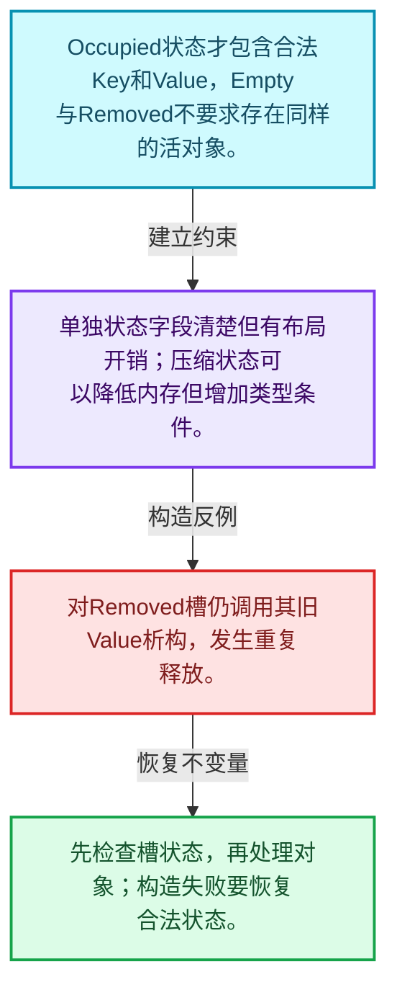
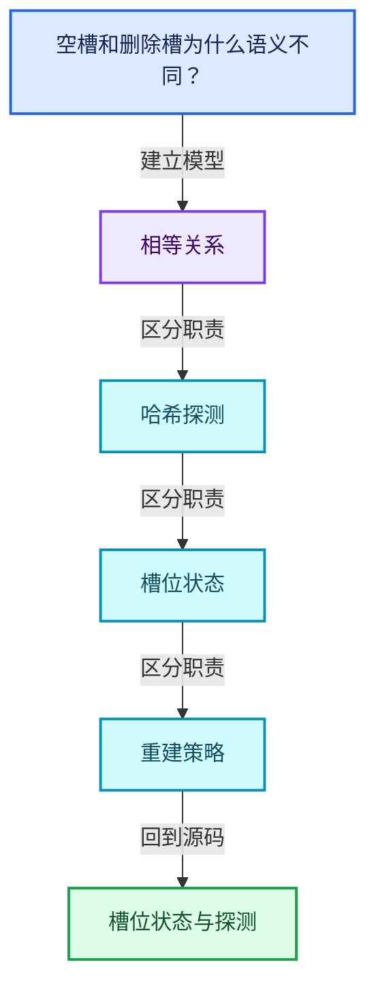
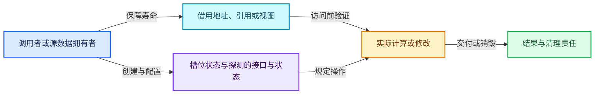
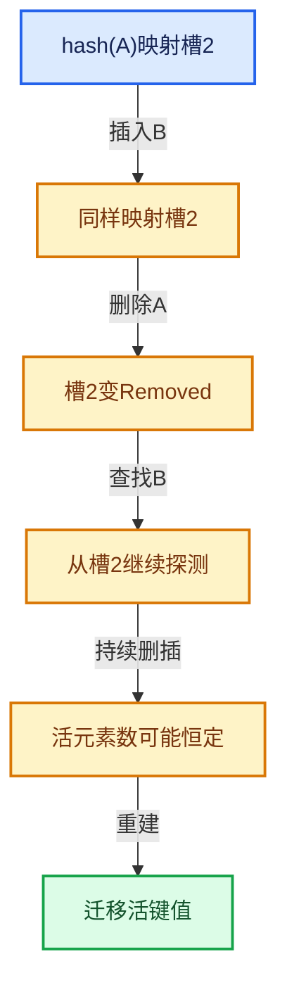

# 02-03 槽位状态与探测

[方向导航](README.md) · [总目录](../README.md) · [覆盖索引](../%E6%BA%90%E7%A0%81%E7%89%88%E6%9C%AC%E4%B8%8E%E8%A6%86%E7%9B%96%E7%B4%A2%E5%BC%95.md)

> 阅读顺序：问题与数据模型 → 语法与类型 → 源码逐行 → 调用线索 → 历史与取舍 → 推演和练习。

- 基准 HEAD：`cbda6b96c26c0dee3c3b5cbb93960c4ac06a6b30`。
- 记录日期：2026-10-14。
- 教学示例状态：正文中的推演不是本机性能实测；已运行练习见验收报告。

## 一、从问题到设计

空槽和删除槽为什么语义不同？

真正空槽能够终止某些查找链，删除槽不能破坏后续碰撞键的可达性。

本篇把语法、数据语义和系统取舍连接起来。相等与哈希是基础契约；探测、删除和增长共同决定复杂度。

### 本篇独立模型与设计推理

Occupied状态才包含合法Key和Value，Empty与Removed不要求存在同样的活对象。

设计取舍：单独状态字段清楚但有布局开销；压缩状态可以降低内存但增加类型条件。

最小反例：对Removed槽仍调用其旧Value析构，发生重复释放。

推导与处理：先检查槽状态，再处理对象；构造失败要恢复合法状态。



### 源码范围与相邻篇章

| 文件 | 本篇逐行范围 | 基准SHA-256 |
|---|---|---|
| [source/blender/blenlib/BLI_map_slots.hh](../../../../../source/blender/blenlib/BLI_map_slots.hh) | L1—L362 | `81247eedacf200481742a3e5041996e5f50abcb4f19d080e44a022424e9bec58` |
| [source/blender/blenlib/BLI_hash_tables.hh](../../../../../source/blender/blenlib/BLI_hash_tables.hh) | L1—L322 | `f4d3ffe6e9dcbccd4849bd5c44f2ee8dbd6d1836c59e601fa2b451033f6e388b` |

同一主讲文件可能分多篇覆盖；超出本篇范围的符号通过覆盖索引定位。空行与纯注释保留在源码摘录中，逐行表解释有效语句与语法边界；许可证头统一保留。

前篇：[Map总体布局](02-Map%E6%80%BB%E4%BD%93%E5%B8%83%E5%B1%80.md).

后篇：[Map查找与键访问](04-Map%E6%9F%A5%E6%89%BE%E4%B8%8E%E9%94%AE%E8%AE%BF%E9%97%AE.md).

## 二、类型、数据与阅读地图



这是概念依赖图，边表示阅读关系，不声称是运行时调用顺序。

### 直接编译依赖


箭头只表示头文件包含关系；完整调用线索见后面的符号定位表。

## 三、关键词、语法与类型角色

### 模板 template

模板把类型或常量作为生成实现的参数。读声明时先列出类型参数、非类型参数和默认值，再看使用者实际实例化了什么。模板声明本身不意味着每种T都支持其全部成员。

具体检查：把T替换为int、string、只能移动的类型，分别检查每个被调用操作是否成立。

### 依赖名称 typename

typename既可引入类型模板参数，也可告诉编译器某个依赖名称是类型。它不创建运行时对象；解析期确认语法类别与实例化期检查具体类型是不同阶段。

具体检查：区分typename T::value_type和T::size()，前者标记类型，后者是表达式。

### 约束 requires

requires表达式或requires子句限制模板参与重载的条件。它提供编译期可用性检查，不是运行时if，不能指望输入到达程序后再被这一机制验证。

具体检查：构造满足和不满足约束的两个类型，观察候选被排除而不是在函数内返回错误。

### 常量求值 constexpr

constexpr声明允许相应实体参与常量求值，但constexpr函数仍可以在运行时执行。是否常量求值由调用场景和表达式合法性共同决定。

具体检查：比较constexpr变量初始化和从运行时输入调用同一函数。

### 只读限定 const

const约束当前访问路径可做的修改。const指针、指向const的指针、const视图对象、const元素是不同位置的限定；其他别名可能仍可修改原对象。

具体检查：分别写T* const、const T*与const T* const，并画出不可修改的层次。

### 移动转换 std::move

std::move把表达式转换为可供移动重载选择的值类别，实际资源转移发生在被选中的构造或赋值中。对const对象move可能仍调用复制，对视图move也不会获得底层数据所有权。

具体检查：记录移动构造调用次数，不用变量名或std::move的出现次数替代测量。

### 完美转发 std::forward

std::forward在转发引用模板中恢复调用者原来的值类别。它依赖推导出的模板实参；无条件move会改变左值调用者的语义。

具体检查：对同一接口分别传入左值、临时对象和const左值，记录实际重载。

### 异常约定 noexcept

noexcept表达式可以依赖类型特征。违反不抛异常约定会终止程序；它不是自动捕获异常，也不是资源回滚代码。

具体检查：找出声明的条件与实际可能抛出的分配、构造操作是否一致。

### 异常边界 try与catch

try定义异常传播的局部边界。失败路径需要销毁已经成功构造的部分并释放相应存储；未构造的对象不能被析构。

具体检查：在第k次构造失败，列出已经存在的对象集合与待释放缓冲。

### 显式静态转换 static_cast

static_cast表达编译期允许的转换，不会自动验证运行时真实类型、指针寿命或索引边界。由void指针恢复T指针时，调用者仍须保证实际存储中确有合法T对象。

具体检查：标出转换前后的类型以及正确性依据来自哪里。

### 构造与new表达式

普通new可能分配并构造；placement new在给定地址构造，存储由其他机制提供。失败回滚应区分两类责任。

具体检查：追踪地址来自哪里、构造何时成功、由谁析构、由谁释放。

### 内部断言 assert

断言表达开发者预期成立的内部契约，发布构建可能关闭。它不能替代对不可信输入的完整错误处理，也不保证后续操作被运行时保护。

具体检查：对每条断言构造违反条件的输入，区分调用者错误与应向用户报告的错误。

### 编译期分支 if constexpr

条件在实例化时决定被保留的分支，这常用于不同类型的合法操作选择。它与运行时if有不同的实例化检查规则。

具体检查：找出每个分支依赖哪些类型特征，再使用满足与不满足条件的类型。

### 独占拥有 unique_ptr

unique_ptr通过移动转移拥有关系，默认删除策略必须与资源来源匹配。get返回借用指针，release交出责任而不销毁。

具体检查：区分move、get、release和reset后谁负责销毁。

### 共享拥有 shared_ptr

shared_ptr让控制块跟踪共享寿命，不自动使被指向对象的读写线程安全；循环拥有可能阻止销毁。

具体检查：画出强引用环并考虑是否应改变所有权方向或引入弱引用。

### 类型别名 using

类型别名为已有类型建立名字，不创建运行期对象。它常把模板内部使用的类型统一暴露给泛型调用者。

具体检查：展开别名直到基础类型，区分类型别名和变量声明。

### 枚举与状态模型 enum

枚举把有限状态命名；enum class避免许多隐式整数转换。状态机正确性还依赖允许的转移，不能只看有哪些枚举项。

具体检查：列出每个状态的进入条件和离开条件，检查终止状态是否仍可能被调度。

## 四、真实源码与逐行讲解

源码块保持原行内容，原始行号由小节标题及逐行表给出。表中的调用定位是静态阅读辅助；重载、模板实例化、宏展开和虚调用需结合完整声明，不能仅凭词法出现证明动态调用。

### BLI_map_slots.hh：L1—L49

<!-- source:source/blender/blenlib/BLI_map_slots.hh:1:49 -->

```cpp
/* SPDX-FileCopyrightText: 2023 Blender Authors
 *
 * SPDX-License-Identifier: GPL-2.0-or-later */

#pragma once

/** \file
 * \ingroup bli
 *
 * This file contains slot types that are supposed to be used with Map.
 *
 * Every slot type has to be able to hold a value of type Key, a value of type Value and state
 * information. A map slot has three possible states: empty, occupied and removed.
 *
 * When a slot is occupied, it stores instances of type Key and Value.
 *
 * A map slot type has to implement a couple of methods that are explained in SimpleMapSlot.
 * A slot type is assumed to be trivially destructible, when it is not in occupied state. So the
 * destructor might not be called in that case.
 *
 * Possible Improvements:
 * - Implement slot type that stores the hash.
 */

#include "BLI_hash_tables.hh"
#include "BLI_memory_utils.hh"

namespace blender {

template<typename Src1, typename Src2, typename Dst1, typename Dst2>
void initialize_pointer_pair(Src1 &&src1, Src2 &&src2, Dst1 *dst1, Dst2 *dst2)
{
  new ((void *)dst1) Dst1(std::forward<Src1>(src1));
  try {
    new ((void *)dst2) Dst2(std::forward<Src2>(src2));
  }
  catch (...) {
    dst1->~Dst1();
    throw;
  }
}

/**
 * The simplest possible map slot. It stores the slot state and the optional key and value
 * instances in separate variables. Depending on the alignment requirement of the key and value,
 * many bytes might be wasted.
 */
template<typename Key, typename Value> class SimpleMapSlot {
 private:
```

| 原始行 | 语义、约束与检查 |
|---|---|
| L5 | 防止同一头文件在一个翻译单元中重复展开；不控制多个源文件之间的链接或对象寿命。 |
| L25 | 引入编译依赖 "BLI_hash_tables.hh"；这是声明可见性关系，不表示运行时一定调用该文件的所有接口。 |
| L26 | 引入编译依赖 "BLI_memory_utils.hh"；这是声明可见性关系，不表示运行时一定调用该文件的所有接口。 |
| L28 | 把后续声明放入 blender 命名空间，影响名称查找和符号归属，不创建运行时对象。 |
| L30 | 声明模板参数 `template<typename Src1, typename Src2, typename Dst1, typename Dst2>`。类型参数决定生成操作的类型，非类型参数可决定内嵌容量或编译期分支。 |
| L31 | 出现调用或函数声明 `initialize_pointer_pair`，对应表达式为 `void initialize_pointer_pair(Src1 &&src1, Src2 &&src2, Dst1 *dst1, Dst2 *dst2)`。参数求值、返回类型与重载需结合前后完整语句；静态文本引用不能证明动态目标。 |
| L32 | 连接上一行的声明或控制结构与其语句块；后续行在这个作用域中执行或声明。 |
| L33 | 出现调用或函数声明 `new`，对应表达式为 `new ((void *)dst1) Dst1(std::forward<Src1>(src1));`。参数求值、返回类型与重载需结合前后完整语句；静态文本引用不能证明动态目标。 |
| L34 | 开始可能抛异常的操作区间；下面catch负责局部回滚，需精确区分已经构造和尚未构造对象。 |
| L35 | 出现调用或函数声明 `new`，对应表达式为 `new ((void *)dst2) Dst2(std::forward<Src2>(src2));`。参数求值、返回类型与重载需结合前后完整语句；静态文本引用不能证明动态目标。 |
| L36 | 结束当前语法单元。局部自动对象在离开其作用域时按规则销毁；这不等于所有被引用的外部数据也被释放。 |
| L37 | 进入异常清理路径；随后应释放本路径新取得的资源，同时遵守源对象已经发生的状态变化。 |
| L38 | 涉及析构接口或显式析构：`dst1->~Dst1();`。检查目标对象已成功构造，且资源不会在另一条清理路径再次销毁。 |
| L39 | 继续传播异常或抛出新异常；在执行前必须完成本层负责的资源清理。 |
| L40 | 结束当前语法单元。局部自动对象在离开其作用域时按规则销毁；这不等于所有被引用的外部数据也被释放。 |
| L41 | 结束当前语法单元。局部自动对象在离开其作用域时按规则销毁；这不等于所有被引用的外部数据也被释放。 |
| L48 | 声明模板参数 `template<typename Key, typename Value> class SimpleMapSlot {`。类型参数决定生成操作的类型，非类型参数可决定内嵌容量或编译期分支。 |
| L49 | 切换成员访问权限为 private；它是编译期接口边界，不是线程同步或内存保护。 |

### BLI_map_slots.hh：L50—L93

<!-- source:source/blender/blenlib/BLI_map_slots.hh:50:93 -->

```cpp
  enum State : uint8_t {
    Empty = 0,
    Occupied = 1,
    Removed = 2,
  };

  State state_;
  TypedBuffer<Key> key_buffer_;
  TypedBuffer<Value> value_buffer_;

 public:
  /**
   * After the default constructor has run, the slot has to be in the empty state.
   */
  SimpleMapSlot()
  {
    state_ = Empty;
  }

  /**
   * The destructor also has to destruct the key and value, if the slot is currently occupied.
   */
  ~SimpleMapSlot()
  {
    if (state_ == Occupied) {
      key_buffer_.ref().~Key();
      value_buffer_.ref().~Value();
    }
  }

  /**
   * The copy constructor has to copy the state. If the other slot was occupied, a copy of the key
   * and value have to be made as well.
   */
  SimpleMapSlot(const SimpleMapSlot &other)
  {
    state_ = other.state_;
    if (other.state_ == Occupied) {
      initialize_pointer_pair(other.key_buffer_.ref(),
                              other.value_buffer_.ref(),
                              key_buffer_.ptr(),
                              value_buffer_.ptr());
    }
  }
```

本段语义重点：

- `state_`：当前对象记录的状态，后续读取依赖状态不变量。

| 原始行 | 语义、约束与检查 |
|---|---|
| L50 | 声明或定义类型 `enum State : uint8_t`。结合继承、访问权限和成员布局确认接口与拥有关系；前向声明本身没有完整对象布局。 |
| L51 | 把右侧 `0,` 用于初始化或更新左侧 `Empty`。声明初始化与已有对象赋值应按上下文区分；有资源的类型会调用相应特殊成员。 |
| L52 | 把右侧 `1,` 用于初始化或更新左侧 `Occupied`。声明初始化与已有对象赋值应按上下文区分；有资源的类型会调用相应特殊成员。 |
| L53 | 把右侧 `2,` 用于初始化或更新左侧 `Removed`。声明初始化与已有对象赋值应按上下文区分；有资源的类型会调用相应特殊成员。 |
| L54 | 结束当前语法单元。局部自动对象在离开其作用域时按规则销毁；这不等于所有被引用的外部数据也被释放。 |
| L56 | 本行涉及 `state_`：当前对象记录的状态，后续读取依赖状态不变量。按此语义解读 `State state_`，不要把地址、数量或状态混用。 |
| L57 | 声明成员、局部对象或完成语句 `TypedBuffer<Key> key_buffer_`。若为指针或引用，它本身不说明拥有；若为值对象，其构造析构由所在作用域或外层对象管理。 |
| L58 | 声明成员、局部对象或完成语句 `TypedBuffer<Value> value_buffer_`。若为指针或引用，它本身不说明拥有；若为值对象，其构造析构由所在作用域或外层对象管理。 |
| L60 | 切换成员访问权限为 public；它是编译期接口边界，不是线程同步或内存保护。 |
| L64 | 出现调用或函数声明 `SimpleMapSlot`，对应表达式为 `SimpleMapSlot()`。参数求值、返回类型与重载需结合前后完整语句；静态文本引用不能证明动态目标。 |
| L65 | 连接上一行的声明或控制结构与其语句块；后续行在这个作用域中执行或声明。 |
| L66 | 建立或更新 `state_`：当前对象记录的状态，后续读取依赖状态不变量。本行的具体值关系为 `state_ = Empty`；对照更新前后相应范围或状态是否一致。 |
| L67 | 结束当前语法单元。局部自动对象在离开其作用域时按规则销毁；这不等于所有被引用的外部数据也被释放。 |
| L72 | 涉及析构接口或显式析构：`~SimpleMapSlot()`。检查目标对象已成功构造，且资源不会在另一条清理路径再次销毁。 |
| L73 | 连接上一行的声明或控制结构与其语句块；后续行在这个作用域中执行或声明。 |
| L74 | 判断 `state_ == Occupied`，成立时进入本分支，否则继续后续路径。 |
| L75 | 涉及析构接口或显式析构：`key_buffer_.ref().~Key();`。检查目标对象已成功构造，且资源不会在另一条清理路径再次销毁。 |
| L76 | 涉及析构接口或显式析构：`value_buffer_.ref().~Value();`。检查目标对象已成功构造，且资源不会在另一条清理路径再次销毁。 |
| L77 | 结束当前语法单元。局部自动对象在离开其作用域时按规则销毁；这不等于所有被引用的外部数据也被释放。 |
| L78 | 结束当前语法单元。局部自动对象在离开其作用域时按规则销毁；这不等于所有被引用的外部数据也被释放。 |
| L84 | 出现调用或函数声明 `SimpleMapSlot`，对应表达式为 `SimpleMapSlot(const SimpleMapSlot &other)`。参数求值、返回类型与重载需结合前后完整语句；静态文本引用不能证明动态目标。 |
| L85 | 连接上一行的声明或控制结构与其语句块；后续行在这个作用域中执行或声明。 |
| L86 | 建立或更新 `state_`：当前对象记录的状态，后续读取依赖状态不变量。本行的具体值关系为 `state_ = other.state_`；对照更新前后相应范围或状态是否一致。 |
| L87 | 判断 `other.state_ == Occupied`，成立时进入本分支，否则继续后续路径。 |
| L88 | 出现调用或函数声明 `initialize_pointer_pair`，对应表达式为 `initialize_pointer_pair(other.key_buffer_.ref(),`。参数求值、返回类型与重载需结合前后完整语句；静态文本引用不能证明动态目标。 |
| L89 | 出现调用或函数声明 `ref`，对应表达式为 `other.value_buffer_.ref(),`。参数求值、返回类型与重载需结合前后完整语句；静态文本引用不能证明动态目标。 |
| L90 | 出现调用或函数声明 `ptr`，对应表达式为 `key_buffer_.ptr(),`。参数求值、返回类型与重载需结合前后完整语句；静态文本引用不能证明动态目标。 |
| L91 | 出现调用或函数声明 `ptr`，对应表达式为 `value_buffer_.ptr());`。参数求值、返回类型与重载需结合前后完整语句；静态文本引用不能证明动态目标。 |
| L92 | 结束当前语法单元。局部自动对象在离开其作用域时按规则销毁；这不等于所有被引用的外部数据也被释放。 |
| L93 | 结束当前语法单元。局部自动对象在离开其作用域时按规则销毁；这不等于所有被引用的外部数据也被释放。 |

### BLI_map_slots.hh：L94—L142

<!-- source:source/blender/blenlib/BLI_map_slots.hh:94:142 -->

```cpp

  /**
   * The move constructor has to copy the state. If the other slot was occupied, the key and value
   * from the other have to moved as well. The other slot stays in the state it was in before. Its
   * optionally stored key and value remain in a moved-from state.
   */
  SimpleMapSlot(SimpleMapSlot &&other) noexcept(std::is_nothrow_move_constructible_v<Key> &&
                                                std::is_nothrow_move_constructible_v<Value>)
  {
    state_ = other.state_;
    if (other.state_ == Occupied) {
      initialize_pointer_pair(std::move(other.key_buffer_.ref()),
                              std::move(other.value_buffer_.ref()),
                              key_buffer_.ptr(),
                              value_buffer_.ptr());
    }
  }

  /**
   * Returns a non-const pointer to the position where the key is stored.
   */
  Key *key()
  {
    return key_buffer_;
  }

  /**
   * Returns a const pointer to the position where the key is stored.
   */
  const Key *key() const
  {
    return key_buffer_;
  }

  /**
   * Returns a non-const pointer to the position where the value is stored.
   */
  Value *value()
  {
    return value_buffer_;
  }

  /**
   * Returns a const pointer to the position where the value is stored.
   */
  const Value *value() const
  {
    return value_buffer_;
  }
```

本段语义重点：

- `state_`：当前对象记录的状态，后续读取依赖状态不变量。

| 原始行 | 语义、约束与检查 |
|---|---|
| L100 | 出现调用或函数声明 `SimpleMapSlot`，对应表达式为 `SimpleMapSlot(SimpleMapSlot &&other) noexcept(std::is_nothrow_move_constructible_v<Key> &&`。参数求值、返回类型与重载需结合前后完整语句；静态文本引用不能证明动态目标。 |
| L101 | 本行是连续声明或表达式的一部分：`std::is_nothrow_move_constructible_v<Value>)`。与本段前后行合读；逗号、括号和限定符决定它属于参数、初始化列表还是实际计算。 |
| L102 | 连接上一行的声明或控制结构与其语句块；后续行在这个作用域中执行或声明。 |
| L103 | 建立或更新 `state_`：当前对象记录的状态，后续读取依赖状态不变量。本行的具体值关系为 `state_ = other.state_`；对照更新前后相应范围或状态是否一致。 |
| L104 | 判断 `other.state_ == Occupied`，成立时进入本分支，否则继续后续路径。 |
| L105 | 出现调用或函数声明 `initialize_pointer_pair`，对应表达式为 `initialize_pointer_pair(std::move(other.key_buffer_.ref()),`。参数求值、返回类型与重载需结合前后完整语句；静态文本引用不能证明动态目标。 |
| L106 | 出现调用或函数声明 `std::move`，对应表达式为 `std::move(other.value_buffer_.ref()),`。参数求值、返回类型与重载需结合前后完整语句；静态文本引用不能证明动态目标。 |
| L107 | 出现调用或函数声明 `ptr`，对应表达式为 `key_buffer_.ptr(),`。参数求值、返回类型与重载需结合前后完整语句；静态文本引用不能证明动态目标。 |
| L108 | 出现调用或函数声明 `ptr`，对应表达式为 `value_buffer_.ptr());`。参数求值、返回类型与重载需结合前后完整语句；静态文本引用不能证明动态目标。 |
| L109 | 结束当前语法单元。局部自动对象在离开其作用域时按规则销毁；这不等于所有被引用的外部数据也被释放。 |
| L110 | 结束当前语法单元。局部自动对象在离开其作用域时按规则销毁；这不等于所有被引用的外部数据也被释放。 |
| L115 | 出现调用或函数声明 `key`，对应表达式为 `Key *key()`。参数求值、返回类型与重载需结合前后完整语句；静态文本引用不能证明动态目标。 |
| L116 | 连接上一行的声明或控制结构与其语句块；后续行在这个作用域中执行或声明。 |
| L117 | 返回表达式 `key_buffer_`。 |
| L118 | 结束当前语法单元。局部自动对象在离开其作用域时按规则销毁；这不等于所有被引用的外部数据也被释放。 |
| L123 | 出现调用或函数声明 `key`，对应表达式为 `const Key *key() const`。参数求值、返回类型与重载需结合前后完整语句；静态文本引用不能证明动态目标。 |
| L124 | 连接上一行的声明或控制结构与其语句块；后续行在这个作用域中执行或声明。 |
| L125 | 返回表达式 `key_buffer_`。 |
| L126 | 结束当前语法单元。局部自动对象在离开其作用域时按规则销毁；这不等于所有被引用的外部数据也被释放。 |
| L131 | 出现调用或函数声明 `value`，对应表达式为 `Value *value()`。参数求值、返回类型与重载需结合前后完整语句；静态文本引用不能证明动态目标。 |
| L132 | 连接上一行的声明或控制结构与其语句块；后续行在这个作用域中执行或声明。 |
| L133 | 返回表达式 `value_buffer_`。 |
| L134 | 结束当前语法单元。局部自动对象在离开其作用域时按规则销毁；这不等于所有被引用的外部数据也被释放。 |
| L139 | 出现调用或函数声明 `value`，对应表达式为 `const Value *value() const`。参数求值、返回类型与重载需结合前后完整语句；静态文本引用不能证明动态目标。 |
| L140 | 连接上一行的声明或控制结构与其语句块；后续行在这个作用域中执行或声明。 |
| L141 | 返回表达式 `value_buffer_`。 |
| L142 | 结束当前语法单元。局部自动对象在离开其作用域时按规则销毁；这不等于所有被引用的外部数据也被释放。 |

### BLI_map_slots.hh：L143—L194

<!-- source:source/blender/blenlib/BLI_map_slots.hh:143:194 -->

```cpp

  /**
   * Returns true if the slot currently contains a key and a value.
   */
  bool is_occupied() const
  {
    return state_ == Occupied;
  }

  /**
   * Returns true if the slot is empty, i.e. it does not contain a key and is not in removed state.
   */
  bool is_empty() const
  {
    return state_ == Empty;
  }

  /**
   * Returns the hash of the currently stored key. In this simple map slot implementation, we just
   * computed the hash here. Other implementations might store the hash in the slot instead.
   */
  template<typename Hash> uint64_t get_hash(const Hash &hash)
  {
    BLI_assert(this->is_occupied());
    return hash(*key_buffer_);
  }

  /**
   * Returns true, when this slot is occupied and contains a key that compares equal to the given
   * key. The hash can be used by other slot implementations to determine inequality faster.
   */
  template<typename ForwardKey, typename IsEqual>
  bool contains(const ForwardKey &key, const IsEqual &is_equal, uint64_t /*hash*/) const
  {
    if (state_ == Occupied) {
      return is_equal(key, *key_buffer_);
    }
    return false;
  }

  /**
   * Change the state of this slot from empty/removed to occupied. The key/value has to be
   * constructed by calling the constructor with the given key/value as parameter.
   */
  template<typename ForwardKey, typename... ForwardValue>
  void occupy(ForwardKey &&key, uint64_t hash, ForwardValue &&...value)
  {
    BLI_assert(!this->is_occupied());
    new (&value_buffer_) Value(std::forward<ForwardValue>(value)...);
    this->occupy_no_value(std::forward<ForwardKey>(key), hash);
    state_ = Occupied;
  }
```

本段语义重点：

- `state_`：当前对象记录的状态，后续读取依赖状态不变量。

| 原始行 | 语义、约束与检查 |
|---|---|
| L147 | 出现调用或函数声明 `is_occupied`，对应表达式为 `bool is_occupied() const`。参数求值、返回类型与重载需结合前后完整语句；静态文本引用不能证明动态目标。 |
| L148 | 连接上一行的声明或控制结构与其语句块；后续行在这个作用域中执行或声明。 |
| L149 | 返回表达式 `state_ == Occupied`。 |
| L150 | 结束当前语法单元。局部自动对象在离开其作用域时按规则销毁；这不等于所有被引用的外部数据也被释放。 |
| L155 | 出现调用或函数声明 `is_empty`，对应表达式为 `bool is_empty() const`。参数求值、返回类型与重载需结合前后完整语句；静态文本引用不能证明动态目标。 |
| L156 | 连接上一行的声明或控制结构与其语句块；后续行在这个作用域中执行或声明。 |
| L157 | 返回表达式 `state_ == Empty`。 |
| L158 | 结束当前语法单元。局部自动对象在离开其作用域时按规则销毁；这不等于所有被引用的外部数据也被释放。 |
| L164 | 声明模板参数 `template<typename Hash> uint64_t get_hash(const Hash &hash)`。类型参数决定生成操作的类型，非类型参数可决定内嵌容量或编译期分支。 |
| L165 | 连接上一行的声明或控制结构与其语句块；后续行在这个作用域中执行或声明。 |
| L166 | 断言约束 `BLI_assert(this->is_occupied());`。条件是后续访问的内部前置条件；发布构建可能不执行，不能把断言当作输入修复。 |
| L167 | 返回表达式 `hash(*key_buffer_)`。 |
| L168 | 结束当前语法单元。局部自动对象在离开其作用域时按规则销毁；这不等于所有被引用的外部数据也被释放。 |
| L174 | 声明模板参数 `template<typename ForwardKey, typename IsEqual>`。类型参数决定生成操作的类型，非类型参数可决定内嵌容量或编译期分支。 |
| L175 | 出现调用或函数声明 `contains`，对应表达式为 `bool contains(const ForwardKey &key, const IsEqual &is_equal, uint64_t ) const`。参数求值、返回类型与重载需结合前后完整语句；静态文本引用不能证明动态目标。 |
| L176 | 连接上一行的声明或控制结构与其语句块；后续行在这个作用域中执行或声明。 |
| L177 | 判断 `state_ == Occupied`，成立时进入本分支，否则继续后续路径。 |
| L178 | 返回表达式 `is_equal(key, *key_buffer_)`。 |
| L179 | 结束当前语法单元。局部自动对象在离开其作用域时按规则销毁；这不等于所有被引用的外部数据也被释放。 |
| L180 | 返回表达式 `false`。这是本路径的布尔结果，具体成功、存在或状态含义由函数接口规定。 |
| L181 | 结束当前语法单元。局部自动对象在离开其作用域时按规则销毁；这不等于所有被引用的外部数据也被释放。 |
| L187 | 声明模板参数 `template<typename ForwardKey, typename... ForwardValue>`。类型参数决定生成操作的类型，非类型参数可决定内嵌容量或编译期分支。 |
| L188 | 出现调用或函数声明 `occupy`，对应表达式为 `void occupy(ForwardKey &&key, uint64_t hash, ForwardValue &&...value)`。参数求值、返回类型与重载需结合前后完整语句；静态文本引用不能证明动态目标。 |
| L189 | 连接上一行的声明或控制结构与其语句块；后续行在这个作用域中执行或声明。 |
| L190 | 断言约束 `BLI_assert(!this->is_occupied());`。条件是后续访问的内部前置条件；发布构建可能不执行，不能把断言当作输入修复。 |
| L191 | 出现调用或函数声明 `new`，对应表达式为 `new (&value_buffer_) Value(std::forward<ForwardValue>(value)...);`。参数求值、返回类型与重载需结合前后完整语句；静态文本引用不能证明动态目标。 |
| L192 | 出现调用或函数声明 `occupy_no_value`，对应表达式为 `this->occupy_no_value(std::forward<ForwardKey>(key), hash);`。参数求值、返回类型与重载需结合前后完整语句；静态文本引用不能证明动态目标。 |
| L193 | 建立或更新 `state_`：当前对象记录的状态，后续读取依赖状态不变量。本行的具体值关系为 `state_ = Occupied`；对照更新前后相应范围或状态是否一致。 |
| L194 | 结束当前语法单元。局部自动对象在离开其作用域时按规则销毁；这不等于所有被引用的外部数据也被释放。 |

### BLI_map_slots.hh：L195—L241

<!-- source:source/blender/blenlib/BLI_map_slots.hh:195:241 -->

```cpp

  /**
   * Change the state of this slot from empty/removed to occupied. The value is assumed to be
   * constructed already.
   */
  template<typename ForwardKey> void occupy_no_value(ForwardKey &&key, uint64_t /*hash*/)
  {
    BLI_assert(!this->is_occupied());
    try {
      new (&key_buffer_) Key(std::forward<ForwardKey>(key));
    }
    catch (...) {
      /* The value is assumed to be constructed already, so it has to be destructed as well. */
      value_buffer_.ref().~Value();
      throw;
    }
    state_ = Occupied;
  }

  /**
   * Change the state of this slot from occupied to removed. The key and value have to be
   * destructed as well.
   */
  void remove()
  {
    BLI_assert(this->is_occupied());
    key_buffer_.ref().~Key();
    value_buffer_.ref().~Value();
    state_ = Removed;
  }
};

/**
 * An IntrusiveMapSlot uses two special values of the key to indicate whether the slot is empty
 * or removed. This saves some memory in all cases and is more efficient in many cases. The
 * KeyInfo type indicates which specific values are used. An example for a KeyInfo
 * implementation is PointerKeyInfo.
 *
 * The special key values are expected to be trivially destructible.
 */
template<typename Key, typename Value, typename KeyInfo> class IntrusiveMapSlot {
 private:
  Key key_ = KeyInfo::get_empty();
  TypedBuffer<Value> value_buffer_;

 public:
  IntrusiveMapSlot() = default;
```

本段语义重点：

- `state_`：当前对象记录的状态，后续读取依赖状态不变量。

| 原始行 | 语义、约束与检查 |
|---|---|
| L200 | 声明模板参数 `template<typename ForwardKey> void occupy_no_value(ForwardKey &&key, uint64_t )`。类型参数决定生成操作的类型，非类型参数可决定内嵌容量或编译期分支。 |
| L201 | 连接上一行的声明或控制结构与其语句块；后续行在这个作用域中执行或声明。 |
| L202 | 断言约束 `BLI_assert(!this->is_occupied());`。条件是后续访问的内部前置条件；发布构建可能不执行，不能把断言当作输入修复。 |
| L203 | 开始可能抛异常的操作区间；下面catch负责局部回滚，需精确区分已经构造和尚未构造对象。 |
| L204 | 出现调用或函数声明 `new`，对应表达式为 `new (&key_buffer_) Key(std::forward<ForwardKey>(key));`。参数求值、返回类型与重载需结合前后完整语句；静态文本引用不能证明动态目标。 |
| L205 | 结束当前语法单元。局部自动对象在离开其作用域时按规则销毁；这不等于所有被引用的外部数据也被释放。 |
| L206 | 进入异常清理路径；随后应释放本路径新取得的资源，同时遵守源对象已经发生的状态变化。 |
| L208 | 涉及析构接口或显式析构：`value_buffer_.ref().~Value();`。检查目标对象已成功构造，且资源不会在另一条清理路径再次销毁。 |
| L209 | 继续传播异常或抛出新异常；在执行前必须完成本层负责的资源清理。 |
| L210 | 结束当前语法单元。局部自动对象在离开其作用域时按规则销毁；这不等于所有被引用的外部数据也被释放。 |
| L211 | 建立或更新 `state_`：当前对象记录的状态，后续读取依赖状态不变量。本行的具体值关系为 `state_ = Occupied`；对照更新前后相应范围或状态是否一致。 |
| L212 | 结束当前语法单元。局部自动对象在离开其作用域时按规则销毁；这不等于所有被引用的外部数据也被释放。 |
| L218 | 出现调用或函数声明 `remove`，对应表达式为 `void remove()`。参数求值、返回类型与重载需结合前后完整语句；静态文本引用不能证明动态目标。 |
| L219 | 连接上一行的声明或控制结构与其语句块；后续行在这个作用域中执行或声明。 |
| L220 | 断言约束 `BLI_assert(this->is_occupied());`。条件是后续访问的内部前置条件；发布构建可能不执行，不能把断言当作输入修复。 |
| L221 | 涉及析构接口或显式析构：`key_buffer_.ref().~Key();`。检查目标对象已成功构造，且资源不会在另一条清理路径再次销毁。 |
| L222 | 涉及析构接口或显式析构：`value_buffer_.ref().~Value();`。检查目标对象已成功构造，且资源不会在另一条清理路径再次销毁。 |
| L223 | 建立或更新 `state_`：当前对象记录的状态，后续读取依赖状态不变量。本行的具体值关系为 `state_ = Removed`；对照更新前后相应范围或状态是否一致。 |
| L224 | 结束当前语法单元。局部自动对象在离开其作用域时按规则销毁；这不等于所有被引用的外部数据也被释放。 |
| L225 | 结束当前语法单元。局部自动对象在离开其作用域时按规则销毁；这不等于所有被引用的外部数据也被释放。 |
| L235 | 声明模板参数 `template<typename Key, typename Value, typename KeyInfo> class IntrusiveMapSlot {`。类型参数决定生成操作的类型，非类型参数可决定内嵌容量或编译期分支。 |
| L236 | 切换成员访问权限为 private；它是编译期接口边界，不是线程同步或内存保护。 |
| L237 | 把右侧 `KeyInfo::get_empty()` 用于初始化或更新左侧 `Key key_`。声明初始化与已有对象赋值应按上下文区分；有资源的类型会调用相应特殊成员。 |
| L238 | 声明成员、局部对象或完成语句 `TypedBuffer<Value> value_buffer_`。若为指针或引用，它本身不说明拥有；若为值对象，其构造析构由所在作用域或外层对象管理。 |
| L240 | 切换成员访问权限为 public；它是编译期接口边界，不是线程同步或内存保护。 |
| L241 | 显式采用编译器生成的特殊成员行为：`IntrusiveMapSlot() = default;`。成员和基类的性质决定该操作是否可用、是否被删除及异常约定，不表示运行时给对象赋值为default。 |

### BLI_map_slots.hh：L242—L287

<!-- source:source/blender/blenlib/BLI_map_slots.hh:242:287 -->

```cpp

  ~IntrusiveMapSlot()
  {
    if (KeyInfo::is_not_empty_or_removed(key_)) {
      value_buffer_.ref().~Value();
    }
  }

  IntrusiveMapSlot(const IntrusiveMapSlot &other) : key_(other.key_)
  {
    if (KeyInfo::is_not_empty_or_removed(key_)) {
      new (&value_buffer_) Value(*other.value_buffer_);
    }
  }

  IntrusiveMapSlot(IntrusiveMapSlot &&other) noexcept : key_(other.key_)
  {
    if (KeyInfo::is_not_empty_or_removed(key_)) {
      new (&value_buffer_) Value(std::move(*other.value_buffer_));
    }
  }

  Key *key()
  {
    return &key_;
  }

  const Key *key() const
  {
    return &key_;
  }

  Value *value()
  {
    return value_buffer_;
  }

  const Value *value() const
  {
    return value_buffer_;
  }

  bool is_occupied() const
  {
    return KeyInfo::is_not_empty_or_removed(key_);
  }
```

本段语义重点：

- 分支证据 `KeyInfo::is_not_empty_or_removed(key_))`：分别推演条件成立与不成立，核对相同出口处的状态。
- 分支证据 `KeyInfo::is_not_empty_or_removed(key_))`：分别推演条件成立与不成立，核对相同出口处的状态。

| 原始行 | 语义、约束与检查 |
|---|---|
| L243 | 涉及析构接口或显式析构：`~IntrusiveMapSlot()`。检查目标对象已成功构造，且资源不会在另一条清理路径再次销毁。 |
| L244 | 连接上一行的声明或控制结构与其语句块；后续行在这个作用域中执行或声明。 |
| L245 | 判断 `KeyInfo::is_not_empty_or_removed(key_)`，成立时进入本分支，否则继续后续路径。 |
| L246 | 涉及析构接口或显式析构：`value_buffer_.ref().~Value();`。检查目标对象已成功构造，且资源不会在另一条清理路径再次销毁。 |
| L247 | 结束当前语法单元。局部自动对象在离开其作用域时按规则销毁；这不等于所有被引用的外部数据也被释放。 |
| L248 | 结束当前语法单元。局部自动对象在离开其作用域时按规则销毁；这不等于所有被引用的外部数据也被释放。 |
| L250 | 出现调用或函数声明 `IntrusiveMapSlot`，对应表达式为 `IntrusiveMapSlot(const IntrusiveMapSlot &other) : key_(other.key_)`。参数求值、返回类型与重载需结合前后完整语句；静态文本引用不能证明动态目标。 |
| L251 | 连接上一行的声明或控制结构与其语句块；后续行在这个作用域中执行或声明。 |
| L252 | 判断 `KeyInfo::is_not_empty_or_removed(key_)`，成立时进入本分支，否则继续后续路径。 |
| L253 | 出现调用或函数声明 `new`，对应表达式为 `new (&value_buffer_) Value(*other.value_buffer_);`。参数求值、返回类型与重载需结合前后完整语句；静态文本引用不能证明动态目标。 |
| L254 | 结束当前语法单元。局部自动对象在离开其作用域时按规则销毁；这不等于所有被引用的外部数据也被释放。 |
| L255 | 结束当前语法单元。局部自动对象在离开其作用域时按规则销毁；这不等于所有被引用的外部数据也被释放。 |
| L257 | 出现调用或函数声明 `IntrusiveMapSlot`，对应表达式为 `IntrusiveMapSlot(IntrusiveMapSlot &&other) noexcept : key_(other.key_)`。参数求值、返回类型与重载需结合前后完整语句；静态文本引用不能证明动态目标。 |
| L258 | 连接上一行的声明或控制结构与其语句块；后续行在这个作用域中执行或声明。 |
| L259 | 判断 `KeyInfo::is_not_empty_or_removed(key_)`，成立时进入本分支，否则继续后续路径。 |
| L260 | 出现调用或函数声明 `new`，对应表达式为 `new (&value_buffer_) Value(std::move(*other.value_buffer_));`。参数求值、返回类型与重载需结合前后完整语句；静态文本引用不能证明动态目标。 |
| L261 | 结束当前语法单元。局部自动对象在离开其作用域时按规则销毁；这不等于所有被引用的外部数据也被释放。 |
| L262 | 结束当前语法单元。局部自动对象在离开其作用域时按规则销毁；这不等于所有被引用的外部数据也被释放。 |
| L264 | 出现调用或函数声明 `key`，对应表达式为 `Key *key()`。参数求值、返回类型与重载需结合前后完整语句；静态文本引用不能证明动态目标。 |
| L265 | 连接上一行的声明或控制结构与其语句块；后续行在这个作用域中执行或声明。 |
| L266 | 返回表达式 `&key_`。 |
| L267 | 结束当前语法单元。局部自动对象在离开其作用域时按规则销毁；这不等于所有被引用的外部数据也被释放。 |
| L269 | 出现调用或函数声明 `key`，对应表达式为 `const Key *key() const`。参数求值、返回类型与重载需结合前后完整语句；静态文本引用不能证明动态目标。 |
| L270 | 连接上一行的声明或控制结构与其语句块；后续行在这个作用域中执行或声明。 |
| L271 | 返回表达式 `&key_`。 |
| L272 | 结束当前语法单元。局部自动对象在离开其作用域时按规则销毁；这不等于所有被引用的外部数据也被释放。 |
| L274 | 出现调用或函数声明 `value`，对应表达式为 `Value *value()`。参数求值、返回类型与重载需结合前后完整语句；静态文本引用不能证明动态目标。 |
| L275 | 连接上一行的声明或控制结构与其语句块；后续行在这个作用域中执行或声明。 |
| L276 | 返回表达式 `value_buffer_`。 |
| L277 | 结束当前语法单元。局部自动对象在离开其作用域时按规则销毁；这不等于所有被引用的外部数据也被释放。 |
| L279 | 出现调用或函数声明 `value`，对应表达式为 `const Value *value() const`。参数求值、返回类型与重载需结合前后完整语句；静态文本引用不能证明动态目标。 |
| L280 | 连接上一行的声明或控制结构与其语句块；后续行在这个作用域中执行或声明。 |
| L281 | 返回表达式 `value_buffer_`。 |
| L282 | 结束当前语法单元。局部自动对象在离开其作用域时按规则销毁；这不等于所有被引用的外部数据也被释放。 |
| L284 | 出现调用或函数声明 `is_occupied`，对应表达式为 `bool is_occupied() const`。参数求值、返回类型与重载需结合前后完整语句；静态文本引用不能证明动态目标。 |
| L285 | 连接上一行的声明或控制结构与其语句块；后续行在这个作用域中执行或声明。 |
| L286 | 返回表达式 `KeyInfo::is_not_empty_or_removed(key_)`。 |
| L287 | 结束当前语法单元。局部自动对象在离开其作用域时按规则销毁；这不等于所有被引用的外部数据也被释放。 |

### BLI_map_slots.hh：L288—L335

<!-- source:source/blender/blenlib/BLI_map_slots.hh:288:335 -->

```cpp

  bool is_empty() const
  {
    return KeyInfo::is_empty(key_);
  }

  template<typename Hash> uint64_t get_hash(const Hash &hash)
  {
    BLI_assert(this->is_occupied());
    return hash(key_);
  }

  template<typename ForwardKey, typename IsEqual>
  bool contains(const ForwardKey &key, const IsEqual &is_equal, uint64_t /*hash*/) const
  {
    BLI_assert(KeyInfo::is_not_empty_or_removed(key));
    if constexpr (std::is_same_v<std::decay_t<IsEqual>, DefaultEquality<Key>>) {
      return is_equal(key, key_);
    }
    else {
      if (KeyInfo::is_not_empty_or_removed(key_)) {
        return is_equal(key, key_);
      }
      return false;
    }
  }

  template<typename ForwardKey, typename... ForwardValue>
  void occupy(ForwardKey &&key, uint64_t hash, ForwardValue &&...value)
  {
    BLI_assert(!this->is_occupied());
    BLI_assert(KeyInfo::is_not_empty_or_removed(key));
    new (&value_buffer_) Value(std::forward<ForwardValue>(value)...);
    this->occupy_no_value(std::forward<ForwardKey>(key), hash);
  }

  template<typename ForwardKey> void occupy_no_value(ForwardKey &&key, uint64_t /*hash*/)
  {
    BLI_assert(!this->is_occupied());
    BLI_assert(KeyInfo::is_not_empty_or_removed(key));
    try {
      key_ = std::forward<ForwardKey>(key);
    }
    catch (...) {
      value_buffer_.ref().~Value();
      throw;
    }
  }
```

本段语义重点：

- 分支证据 `KeyInfo::is_not_empty_or_removed(key_))`：分别推演条件成立与不成立，核对相同出口处的状态。

| 原始行 | 语义、约束与检查 |
|---|---|
| L289 | 出现调用或函数声明 `is_empty`，对应表达式为 `bool is_empty() const`。参数求值、返回类型与重载需结合前后完整语句；静态文本引用不能证明动态目标。 |
| L290 | 连接上一行的声明或控制结构与其语句块；后续行在这个作用域中执行或声明。 |
| L291 | 返回表达式 `KeyInfo::is_empty(key_)`。 |
| L292 | 结束当前语法单元。局部自动对象在离开其作用域时按规则销毁；这不等于所有被引用的外部数据也被释放。 |
| L294 | 声明模板参数 `template<typename Hash> uint64_t get_hash(const Hash &hash)`。类型参数决定生成操作的类型，非类型参数可决定内嵌容量或编译期分支。 |
| L295 | 连接上一行的声明或控制结构与其语句块；后续行在这个作用域中执行或声明。 |
| L296 | 断言约束 `BLI_assert(this->is_occupied());`。条件是后续访问的内部前置条件；发布构建可能不执行，不能把断言当作输入修复。 |
| L297 | 返回表达式 `hash(key_)`。 |
| L298 | 结束当前语法单元。局部自动对象在离开其作用域时按规则销毁；这不等于所有被引用的外部数据也被释放。 |
| L300 | 声明模板参数 `template<typename ForwardKey, typename IsEqual>`。类型参数决定生成操作的类型，非类型参数可决定内嵌容量或编译期分支。 |
| L301 | 出现调用或函数声明 `contains`，对应表达式为 `bool contains(const ForwardKey &key, const IsEqual &is_equal, uint64_t ) const`。参数求值、返回类型与重载需结合前后完整语句；静态文本引用不能证明动态目标。 |
| L302 | 连接上一行的声明或控制结构与其语句块；后续行在这个作用域中执行或声明。 |
| L303 | 断言约束 `BLI_assert(KeyInfo::is_not_empty_or_removed(key));`。条件是后续访问的内部前置条件；发布构建可能不执行，不能把断言当作输入修复。 |
| L304 | 编译期条件分支 `if constexpr (std::is_same_v<std::decay_t<IsEqual>, DefaultEquality<Key>>)`。按实例化类型选择相应实现；被舍弃分支和运行期if具有不同检查规则，不能当作运行时输入验证。 |
| L305 | 返回表达式 `is_equal(key, key_)`。 |
| L306 | 结束当前语法单元。局部自动对象在离开其作用域时按规则销毁；这不等于所有被引用的外部数据也被释放。 |
| L307 | 处理前一条件不成立的互补路径。比较两条路径最后是否恢复同一不变量，以及是否产生不同的资源责任。 |
| L308 | 判断 `KeyInfo::is_not_empty_or_removed(key_)`，成立时进入本分支，否则继续后续路径。 |
| L309 | 返回表达式 `is_equal(key, key_)`。 |
| L310 | 结束当前语法单元。局部自动对象在离开其作用域时按规则销毁；这不等于所有被引用的外部数据也被释放。 |
| L311 | 返回表达式 `false`。这是本路径的布尔结果，具体成功、存在或状态含义由函数接口规定。 |
| L312 | 结束当前语法单元。局部自动对象在离开其作用域时按规则销毁；这不等于所有被引用的外部数据也被释放。 |
| L313 | 结束当前语法单元。局部自动对象在离开其作用域时按规则销毁；这不等于所有被引用的外部数据也被释放。 |
| L315 | 声明模板参数 `template<typename ForwardKey, typename... ForwardValue>`。类型参数决定生成操作的类型，非类型参数可决定内嵌容量或编译期分支。 |
| L316 | 出现调用或函数声明 `occupy`，对应表达式为 `void occupy(ForwardKey &&key, uint64_t hash, ForwardValue &&...value)`。参数求值、返回类型与重载需结合前后完整语句；静态文本引用不能证明动态目标。 |
| L317 | 连接上一行的声明或控制结构与其语句块；后续行在这个作用域中执行或声明。 |
| L318 | 断言约束 `BLI_assert(!this->is_occupied());`。条件是后续访问的内部前置条件；发布构建可能不执行，不能把断言当作输入修复。 |
| L319 | 断言约束 `BLI_assert(KeyInfo::is_not_empty_or_removed(key));`。条件是后续访问的内部前置条件；发布构建可能不执行，不能把断言当作输入修复。 |
| L320 | 出现调用或函数声明 `new`，对应表达式为 `new (&value_buffer_) Value(std::forward<ForwardValue>(value)...);`。参数求值、返回类型与重载需结合前后完整语句；静态文本引用不能证明动态目标。 |
| L321 | 出现调用或函数声明 `occupy_no_value`，对应表达式为 `this->occupy_no_value(std::forward<ForwardKey>(key), hash);`。参数求值、返回类型与重载需结合前后完整语句；静态文本引用不能证明动态目标。 |
| L322 | 结束当前语法单元。局部自动对象在离开其作用域时按规则销毁；这不等于所有被引用的外部数据也被释放。 |
| L324 | 声明模板参数 `template<typename ForwardKey> void occupy_no_value(ForwardKey &&key, uint64_t )`。类型参数决定生成操作的类型，非类型参数可决定内嵌容量或编译期分支。 |
| L325 | 连接上一行的声明或控制结构与其语句块；后续行在这个作用域中执行或声明。 |
| L326 | 断言约束 `BLI_assert(!this->is_occupied());`。条件是后续访问的内部前置条件；发布构建可能不执行，不能把断言当作输入修复。 |
| L327 | 断言约束 `BLI_assert(KeyInfo::is_not_empty_or_removed(key));`。条件是后续访问的内部前置条件；发布构建可能不执行，不能把断言当作输入修复。 |
| L328 | 开始可能抛异常的操作区间；下面catch负责局部回滚，需精确区分已经构造和尚未构造对象。 |
| L329 | 把右侧 `std::forward<ForwardKey>(key)` 用于初始化或更新左侧 `key_`。声明初始化与已有对象赋值应按上下文区分；有资源的类型会调用相应特殊成员。 |
| L330 | 结束当前语法单元。局部自动对象在离开其作用域时按规则销毁；这不等于所有被引用的外部数据也被释放。 |
| L331 | 进入异常清理路径；随后应释放本路径新取得的资源，同时遵守源对象已经发生的状态变化。 |
| L332 | 涉及析构接口或显式析构：`value_buffer_.ref().~Value();`。检查目标对象已成功构造，且资源不会在另一条清理路径再次销毁。 |
| L333 | 继续传播异常或抛出新异常；在执行前必须完成本层负责的资源清理。 |
| L334 | 结束当前语法单元。局部自动对象在离开其作用域时按规则销毁；这不等于所有被引用的外部数据也被释放。 |
| L335 | 结束当前语法单元。局部自动对象在离开其作用域时按规则销毁；这不等于所有被引用的外部数据也被释放。 |

### BLI_map_slots.hh：L336—L362

<!-- source:source/blender/blenlib/BLI_map_slots.hh:336:362 -->

```cpp

  void remove()
  {
    BLI_assert(this->is_occupied());
    value_buffer_.ref().~Value();
    KeyInfo::remove(key_);
  }
};

template<typename Key, typename Value> struct DefaultMapSlot;

/**
 * Use SimpleMapSlot by default, because it is the smallest slot type, that works for all keys.
 */
template<typename Key, typename Value> struct DefaultMapSlot {
  using type = SimpleMapSlot<Key, Value>;
};

/**
 * Use a special slot type for pointer keys, because we can store whether a slot is empty or
 * removed with special pointer values.
 */
template<typename Key, typename Value> struct DefaultMapSlot<Key *, Value> {
  using type = IntrusiveMapSlot<Key *, Value, PointerKeyInfo<Key *>>;
};

}  // namespace blender
```

| 原始行 | 语义、约束与检查 |
|---|---|
| L337 | 出现调用或函数声明 `remove`，对应表达式为 `void remove()`。参数求值、返回类型与重载需结合前后完整语句；静态文本引用不能证明动态目标。 |
| L338 | 连接上一行的声明或控制结构与其语句块；后续行在这个作用域中执行或声明。 |
| L339 | 断言约束 `BLI_assert(this->is_occupied());`。条件是后续访问的内部前置条件；发布构建可能不执行，不能把断言当作输入修复。 |
| L340 | 涉及析构接口或显式析构：`value_buffer_.ref().~Value();`。检查目标对象已成功构造，且资源不会在另一条清理路径再次销毁。 |
| L341 | 出现调用或函数声明 `KeyInfo::remove`，对应表达式为 `KeyInfo::remove(key_);`。参数求值、返回类型与重载需结合前后完整语句；静态文本引用不能证明动态目标。 |
| L342 | 结束当前语法单元。局部自动对象在离开其作用域时按规则销毁；这不等于所有被引用的外部数据也被释放。 |
| L343 | 结束当前语法单元。局部自动对象在离开其作用域时按规则销毁；这不等于所有被引用的外部数据也被释放。 |
| L345 | 声明模板参数 `template<typename Key, typename Value> struct DefaultMapSlot;`。类型参数决定生成操作的类型，非类型参数可决定内嵌容量或编译期分支。 |
| L350 | 声明模板参数 `template<typename Key, typename Value> struct DefaultMapSlot {`。类型参数决定生成操作的类型，非类型参数可决定内嵌容量或编译期分支。 |
| L351 | 定义类型别名 `using type = SimpleMapSlot<Key, Value>`，为模板接口或内部实现统一命名；本行不分配该类型对象。 |
| L352 | 结束当前语法单元。局部自动对象在离开其作用域时按规则销毁；这不等于所有被引用的外部数据也被释放。 |
| L358 | 声明模板参数 `template<typename Key, typename Value> struct DefaultMapSlot<Key *, Value> {`。类型参数决定生成操作的类型，非类型参数可决定内嵌容量或编译期分支。 |
| L359 | 定义类型别名 `using type = IntrusiveMapSlot<Key *, Value, PointerKeyInfo<Key *>>`，为模板接口或内部实现统一命名；本行不分配该类型对象。 |
| L360 | 结束当前语法单元。局部自动对象在离开其作用域时按规则销毁；这不等于所有被引用的外部数据也被释放。 |
| L362 | 结束当前语法单元。局部自动对象在离开其作用域时按规则销毁；这不等于所有被引用的外部数据也被释放。 |

### BLI_hash_tables.hh：L1—L45

<!-- source:source/blender/blenlib/BLI_hash_tables.hh:1:45 -->

```cpp
/* SPDX-FileCopyrightText: 2023 Blender Authors
 *
 * SPDX-License-Identifier: GPL-2.0-or-later */

#pragma once

/** \file
 * \ingroup bli
 *
 * This file contains code that can be shared between different hash table implementations.
 */

#include <algorithm>

#include "BLI_utildefines.hh"
#include "BLI_vector.hh"

namespace blender {

/* -------------------------------------------------------------------- */
/** \name Constexpr Utility Functions
 *
 * Those should eventually be de-duplicated with functions in BLI_math_base_c.hh.
 * \{ */

template<typename IntT> constexpr IntT ceil_division(const IntT x, const IntT y)
{
  BLI_assert(x >= 0);
  BLI_assert(y >= 0);
  return x / y + ((x % y) != 0);
}

template<typename IntT> constexpr IntT floor_division(const IntT x, const IntT y)
{
  BLI_assert(x >= 0);
  BLI_assert(y >= 0);
  return x / y;
}

constexpr int64_t ceil_division_by_fraction(const int64_t x,
                                            const int64_t numerator,
                                            const int64_t denominator)
{
  return int64_t(ceil_division(uint64_t(x) * uint64_t(denominator), uint64_t(numerator)));
}
```

| 原始行 | 语义、约束与检查 |
|---|---|
| L5 | 防止同一头文件在一个翻译单元中重复展开；不控制多个源文件之间的链接或对象寿命。 |
| L13 | 引入编译依赖 <algorithm>；这是声明可见性关系，不表示运行时一定调用该文件的所有接口。 |
| L15 | 引入编译依赖 "BLI_utildefines.hh"；这是声明可见性关系，不表示运行时一定调用该文件的所有接口。 |
| L16 | 引入编译依赖 "BLI_vector.hh"；这是声明可见性关系，不表示运行时一定调用该文件的所有接口。 |
| L18 | 把后续声明放入 blender 命名空间，影响名称查找和符号归属，不创建运行时对象。 |
| L26 | 声明模板参数 `template<typename IntT> constexpr IntT ceil_division(const IntT x, const IntT y)`。类型参数决定生成操作的类型，非类型参数可决定内嵌容量或编译期分支。 |
| L27 | 连接上一行的声明或控制结构与其语句块；后续行在这个作用域中执行或声明。 |
| L28 | 断言约束 `BLI_assert(x >= 0);`。条件是后续访问的内部前置条件；发布构建可能不执行，不能把断言当作输入修复。 |
| L29 | 断言约束 `BLI_assert(y >= 0);`。条件是后续访问的内部前置条件；发布构建可能不执行，不能把断言当作输入修复。 |
| L30 | 返回表达式 `x / y + ((x % y) != 0)`。 |
| L31 | 结束当前语法单元。局部自动对象在离开其作用域时按规则销毁；这不等于所有被引用的外部数据也被释放。 |
| L33 | 声明模板参数 `template<typename IntT> constexpr IntT floor_division(const IntT x, const IntT y)`。类型参数决定生成操作的类型，非类型参数可决定内嵌容量或编译期分支。 |
| L34 | 连接上一行的声明或控制结构与其语句块；后续行在这个作用域中执行或声明。 |
| L35 | 断言约束 `BLI_assert(x >= 0);`。条件是后续访问的内部前置条件；发布构建可能不执行，不能把断言当作输入修复。 |
| L36 | 断言约束 `BLI_assert(y >= 0);`。条件是后续访问的内部前置条件；发布构建可能不执行，不能把断言当作输入修复。 |
| L37 | 返回表达式 `x / y`。 |
| L38 | 结束当前语法单元。局部自动对象在离开其作用域时按规则销毁；这不等于所有被引用的外部数据也被释放。 |
| L40 | 出现调用或函数声明 `ceil_division_by_fraction`，对应表达式为 `constexpr int64_t ceil_division_by_fraction(const int64_t x,`。参数求值、返回类型与重载需结合前后完整语句；静态文本引用不能证明动态目标。 |
| L41 | 本行是连续声明或表达式的一部分：`const int64_t numerator,`。与本段前后行合读；逗号、括号和限定符决定它属于参数、初始化列表还是实际计算。 |
| L42 | 本行是连续声明或表达式的一部分：`const int64_t denominator)`。与本段前后行合读；逗号、括号和限定符决定它属于参数、初始化列表还是实际计算。 |
| L43 | 连接上一行的声明或控制结构与其语句块；后续行在这个作用域中执行或声明。 |
| L44 | 返回表达式 `int64_t(ceil_division(uint64_t(x) * uint64_t(denominator), uint64_t(numerator)))`。 |
| L45 | 结束当前语法单元。局部自动对象在离开其作用域时按规则销毁；这不等于所有被引用的外部数据也被释放。 |

### BLI_hash_tables.hh：L46—L100

<!-- source:source/blender/blenlib/BLI_hash_tables.hh:46:100 -->

```cpp

constexpr int64_t floor_multiplication_with_fraction(const int64_t x,
                                                     const int64_t numerator,
                                                     const int64_t denominator)
{
  return int64_t((uint64_t(x) * uint64_t(numerator) / uint64_t(denominator)));
}

constexpr int64_t total_slot_amount_for_usable_slots(const int64_t min_usable_slots,
                                                     const int64_t max_load_factor_numerator,
                                                     const int64_t max_load_factor_denominator)
{
  return power_of_2_max(ceil_division_by_fraction(
      min_usable_slots, max_load_factor_numerator, max_load_factor_denominator));
}

/** \} */

/* -------------------------------------------------------------------- */
/** \name Load Factor
 *
 * This is an abstraction for a fractional load factor. The hash table using this class is assumed
 * to use arrays with a size that is a power of two.
 *
 * \{ */

class LoadFactor {
 private:
  uint8_t numerator_;
  uint8_t denominator_;

 public:
  constexpr LoadFactor(uint8_t numerator, uint8_t denominator)
      : numerator_(numerator), denominator_(denominator)
  {
    BLI_assert(numerator > 0);
    BLI_assert(numerator < denominator);
  }

  constexpr void compute_total_and_usable_slots(int64_t min_total_slots,
                                                int64_t min_usable_slots,
                                                int64_t *r_total_slots,
                                                int64_t *r_usable_slots) const
  {
    BLI_assert(is_power_of_2(int(min_total_slots)));

    int64_t total_slots = this->compute_total_slots(min_usable_slots, numerator_, denominator_);
    total_slots = std::max(total_slots, min_total_slots);
    const int64_t usable_slots = floor_multiplication_with_fraction(
        total_slots, numerator_, denominator_);
    BLI_assert(min_usable_slots <= usable_slots);

    *r_total_slots = total_slots;
    *r_usable_slots = usable_slots;
  }
```

本段语义重点：

- `std::max`：取较大值，在容量计算中常用于同时满足请求量和增长策略。

| 原始行 | 语义、约束与检查 |
|---|---|
| L47 | 出现调用或函数声明 `floor_multiplication_with_fraction`，对应表达式为 `constexpr int64_t floor_multiplication_with_fraction(const int64_t x,`。参数求值、返回类型与重载需结合前后完整语句；静态文本引用不能证明动态目标。 |
| L48 | 本行是连续声明或表达式的一部分：`const int64_t numerator,`。与本段前后行合读；逗号、括号和限定符决定它属于参数、初始化列表还是实际计算。 |
| L49 | 本行是连续声明或表达式的一部分：`const int64_t denominator)`。与本段前后行合读；逗号、括号和限定符决定它属于参数、初始化列表还是实际计算。 |
| L50 | 连接上一行的声明或控制结构与其语句块；后续行在这个作用域中执行或声明。 |
| L51 | 返回表达式 `int64_t((uint64_t(x) * uint64_t(numerator) / uint64_t(denominator)))`。 |
| L52 | 结束当前语法单元。局部自动对象在离开其作用域时按规则销毁；这不等于所有被引用的外部数据也被释放。 |
| L54 | 出现调用或函数声明 `total_slot_amount_for_usable_slots`，对应表达式为 `constexpr int64_t total_slot_amount_for_usable_slots(const int64_t min_usable_slots,`。参数求值、返回类型与重载需结合前后完整语句；静态文本引用不能证明动态目标。 |
| L55 | 本行是连续声明或表达式的一部分：`const int64_t max_load_factor_numerator,`。与本段前后行合读；逗号、括号和限定符决定它属于参数、初始化列表还是实际计算。 |
| L56 | 本行是连续声明或表达式的一部分：`const int64_t max_load_factor_denominator)`。与本段前后行合读；逗号、括号和限定符决定它属于参数、初始化列表还是实际计算。 |
| L57 | 连接上一行的声明或控制结构与其语句块；后续行在这个作用域中执行或声明。 |
| L58 | 返回表达式 `power_of_2_max(ceil_division_by_fraction(`。 |
| L59 | 声明成员、局部对象或完成语句 `min_usable_slots, max_load_factor_numerator, max_load_factor_denominator))`。若为指针或引用，它本身不说明拥有；若为值对象，其构造析构由所在作用域或外层对象管理。 |
| L60 | 结束当前语法单元。局部自动对象在离开其作用域时按规则销毁；这不等于所有被引用的外部数据也被释放。 |
| L72 | 声明或定义类型 `class LoadFactor`。结合继承、访问权限和成员布局确认接口与拥有关系；前向声明本身没有完整对象布局。 |
| L73 | 切换成员访问权限为 private；它是编译期接口边界，不是线程同步或内存保护。 |
| L74 | 声明成员、局部对象或完成语句 `uint8_t numerator_`。若为指针或引用，它本身不说明拥有；若为值对象，其构造析构由所在作用域或外层对象管理。 |
| L75 | 声明成员、局部对象或完成语句 `uint8_t denominator_`。若为指针或引用，它本身不说明拥有；若为值对象，其构造析构由所在作用域或外层对象管理。 |
| L77 | 切换成员访问权限为 public；它是编译期接口边界，不是线程同步或内存保护。 |
| L78 | 出现调用或函数声明 `LoadFactor`，对应表达式为 `constexpr LoadFactor(uint8_t numerator, uint8_t denominator)`。参数求值、返回类型与重载需结合前后完整语句；静态文本引用不能证明动态目标。 |
| L79 | 出现调用或函数声明 `numerator_`，对应表达式为 `: numerator_(numerator), denominator_(denominator)`。参数求值、返回类型与重载需结合前后完整语句；静态文本引用不能证明动态目标。 |
| L80 | 连接上一行的声明或控制结构与其语句块；后续行在这个作用域中执行或声明。 |
| L81 | 断言约束 `BLI_assert(numerator > 0);`。条件是后续访问的内部前置条件；发布构建可能不执行，不能把断言当作输入修复。 |
| L82 | 断言约束 `BLI_assert(numerator < denominator);`。条件是后续访问的内部前置条件；发布构建可能不执行，不能把断言当作输入修复。 |
| L83 | 结束当前语法单元。局部自动对象在离开其作用域时按规则销毁；这不等于所有被引用的外部数据也被释放。 |
| L85 | 出现调用或函数声明 `compute_total_and_usable_slots`，对应表达式为 `constexpr void compute_total_and_usable_slots(int64_t min_total_slots,`。参数求值、返回类型与重载需结合前后完整语句；静态文本引用不能证明动态目标。 |
| L86 | 本行是连续声明或表达式的一部分：`int64_t min_usable_slots,`。与本段前后行合读；逗号、括号和限定符决定它属于参数、初始化列表还是实际计算。 |
| L87 | 本行是连续声明或表达式的一部分：`int64_t *r_total_slots,`。与本段前后行合读；逗号、括号和限定符决定它属于参数、初始化列表还是实际计算。 |
| L88 | 本行是连续声明或表达式的一部分：`int64_t *r_usable_slots) const`。与本段前后行合读；逗号、括号和限定符决定它属于参数、初始化列表还是实际计算。 |
| L89 | 连接上一行的声明或控制结构与其语句块；后续行在这个作用域中执行或声明。 |
| L90 | 断言约束 `BLI_assert(is_power_of_2(int(min_total_slots)));`。条件是后续访问的内部前置条件；发布构建可能不执行，不能把断言当作输入修复。 |
| L92 | 把右侧 `this->compute_total_slots(min_usable_slots, numerator_, denominator_)` 用于初始化或更新左侧 `int64_t total_slots`。声明初始化与已有对象赋值应按上下文区分；有资源的类型会调用相应特殊成员。 |
| L93 | 本行使用 `std::max`：取较大值，在容量计算中常用于同时满足请求量和增长策略。 |
| L94 | 把右侧 `floor_multiplication_with_fraction(` 用于初始化或更新左侧 `const int64_t usable_slots`。声明初始化与已有对象赋值应按上下文区分；有资源的类型会调用相应特殊成员。 |
| L95 | 声明成员、局部对象或完成语句 `total_slots, numerator_, denominator_)`。若为指针或引用，它本身不说明拥有；若为值对象，其构造析构由所在作用域或外层对象管理。 |
| L96 | 断言约束 `BLI_assert(min_usable_slots <= usable_slots);`。条件是后续访问的内部前置条件；发布构建可能不执行，不能把断言当作输入修复。 |
| L98 | 把右侧 `total_slots` 用于初始化或更新左侧 `*r_total_slots`。声明初始化与已有对象赋值应按上下文区分；有资源的类型会调用相应特殊成员。 |
| L99 | 把右侧 `usable_slots` 用于初始化或更新左侧 `*r_usable_slots`。声明初始化与已有对象赋值应按上下文区分；有资源的类型会调用相应特殊成员。 |
| L100 | 结束当前语法单元。局部自动对象在离开其作用域时按规则销毁；这不等于所有被引用的外部数据也被释放。 |

### BLI_hash_tables.hh：L101—L150

<!-- source:source/blender/blenlib/BLI_hash_tables.hh:101:150 -->

```cpp

  static constexpr int64_t compute_total_slots(int64_t min_usable_slots,
                                               uint8_t numerator,
                                               uint8_t denominator)
  {
    return total_slot_amount_for_usable_slots(min_usable_slots, numerator, denominator);
  }
};

/** \} */

/* -------------------------------------------------------------------- */
/** \name Intrusive Key Info
 *
 * A hash table slot has to maintain state about whether the slot is empty, occupied or removed.
 * Usually, this state information is stored in its own variable. While it only needs two bits in
 * theory, in practice often 4 or 8 bytes are used, due to alignment requirements.
 *
 * One solution to deal with this problem is to embed the state information in the key. That means,
 * two values of the key type are selected to indicate whether the slot is empty or removed.
 *
 * The classes below tell a slot implementation which special key values it can use. They can be
 * used as #KeyInfo in slot types like #IntrusiveSetSlot and #IntrusiveMapSlot.
 *
 * A #KeyInfo type has to implement a couple of static methods that are descried in
 * #TemplatedKeyInfo.
 *
 * \{ */

/**
 * The template arguments EmptyValue and RemovedValue define which special are used. This can be
 * used when a hash table has integer keys and there are two specific integers that will never be
 * used as keys.
 */
template<typename Key, Key EmptyValue, Key RemovedValue> struct TemplatedKeyInfo {
  /**
   * Get the value that indicates that the slot is empty. This is used to indicate new slots.
   */
  static Key get_empty()
  {
    return EmptyValue;
  }

  /**
   * Modify the given key so that it represents a removed slot.
   */
  static void remove(Key &key)
  {
    key = RemovedValue;
  }
```

| 原始行 | 语义、约束与检查 |
|---|---|
| L102 | 出现调用或函数声明 `compute_total_slots`，对应表达式为 `static constexpr int64_t compute_total_slots(int64_t min_usable_slots,`。参数求值、返回类型与重载需结合前后完整语句；静态文本引用不能证明动态目标。 |
| L103 | 本行是连续声明或表达式的一部分：`uint8_t numerator,`。与本段前后行合读；逗号、括号和限定符决定它属于参数、初始化列表还是实际计算。 |
| L104 | 本行是连续声明或表达式的一部分：`uint8_t denominator)`。与本段前后行合读；逗号、括号和限定符决定它属于参数、初始化列表还是实际计算。 |
| L105 | 连接上一行的声明或控制结构与其语句块；后续行在这个作用域中执行或声明。 |
| L106 | 返回表达式 `total_slot_amount_for_usable_slots(min_usable_slots, numerator, denominator)`。 |
| L107 | 结束当前语法单元。局部自动对象在离开其作用域时按规则销毁；这不等于所有被引用的外部数据也被释放。 |
| L108 | 结束当前语法单元。局部自动对象在离开其作用域时按规则销毁；这不等于所有被引用的外部数据也被释放。 |
| L135 | 声明模板参数 `template<typename Key, Key EmptyValue, Key RemovedValue> struct TemplatedKeyInfo {`。类型参数决定生成操作的类型，非类型参数可决定内嵌容量或编译期分支。 |
| L139 | 出现调用或函数声明 `get_empty`，对应表达式为 `static Key get_empty()`。参数求值、返回类型与重载需结合前后完整语句；静态文本引用不能证明动态目标。 |
| L140 | 连接上一行的声明或控制结构与其语句块；后续行在这个作用域中执行或声明。 |
| L141 | 返回表达式 `EmptyValue`。 |
| L142 | 结束当前语法单元。局部自动对象在离开其作用域时按规则销毁；这不等于所有被引用的外部数据也被释放。 |
| L147 | 出现调用或函数声明 `remove`，对应表达式为 `static void remove(Key &key)`。参数求值、返回类型与重载需结合前后完整语句；静态文本引用不能证明动态目标。 |
| L148 | 连接上一行的声明或控制结构与其语句块；后续行在这个作用域中执行或声明。 |
| L149 | 把右侧 `RemovedValue` 用于初始化或更新左侧 `key`。声明初始化与已有对象赋值应按上下文区分；有资源的类型会调用相应特殊成员。 |
| L150 | 结束当前语法单元。局部自动对象在离开其作用域时按规则销毁；这不等于所有被引用的外部数据也被释放。 |

### BLI_hash_tables.hh：L151—L199

<!-- source:source/blender/blenlib/BLI_hash_tables.hh:151:199 -->

```cpp

  /**
   * Return true, when the given key indicates that the slot is empty.
   */
  static bool is_empty(const Key &key)
  {
    return key == EmptyValue;
  }

  /**
   * Return true, when the given key indicates that the slot is removed.
   */
  static bool is_removed(const Key &key)
  {
    return key == RemovedValue;
  }

  /**
   * Return true, when the key is valid, i.e. it can be contained in an occupied slot.
   */
  static bool is_not_empty_or_removed(const Key &key)
  {
    return key != EmptyValue && key != RemovedValue;
  }
};

/**
 * `0xffff...ffff` indicates an empty slot.
 * `0xffff...fffe` indicates a removed slot.
 *
 * Those specific values are used, because with them a single comparison is enough to check whether
 * a slot is occupied. The keys `0x0000...0000` and `0x0000...0001` also satisfy this constraint.
 * However, nullptr is much more likely to be used as valid key.
 */
template<typename Pointer> struct PointerKeyInfo {
  static Pointer get_empty()
  {
    return Pointer(UINTPTR_MAX);
  }

  static void remove(Pointer &pointer)
  {
    pointer = Pointer(UINTPTR_MAX - 1);
  }

  static bool is_empty(Pointer pointer)
  {
    return uintptr_t(pointer) == UINTPTR_MAX;
  }
```

| 原始行 | 语义、约束与检查 |
|---|---|
| L155 | 出现调用或函数声明 `is_empty`，对应表达式为 `static bool is_empty(const Key &key)`。参数求值、返回类型与重载需结合前后完整语句；静态文本引用不能证明动态目标。 |
| L156 | 连接上一行的声明或控制结构与其语句块；后续行在这个作用域中执行或声明。 |
| L157 | 返回表达式 `key == EmptyValue`。 |
| L158 | 结束当前语法单元。局部自动对象在离开其作用域时按规则销毁；这不等于所有被引用的外部数据也被释放。 |
| L163 | 出现调用或函数声明 `is_removed`，对应表达式为 `static bool is_removed(const Key &key)`。参数求值、返回类型与重载需结合前后完整语句；静态文本引用不能证明动态目标。 |
| L164 | 连接上一行的声明或控制结构与其语句块；后续行在这个作用域中执行或声明。 |
| L165 | 返回表达式 `key == RemovedValue`。 |
| L166 | 结束当前语法单元。局部自动对象在离开其作用域时按规则销毁；这不等于所有被引用的外部数据也被释放。 |
| L171 | 出现调用或函数声明 `is_not_empty_or_removed`，对应表达式为 `static bool is_not_empty_or_removed(const Key &key)`。参数求值、返回类型与重载需结合前后完整语句；静态文本引用不能证明动态目标。 |
| L172 | 连接上一行的声明或控制结构与其语句块；后续行在这个作用域中执行或声明。 |
| L173 | 返回表达式 `key != EmptyValue && key != RemovedValue`。 |
| L174 | 结束当前语法单元。局部自动对象在离开其作用域时按规则销毁；这不等于所有被引用的外部数据也被释放。 |
| L175 | 结束当前语法单元。局部自动对象在离开其作用域时按规则销毁；这不等于所有被引用的外部数据也被释放。 |
| L185 | 声明模板参数 `template<typename Pointer> struct PointerKeyInfo {`。类型参数决定生成操作的类型，非类型参数可决定内嵌容量或编译期分支。 |
| L186 | 出现调用或函数声明 `get_empty`，对应表达式为 `static Pointer get_empty()`。参数求值、返回类型与重载需结合前后完整语句；静态文本引用不能证明动态目标。 |
| L187 | 连接上一行的声明或控制结构与其语句块；后续行在这个作用域中执行或声明。 |
| L188 | 返回表达式 `Pointer(UINTPTR_MAX)`。 |
| L189 | 结束当前语法单元。局部自动对象在离开其作用域时按规则销毁；这不等于所有被引用的外部数据也被释放。 |
| L191 | 出现调用或函数声明 `remove`，对应表达式为 `static void remove(Pointer &pointer)`。参数求值、返回类型与重载需结合前后完整语句；静态文本引用不能证明动态目标。 |
| L192 | 连接上一行的声明或控制结构与其语句块；后续行在这个作用域中执行或声明。 |
| L193 | 把右侧 `Pointer(UINTPTR_MAX - 1)` 用于初始化或更新左侧 `pointer`。声明初始化与已有对象赋值应按上下文区分；有资源的类型会调用相应特殊成员。 |
| L194 | 结束当前语法单元。局部自动对象在离开其作用域时按规则销毁；这不等于所有被引用的外部数据也被释放。 |
| L196 | 出现调用或函数声明 `is_empty`，对应表达式为 `static bool is_empty(Pointer pointer)`。参数求值、返回类型与重载需结合前后完整语句；静态文本引用不能证明动态目标。 |
| L197 | 连接上一行的声明或控制结构与其语句块；后续行在这个作用域中执行或声明。 |
| L198 | 返回表达式 `uintptr_t(pointer) == UINTPTR_MAX`。 |
| L199 | 结束当前语法单元。局部自动对象在离开其作用域时按规则销毁；这不等于所有被引用的外部数据也被释放。 |

### BLI_hash_tables.hh：L200—L238

<!-- source:source/blender/blenlib/BLI_hash_tables.hh:200:238 -->

```cpp

  static bool is_removed(Pointer pointer)
  {
    return uintptr_t(pointer) == UINTPTR_MAX - 1;
  }

  static bool is_not_empty_or_removed(Pointer pointer)
  {
    return uintptr_t(pointer) < UINTPTR_MAX - 1;
  }
};

/** \} */

/* -------------------------------------------------------------------- */
/** \name Hash Table Stats
 *
 * A utility class that makes it easier for hash table implementations to provide statistics to the
 * developer. These statistics can be helpful when trying to figure out why a hash table is slow.
 *
 * To use this utility, a hash table has to implement various methods, that are mentioned below.
 *
 * \{ */

class HashTableStats {
 private:
  Vector<int64_t> keys_by_collision_count_;
  int64_t total_collisions_;
  float average_collisions_;
  int64_t size_;
  int64_t capacity_;
  int64_t removed_amount_;
  float load_factor_;
  float removed_load_factor_;
  int64_t size_per_element_;
  int64_t size_in_bytes_;
  const void *address_;

 public:
```

本段语义重点：

- `size_`：该对象记录的元素数或长度，不能直接当作容量。

| 原始行 | 语义、约束与检查 |
|---|---|
| L201 | 出现调用或函数声明 `is_removed`，对应表达式为 `static bool is_removed(Pointer pointer)`。参数求值、返回类型与重载需结合前后完整语句；静态文本引用不能证明动态目标。 |
| L202 | 连接上一行的声明或控制结构与其语句块；后续行在这个作用域中执行或声明。 |
| L203 | 返回表达式 `uintptr_t(pointer) == UINTPTR_MAX - 1`。 |
| L204 | 结束当前语法单元。局部自动对象在离开其作用域时按规则销毁；这不等于所有被引用的外部数据也被释放。 |
| L206 | 出现调用或函数声明 `is_not_empty_or_removed`，对应表达式为 `static bool is_not_empty_or_removed(Pointer pointer)`。参数求值、返回类型与重载需结合前后完整语句；静态文本引用不能证明动态目标。 |
| L207 | 连接上一行的声明或控制结构与其语句块；后续行在这个作用域中执行或声明。 |
| L208 | 返回表达式 `uintptr_t(pointer) < UINTPTR_MAX - 1`。 |
| L209 | 结束当前语法单元。局部自动对象在离开其作用域时按规则销毁；这不等于所有被引用的外部数据也被释放。 |
| L210 | 结束当前语法单元。局部自动对象在离开其作用域时按规则销毁；这不等于所有被引用的外部数据也被释放。 |
| L224 | 声明或定义类型 `class HashTableStats`。结合继承、访问权限和成员布局确认接口与拥有关系；前向声明本身没有完整对象布局。 |
| L225 | 切换成员访问权限为 private；它是编译期接口边界，不是线程同步或内存保护。 |
| L226 | 声明成员、局部对象或完成语句 `Vector<int64_t> keys_by_collision_count_`。若为指针或引用，它本身不说明拥有；若为值对象，其构造析构由所在作用域或外层对象管理。 |
| L227 | 声明成员、局部对象或完成语句 `int64_t total_collisions_`。若为指针或引用，它本身不说明拥有；若为值对象，其构造析构由所在作用域或外层对象管理。 |
| L228 | 声明成员、局部对象或完成语句 `float average_collisions_`。若为指针或引用，它本身不说明拥有；若为值对象，其构造析构由所在作用域或外层对象管理。 |
| L229 | 本行涉及 `size_`：该对象记录的元素数或长度，不能直接当作容量。按此语义解读 `int64_t size_`，不要把地址、数量或状态混用。 |
| L230 | 声明成员、局部对象或完成语句 `int64_t capacity_`。若为指针或引用，它本身不说明拥有；若为值对象，其构造析构由所在作用域或外层对象管理。 |
| L231 | 声明成员、局部对象或完成语句 `int64_t removed_amount_`。若为指针或引用，它本身不说明拥有；若为值对象，其构造析构由所在作用域或外层对象管理。 |
| L232 | 声明成员、局部对象或完成语句 `float load_factor_`。若为指针或引用，它本身不说明拥有；若为值对象，其构造析构由所在作用域或外层对象管理。 |
| L233 | 声明成员、局部对象或完成语句 `float removed_load_factor_`。若为指针或引用，它本身不说明拥有；若为值对象，其构造析构由所在作用域或外层对象管理。 |
| L234 | 声明成员、局部对象或完成语句 `int64_t size_per_element_`。若为指针或引用，它本身不说明拥有；若为值对象，其构造析构由所在作用域或外层对象管理。 |
| L235 | 声明成员、局部对象或完成语句 `int64_t size_in_bytes_`。若为指针或引用，它本身不说明拥有；若为值对象，其构造析构由所在作用域或外层对象管理。 |
| L236 | 声明成员、局部对象或完成语句 `const void *address_`。若为指针或引用，它本身不说明拥有；若为值对象，其构造析构由所在作用域或外层对象管理。 |
| L238 | 切换成员访问权限为 public；它是编译期接口边界，不是线程同步或内存保护。 |

### BLI_hash_tables.hh：L239—L289

<!-- source:source/blender/blenlib/BLI_hash_tables.hh:239:289 -->

```cpp
  /**
   * Requires that the hash table has the following methods:
   * - count_collisions(key) -> int64_t
   * - size() -> int64_t
   * - capacity() -> int64_t
   * - removed_amount() -> int64_t
   * - size_per_element() -> int64_t
   * - size_in_bytes() -> int64_t
   */
  template<typename HashTable, typename Keys>
  HashTableStats(const HashTable &hash_table, const Keys &keys)
  {
    total_collisions_ = 0;
    size_ = hash_table.size();
    capacity_ = hash_table.capacity();
    removed_amount_ = hash_table.removed_amount();
    size_per_element_ = hash_table.size_per_element();
    size_in_bytes_ = hash_table.size_in_bytes();
    address_ = static_cast<const void *>(&hash_table);

    for (const auto &key : keys) {
      int64_t collisions = hash_table.count_collisions(key);
      if (keys_by_collision_count_.size() <= collisions) {
        keys_by_collision_count_.append_n_times(0,
                                                collisions - keys_by_collision_count_.size() + 1);
      }
      keys_by_collision_count_[collisions]++;
      total_collisions_ += collisions;
    }

    average_collisions_ = (size_ == 0) ? 0 : float(total_collisions_) / float(size_);
    load_factor_ = float(size_) / float(capacity_);
    removed_load_factor_ = float(removed_amount_) / float(capacity_);
  }

  void print(const char *name) const;
};

/** \} */

/**
 * This struct provides an equality operator that returns true for all objects that compare equal
 * when one would use the `==` operator. This is different from std::equal_to<T>, because that
 * requires the parameters to be of type T. Our hash tables support lookups using other types
 * without conversion, therefore DefaultEquality needs to be more generic.
 */
template<typename T> struct DefaultEquality {
  template<typename T1, typename T2> bool operator()(const T1 &a, const T2 &b) const
  {
    return a == b;
  }
```

本段语义重点：

- `size_`：该对象记录的元素数或长度，不能直接当作容量。

| 原始行 | 语义、约束与检查 |
|---|---|
| L248 | 声明模板参数 `template<typename HashTable, typename Keys>`。类型参数决定生成操作的类型，非类型参数可决定内嵌容量或编译期分支。 |
| L249 | 出现调用或函数声明 `HashTableStats`，对应表达式为 `HashTableStats(const HashTable &hash_table, const Keys &keys)`。参数求值、返回类型与重载需结合前后完整语句；静态文本引用不能证明动态目标。 |
| L250 | 连接上一行的声明或控制结构与其语句块；后续行在这个作用域中执行或声明。 |
| L251 | 把右侧 `0` 用于初始化或更新左侧 `total_collisions_`。声明初始化与已有对象赋值应按上下文区分；有资源的类型会调用相应特殊成员。 |
| L252 | 建立或更新 `size_`：该对象记录的元素数或长度，不能直接当作容量。本行的具体值关系为 `size_ = hash_table.size()`；对照更新前后相应范围或状态是否一致。 |
| L253 | 把右侧 `hash_table.capacity()` 用于初始化或更新左侧 `capacity_`。声明初始化与已有对象赋值应按上下文区分；有资源的类型会调用相应特殊成员。 |
| L254 | 把右侧 `hash_table.removed_amount()` 用于初始化或更新左侧 `removed_amount_`。声明初始化与已有对象赋值应按上下文区分；有资源的类型会调用相应特殊成员。 |
| L255 | 把右侧 `hash_table.size_per_element()` 用于初始化或更新左侧 `size_per_element_`。声明初始化与已有对象赋值应按上下文区分；有资源的类型会调用相应特殊成员。 |
| L256 | 把右侧 `hash_table.size_in_bytes()` 用于初始化或更新左侧 `size_in_bytes_`。声明初始化与已有对象赋值应按上下文区分；有资源的类型会调用相应特殊成员。 |
| L257 | 把右侧 `static_cast<const void *>(&hash_table)` 用于初始化或更新左侧 `address_`。声明初始化与已有对象赋值应按上下文区分；有资源的类型会调用相应特殊成员。 |
| L259 | 按 `for (const auto &key : keys)` 指定的范围或条件重复执行。对照循环变量与真实元素编号；循环内调用成本乘以实际迭代次数。 |
| L260 | 把右侧 `hash_table.count_collisions(key)` 用于初始化或更新左侧 `int64_t collisions`。声明初始化与已有对象赋值应按上下文区分；有资源的类型会调用相应特殊成员。 |
| L261 | 判断 `keys_by_collision_count_.size() <= collisions`，成立时进入本分支，否则继续后续路径。该边界影响可访问元素或可用容量，两者要按各变量的定义区分。 |
| L262 | 出现调用或函数声明 `append_n_times`，对应表达式为 `keys_by_collision_count_.append_n_times(0,`。参数求值、返回类型与重载需结合前后完整语句；静态文本引用不能证明动态目标。 |
| L263 | 出现调用或函数声明 `size`，对应表达式为 `collisions - keys_by_collision_count_.size() + 1);`。参数求值、返回类型与重载需结合前后完整语句；静态文本引用不能证明动态目标。 |
| L264 | 结束当前语法单元。局部自动对象在离开其作用域时按规则销毁；这不等于所有被引用的外部数据也被释放。 |
| L265 | 声明成员、局部对象或完成语句 `keys_by_collision_count_[collisions]++`。若为指针或引用，它本身不说明拥有；若为值对象，其构造析构由所在作用域或外层对象管理。 |
| L266 | 复合更新 `total_collisions_ += collisions`：读取左侧现有值，与右侧按`+=`对应操作组合后写回。检查数值边界、位掩码或共享状态保护；它不是新对象的构造。 |
| L267 | 结束当前语法单元。局部自动对象在离开其作用域时按规则销毁；这不等于所有被引用的外部数据也被释放。 |
| L269 | 建立或更新 `size_`：该对象记录的元素数或长度，不能直接当作容量。本行的具体值关系为 `average_collisions_ = (size_ == 0) ? 0 : float(total_collisions_) / float(size_)`；对照更新前后相应范围或状态是否一致。 |
| L270 | 建立或更新 `size_`：该对象记录的元素数或长度，不能直接当作容量。本行的具体值关系为 `load_factor_ = float(size_) / float(capacity_)`；对照更新前后相应范围或状态是否一致。 |
| L271 | 把右侧 `float(removed_amount_) / float(capacity_)` 用于初始化或更新左侧 `removed_load_factor_`。声明初始化与已有对象赋值应按上下文区分；有资源的类型会调用相应特殊成员。 |
| L272 | 结束当前语法单元。局部自动对象在离开其作用域时按规则销毁；这不等于所有被引用的外部数据也被释放。 |
| L274 | 声明接口 `void print(const char *name) const`，本行没有对应函数体；返回类型、参数限定和const/noexcept共同组成调用契约，实际行为需继续定位实现。 |
| L275 | 结束当前语法单元。局部自动对象在离开其作用域时按规则销毁；这不等于所有被引用的外部数据也被释放。 |
| L285 | 声明模板参数 `template<typename T> struct DefaultEquality {`。类型参数决定生成操作的类型，非类型参数可决定内嵌容量或编译期分支。 |
| L286 | 运算符重载声明、定义或显式调用：`template<typename T1, typename T2> bool operator()(const T1 &a, const T2 &b) const`。结合参数和返回类型判断是赋值、索引、比较还是转换；operator=声明中的等号不是在给名为operator的变量赋值。 |
| L287 | 连接上一行的声明或控制结构与其语句块；后续行在这个作用域中执行或声明。 |
| L288 | 返回表达式 `a == b`。 |
| L289 | 结束当前语法单元。局部自动对象在离开其作用域时按规则销毁；这不等于所有被引用的外部数据也被释放。 |

### BLI_hash_tables.hh：L290—L322

<!-- source:source/blender/blenlib/BLI_hash_tables.hh:290:322 -->

```cpp
};

/**
 * Support comparing different kinds of raw and smart pointers.
 */
struct PointerComparison {
  template<typename T1, typename T2> bool operator()(const T1 &a, const T2 &b) const
  {
    return &*a == &*b;
  }
};

template<typename T> struct DefaultEquality<std::unique_ptr<T>> : public PointerComparison {};
template<typename T> struct DefaultEquality<std::shared_ptr<T>> : public PointerComparison {};

struct SequenceComparison {
  template<typename T1, typename T2> bool operator()(const T1 &a, const T2 &b) const
  {
    const auto a_begin = a.begin();
    const auto a_end = a.end();
    const auto b_begin = b.begin();
    const auto b_end = b.end();
    if (a_end - a_begin != b_end - b_begin) {
      return false;
    }
    return std::equal(a_begin, a_end, b_begin);
  }
};

template<typename T, int64_t InlineBufferCapacity, typename Allocator>
struct DefaultEquality<Vector<T, InlineBufferCapacity, Allocator>> : public SequenceComparison {};

}  // namespace blender
```

本段语义重点：

- 分支证据 `a_end - a_begin != b_end - b_begin)`：分别推演条件成立与不成立，核对相同出口处的状态。

| 原始行 | 语义、约束与检查 |
|---|---|
| L290 | 结束当前语法单元。局部自动对象在离开其作用域时按规则销毁；这不等于所有被引用的外部数据也被释放。 |
| L295 | 声明或定义类型 `struct PointerComparison`。结合继承、访问权限和成员布局确认接口与拥有关系；前向声明本身没有完整对象布局。 |
| L296 | 运算符重载声明、定义或显式调用：`template<typename T1, typename T2> bool operator()(const T1 &a, const T2 &b) const`。结合参数和返回类型判断是赋值、索引、比较还是转换；operator=声明中的等号不是在给名为operator的变量赋值。 |
| L297 | 连接上一行的声明或控制结构与其语句块；后续行在这个作用域中执行或声明。 |
| L298 | 返回表达式 `&*a == &*b`。 |
| L299 | 结束当前语法单元。局部自动对象在离开其作用域时按规则销毁；这不等于所有被引用的外部数据也被释放。 |
| L300 | 结束当前语法单元。局部自动对象在离开其作用域时按规则销毁；这不等于所有被引用的外部数据也被释放。 |
| L302 | 声明模板参数 `template<typename T> struct DefaultEquality<std::unique_ptr<T>> : public PointerComparison {};`。类型参数决定生成操作的类型，非类型参数可决定内嵌容量或编译期分支。 |
| L303 | 声明模板参数 `template<typename T> struct DefaultEquality<std::shared_ptr<T>> : public PointerComparison {};`。类型参数决定生成操作的类型，非类型参数可决定内嵌容量或编译期分支。 |
| L305 | 声明或定义类型 `struct SequenceComparison`。结合继承、访问权限和成员布局确认接口与拥有关系；前向声明本身没有完整对象布局。 |
| L306 | 运算符重载声明、定义或显式调用：`template<typename T1, typename T2> bool operator()(const T1 &a, const T2 &b) const`。结合参数和返回类型判断是赋值、索引、比较还是转换；operator=声明中的等号不是在给名为operator的变量赋值。 |
| L307 | 连接上一行的声明或控制结构与其语句块；后续行在这个作用域中执行或声明。 |
| L308 | 把右侧 `a.begin()` 用于初始化或更新左侧 `const auto a_begin`。声明初始化与已有对象赋值应按上下文区分；有资源的类型会调用相应特殊成员。 |
| L309 | 把右侧 `a.end()` 用于初始化或更新左侧 `const auto a_end`。声明初始化与已有对象赋值应按上下文区分；有资源的类型会调用相应特殊成员。 |
| L310 | 把右侧 `b.begin()` 用于初始化或更新左侧 `const auto b_begin`。声明初始化与已有对象赋值应按上下文区分；有资源的类型会调用相应特殊成员。 |
| L311 | 把右侧 `b.end()` 用于初始化或更新左侧 `const auto b_end`。声明初始化与已有对象赋值应按上下文区分；有资源的类型会调用相应特殊成员。 |
| L312 | 判断 `a_end - a_begin != b_end - b_begin`，成立时进入本分支，否则继续后续路径。 |
| L313 | 返回表达式 `false`。这是本路径的布尔结果，具体成功、存在或状态含义由函数接口规定。 |
| L314 | 结束当前语法单元。局部自动对象在离开其作用域时按规则销毁；这不等于所有被引用的外部数据也被释放。 |
| L315 | 返回表达式 `std::equal(a_begin, a_end, b_begin)`。 |
| L316 | 结束当前语法单元。局部自动对象在离开其作用域时按规则销毁；这不等于所有被引用的外部数据也被释放。 |
| L317 | 结束当前语法单元。局部自动对象在离开其作用域时按规则销毁；这不等于所有被引用的外部数据也被释放。 |
| L319 | 声明模板参数 `template<typename T, int64_t InlineBufferCapacity, typename Allocator>`。类型参数决定生成操作的类型，非类型参数可决定内嵌容量或编译期分支。 |
| L320 | 声明或定义类型 `struct DefaultEquality<Vector<T, InlineBufferCapacity, Allocator>> : public SequenceComparison {}`。结合继承、访问权限和成员布局确认接口与拥有关系；前向声明本身没有完整对象布局。 |
| L322 | 结束当前语法单元。局部自动对象在离开其作用域时按规则销毁；这不等于所有被引用的外部数据也被释放。 |

## 五、接口定位、调用线索与生命周期

### 本篇声明与实现入口

| 源码位置 | 实际声明片段 |
|---|---|
| [BLI_map_slots.hh:L31](../../../../../source/blender/blenlib/BLI_map_slots.hh#L31) | `void initialize_pointer_pair(Src1 &&src1, Src2 &&src2, Dst1 *dst1, Dst2 *dst2)` |
| [BLI_map_slots.hh:L48](../../../../../source/blender/blenlib/BLI_map_slots.hh#L48) | `template<typename Key, typename Value> class SimpleMapSlot` |
| [BLI_map_slots.hh:L64](../../../../../source/blender/blenlib/BLI_map_slots.hh#L64) | `SimpleMapSlot()` |
| [BLI_map_slots.hh:L84](../../../../../source/blender/blenlib/BLI_map_slots.hh#L84) | `SimpleMapSlot(const SimpleMapSlot &other)` |
| [BLI_map_slots.hh:L100](../../../../../source/blender/blenlib/BLI_map_slots.hh#L100) | `SimpleMapSlot(SimpleMapSlot &&other) noexcept(std::is_nothrow_move_constructible_v<Key> &&` |
| [BLI_map_slots.hh:L115](../../../../../source/blender/blenlib/BLI_map_slots.hh#L115) | `Key *key()` |
| [BLI_map_slots.hh:L123](../../../../../source/blender/blenlib/BLI_map_slots.hh#L123) | `const Key *key() const` |
| [BLI_map_slots.hh:L131](../../../../../source/blender/blenlib/BLI_map_slots.hh#L131) | `Value *value()` |
| [BLI_map_slots.hh:L139](../../../../../source/blender/blenlib/BLI_map_slots.hh#L139) | `const Value *value() const` |
| [BLI_map_slots.hh:L147](../../../../../source/blender/blenlib/BLI_map_slots.hh#L147) | `bool is_occupied() const` |
| [BLI_map_slots.hh:L155](../../../../../source/blender/blenlib/BLI_map_slots.hh#L155) | `bool is_empty() const` |
| [BLI_map_slots.hh:L164](../../../../../source/blender/blenlib/BLI_map_slots.hh#L164) | `template<typename Hash> uint64_t get_hash(const Hash &hash)` |
| [BLI_map_slots.hh:L175](../../../../../source/blender/blenlib/BLI_map_slots.hh#L175) | `bool contains(const ForwardKey &key, const IsEqual &is_equal, uint64_t /*hash*/) const` |
| [BLI_map_slots.hh:L188](../../../../../source/blender/blenlib/BLI_map_slots.hh#L188) | `void occupy(ForwardKey &&key, uint64_t hash, ForwardValue &&...value)` |
| [BLI_map_slots.hh:L200](../../../../../source/blender/blenlib/BLI_map_slots.hh#L200) | `template<typename ForwardKey> void occupy_no_value(ForwardKey &&key, uint64_t /*hash*/)` |
| [BLI_map_slots.hh:L218](../../../../../source/blender/blenlib/BLI_map_slots.hh#L218) | `void remove()` |
| [BLI_map_slots.hh:L235](../../../../../source/blender/blenlib/BLI_map_slots.hh#L235) | `template<typename Key, typename Value, typename KeyInfo> class IntrusiveMapSlot` |
| [BLI_map_slots.hh:L241](../../../../../source/blender/blenlib/BLI_map_slots.hh#L241) | `IntrusiveMapSlot() = default;` |
| [BLI_map_slots.hh:L250](../../../../../source/blender/blenlib/BLI_map_slots.hh#L250) | `IntrusiveMapSlot(const IntrusiveMapSlot &other) : key_(other.key_)` |
| [BLI_map_slots.hh:L257](../../../../../source/blender/blenlib/BLI_map_slots.hh#L257) | `IntrusiveMapSlot(IntrusiveMapSlot &&other) noexcept : key_(other.key_)` |
| [BLI_map_slots.hh:L264](../../../../../source/blender/blenlib/BLI_map_slots.hh#L264) | `Key *key()` |
| [BLI_map_slots.hh:L269](../../../../../source/blender/blenlib/BLI_map_slots.hh#L269) | `const Key *key() const` |
| [BLI_map_slots.hh:L274](../../../../../source/blender/blenlib/BLI_map_slots.hh#L274) | `Value *value()` |
| [BLI_map_slots.hh:L279](../../../../../source/blender/blenlib/BLI_map_slots.hh#L279) | `const Value *value() const` |
| [BLI_map_slots.hh:L284](../../../../../source/blender/blenlib/BLI_map_slots.hh#L284) | `bool is_occupied() const` |
| [BLI_map_slots.hh:L289](../../../../../source/blender/blenlib/BLI_map_slots.hh#L289) | `bool is_empty() const` |
| [BLI_map_slots.hh:L294](../../../../../source/blender/blenlib/BLI_map_slots.hh#L294) | `template<typename Hash> uint64_t get_hash(const Hash &hash)` |
| [BLI_map_slots.hh:L301](../../../../../source/blender/blenlib/BLI_map_slots.hh#L301) | `bool contains(const ForwardKey &key, const IsEqual &is_equal, uint64_t /*hash*/) const` |
| [BLI_map_slots.hh:L316](../../../../../source/blender/blenlib/BLI_map_slots.hh#L316) | `void occupy(ForwardKey &&key, uint64_t hash, ForwardValue &&...value)` |
| [BLI_map_slots.hh:L324](../../../../../source/blender/blenlib/BLI_map_slots.hh#L324) | `template<typename ForwardKey> void occupy_no_value(ForwardKey &&key, uint64_t /*hash*/)` |
| [BLI_map_slots.hh:L337](../../../../../source/blender/blenlib/BLI_map_slots.hh#L337) | `void remove()` |
| [BLI_map_slots.hh:L345](../../../../../source/blender/blenlib/BLI_map_slots.hh#L345) | `template<typename Key, typename Value> struct DefaultMapSlot;` |
| [BLI_map_slots.hh:L350](../../../../../source/blender/blenlib/BLI_map_slots.hh#L350) | `template<typename Key, typename Value> struct DefaultMapSlot` |
| [BLI_map_slots.hh:L358](../../../../../source/blender/blenlib/BLI_map_slots.hh#L358) | `template<typename Key, typename Value> struct DefaultMapSlot<Key *, Value>` |
| [BLI_hash_tables.hh:L26](../../../../../source/blender/blenlib/BLI_hash_tables.hh#L26) | `template<typename IntT> constexpr IntT ceil_division(const IntT x, const IntT y)` |
| [BLI_hash_tables.hh:L33](../../../../../source/blender/blenlib/BLI_hash_tables.hh#L33) | `template<typename IntT> constexpr IntT floor_division(const IntT x, const IntT y)` |
| [BLI_hash_tables.hh:L40](../../../../../source/blender/blenlib/BLI_hash_tables.hh#L40) | `constexpr int64_t ceil_division_by_fraction(const int64_t x,` |
| [BLI_hash_tables.hh:L47](../../../../../source/blender/blenlib/BLI_hash_tables.hh#L47) | `constexpr int64_t floor_multiplication_with_fraction(const int64_t x,` |
| [BLI_hash_tables.hh:L54](../../../../../source/blender/blenlib/BLI_hash_tables.hh#L54) | `constexpr int64_t total_slot_amount_for_usable_slots(const int64_t min_usable_slots,` |
| [BLI_hash_tables.hh:L72](../../../../../source/blender/blenlib/BLI_hash_tables.hh#L72) | `class LoadFactor` |
| [BLI_hash_tables.hh:L78](../../../../../source/blender/blenlib/BLI_hash_tables.hh#L78) | `constexpr LoadFactor(uint8_t numerator, uint8_t denominator)` |
| [BLI_hash_tables.hh:L79](../../../../../source/blender/blenlib/BLI_hash_tables.hh#L79) | `: numerator_(numerator), denominator_(denominator)` |
| [BLI_hash_tables.hh:L85](../../../../../source/blender/blenlib/BLI_hash_tables.hh#L85) | `constexpr void compute_total_and_usable_slots(int64_t min_total_slots,` |
| [BLI_hash_tables.hh:L102](../../../../../source/blender/blenlib/BLI_hash_tables.hh#L102) | `static constexpr int64_t compute_total_slots(int64_t min_usable_slots,` |
| [BLI_hash_tables.hh:L135](../../../../../source/blender/blenlib/BLI_hash_tables.hh#L135) | `template<typename Key, Key EmptyValue, Key RemovedValue> struct TemplatedKeyInfo` |
| [BLI_hash_tables.hh:L139](../../../../../source/blender/blenlib/BLI_hash_tables.hh#L139) | `static Key get_empty()` |
| [BLI_hash_tables.hh:L147](../../../../../source/blender/blenlib/BLI_hash_tables.hh#L147) | `static void remove(Key &key)` |
| [BLI_hash_tables.hh:L155](../../../../../source/blender/blenlib/BLI_hash_tables.hh#L155) | `static bool is_empty(const Key &key)` |
| [BLI_hash_tables.hh:L163](../../../../../source/blender/blenlib/BLI_hash_tables.hh#L163) | `static bool is_removed(const Key &key)` |
| [BLI_hash_tables.hh:L171](../../../../../source/blender/blenlib/BLI_hash_tables.hh#L171) | `static bool is_not_empty_or_removed(const Key &key)` |
| [BLI_hash_tables.hh:L185](../../../../../source/blender/blenlib/BLI_hash_tables.hh#L185) | `template<typename Pointer> struct PointerKeyInfo` |
| [BLI_hash_tables.hh:L186](../../../../../source/blender/blenlib/BLI_hash_tables.hh#L186) | `static Pointer get_empty()` |
| [BLI_hash_tables.hh:L191](../../../../../source/blender/blenlib/BLI_hash_tables.hh#L191) | `static void remove(Pointer &pointer)` |
| [BLI_hash_tables.hh:L196](../../../../../source/blender/blenlib/BLI_hash_tables.hh#L196) | `static bool is_empty(Pointer pointer)` |
| [BLI_hash_tables.hh:L201](../../../../../source/blender/blenlib/BLI_hash_tables.hh#L201) | `static bool is_removed(Pointer pointer)` |
| [BLI_hash_tables.hh:L206](../../../../../source/blender/blenlib/BLI_hash_tables.hh#L206) | `static bool is_not_empty_or_removed(Pointer pointer)` |
| [BLI_hash_tables.hh:L224](../../../../../source/blender/blenlib/BLI_hash_tables.hh#L224) | `class HashTableStats` |
| [BLI_hash_tables.hh:L249](../../../../../source/blender/blenlib/BLI_hash_tables.hh#L249) | `HashTableStats(const HashTable &hash_table, const Keys &keys)` |
| [BLI_hash_tables.hh:L274](../../../../../source/blender/blenlib/BLI_hash_tables.hh#L274) | `void print(const char *name) const;` |
| [BLI_hash_tables.hh:L285](../../../../../source/blender/blenlib/BLI_hash_tables.hh#L285) | `template<typename T> struct DefaultEquality` |
| [BLI_hash_tables.hh:L295](../../../../../source/blender/blenlib/BLI_hash_tables.hh#L295) | `struct PointerComparison` |
| [BLI_hash_tables.hh:L302](../../../../../source/blender/blenlib/BLI_hash_tables.hh#L302) | `template<typename T> struct DefaultEquality<std::unique_ptr<T>> : public PointerComparison {};` |
| [BLI_hash_tables.hh:L303](../../../../../source/blender/blenlib/BLI_hash_tables.hh#L303) | `template<typename T> struct DefaultEquality<std::shared_ptr<T>> : public PointerComparison {};` |
| [BLI_hash_tables.hh:L305](../../../../../source/blender/blenlib/BLI_hash_tables.hh#L305) | `struct SequenceComparison` |
| [BLI_hash_tables.hh:L320](../../../../../source/blender/blenlib/BLI_hash_tables.hh#L320) | `struct DefaultEquality<Vector<T, InlineBufferCapacity, Allocator>> : public SequenceComparison {};` |

### 同名符号出现位置

以下表提供跨文件阅读入口，包含声明、调用或测试使用；没有经过完整C++名称解析，不把它命名为已证明的运行时调用图。

| 符号 | 位置 | 文本证据 |
|---|---|---|
| `key` | [BLI_map.hh:L663](../../../../../source/blender/blenlib/BLI_map.hh#L663) | `return *slot.key();` |
| `key` | [BLI_map.hh:L680](../../../../../source/blender/blenlib/BLI_map.hh#L680) | `return slot->key();` |
| `key` | [BLI_map.hh:L693](../../../../../source/blender/blenlib/BLI_map.hh#L693) | `const Key &key = *slot.key();` |
| `value` | [BKE_attribute.hh:L101](../../../../../source/blender/blenkernel/BKE_attribute.hh#L101) | `AttributeInitValue(const T &value) : AttributeInit(Type::Value), value(GPointer(&value))` |
| `value` | [BKE_attribute.hh:L104](../../../../../source/blender/blenkernel/BKE_attribute.hh#L104) | `AttributeInitValue(const GPointer value) : AttributeInit(Type::Value), value(value) {}` |
| `value` | [BLI_map.hh:L409](../../../../../source/blender/blenlib/BLI_map.hh#L409) | `Value value = std::move(*slot.value());` |
| `is_occupied` | [BLI_map.hh:L692](../../../../../source/blender/blenlib/BLI_map.hh#L692) | `if (slot.is_occupied()) {` |
| `is_occupied` | [BLI_map.hh:L724](../../../../../source/blender/blenlib/BLI_map.hh#L724) | `if (slots_[current_slot_].is_occupied()) {` |
| `is_occupied` | [BLI_map.hh:L771](../../../../../source/blender/blenlib/BLI_map.hh#L771) | `if (this->slots_[i].is_occupied()) {` |
| `is_empty` | [BKE_attribute.hh:L780](../../../../../source/blender/blenkernel/BKE_attribute.hh#L780) | `if (name.is_empty()) {` |
| `is_empty` | [BKE_attribute.hh:L798](../../../../../source/blender/blenkernel/BKE_attribute.hh#L798) | `if (name.is_empty()) {` |
| `is_empty` | [BKE_curves.hh:L185](../../../../../source/blender/blenkernel/BKE_curves.hh#L185) | `bool is_empty() const;` |
| `get_hash` | [BLI_map.hh:L1153](../../../../../source/blender/blenlib/BLI_map.hh#L1153) | `uint64_t hash = old_slot.get_hash(Hash());` |
| `get_hash` | [BLI_set.hh:L763](../../../../../source/blender/blenlib/BLI_set.hh#L763) | `const uint64_t hash = old_slot.get_hash(Hash());` |
| `get_hash` | [BLI_set_slots.hh:L124](../../../../../source/blender/blenlib/BLI_set_slots.hh#L124) | `template<typename Hash> uint64_t get_hash(const Hash &hash) const` |
| `contains` | [BKE_attribute.hh:L525](../../../../../source/blender/blenkernel/BKE_attribute.hh#L525) | `bool contains(StringRef name) const` |
| `contains` | [BKE_attribute.hh:L777](../../../../../source/blender/blenkernel/BKE_attribute.hh#L777) | `if (this->contains(name)) {` |
| `contains` | [BKE_attribute.hh:L818](../../../../../source/blender/blenkernel/BKE_attribute.hh#L818) | `BLI_assert(this->contains(name));` |
| `occupy` | [BLI_map.hh:L1157](../../../../../source/blender/blenlib/BLI_map.hh#L1157) | `slot.occupy(std::move(*old_slot.key()), hash, std::move(*old_slot.value()));` |
| `occupy` | [BLI_map.hh:L1180](../../../../../source/blender/blenlib/BLI_map.hh#L1180) | `slot.occupy(std::forward<ForwardKey>(key), hash, std::forward<ForwardValue>(value)...);` |
| `occupy` | [BLI_map.hh:L1197](../../../../../source/blender/blenlib/BLI_map.hh#L1197) | `slot.occupy(std::forward<ForwardKey>(key), hash, std::forward<ForwardValue>(value)...);` |
| `occupy_no_value` | [BLI_map.hh:L1232](../../../../../source/blender/blenlib/BLI_map.hh#L1232) | `slot.occupy_no_value(std::forward<ForwardKey>(key), hash);` |
| `occupy_no_value` | [BLI_map.hh:L1238](../../../../../source/blender/blenlib/BLI_map.hh#L1238) | `slot.occupy_no_value(std::forward<ForwardKey>(key), hash);` |
| `remove` | [BKE_attribute.hh:L809](../../../../../source/blender/blenkernel/BKE_attribute.hh#L809) | `if (!this->remove(name)) {` |
| `remove` | [BKE_attribute.hh:L1007](../../../../../source/blender/blenkernel/BKE_attribute.hh#L1007) | `bool remove(const StringRef name)` |
| `remove` | [BKE_attribute.hh:L1009](../../../../../source/blender/blenkernel/BKE_attribute.hh#L1009) | `return fn_->remove(owner_, name);` |
| `ceil_division` | [index_mask.cc:L1070](../../../../../source/blender/blenlib/intern/index_mask.cc#L1070) | `const int64_t result_segments_num = ceil_division(repetitions, inline_repetitions_num);` |
| `ceil_division` | [index_mask_expression.cc:L600](../../../../../source/blender/blenlib/intern/index_mask_expression.cc#L600) | `const int64_t ints_in_bounds = ceil_division(bounds.size(), bits::BitsPerInt);` |
| `LoadFactor` | [BLI_map.hh:L163](../../../../../source/blender/blenlib/BLI_map.hh#L163) | `static constexpr LoadFactor max_load_factor_ = LoadFactor(LOAD_FACTOR);` |
| `LoadFactor` | [BLI_set.hh:L145](../../../../../source/blender/blenlib/BLI_set.hh#L145) | `static constexpr LoadFactor max_load_factor_ = LoadFactor(LOAD_FACTOR);` |
| `LoadFactor` | [BLI_vector_set.hh:L133](../../../../../source/blender/blenlib/BLI_vector_set.hh#L133) | `static constexpr LoadFactor max_load_factor_ = LoadFactor(LOAD_FACTOR);` |

### 生命周期推理图



这是审查生命周期的通用模型。具体类是否拥有数据由本篇成员、构造、析构和调用者一起证明；任何箭头都不自动代表shared_ptr。

## 六、把代码放进具体数据中推演

本方向的共同数值模型如下。本篇的专门检查是：删除碰撞链中间键，验证后方键仍能被查到。

| 步骤 | 数据或状态 | 为什么需要这一步 |
|---|---|---|
| 插入A | hash(A)映射槽2 | 槽2变Occupied |
| 插入B | 同样映射槽2 | 沿探测序列找到后续空槽 |
| 删除A | 槽2变Removed | B仍须可达 |
| 查找B | 从槽2继续探测 | Removed不能当作Empty终止 |
| 持续删插 | 活元素数可能恒定 | 墓碑和探测长度仍可能增长 |
| 重建 | 迁移活键值 | 去掉旧删除状态并恢复足够空间 |



图是教学推演模型；精确分支与状态更新以本篇摘录及调用契约为准。

### 本篇独立练习与参考思路

删除碰撞链中间键，验证后方键仍能被查到。

参考思路：真正空槽能够终止某些查找链，删除槽不能破坏后续碰撞键的可达性。

将输入、预期结果和资源责任分成三张清单。先用最直接的实现给出可核对的答案，再替换成对应源码使用的表示；比较结果不变的条件，而不是只比较接口名字。

验收依据：每个活键从其探测起点可达；不存在的键可终止；析构仅命中占用状态的真实对象。

## 七、复杂度、设计取舍与其他基础库

对比std::unordered_map、Abseil flat_hash_map与node_hash_map时，优先比较地址稳定性、键值搬移要求和删除行为；不同实现的平均常数及负载策略需要测量。

本篇的具体取舍：真正空槽能够终止某些查找链，删除槽不能破坏后续碰撞键的可达性。

| 观察维度 | 从源码取得证据的方法 | 本篇要避免的误判 |
|---|---|---|
| 时间 | 对循环次数、分派次数和重建频率分别计数 | 看到单次常数操作就断定整个操作序列是常数成本 |
| 内存 | 区分对象本体、容量存储、间接资源和共享控制块 | 用sizeof代替总内存 |
| 安全 | 沿构造、失败回滚、销毁与失效逐路径检查 | 把断言或非空指针当作完整安全证明 |
| 并发 | 逐字段确认锁、发布顺序和借用寿命 | 把引用计数线程安全等同数据读写线程安全 |

相关一手资料：

- [C++公开工作草案](https://eel.is/c++draft/)：持续更新的工作草案；语言与标准库语义以相应章节为准。
- [Abseil Containers](https://abseil.io/docs/cpp/guides/container)：在线版，2026-10-14查阅；引用失效按具体容器契约检查。

资料用于核对契约和进一步阅读；这里没有声称外部库与Blender实现相同，也没有把上游性能数字当作本机实测。

## 八、历史提交与设计演化

本篇主要讲当前接口或辅助实现，方向导航给出相关架构演化提交；没有把不涉及本篇文件的提交硬写成该实现的引入证据。

## 九、反例、测试入口与掌握标准

需要实际构造的反例：

- 空输入或没有结果需求：确认接口允许的空状态与不允许访问的操作。
- 边界位置和退化结构：把长度为1、末尾位置、重复值或深链代入真实分支。
- 生命周期结束或修改之后：检查保存的指针、引用、结果视图是否仍有效。
- 与本篇核心不变量相冲突的输入：删除碰撞链中间键，验证后方键仍能被查到。

### 可运行的教学参考程序

[reference_exercises.cc](../_tools/reference_exercises.cc)包含独立于Blender的C++20参考检查：视图、简化SmallVector、异常回滚、哈希碰撞与删除、偏移数组、拓扑映射、共享缓存、表达式、惰性分支、闭包和暴力最近邻。

参考程序有意省略生产实现的完整能力。例如SmallVector禁止复制移动容器，不支持只能移动的元素，并禁止append参数别名到自身元素；TinyMap固定8槽，不提供增长。程序通过不能替代Blender实现测试。实际运行结果、编译器与命令见验收报告。

掌握标准：离开源码解释“空槽和删除槽为什么语义不同？”；独立完成上述练习；能指出一个会破坏相等关系相关约束的最小反例，并用具体代码行说明检查或修复应放在哪里。
