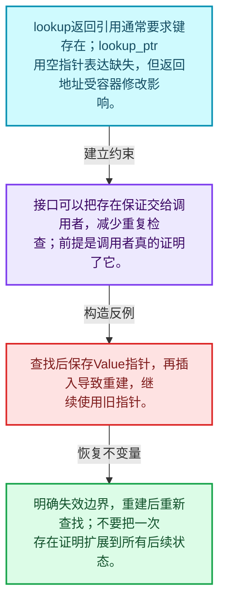
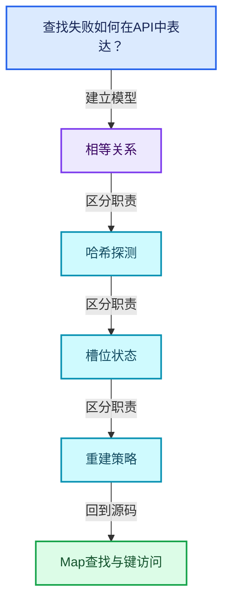
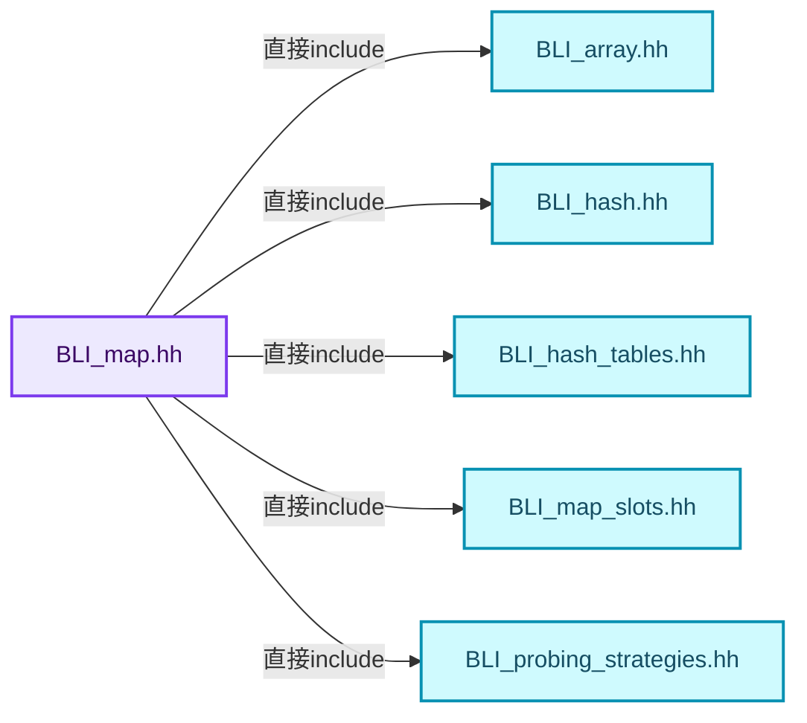
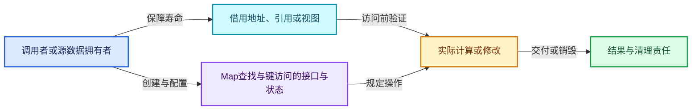
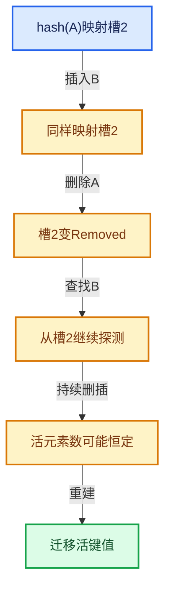

# 02-04 Map查找与键访问

[方向导航](README.md) · [总目录](../README.md) · [覆盖索引](../%E6%BA%90%E7%A0%81%E7%89%88%E6%9C%AC%E4%B8%8E%E8%A6%86%E7%9B%96%E7%B4%A2%E5%BC%95.md)

> 阅读顺序：问题与数据模型 → 语法与类型 → 源码逐行 → 调用线索 → 历史与取舍 → 推演和练习。

- 基准 HEAD：`cbda6b96c26c0dee3c3b5cbb93960c4ac06a6b30`。
- 记录日期：2026-10-14。
- 教学示例状态：正文中的推演不是本机性能实测；已运行练习见验收报告。

## 一、从问题到设计

查找失败如何在API中表达？

引用返回、指针返回、默认值和断言接口有不同前置条件；避免在未证明存在时调用必存在接口。

本篇把语法、数据语义和系统取舍连接起来。相等与哈希是基础契约；探测、删除和增长共同决定复杂度。

### 本篇独立模型与设计推理

lookup返回引用通常要求键存在；lookup_ptr用空指针表达缺失，但返回地址受容器修改影响。

设计取舍：接口可以把存在保证交给调用者，减少重复检查；前提是调用者真的证明了它。

最小反例：查找后保存Value指针，再插入导致重建，继续使用旧指针。

推导与处理：明确失效边界，重建后重新查找；不要把一次存在证明扩展到所有后续状态。



### 源码范围与相邻篇章

| 文件 | 本篇逐行范围 | 基准SHA-256 |
|---|---|---|
| [source/blender/blenlib/BLI_map.hh](../../../../../source/blender/blenlib/BLI_map.hh) | L277—L552 | `236ceadf1c36a6e452538529f550bb9a61c4d2efc16cbb8419861fdd638bd5c7` |

同一主讲文件可能分多篇覆盖；超出本篇范围的符号通过覆盖索引定位。空行与纯注释保留在源码摘录中，逐行表解释有效语句与语法边界；许可证头统一保留。

前篇：[槽位状态与探测](03-%E6%A7%BD%E4%BD%8D%E7%8A%B6%E6%80%81%E4%B8%8E%E6%8E%A2%E6%B5%8B.md).

后篇：[Map插入与回调](05-Map%E6%8F%92%E5%85%A5%E4%B8%8E%E5%9B%9E%E8%B0%83.md).

## 二、类型、数据与阅读地图



这是概念依赖图，边表示阅读关系，不声称是运行时调用顺序。

### 直接编译依赖



箭头只表示头文件包含关系；完整调用线索见后面的符号定位表。

## 三、关键词、语法与类型角色

### 模板 template

模板把类型或常量作为生成实现的参数。读声明时先列出类型参数、非类型参数和默认值，再看使用者实际实例化了什么。模板声明本身不意味着每种T都支持其全部成员。

具体检查：把T替换为int、string、只能移动的类型，分别检查每个被调用操作是否成立。

### 依赖名称 typename

typename既可引入类型模板参数，也可告诉编译器某个依赖名称是类型。它不创建运行时对象；解析期确认语法类别与实例化期检查具体类型是不同阶段。

具体检查：区分typename T::value_type和T::size()，前者标记类型，后者是表达式。

### 只读限定 const

const约束当前访问路径可做的修改。const指针、指向const的指针、const视图对象、const元素是不同位置的限定；其他别名可能仍可修改原对象。

具体检查：分别写T* const、const T*与const T* const，并画出不可修改的层次。

### 移动转换 std::move

std::move把表达式转换为可供移动重载选择的值类别，实际资源转移发生在被选中的构造或赋值中。对const对象move可能仍调用复制，对视图move也不会获得底层数据所有权。

具体检查：记录移动构造调用次数，不用变量名或std::move的出现次数替代测量。

### 完美转发 std::forward

std::forward在转发引用模板中恢复调用者原来的值类别。它依赖推导出的模板实参；无条件move会改变左值调用者的语义。

具体检查：对同一接口分别传入左值、临时对象和const左值，记录实际重载。

### 异常边界 try与catch

try定义异常传播的局部边界。失败路径需要销毁已经成功构造的部分并释放相应存储；未构造的对象不能被析构。

具体检查：在第k次构造失败，列出已经存在的对象集合与待释放缓冲。

### 限定转换 const_cast

const_cast可以改变访问路径的限定，但不能让本来就是const的对象合法可写。常用于复用只读实现时，仍需检查底层对象是否实际可变。

具体检查：对非const对象的const引用与真正const对象分别分析修改是否合法。

### 可选值 optional

optional把不存在与存在的T区分开，T的构造和析构跟随engaged状态变化。访问前应由has_value或条件分支证明存在。

具体检查：把空Field状态与合法常量零区分，不能用某个普通值代替不存在。

## 四、真实源码与逐行讲解

源码块保持原行内容，原始行号由小节标题及逐行表给出。表中的调用定位是静态阅读辅助；重载、模板实例化、宏展开和虚调用需结合完整声明，不能仅凭词法出现证明动态调用。

### BLI_map.hh：L277—L328

<!-- source:source/blender/blenlib/BLI_map.hh:277:328 -->

```cpp
  void add_new(Key &&key, Value &&value)
  {
    this->add_new_as(std::move(key), std::move(value));
  }
  template<typename ForwardKey, typename... ForwardValue>
  void add_new_as(ForwardKey &&key, ForwardValue &&...value)
  {
    this->add_new__impl(
        std::forward<ForwardKey>(key), hash_(key), std::forward<ForwardValue>(value)...);
  }

  /**
   * Add a key-value-pair to the map. If the map contains the key already, nothing is changed.
   * If you want to replace the currently stored value, use `add_overwrite`.
   * Returns true when the key has been newly added.
   *
   * This is similar to std::unordered_map::insert.
   */
  bool add(const Key &key, const Value &value)
  {
    return this->add_as(key, value);
  }
  bool add(const Key &key, Value &&value)
  {
    return this->add_as(key, std::move(value));
  }
  bool add(Key &&key, const Value &value)
  {
    return this->add_as(std::move(key), value);
  }
  bool add(Key &&key, Value &&value)
  {
    return this->add_as(std::move(key), std::move(value));
  }
  template<typename ForwardKey, typename... ForwardValue>
  bool add_as(ForwardKey &&key, ForwardValue &&...value)
  {
    return this->add__impl(
        std::forward<ForwardKey>(key), hash_(key), std::forward<ForwardValue>(value)...);
  }

  /**
   * Adds a key-value-pair to the map. If the map contained the key already, the corresponding
   * value will be replaced.
   * Returns true when the key has been newly added.
   *
   * This is similar to std::unordered_map::insert_or_assign.
   */
  bool add_overwrite(const Key &key, const Value &value)
  {
    return this->add_overwrite_as(key, value);
  }
```

| 原始行 | 语义、约束与检查 |
|---|---|
| L277 | 出现调用或函数声明 `add_new`，对应表达式为 `void add_new(Key &&key, Value &&value)`。参数求值、返回类型与重载需结合前后完整语句；静态文本引用不能证明动态目标。 |
| L278 | 连接上一行的声明或控制结构与其语句块；后续行在这个作用域中执行或声明。 |
| L279 | 出现调用或函数声明 `add_new_as`，对应表达式为 `this->add_new_as(std::move(key), std::move(value));`。参数求值、返回类型与重载需结合前后完整语句；静态文本引用不能证明动态目标。 |
| L280 | 结束当前语法单元。局部自动对象在离开其作用域时按规则销毁；这不等于所有被引用的外部数据也被释放。 |
| L281 | 声明模板参数 `template<typename ForwardKey, typename... ForwardValue>`。类型参数决定生成操作的类型，非类型参数可决定内嵌容量或编译期分支。 |
| L282 | 出现调用或函数声明 `add_new_as`，对应表达式为 `void add_new_as(ForwardKey &&key, ForwardValue &&...value)`。参数求值、返回类型与重载需结合前后完整语句；静态文本引用不能证明动态目标。 |
| L283 | 连接上一行的声明或控制结构与其语句块；后续行在这个作用域中执行或声明。 |
| L284 | 出现调用或函数声明 `add_new__impl`，对应表达式为 `this->add_new__impl(`。参数求值、返回类型与重载需结合前后完整语句；静态文本引用不能证明动态目标。 |
| L285 | 出现调用或函数声明 `std::forward`，对应表达式为 `std::forward<ForwardKey>(key), hash_(key), std::forward<ForwardValue>(value)...);`。参数求值、返回类型与重载需结合前后完整语句；静态文本引用不能证明动态目标。 |
| L286 | 结束当前语法单元。局部自动对象在离开其作用域时按规则销毁；这不等于所有被引用的外部数据也被释放。 |
| L295 | 出现调用或函数声明 `add`，对应表达式为 `bool add(const Key &key, const Value &value)`。参数求值、返回类型与重载需结合前后完整语句；静态文本引用不能证明动态目标。 |
| L296 | 连接上一行的声明或控制结构与其语句块；后续行在这个作用域中执行或声明。 |
| L297 | 返回表达式 `this->add_as(key, value)`。 |
| L298 | 结束当前语法单元。局部自动对象在离开其作用域时按规则销毁；这不等于所有被引用的外部数据也被释放。 |
| L299 | 出现调用或函数声明 `add`，对应表达式为 `bool add(const Key &key, Value &&value)`。参数求值、返回类型与重载需结合前后完整语句；静态文本引用不能证明动态目标。 |
| L300 | 连接上一行的声明或控制结构与其语句块；后续行在这个作用域中执行或声明。 |
| L301 | 返回表达式 `this->add_as(key, std::move(value))`。 |
| L302 | 结束当前语法单元。局部自动对象在离开其作用域时按规则销毁；这不等于所有被引用的外部数据也被释放。 |
| L303 | 出现调用或函数声明 `add`，对应表达式为 `bool add(Key &&key, const Value &value)`。参数求值、返回类型与重载需结合前后完整语句；静态文本引用不能证明动态目标。 |
| L304 | 连接上一行的声明或控制结构与其语句块；后续行在这个作用域中执行或声明。 |
| L305 | 返回表达式 `this->add_as(std::move(key), value)`。 |
| L306 | 结束当前语法单元。局部自动对象在离开其作用域时按规则销毁；这不等于所有被引用的外部数据也被释放。 |
| L307 | 出现调用或函数声明 `add`，对应表达式为 `bool add(Key &&key, Value &&value)`。参数求值、返回类型与重载需结合前后完整语句；静态文本引用不能证明动态目标。 |
| L308 | 连接上一行的声明或控制结构与其语句块；后续行在这个作用域中执行或声明。 |
| L309 | 返回表达式 `this->add_as(std::move(key), std::move(value))`。 |
| L310 | 结束当前语法单元。局部自动对象在离开其作用域时按规则销毁；这不等于所有被引用的外部数据也被释放。 |
| L311 | 声明模板参数 `template<typename ForwardKey, typename... ForwardValue>`。类型参数决定生成操作的类型，非类型参数可决定内嵌容量或编译期分支。 |
| L312 | 出现调用或函数声明 `add_as`，对应表达式为 `bool add_as(ForwardKey &&key, ForwardValue &&...value)`。参数求值、返回类型与重载需结合前后完整语句；静态文本引用不能证明动态目标。 |
| L313 | 连接上一行的声明或控制结构与其语句块；后续行在这个作用域中执行或声明。 |
| L314 | 返回表达式 `this->add__impl(`。 |
| L315 | 出现调用或函数声明 `std::forward`，对应表达式为 `std::forward<ForwardKey>(key), hash_(key), std::forward<ForwardValue>(value)...);`。参数求值、返回类型与重载需结合前后完整语句；静态文本引用不能证明动态目标。 |
| L316 | 结束当前语法单元。局部自动对象在离开其作用域时按规则销毁；这不等于所有被引用的外部数据也被释放。 |
| L325 | 出现调用或函数声明 `add_overwrite`，对应表达式为 `bool add_overwrite(const Key &key, const Value &value)`。参数求值、返回类型与重载需结合前后完整语句；静态文本引用不能证明动态目标。 |
| L326 | 连接上一行的声明或控制结构与其语句块；后续行在这个作用域中执行或声明。 |
| L327 | 返回表达式 `this->add_overwrite_as(key, value)`。 |
| L328 | 结束当前语法单元。局部自动对象在离开其作用域时按规则销毁；这不等于所有被引用的外部数据也被释放。 |

### BLI_map.hh：L329—L371

<!-- source:source/blender/blenlib/BLI_map.hh:329:371 -->

```cpp
  bool add_overwrite(const Key &key, Value &&value)
  {
    return this->add_overwrite_as(key, std::move(value));
  }
  bool add_overwrite(Key &&key, const Value &value)
  {
    return this->add_overwrite_as(std::move(key), value);
  }
  bool add_overwrite(Key &&key, Value &&value)
  {
    return this->add_overwrite_as(std::move(key), std::move(value));
  }
  template<typename ForwardKey, typename... ForwardValue>
  bool add_overwrite_as(ForwardKey &&key, ForwardValue &&...value)
  {
    return this->add_overwrite__impl(
        std::forward<ForwardKey>(key), hash_(key), std::forward<ForwardValue>(value)...);
  }

  /**
   * Returns true if there is a key in the map that compares equal to the given key.
   *
   * This is similar to std::unordered_map::contains.
   */
  bool contains(const Key &key) const
  {
    return this->contains_as(key);
  }
  template<typename ForwardKey> bool contains_as(const ForwardKey &key) const
  {
    return this->lookup_slot_ptr(key, hash_(key)) != nullptr;
  }

  /**
   * Deletes the key-value-pair with the given key. Returns true when the key was contained and is
   * now removed, otherwise false.
   *
   * This is similar to std::unordered_map::erase.
   */
  bool remove(const Key &key)
  {
    return this->remove_as(key);
  }
```

| 原始行 | 语义、约束与检查 |
|---|---|
| L329 | 出现调用或函数声明 `add_overwrite`，对应表达式为 `bool add_overwrite(const Key &key, Value &&value)`。参数求值、返回类型与重载需结合前后完整语句；静态文本引用不能证明动态目标。 |
| L330 | 连接上一行的声明或控制结构与其语句块；后续行在这个作用域中执行或声明。 |
| L331 | 返回表达式 `this->add_overwrite_as(key, std::move(value))`。 |
| L332 | 结束当前语法单元。局部自动对象在离开其作用域时按规则销毁；这不等于所有被引用的外部数据也被释放。 |
| L333 | 出现调用或函数声明 `add_overwrite`，对应表达式为 `bool add_overwrite(Key &&key, const Value &value)`。参数求值、返回类型与重载需结合前后完整语句；静态文本引用不能证明动态目标。 |
| L334 | 连接上一行的声明或控制结构与其语句块；后续行在这个作用域中执行或声明。 |
| L335 | 返回表达式 `this->add_overwrite_as(std::move(key), value)`。 |
| L336 | 结束当前语法单元。局部自动对象在离开其作用域时按规则销毁；这不等于所有被引用的外部数据也被释放。 |
| L337 | 出现调用或函数声明 `add_overwrite`，对应表达式为 `bool add_overwrite(Key &&key, Value &&value)`。参数求值、返回类型与重载需结合前后完整语句；静态文本引用不能证明动态目标。 |
| L338 | 连接上一行的声明或控制结构与其语句块；后续行在这个作用域中执行或声明。 |
| L339 | 返回表达式 `this->add_overwrite_as(std::move(key), std::move(value))`。 |
| L340 | 结束当前语法单元。局部自动对象在离开其作用域时按规则销毁；这不等于所有被引用的外部数据也被释放。 |
| L341 | 声明模板参数 `template<typename ForwardKey, typename... ForwardValue>`。类型参数决定生成操作的类型，非类型参数可决定内嵌容量或编译期分支。 |
| L342 | 出现调用或函数声明 `add_overwrite_as`，对应表达式为 `bool add_overwrite_as(ForwardKey &&key, ForwardValue &&...value)`。参数求值、返回类型与重载需结合前后完整语句；静态文本引用不能证明动态目标。 |
| L343 | 连接上一行的声明或控制结构与其语句块；后续行在这个作用域中执行或声明。 |
| L344 | 返回表达式 `this->add_overwrite__impl(`。 |
| L345 | 出现调用或函数声明 `std::forward`，对应表达式为 `std::forward<ForwardKey>(key), hash_(key), std::forward<ForwardValue>(value)...);`。参数求值、返回类型与重载需结合前后完整语句；静态文本引用不能证明动态目标。 |
| L346 | 结束当前语法单元。局部自动对象在离开其作用域时按规则销毁；这不等于所有被引用的外部数据也被释放。 |
| L353 | 出现调用或函数声明 `contains`，对应表达式为 `bool contains(const Key &key) const`。参数求值、返回类型与重载需结合前后完整语句；静态文本引用不能证明动态目标。 |
| L354 | 连接上一行的声明或控制结构与其语句块；后续行在这个作用域中执行或声明。 |
| L355 | 返回表达式 `this->contains_as(key)`。 |
| L356 | 结束当前语法单元。局部自动对象在离开其作用域时按规则销毁；这不等于所有被引用的外部数据也被释放。 |
| L357 | 声明模板参数 `template<typename ForwardKey> bool contains_as(const ForwardKey &key) const`。类型参数决定生成操作的类型，非类型参数可决定内嵌容量或编译期分支。 |
| L358 | 连接上一行的声明或控制结构与其语句块；后续行在这个作用域中执行或声明。 |
| L359 | 返回表达式 `this->lookup_slot_ptr(key, hash_(key)) != nullptr`。 |
| L360 | 结束当前语法单元。局部自动对象在离开其作用域时按规则销毁；这不等于所有被引用的外部数据也被释放。 |
| L368 | 出现调用或函数声明 `remove`，对应表达式为 `bool remove(const Key &key)`。参数求值、返回类型与重载需结合前后完整语句；静态文本引用不能证明动态目标。 |
| L369 | 连接上一行的声明或控制结构与其语句块；后续行在这个作用域中执行或声明。 |
| L370 | 返回表达式 `this->remove_as(key)`。 |
| L371 | 结束当前语法单元。局部自动对象在离开其作用域时按规则销毁；这不等于所有被引用的外部数据也被释放。 |

### BLI_map.hh：L372—L422

<!-- source:source/blender/blenlib/BLI_map.hh:372:422 -->

```cpp
  template<typename ForwardKey> bool remove_as(const ForwardKey &key)
  {
    Slot *slot = this->lookup_slot_ptr(key, hash_(key));
    if (slot == nullptr) {
      return false;
    }
    slot->remove();
    removed_slots_++;
    return true;
  }

  /**
   * Deletes the key-value-pair with the given key. This invokes undefined behavior when the key is
   * not in the map.
   */
  void remove_contained(const Key &key)
  {
    this->remove_contained_as(key);
  }
  template<typename ForwardKey> void remove_contained_as(const ForwardKey &key)
  {
    Slot &slot = this->lookup_slot(key, hash_(key));
    slot.remove();
    removed_slots_++;
  }

  /**
   * Get the value that is stored for the given key and remove it from the map. This invokes
   * undefined behavior when the key is not in the map.
   */
  Value pop(const Key &key)
  {
    return this->pop_as(key);
  }
  template<typename ForwardKey> Value pop_as(const ForwardKey &key)
  {
    Slot &slot = this->lookup_slot(key, hash_(key));
    Value value = std::move(*slot.value());
    slot.remove();
    removed_slots_++;
    return value;
  }

  /**
   * Get the value that is stored for the given key and remove it from the map. If the key is not
   * in the map, a value-less optional is returned.
   */
  std::optional<Value> pop_try(const Key &key)
  {
    return this->pop_try_as(key);
  }
```

本段语义重点：

- `removed_slots_`：删除标记计数，影响重建判断及探测长度。

| 原始行 | 语义、约束与检查 |
|---|---|
| L372 | 声明模板参数 `template<typename ForwardKey> bool remove_as(const ForwardKey &key)`。类型参数决定生成操作的类型，非类型参数可决定内嵌容量或编译期分支。 |
| L373 | 连接上一行的声明或控制结构与其语句块；后续行在这个作用域中执行或声明。 |
| L374 | 把右侧 `this->lookup_slot_ptr(key, hash_(key))` 用于初始化或更新左侧 `Slot *slot`。声明初始化与已有对象赋值应按上下文区分；有资源的类型会调用相应特殊成员。 |
| L375 | 判断 `slot == nullptr`，成立时进入本分支，否则继续后续路径。这里区分空地址与可用地址，但非空本身仍不能证明对象存活。 |
| L376 | 返回表达式 `false`。这是本路径的布尔结果，具体成功、存在或状态含义由函数接口规定。 |
| L377 | 结束当前语法单元。局部自动对象在离开其作用域时按规则销毁；这不等于所有被引用的外部数据也被释放。 |
| L378 | 出现调用或函数声明 `remove`，对应表达式为 `slot->remove();`。参数求值、返回类型与重载需结合前后完整语句；静态文本引用不能证明动态目标。 |
| L379 | 递增或递减现有状态：`removed_slots_++;`。这改变计数或游标；检查边界、计数单位，以及并发访问是否有相应保护。 |
| L380 | 返回表达式 `true`。这是本路径的布尔结果，具体成功、存在或状态含义由函数接口规定。 |
| L381 | 结束当前语法单元。局部自动对象在离开其作用域时按规则销毁；这不等于所有被引用的外部数据也被释放。 |
| L387 | 出现调用或函数声明 `remove_contained`，对应表达式为 `void remove_contained(const Key &key)`。参数求值、返回类型与重载需结合前后完整语句；静态文本引用不能证明动态目标。 |
| L388 | 连接上一行的声明或控制结构与其语句块；后续行在这个作用域中执行或声明。 |
| L389 | 出现调用或函数声明 `remove_contained_as`，对应表达式为 `this->remove_contained_as(key);`。参数求值、返回类型与重载需结合前后完整语句；静态文本引用不能证明动态目标。 |
| L390 | 结束当前语法单元。局部自动对象在离开其作用域时按规则销毁；这不等于所有被引用的外部数据也被释放。 |
| L391 | 声明模板参数 `template<typename ForwardKey> void remove_contained_as(const ForwardKey &key)`。类型参数决定生成操作的类型，非类型参数可决定内嵌容量或编译期分支。 |
| L392 | 连接上一行的声明或控制结构与其语句块；后续行在这个作用域中执行或声明。 |
| L393 | 把右侧 `this->lookup_slot(key, hash_(key))` 用于初始化或更新左侧 `Slot &slot`。声明初始化与已有对象赋值应按上下文区分；有资源的类型会调用相应特殊成员。 |
| L394 | 出现调用或函数声明 `remove`，对应表达式为 `slot.remove();`。参数求值、返回类型与重载需结合前后完整语句；静态文本引用不能证明动态目标。 |
| L395 | 递增或递减现有状态：`removed_slots_++;`。这改变计数或游标；检查边界、计数单位，以及并发访问是否有相应保护。 |
| L396 | 结束当前语法单元。局部自动对象在离开其作用域时按规则销毁；这不等于所有被引用的外部数据也被释放。 |
| L402 | 出现调用或函数声明 `pop`，对应表达式为 `Value pop(const Key &key)`。参数求值、返回类型与重载需结合前后完整语句；静态文本引用不能证明动态目标。 |
| L403 | 连接上一行的声明或控制结构与其语句块；后续行在这个作用域中执行或声明。 |
| L404 | 返回表达式 `this->pop_as(key)`。 |
| L405 | 结束当前语法单元。局部自动对象在离开其作用域时按规则销毁；这不等于所有被引用的外部数据也被释放。 |
| L406 | 声明模板参数 `template<typename ForwardKey> Value pop_as(const ForwardKey &key)`。类型参数决定生成操作的类型，非类型参数可决定内嵌容量或编译期分支。 |
| L407 | 连接上一行的声明或控制结构与其语句块；后续行在这个作用域中执行或声明。 |
| L408 | 把右侧 `this->lookup_slot(key, hash_(key))` 用于初始化或更新左侧 `Slot &slot`。声明初始化与已有对象赋值应按上下文区分；有资源的类型会调用相应特殊成员。 |
| L409 | 把右侧 `std::move(*slot.value())` 用于初始化或更新左侧 `Value value`。声明初始化与已有对象赋值应按上下文区分；有资源的类型会调用相应特殊成员。 |
| L410 | 出现调用或函数声明 `remove`，对应表达式为 `slot.remove();`。参数求值、返回类型与重载需结合前后完整语句；静态文本引用不能证明动态目标。 |
| L411 | 递增或递减现有状态：`removed_slots_++;`。这改变计数或游标；检查边界、计数单位，以及并发访问是否有相应保护。 |
| L412 | 返回表达式 `value`。 |
| L413 | 结束当前语法单元。局部自动对象在离开其作用域时按规则销毁；这不等于所有被引用的外部数据也被释放。 |
| L419 | 出现调用或函数声明 `pop_try`，对应表达式为 `std::optional<Value> pop_try(const Key &key)`。参数求值、返回类型与重载需结合前后完整语句；静态文本引用不能证明动态目标。 |
| L420 | 连接上一行的声明或控制结构与其语句块；后续行在这个作用域中执行或声明。 |
| L421 | 返回表达式 `this->pop_try_as(key)`。 |
| L422 | 结束当前语法单元。局部自动对象在离开其作用域时按规则销毁；这不等于所有被引用的外部数据也被释放。 |

### BLI_map.hh：L423—L458

<!-- source:source/blender/blenlib/BLI_map.hh:423:458 -->

```cpp
  template<typename ForwardKey> std::optional<Value> pop_try_as(const ForwardKey &key)
  {
    Slot *slot = this->lookup_slot_ptr(key, hash_(key));
    if (slot == nullptr) {
      return {};
    }
    std::optional<Value> value = std::move(*slot->value());
    slot->remove();
    removed_slots_++;
    return value;
  }

  /**
   * Get the value that corresponds to the given key and remove it from the map. If the key is not
   * in the map, return the given default value instead.
   */
  Value pop_default(const Key &key, const Value &default_value)
  {
    return this->pop_default_as(key, default_value);
  }
  Value pop_default(const Key &key, Value &&default_value)
  {
    return this->pop_default_as(key, std::move(default_value));
  }
  template<typename ForwardKey, typename... ForwardValue>
  Value pop_default_as(const ForwardKey &key, ForwardValue &&...default_value)
  {
    Slot *slot = this->lookup_slot_ptr(key, hash_(key));
    if (slot == nullptr) {
      return Value(std::forward<ForwardValue>(default_value)...);
    }
    Value value = std::move(*slot->value());
    slot->remove();
    removed_slots_++;
    return value;
  }
```

本段语义重点：

- `removed_slots_`：删除标记计数，影响重建判断及探测长度。

| 原始行 | 语义、约束与检查 |
|---|---|
| L423 | 声明模板参数 `template<typename ForwardKey> std::optional<Value> pop_try_as(const ForwardKey &key)`。类型参数决定生成操作的类型，非类型参数可决定内嵌容量或编译期分支。 |
| L424 | 连接上一行的声明或控制结构与其语句块；后续行在这个作用域中执行或声明。 |
| L425 | 把右侧 `this->lookup_slot_ptr(key, hash_(key))` 用于初始化或更新左侧 `Slot *slot`。声明初始化与已有对象赋值应按上下文区分；有资源的类型会调用相应特殊成员。 |
| L426 | 判断 `slot == nullptr`，成立时进入本分支，否则继续后续路径。这里区分空地址与可用地址，但非空本身仍不能证明对象存活。 |
| L427 | 返回表达式 `{}`。 |
| L428 | 结束当前语法单元。局部自动对象在离开其作用域时按规则销毁；这不等于所有被引用的外部数据也被释放。 |
| L429 | 把右侧 `std::move(*slot->value())` 用于初始化或更新左侧 `std::optional<Value> value`。声明初始化与已有对象赋值应按上下文区分；有资源的类型会调用相应特殊成员。 |
| L430 | 出现调用或函数声明 `remove`，对应表达式为 `slot->remove();`。参数求值、返回类型与重载需结合前后完整语句；静态文本引用不能证明动态目标。 |
| L431 | 递增或递减现有状态：`removed_slots_++;`。这改变计数或游标；检查边界、计数单位，以及并发访问是否有相应保护。 |
| L432 | 返回表达式 `value`。 |
| L433 | 结束当前语法单元。局部自动对象在离开其作用域时按规则销毁；这不等于所有被引用的外部数据也被释放。 |
| L439 | 出现调用或函数声明 `pop_default`，对应表达式为 `Value pop_default(const Key &key, const Value &default_value)`。参数求值、返回类型与重载需结合前后完整语句；静态文本引用不能证明动态目标。 |
| L440 | 连接上一行的声明或控制结构与其语句块；后续行在这个作用域中执行或声明。 |
| L441 | 返回表达式 `this->pop_default_as(key, default_value)`。 |
| L442 | 结束当前语法单元。局部自动对象在离开其作用域时按规则销毁；这不等于所有被引用的外部数据也被释放。 |
| L443 | 出现调用或函数声明 `pop_default`，对应表达式为 `Value pop_default(const Key &key, Value &&default_value)`。参数求值、返回类型与重载需结合前后完整语句；静态文本引用不能证明动态目标。 |
| L444 | 连接上一行的声明或控制结构与其语句块；后续行在这个作用域中执行或声明。 |
| L445 | 返回表达式 `this->pop_default_as(key, std::move(default_value))`。 |
| L446 | 结束当前语法单元。局部自动对象在离开其作用域时按规则销毁；这不等于所有被引用的外部数据也被释放。 |
| L447 | 声明模板参数 `template<typename ForwardKey, typename... ForwardValue>`。类型参数决定生成操作的类型，非类型参数可决定内嵌容量或编译期分支。 |
| L448 | 出现调用或函数声明 `pop_default_as`，对应表达式为 `Value pop_default_as(const ForwardKey &key, ForwardValue &&...default_value)`。参数求值、返回类型与重载需结合前后完整语句；静态文本引用不能证明动态目标。 |
| L449 | 连接上一行的声明或控制结构与其语句块；后续行在这个作用域中执行或声明。 |
| L450 | 把右侧 `this->lookup_slot_ptr(key, hash_(key))` 用于初始化或更新左侧 `Slot *slot`。声明初始化与已有对象赋值应按上下文区分；有资源的类型会调用相应特殊成员。 |
| L451 | 判断 `slot == nullptr`，成立时进入本分支，否则继续后续路径。这里区分空地址与可用地址，但非空本身仍不能证明对象存活。 |
| L452 | 返回表达式 `Value(std::forward<ForwardValue>(default_value)...)`。 |
| L453 | 结束当前语法单元。局部自动对象在离开其作用域时按规则销毁；这不等于所有被引用的外部数据也被释放。 |
| L454 | 把右侧 `std::move(*slot->value())` 用于初始化或更新左侧 `Value value`。声明初始化与已有对象赋值应按上下文区分；有资源的类型会调用相应特殊成员。 |
| L455 | 出现调用或函数声明 `remove`，对应表达式为 `slot->remove();`。参数求值、返回类型与重载需结合前后完整语句；静态文本引用不能证明动态目标。 |
| L456 | 递增或递减现有状态：`removed_slots_++;`。这改变计数或游标；检查边界、计数单位，以及并发访问是否有相应保护。 |
| L457 | 返回表达式 `value`。 |
| L458 | 结束当前语法单元。局部自动对象在离开其作用域时按规则销毁；这不等于所有被引用的外部数据也被释放。 |

### BLI_map.hh：L459—L511

<!-- source:source/blender/blenlib/BLI_map.hh:459:511 -->

```cpp

  /**
   * This method can be used to implement more complex custom behavior without having to do
   * multiple lookups
   *
   * When the key did not yet exist in the map, the create_value function is called. Otherwise the
   * modify_value function is called.
   *
   * Both functions are expected to take a single parameter of type `Value *`. In create_value,
   * this pointer will point to uninitialized memory that has to be initialized by the function. In
   * modify_value, it will point to an already initialized value.
   *
   * The function returns whatever is returned from the create_value or modify_value callback.
   * Therefore, both callbacks have to have the same return type.
   *
   * In this example an integer is stored for every key. The initial value is five and we want to
   * increase it every time the same key is used.
   *   map.add_or_modify(key,
   *                     [](int *value) { *value = 5; },
   *                     [](int *value) { (*value)++; });
   */
  template<typename CreateValueF, typename ModifyValueF>
  auto add_or_modify(const Key &key,
                     const CreateValueF &create_value,
                     const ModifyValueF &modify_value) -> decltype(create_value(nullptr))
  {
    return this->add_or_modify_as(key, create_value, modify_value);
  }
  template<typename CreateValueF, typename ModifyValueF>
  auto add_or_modify(Key &&key, const CreateValueF &create_value, const ModifyValueF &modify_value)
      -> decltype(create_value(nullptr))
  {
    return this->add_or_modify_as(std::move(key), create_value, modify_value);
  }
  template<typename ForwardKey, typename CreateValueF, typename ModifyValueF>
  auto add_or_modify_as(ForwardKey &&key,
                        const CreateValueF &create_value,
                        const ModifyValueF &modify_value) -> decltype(create_value(nullptr))
  {
    return this->add_or_modify__impl(
        std::forward<ForwardKey>(key), create_value, modify_value, hash_(key));
  }

  /**
   * Returns a pointer to the value that corresponds to the given key. If the key is not in the
   * map, nullptr is returned.
   *
   * This is similar to std::unordered_map::find.
   */
  const Value *lookup_ptr(const Key &key) const
  {
    return this->lookup_ptr_as(key);
  }
```

| 原始行 | 语义、约束与检查 |
|---|---|
| L480 | 声明模板参数 `template<typename CreateValueF, typename ModifyValueF>`。类型参数决定生成操作的类型，非类型参数可决定内嵌容量或编译期分支。 |
| L481 | 出现调用或函数声明 `add_or_modify`，对应表达式为 `auto add_or_modify(const Key &key,`。参数求值、返回类型与重载需结合前后完整语句；静态文本引用不能证明动态目标。 |
| L482 | 本行是连续声明或表达式的一部分：`const CreateValueF &create_value,`。与本段前后行合读；逗号、括号和限定符决定它属于参数、初始化列表还是实际计算。 |
| L483 | 出现调用或函数声明 `decltype`，对应表达式为 `const ModifyValueF &modify_value) -> decltype(create_value(nullptr))`。参数求值、返回类型与重载需结合前后完整语句；静态文本引用不能证明动态目标。 |
| L484 | 连接上一行的声明或控制结构与其语句块；后续行在这个作用域中执行或声明。 |
| L485 | 返回表达式 `this->add_or_modify_as(key, create_value, modify_value)`。 |
| L486 | 结束当前语法单元。局部自动对象在离开其作用域时按规则销毁；这不等于所有被引用的外部数据也被释放。 |
| L487 | 声明模板参数 `template<typename CreateValueF, typename ModifyValueF>`。类型参数决定生成操作的类型，非类型参数可决定内嵌容量或编译期分支。 |
| L488 | 出现调用或函数声明 `add_or_modify`，对应表达式为 `auto add_or_modify(Key &&key, const CreateValueF &create_value, const ModifyValueF &modify_value)`。参数求值、返回类型与重载需结合前后完整语句；静态文本引用不能证明动态目标。 |
| L489 | 出现调用或函数声明 `decltype`，对应表达式为 `-> decltype(create_value(nullptr))`。参数求值、返回类型与重载需结合前后完整语句；静态文本引用不能证明动态目标。 |
| L490 | 连接上一行的声明或控制结构与其语句块；后续行在这个作用域中执行或声明。 |
| L491 | 返回表达式 `this->add_or_modify_as(std::move(key), create_value, modify_value)`。 |
| L492 | 结束当前语法单元。局部自动对象在离开其作用域时按规则销毁；这不等于所有被引用的外部数据也被释放。 |
| L493 | 声明模板参数 `template<typename ForwardKey, typename CreateValueF, typename ModifyValueF>`。类型参数决定生成操作的类型，非类型参数可决定内嵌容量或编译期分支。 |
| L494 | 出现调用或函数声明 `add_or_modify_as`，对应表达式为 `auto add_or_modify_as(ForwardKey &&key,`。参数求值、返回类型与重载需结合前后完整语句；静态文本引用不能证明动态目标。 |
| L495 | 本行是连续声明或表达式的一部分：`const CreateValueF &create_value,`。与本段前后行合读；逗号、括号和限定符决定它属于参数、初始化列表还是实际计算。 |
| L496 | 出现调用或函数声明 `decltype`，对应表达式为 `const ModifyValueF &modify_value) -> decltype(create_value(nullptr))`。参数求值、返回类型与重载需结合前后完整语句；静态文本引用不能证明动态目标。 |
| L497 | 连接上一行的声明或控制结构与其语句块；后续行在这个作用域中执行或声明。 |
| L498 | 返回表达式 `this->add_or_modify__impl(`。 |
| L499 | 出现调用或函数声明 `std::forward`，对应表达式为 `std::forward<ForwardKey>(key), create_value, modify_value, hash_(key));`。参数求值、返回类型与重载需结合前后完整语句；静态文本引用不能证明动态目标。 |
| L500 | 结束当前语法单元。局部自动对象在离开其作用域时按规则销毁；这不等于所有被引用的外部数据也被释放。 |
| L508 | 出现调用或函数声明 `lookup_ptr`，对应表达式为 `const Value *lookup_ptr(const Key &key) const`。参数求值、返回类型与重载需结合前后完整语句；静态文本引用不能证明动态目标。 |
| L509 | 连接上一行的声明或控制结构与其语句块；后续行在这个作用域中执行或声明。 |
| L510 | 返回表达式 `this->lookup_ptr_as(key)`。 |
| L511 | 结束当前语法单元。局部自动对象在离开其作用域时按规则销毁；这不等于所有被引用的外部数据也被释放。 |

### BLI_map.hh：L512—L552

<!-- source:source/blender/blenlib/BLI_map.hh:512:552 -->

```cpp
  Value *lookup_ptr(const Key &key)
  {
    return this->lookup_ptr_as(key);
  }
  template<typename ForwardKey> const Value *lookup_ptr_as(const ForwardKey &key) const
  {
    const Slot *slot = this->lookup_slot_ptr(key, hash_(key));
    return (slot != nullptr) ? slot->value() : nullptr;
  }
  template<typename ForwardKey> Value *lookup_ptr_as(const ForwardKey &key)
  {
    return const_cast<Value *>(const_cast<const Map *>(this)->lookup_ptr_as(key));
  }

  /**
   * Returns a copy of the value that corresponds to the given key, or std::nullopt if the key is
   * not in the map. In some cases, one may not want a copy but an actual reference to the value.
   * In that case it's better to use #lookup_ptr instead.
   */
  std::optional<Value> lookup_try(const Key &key) const
  {
    return this->lookup_try_as(key);
  }
  template<typename ForwardKey> std::optional<Value> lookup_try_as(const ForwardKey &key) const
  {
    const Slot *slot = this->lookup_slot_ptr(key, hash_(key));
    return (slot != nullptr) ? std::optional<Value>(*slot->value()) : std::nullopt;
  }

  /**
   * Returns a reference to the value that corresponds to the given key. This invokes undefined
   * behavior when the key is not in the map.
   */
  const Value &lookup(const Key &key) const
  {
    return this->lookup_as(key);
  }
  Value &lookup(const Key &key)
  {
    return this->lookup_as(key);
  }
```

| 原始行 | 语义、约束与检查 |
|---|---|
| L512 | 出现调用或函数声明 `lookup_ptr`，对应表达式为 `Value *lookup_ptr(const Key &key)`。参数求值、返回类型与重载需结合前后完整语句；静态文本引用不能证明动态目标。 |
| L513 | 连接上一行的声明或控制结构与其语句块；后续行在这个作用域中执行或声明。 |
| L514 | 返回表达式 `this->lookup_ptr_as(key)`。 |
| L515 | 结束当前语法单元。局部自动对象在离开其作用域时按规则销毁；这不等于所有被引用的外部数据也被释放。 |
| L516 | 声明模板参数 `template<typename ForwardKey> const Value *lookup_ptr_as(const ForwardKey &key) const`。类型参数决定生成操作的类型，非类型参数可决定内嵌容量或编译期分支。 |
| L517 | 连接上一行的声明或控制结构与其语句块；后续行在这个作用域中执行或声明。 |
| L518 | 把右侧 `this->lookup_slot_ptr(key, hash_(key))` 用于初始化或更新左侧 `const Slot *slot`。声明初始化与已有对象赋值应按上下文区分；有资源的类型会调用相应特殊成员。 |
| L519 | 返回表达式 `(slot != nullptr) ? slot->value() : nullptr`。结合函数声明检查返回值是否借用原存储，借用值不会自动延长其寿命。 |
| L520 | 结束当前语法单元。局部自动对象在离开其作用域时按规则销毁；这不等于所有被引用的外部数据也被释放。 |
| L521 | 声明模板参数 `template<typename ForwardKey> Value *lookup_ptr_as(const ForwardKey &key)`。类型参数决定生成操作的类型，非类型参数可决定内嵌容量或编译期分支。 |
| L522 | 连接上一行的声明或控制结构与其语句块；后续行在这个作用域中执行或声明。 |
| L523 | 返回表达式 `const_cast<Value *>(const_cast<const Map *>(this)->lookup_ptr_as(key))`。 |
| L524 | 结束当前语法单元。局部自动对象在离开其作用域时按规则销毁；这不等于所有被引用的外部数据也被释放。 |
| L531 | 出现调用或函数声明 `lookup_try`，对应表达式为 `std::optional<Value> lookup_try(const Key &key) const`。参数求值、返回类型与重载需结合前后完整语句；静态文本引用不能证明动态目标。 |
| L532 | 连接上一行的声明或控制结构与其语句块；后续行在这个作用域中执行或声明。 |
| L533 | 返回表达式 `this->lookup_try_as(key)`。 |
| L534 | 结束当前语法单元。局部自动对象在离开其作用域时按规则销毁；这不等于所有被引用的外部数据也被释放。 |
| L535 | 声明模板参数 `template<typename ForwardKey> std::optional<Value> lookup_try_as(const ForwardKey &key) const`。类型参数决定生成操作的类型，非类型参数可决定内嵌容量或编译期分支。 |
| L536 | 连接上一行的声明或控制结构与其语句块；后续行在这个作用域中执行或声明。 |
| L537 | 把右侧 `this->lookup_slot_ptr(key, hash_(key))` 用于初始化或更新左侧 `const Slot *slot`。声明初始化与已有对象赋值应按上下文区分；有资源的类型会调用相应特殊成员。 |
| L538 | 返回表达式 `(slot != nullptr) ? std::optional<Value>(*slot->value()) : std::nullopt`。结合函数声明检查返回值是否借用原存储，借用值不会自动延长其寿命。 |
| L539 | 结束当前语法单元。局部自动对象在离开其作用域时按规则销毁；这不等于所有被引用的外部数据也被释放。 |
| L545 | 出现调用或函数声明 `lookup`，对应表达式为 `const Value &lookup(const Key &key) const`。参数求值、返回类型与重载需结合前后完整语句；静态文本引用不能证明动态目标。 |
| L546 | 连接上一行的声明或控制结构与其语句块；后续行在这个作用域中执行或声明。 |
| L547 | 返回表达式 `this->lookup_as(key)`。 |
| L548 | 结束当前语法单元。局部自动对象在离开其作用域时按规则销毁；这不等于所有被引用的外部数据也被释放。 |
| L549 | 出现调用或函数声明 `lookup`，对应表达式为 `Value &lookup(const Key &key)`。参数求值、返回类型与重载需结合前后完整语句；静态文本引用不能证明动态目标。 |
| L550 | 连接上一行的声明或控制结构与其语句块；后续行在这个作用域中执行或声明。 |
| L551 | 返回表达式 `this->lookup_as(key)`。 |
| L552 | 结束当前语法单元。局部自动对象在离开其作用域时按规则销毁；这不等于所有被引用的外部数据也被释放。 |

## 五、接口定位、调用线索与生命周期

### 本篇声明与实现入口

| 源码位置 | 实际声明片段 |
|---|---|
| [BLI_map.hh:L277](../../../../../source/blender/blenlib/BLI_map.hh#L277) | `void add_new(Key &&key, Value &&value)` |
| [BLI_map.hh:L282](../../../../../source/blender/blenlib/BLI_map.hh#L282) | `void add_new_as(ForwardKey &&key, ForwardValue &&...value)` |
| [BLI_map.hh:L295](../../../../../source/blender/blenlib/BLI_map.hh#L295) | `bool add(const Key &key, const Value &value)` |
| [BLI_map.hh:L299](../../../../../source/blender/blenlib/BLI_map.hh#L299) | `bool add(const Key &key, Value &&value)` |
| [BLI_map.hh:L303](../../../../../source/blender/blenlib/BLI_map.hh#L303) | `bool add(Key &&key, const Value &value)` |
| [BLI_map.hh:L307](../../../../../source/blender/blenlib/BLI_map.hh#L307) | `bool add(Key &&key, Value &&value)` |
| [BLI_map.hh:L312](../../../../../source/blender/blenlib/BLI_map.hh#L312) | `bool add_as(ForwardKey &&key, ForwardValue &&...value)` |
| [BLI_map.hh:L325](../../../../../source/blender/blenlib/BLI_map.hh#L325) | `bool add_overwrite(const Key &key, const Value &value)` |
| [BLI_map.hh:L329](../../../../../source/blender/blenlib/BLI_map.hh#L329) | `bool add_overwrite(const Key &key, Value &&value)` |
| [BLI_map.hh:L333](../../../../../source/blender/blenlib/BLI_map.hh#L333) | `bool add_overwrite(Key &&key, const Value &value)` |
| [BLI_map.hh:L337](../../../../../source/blender/blenlib/BLI_map.hh#L337) | `bool add_overwrite(Key &&key, Value &&value)` |
| [BLI_map.hh:L342](../../../../../source/blender/blenlib/BLI_map.hh#L342) | `bool add_overwrite_as(ForwardKey &&key, ForwardValue &&...value)` |
| [BLI_map.hh:L353](../../../../../source/blender/blenlib/BLI_map.hh#L353) | `bool contains(const Key &key) const` |
| [BLI_map.hh:L357](../../../../../source/blender/blenlib/BLI_map.hh#L357) | `template<typename ForwardKey> bool contains_as(const ForwardKey &key) const` |
| [BLI_map.hh:L368](../../../../../source/blender/blenlib/BLI_map.hh#L368) | `bool remove(const Key &key)` |
| [BLI_map.hh:L372](../../../../../source/blender/blenlib/BLI_map.hh#L372) | `template<typename ForwardKey> bool remove_as(const ForwardKey &key)` |
| [BLI_map.hh:L387](../../../../../source/blender/blenlib/BLI_map.hh#L387) | `void remove_contained(const Key &key)` |
| [BLI_map.hh:L391](../../../../../source/blender/blenlib/BLI_map.hh#L391) | `template<typename ForwardKey> void remove_contained_as(const ForwardKey &key)` |
| [BLI_map.hh:L402](../../../../../source/blender/blenlib/BLI_map.hh#L402) | `Value pop(const Key &key)` |
| [BLI_map.hh:L406](../../../../../source/blender/blenlib/BLI_map.hh#L406) | `template<typename ForwardKey> Value pop_as(const ForwardKey &key)` |
| [BLI_map.hh:L419](../../../../../source/blender/blenlib/BLI_map.hh#L419) | `std::optional<Value> pop_try(const Key &key)` |
| [BLI_map.hh:L423](../../../../../source/blender/blenlib/BLI_map.hh#L423) | `template<typename ForwardKey> std::optional<Value> pop_try_as(const ForwardKey &key)` |
| [BLI_map.hh:L439](../../../../../source/blender/blenlib/BLI_map.hh#L439) | `Value pop_default(const Key &key, const Value &default_value)` |
| [BLI_map.hh:L443](../../../../../source/blender/blenlib/BLI_map.hh#L443) | `Value pop_default(const Key &key, Value &&default_value)` |
| [BLI_map.hh:L448](../../../../../source/blender/blenlib/BLI_map.hh#L448) | `Value pop_default_as(const ForwardKey &key, ForwardValue &&...default_value)` |
| [BLI_map.hh:L481](../../../../../source/blender/blenlib/BLI_map.hh#L481) | `auto add_or_modify(const Key &key,` |
| [BLI_map.hh:L488](../../../../../source/blender/blenlib/BLI_map.hh#L488) | `auto add_or_modify(Key &&key, const CreateValueF &create_value, const ModifyValueF &modify_value)` |
| [BLI_map.hh:L494](../../../../../source/blender/blenlib/BLI_map.hh#L494) | `auto add_or_modify_as(ForwardKey &&key,` |
| [BLI_map.hh:L508](../../../../../source/blender/blenlib/BLI_map.hh#L508) | `const Value *lookup_ptr(const Key &key) const` |
| [BLI_map.hh:L512](../../../../../source/blender/blenlib/BLI_map.hh#L512) | `Value *lookup_ptr(const Key &key)` |
| [BLI_map.hh:L516](../../../../../source/blender/blenlib/BLI_map.hh#L516) | `template<typename ForwardKey> const Value *lookup_ptr_as(const ForwardKey &key) const` |
| [BLI_map.hh:L521](../../../../../source/blender/blenlib/BLI_map.hh#L521) | `template<typename ForwardKey> Value *lookup_ptr_as(const ForwardKey &key)` |
| [BLI_map.hh:L531](../../../../../source/blender/blenlib/BLI_map.hh#L531) | `std::optional<Value> lookup_try(const Key &key) const` |
| [BLI_map.hh:L535](../../../../../source/blender/blenlib/BLI_map.hh#L535) | `template<typename ForwardKey> std::optional<Value> lookup_try_as(const ForwardKey &key) const` |
| [BLI_map.hh:L545](../../../../../source/blender/blenlib/BLI_map.hh#L545) | `const Value &lookup(const Key &key) const` |
| [BLI_map.hh:L549](../../../../../source/blender/blenlib/BLI_map.hh#L549) | `Value &lookup(const Key &key)` |

### 同名符号出现位置

以下表提供跨文件阅读入口，包含声明、调用或测试使用；没有经过完整C++名称解析，不把它命名为已证明的运行时调用图。

| 符号 | 位置 | 文本证据 |
|---|---|---|
| `add_new` | [mesh.cc:L1313](../../../../../source/blender/blenkernel/intern/mesh.cc#L1313) | `names.add_new(iter.name);` |
| `add_new` | [mesh.cc:L2045](../../../../../source/blender/blenkernel/intern/mesh.cc#L2045) | `r_data.add_new(i);` |
| `add_new` | [BLI_set.hh:L233](../../../../../source/blender/blenlib/BLI_set.hh#L233) | `void add_new(const Key &key)` |
| `add_new_as` | [geometry_nodes_bundle.cc:L95](../../../../../source/blender/nodes/intern/geometry_nodes_bundle.cc#L95) | `items_.add_new_as(key, value);` |
| `add_new_as` | [geometry_nodes_bundle.cc:L100](../../../../../source/blender/nodes/intern/geometry_nodes_bundle.cc#L100) | `items_.add_new_as(key, std::move(value));` |
| `add` | [BKE_attribute.hh:L769](../../../../../source/blender/blenkernel/BKE_attribute.hh#L769) | `bool add(const StringRef name,` |
| `add` | [BKE_attribute.hh:L783](../../../../../source/blender/blenkernel/BKE_attribute.hh#L783) | `return fn_->add(owner_, name, domain, data_type, initializer);` |
| `add` | [BKE_attribute.hh:L786](../../../../../source/blender/blenkernel/BKE_attribute.hh#L786) | `bool add(const StringRef name, const AttrDomain domain, const AttributeInit &initializer)` |
| `add_as` | [BLI_multi_value_map.hh:L43](../../../../../source/blender/blenlib/BLI_multi_value_map.hh#L43) | `this->add_as(key, value);` |
| `add_as` | [BLI_multi_value_map.hh:L47](../../../../../source/blender/blenlib/BLI_multi_value_map.hh#L47) | `this->add_as(key, std::move(value));` |
| `add_as` | [BLI_multi_value_map.hh:L51](../../../../../source/blender/blenlib/BLI_multi_value_map.hh#L51) | `this->add_as(std::move(key), value);` |
| `add_overwrite` | [BLI_set.hh:L267](../../../../../source/blender/blenlib/BLI_set.hh#L267) | `bool add_overwrite(const Key &key)` |
| `add_overwrite` | [BLI_set.hh:L271](../../../../../source/blender/blenlib/BLI_set.hh#L271) | `bool add_overwrite(Key &&key)` |
| `add_overwrite` | [BLI_vector_set.hh:L374](../../../../../source/blender/blenlib/BLI_vector_set.hh#L374) | `bool add_overwrite(const Key &key)` |
| `add_overwrite_as` | [BLI_set.hh:L269](../../../../../source/blender/blenlib/BLI_set.hh#L269) | `return this->add_overwrite_as(key);` |
| `add_overwrite_as` | [BLI_set.hh:L273](../../../../../source/blender/blenlib/BLI_set.hh#L273) | `return this->add_overwrite_as(std::move(key));` |
| `add_overwrite_as` | [BLI_set.hh:L275](../../../../../source/blender/blenlib/BLI_set.hh#L275) | `template<typename ForwardKey> bool add_overwrite_as(ForwardKey &&key)` |
| `contains` | [BKE_attribute.hh:L525](../../../../../source/blender/blenkernel/BKE_attribute.hh#L525) | `bool contains(StringRef name) const` |
| `contains` | [BKE_attribute.hh:L777](../../../../../source/blender/blenkernel/BKE_attribute.hh#L777) | `if (this->contains(name)) {` |
| `contains` | [BKE_attribute.hh:L818](../../../../../source/blender/blenkernel/BKE_attribute.hh#L818) | `BLI_assert(this->contains(name));` |
| `contains_as` | [BKE_attribute_filters.hh:L55](../../../../../source/blender/blenkernel/BKE_attribute_filters.hh#L55) | `if (skip.contains_as(name)) {` |
| `contains_as` | [BKE_attribute_filters.hh:L80](../../../../../source/blender/blenkernel/BKE_attribute_filters.hh#L80) | `if (skip.contains_as(name)) {` |
| `contains_as` | [BLI_set.hh:L312](../../../../../source/blender/blenlib/BLI_set.hh#L312) | `return this->contains_as(key);` |
| `remove` | [BKE_attribute.hh:L809](../../../../../source/blender/blenkernel/BKE_attribute.hh#L809) | `if (!this->remove(name)) {` |
| `remove` | [BKE_attribute.hh:L1007](../../../../../source/blender/blenkernel/BKE_attribute.hh#L1007) | `bool remove(const StringRef name)` |
| `remove` | [BKE_attribute.hh:L1009](../../../../../source/blender/blenkernel/BKE_attribute.hh#L1009) | `return fn_->remove(owner_, name);` |
| `remove_as` | [BLI_set.hh:L406](../../../../../source/blender/blenlib/BLI_set.hh#L406) | `return this->remove_as(key);` |
| `remove_as` | [BLI_set.hh:L408](../../../../../source/blender/blenlib/BLI_set.hh#L408) | `template<typename ForwardKey> bool remove_as(const ForwardKey &key)` |
| `remove_as` | [BLI_vector_set.hh:L425](../../../../../source/blender/blenlib/BLI_vector_set.hh#L425) | `return this->remove_as(key);` |
| `remove_contained` | [BLI_set.hh:L416](../../../../../source/blender/blenlib/BLI_set.hh#L416) | `void remove_contained(const Key &key)` |
| `remove_contained` | [BLI_vector_set.hh:L436](../../../../../source/blender/blenlib/BLI_vector_set.hh#L436) | `void remove_contained(const Key &key)` |

### 生命周期推理图



这是审查生命周期的通用模型。具体类是否拥有数据由本篇成员、构造、析构和调用者一起证明；任何箭头都不自动代表shared_ptr。

## 六、把代码放进具体数据中推演

本方向的共同数值模型如下。本篇的专门检查是：对存在键和缺失键比较不同查找接口的行为与复制成本。

| 步骤 | 数据或状态 | 为什么需要这一步 |
|---|---|---|
| 插入A | hash(A)映射槽2 | 槽2变Occupied |
| 插入B | 同样映射槽2 | 沿探测序列找到后续空槽 |
| 删除A | 槽2变Removed | B仍须可达 |
| 查找B | 从槽2继续探测 | Removed不能当作Empty终止 |
| 持续删插 | 活元素数可能恒定 | 墓碑和探测长度仍可能增长 |
| 重建 | 迁移活键值 | 去掉旧删除状态并恢复足够空间 |



图是教学推演模型；精确分支与状态更新以本篇摘录及调用契约为准。

### 本篇独立练习与参考思路

对存在键和缺失键比较不同查找接口的行为与复制成本。

参考思路：引用返回、指针返回、默认值和断言接口有不同前置条件；避免在未证明存在时调用必存在接口。

将输入、预期结果和资源责任分成三张清单。先用最直接的实现给出可核对的答案，再替换成对应源码使用的表示；比较结果不变的条件，而不是只比较接口名字。

验收依据：每个活键从其探测起点可达；不存在的键可终止；析构仅命中占用状态的真实对象。

## 七、复杂度、设计取舍与其他基础库

对比std::unordered_map、Abseil flat_hash_map与node_hash_map时，优先比较地址稳定性、键值搬移要求和删除行为；不同实现的平均常数及负载策略需要测量。

本篇的具体取舍：引用返回、指针返回、默认值和断言接口有不同前置条件；避免在未证明存在时调用必存在接口。

| 观察维度 | 从源码取得证据的方法 | 本篇要避免的误判 |
|---|---|---|
| 时间 | 对循环次数、分派次数和重建频率分别计数 | 看到单次常数操作就断定整个操作序列是常数成本 |
| 内存 | 区分对象本体、容量存储、间接资源和共享控制块 | 用sizeof代替总内存 |
| 安全 | 沿构造、失败回滚、销毁与失效逐路径检查 | 把断言或非空指针当作完整安全证明 |
| 并发 | 逐字段确认锁、发布顺序和借用寿命 | 把引用计数线程安全等同数据读写线程安全 |

相关一手资料：

- [C++公开工作草案](https://eel.is/c++draft/)：持续更新的工作草案；语言与标准库语义以相应章节为准。
- [Abseil Containers](https://abseil.io/docs/cpp/guides/container)：在线版，2026-10-14查阅；引用失效按具体容器契约检查。

资料用于核对契约和进一步阅读；这里没有声称外部库与Blender实现相同，也没有把上游性能数字当作本机实测。

## 八、历史提交与设计演化

### 2025-12-12 · Jacques Lucke

[Fix: BLI: bad performance edge case in hash table implementations](https://projects.blender.org/blender/blender/commit/b242c618450e3c0011914112c3ffe31ae2e96028)

完整哈希：`b242c618450e3c0011914112c3ffe31ae2e96028`。提交标题与作者日期来自本地Git对象。

提交说明原文（历史证据，不能直接作为当前API说明）：

```text
Fix: BLI: bad performance edge case in hash table implementations

The issue happened when the hash table (e.g. Map) has close to a power of two
number of elements and repeatedly deletes and adds values. In this case the map
is rebuild more often than is necessary, and in the worst case a rebuild happens
each time something is removed and added again.

The fix here is to make sure that each call to `realloc_and_reinsert` is
actually worth it by making it grow the map in some cases where it previously
wouldn't. A similar optimization already exists in
`Vector::realloc_to_at_least`.

An alternative would be to support overriding removed-slots in `Map::add`, but
that has negative performance implications for the most common case when no
elements are ever removed.

This brings back performance to the same level before #150009:
`60k_cubes_same_mesh.blend: old: 11.3s, main: 70s, this patch: 11.3s`

Pull Request: https://projects.blender.org/blender/blender/pulls/151502
```

阅读任务：先根据说明复述旧问题，提出一个自己的修复方案，再对照diff。结合本篇重点“查找失败如何在API中表达？”判断方案改变的是表示、接口、生命周期还是调度。

### 2026-06-11 · Jacques Lucke

[BLI: assert on hash table keys not comparing equal to themselves](https://projects.blender.org/blender/blender/commit/44a1dc7055466e153b4ab66628034d8561f540bf)

完整哈希：`44a1dc7055466e153b4ab66628034d8561f540bf`。提交标题与作者日期来自本地Git对象。

提交说明原文（历史证据，不能直接作为当前API说明）：

```text
BLI: assert on hash table keys not comparing equal to themselves

This helps finding issues with bad data (especially nan values) earlier.

Pull Request: https://projects.blender.org/blender/blender/pulls/159974
```

阅读任务：先根据说明复述旧问题，提出一个自己的修复方案，再对照diff。结合本篇重点“查找失败如何在API中表达？”判断方案改变的是表示、接口、生命周期还是调度。

## 九、反例、测试入口与掌握标准

仓库测试入口：

- [BLI_map_test.cc](../../../../../source/blender/blenlib/tests/BLI_map_test.cc)：阅读输入、断言与覆盖边界；本篇不把“存在测试”写成“本轮已运行”。

需要实际构造的反例：

- 空输入或没有结果需求：确认接口允许的空状态与不允许访问的操作。
- 边界位置和退化结构：把长度为1、末尾位置、重复值或深链代入真实分支。
- 生命周期结束或修改之后：检查保存的指针、引用、结果视图是否仍有效。
- 与本篇核心不变量相冲突的输入：对存在键和缺失键比较不同查找接口的行为与复制成本。

### 可运行的教学参考程序

[reference_exercises.cc](../_tools/reference_exercises.cc)包含独立于Blender的C++20参考检查：视图、简化SmallVector、异常回滚、哈希碰撞与删除、偏移数组、拓扑映射、共享缓存、表达式、惰性分支、闭包和暴力最近邻。

参考程序有意省略生产实现的完整能力。例如SmallVector禁止复制移动容器，不支持只能移动的元素，并禁止append参数别名到自身元素；TinyMap固定8槽，不提供增长。程序通过不能替代Blender实现测试。实际运行结果、编译器与命令见验收报告。

掌握标准：离开源码解释“查找失败如何在API中表达？”；独立完成上述练习；能指出一个会破坏相等关系相关约束的最小反例，并用具体代码行说明检查或修复应放在哪里。
