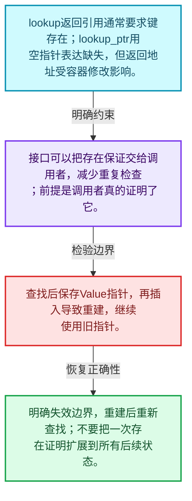
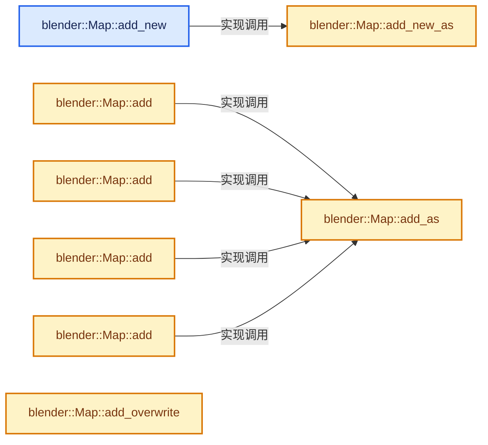
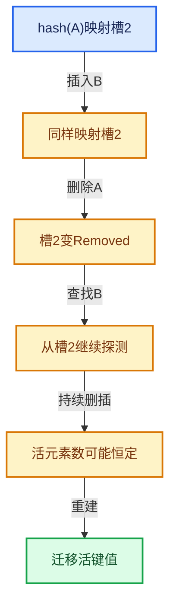

# 02-04 Map查找与键访问

[方向导航](README.md) · [总目录](../README.md) · [实现索引](../00-课程指南/02-源码与提交索引/符号依赖与实现索引.md)

## 从问题到实现

查找失败如何在API中表达？

引用返回、指针返回、默认值和断言接口有不同前置条件；避免在未证明存在时调用必存在接口。

**数据模型**

lookup返回引用通常要求键存在；lookup_ptr用空指针表达缺失，但返回地址受容器修改影响。

**设计取舍**

接口可以把存在保证交给调用者，减少重复检查；前提是调用者真的证明了它。

**最小反例**

查找后保存Value指针，再插入导致重建，继续使用旧指针。

**推导**

明确失效边界，重建后重新查找；不要把一次存在证明扩展到所有后续状态。

## 阅读地图与执行推演








图中的数值推演是本方向的教学模型；实际函数之间的调用边与概念分析边分别标注，不能把概念关系当作运行时调度顺序。

## 完整源码单元与就地讲解

中文讲解直接放在相关代码旁，复杂机制在代码下展开。原文折叠区保留基准行号；不需要在行号表和函数之间来回查找。类布局可分段展示，函数实现不按固定行数切开。

<a id="f-da1e537f229db040"></a>

### `blender::Map::add_new`

按哈希与相等关系加入键或键值。

实现位置：[source/blender/blenlib/BLI_map.hh](../../../../../source/blender/blenlib/BLI_map.hh) · L277—L280。

接口参数：

- `Key &&key`
- `Value &&value`

**教学注释版**

<!-- annotated:787b671724e654 -->

```cpp
  void add_new(Key &&key, Value &&value)
  {
    // [讲解] std::move：把表达式转换成可供移动重载选择的值类别；不保证真的移动，不结束源对象寿命，对const值可能选择复制。
    this->add_new_as(std::move(key), std::move(value));
  }
```

<details>
<summary>核对原始源码：source/blender/blenlib/BLI_map.hh · L277—L280</summary>

<!-- original:787b671724e654:source/blender/blenlib/BLI_map.hh:277:280 -->

```cpp
  void add_new(Key &&key, Value &&value)
  {
    this->add_new_as(std::move(key), std::move(value));
  }
```

</details>

**接口与不变量**

存在键与不存在键的接口承诺不同；add_new需要调用者保证键尚不存在。

**继续追踪实现**

- `this->add_new_as` → [blender::Map::add_new_as · L281](04-Map查找与键访问.md#f-f556b7e3fb7de063)。
- `std::move` → [外部契约](https://eel.is/c++draft/utility.forward)：把表达式转换成可供移动重载选择的值类别；不保证真的移动，不结束源对象寿命，对const值可能选择复制。

<a id="f-f556b7e3fb7de063"></a>

### `blender::Map::add_new_as`

实现位置：[source/blender/blenlib/BLI_map.hh](../../../../../source/blender/blenlib/BLI_map.hh) · L281—L286。

接口参数：

- `ForwardKey &&key`

**教学注释版**

<!-- annotated:e8e57e2d33a9b4 -->

```cpp
  template<typename ForwardKey, typename... ForwardValue>
  void add_new_as(ForwardKey &&key, ForwardValue &&...value)
  {
    this->add_new__impl(
        // [讲解] std::forward<ForwardKey>：在转发引用中恢复调用者传入的值类别；依赖推导类型，不能与无条件move互换。
        std::forward<ForwardKey>(key), hash_(key), std::forward<ForwardValue>(value)...);
  }
```

<details>
<summary>核对原始源码：source/blender/blenlib/BLI_map.hh · L281—L286</summary>

<!-- original:e8e57e2d33a9b4:source/blender/blenlib/BLI_map.hh:281:286 -->

```cpp
  template<typename ForwardKey, typename... ForwardValue>
  void add_new_as(ForwardKey &&key, ForwardValue &&...value)
  {
    this->add_new__impl(
        std::forward<ForwardKey>(key), hash_(key), std::forward<ForwardValue>(value)...);
  }
```

</details>

**继续追踪实现**

- `this->add_new__impl` → [blender::Map::add_new__impl · L1171](07-重建与摊还复杂度.md#f-5c0d112426a8af61)。
- `std::forward<ForwardKey>` → [外部契约](https://eel.is/c++draft/utility.forward)：在转发引用中恢复调用者传入的值类别；依赖推导类型，不能与无条件move互换。
- `hash_` → [调用协议](../00-课程指南/01-路线与规范/模板宏与动态分派协议.md)：函数指针、局部可调用对象或未展开的宏；必须结合调用者环境。调用位置L285。
- `std::forward<ForwardValue>` → [外部契约](https://eel.is/c++draft/utility.forward)：在转发引用中恢复调用者传入的值类别；依赖推导类型，不能与无条件move互换。

### 类型布局、声明与编译条件 · BLI_map.hh L287—L294

<!-- annotated:494e7ec4953cee -->

```cpp

  /**
   * Add a key-value-pair to the map. If the map contains the key already, nothing is changed.
   * If you want to replace the currently stored value, use `add_overwrite`.
   * Returns true when the key has been newly added.
   *
   * This is similar to std::unordered_map::insert.
   */
```

<details>
<summary>核对原始源码：source/blender/blenlib/BLI_map.hh · L287—L294</summary>

<!-- original:494e7ec4953cee:source/blender/blenlib/BLI_map.hh:287:294 -->

```cpp

  /**
   * Add a key-value-pair to the map. If the map contains the key already, nothing is changed.
   * If you want to replace the currently stored value, use `add_overwrite`.
   * Returns true when the key has been newly added.
   *
   * This is similar to std::unordered_map::insert.
   */
```

</details>

<a id="f-8d38101abf162f88"></a>

### `blender::Map::add`

按哈希与相等关系加入键或键值。

实现位置：[source/blender/blenlib/BLI_map.hh](../../../../../source/blender/blenlib/BLI_map.hh) · L295—L298。

接口参数：

- `const Key &key`
- `const Value &value`

**教学注释版**

<!-- annotated:2e2e659ddcef72 -->

```cpp
  bool add(const Key &key, const Value &value)
  {
    // [讲解] this->add_as：按哈希与相等关系加入键或键值。
    return this->add_as(key, value);
  }
```

<details>
<summary>核对原始源码：source/blender/blenlib/BLI_map.hh · L295—L298</summary>

<!-- original:2e2e659ddcef72:source/blender/blenlib/BLI_map.hh:295:298 -->

```cpp
  bool add(const Key &key, const Value &value)
  {
    return this->add_as(key, value);
  }
```

</details>

**接口与不变量**

存在键与不存在键的接口承诺不同；add_new需要调用者保证键尚不存在。

**结果出口**

- `return this->add_as(key, value);`

**继续追踪实现**

- `this->add_as` → [blender::Map::add_as · L311](04-Map查找与键访问.md#f-14a51c8e15129893)。

<a id="f-1f59510cdfbd9f87"></a>

### `blender::Map::add`

按哈希与相等关系加入键或键值。

实现位置：[source/blender/blenlib/BLI_map.hh](../../../../../source/blender/blenlib/BLI_map.hh) · L299—L302。

接口参数：

- `const Key &key`
- `Value &&value`

**教学注释版**

<!-- annotated:aac32bd535dd7e -->

```cpp
  bool add(const Key &key, Value &&value)
  {
    // [讲解] this->add_as：按哈希与相等关系加入键或键值。
    return this->add_as(key, std::move(value));
  }
```

<details>
<summary>核对原始源码：source/blender/blenlib/BLI_map.hh · L299—L302</summary>

<!-- original:aac32bd535dd7e:source/blender/blenlib/BLI_map.hh:299:302 -->

```cpp
  bool add(const Key &key, Value &&value)
  {
    return this->add_as(key, std::move(value));
  }
```

</details>

**接口与不变量**

存在键与不存在键的接口承诺不同；add_new需要调用者保证键尚不存在。

**结果出口**

- `return this->add_as(key, std::move(value));`

**继续追踪实现**

- `this->add_as` → [blender::Map::add_as · L311](04-Map查找与键访问.md#f-14a51c8e15129893)。
- `std::move` → [外部契约](https://eel.is/c++draft/utility.forward)：把表达式转换成可供移动重载选择的值类别；不保证真的移动，不结束源对象寿命，对const值可能选择复制。

<a id="f-645e0522347aa018"></a>

### `blender::Map::add`

按哈希与相等关系加入键或键值。

实现位置：[source/blender/blenlib/BLI_map.hh](../../../../../source/blender/blenlib/BLI_map.hh) · L303—L306。

接口参数：

- `Key &&key`
- `const Value &value`

**教学注释版**

<!-- annotated:140d49fb0e9d07 -->

```cpp
  bool add(Key &&key, const Value &value)
  {
    // [讲解] this->add_as：按哈希与相等关系加入键或键值。
    return this->add_as(std::move(key), value);
  }
```

<details>
<summary>核对原始源码：source/blender/blenlib/BLI_map.hh · L303—L306</summary>

<!-- original:140d49fb0e9d07:source/blender/blenlib/BLI_map.hh:303:306 -->

```cpp
  bool add(Key &&key, const Value &value)
  {
    return this->add_as(std::move(key), value);
  }
```

</details>

**接口与不变量**

存在键与不存在键的接口承诺不同；add_new需要调用者保证键尚不存在。

**结果出口**

- `return this->add_as(std::move(key), value);`

**继续追踪实现**

- `this->add_as` → [blender::Map::add_as · L311](04-Map查找与键访问.md#f-14a51c8e15129893)。
- `std::move` → [外部契约](https://eel.is/c++draft/utility.forward)：把表达式转换成可供移动重载选择的值类别；不保证真的移动，不结束源对象寿命，对const值可能选择复制。

<a id="f-03405db0730cedc0"></a>

### `blender::Map::add`

按哈希与相等关系加入键或键值。

实现位置：[source/blender/blenlib/BLI_map.hh](../../../../../source/blender/blenlib/BLI_map.hh) · L307—L310。

接口参数：

- `Key &&key`
- `Value &&value`

**教学注释版**

<!-- annotated:c4e2baff7cf488 -->

```cpp
  bool add(Key &&key, Value &&value)
  {
    // [讲解] this->add_as：按哈希与相等关系加入键或键值。
    return this->add_as(std::move(key), std::move(value));
  }
```

<details>
<summary>核对原始源码：source/blender/blenlib/BLI_map.hh · L307—L310</summary>

<!-- original:c4e2baff7cf488:source/blender/blenlib/BLI_map.hh:307:310 -->

```cpp
  bool add(Key &&key, Value &&value)
  {
    return this->add_as(std::move(key), std::move(value));
  }
```

</details>

**接口与不变量**

存在键与不存在键的接口承诺不同；add_new需要调用者保证键尚不存在。

**结果出口**

- `return this->add_as(std::move(key), std::move(value));`

**继续追踪实现**

- `this->add_as` → [blender::Map::add_as · L311](04-Map查找与键访问.md#f-14a51c8e15129893)。
- `std::move` → [外部契约](https://eel.is/c++draft/utility.forward)：把表达式转换成可供移动重载选择的值类别；不保证真的移动，不结束源对象寿命，对const值可能选择复制。

<a id="f-14a51c8e15129893"></a>

### `blender::Map::add_as`

按哈希与相等关系加入键或键值。

实现位置：[source/blender/blenlib/BLI_map.hh](../../../../../source/blender/blenlib/BLI_map.hh) · L311—L316。

接口参数：

- `ForwardKey &&key`

**教学注释版**

<!-- annotated:9e501caaa5dacb -->

```cpp
  template<typename ForwardKey, typename... ForwardValue>
  bool add_as(ForwardKey &&key, ForwardValue &&...value)
  {
    return this->add__impl(
        // [讲解] std::forward<ForwardKey>：在转发引用中恢复调用者传入的值类别；依赖推导类型，不能与无条件move互换。
        std::forward<ForwardKey>(key), hash_(key), std::forward<ForwardValue>(value)...);
  }
```

<details>
<summary>核对原始源码：source/blender/blenlib/BLI_map.hh · L311—L316</summary>

<!-- original:9e501caaa5dacb:source/blender/blenlib/BLI_map.hh:311:316 -->

```cpp
  template<typename ForwardKey, typename... ForwardValue>
  bool add_as(ForwardKey &&key, ForwardValue &&...value)
  {
    return this->add__impl(
        std::forward<ForwardKey>(key), hash_(key), std::forward<ForwardValue>(value)...);
  }
```

</details>

**接口与不变量**

存在键与不存在键的接口承诺不同；add_new需要调用者保证键尚不存在。

**结果出口**

- `return this->add__impl(`

**继续追踪实现**

- `this->add__impl` → [blender::Map::add__impl · L1190](07-重建与摊还复杂度.md#f-28f9b02dc3c96291)。
- `std::forward<ForwardKey>` → [外部契约](https://eel.is/c++draft/utility.forward)：在转发引用中恢复调用者传入的值类别；依赖推导类型，不能与无条件move互换。
- `hash_` → [调用协议](../00-课程指南/01-路线与规范/模板宏与动态分派协议.md)：函数指针、局部可调用对象或未展开的宏；必须结合调用者环境。调用位置L315。
- `std::forward<ForwardValue>` → [外部契约](https://eel.is/c++draft/utility.forward)：在转发引用中恢复调用者传入的值类别；依赖推导类型，不能与无条件move互换。

### 类型布局、声明与编译条件 · BLI_map.hh L317—L324

<!-- annotated:732945c065fb93 -->

```cpp

  /**
   * Adds a key-value-pair to the map. If the map contained the key already, the corresponding
   * value will be replaced.
   * Returns true when the key has been newly added.
   *
   * This is similar to std::unordered_map::insert_or_assign.
   */
```

<details>
<summary>核对原始源码：source/blender/blenlib/BLI_map.hh · L317—L324</summary>

<!-- original:732945c065fb93:source/blender/blenlib/BLI_map.hh:317:324 -->

```cpp

  /**
   * Adds a key-value-pair to the map. If the map contained the key already, the corresponding
   * value will be replaced.
   * Returns true when the key has been newly added.
   *
   * This is similar to std::unordered_map::insert_or_assign.
   */
```

</details>

<a id="f-e340706c503570c8"></a>

### `blender::Map::add_overwrite`

实现位置：[source/blender/blenlib/BLI_map.hh](../../../../../source/blender/blenlib/BLI_map.hh) · L325—L328。

接口参数：

- `const Key &key`
- `const Value &value`

**教学注释版**

<!-- annotated:729d74b6d3366f -->

```cpp
  bool add_overwrite(const Key &key, const Value &value)
  {
    return this->add_overwrite_as(key, value);
  }
```

<details>
<summary>核对原始源码：source/blender/blenlib/BLI_map.hh · L325—L328</summary>

<!-- original:729d74b6d3366f:source/blender/blenlib/BLI_map.hh:325:328 -->

```cpp
  bool add_overwrite(const Key &key, const Value &value)
  {
    return this->add_overwrite_as(key, value);
  }
```

</details>

**结果出口**

- `return this->add_overwrite_as(key, value);`

**继续追踪实现**

- `this->add_overwrite_as` → [blender::Map::add_overwrite_as · L341](04-Map查找与键访问.md#f-5db21628bb7ff876)。

<a id="f-33b468b72fd66944"></a>

### `blender::Map::add_overwrite`

实现位置：[source/blender/blenlib/BLI_map.hh](../../../../../source/blender/blenlib/BLI_map.hh) · L329—L332。

接口参数：

- `const Key &key`
- `Value &&value`

**教学注释版**

<!-- annotated:194339085b7afb -->

```cpp
  bool add_overwrite(const Key &key, Value &&value)
  {
    // [讲解] std::move：把表达式转换成可供移动重载选择的值类别；不保证真的移动，不结束源对象寿命，对const值可能选择复制。
    return this->add_overwrite_as(key, std::move(value));
  }
```

<details>
<summary>核对原始源码：source/blender/blenlib/BLI_map.hh · L329—L332</summary>

<!-- original:194339085b7afb:source/blender/blenlib/BLI_map.hh:329:332 -->

```cpp
  bool add_overwrite(const Key &key, Value &&value)
  {
    return this->add_overwrite_as(key, std::move(value));
  }
```

</details>

**结果出口**

- `return this->add_overwrite_as(key, std::move(value));`

**继续追踪实现**

- `this->add_overwrite_as` → [blender::Map::add_overwrite_as · L341](04-Map查找与键访问.md#f-5db21628bb7ff876)。
- `std::move` → [外部契约](https://eel.is/c++draft/utility.forward)：把表达式转换成可供移动重载选择的值类别；不保证真的移动，不结束源对象寿命，对const值可能选择复制。

<a id="f-d91cbf0ab4beeb7f"></a>

### `blender::Map::add_overwrite`

实现位置：[source/blender/blenlib/BLI_map.hh](../../../../../source/blender/blenlib/BLI_map.hh) · L333—L336。

接口参数：

- `Key &&key`
- `const Value &value`

**教学注释版**

<!-- annotated:bf28623c48c861 -->

```cpp
  bool add_overwrite(Key &&key, const Value &value)
  {
    // [讲解] std::move：把表达式转换成可供移动重载选择的值类别；不保证真的移动，不结束源对象寿命，对const值可能选择复制。
    return this->add_overwrite_as(std::move(key), value);
  }
```

<details>
<summary>核对原始源码：source/blender/blenlib/BLI_map.hh · L333—L336</summary>

<!-- original:bf28623c48c861:source/blender/blenlib/BLI_map.hh:333:336 -->

```cpp
  bool add_overwrite(Key &&key, const Value &value)
  {
    return this->add_overwrite_as(std::move(key), value);
  }
```

</details>

**结果出口**

- `return this->add_overwrite_as(std::move(key), value);`

**继续追踪实现**

- `this->add_overwrite_as` → [blender::Map::add_overwrite_as · L341](04-Map查找与键访问.md#f-5db21628bb7ff876)。
- `std::move` → [外部契约](https://eel.is/c++draft/utility.forward)：把表达式转换成可供移动重载选择的值类别；不保证真的移动，不结束源对象寿命，对const值可能选择复制。

<a id="f-7e2b93551ab3f253"></a>

### `blender::Map::add_overwrite`

实现位置：[source/blender/blenlib/BLI_map.hh](../../../../../source/blender/blenlib/BLI_map.hh) · L337—L340。

接口参数：

- `Key &&key`
- `Value &&value`

**教学注释版**

<!-- annotated:0f7ece0e6959a5 -->

```cpp
  bool add_overwrite(Key &&key, Value &&value)
  {
    // [讲解] std::move：把表达式转换成可供移动重载选择的值类别；不保证真的移动，不结束源对象寿命，对const值可能选择复制。
    return this->add_overwrite_as(std::move(key), std::move(value));
  }
```

<details>
<summary>核对原始源码：source/blender/blenlib/BLI_map.hh · L337—L340</summary>

<!-- original:0f7ece0e6959a5:source/blender/blenlib/BLI_map.hh:337:340 -->

```cpp
  bool add_overwrite(Key &&key, Value &&value)
  {
    return this->add_overwrite_as(std::move(key), std::move(value));
  }
```

</details>

**结果出口**

- `return this->add_overwrite_as(std::move(key), std::move(value));`

**继续追踪实现**

- `this->add_overwrite_as` → [blender::Map::add_overwrite_as · L341](04-Map查找与键访问.md#f-5db21628bb7ff876)。
- `std::move` → [外部契约](https://eel.is/c++draft/utility.forward)：把表达式转换成可供移动重载选择的值类别；不保证真的移动，不结束源对象寿命，对const值可能选择复制。

<a id="f-5db21628bb7ff876"></a>

### `blender::Map::add_overwrite_as`

实现位置：[source/blender/blenlib/BLI_map.hh](../../../../../source/blender/blenlib/BLI_map.hh) · L341—L346。

接口参数：

- `ForwardKey &&key`

**教学注释版**

<!-- annotated:135a90b5275dec -->

```cpp
  template<typename ForwardKey, typename... ForwardValue>
  bool add_overwrite_as(ForwardKey &&key, ForwardValue &&...value)
  {
    return this->add_overwrite__impl(
        // [讲解] std::forward<ForwardKey>：在转发引用中恢复调用者传入的值类别；依赖推导类型，不能与无条件move互换。
        std::forward<ForwardKey>(key), hash_(key), std::forward<ForwardValue>(value)...);
  }
```

<details>
<summary>核对原始源码：source/blender/blenlib/BLI_map.hh · L341—L346</summary>

<!-- original:135a90b5275dec:source/blender/blenlib/BLI_map.hh:341:346 -->

```cpp
  template<typename ForwardKey, typename... ForwardValue>
  bool add_overwrite_as(ForwardKey &&key, ForwardValue &&...value)
  {
    return this->add_overwrite__impl(
        std::forward<ForwardKey>(key), hash_(key), std::forward<ForwardValue>(value)...);
  }
```

</details>

**结果出口**

- `return this->add_overwrite__impl(`

**继续追踪实现**

- `this->add_overwrite__impl` → [blender::Map::add_overwrite__impl · L1291](07-重建与摊还复杂度.md#f-4cc01a88e5ace88d)。
- `std::forward<ForwardKey>` → [外部契约](https://eel.is/c++draft/utility.forward)：在转发引用中恢复调用者传入的值类别；依赖推导类型，不能与无条件move互换。
- `hash_` → [调用协议](../00-课程指南/01-路线与规范/模板宏与动态分派协议.md)：函数指针、局部可调用对象或未展开的宏；必须结合调用者环境。调用位置L345。
- `std::forward<ForwardValue>` → [外部契约](https://eel.is/c++draft/utility.forward)：在转发引用中恢复调用者传入的值类别；依赖推导类型，不能与无条件move互换。

### 类型布局、声明与编译条件 · BLI_map.hh L347—L352

<!-- annotated:cea2eb28965aef -->

```cpp

  /**
   * Returns true if there is a key in the map that compares equal to the given key.
   *
   * This is similar to std::unordered_map::contains.
   */
```

<details>
<summary>核对原始源码：source/blender/blenlib/BLI_map.hh · L347—L352</summary>

<!-- original:cea2eb28965aef:source/blender/blenlib/BLI_map.hh:347:352 -->

```cpp

  /**
   * Returns true if there is a key in the map that compares equal to the given key.
   *
   * This is similar to std::unordered_map::contains.
   */
```

</details>

<a id="f-70237c86261ee04d"></a>

### `blender::Map::contains`

查询活项数量或键是否存在。

实现位置：[source/blender/blenlib/BLI_map.hh](../../../../../source/blender/blenlib/BLI_map.hh) · L353—L356。

接口参数：

- `const Key &key`

**教学注释版**

<!-- annotated:756e4a1f28dc41 -->

```cpp
  bool contains(const Key &key) const
  {
    // [讲解] this->contains_as：查询活项数量或键是否存在。
    return this->contains_as(key);
  }
```

<details>
<summary>核对原始源码：source/blender/blenlib/BLI_map.hh · L353—L356</summary>

<!-- original:756e4a1f28dc41:source/blender/blenlib/BLI_map.hh:353:356 -->

```cpp
  bool contains(const Key &key) const
  {
    return this->contains_as(key);
  }
```

</details>

**接口与不变量**

活项数量与删除槽数量不同，探测成本不能只看size。

**结果出口**

- `return this->contains_as(key);`

**继续追踪实现**

- `this->contains_as` → [blender::Map::contains_as · L357](04-Map查找与键访问.md#f-4e0b78bed756de2b)。

<a id="f-4e0b78bed756de2b"></a>

### `blender::Map::contains_as`

查询活项数量或键是否存在。

实现位置：[source/blender/blenlib/BLI_map.hh](../../../../../source/blender/blenlib/BLI_map.hh) · L357—L360。

接口参数：

- `const ForwardKey &key`

**教学注释版**

<!-- annotated:9bb967c0e2f497 -->

```cpp
  template<typename ForwardKey> bool contains_as(const ForwardKey &key) const
  {
    return this->lookup_slot_ptr(key, hash_(key)) != nullptr;
  }
```

<details>
<summary>核对原始源码：source/blender/blenlib/BLI_map.hh · L357—L360</summary>

<!-- original:9bb967c0e2f497:source/blender/blenlib/BLI_map.hh:357:360 -->

```cpp
  template<typename ForwardKey> bool contains_as(const ForwardKey &key) const
  {
    return this->lookup_slot_ptr(key, hash_(key)) != nullptr;
  }
```

</details>

**接口与不变量**

活项数量与删除槽数量不同，探测成本不能只看size。

**结果出口**

- `return this->lookup_slot_ptr(key, hash_(key)) != nullptr;`

**继续追踪实现**

- `this->lookup_slot_ptr` → [blender::Map::lookup_slot_ptr · L1323](07-重建与摊还复杂度.md#f-93cb8db01f95f07b)；[blender::Map::lookup_slot_ptr · L1337](07-重建与摊还复杂度.md#f-eeec937f512ef4fe)。同名重载需按实参类型选择。
- `hash_` → [调用协议](../00-课程指南/01-路线与规范/模板宏与动态分派协议.md)：函数指针、局部可调用对象或未展开的宏；必须结合调用者环境。调用位置L359。

### 类型布局、声明与编译条件 · BLI_map.hh L361—L367

<!-- annotated:70b1b1bdfb8981 -->

```cpp

  /**
   * Deletes the key-value-pair with the given key. Returns true when the key was contained and is
   * now removed, otherwise false.
   *
   * This is similar to std::unordered_map::erase.
   */
```

<details>
<summary>核对原始源码：source/blender/blenlib/BLI_map.hh · L361—L367</summary>

<!-- original:70b1b1bdfb8981:source/blender/blenlib/BLI_map.hh:361:367 -->

```cpp

  /**
   * Deletes the key-value-pair with the given key. Returns true when the key was contained and is
   * now removed, otherwise false.
   *
   * This is similar to std::unordered_map::erase.
   */
```

</details>

<a id="f-2f431f9fec96d780"></a>

### `blender::Map::remove`

移除占用项并维护探测状态。

实现位置：[source/blender/blenlib/BLI_map.hh](../../../../../source/blender/blenlib/BLI_map.hh) · L368—L371。

接口参数：

- `const Key &key`

**教学注释版**

<!-- annotated:9cb4d45b0161ec -->

```cpp
  bool remove(const Key &key)
  {
    // [讲解] this->remove_as：移除占用项并维护探测状态。
    return this->remove_as(key);
  }
```

<details>
<summary>核对原始源码：source/blender/blenlib/BLI_map.hh · L368—L371</summary>

<!-- original:9cb4d45b0161ec:source/blender/blenlib/BLI_map.hh:368:371 -->

```cpp
  bool remove(const Key &key)
  {
    return this->remove_as(key);
  }
```

</details>

**接口与不变量**

对象销毁与留下删除槽标记是不同步骤，直接把碰撞链中间槽变成Empty可能截断后续查找。

**结果出口**

- `return this->remove_as(key);`

**继续追踪实现**

- `this->remove_as` → [blender::Map::remove_as · L372](04-Map查找与键访问.md#f-c45f4a8184335ca1)。

<a id="f-c45f4a8184335ca1"></a>

### `blender::Map::remove_as`

移除占用项并维护探测状态。

实现位置：[source/blender/blenlib/BLI_map.hh](../../../../../source/blender/blenlib/BLI_map.hh) · L372—L381。

接口参数：

- `const ForwardKey &key`

**教学注释版**

<!-- annotated:3594bc35e8039d -->

```cpp
  template<typename ForwardKey> bool remove_as(const ForwardKey &key)
  {
    Slot *slot = this->lookup_slot_ptr(key, hash_(key));
    if (slot == nullptr) {
      return false;
    }
    slot->remove();
    removed_slots_++;
    return true;
  }
```

<details>
<summary>核对原始源码：source/blender/blenlib/BLI_map.hh · L372—L381</summary>

<!-- original:3594bc35e8039d:source/blender/blenlib/BLI_map.hh:372:381 -->

```cpp
  template<typename ForwardKey> bool remove_as(const ForwardKey &key)
  {
    Slot *slot = this->lookup_slot_ptr(key, hash_(key));
    if (slot == nullptr) {
      return false;
    }
    slot->remove();
    removed_slots_++;
    return true;
  }
```

</details>

**接口与不变量**

对象销毁与留下删除槽标记是不同步骤，直接把碰撞链中间槽变成Empty可能截断后续查找。

**结果出口**

- `return false;`
- `return true;`

**继续追踪实现**

- `this->lookup_slot_ptr` → [blender::Map::lookup_slot_ptr · L1323](07-重建与摊还复杂度.md#f-93cb8db01f95f07b)；[blender::Map::lookup_slot_ptr · L1337](07-重建与摊还复杂度.md#f-eeec937f512ef4fe)。同名重载需按实参类型选择。
- `hash_` → [调用协议](../00-课程指南/01-路线与规范/模板宏与动态分派协议.md)：函数指针、局部可调用对象或未展开的宏；必须结合调用者环境。调用位置L374。
- `slot->remove` → [调用协议](../00-课程指南/01-路线与规范/模板宏与动态分派协议.md)：Slot模板参数提供的操作协议。调用位置L378。

### 类型布局、声明与编译条件 · BLI_map.hh L382—L386

<!-- annotated:e92696d8e21f65 -->

```cpp

  /**
   * Deletes the key-value-pair with the given key. This invokes undefined behavior when the key is
   * not in the map.
   */
```

<details>
<summary>核对原始源码：source/blender/blenlib/BLI_map.hh · L382—L386</summary>

<!-- original:e92696d8e21f65:source/blender/blenlib/BLI_map.hh:382:386 -->

```cpp

  /**
   * Deletes the key-value-pair with the given key. This invokes undefined behavior when the key is
   * not in the map.
   */
```

</details>

<a id="f-a4aaf2d337ca5a8c"></a>

### `blender::Map::remove_contained`

移除占用项并维护探测状态。

实现位置：[source/blender/blenlib/BLI_map.hh](../../../../../source/blender/blenlib/BLI_map.hh) · L387—L390。

接口参数：

- `const Key &key`

**教学注释版**

<!-- annotated:8a5f333f0e7d65 -->

```cpp
  void remove_contained(const Key &key)
  {
    // [讲解] this->remove_contained_as：移除占用项并维护探测状态。
    this->remove_contained_as(key);
  }
```

<details>
<summary>核对原始源码：source/blender/blenlib/BLI_map.hh · L387—L390</summary>

<!-- original:8a5f333f0e7d65:source/blender/blenlib/BLI_map.hh:387:390 -->

```cpp
  void remove_contained(const Key &key)
  {
    this->remove_contained_as(key);
  }
```

</details>

**接口与不变量**

对象销毁与留下删除槽标记是不同步骤，直接把碰撞链中间槽变成Empty可能截断后续查找。

**继续追踪实现**

- `this->remove_contained_as` → [blender::Map::remove_contained_as · L391](04-Map查找与键访问.md#f-1bcb2ee7f6fa6831)。

<a id="f-1bcb2ee7f6fa6831"></a>

### `blender::Map::remove_contained_as`

移除占用项并维护探测状态。

实现位置：[source/blender/blenlib/BLI_map.hh](../../../../../source/blender/blenlib/BLI_map.hh) · L391—L396。

接口参数：

- `const ForwardKey &key`

**教学注释版**

<!-- annotated:0d40ac5ec5205a -->

```cpp
  template<typename ForwardKey> void remove_contained_as(const ForwardKey &key)
  {
    Slot &slot = this->lookup_slot(key, hash_(key));
    slot.remove();
    removed_slots_++;
  }
```

<details>
<summary>核对原始源码：source/blender/blenlib/BLI_map.hh · L391—L396</summary>

<!-- original:0d40ac5ec5205a:source/blender/blenlib/BLI_map.hh:391:396 -->

```cpp
  template<typename ForwardKey> void remove_contained_as(const ForwardKey &key)
  {
    Slot &slot = this->lookup_slot(key, hash_(key));
    slot.remove();
    removed_slots_++;
  }
```

</details>

**接口与不变量**

对象销毁与留下删除槽标记是不同步骤，直接把碰撞链中间槽变成Empty可能截断后续查找。

**继续追踪实现**

- `this->lookup_slot` → [blender::Map::lookup_slot · L1306](07-重建与摊还复杂度.md#f-7180cfdde1dfaf79)；[blender::Map::lookup_slot · L1318](07-重建与摊还复杂度.md#f-94b5328db99e893f)。同名重载需按实参类型选择。
- `hash_` → [调用协议](../00-课程指南/01-路线与规范/模板宏与动态分派协议.md)：函数指针、局部可调用对象或未展开的宏；必须结合调用者环境。调用位置L393。
- `slot.remove` → [调用协议](../00-课程指南/01-路线与规范/模板宏与动态分派协议.md)：Slot模板参数提供的操作协议。调用位置L394。

### 类型布局、声明与编译条件 · BLI_map.hh L397—L401

<!-- annotated:7133431a8769ed -->

```cpp

  /**
   * Get the value that is stored for the given key and remove it from the map. This invokes
   * undefined behavior when the key is not in the map.
   */
```

<details>
<summary>核对原始源码：source/blender/blenlib/BLI_map.hh · L397—L401</summary>

<!-- original:7133431a8769ed:source/blender/blenlib/BLI_map.hh:397:401 -->

```cpp

  /**
   * Get the value that is stored for the given key and remove it from the map. This invokes
   * undefined behavior when the key is not in the map.
   */
```

</details>

<a id="f-bbb4dcd2e8987a30"></a>

### `blender::Map::pop`

移除占用项并维护探测状态。

实现位置：[source/blender/blenlib/BLI_map.hh](../../../../../source/blender/blenlib/BLI_map.hh) · L402—L405。

接口参数：

- `const Key &key`

**教学注释版**

<!-- annotated:d0870f0cc3f5cd -->

```cpp
  Value pop(const Key &key)
  {
    return this->pop_as(key);
  }
```

<details>
<summary>核对原始源码：source/blender/blenlib/BLI_map.hh · L402—L405</summary>

<!-- original:d0870f0cc3f5cd:source/blender/blenlib/BLI_map.hh:402:405 -->

```cpp
  Value pop(const Key &key)
  {
    return this->pop_as(key);
  }
```

</details>

**接口与不变量**

对象销毁与留下删除槽标记是不同步骤，直接把碰撞链中间槽变成Empty可能截断后续查找。

**结果出口**

- `return this->pop_as(key);`

**继续追踪实现**

- `this->pop_as` → [blender::Map::pop_as · L406](04-Map查找与键访问.md#f-79800111d8438c28)。

<a id="f-79800111d8438c28"></a>

### `blender::Map::pop_as`

实现位置：[source/blender/blenlib/BLI_map.hh](../../../../../source/blender/blenlib/BLI_map.hh) · L406—L413。

接口参数：

- `const ForwardKey &key`

**教学注释版**

<!-- annotated:d9ef09420e56e4 -->

```cpp
  template<typename ForwardKey> Value pop_as(const ForwardKey &key)
  {
    Slot &slot = this->lookup_slot(key, hash_(key));
    // [讲解] std::move：把表达式转换成可供移动重载选择的值类别；不保证真的移动，不结束源对象寿命，对const值可能选择复制。
    Value value = std::move(*slot.value());
    slot.remove();
    removed_slots_++;
    return value;
  }
```

<details>
<summary>核对原始源码：source/blender/blenlib/BLI_map.hh · L406—L413</summary>

<!-- original:d9ef09420e56e4:source/blender/blenlib/BLI_map.hh:406:413 -->

```cpp
  template<typename ForwardKey> Value pop_as(const ForwardKey &key)
  {
    Slot &slot = this->lookup_slot(key, hash_(key));
    Value value = std::move(*slot.value());
    slot.remove();
    removed_slots_++;
    return value;
  }
```

</details>

**结果出口**

- `return value;`

**继续追踪实现**

- `this->lookup_slot` → [blender::Map::lookup_slot · L1306](07-重建与摊还复杂度.md#f-7180cfdde1dfaf79)；[blender::Map::lookup_slot · L1318](07-重建与摊还复杂度.md#f-94b5328db99e893f)。同名重载需按实参类型选择。
- `hash_` → [调用协议](../00-课程指南/01-路线与规范/模板宏与动态分派协议.md)：函数指针、局部可调用对象或未展开的宏；必须结合调用者环境。调用位置L408。
- `std::move` → [外部契约](https://eel.is/c++draft/utility.forward)：把表达式转换成可供移动重载选择的值类别；不保证真的移动，不结束源对象寿命，对const值可能选择复制。
- `slot.value` → [调用协议](../00-课程指南/01-路线与规范/模板宏与动态分派协议.md)：Slot模板参数提供的操作协议。调用位置L409。
- `slot.remove` → [调用协议](../00-课程指南/01-路线与规范/模板宏与动态分派协议.md)：Slot模板参数提供的操作协议。调用位置L410。

### 类型布局、声明与编译条件 · BLI_map.hh L414—L418

<!-- annotated:31861aaa314004 -->

```cpp

  /**
   * Get the value that is stored for the given key and remove it from the map. If the key is not
   * in the map, a value-less optional is returned.
   */
```

<details>
<summary>核对原始源码：source/blender/blenlib/BLI_map.hh · L414—L418</summary>

<!-- original:31861aaa314004:source/blender/blenlib/BLI_map.hh:414:418 -->

```cpp

  /**
   * Get the value that is stored for the given key and remove it from the map. If the key is not
   * in the map, a value-less optional is returned.
   */
```

</details>

<a id="f-1b454f51360ea453"></a>

### `blender::Map::pop_try`

移除占用项并维护探测状态。

实现位置：[source/blender/blenlib/BLI_map.hh](../../../../../source/blender/blenlib/BLI_map.hh) · L419—L422。

接口参数：

- `const Key &key`

**教学注释版**

<!-- annotated:82da0a91d6c6d5 -->

```cpp
  std::optional<Value> pop_try(const Key &key)
  {
    return this->pop_try_as(key);
  }
```

<details>
<summary>核对原始源码：source/blender/blenlib/BLI_map.hh · L419—L422</summary>

<!-- original:82da0a91d6c6d5:source/blender/blenlib/BLI_map.hh:419:422 -->

```cpp
  std::optional<Value> pop_try(const Key &key)
  {
    return this->pop_try_as(key);
  }
```

</details>

**接口与不变量**

对象销毁与留下删除槽标记是不同步骤，直接把碰撞链中间槽变成Empty可能截断后续查找。

**结果出口**

- `return this->pop_try_as(key);`

**继续追踪实现**

- `this->pop_try_as` → [blender::Map::pop_try_as · L423](04-Map查找与键访问.md#f-3c6b67808922ebfb)。

<a id="f-3c6b67808922ebfb"></a>

### `blender::Map::pop_try_as`

实现位置：[source/blender/blenlib/BLI_map.hh](../../../../../source/blender/blenlib/BLI_map.hh) · L423—L433。

接口参数：

- `const ForwardKey &key`

**教学注释版**

<!-- annotated:50923f3f45bc12 -->

```cpp
  template<typename ForwardKey> std::optional<Value> pop_try_as(const ForwardKey &key)
  {
    Slot *slot = this->lookup_slot_ptr(key, hash_(key));
    if (slot == nullptr) {
      return {};
    }
    // [讲解] std::move：把表达式转换成可供移动重载选择的值类别；不保证真的移动，不结束源对象寿命，对const值可能选择复制。
    std::optional<Value> value = std::move(*slot->value());
    slot->remove();
    removed_slots_++;
    return value;
  }
```

<details>
<summary>核对原始源码：source/blender/blenlib/BLI_map.hh · L423—L433</summary>

<!-- original:50923f3f45bc12:source/blender/blenlib/BLI_map.hh:423:433 -->

```cpp
  template<typename ForwardKey> std::optional<Value> pop_try_as(const ForwardKey &key)
  {
    Slot *slot = this->lookup_slot_ptr(key, hash_(key));
    if (slot == nullptr) {
      return {};
    }
    std::optional<Value> value = std::move(*slot->value());
    slot->remove();
    removed_slots_++;
    return value;
  }
```

</details>

**结果出口**

- `return {};`
- `return value;`

**继续追踪实现**

- `this->lookup_slot_ptr` → [blender::Map::lookup_slot_ptr · L1323](07-重建与摊还复杂度.md#f-93cb8db01f95f07b)；[blender::Map::lookup_slot_ptr · L1337](07-重建与摊还复杂度.md#f-eeec937f512ef4fe)。同名重载需按实参类型选择。
- `hash_` → [调用协议](../00-课程指南/01-路线与规范/模板宏与动态分派协议.md)：函数指针、局部可调用对象或未展开的宏；必须结合调用者环境。调用位置L425。
- `std::move` → [外部契约](https://eel.is/c++draft/utility.forward)：把表达式转换成可供移动重载选择的值类别；不保证真的移动，不结束源对象寿命，对const值可能选择复制。
- `slot->value` → [调用协议](../00-课程指南/01-路线与规范/模板宏与动态分派协议.md)：Slot模板参数提供的操作协议。调用位置L429。
- `slot->remove` → [调用协议](../00-课程指南/01-路线与规范/模板宏与动态分派协议.md)：Slot模板参数提供的操作协议。调用位置L430。

### 类型布局、声明与编译条件 · BLI_map.hh L434—L438

<!-- annotated:197537dc8aebab -->

```cpp

  /**
   * Get the value that corresponds to the given key and remove it from the map. If the key is not
   * in the map, return the given default value instead.
   */
```

<details>
<summary>核对原始源码：source/blender/blenlib/BLI_map.hh · L434—L438</summary>

<!-- original:197537dc8aebab:source/blender/blenlib/BLI_map.hh:434:438 -->

```cpp

  /**
   * Get the value that corresponds to the given key and remove it from the map. If the key is not
   * in the map, return the given default value instead.
   */
```

</details>

<a id="f-9dd656831c024785"></a>

### `blender::Map::pop_default`

实现位置：[source/blender/blenlib/BLI_map.hh](../../../../../source/blender/blenlib/BLI_map.hh) · L439—L442。

接口参数：

- `const Key &key`
- `const Value &default_value`

**教学注释版**

<!-- annotated:b4d2e2e0684803 -->

```cpp
  Value pop_default(const Key &key, const Value &default_value)
  {
    return this->pop_default_as(key, default_value);
  }
```

<details>
<summary>核对原始源码：source/blender/blenlib/BLI_map.hh · L439—L442</summary>

<!-- original:b4d2e2e0684803:source/blender/blenlib/BLI_map.hh:439:442 -->

```cpp
  Value pop_default(const Key &key, const Value &default_value)
  {
    return this->pop_default_as(key, default_value);
  }
```

</details>

**结果出口**

- `return this->pop_default_as(key, default_value);`

**继续追踪实现**

- `this->pop_default_as` → [blender::Map::pop_default_as · L447](04-Map查找与键访问.md#f-e594019adc9970e7)。

<a id="f-f0e4b7971e882c92"></a>

### `blender::Map::pop_default`

实现位置：[source/blender/blenlib/BLI_map.hh](../../../../../source/blender/blenlib/BLI_map.hh) · L443—L446。

接口参数：

- `const Key &key`
- `Value &&default_value`

**教学注释版**

<!-- annotated:3445a6bd15b6b7 -->

```cpp
  Value pop_default(const Key &key, Value &&default_value)
  {
    // [讲解] std::move：把表达式转换成可供移动重载选择的值类别；不保证真的移动，不结束源对象寿命，对const值可能选择复制。
    return this->pop_default_as(key, std::move(default_value));
  }
```

<details>
<summary>核对原始源码：source/blender/blenlib/BLI_map.hh · L443—L446</summary>

<!-- original:3445a6bd15b6b7:source/blender/blenlib/BLI_map.hh:443:446 -->

```cpp
  Value pop_default(const Key &key, Value &&default_value)
  {
    return this->pop_default_as(key, std::move(default_value));
  }
```

</details>

**结果出口**

- `return this->pop_default_as(key, std::move(default_value));`

**继续追踪实现**

- `this->pop_default_as` → [blender::Map::pop_default_as · L447](04-Map查找与键访问.md#f-e594019adc9970e7)。
- `std::move` → [外部契约](https://eel.is/c++draft/utility.forward)：把表达式转换成可供移动重载选择的值类别；不保证真的移动，不结束源对象寿命，对const值可能选择复制。

<a id="f-e594019adc9970e7"></a>

### `blender::Map::pop_default_as`

实现位置：[source/blender/blenlib/BLI_map.hh](../../../../../source/blender/blenlib/BLI_map.hh) · L447—L458。

接口参数：

- `const ForwardKey &key`

**教学注释版**

<!-- annotated:2d2ae1848cf75f -->

```cpp
  template<typename ForwardKey, typename... ForwardValue>
  Value pop_default_as(const ForwardKey &key, ForwardValue &&...default_value)
  {
    Slot *slot = this->lookup_slot_ptr(key, hash_(key));
    if (slot == nullptr) {
      // [讲解] std::forward<ForwardValue>：在转发引用中恢复调用者传入的值类别；依赖推导类型，不能与无条件move互换。
      return Value(std::forward<ForwardValue>(default_value)...);
    }
    // [讲解] std::move：把表达式转换成可供移动重载选择的值类别；不保证真的移动，不结束源对象寿命，对const值可能选择复制。
    Value value = std::move(*slot->value());
    slot->remove();
    removed_slots_++;
    return value;
  }
```

<details>
<summary>核对原始源码：source/blender/blenlib/BLI_map.hh · L447—L458</summary>

<!-- original:2d2ae1848cf75f:source/blender/blenlib/BLI_map.hh:447:458 -->

```cpp
  template<typename ForwardKey, typename... ForwardValue>
  Value pop_default_as(const ForwardKey &key, ForwardValue &&...default_value)
  {
    Slot *slot = this->lookup_slot_ptr(key, hash_(key));
    if (slot == nullptr) {
      return Value(std::forward<ForwardValue>(default_value)...);
    }
    Value value = std::move(*slot->value());
    slot->remove();
    removed_slots_++;
    return value;
  }
```

</details>

**结果出口**

- `return Value(std::forward<ForwardValue>(default_value)...);`
- `return value;`

**继续追踪实现**

- `this->lookup_slot_ptr` → [blender::Map::lookup_slot_ptr · L1323](07-重建与摊还复杂度.md#f-93cb8db01f95f07b)；[blender::Map::lookup_slot_ptr · L1337](07-重建与摊还复杂度.md#f-eeec937f512ef4fe)。同名重载需按实参类型选择。
- `hash_` → [调用协议](../00-课程指南/01-路线与规范/模板宏与动态分派协议.md)：函数指针、局部可调用对象或未展开的宏；必须结合调用者环境。调用位置L450。
- `Value` → [blender::io::serialize::Value](../90-实现依赖专题/08-其他Blender模块/editors/asset/intern/asset_index.hh.md#t-12f6bd59d805)；[blender::io::serialize::Value](../90-实现依赖专题/01-BLI基础库/BLI_serialize.hh.md#t-68cc6c9eb2b6)；[blender::io::serialize::Value](../90-实现依赖专题/01-BLI基础库/BLI_serialize.hh.md#t-6338b3e5fd60)；[blender::math::Axis::Value](../90-实现依赖专题/01-BLI基础库/BLI_math_basis_types.hh.md#t-ef2f63ee0ed5)；[blender::math::AxisSigned::Value](../90-实现依赖专题/01-BLI基础库/BLI_math_basis_types.hh.md#t-fde967b6970e)；[blender::io::serialize::Value](../90-实现依赖专题/02-BKE几何与数据/BKE_idprop.hh.md#t-295d951f0692)；[blender::gpu::shader::SpecializationConstant::Value](../90-实现依赖专题/08-其他Blender模块/gpu/GPU_common_types.hh.md#t-8b4628c1c185)；[blender::fn::GFieldRef::Value](../90-实现依赖专题/03-FN函数与求值/FN_field.hh.md#t-c10039d00c56)。
- `std::forward<ForwardValue>` → [外部契约](https://eel.is/c++draft/utility.forward)：在转发引用中恢复调用者传入的值类别；依赖推导类型，不能与无条件move互换。
- `std::move` → [外部契约](https://eel.is/c++draft/utility.forward)：把表达式转换成可供移动重载选择的值类别；不保证真的移动，不结束源对象寿命，对const值可能选择复制。
- `slot->value` → [调用协议](../00-课程指南/01-路线与规范/模板宏与动态分派协议.md)：Slot模板参数提供的操作协议。调用位置L454。
- `slot->remove` → [调用协议](../00-课程指南/01-路线与规范/模板宏与动态分派协议.md)：Slot模板参数提供的操作协议。调用位置L455。

### 类型布局、声明与编译条件 · BLI_map.hh L459—L479

<!-- annotated:63d0df0362a754 -->

```cpp

  /**
   * This method can be used to implement more complex custom behavior without having to do
   * multiple lookups
   *
   * When the key did not yet exist in the map, the create_value function is called. Otherwise the
   * modify_value function is called.
   *
   * Both functions are expected to take a single parameter of type `Value *`. In create_value,
   * this pointer will point to uninitialized memory that has to be initialized by the function. In
   * modify_value, it will point to an already initialized value.
   *
   * The function returns whatever is returned from the create_value or modify_value callback.
   * Therefore, both callbacks have to have the same return type.
   *
   * In this example an integer is stored for every key. The initial value is five and we want to
   * increase it every time the same key is used.
   *   map.add_or_modify(key,
   *                     [](int *value) { *value = 5; },
   *                     [](int *value) { (*value)++; });
   */
```

<details>
<summary>核对原始源码：source/blender/blenlib/BLI_map.hh · L459—L479</summary>

<!-- original:63d0df0362a754:source/blender/blenlib/BLI_map.hh:459:479 -->

```cpp

  /**
   * This method can be used to implement more complex custom behavior without having to do
   * multiple lookups
   *
   * When the key did not yet exist in the map, the create_value function is called. Otherwise the
   * modify_value function is called.
   *
   * Both functions are expected to take a single parameter of type `Value *`. In create_value,
   * this pointer will point to uninitialized memory that has to be initialized by the function. In
   * modify_value, it will point to an already initialized value.
   *
   * The function returns whatever is returned from the create_value or modify_value callback.
   * Therefore, both callbacks have to have the same return type.
   *
   * In this example an integer is stored for every key. The initial value is five and we want to
   * increase it every time the same key is used.
   *   map.add_or_modify(key,
   *                     [](int *value) { *value = 5; },
   *                     [](int *value) { (*value)++; });
   */
```

</details>

<a id="f-eb982d087ea50687"></a>

### `blender::Map::add_or_modify`

实现位置：[source/blender/blenlib/BLI_map.hh](../../../../../source/blender/blenlib/BLI_map.hh) · L480—L486。

接口参数：

- `const Key &key`
- `const CreateValueF &create_value`
- `const ModifyValueF &modify_value`

**教学注释版**

<!-- annotated:60caa7923f7c16 -->

```cpp
  template<typename CreateValueF, typename ModifyValueF>
  auto add_or_modify(const Key &key,
                     const CreateValueF &create_value,
                     const ModifyValueF &modify_value) -> decltype(create_value(nullptr))
  {
    return this->add_or_modify_as(key, create_value, modify_value);
  }
```

<details>
<summary>核对原始源码：source/blender/blenlib/BLI_map.hh · L480—L486</summary>

<!-- original:60caa7923f7c16:source/blender/blenlib/BLI_map.hh:480:486 -->

```cpp
  template<typename CreateValueF, typename ModifyValueF>
  auto add_or_modify(const Key &key,
                     const CreateValueF &create_value,
                     const ModifyValueF &modify_value) -> decltype(create_value(nullptr))
  {
    return this->add_or_modify_as(key, create_value, modify_value);
  }
```

</details>

**结果出口**

- `return this->add_or_modify_as(key, create_value, modify_value);`

**继续追踪实现**

- `this->add_or_modify_as` → [blender::Map::add_or_modify_as · L493](04-Map查找与键访问.md#f-22f41133444128e3)。

<a id="f-1811a186397c90d9"></a>

### `blender::Map::add_or_modify`

实现位置：[source/blender/blenlib/BLI_map.hh](../../../../../source/blender/blenlib/BLI_map.hh) · L487—L492。

接口参数：

- `Key &&key`
- `const CreateValueF &create_value`
- `const ModifyValueF &modify_value`

**教学注释版**

<!-- annotated:8773006d944c9e -->

```cpp
  template<typename CreateValueF, typename ModifyValueF>
  auto add_or_modify(Key &&key, const CreateValueF &create_value, const ModifyValueF &modify_value)
      -> decltype(create_value(nullptr))
  {
    // [讲解] std::move：把表达式转换成可供移动重载选择的值类别；不保证真的移动，不结束源对象寿命，对const值可能选择复制。
    return this->add_or_modify_as(std::move(key), create_value, modify_value);
  }
```

<details>
<summary>核对原始源码：source/blender/blenlib/BLI_map.hh · L487—L492</summary>

<!-- original:8773006d944c9e:source/blender/blenlib/BLI_map.hh:487:492 -->

```cpp
  template<typename CreateValueF, typename ModifyValueF>
  auto add_or_modify(Key &&key, const CreateValueF &create_value, const ModifyValueF &modify_value)
      -> decltype(create_value(nullptr))
  {
    return this->add_or_modify_as(std::move(key), create_value, modify_value);
  }
```

</details>

**结果出口**

- `return this->add_or_modify_as(std::move(key), create_value, modify_value);`

**继续追踪实现**

- `this->add_or_modify_as` → [blender::Map::add_or_modify_as · L493](04-Map查找与键访问.md#f-22f41133444128e3)。
- `std::move` → [外部契约](https://eel.is/c++draft/utility.forward)：把表达式转换成可供移动重载选择的值类别；不保证真的移动，不结束源对象寿命，对const值可能选择复制。

<a id="f-22f41133444128e3"></a>

### `blender::Map::add_or_modify_as`

实现位置：[source/blender/blenlib/BLI_map.hh](../../../../../source/blender/blenlib/BLI_map.hh) · L493—L500。

接口参数：

- `ForwardKey &&key`
- `const CreateValueF &create_value`
- `const ModifyValueF &modify_value`

**教学注释版**

<!-- annotated:d19b122104c123 -->

```cpp
  template<typename ForwardKey, typename CreateValueF, typename ModifyValueF>
  auto add_or_modify_as(ForwardKey &&key,
                        const CreateValueF &create_value,
                        const ModifyValueF &modify_value) -> decltype(create_value(nullptr))
  {
    return this->add_or_modify__impl(
        // [讲解] std::forward<ForwardKey>：在转发引用中恢复调用者传入的值类别；依赖推导类型，不能与无条件move互换。
        std::forward<ForwardKey>(key), create_value, modify_value, hash_(key));
  }
```

<details>
<summary>核对原始源码：source/blender/blenlib/BLI_map.hh · L493—L500</summary>

<!-- original:d19b122104c123:source/blender/blenlib/BLI_map.hh:493:500 -->

```cpp
  template<typename ForwardKey, typename CreateValueF, typename ModifyValueF>
  auto add_or_modify_as(ForwardKey &&key,
                        const CreateValueF &create_value,
                        const ModifyValueF &modify_value) -> decltype(create_value(nullptr))
  {
    return this->add_or_modify__impl(
        std::forward<ForwardKey>(key), create_value, modify_value, hash_(key));
  }
```

</details>

**结果出口**

- `return this->add_or_modify__impl(`

**继续追踪实现**

- `this->add_or_modify__impl` → [blender::Map::add_or_modify__impl · L1214](07-重建与摊还复杂度.md#f-f36721a3ec1883f8)。
- `std::forward<ForwardKey>` → [外部契约](https://eel.is/c++draft/utility.forward)：在转发引用中恢复调用者传入的值类别；依赖推导类型，不能与无条件move互换。
- `hash_` → [调用协议](../00-课程指南/01-路线与规范/模板宏与动态分派协议.md)：函数指针、局部可调用对象或未展开的宏；必须结合调用者环境。调用位置L499。

### 类型布局、声明与编译条件 · BLI_map.hh L501—L507

<!-- annotated:6a05484dc5e9c9 -->

```cpp

  /**
   * Returns a pointer to the value that corresponds to the given key. If the key is not in the
   * map, nullptr is returned.
   *
   * This is similar to std::unordered_map::find.
   */
```

<details>
<summary>核对原始源码：source/blender/blenlib/BLI_map.hh · L501—L507</summary>

<!-- original:6a05484dc5e9c9:source/blender/blenlib/BLI_map.hh:501:507 -->

```cpp

  /**
   * Returns a pointer to the value that corresponds to the given key. If the key is not in the
   * map, nullptr is returned.
   *
   * This is similar to std::unordered_map::find.
   */
```

</details>

<a id="f-90844510a761dcb2"></a>

### `blender::Map::lookup_ptr`

按键查找对应项。

实现位置：[source/blender/blenlib/BLI_map.hh](../../../../../source/blender/blenlib/BLI_map.hh) · L508—L511。

接口参数：

- `const Key &key`

**教学注释版**

<!-- annotated:656b7b1da3d646 -->

```cpp
  const Value *lookup_ptr(const Key &key) const
  {
    // [讲解] this->lookup_ptr_as：按键查找对应项。
    return this->lookup_ptr_as(key);
  }
```

<details>
<summary>核对原始源码：source/blender/blenlib/BLI_map.hh · L508—L511</summary>

<!-- original:656b7b1da3d646:source/blender/blenlib/BLI_map.hh:508:511 -->

```cpp
  const Value *lookup_ptr(const Key &key) const
  {
    return this->lookup_ptr_as(key);
  }
```

</details>

**接口与不变量**

引用、空指针与默认值表达不同失败语义，保存返回地址后再修改容器要检查失效。

**结果出口**

- `return this->lookup_ptr_as(key);`

**继续追踪实现**

- `this->lookup_ptr_as` → [blender::Map::lookup_ptr_as · L516](04-Map查找与键访问.md#f-c82b929e8b2a18fb)；[blender::Map::lookup_ptr_as · L521](04-Map查找与键访问.md#f-6350d153de2baf1d)。同名重载需按实参类型选择。

<a id="f-ce017485b88f4b2c"></a>

### `blender::Map::lookup_ptr`

按键查找对应项。

实现位置：[source/blender/blenlib/BLI_map.hh](../../../../../source/blender/blenlib/BLI_map.hh) · L512—L515。

接口参数：

- `const Key &key`

**教学注释版**

<!-- annotated:093aba09b64eaa -->

```cpp
  Value *lookup_ptr(const Key &key)
  {
    // [讲解] this->lookup_ptr_as：按键查找对应项。
    return this->lookup_ptr_as(key);
  }
```

<details>
<summary>核对原始源码：source/blender/blenlib/BLI_map.hh · L512—L515</summary>

<!-- original:093aba09b64eaa:source/blender/blenlib/BLI_map.hh:512:515 -->

```cpp
  Value *lookup_ptr(const Key &key)
  {
    return this->lookup_ptr_as(key);
  }
```

</details>

**接口与不变量**

引用、空指针与默认值表达不同失败语义，保存返回地址后再修改容器要检查失效。

**结果出口**

- `return this->lookup_ptr_as(key);`

**继续追踪实现**

- `this->lookup_ptr_as` → [blender::Map::lookup_ptr_as · L516](04-Map查找与键访问.md#f-c82b929e8b2a18fb)；[blender::Map::lookup_ptr_as · L521](04-Map查找与键访问.md#f-6350d153de2baf1d)。同名重载需按实参类型选择。

<a id="f-c82b929e8b2a18fb"></a>

### `blender::Map::lookup_ptr_as`

按键查找对应项。

实现位置：[source/blender/blenlib/BLI_map.hh](../../../../../source/blender/blenlib/BLI_map.hh) · L516—L520。

接口参数：

- `const ForwardKey &key`

**教学注释版**

<!-- annotated:a0c9cf1e6af657 -->

```cpp
  template<typename ForwardKey> const Value *lookup_ptr_as(const ForwardKey &key) const
  {
    const Slot *slot = this->lookup_slot_ptr(key, hash_(key));
    return (slot != nullptr) ? slot->value() : nullptr;
  }
```

<details>
<summary>核对原始源码：source/blender/blenlib/BLI_map.hh · L516—L520</summary>

<!-- original:a0c9cf1e6af657:source/blender/blenlib/BLI_map.hh:516:520 -->

```cpp
  template<typename ForwardKey> const Value *lookup_ptr_as(const ForwardKey &key) const
  {
    const Slot *slot = this->lookup_slot_ptr(key, hash_(key));
    return (slot != nullptr) ? slot->value() : nullptr;
  }
```

</details>

**接口与不变量**

引用、空指针与默认值表达不同失败语义，保存返回地址后再修改容器要检查失效。

**结果出口**

- `return (slot != nullptr) ? slot->value() : nullptr;`

**继续追踪实现**

- `this->lookup_slot_ptr` → [blender::Map::lookup_slot_ptr · L1323](07-重建与摊还复杂度.md#f-93cb8db01f95f07b)；[blender::Map::lookup_slot_ptr · L1337](07-重建与摊还复杂度.md#f-eeec937f512ef4fe)。同名重载需按实参类型选择。
- `hash_` → [调用协议](../00-课程指南/01-路线与规范/模板宏与动态分派协议.md)：函数指针、局部可调用对象或未展开的宏；必须结合调用者环境。调用位置L518。
- `slot->value` → [调用协议](../00-课程指南/01-路线与规范/模板宏与动态分派协议.md)：Slot模板参数提供的操作协议。调用位置L519。

<a id="f-6350d153de2baf1d"></a>

### `blender::Map::lookup_ptr_as`

按键查找对应项。

实现位置：[source/blender/blenlib/BLI_map.hh](../../../../../source/blender/blenlib/BLI_map.hh) · L521—L524。

接口参数：

- `const ForwardKey &key`

**教学注释版**

<!-- annotated:d3d0cafa8e8be7 -->

```cpp
  template<typename ForwardKey> Value *lookup_ptr_as(const ForwardKey &key)
  {
    return const_cast<Value *>(const_cast<const Map *>(this)->lookup_ptr_as(key));
  }
```

<details>
<summary>核对原始源码：source/blender/blenlib/BLI_map.hh · L521—L524</summary>

<!-- original:d3d0cafa8e8be7:source/blender/blenlib/BLI_map.hh:521:524 -->

```cpp
  template<typename ForwardKey> Value *lookup_ptr_as(const ForwardKey &key)
  {
    return const_cast<Value *>(const_cast<const Map *>(this)->lookup_ptr_as(key));
  }
```

</details>

**接口与不变量**

引用、空指针与默认值表达不同失败语义，保存返回地址后再修改容器要检查失效。

**结果出口**

- `return const_cast<Value *>(const_cast<const Map *>(this)->lookup_ptr_as(key));`

**继续追踪实现**

- `const_cast<const Map *>(this)->lookup_ptr_as` → [调用协议](../00-课程指南/01-路线与规范/模板宏与动态分派协议.md)：接收对象类型依赖auto、返回值或模板实例；不按同名猜测目标。调用位置L523。

### 类型布局、声明与编译条件 · BLI_map.hh L525—L530

<!-- annotated:7e93615f0e7106 -->

```cpp

  /**
   * Returns a copy of the value that corresponds to the given key, or std::nullopt if the key is
   * not in the map. In some cases, one may not want a copy but an actual reference to the value.
   * In that case it's better to use #lookup_ptr instead.
   */
```

<details>
<summary>核对原始源码：source/blender/blenlib/BLI_map.hh · L525—L530</summary>

<!-- original:7e93615f0e7106:source/blender/blenlib/BLI_map.hh:525:530 -->

```cpp

  /**
   * Returns a copy of the value that corresponds to the given key, or std::nullopt if the key is
   * not in the map. In some cases, one may not want a copy but an actual reference to the value.
   * In that case it's better to use #lookup_ptr instead.
   */
```

</details>

<a id="f-665dd73b209925d1"></a>

### `blender::Map::lookup_try`

实现位置：[source/blender/blenlib/BLI_map.hh](../../../../../source/blender/blenlib/BLI_map.hh) · L531—L534。

接口参数：

- `const Key &key`

**教学注释版**

<!-- annotated:2ebf1eaa6295de -->

```cpp
  std::optional<Value> lookup_try(const Key &key) const
  {
    return this->lookup_try_as(key);
  }
```

<details>
<summary>核对原始源码：source/blender/blenlib/BLI_map.hh · L531—L534</summary>

<!-- original:2ebf1eaa6295de:source/blender/blenlib/BLI_map.hh:531:534 -->

```cpp
  std::optional<Value> lookup_try(const Key &key) const
  {
    return this->lookup_try_as(key);
  }
```

</details>

**结果出口**

- `return this->lookup_try_as(key);`

**继续追踪实现**

- `this->lookup_try_as` → [blender::Map::lookup_try_as · L535](04-Map查找与键访问.md#f-b67ee5c5ed0c1195)。

<a id="f-b67ee5c5ed0c1195"></a>

### `blender::Map::lookup_try_as`

实现位置：[source/blender/blenlib/BLI_map.hh](../../../../../source/blender/blenlib/BLI_map.hh) · L535—L539。

接口参数：

- `const ForwardKey &key`

**教学注释版**

<!-- annotated:b60cf3a6976f56 -->

```cpp
  template<typename ForwardKey> std::optional<Value> lookup_try_as(const ForwardKey &key) const
  {
    const Slot *slot = this->lookup_slot_ptr(key, hash_(key));
    return (slot != nullptr) ? std::optional<Value>(*slot->value()) : std::nullopt;
  }
```

<details>
<summary>核对原始源码：source/blender/blenlib/BLI_map.hh · L535—L539</summary>

<!-- original:b60cf3a6976f56:source/blender/blenlib/BLI_map.hh:535:539 -->

```cpp
  template<typename ForwardKey> std::optional<Value> lookup_try_as(const ForwardKey &key) const
  {
    const Slot *slot = this->lookup_slot_ptr(key, hash_(key));
    return (slot != nullptr) ? std::optional<Value>(*slot->value()) : std::nullopt;
  }
```

</details>

**结果出口**

- `return (slot != nullptr) ? std::optional<Value>(*slot->value()) : std::nullopt;`

**继续追踪实现**

- `this->lookup_slot_ptr` → [blender::Map::lookup_slot_ptr · L1323](07-重建与摊还复杂度.md#f-93cb8db01f95f07b)；[blender::Map::lookup_slot_ptr · L1337](07-重建与摊还复杂度.md#f-eeec937f512ef4fe)。同名重载需按实参类型选择。
- `hash_` → [调用协议](../00-课程指南/01-路线与规范/模板宏与动态分派协议.md)：函数指针、局部可调用对象或未展开的宏；必须结合调用者环境。调用位置L537。
- `std::optional<Value>` → [外部契约](https://eel.is/c++draft/)：这个边界按实际表达式及所属类型核对参数、返回值、寿命与失败行为。这里提供接口入口，不声称已解释该第三方版本的内部实现。
- `slot->value` → [调用协议](../00-课程指南/01-路线与规范/模板宏与动态分派协议.md)：Slot模板参数提供的操作协议。调用位置L538。

### 类型布局、声明与编译条件 · BLI_map.hh L540—L544

<!-- annotated:579dff0dce1435 -->

```cpp

  /**
   * Returns a reference to the value that corresponds to the given key. This invokes undefined
   * behavior when the key is not in the map.
   */
```

<details>
<summary>核对原始源码：source/blender/blenlib/BLI_map.hh · L540—L544</summary>

<!-- original:579dff0dce1435:source/blender/blenlib/BLI_map.hh:540:544 -->

```cpp

  /**
   * Returns a reference to the value that corresponds to the given key. This invokes undefined
   * behavior when the key is not in the map.
   */
```

</details>

<a id="f-f25ef95f1454656d"></a>

### `blender::Map::lookup`

按键查找对应项。

实现位置：[source/blender/blenlib/BLI_map.hh](../../../../../source/blender/blenlib/BLI_map.hh) · L545—L548。

接口参数：

- `const Key &key`

**教学注释版**

<!-- annotated:cb4692e419d37c -->

```cpp
  const Value &lookup(const Key &key) const
  {
    // [讲解] this->lookup_as：按键查找对应项。
    return this->lookup_as(key);
  }
```

<details>
<summary>核对原始源码：source/blender/blenlib/BLI_map.hh · L545—L548</summary>

<!-- original:cb4692e419d37c:source/blender/blenlib/BLI_map.hh:545:548 -->

```cpp
  const Value &lookup(const Key &key) const
  {
    return this->lookup_as(key);
  }
```

</details>

**接口与不变量**

引用、空指针与默认值表达不同失败语义，保存返回地址后再修改容器要检查失效。

**结果出口**

- `return this->lookup_as(key);`

**继续追踪实现**

- `this->lookup_as` → [blender::Map::lookup_as · L553](05-Map插入与回调.md#f-79a6756cad0e235d)；[blender::Map::lookup_as · L559](05-Map插入与回调.md#f-2c59f935773aaceb)。同名重载需按实参类型选择。

<a id="f-742f9454fa7ea4b9"></a>

### `blender::Map::lookup`

按键查找对应项。

实现位置：[source/blender/blenlib/BLI_map.hh](../../../../../source/blender/blenlib/BLI_map.hh) · L549—L552。

接口参数：

- `const Key &key`

**教学注释版**

<!-- annotated:74fcfa4c5cbb3e -->

```cpp
  Value &lookup(const Key &key)
  {
    // [讲解] this->lookup_as：按键查找对应项。
    return this->lookup_as(key);
  }
```

<details>
<summary>核对原始源码：source/blender/blenlib/BLI_map.hh · L549—L552</summary>

<!-- original:74fcfa4c5cbb3e:source/blender/blenlib/BLI_map.hh:549:552 -->

```cpp
  Value &lookup(const Key &key)
  {
    return this->lookup_as(key);
  }
```

</details>

**接口与不变量**

引用、空指针与默认值表达不同失败语义，保存返回地址后再修改容器要检查失效。

**结果出口**

- `return this->lookup_as(key);`

**继续追踪实现**

- `this->lookup_as` → [blender::Map::lookup_as · L553](05-Map插入与回调.md#f-79a6756cad0e235d)；[blender::Map::lookup_as · L559](05-Map插入与回调.md#f-2c59f935773aaceb)。同名重载需按实参类型选择。

## 语法与相关类型

### 模板 template

模板把类型或常量作为生成实现的参数。读声明时先列出类型参数、非类型参数和默认值，再看使用者实际实例化了什么。模板声明本身不意味着每种T都支持其全部成员。

把T替换为int、string、只能移动的类型，分别检查每个被调用操作是否成立。

### 依赖名称 typename

typename既可引入类型模板参数，也可告诉编译器某个依赖名称是类型。它不创建运行时对象；解析期确认语法类别与实例化期检查具体类型是不同阶段。

区分typename T::value_type和T::size()，前者标记类型，后者是表达式。

### 只读限定 const

const约束当前访问路径可做的修改。const指针、指向const的指针、const视图对象、const元素是不同位置的限定；其他别名可能仍可修改原对象。

分别写T* const、const T*与const T* const，并画出不可修改的层次。

### 移动转换 std::move

std::move把表达式转换为可供移动重载选择的值类别，实际资源转移发生在被选中的构造或赋值中。对const对象move可能仍调用复制，对视图move也不会获得底层数据所有权。

记录移动构造调用次数，不用变量名或std::move的出现次数替代测量。

### 完美转发 std::forward

std::forward在转发引用模板中恢复调用者原来的值类别。它依赖推导出的模板实参；无条件move会改变左值调用者的语义。

对同一接口分别传入左值、临时对象和const左值，记录实际重载。

### 异常边界 try与catch

try定义异常传播的局部边界。失败路径需要销毁已经成功构造的部分并释放相应存储；未构造的对象不能被析构。

在第k次构造失败，列出已经存在的对象集合与待释放缓冲。

### 限定转换 const_cast

const_cast可以改变访问路径的限定，但不能让本来就是const的对象合法可写。常用于复用只读实现时，仍需检查底层对象是否实际可变。

对非const对象的const引用与真正const对象分别分析修改是否合法。

### 可选值 optional

optional把不存在与存在的T区分开，T的构造和析构跟随engaged状态变化。访问前应由has_value或条件分支证明存在。

把空Field状态与合法常量零区分，不能用某个普通值代替不存在。

## 实现练习与验证

对存在键和缺失键比较不同查找接口的行为与复制成本。

参考推理：明确失效边界，重建后重新查找；不要把一次存在证明扩展到所有后续状态。

每个活键从其探测起点可达；不存在的键可终止；析构仅命中占用状态的真实对象。

## 历史、跨库比较与证据

对比std::unordered_map、Abseil flat_hash_map与node_hash_map时，优先比较地址稳定性、键值搬移要求和删除行为；不同实现的平均常数及负载策略需要测量。

[历史提交索引](../00-课程指南/02-源码与提交索引/历史提交与设计演化索引.md) · [源码基准](../00-课程指南/02-源码与提交索引/源码版本与覆盖索引.md) · [验收报告](../00-课程指南/03-验收报告/验收报告.md)
