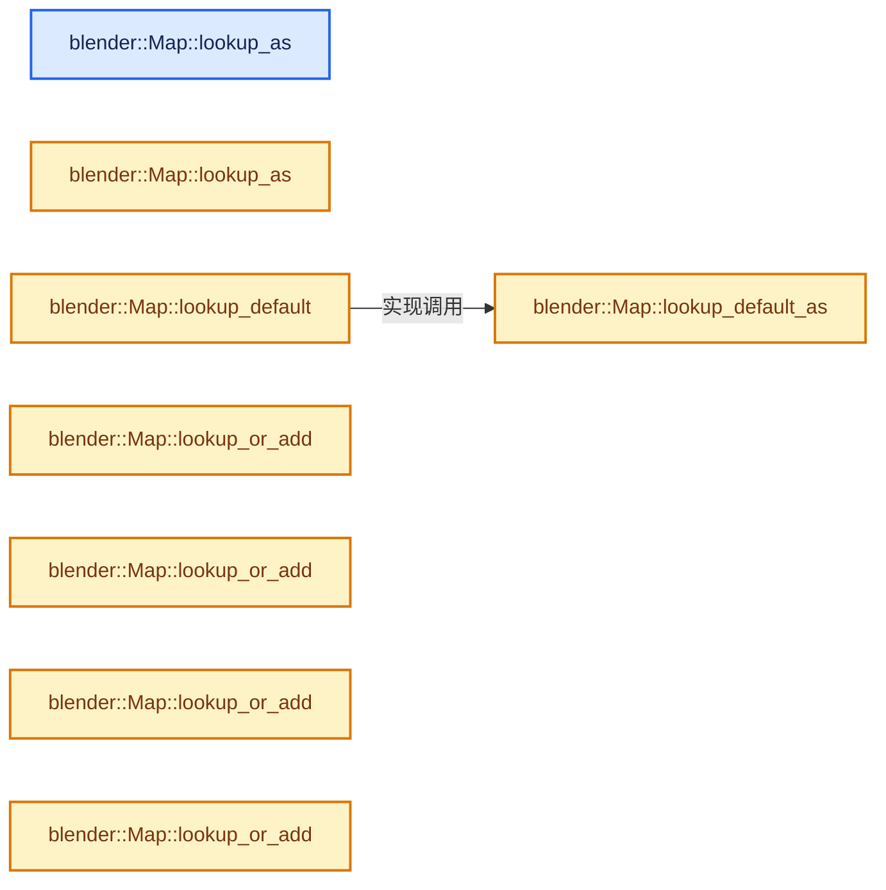
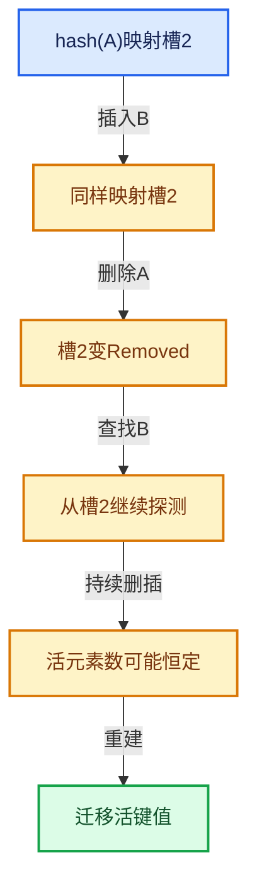

# 02-05 Map插入与回调

[方向导航](README.md) · [总目录](../README.md) · [实现索引](../00-课程指南/02-源码与提交索引/符号依赖与实现索引.md)

## 从问题到实现

lookup_or_add为什么适合延迟构造昂贵值？

查找与添加组合可以避免重复探测，但回调重入或修改同一容器时要检查契约和引用失效。

**数据模型**

lookup_or_add_cb在缺失路径才创建值，避免提前构造昂贵对象。

**设计取舍**

回调式接口减少样板与重复探测，但重入同一容器可能破坏正在使用的内部状态。

**最小反例**

回调内部向相同Map插入很多键并触发重建。

**推导**

查接口是否允许重入；不允许时先在外部构造或调整操作顺序。

## 阅读地图与执行推演

```mermaid
flowchart TB
  M["lookup_or_add_cb在缺失路径才创建值，避免提<br/>前构造昂贵对象。"]:::data
  C["回调式接口减少样板与重复探测，但重入同一容<br/>器可能破坏正在使用的内部状态。"]:::abstraction
  B["回调内部向相同Map插入很多键并触发重建。"]:::error
  R["查接口是否允许重入；不允许时先在外部构造或<br/>调整操作顺序。"]:::result
  M -->|"明确约束"| C
  C -->|"检验边界"| B
  B -->|"恢复正确性"| R
  classDef input fill:#DBEAFE,stroke:#2563EB,color:#172554,stroke-width:2px;
  classDef data fill:#CFFAFE,stroke:#0891B2,color:#164E63,stroke-width:2px;
  classDef abstraction fill:#EDE9FE,stroke:#7C3AED,color:#3B0764,stroke-width:2px;
  classDef compute fill:#FEF3C7,stroke:#D97706,color:#78350F,stroke-width:2px;
  classDef result fill:#DCFCE7,stroke:#16A34A,color:#14532D,stroke-width:2px;
  classDef error fill:#FEE2E2,stroke:#DC2626,color:#7F1D1D,stroke-width:2px;
```








图中的数值推演是本方向的教学模型；实际函数之间的调用边与概念分析边分别标注，不能把概念关系当作运行时调度顺序。

## 完整源码单元与就地讲解

中文讲解直接放在相关代码旁，复杂机制在代码下展开。原文折叠区保留基准行号；不需要在行号表和函数之间来回查找。类布局可分段展示，函数实现不按固定行数切开。

<a id="f-79a6756cad0e235d"></a>

### `blender::Map::lookup_as`

按键查找对应项。

实现位置：[source/blender/blenlib/BLI_map.hh](../../../../../source/blender/blenlib/BLI_map.hh) · L553—L558。

接口参数：

- `const ForwardKey &key`

**教学注释版**

<!-- annotated:05fedb82c33cd6 -->

```cpp
  template<typename ForwardKey> const Value &lookup_as(const ForwardKey &key) const
  {
    // [讲解] this->lookup_ptr_as：按键查找对应项。
    const Value *ptr = this->lookup_ptr_as(key);
    BLI_assert(ptr != nullptr);
    return *ptr;
  }
```

<details>
<summary>核对原始源码：source/blender/blenlib/BLI_map.hh · L553—L558</summary>

<!-- original:05fedb82c33cd6:source/blender/blenlib/BLI_map.hh:553:558 -->

```cpp
  template<typename ForwardKey> const Value &lookup_as(const ForwardKey &key) const
  {
    const Value *ptr = this->lookup_ptr_as(key);
    BLI_assert(ptr != nullptr);
    return *ptr;
  }
```

</details>

**接口与不变量**

引用、空指针与默认值表达不同失败语义，保存返回地址后再修改容器要检查失效。

**结果出口**

- `return *ptr;`

**继续追踪实现**

- `this->lookup_ptr_as` → [blender::Map::lookup_ptr_as · L516](04-Map查找与键访问.md#f-c82b929e8b2a18fb)；[blender::Map::lookup_ptr_as · L521](04-Map查找与键访问.md#f-6350d153de2baf1d)。同名重载需按实参类型选择。
- `BLI_assert` → [BLI_assert · L48](../90-实现依赖专题/01-BLI基础库/BLI_assert.hh.md#m-57a88495704d)；[BLI_assert · L63](../90-实现依赖专题/01-BLI基础库/BLI_assert.hh.md#m-d07050020cb5)。宏定义由构建条件选择。

<a id="f-2c59f935773aaceb"></a>

### `blender::Map::lookup_as`

按键查找对应项。

实现位置：[source/blender/blenlib/BLI_map.hh](../../../../../source/blender/blenlib/BLI_map.hh) · L559—L564。

接口参数：

- `const ForwardKey &key`

**教学注释版**

<!-- annotated:96a673e1db9eeb -->

```cpp
  template<typename ForwardKey> Value &lookup_as(const ForwardKey &key)
  {
    // [讲解] this->lookup_ptr_as：按键查找对应项。
    Value *ptr = this->lookup_ptr_as(key);
    BLI_assert(ptr != nullptr);
    return *ptr;
  }
```

<details>
<summary>核对原始源码：source/blender/blenlib/BLI_map.hh · L559—L564</summary>

<!-- original:96a673e1db9eeb:source/blender/blenlib/BLI_map.hh:559:564 -->

```cpp
  template<typename ForwardKey> Value &lookup_as(const ForwardKey &key)
  {
    Value *ptr = this->lookup_ptr_as(key);
    BLI_assert(ptr != nullptr);
    return *ptr;
  }
```

</details>

**接口与不变量**

引用、空指针与默认值表达不同失败语义，保存返回地址后再修改容器要检查失效。

**结果出口**

- `return *ptr;`

**继续追踪实现**

- `this->lookup_ptr_as` → [blender::Map::lookup_ptr_as · L516](04-Map查找与键访问.md#f-c82b929e8b2a18fb)；[blender::Map::lookup_ptr_as · L521](04-Map查找与键访问.md#f-6350d153de2baf1d)。同名重载需按实参类型选择。
- `BLI_assert` → [BLI_assert · L48](../90-实现依赖专题/01-BLI基础库/BLI_assert.hh.md#m-57a88495704d)；[BLI_assert · L63](../90-实现依赖专题/01-BLI基础库/BLI_assert.hh.md#m-d07050020cb5)。宏定义由构建条件选择。

### 类型布局、声明与编译条件 · BLI_map.hh L565—L569

<!-- annotated:e6955ae03edaa7 -->

```cpp

  /**
   * Returns a copy of the value that corresponds to the given key. If the key is not in the
   * map, the provided default_value is returned.
   */
```

<details>
<summary>核对原始源码：source/blender/blenlib/BLI_map.hh · L565—L569</summary>

<!-- original:e6955ae03edaa7:source/blender/blenlib/BLI_map.hh:565:569 -->

```cpp

  /**
   * Returns a copy of the value that corresponds to the given key. If the key is not in the
   * map, the provided default_value is returned.
   */
```

</details>

<a id="f-40294aaf345f6a8b"></a>

### `blender::Map::lookup_default`

按键查找对应项。

实现位置：[source/blender/blenlib/BLI_map.hh](../../../../../source/blender/blenlib/BLI_map.hh) · L570—L573。

接口参数：

- `const Key &key`
- `const Value &default_value`

**教学注释版**

<!-- annotated:61b6a363366e64 -->

```cpp
  Value lookup_default(const Key &key, const Value &default_value) const
  {
    return this->lookup_default_as(key, default_value);
  }
```

<details>
<summary>核对原始源码：source/blender/blenlib/BLI_map.hh · L570—L573</summary>

<!-- original:61b6a363366e64:source/blender/blenlib/BLI_map.hh:570:573 -->

```cpp
  Value lookup_default(const Key &key, const Value &default_value) const
  {
    return this->lookup_default_as(key, default_value);
  }
```

</details>

**接口与不变量**

引用、空指针与默认值表达不同失败语义，保存返回地址后再修改容器要检查失效。

**结果出口**

- `return this->lookup_default_as(key, default_value);`

**继续追踪实现**

- `this->lookup_default_as` → [blender::Map::lookup_default_as · L574](05-Map插入与回调.md#f-e564beca3ee75526)。

<a id="f-e564beca3ee75526"></a>

### `blender::Map::lookup_default_as`

实现位置：[source/blender/blenlib/BLI_map.hh](../../../../../source/blender/blenlib/BLI_map.hh) · L574—L582。

接口参数：

- `const ForwardKey &key`

**教学注释版**

<!-- annotated:fb52f5f25f6216 -->

```cpp
  template<typename ForwardKey, typename... ForwardValue>
  Value lookup_default_as(const ForwardKey &key, ForwardValue &&...default_value) const
  {
    // [讲解] this->lookup_ptr_as：按键查找对应项。
    const Value *ptr = this->lookup_ptr_as(key);
    if (ptr != nullptr) {
      return *ptr;
    }
    // [讲解] std::forward<ForwardValue>：在转发引用中恢复调用者传入的值类别；依赖推导类型，不能与无条件move互换。
    return Value(std::forward<ForwardValue>(default_value)...);
  }
```

<details>
<summary>核对原始源码：source/blender/blenlib/BLI_map.hh · L574—L582</summary>

<!-- original:fb52f5f25f6216:source/blender/blenlib/BLI_map.hh:574:582 -->

```cpp
  template<typename ForwardKey, typename... ForwardValue>
  Value lookup_default_as(const ForwardKey &key, ForwardValue &&...default_value) const
  {
    const Value *ptr = this->lookup_ptr_as(key);
    if (ptr != nullptr) {
      return *ptr;
    }
    return Value(std::forward<ForwardValue>(default_value)...);
  }
```

</details>

**结果出口**

- `return *ptr;`
- `return Value(std::forward<ForwardValue>(default_value)...);`

**继续追踪实现**

- `this->lookup_ptr_as` → [blender::Map::lookup_ptr_as · L516](04-Map查找与键访问.md#f-c82b929e8b2a18fb)；[blender::Map::lookup_ptr_as · L521](04-Map查找与键访问.md#f-6350d153de2baf1d)。同名重载需按实参类型选择。
- `Value` → [blender::io::serialize::Value](../90-实现依赖专题/08-其他Blender模块/editors/asset/intern/asset_index.hh.md#t-12f6bd59d805)；[blender::io::serialize::Value](../90-实现依赖专题/01-BLI基础库/BLI_serialize.hh.md#t-68cc6c9eb2b6)；[blender::io::serialize::Value](../90-实现依赖专题/01-BLI基础库/BLI_serialize.hh.md#t-6338b3e5fd60)；[blender::math::Axis::Value](../90-实现依赖专题/01-BLI基础库/BLI_math_basis_types.hh.md#t-ef2f63ee0ed5)；[blender::math::AxisSigned::Value](../90-实现依赖专题/01-BLI基础库/BLI_math_basis_types.hh.md#t-fde967b6970e)；[blender::io::serialize::Value](../90-实现依赖专题/02-BKE几何与数据/BKE_idprop.hh.md#t-295d951f0692)；[blender::gpu::shader::SpecializationConstant::Value](../90-实现依赖专题/08-其他Blender模块/gpu/GPU_common_types.hh.md#t-8b4628c1c185)；[blender::fn::GFieldRef::Value](../90-实现依赖专题/03-FN函数与求值/FN_field.hh.md#t-c10039d00c56)。
- `std::forward<ForwardValue>` → [外部契约](https://eel.is/c++draft/utility.forward)：在转发引用中恢复调用者传入的值类别；依赖推导类型，不能与无条件move互换。

### 类型布局、声明与编译条件 · BLI_map.hh L583—L587

<!-- annotated:50ce68974525c7 -->

```cpp

  /**
   * Returns a reference to the value corresponding to the given key. If the key is not in the map,
   * a new key-value-pair is added and a reference to the value in the map is returned.
   */
```

<details>
<summary>核对原始源码：source/blender/blenlib/BLI_map.hh · L583—L587</summary>

<!-- original:50ce68974525c7:source/blender/blenlib/BLI_map.hh:583:587 -->

```cpp

  /**
   * Returns a reference to the value corresponding to the given key. If the key is not in the map,
   * a new key-value-pair is added and a reference to the value in the map is returned.
   */
```

</details>

<a id="f-c419897675e1c232"></a>

### `blender::Map::lookup_or_add`

把查找与缺失时创建合成一次操作。

实现位置：[source/blender/blenlib/BLI_map.hh](../../../../../source/blender/blenlib/BLI_map.hh) · L588—L591。

接口参数：

- `const Key &key`
- `const Value &value`

**教学注释版**

<!-- annotated:178ec956782b73 -->

```cpp
  Value &lookup_or_add(const Key &key, const Value &value)
  {
    // [讲解] this->lookup_or_add_as：把查找与缺失时创建合成一次操作。
    return this->lookup_or_add_as(key, value);
  }
```

<details>
<summary>核对原始源码：source/blender/blenlib/BLI_map.hh · L588—L591</summary>

<!-- original:178ec956782b73:source/blender/blenlib/BLI_map.hh:588:591 -->

```cpp
  Value &lookup_or_add(const Key &key, const Value &value)
  {
    return this->lookup_or_add_as(key, value);
  }
```

</details>

**接口与不变量**

回调可能只在缺失时执行；不能未经接口允许在回调中重入修改同一个表。

**结果出口**

- `return this->lookup_or_add_as(key, value);`

**继续追踪实现**

- `this->lookup_or_add_as` → [blender::Map::lookup_or_add_as · L604](05-Map插入与回调.md#f-d3d3b432f492ec61)。

<a id="f-85b5fa3f7399794c"></a>

### `blender::Map::lookup_or_add`

把查找与缺失时创建合成一次操作。

实现位置：[source/blender/blenlib/BLI_map.hh](../../../../../source/blender/blenlib/BLI_map.hh) · L592—L595。

接口参数：

- `const Key &key`
- `Value &&value`

**教学注释版**

<!-- annotated:3f6d034c175b6f -->

```cpp
  Value &lookup_or_add(const Key &key, Value &&value)
  {
    // [讲解] this->lookup_or_add_as：把查找与缺失时创建合成一次操作。
    return this->lookup_or_add_as(key, std::move(value));
  }
```

<details>
<summary>核对原始源码：source/blender/blenlib/BLI_map.hh · L592—L595</summary>

<!-- original:3f6d034c175b6f:source/blender/blenlib/BLI_map.hh:592:595 -->

```cpp
  Value &lookup_or_add(const Key &key, Value &&value)
  {
    return this->lookup_or_add_as(key, std::move(value));
  }
```

</details>

**接口与不变量**

回调可能只在缺失时执行；不能未经接口允许在回调中重入修改同一个表。

**结果出口**

- `return this->lookup_or_add_as(key, std::move(value));`

**继续追踪实现**

- `this->lookup_or_add_as` → [blender::Map::lookup_or_add_as · L604](05-Map插入与回调.md#f-d3d3b432f492ec61)。
- `std::move` → [外部契约](https://eel.is/c++draft/utility.forward)：把表达式转换成可供移动重载选择的值类别；不保证真的移动，不结束源对象寿命，对const值可能选择复制。

<a id="f-45a386e54e052059"></a>

### `blender::Map::lookup_or_add`

把查找与缺失时创建合成一次操作。

实现位置：[source/blender/blenlib/BLI_map.hh](../../../../../source/blender/blenlib/BLI_map.hh) · L596—L599。

接口参数：

- `Key &&key`
- `const Value &value`

**教学注释版**

<!-- annotated:68d90d23e6ae9e -->

```cpp
  Value &lookup_or_add(Key &&key, const Value &value)
  {
    // [讲解] this->lookup_or_add_as：把查找与缺失时创建合成一次操作。
    return this->lookup_or_add_as(std::move(key), value);
  }
```

<details>
<summary>核对原始源码：source/blender/blenlib/BLI_map.hh · L596—L599</summary>

<!-- original:68d90d23e6ae9e:source/blender/blenlib/BLI_map.hh:596:599 -->

```cpp
  Value &lookup_or_add(Key &&key, const Value &value)
  {
    return this->lookup_or_add_as(std::move(key), value);
  }
```

</details>

**接口与不变量**

回调可能只在缺失时执行；不能未经接口允许在回调中重入修改同一个表。

**结果出口**

- `return this->lookup_or_add_as(std::move(key), value);`

**继续追踪实现**

- `this->lookup_or_add_as` → [blender::Map::lookup_or_add_as · L604](05-Map插入与回调.md#f-d3d3b432f492ec61)。
- `std::move` → [外部契约](https://eel.is/c++draft/utility.forward)：把表达式转换成可供移动重载选择的值类别；不保证真的移动，不结束源对象寿命，对const值可能选择复制。

<a id="f-fee760b21dfabceb"></a>

### `blender::Map::lookup_or_add`

把查找与缺失时创建合成一次操作。

实现位置：[source/blender/blenlib/BLI_map.hh](../../../../../source/blender/blenlib/BLI_map.hh) · L600—L603。

接口参数：

- `Key &&key`
- `Value &&value`

**教学注释版**

<!-- annotated:9af17aef85bcba -->

```cpp
  Value &lookup_or_add(Key &&key, Value &&value)
  {
    // [讲解] this->lookup_or_add_as：把查找与缺失时创建合成一次操作。
    return this->lookup_or_add_as(std::move(key), std::move(value));
  }
```

<details>
<summary>核对原始源码：source/blender/blenlib/BLI_map.hh · L600—L603</summary>

<!-- original:9af17aef85bcba:source/blender/blenlib/BLI_map.hh:600:603 -->

```cpp
  Value &lookup_or_add(Key &&key, Value &&value)
  {
    return this->lookup_or_add_as(std::move(key), std::move(value));
  }
```

</details>

**接口与不变量**

回调可能只在缺失时执行；不能未经接口允许在回调中重入修改同一个表。

**结果出口**

- `return this->lookup_or_add_as(std::move(key), std::move(value));`

**继续追踪实现**

- `this->lookup_or_add_as` → [blender::Map::lookup_or_add_as · L604](05-Map插入与回调.md#f-d3d3b432f492ec61)。
- `std::move` → [外部契约](https://eel.is/c++draft/utility.forward)：把表达式转换成可供移动重载选择的值类别；不保证真的移动，不结束源对象寿命，对const值可能选择复制。

<a id="f-d3d3b432f492ec61"></a>

### `blender::Map::lookup_or_add_as`

把查找与缺失时创建合成一次操作。

实现位置：[source/blender/blenlib/BLI_map.hh](../../../../../source/blender/blenlib/BLI_map.hh) · L604—L609。

接口参数：

- `ForwardKey &&key`

**教学注释版**

<!-- annotated:98eac475acba70 -->

```cpp
  template<typename ForwardKey, typename... ForwardValue>
  Value &lookup_or_add_as(ForwardKey &&key, ForwardValue &&...value)
  {
    return this->lookup_or_add__impl(
        // [讲解] std::forward<ForwardKey>：在转发引用中恢复调用者传入的值类别；依赖推导类型，不能与无条件move互换。
        std::forward<ForwardKey>(key), hash_(key), std::forward<ForwardValue>(value)...);
  }
```

<details>
<summary>核对原始源码：source/blender/blenlib/BLI_map.hh · L604—L609</summary>

<!-- original:98eac475acba70:source/blender/blenlib/BLI_map.hh:604:609 -->

```cpp
  template<typename ForwardKey, typename... ForwardValue>
  Value &lookup_or_add_as(ForwardKey &&key, ForwardValue &&...value)
  {
    return this->lookup_or_add__impl(
        std::forward<ForwardKey>(key), hash_(key), std::forward<ForwardValue>(value)...);
  }
```

</details>

**接口与不变量**

回调可能只在缺失时执行；不能未经接口允许在回调中重入修改同一个表。

**结果出口**

- `return this->lookup_or_add__impl(`

**继续追踪实现**

- `this->lookup_or_add__impl` → [blender::Map::lookup_or_add__impl · L1271](07-重建与摊还复杂度.md#f-e91ef5efdcac2964)。
- `std::forward<ForwardKey>` → [外部契约](https://eel.is/c++draft/utility.forward)：在转发引用中恢复调用者传入的值类别；依赖推导类型，不能与无条件move互换。
- `hash_` → [调用协议](../00-课程指南/01-路线与规范/模板宏与动态分派协议.md)：函数指针、局部可调用对象或未展开的宏；必须结合调用者环境。调用位置L608。
- `std::forward<ForwardValue>` → [外部契约](https://eel.is/c++draft/utility.forward)：在转发引用中恢复调用者传入的值类别；依赖推导类型，不能与无条件move互换。

### 类型布局、声明与编译条件 · BLI_map.hh L610—L618

<!-- annotated:095a9df2d75ec6 -->

```cpp

  /**
   * Returns a reference to the value that corresponds to the given key. If the key is not yet in
   * the map, it will be newly added.
   *
   * The create_value callback is only called when the key did not exist yet. It is expected to
   * take no parameters and return the value to be inserted. The callback is called before the key
   * is copied/moved into the map.
   */
```

<details>
<summary>核对原始源码：source/blender/blenlib/BLI_map.hh · L610—L618</summary>

<!-- original:095a9df2d75ec6:source/blender/blenlib/BLI_map.hh:610:618 -->

```cpp

  /**
   * Returns a reference to the value that corresponds to the given key. If the key is not yet in
   * the map, it will be newly added.
   *
   * The create_value callback is only called when the key did not exist yet. It is expected to
   * take no parameters and return the value to be inserted. The callback is called before the key
   * is copied/moved into the map.
   */
```

</details>

<a id="f-6e15bb75721c1170"></a>

### `blender::Map::lookup_or_add_cb`

把查找与缺失时创建合成一次操作。

实现位置：[source/blender/blenlib/BLI_map.hh](../../../../../source/blender/blenlib/BLI_map.hh) · L619—L623。

接口参数：

- `const Key &key`
- `const CreateValueF &create_value`

**教学注释版**

<!-- annotated:cb958912a48397 -->

```cpp
  template<typename CreateValueF>
  Value &lookup_or_add_cb(const Key &key, const CreateValueF &create_value)
  {
    // [讲解] this->lookup_or_add_cb_as：把查找与缺失时创建合成一次操作。
    return this->lookup_or_add_cb_as(key, create_value);
  }
```

<details>
<summary>核对原始源码：source/blender/blenlib/BLI_map.hh · L619—L623</summary>

<!-- original:cb958912a48397:source/blender/blenlib/BLI_map.hh:619:623 -->

```cpp
  template<typename CreateValueF>
  Value &lookup_or_add_cb(const Key &key, const CreateValueF &create_value)
  {
    return this->lookup_or_add_cb_as(key, create_value);
  }
```

</details>

**接口与不变量**

回调可能只在缺失时执行；不能未经接口允许在回调中重入修改同一个表。

**结果出口**

- `return this->lookup_or_add_cb_as(key, create_value);`

**继续追踪实现**

- `this->lookup_or_add_cb_as` → [blender::Map::lookup_or_add_cb_as · L629](05-Map插入与回调.md#f-5209824801eb636c)。

<a id="f-9685875870107c12"></a>

### `blender::Map::lookup_or_add_cb`

把查找与缺失时创建合成一次操作。

实现位置：[source/blender/blenlib/BLI_map.hh](../../../../../source/blender/blenlib/BLI_map.hh) · L624—L628。

接口参数：

- `Key &&key`
- `const CreateValueF &create_value`

**教学注释版**

<!-- annotated:d5c7ff3fc51084 -->

```cpp
  template<typename CreateValueF>
  Value &lookup_or_add_cb(Key &&key, const CreateValueF &create_value)
  {
    // [讲解] this->lookup_or_add_cb_as：把查找与缺失时创建合成一次操作。
    return this->lookup_or_add_cb_as(std::move(key), create_value);
  }
```

<details>
<summary>核对原始源码：source/blender/blenlib/BLI_map.hh · L624—L628</summary>

<!-- original:d5c7ff3fc51084:source/blender/blenlib/BLI_map.hh:624:628 -->

```cpp
  template<typename CreateValueF>
  Value &lookup_or_add_cb(Key &&key, const CreateValueF &create_value)
  {
    return this->lookup_or_add_cb_as(std::move(key), create_value);
  }
```

</details>

**接口与不变量**

回调可能只在缺失时执行；不能未经接口允许在回调中重入修改同一个表。

**结果出口**

- `return this->lookup_or_add_cb_as(std::move(key), create_value);`

**继续追踪实现**

- `this->lookup_or_add_cb_as` → [blender::Map::lookup_or_add_cb_as · L629](05-Map插入与回调.md#f-5209824801eb636c)。
- `std::move` → [外部契约](https://eel.is/c++draft/utility.forward)：把表达式转换成可供移动重载选择的值类别；不保证真的移动，不结束源对象寿命，对const值可能选择复制。

<a id="f-5209824801eb636c"></a>

### `blender::Map::lookup_or_add_cb_as`

把查找与缺失时创建合成一次操作。

实现位置：[source/blender/blenlib/BLI_map.hh](../../../../../source/blender/blenlib/BLI_map.hh) · L629—L633。

接口参数：

- `ForwardKey &&key`
- `const CreateValueF &create_value`

**教学注释版**

<!-- annotated:4122f9b3fc1d15 -->

```cpp
  template<typename ForwardKey, typename CreateValueF>
  Value &lookup_or_add_cb_as(ForwardKey &&key, const CreateValueF &create_value)
  {
    // [讲解] std::forward<ForwardKey>：在转发引用中恢复调用者传入的值类别；依赖推导类型，不能与无条件move互换。
    return this->lookup_or_add_cb__impl(std::forward<ForwardKey>(key), create_value, hash_(key));
  }
```

<details>
<summary>核对原始源码：source/blender/blenlib/BLI_map.hh · L629—L633</summary>

<!-- original:4122f9b3fc1d15:source/blender/blenlib/BLI_map.hh:629:633 -->

```cpp
  template<typename ForwardKey, typename CreateValueF>
  Value &lookup_or_add_cb_as(ForwardKey &&key, const CreateValueF &create_value)
  {
    return this->lookup_or_add_cb__impl(std::forward<ForwardKey>(key), create_value, hash_(key));
  }
```

</details>

**接口与不变量**

回调可能只在缺失时执行；不能未经接口允许在回调中重入修改同一个表。

**结果出口**

- `return this->lookup_or_add_cb__impl(std::forward<ForwardKey>(key), create_value, hash_(key));`

**继续追踪实现**

- `this->lookup_or_add_cb__impl` → [blender::Map::lookup_or_add_cb__impl · L1251](07-重建与摊还复杂度.md#f-04674c71289a8005)。
- `std::forward<ForwardKey>` → [外部契约](https://eel.is/c++draft/utility.forward)：在转发引用中恢复调用者传入的值类别；依赖推导类型，不能与无条件move互换。
- `hash_` → [调用协议](../00-课程指南/01-路线与规范/模板宏与动态分派协议.md)：函数指针、局部可调用对象或未展开的宏；必须结合调用者环境。调用位置L632。

### 类型布局、声明与编译条件 · BLI_map.hh L634—L638

<!-- annotated:0e017dddfb8c51 -->

```cpp

  /**
   * Returns a reference to the value that corresponds to the given key. If the key is not yet in
   * the map, it will be newly added. The newly added value will be default constructed.
   */
```

<details>
<summary>核对原始源码：source/blender/blenlib/BLI_map.hh · L634—L638</summary>

<!-- original:0e017dddfb8c51:source/blender/blenlib/BLI_map.hh:634:638 -->

```cpp

  /**
   * Returns a reference to the value that corresponds to the given key. If the key is not yet in
   * the map, it will be newly added. The newly added value will be default constructed.
   */
```

</details>

<a id="f-e8d33f0bfe1f3153"></a>

### `blender::Map::lookup_or_add_default`

实现位置：[source/blender/blenlib/BLI_map.hh](../../../../../source/blender/blenlib/BLI_map.hh) · L639—L642。

接口参数：

- `const Key &key`

**教学注释版**

<!-- annotated:2cece52762993b -->

```cpp
  Value &lookup_or_add_default(const Key &key)
  {
    return this->lookup_or_add_default_as(key);
  }
```

<details>
<summary>核对原始源码：source/blender/blenlib/BLI_map.hh · L639—L642</summary>

<!-- original:2cece52762993b:source/blender/blenlib/BLI_map.hh:639:642 -->

```cpp
  Value &lookup_or_add_default(const Key &key)
  {
    return this->lookup_or_add_default_as(key);
  }
```

</details>

**结果出口**

- `return this->lookup_or_add_default_as(key);`

**继续追踪实现**

- `this->lookup_or_add_default_as` → [blender::Map::lookup_or_add_default_as · L647](05-Map插入与回调.md#f-85914156c7417813)。

<a id="f-d67ab6e12fd0a267"></a>

### `blender::Map::lookup_or_add_default`

实现位置：[source/blender/blenlib/BLI_map.hh](../../../../../source/blender/blenlib/BLI_map.hh) · L643—L646。

接口参数：

- `Key &&key`

**教学注释版**

<!-- annotated:87657b0cbe14e6 -->

```cpp
  Value &lookup_or_add_default(Key &&key)
  {
    // [讲解] std::move：把表达式转换成可供移动重载选择的值类别；不保证真的移动，不结束源对象寿命，对const值可能选择复制。
    return this->lookup_or_add_default_as(std::move(key));
  }
```

<details>
<summary>核对原始源码：source/blender/blenlib/BLI_map.hh · L643—L646</summary>

<!-- original:87657b0cbe14e6:source/blender/blenlib/BLI_map.hh:643:646 -->

```cpp
  Value &lookup_or_add_default(Key &&key)
  {
    return this->lookup_or_add_default_as(std::move(key));
  }
```

</details>

**结果出口**

- `return this->lookup_or_add_default_as(std::move(key));`

**继续追踪实现**

- `this->lookup_or_add_default_as` → [blender::Map::lookup_or_add_default_as · L647](05-Map插入与回调.md#f-85914156c7417813)。
- `std::move` → [外部契约](https://eel.is/c++draft/utility.forward)：把表达式转换成可供移动重载选择的值类别；不保证真的移动，不结束源对象寿命，对const值可能选择复制。

<a id="f-85914156c7417813"></a>

### `blender::Map::lookup_or_add_default_as`

实现位置：[source/blender/blenlib/BLI_map.hh](../../../../../source/blender/blenlib/BLI_map.hh) · L647—L650。

接口参数：

- `ForwardKey &&key`

**教学注释版**

<!-- annotated:c0bf5ed03b39af -->

```cpp
  template<typename ForwardKey> Value &lookup_or_add_default_as(ForwardKey &&key)
  {
    // [讲解] this->lookup_or_add_cb_as：把查找与缺失时创建合成一次操作。
    return this->lookup_or_add_cb_as(std::forward<ForwardKey>(key), []() { return Value(); });
  }
```

<details>
<summary>核对原始源码：source/blender/blenlib/BLI_map.hh · L647—L650</summary>

<!-- original:c0bf5ed03b39af:source/blender/blenlib/BLI_map.hh:647:650 -->

```cpp
  template<typename ForwardKey> Value &lookup_or_add_default_as(ForwardKey &&key)
  {
    return this->lookup_or_add_cb_as(std::forward<ForwardKey>(key), []() { return Value(); });
  }
```

</details>

**结果出口**

- `return this->lookup_or_add_cb_as(std::forward<ForwardKey>(key), []() { return Value(); });`

**继续追踪实现**

- `this->lookup_or_add_cb_as` → [blender::Map::lookup_or_add_cb_as · L629](05-Map插入与回调.md#f-5209824801eb636c)。
- `std::forward<ForwardKey>` → [外部契约](https://eel.is/c++draft/utility.forward)：在转发引用中恢复调用者传入的值类别；依赖推导类型，不能与无条件move互换。
- `Value` → [blender::io::serialize::Value](../90-实现依赖专题/08-其他Blender模块/editors/asset/intern/asset_index.hh.md#t-12f6bd59d805)；[blender::io::serialize::Value](../90-实现依赖专题/01-BLI基础库/BLI_serialize.hh.md#t-68cc6c9eb2b6)；[blender::io::serialize::Value](../90-实现依赖专题/01-BLI基础库/BLI_serialize.hh.md#t-6338b3e5fd60)；[blender::math::Axis::Value](../90-实现依赖专题/01-BLI基础库/BLI_math_basis_types.hh.md#t-ef2f63ee0ed5)；[blender::math::AxisSigned::Value](../90-实现依赖专题/01-BLI基础库/BLI_math_basis_types.hh.md#t-fde967b6970e)；[blender::io::serialize::Value](../90-实现依赖专题/02-BKE几何与数据/BKE_idprop.hh.md#t-295d951f0692)；[blender::gpu::shader::SpecializationConstant::Value](../90-实现依赖专题/08-其他Blender模块/gpu/GPU_common_types.hh.md#t-8b4628c1c185)；[blender::fn::GFieldRef::Value](../90-实现依赖专题/03-FN函数与求值/FN_field.hh.md#t-c10039d00c56)。

### 类型布局、声明与编译条件 · BLI_map.hh L651—L655

<!-- annotated:3baac8c77234b2 -->

```cpp

  /**
   * Returns the key that is stored in the set that compares equal to the given key. This invokes
   * undefined behavior when the key is not in the map.
   */
```

<details>
<summary>核对原始源码：source/blender/blenlib/BLI_map.hh · L651—L655</summary>

<!-- original:3baac8c77234b2:source/blender/blenlib/BLI_map.hh:651:655 -->

```cpp

  /**
   * Returns the key that is stored in the set that compares equal to the given key. This invokes
   * undefined behavior when the key is not in the map.
   */
```

</details>

<a id="f-2614e1eb65c2dda9"></a>

### `blender::Map::lookup_key`

实现位置：[source/blender/blenlib/BLI_map.hh](../../../../../source/blender/blenlib/BLI_map.hh) · L656—L659。

接口参数：

- `const Key &key`

**教学注释版**

<!-- annotated:f5d04e83853004 -->

```cpp
  const Key &lookup_key(const Key &key) const
  {
    return this->lookup_key_as(key);
  }
```

<details>
<summary>核对原始源码：source/blender/blenlib/BLI_map.hh · L656—L659</summary>

<!-- original:f5d04e83853004:source/blender/blenlib/BLI_map.hh:656:659 -->

```cpp
  const Key &lookup_key(const Key &key) const
  {
    return this->lookup_key_as(key);
  }
```

</details>

**结果出口**

- `return this->lookup_key_as(key);`

**继续追踪实现**

- `this->lookup_key_as` → [blender::Map::lookup_key_as · L660](05-Map插入与回调.md#f-7d4693e0bc2252d8)。

<a id="f-7d4693e0bc2252d8"></a>

### `blender::Map::lookup_key_as`

实现位置：[source/blender/blenlib/BLI_map.hh](../../../../../source/blender/blenlib/BLI_map.hh) · L660—L664。

接口参数：

- `const ForwardKey &key`

**教学注释版**

<!-- annotated:1c3d8988a696cb -->

```cpp
  template<typename ForwardKey> const Key &lookup_key_as(const ForwardKey &key) const
  {
    const Slot &slot = this->lookup_slot(key, hash_(key));
    return *slot.key();
  }
```

<details>
<summary>核对原始源码：source/blender/blenlib/BLI_map.hh · L660—L664</summary>

<!-- original:1c3d8988a696cb:source/blender/blenlib/BLI_map.hh:660:664 -->

```cpp
  template<typename ForwardKey> const Key &lookup_key_as(const ForwardKey &key) const
  {
    const Slot &slot = this->lookup_slot(key, hash_(key));
    return *slot.key();
  }
```

</details>

**结果出口**

- `return *slot.key();`

**继续追踪实现**

- `this->lookup_slot` → [blender::Map::lookup_slot · L1306](07-重建与摊还复杂度.md#f-7180cfdde1dfaf79)；[blender::Map::lookup_slot · L1318](07-重建与摊还复杂度.md#f-94b5328db99e893f)。同名重载需按实参类型选择。
- `hash_` → [调用协议](../00-课程指南/01-路线与规范/模板宏与动态分派协议.md)：函数指针、局部可调用对象或未展开的宏；必须结合调用者环境。调用位置L662。
- `slot.key` → [调用协议](../00-课程指南/01-路线与规范/模板宏与动态分派协议.md)：Slot模板参数提供的操作协议。调用位置L663。

### 类型布局、声明与编译条件 · BLI_map.hh L665—L669

<!-- annotated:be512e8f683ab3 -->

```cpp

  /**
   * Returns a pointer to the key that is stored in the map that compares equal to the given key.
   * If the key is not in the map, null is returned.
   */
```

<details>
<summary>核对原始源码：source/blender/blenlib/BLI_map.hh · L665—L669</summary>

<!-- original:be512e8f683ab3:source/blender/blenlib/BLI_map.hh:665:669 -->

```cpp

  /**
   * Returns a pointer to the key that is stored in the map that compares equal to the given key.
   * If the key is not in the map, null is returned.
   */
```

</details>

<a id="f-fcf615d00982e3b5"></a>

### `blender::Map::lookup_key_ptr`

实现位置：[source/blender/blenlib/BLI_map.hh](../../../../../source/blender/blenlib/BLI_map.hh) · L670—L673。

接口参数：

- `const Key &key`

**教学注释版**

<!-- annotated:8df37894101c01 -->

```cpp
  const Key *lookup_key_ptr(const Key &key) const
  {
    return this->lookup_key_ptr_as(key);
  }
```

<details>
<summary>核对原始源码：source/blender/blenlib/BLI_map.hh · L670—L673</summary>

<!-- original:8df37894101c01:source/blender/blenlib/BLI_map.hh:670:673 -->

```cpp
  const Key *lookup_key_ptr(const Key &key) const
  {
    return this->lookup_key_ptr_as(key);
  }
```

</details>

**结果出口**

- `return this->lookup_key_ptr_as(key);`

**继续追踪实现**

- `this->lookup_key_ptr_as` → [blender::Map::lookup_key_ptr_as · L674](05-Map插入与回调.md#f-d6fbaf53a7a0a28e)。

<a id="f-d6fbaf53a7a0a28e"></a>

### `blender::Map::lookup_key_ptr_as`

实现位置：[source/blender/blenlib/BLI_map.hh](../../../../../source/blender/blenlib/BLI_map.hh) · L674—L681。

接口参数：

- `const ForwardKey &key`

**教学注释版**

<!-- annotated:e55a28b061ed90 -->

```cpp
  template<typename ForwardKey> const Key *lookup_key_ptr_as(const ForwardKey &key) const
  {
    const Slot *slot = this->lookup_slot_ptr(key, hash_(key));
    if (slot == nullptr) {
      return nullptr;
    }
    return slot->key();
  }
```

<details>
<summary>核对原始源码：source/blender/blenlib/BLI_map.hh · L674—L681</summary>

<!-- original:e55a28b061ed90:source/blender/blenlib/BLI_map.hh:674:681 -->

```cpp
  template<typename ForwardKey> const Key *lookup_key_ptr_as(const ForwardKey &key) const
  {
    const Slot *slot = this->lookup_slot_ptr(key, hash_(key));
    if (slot == nullptr) {
      return nullptr;
    }
    return slot->key();
  }
```

</details>

**结果出口**

- `return nullptr;`
- `return slot->key();`

**继续追踪实现**

- `this->lookup_slot_ptr` → [blender::Map::lookup_slot_ptr · L1323](07-重建与摊还复杂度.md#f-93cb8db01f95f07b)；[blender::Map::lookup_slot_ptr · L1337](07-重建与摊还复杂度.md#f-eeec937f512ef4fe)。同名重载需按实参类型选择。
- `hash_` → [调用协议](../00-课程指南/01-路线与规范/模板宏与动态分派协议.md)：函数指针、局部可调用对象或未展开的宏；必须结合调用者环境。调用位置L676。
- `slot->key` → [调用协议](../00-课程指南/01-路线与规范/模板宏与动态分派协议.md)：Slot模板参数提供的操作协议。调用位置L680。

### 类型布局、声明与编译条件 · BLI_map.hh L682—L686

<!-- annotated:0c22b6f1a62586 -->

```cpp

  /**
   * Calls the provided callback for every key-value-pair in the map. The callback is expected
   * to take a `const Key &` as first and a `const Value &` as second parameter.
   */
```

<details>
<summary>核对原始源码：source/blender/blenlib/BLI_map.hh · L682—L686</summary>

<!-- original:0c22b6f1a62586:source/blender/blenlib/BLI_map.hh:682:686 -->

```cpp

  /**
   * Calls the provided callback for every key-value-pair in the map. The callback is expected
   * to take a `const Key &` as first and a `const Value &` as second parameter.
   */
```

</details>

<a id="f-f89a0d0750944af9"></a>

### `blender::Map::foreach_item`

实现位置：[source/blender/blenlib/BLI_map.hh](../../../../../source/blender/blenlib/BLI_map.hh) · L687—L698。

接口参数：

- `const FuncT &func`

**教学注释版**

<!-- annotated:3c5861ee0ab587 -->

```cpp
  template<typename FuncT> void foreach_item(const FuncT &func) const
  {
    // [讲解] slots_.size：查询活项数量或键是否存在。
    int64_t size = slots_.size();
    for (int64_t i = 0; i < size; i++) {
      const Slot &slot = slots_[i];
      if (slot.is_occupied()) {
        const Key &key = *slot.key();
        const Value &value = *slot.value();
        func(key, value);
      }
    }
  }
```

<details>
<summary>核对原始源码：source/blender/blenlib/BLI_map.hh · L687—L698</summary>

<!-- original:3c5861ee0ab587:source/blender/blenlib/BLI_map.hh:687:698 -->

```cpp
  template<typename FuncT> void foreach_item(const FuncT &func) const
  {
    int64_t size = slots_.size();
    for (int64_t i = 0; i < size; i++) {
      const Slot &slot = slots_[i];
      if (slot.is_occupied()) {
        const Key &key = *slot.key();
        const Value &value = *slot.value();
        func(key, value);
      }
    }
  }
```

</details>

**继续追踪实现**

- `slots_.size` → [blender::Map::size · L976](06-删除墓碑与值销毁.md#f-ac1e466c97fbbebe)。
- `slot.is_occupied` → [调用协议](../00-课程指南/01-路线与规范/模板宏与动态分派协议.md)：Slot模板参数提供的操作协议。调用位置L692。
- `slot.key` → [调用协议](../00-课程指南/01-路线与规范/模板宏与动态分派协议.md)：Slot模板参数提供的操作协议。调用位置L693。
- `slot.value` → [调用协议](../00-课程指南/01-路线与规范/模板宏与动态分派协议.md)：Slot模板参数提供的操作协议。调用位置L694。
- `func` → [调用协议](../00-课程指南/01-路线与规范/模板宏与动态分派协议.md)：局部可调用对象，须结合其初始化与捕获环境。调用位置L695。

### 类型布局、声明与编译条件 · BLI_map.hh L699—L715

<a id="t-4ef6612074c3"></a>

`BaseIterator`在这里声明的数据成员：

- `Slot slots_`
- `int64_t total_slots_`
- `int64_t current_slot_`

<!-- annotated:f861d0362d3f42 -->

```cpp

  /* Common base class for all iterators below. */
  struct BaseIterator {
   public:
    using iterator_category = std::forward_iterator_tag;
    using difference_type = std::ptrdiff_t;

   protected:
    /* We could have separate base iterators for const and non-const iterators, but that would add
     * more complexity than benefits right now. */
    Slot *slots_;
    int64_t total_slots_;
    int64_t current_slot_;

    friend Map;

   public:
```

<details>
<summary>核对原始源码：source/blender/blenlib/BLI_map.hh · L699—L715</summary>

<!-- original:f861d0362d3f42:source/blender/blenlib/BLI_map.hh:699:715 -->

```cpp

  /* Common base class for all iterators below. */
  struct BaseIterator {
   public:
    using iterator_category = std::forward_iterator_tag;
    using difference_type = std::ptrdiff_t;

   protected:
    /* We could have separate base iterators for const and non-const iterators, but that would add
     * more complexity than benefits right now. */
    Slot *slots_;
    int64_t total_slots_;
    int64_t current_slot_;

    friend Map;

   public:
```

</details>

<a id="f-a394f8f4f0141378"></a>

### `blender::Map::BaseIterator::BaseIterator`

实现位置：[source/blender/blenlib/BLI_map.hh](../../../../../source/blender/blenlib/BLI_map.hh) · L716—L719。

接口参数：

- `const Slot *slots`
- `const int64_t total_slots`
- `const int64_t current_slot`

**教学注释版**

<!-- annotated:4766c14e7d3ddf -->

```cpp
    BaseIterator(const Slot *slots, const int64_t total_slots, const int64_t current_slot)
        : slots_(const_cast<Slot *>(slots)), total_slots_(total_slots), current_slot_(current_slot)
    {
    }
```

<details>
<summary>核对原始源码：source/blender/blenlib/BLI_map.hh · L716—L719</summary>

<!-- original:4766c14e7d3ddf:source/blender/blenlib/BLI_map.hh:716:719 -->

```cpp
    BaseIterator(const Slot *slots, const int64_t total_slots, const int64_t current_slot)
        : slots_(const_cast<Slot *>(slots)), total_slots_(total_slots), current_slot_(current_slot)
    {
    }
```

</details>

**继续追踪实现**

本实现没有需要继续展开的显式调用；检查返回表达式、对象转换和调用者前置条件。

<!-- annotated:d1fdb62ec9b739 -->

```cpp

```

<details>
<summary>核对原始源码：source/blender/blenlib/BLI_map.hh · L720—L720</summary>

<!-- original:d1fdb62ec9b739:source/blender/blenlib/BLI_map.hh:720:720 -->

```cpp

```

</details>

<a id="f-050bf55da33bd479"></a>

### `blender::Map::BaseIterator::operator++`

实现位置：[source/blender/blenlib/BLI_map.hh](../../../../../source/blender/blenlib/BLI_map.hh) · L721—L729。

**教学注释版**

<!-- annotated:261a2d98d5289c -->

```cpp
    BaseIterator &operator++()
    {
      while (++current_slot_ < total_slots_) {
        if (slots_[current_slot_].is_occupied()) {
          break;
        }
      }
      return *this;
    }
```

<details>
<summary>核对原始源码：source/blender/blenlib/BLI_map.hh · L721—L729</summary>

<!-- original:261a2d98d5289c:source/blender/blenlib/BLI_map.hh:721:729 -->

```cpp
    BaseIterator &operator++()
    {
      while (++current_slot_ < total_slots_) {
        if (slots_[current_slot_].is_occupied()) {
          break;
        }
      }
      return *this;
    }
```

</details>

**结果出口**

- `return *this;`

**继续追踪实现**

- `slots_[current_slot_].is_occupied` → [调用协议](../00-课程指南/01-路线与规范/模板宏与动态分派协议.md)：接收对象类型依赖auto、返回值或模板实例；不按同名猜测目标。调用位置L724。

<!-- annotated:f93904966be691 -->

```cpp

```

<details>
<summary>核对原始源码：source/blender/blenlib/BLI_map.hh · L730—L730</summary>

<!-- original:f93904966be691:source/blender/blenlib/BLI_map.hh:730:730 -->

```cpp

```

</details>

<a id="f-4cb0e9cf03c9034b"></a>

### `blender::Map::BaseIterator::operator++`

实现位置：[source/blender/blenlib/BLI_map.hh](../../../../../source/blender/blenlib/BLI_map.hh) · L731—L736。

接口参数：

- `int`

**教学注释版**

<!-- annotated:2959e332c7cb5c -->

```cpp
    BaseIterator operator++(int)
    {
      BaseIterator copied_iterator = *this;
      ++(*this);
      return copied_iterator;
    }
```

<details>
<summary>核对原始源码：source/blender/blenlib/BLI_map.hh · L731—L736</summary>

<!-- original:2959e332c7cb5c:source/blender/blenlib/BLI_map.hh:731:736 -->

```cpp
    BaseIterator operator++(int)
    {
      BaseIterator copied_iterator = *this;
      ++(*this);
      return copied_iterator;
    }
```

</details>

**结果出口**

- `return copied_iterator;`

**继续追踪实现**

本实现没有需要继续展开的显式调用；检查返回表达式、对象转换和调用者前置条件。

<!-- annotated:bf713480f10a86 -->

```cpp

```

<details>
<summary>核对原始源码：source/blender/blenlib/BLI_map.hh · L737—L737</summary>

<!-- original:bf713480f10a86:source/blender/blenlib/BLI_map.hh:737:737 -->

```cpp

```

</details>

<a id="f-f2c23891df0e4c7b"></a>

### `blender::Map::BaseIterator::operator!=`

实现位置：[source/blender/blenlib/BLI_map.hh](../../../../../source/blender/blenlib/BLI_map.hh) · L738—L743。

接口参数：

- `const BaseIterator &a`
- `const BaseIterator &b`

**教学注释版**

<!-- annotated:26ef142169d2e0 -->

```cpp
    friend bool operator!=(const BaseIterator &a, const BaseIterator &b)
    {
      BLI_assert(a.slots_ == b.slots_);
      BLI_assert(a.total_slots_ == b.total_slots_);
      return a.current_slot_ != b.current_slot_;
    }
```

<details>
<summary>核对原始源码：source/blender/blenlib/BLI_map.hh · L738—L743</summary>

<!-- original:26ef142169d2e0:source/blender/blenlib/BLI_map.hh:738:743 -->

```cpp
    friend bool operator!=(const BaseIterator &a, const BaseIterator &b)
    {
      BLI_assert(a.slots_ == b.slots_);
      BLI_assert(a.total_slots_ == b.total_slots_);
      return a.current_slot_ != b.current_slot_;
    }
```

</details>

**结果出口**

- `return a.current_slot_ != b.current_slot_;`

**继续追踪实现**

- `BLI_assert` → [BLI_assert · L48](../90-实现依赖专题/01-BLI基础库/BLI_assert.hh.md#m-57a88495704d)；[BLI_assert · L63](../90-实现依赖专题/01-BLI基础库/BLI_assert.hh.md#m-d07050020cb5)。宏定义由构建条件选择。

<!-- annotated:f7db6c4bf53964 -->

```cpp

```

<details>
<summary>核对原始源码：source/blender/blenlib/BLI_map.hh · L744—L744</summary>

<!-- original:f7db6c4bf53964:source/blender/blenlib/BLI_map.hh:744:744 -->

```cpp

```

</details>

<a id="f-90da2fc7568b08c9"></a>

### `blender::Map::BaseIterator::operator==`

实现位置：[source/blender/blenlib/BLI_map.hh](../../../../../source/blender/blenlib/BLI_map.hh) · L745—L748。

接口参数：

- `const BaseIterator &a`
- `const BaseIterator &b`

**教学注释版**

<!-- annotated:3779a612e014ad -->

```cpp
    friend bool operator==(const BaseIterator &a, const BaseIterator &b)
    {
      return !(a != b);
    }
```

<details>
<summary>核对原始源码：source/blender/blenlib/BLI_map.hh · L745—L748</summary>

<!-- original:3779a612e014ad:source/blender/blenlib/BLI_map.hh:745:748 -->

```cpp
    friend bool operator==(const BaseIterator &a, const BaseIterator &b)
    {
      return !(a != b);
    }
```

</details>

**结果出口**

- `return !(a != b);`

**继续追踪实现**

本实现没有需要继续展开的显式调用；检查返回表达式、对象转换和调用者前置条件。

### 类型布局、声明与编译条件 · BLI_map.hh L749—L750

<!-- annotated:a7d7d1f451606f -->

```cpp

   protected:
```

<details>
<summary>核对原始源码：source/blender/blenlib/BLI_map.hh · L749—L750</summary>

<!-- original:a7d7d1f451606f:source/blender/blenlib/BLI_map.hh:749:750 -->

```cpp

   protected:
```

</details>

<a id="f-283fe72c7ce12584"></a>

### `blender::Map::BaseIterator::current_slot`

实现位置：[source/blender/blenlib/BLI_map.hh](../../../../../source/blender/blenlib/BLI_map.hh) · L751—L754。

**教学注释版**

<!-- annotated:c6c04bf9ba7359 -->

```cpp
    Slot &current_slot() const
    {
      return slots_[current_slot_];
    }
```

<details>
<summary>核对原始源码：source/blender/blenlib/BLI_map.hh · L751—L754</summary>

<!-- original:c6c04bf9ba7359:source/blender/blenlib/BLI_map.hh:751:754 -->

```cpp
    Slot &current_slot() const
    {
      return slots_[current_slot_];
    }
```

</details>

**结果出口**

- `return slots_[current_slot_];`

**继续追踪实现**

本实现没有需要继续展开的显式调用；检查返回表达式、对象转换和调用者前置条件。

### 类型布局、声明与编译条件 · BLI_map.hh L755—L762

<a id="t-51e414d58bd9"></a>

<!-- annotated:347fcf91e24d47 -->

```cpp
  };

  /**
   * A utility iterator that reduces the amount of code when implementing the actual iterators.
   * This uses the "curiously recurring template pattern" (CRTP).
   */
  template<typename SubIterator> class BaseIteratorRange : public BaseIterator {
   public:
```

<details>
<summary>核对原始源码：source/blender/blenlib/BLI_map.hh · L755—L762</summary>

<!-- original:347fcf91e24d47:source/blender/blenlib/BLI_map.hh:755:762 -->

```cpp
  };

  /**
   * A utility iterator that reduces the amount of code when implementing the actual iterators.
   * This uses the "curiously recurring template pattern" (CRTP).
   */
  template<typename SubIterator> class BaseIteratorRange : public BaseIterator {
   public:
```

</details>

<a id="f-b3e92a89d6ba9236"></a>

### `blender::Map::BaseIteratorRange::BaseIteratorRange`

实现位置：[source/blender/blenlib/BLI_map.hh](../../../../../source/blender/blenlib/BLI_map.hh) · L763—L766。

接口参数：

- `const Slot *slots`
- `int64_t total_slots`
- `int64_t current_slot`

**教学注释版**

<!-- annotated:e0ebceb77264c5 -->

```cpp
    BaseIteratorRange(const Slot *slots, int64_t total_slots, int64_t current_slot)
        : BaseIterator(slots, total_slots, current_slot)
    {
    }
```

<details>
<summary>核对原始源码：source/blender/blenlib/BLI_map.hh · L763—L766</summary>

<!-- original:e0ebceb77264c5:source/blender/blenlib/BLI_map.hh:763:766 -->

```cpp
    BaseIteratorRange(const Slot *slots, int64_t total_slots, int64_t current_slot)
        : BaseIterator(slots, total_slots, current_slot)
    {
    }
```

</details>

**继续追踪实现**

本实现没有需要继续展开的显式调用；检查返回表达式、对象转换和调用者前置条件。

<!-- annotated:153e4ef44b719f -->

```cpp

```

<details>
<summary>核对原始源码：source/blender/blenlib/BLI_map.hh · L767—L767</summary>

<!-- original:153e4ef44b719f:source/blender/blenlib/BLI_map.hh:767:767 -->

```cpp

```

</details>

<a id="f-bcd12bb52281115b"></a>

### `blender::Map::BaseIteratorRange::begin`

实现位置：[source/blender/blenlib/BLI_map.hh](../../../../../source/blender/blenlib/BLI_map.hh) · L768—L776。

**教学注释版**

<!-- annotated:260cd2c31276c7 -->

```cpp
    SubIterator begin() const
    {
      for (int64_t i = 0; i < this->total_slots_; i++) {
        if (this->slots_[i].is_occupied()) {
          return SubIterator(this->slots_, this->total_slots_, i);
        }
      }
      return this->end();
    }
```

<details>
<summary>核对原始源码：source/blender/blenlib/BLI_map.hh · L768—L776</summary>

<!-- original:260cd2c31276c7:source/blender/blenlib/BLI_map.hh:768:776 -->

```cpp
    SubIterator begin() const
    {
      for (int64_t i = 0; i < this->total_slots_; i++) {
        if (this->slots_[i].is_occupied()) {
          return SubIterator(this->slots_, this->total_slots_, i);
        }
      }
      return this->end();
    }
```

</details>

**结果出口**

- `return SubIterator(this->slots_, this->total_slots_, i);`
- `return this->end();`

**继续追踪实现**

- `this->slots_[i].is_occupied` → [调用协议](../00-课程指南/01-路线与规范/模板宏与动态分派协议.md)：接收对象类型依赖auto、返回值或模板实例；不按同名猜测目标。调用位置L771。
- `SubIterator` → [调用协议](../00-课程指南/01-路线与规范/模板宏与动态分派协议.md)：函数指针、局部可调用对象或未展开的宏；必须结合调用者环境。调用位置L772。
- `this->end` → [blender::Map::BaseIteratorRange::end · L778](05-Map插入与回调.md#f-00a44046aabf3a7b)。

<!-- annotated:fc348ca69f3e5b -->

```cpp

```

<details>
<summary>核对原始源码：source/blender/blenlib/BLI_map.hh · L777—L777</summary>

<!-- original:fc348ca69f3e5b:source/blender/blenlib/BLI_map.hh:777:777 -->

```cpp

```

</details>

<a id="f-00a44046aabf3a7b"></a>

### `blender::Map::BaseIteratorRange::end`

实现位置：[source/blender/blenlib/BLI_map.hh](../../../../../source/blender/blenlib/BLI_map.hh) · L778—L781。

**教学注释版**

<!-- annotated:8c5c79ba8bc1d1 -->

```cpp
    SubIterator end() const
    {
      return SubIterator(this->slots_, this->total_slots_, this->total_slots_);
    }
```

<details>
<summary>核对原始源码：source/blender/blenlib/BLI_map.hh · L778—L781</summary>

<!-- original:8c5c79ba8bc1d1:source/blender/blenlib/BLI_map.hh:778:781 -->

```cpp
    SubIterator end() const
    {
      return SubIterator(this->slots_, this->total_slots_, this->total_slots_);
    }
```

</details>

**结果出口**

- `return SubIterator(this->slots_, this->total_slots_, this->total_slots_);`

**继续追踪实现**

- `SubIterator` → [调用协议](../00-课程指南/01-路线与规范/模板宏与动态分派协议.md)：函数指针、局部可调用对象或未展开的宏；必须结合调用者环境。调用位置L780。

### 类型布局、声明与编译条件 · BLI_map.hh L782—L789

<a id="t-bca340b324cb"></a>

<!-- annotated:db6b40ef030424 -->

```cpp
  };

  class KeyIterator final : public BaseIteratorRange<KeyIterator> {
   public:
    using value_type = Key;
    using pointer = const Key *;
    using reference = const Key &;

```

<details>
<summary>核对原始源码：source/blender/blenlib/BLI_map.hh · L782—L789</summary>

<!-- original:db6b40ef030424:source/blender/blenlib/BLI_map.hh:782:789 -->

```cpp
  };

  class KeyIterator final : public BaseIteratorRange<KeyIterator> {
   public:
    using value_type = Key;
    using pointer = const Key *;
    using reference = const Key &;

```

</details>

<a id="f-5e9806986c193a63"></a>

### `blender::Map::KeyIterator::KeyIterator`

实现位置：[source/blender/blenlib/BLI_map.hh](../../../../../source/blender/blenlib/BLI_map.hh) · L790—L793。

接口参数：

- `const Slot *slots`
- `int64_t total_slots`
- `int64_t current_slot`

**教学注释版**

<!-- annotated:c7abb9c858b800 -->

```cpp
    KeyIterator(const Slot *slots, int64_t total_slots, int64_t current_slot)
        : BaseIteratorRange<KeyIterator>(slots, total_slots, current_slot)
    {
    }
```

<details>
<summary>核对原始源码：source/blender/blenlib/BLI_map.hh · L790—L793</summary>

<!-- original:c7abb9c858b800:source/blender/blenlib/BLI_map.hh:790:793 -->

```cpp
    KeyIterator(const Slot *slots, int64_t total_slots, int64_t current_slot)
        : BaseIteratorRange<KeyIterator>(slots, total_slots, current_slot)
    {
    }
```

</details>

**继续追踪实现**

本实现没有需要继续展开的显式调用；检查返回表达式、对象转换和调用者前置条件。

<!-- annotated:47e1baa6232686 -->

```cpp

```

<details>
<summary>核对原始源码：source/blender/blenlib/BLI_map.hh · L794—L794</summary>

<!-- original:47e1baa6232686:source/blender/blenlib/BLI_map.hh:794:794 -->

```cpp

```

</details>

<a id="f-02dd80375dbea8b8"></a>

### `blender::Map::KeyIterator::operator*`

实现位置：[source/blender/blenlib/BLI_map.hh](../../../../../source/blender/blenlib/BLI_map.hh) · L795—L798。

**教学注释版**

<!-- annotated:c95c6c04ecdede -->

```cpp
    const Key &operator*() const
    {
      return *this->current_slot().key();
    }
```

<details>
<summary>核对原始源码：source/blender/blenlib/BLI_map.hh · L795—L798</summary>

<!-- original:c95c6c04ecdede:source/blender/blenlib/BLI_map.hh:795:798 -->

```cpp
    const Key &operator*() const
    {
      return *this->current_slot().key();
    }
```

</details>

**结果出口**

- `return *this->current_slot().key();`

**继续追踪实现**

- `this->current_slot().key` → [调用协议](../00-课程指南/01-路线与规范/模板宏与动态分派协议.md)：接收对象类型依赖auto、返回值或模板实例；不按同名猜测目标。调用位置L797。
- `this->current_slot` → [blender::Map::BaseIterator::current_slot · L751](05-Map插入与回调.md#f-283fe72c7ce12584)。

### 类型布局、声明与编译条件 · BLI_map.hh L799—L806

<a id="t-d97f5a4dc5ce"></a>

<!-- annotated:d60101a248be60 -->

```cpp
  };

  class ValueIterator final : public BaseIteratorRange<ValueIterator> {
   public:
    using value_type = Value;
    using pointer = const Value *;
    using reference = const Value &;

```

<details>
<summary>核对原始源码：source/blender/blenlib/BLI_map.hh · L799—L806</summary>

<!-- original:d60101a248be60:source/blender/blenlib/BLI_map.hh:799:806 -->

```cpp
  };

  class ValueIterator final : public BaseIteratorRange<ValueIterator> {
   public:
    using value_type = Value;
    using pointer = const Value *;
    using reference = const Value &;

```

</details>

<a id="f-6aac7da87f2da164"></a>

### `blender::Map::ValueIterator::ValueIterator`

实现位置：[source/blender/blenlib/BLI_map.hh](../../../../../source/blender/blenlib/BLI_map.hh) · L807—L810。

接口参数：

- `const Slot *slots`
- `int64_t total_slots`
- `int64_t current_slot`

**教学注释版**

<!-- annotated:cc8c07efe6a4f4 -->

```cpp
    ValueIterator(const Slot *slots, int64_t total_slots, int64_t current_slot)
        : BaseIteratorRange<ValueIterator>(slots, total_slots, current_slot)
    {
    }
```

<details>
<summary>核对原始源码：source/blender/blenlib/BLI_map.hh · L807—L810</summary>

<!-- original:cc8c07efe6a4f4:source/blender/blenlib/BLI_map.hh:807:810 -->

```cpp
    ValueIterator(const Slot *slots, int64_t total_slots, int64_t current_slot)
        : BaseIteratorRange<ValueIterator>(slots, total_slots, current_slot)
    {
    }
```

</details>

**继续追踪实现**

本实现没有需要继续展开的显式调用；检查返回表达式、对象转换和调用者前置条件。

<!-- annotated:799a1b9fefa2da -->

```cpp

```

<details>
<summary>核对原始源码：source/blender/blenlib/BLI_map.hh · L811—L811</summary>

<!-- original:799a1b9fefa2da:source/blender/blenlib/BLI_map.hh:811:811 -->

```cpp

```

</details>

<a id="f-0cd1014e720eb0d0"></a>

### `blender::Map::ValueIterator::operator*`

实现位置：[source/blender/blenlib/BLI_map.hh](../../../../../source/blender/blenlib/BLI_map.hh) · L812—L815。

**教学注释版**

<!-- annotated:d6e92022189dca -->

```cpp
    const Value &operator*() const
    {
      return *this->current_slot().value();
    }
```

<details>
<summary>核对原始源码：source/blender/blenlib/BLI_map.hh · L812—L815</summary>

<!-- original:d6e92022189dca:source/blender/blenlib/BLI_map.hh:812:815 -->

```cpp
    const Value &operator*() const
    {
      return *this->current_slot().value();
    }
```

</details>

**结果出口**

- `return *this->current_slot().value();`

**继续追踪实现**

- `this->current_slot().value` → [调用协议](../00-课程指南/01-路线与规范/模板宏与动态分派协议.md)：接收对象类型依赖auto、返回值或模板实例；不按同名猜测目标。调用位置L814。
- `this->current_slot` → [blender::Map::BaseIterator::current_slot · L751](05-Map插入与回调.md#f-283fe72c7ce12584)。

### 类型布局、声明与编译条件 · BLI_map.hh L816—L823

<a id="t-e2ad5bf35517"></a>

<!-- annotated:aba5c10d3cdb45 -->

```cpp
  };

  class MutableValueIterator final : public BaseIteratorRange<MutableValueIterator> {
   public:
    using value_type = Value;
    using pointer = Value *;
    using reference = Value &;

```

<details>
<summary>核对原始源码：source/blender/blenlib/BLI_map.hh · L816—L823</summary>

<!-- original:aba5c10d3cdb45:source/blender/blenlib/BLI_map.hh:816:823 -->

```cpp
  };

  class MutableValueIterator final : public BaseIteratorRange<MutableValueIterator> {
   public:
    using value_type = Value;
    using pointer = Value *;
    using reference = Value &;

```

</details>

<a id="f-8e9767a5d701c1bf"></a>

### `blender::Map::MutableValueIterator::MutableValueIterator`

实现位置：[source/blender/blenlib/BLI_map.hh](../../../../../source/blender/blenlib/BLI_map.hh) · L824—L827。

接口参数：

- `Slot *slots`
- `int64_t total_slots`
- `int64_t current_slot`

**教学注释版**

<!-- annotated:a3e94b6497a1cd -->

```cpp
    MutableValueIterator(Slot *slots, int64_t total_slots, int64_t current_slot)
        : BaseIteratorRange<MutableValueIterator>(slots, total_slots, current_slot)
    {
    }
```

<details>
<summary>核对原始源码：source/blender/blenlib/BLI_map.hh · L824—L827</summary>

<!-- original:a3e94b6497a1cd:source/blender/blenlib/BLI_map.hh:824:827 -->

```cpp
    MutableValueIterator(Slot *slots, int64_t total_slots, int64_t current_slot)
        : BaseIteratorRange<MutableValueIterator>(slots, total_slots, current_slot)
    {
    }
```

</details>

**继续追踪实现**

本实现没有需要继续展开的显式调用；检查返回表达式、对象转换和调用者前置条件。

<!-- annotated:6073d11fb1e997 -->

```cpp

```

<details>
<summary>核对原始源码：source/blender/blenlib/BLI_map.hh · L828—L828</summary>

<!-- original:6073d11fb1e997:source/blender/blenlib/BLI_map.hh:828:828 -->

```cpp

```

</details>

<a id="f-4a81a21d370d978c"></a>

### `blender::Map::MutableValueIterator::operator*`

实现位置：[source/blender/blenlib/BLI_map.hh](../../../../../source/blender/blenlib/BLI_map.hh) · L829—L832。

**教学注释版**

<!-- annotated:8616f6f176c227 -->

```cpp
    Value &operator*()
    {
      return *this->current_slot().value();
    }
```

<details>
<summary>核对原始源码：source/blender/blenlib/BLI_map.hh · L829—L832</summary>

<!-- original:8616f6f176c227:source/blender/blenlib/BLI_map.hh:829:832 -->

```cpp
    Value &operator*()
    {
      return *this->current_slot().value();
    }
```

</details>

**结果出口**

- `return *this->current_slot().value();`

**继续追踪实现**

- `this->current_slot().value` → [调用协议](../00-课程指南/01-路线与规范/模板宏与动态分派协议.md)：接收对象类型依赖auto、返回值或模板实例；不按同名猜测目标。调用位置L831。
- `this->current_slot` → [blender::Map::BaseIterator::current_slot · L751](05-Map插入与回调.md#f-283fe72c7ce12584)。

## 语法与相关类型

### 模板 template

模板把类型或常量作为生成实现的参数。读声明时先列出类型参数、非类型参数和默认值，再看使用者实际实例化了什么。模板声明本身不意味着每种T都支持其全部成员。

把T替换为int、string、只能移动的类型，分别检查每个被调用操作是否成立。

### 依赖名称 typename

typename既可引入类型模板参数，也可告诉编译器某个依赖名称是类型。它不创建运行时对象；解析期确认语法类别与实例化期检查具体类型是不同阶段。

区分typename T::value_type和T::size()，前者标记类型，后者是表达式。

### 只读限定 const

const约束当前访问路径可做的修改。const指针、指向const的指针、const视图对象、const元素是不同位置的限定；其他别名可能仍可修改原对象。

分别写T* const、const T*与const T* const，并画出不可修改的层次。

### 移动转换 std::move

std::move把表达式转换为可供移动重载选择的值类别，实际资源转移发生在被选中的构造或赋值中。对const对象move可能仍调用复制，对视图move也不会获得底层数据所有权。

记录移动构造调用次数，不用变量名或std::move的出现次数替代测量。

### 完美转发 std::forward

std::forward在转发引用模板中恢复调用者原来的值类别。它依赖推导出的模板实参；无条件move会改变左值调用者的语义。

对同一接口分别传入左值、临时对象和const左值，记录实际重载。

### 限定转换 const_cast

const_cast可以改变访问路径的限定，但不能让本来就是const的对象合法可写。常用于复用只读实现时，仍需检查底层对象是否实际可变。

对非const对象的const引用与真正const对象分别分析修改是否合法。

### 构造与new表达式

普通new可能分配并构造；placement new在给定地址构造，存储由其他机制提供。失败回滚应区分两类责任。

追踪地址来自哪里、构造何时成功、由谁析构、由谁释放。

### 内部断言 assert

断言表达开发者预期成立的内部契约，发布构建可能关闭。它不能替代对不可信输入的完整错误处理，也不保证后续操作被运行时保护。

对每条断言构造违反条件的输入，区分调用者错误与应向用户报告的错误。

### 受控访问 friend

friend授予指定函数或类访问非公开成员的权限，并不意味着继承，也不自动扩展到友元的派生类。

解释执行器为何需要访问包装器的内部映射，同时检查边界是否仍清楚。

### 类型别名 using

类型别名为已有类型建立名字，不创建运行期对象。它常把模板内部使用的类型统一暴露给泛型调用者。

展开别名直到基础类型，区分类型别名和变量声明。

## 实现练习与验证

记录回调次数，确认已存在键不会重复构造值。

参考推理：查接口是否允许重入；不允许时先在外部构造或调整操作顺序。

每个活键从其探测起点可达；不存在的键可终止；析构仅命中占用状态的真实对象。

## 历史、跨库比较与证据

对比std::unordered_map、Abseil flat_hash_map与node_hash_map时，优先比较地址稳定性、键值搬移要求和删除行为；不同实现的平均常数及负载策略需要测量。

[历史提交索引](../00-课程指南/02-源码与提交索引/历史提交与设计演化索引.md) · [源码基准](../00-课程指南/02-源码与提交索引/源码版本与覆盖索引.md) · [验收报告](../00-课程指南/03-验收报告/验收报告.md)
