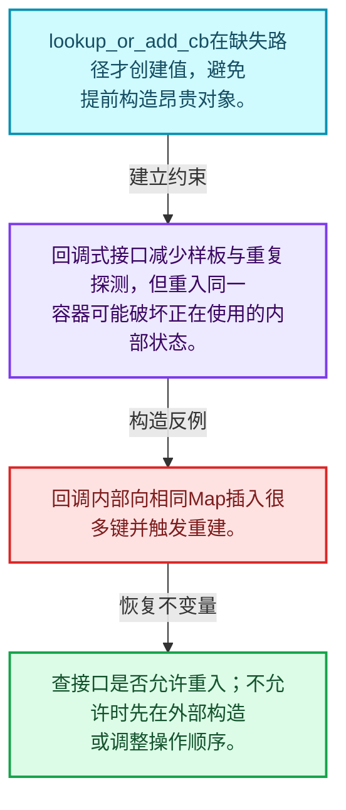
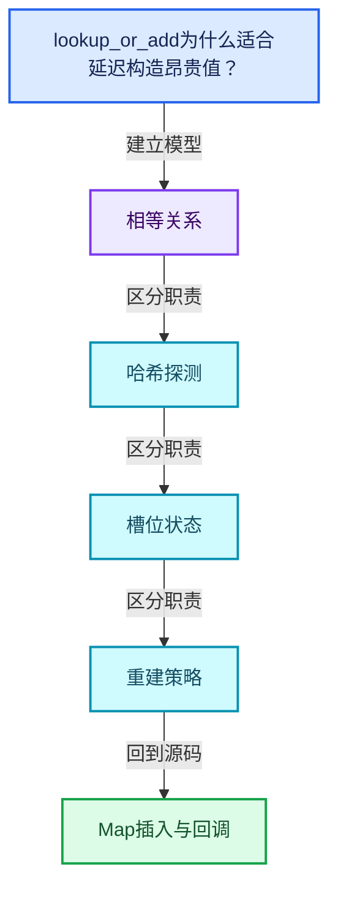
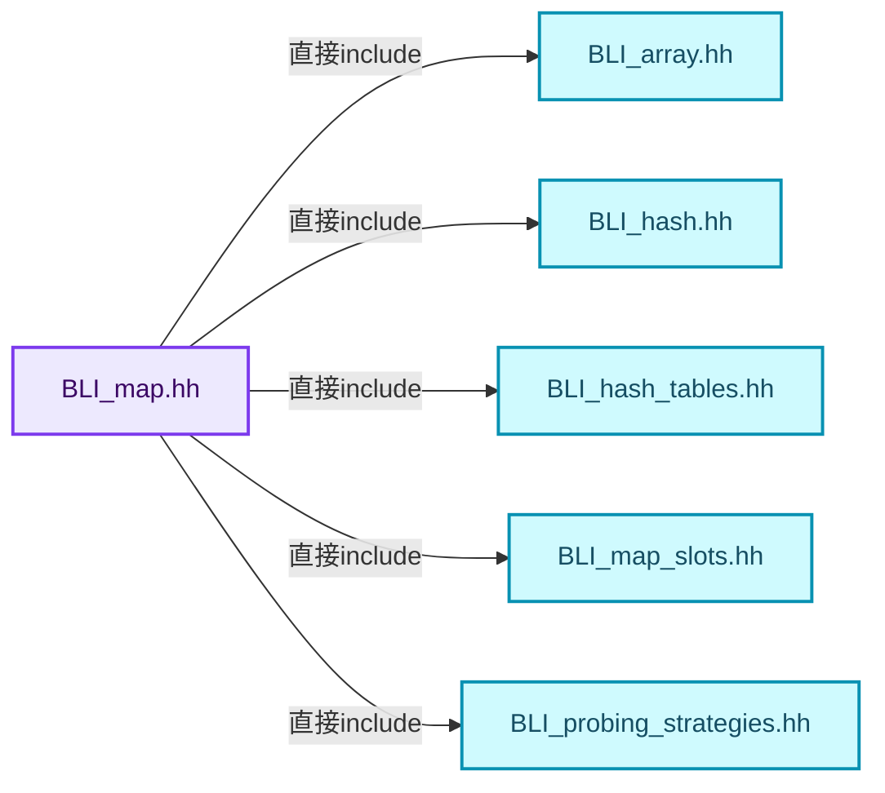
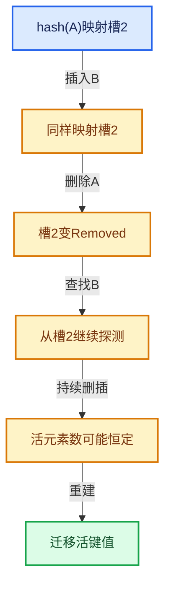

# 02-05 Map插入与回调

[方向导航](README.md) · [总目录](../README.md) · [覆盖索引](../%E6%BA%90%E7%A0%81%E7%89%88%E6%9C%AC%E4%B8%8E%E8%A6%86%E7%9B%96%E7%B4%A2%E5%BC%95.md)

> 阅读顺序：问题与数据模型 → 语法与类型 → 源码逐行 → 调用线索 → 历史与取舍 → 推演和练习。

- 基准 HEAD：`cbda6b96c26c0dee3c3b5cbb93960c4ac06a6b30`。
- 记录日期：2026-10-14。
- 教学示例状态：正文中的推演不是本机性能实测；已运行练习见验收报告。

## 一、从问题到设计

lookup_or_add为什么适合延迟构造昂贵值？

查找与添加组合可以避免重复探测，但回调重入或修改同一容器时要检查契约和引用失效。

本篇把语法、数据语义和系统取舍连接起来。相等与哈希是基础契约；探测、删除和增长共同决定复杂度。

### 本篇独立模型与设计推理

lookup_or_add_cb在缺失路径才创建值，避免提前构造昂贵对象。

设计取舍：回调式接口减少样板与重复探测，但重入同一容器可能破坏正在使用的内部状态。

最小反例：回调内部向相同Map插入很多键并触发重建。

推导与处理：查接口是否允许重入；不允许时先在外部构造或调整操作顺序。



### 源码范围与相邻篇章

| 文件 | 本篇逐行范围 | 基准SHA-256 |
|---|---|---|
| [source/blender/blenlib/BLI_map.hh](../../../../../source/blender/blenlib/BLI_map.hh) | L553—L832 | `236ceadf1c36a6e452538529f550bb9a61c4d2efc16cbb8419861fdd638bd5c7` |

同一主讲文件可能分多篇覆盖；超出本篇范围的符号通过覆盖索引定位。空行与纯注释保留在源码摘录中，逐行表解释有效语句与语法边界；许可证头统一保留。

前篇：[Map查找与键访问](04-Map%E6%9F%A5%E6%89%BE%E4%B8%8E%E9%94%AE%E8%AE%BF%E9%97%AE.md).

后篇：[删除墓碑与值销毁](06-%E5%88%A0%E9%99%A4%E5%A2%93%E7%A2%91%E4%B8%8E%E5%80%BC%E9%94%80%E6%AF%81.md).

## 二、类型、数据与阅读地图



这是概念依赖图，边表示阅读关系，不声称是运行时调用顺序。

### 直接编译依赖



箭头只表示头文件包含关系；完整调用线索见后面的符号定位表。

## 三、关键词、语法与类型角色

### 模板 template

模板把类型或常量作为生成实现的参数。读声明时先列出类型参数、非类型参数和默认值，再看使用者实际实例化了什么。模板声明本身不意味着每种T都支持其全部成员。

具体检查：把T替换为int、string、只能移动的类型，分别检查每个被调用操作是否成立。

### 依赖名称 typename

typename既可引入类型模板参数，也可告诉编译器某个依赖名称是类型。它不创建运行时对象；解析期确认语法类别与实例化期检查具体类型是不同阶段。

具体检查：区分typename T::value_type和T::size()，前者标记类型，后者是表达式。

### 只读限定 const

const约束当前访问路径可做的修改。const指针、指向const的指针、const视图对象、const元素是不同位置的限定；其他别名可能仍可修改原对象。

具体检查：分别写T* const、const T*与const T* const，并画出不可修改的层次。

### 移动转换 std::move

std::move把表达式转换为可供移动重载选择的值类别，实际资源转移发生在被选中的构造或赋值中。对const对象move可能仍调用复制，对视图move也不会获得底层数据所有权。

具体检查：记录移动构造调用次数，不用变量名或std::move的出现次数替代测量。

### 完美转发 std::forward

std::forward在转发引用模板中恢复调用者原来的值类别。它依赖推导出的模板实参；无条件move会改变左值调用者的语义。

具体检查：对同一接口分别传入左值、临时对象和const左值，记录实际重载。

### 限定转换 const_cast

const_cast可以改变访问路径的限定，但不能让本来就是const的对象合法可写。常用于复用只读实现时，仍需检查底层对象是否实际可变。

具体检查：对非const对象的const引用与真正const对象分别分析修改是否合法。

### 构造与new表达式

普通new可能分配并构造；placement new在给定地址构造，存储由其他机制提供。失败回滚应区分两类责任。

具体检查：追踪地址来自哪里、构造何时成功、由谁析构、由谁释放。

### 内部断言 assert

断言表达开发者预期成立的内部契约，发布构建可能关闭。它不能替代对不可信输入的完整错误处理，也不保证后续操作被运行时保护。

具体检查：对每条断言构造违反条件的输入，区分调用者错误与应向用户报告的错误。

### 受控访问 friend

friend授予指定函数或类访问非公开成员的权限，并不意味着继承，也不自动扩展到友元的派生类。

具体检查：解释执行器为何需要访问包装器的内部映射，同时检查边界是否仍清楚。

### 类型别名 using

类型别名为已有类型建立名字，不创建运行期对象。它常把模板内部使用的类型统一暴露给泛型调用者。

具体检查：展开别名直到基础类型，区分类型别名和变量声明。

## 四、真实源码与逐行讲解

源码块保持原行内容，原始行号由小节标题及逐行表给出。表中的调用定位是静态阅读辅助；重载、模板实例化、宏展开和虚调用需结合完整声明，不能仅凭词法出现证明动态调用。

### BLI_map.hh：L553—L599

<!-- source:source/blender/blenlib/BLI_map.hh:553:599 -->

```cpp
  template<typename ForwardKey> const Value &lookup_as(const ForwardKey &key) const
  {
    const Value *ptr = this->lookup_ptr_as(key);
    BLI_assert(ptr != nullptr);
    return *ptr;
  }
  template<typename ForwardKey> Value &lookup_as(const ForwardKey &key)
  {
    Value *ptr = this->lookup_ptr_as(key);
    BLI_assert(ptr != nullptr);
    return *ptr;
  }

  /**
   * Returns a copy of the value that corresponds to the given key. If the key is not in the
   * map, the provided default_value is returned.
   */
  Value lookup_default(const Key &key, const Value &default_value) const
  {
    return this->lookup_default_as(key, default_value);
  }
  template<typename ForwardKey, typename... ForwardValue>
  Value lookup_default_as(const ForwardKey &key, ForwardValue &&...default_value) const
  {
    const Value *ptr = this->lookup_ptr_as(key);
    if (ptr != nullptr) {
      return *ptr;
    }
    return Value(std::forward<ForwardValue>(default_value)...);
  }

  /**
   * Returns a reference to the value corresponding to the given key. If the key is not in the map,
   * a new key-value-pair is added and a reference to the value in the map is returned.
   */
  Value &lookup_or_add(const Key &key, const Value &value)
  {
    return this->lookup_or_add_as(key, value);
  }
  Value &lookup_or_add(const Key &key, Value &&value)
  {
    return this->lookup_or_add_as(key, std::move(value));
  }
  Value &lookup_or_add(Key &&key, const Value &value)
  {
    return this->lookup_or_add_as(std::move(key), value);
  }
```

本段语义重点：

- 分支证据 `ptr != nullptr)`：分别推演条件成立与不成立，核对相同出口处的状态。

| 原始行 | 语义、约束与检查 |
|---|---|
| L553 | 声明模板参数 `template<typename ForwardKey> const Value &lookup_as(const ForwardKey &key) const`。类型参数决定生成操作的类型，非类型参数可决定内嵌容量或编译期分支。 |
| L554 | 连接上一行的声明或控制结构与其语句块；后续行在这个作用域中执行或声明。 |
| L555 | 把右侧 `this->lookup_ptr_as(key)` 用于初始化或更新左侧 `const Value *ptr`。声明初始化与已有对象赋值应按上下文区分；有资源的类型会调用相应特殊成员。 |
| L556 | 断言约束 `BLI_assert(ptr != nullptr);`。条件是后续访问的内部前置条件；发布构建可能不执行，不能把断言当作输入修复。 |
| L557 | 返回表达式 `*ptr`。 |
| L558 | 结束当前语法单元。局部自动对象在离开其作用域时按规则销毁；这不等于所有被引用的外部数据也被释放。 |
| L559 | 声明模板参数 `template<typename ForwardKey> Value &lookup_as(const ForwardKey &key)`。类型参数决定生成操作的类型，非类型参数可决定内嵌容量或编译期分支。 |
| L560 | 连接上一行的声明或控制结构与其语句块；后续行在这个作用域中执行或声明。 |
| L561 | 把右侧 `this->lookup_ptr_as(key)` 用于初始化或更新左侧 `Value *ptr`。声明初始化与已有对象赋值应按上下文区分；有资源的类型会调用相应特殊成员。 |
| L562 | 断言约束 `BLI_assert(ptr != nullptr);`。条件是后续访问的内部前置条件；发布构建可能不执行，不能把断言当作输入修复。 |
| L563 | 返回表达式 `*ptr`。 |
| L564 | 结束当前语法单元。局部自动对象在离开其作用域时按规则销毁；这不等于所有被引用的外部数据也被释放。 |
| L570 | 出现调用或函数声明 `lookup_default`，对应表达式为 `Value lookup_default(const Key &key, const Value &default_value) const`。参数求值、返回类型与重载需结合前后完整语句；静态文本引用不能证明动态目标。 |
| L571 | 连接上一行的声明或控制结构与其语句块；后续行在这个作用域中执行或声明。 |
| L572 | 返回表达式 `this->lookup_default_as(key, default_value)`。 |
| L573 | 结束当前语法单元。局部自动对象在离开其作用域时按规则销毁；这不等于所有被引用的外部数据也被释放。 |
| L574 | 声明模板参数 `template<typename ForwardKey, typename... ForwardValue>`。类型参数决定生成操作的类型，非类型参数可决定内嵌容量或编译期分支。 |
| L575 | 出现调用或函数声明 `lookup_default_as`，对应表达式为 `Value lookup_default_as(const ForwardKey &key, ForwardValue &&...default_value) const`。参数求值、返回类型与重载需结合前后完整语句；静态文本引用不能证明动态目标。 |
| L576 | 连接上一行的声明或控制结构与其语句块；后续行在这个作用域中执行或声明。 |
| L577 | 把右侧 `this->lookup_ptr_as(key)` 用于初始化或更新左侧 `const Value *ptr`。声明初始化与已有对象赋值应按上下文区分；有资源的类型会调用相应特殊成员。 |
| L578 | 判断 `ptr != nullptr`，成立时进入本分支，否则继续后续路径。这里区分空地址与可用地址，但非空本身仍不能证明对象存活。 |
| L579 | 返回表达式 `*ptr`。 |
| L580 | 结束当前语法单元。局部自动对象在离开其作用域时按规则销毁；这不等于所有被引用的外部数据也被释放。 |
| L581 | 返回表达式 `Value(std::forward<ForwardValue>(default_value)...)`。 |
| L582 | 结束当前语法单元。局部自动对象在离开其作用域时按规则销毁；这不等于所有被引用的外部数据也被释放。 |
| L588 | 出现调用或函数声明 `lookup_or_add`，对应表达式为 `Value &lookup_or_add(const Key &key, const Value &value)`。参数求值、返回类型与重载需结合前后完整语句；静态文本引用不能证明动态目标。 |
| L589 | 连接上一行的声明或控制结构与其语句块；后续行在这个作用域中执行或声明。 |
| L590 | 返回表达式 `this->lookup_or_add_as(key, value)`。 |
| L591 | 结束当前语法单元。局部自动对象在离开其作用域时按规则销毁；这不等于所有被引用的外部数据也被释放。 |
| L592 | 出现调用或函数声明 `lookup_or_add`，对应表达式为 `Value &lookup_or_add(const Key &key, Value &&value)`。参数求值、返回类型与重载需结合前后完整语句；静态文本引用不能证明动态目标。 |
| L593 | 连接上一行的声明或控制结构与其语句块；后续行在这个作用域中执行或声明。 |
| L594 | 返回表达式 `this->lookup_or_add_as(key, std::move(value))`。 |
| L595 | 结束当前语法单元。局部自动对象在离开其作用域时按规则销毁；这不等于所有被引用的外部数据也被释放。 |
| L596 | 出现调用或函数声明 `lookup_or_add`，对应表达式为 `Value &lookup_or_add(Key &&key, const Value &value)`。参数求值、返回类型与重载需结合前后完整语句；静态文本引用不能证明动态目标。 |
| L597 | 连接上一行的声明或控制结构与其语句块；后续行在这个作用域中执行或声明。 |
| L598 | 返回表达式 `this->lookup_or_add_as(std::move(key), value)`。 |
| L599 | 结束当前语法单元。局部自动对象在离开其作用域时按规则销毁；这不等于所有被引用的外部数据也被释放。 |

### BLI_map.hh：L600—L646

<!-- source:source/blender/blenlib/BLI_map.hh:600:646 -->

```cpp
  Value &lookup_or_add(Key &&key, Value &&value)
  {
    return this->lookup_or_add_as(std::move(key), std::move(value));
  }
  template<typename ForwardKey, typename... ForwardValue>
  Value &lookup_or_add_as(ForwardKey &&key, ForwardValue &&...value)
  {
    return this->lookup_or_add__impl(
        std::forward<ForwardKey>(key), hash_(key), std::forward<ForwardValue>(value)...);
  }

  /**
   * Returns a reference to the value that corresponds to the given key. If the key is not yet in
   * the map, it will be newly added.
   *
   * The create_value callback is only called when the key did not exist yet. It is expected to
   * take no parameters and return the value to be inserted. The callback is called before the key
   * is copied/moved into the map.
   */
  template<typename CreateValueF>
  Value &lookup_or_add_cb(const Key &key, const CreateValueF &create_value)
  {
    return this->lookup_or_add_cb_as(key, create_value);
  }
  template<typename CreateValueF>
  Value &lookup_or_add_cb(Key &&key, const CreateValueF &create_value)
  {
    return this->lookup_or_add_cb_as(std::move(key), create_value);
  }
  template<typename ForwardKey, typename CreateValueF>
  Value &lookup_or_add_cb_as(ForwardKey &&key, const CreateValueF &create_value)
  {
    return this->lookup_or_add_cb__impl(std::forward<ForwardKey>(key), create_value, hash_(key));
  }

  /**
   * Returns a reference to the value that corresponds to the given key. If the key is not yet in
   * the map, it will be newly added. The newly added value will be default constructed.
   */
  Value &lookup_or_add_default(const Key &key)
  {
    return this->lookup_or_add_default_as(key);
  }
  Value &lookup_or_add_default(Key &&key)
  {
    return this->lookup_or_add_default_as(std::move(key));
  }
```

本段语义重点：

- `lookup_or_add_cb`：合并查找和延迟创建；键已存在时应检查回调是否跳过。

| 原始行 | 语义、约束与检查 |
|---|---|
| L600 | 出现调用或函数声明 `lookup_or_add`，对应表达式为 `Value &lookup_or_add(Key &&key, Value &&value)`。参数求值、返回类型与重载需结合前后完整语句；静态文本引用不能证明动态目标。 |
| L601 | 连接上一行的声明或控制结构与其语句块；后续行在这个作用域中执行或声明。 |
| L602 | 返回表达式 `this->lookup_or_add_as(std::move(key), std::move(value))`。 |
| L603 | 结束当前语法单元。局部自动对象在离开其作用域时按规则销毁；这不等于所有被引用的外部数据也被释放。 |
| L604 | 声明模板参数 `template<typename ForwardKey, typename... ForwardValue>`。类型参数决定生成操作的类型，非类型参数可决定内嵌容量或编译期分支。 |
| L605 | 出现调用或函数声明 `lookup_or_add_as`，对应表达式为 `Value &lookup_or_add_as(ForwardKey &&key, ForwardValue &&...value)`。参数求值、返回类型与重载需结合前后完整语句；静态文本引用不能证明动态目标。 |
| L606 | 连接上一行的声明或控制结构与其语句块；后续行在这个作用域中执行或声明。 |
| L607 | 返回表达式 `this->lookup_or_add__impl(`。 |
| L608 | 出现调用或函数声明 `std::forward`，对应表达式为 `std::forward<ForwardKey>(key), hash_(key), std::forward<ForwardValue>(value)...);`。参数求值、返回类型与重载需结合前后完整语句；静态文本引用不能证明动态目标。 |
| L609 | 结束当前语法单元。局部自动对象在离开其作用域时按规则销毁；这不等于所有被引用的外部数据也被释放。 |
| L619 | 声明模板参数 `template<typename CreateValueF>`。类型参数决定生成操作的类型，非类型参数可决定内嵌容量或编译期分支。 |
| L620 | 出现调用或函数声明 `lookup_or_add_cb`，对应表达式为 `Value &lookup_or_add_cb(const Key &key, const CreateValueF &create_value)`。参数求值、返回类型与重载需结合前后完整语句；静态文本引用不能证明动态目标。 |
| L621 | 连接上一行的声明或控制结构与其语句块；后续行在这个作用域中执行或声明。 |
| L622 | 返回表达式 `this->lookup_or_add_cb_as(key, create_value)`。 |
| L623 | 结束当前语法单元。局部自动对象在离开其作用域时按规则销毁；这不等于所有被引用的外部数据也被释放。 |
| L624 | 声明模板参数 `template<typename CreateValueF>`。类型参数决定生成操作的类型，非类型参数可决定内嵌容量或编译期分支。 |
| L625 | 出现调用或函数声明 `lookup_or_add_cb`，对应表达式为 `Value &lookup_or_add_cb(Key &&key, const CreateValueF &create_value)`。参数求值、返回类型与重载需结合前后完整语句；静态文本引用不能证明动态目标。 |
| L626 | 连接上一行的声明或控制结构与其语句块；后续行在这个作用域中执行或声明。 |
| L627 | 返回表达式 `this->lookup_or_add_cb_as(std::move(key), create_value)`。 |
| L628 | 结束当前语法单元。局部自动对象在离开其作用域时按规则销毁；这不等于所有被引用的外部数据也被释放。 |
| L629 | 声明模板参数 `template<typename ForwardKey, typename CreateValueF>`。类型参数决定生成操作的类型，非类型参数可决定内嵌容量或编译期分支。 |
| L630 | 出现调用或函数声明 `lookup_or_add_cb_as`，对应表达式为 `Value &lookup_or_add_cb_as(ForwardKey &&key, const CreateValueF &create_value)`。参数求值、返回类型与重载需结合前后完整语句；静态文本引用不能证明动态目标。 |
| L631 | 连接上一行的声明或控制结构与其语句块；后续行在这个作用域中执行或声明。 |
| L632 | 返回表达式 `this->lookup_or_add_cb__impl(std::forward<ForwardKey>(key), create_value, hash_(key))`。 |
| L633 | 结束当前语法单元。局部自动对象在离开其作用域时按规则销毁；这不等于所有被引用的外部数据也被释放。 |
| L639 | 出现调用或函数声明 `lookup_or_add_default`，对应表达式为 `Value &lookup_or_add_default(const Key &key)`。参数求值、返回类型与重载需结合前后完整语句；静态文本引用不能证明动态目标。 |
| L640 | 连接上一行的声明或控制结构与其语句块；后续行在这个作用域中执行或声明。 |
| L641 | 返回表达式 `this->lookup_or_add_default_as(key)`。 |
| L642 | 结束当前语法单元。局部自动对象在离开其作用域时按规则销毁；这不等于所有被引用的外部数据也被释放。 |
| L643 | 出现调用或函数声明 `lookup_or_add_default`，对应表达式为 `Value &lookup_or_add_default(Key &&key)`。参数求值、返回类型与重载需结合前后完整语句；静态文本引用不能证明动态目标。 |
| L644 | 连接上一行的声明或控制结构与其语句块；后续行在这个作用域中执行或声明。 |
| L645 | 返回表达式 `this->lookup_or_add_default_as(std::move(key))`。 |
| L646 | 结束当前语法单元。局部自动对象在离开其作用域时按规则销毁；这不等于所有被引用的外部数据也被释放。 |

### BLI_map.hh：L647—L698

<!-- source:source/blender/blenlib/BLI_map.hh:647:698 -->

```cpp
  template<typename ForwardKey> Value &lookup_or_add_default_as(ForwardKey &&key)
  {
    return this->lookup_or_add_cb_as(std::forward<ForwardKey>(key), []() { return Value(); });
  }

  /**
   * Returns the key that is stored in the set that compares equal to the given key. This invokes
   * undefined behavior when the key is not in the map.
   */
  const Key &lookup_key(const Key &key) const
  {
    return this->lookup_key_as(key);
  }
  template<typename ForwardKey> const Key &lookup_key_as(const ForwardKey &key) const
  {
    const Slot &slot = this->lookup_slot(key, hash_(key));
    return *slot.key();
  }

  /**
   * Returns a pointer to the key that is stored in the map that compares equal to the given key.
   * If the key is not in the map, null is returned.
   */
  const Key *lookup_key_ptr(const Key &key) const
  {
    return this->lookup_key_ptr_as(key);
  }
  template<typename ForwardKey> const Key *lookup_key_ptr_as(const ForwardKey &key) const
  {
    const Slot *slot = this->lookup_slot_ptr(key, hash_(key));
    if (slot == nullptr) {
      return nullptr;
    }
    return slot->key();
  }

  /**
   * Calls the provided callback for every key-value-pair in the map. The callback is expected
   * to take a `const Key &` as first and a `const Value &` as second parameter.
   */
  template<typename FuncT> void foreach_item(const FuncT &func) const
  {
    int64_t size = slots_.size();
    for (int64_t i = 0; i < size; i++) {
      const Slot &slot = slots_[i];
      if (slot.is_occupied()) {
        const Key &key = *slot.key();
        const Value &value = *slot.value();
        func(key, value);
      }
    }
  }
```

本段语义重点：

- `lookup_or_add_cb`：合并查找和延迟创建；键已存在时应检查回调是否跳过。
- `slots_`：哈希槽数组，其中对象存活与槽位状态必须一致。

| 原始行 | 语义、约束与检查 |
|---|---|
| L647 | 声明模板参数 `template<typename ForwardKey> Value &lookup_or_add_default_as(ForwardKey &&key)`。类型参数决定生成操作的类型，非类型参数可决定内嵌容量或编译期分支。 |
| L648 | 连接上一行的声明或控制结构与其语句块；后续行在这个作用域中执行或声明。 |
| L649 | 返回表达式 `this->lookup_or_add_cb_as(std::forward<ForwardKey>(key), []() { return Value(); })`。 |
| L650 | 结束当前语法单元。局部自动对象在离开其作用域时按规则销毁；这不等于所有被引用的外部数据也被释放。 |
| L656 | 出现调用或函数声明 `lookup_key`，对应表达式为 `const Key &lookup_key(const Key &key) const`。参数求值、返回类型与重载需结合前后完整语句；静态文本引用不能证明动态目标。 |
| L657 | 连接上一行的声明或控制结构与其语句块；后续行在这个作用域中执行或声明。 |
| L658 | 返回表达式 `this->lookup_key_as(key)`。 |
| L659 | 结束当前语法单元。局部自动对象在离开其作用域时按规则销毁；这不等于所有被引用的外部数据也被释放。 |
| L660 | 声明模板参数 `template<typename ForwardKey> const Key &lookup_key_as(const ForwardKey &key) const`。类型参数决定生成操作的类型，非类型参数可决定内嵌容量或编译期分支。 |
| L661 | 连接上一行的声明或控制结构与其语句块；后续行在这个作用域中执行或声明。 |
| L662 | 把右侧 `this->lookup_slot(key, hash_(key))` 用于初始化或更新左侧 `const Slot &slot`。声明初始化与已有对象赋值应按上下文区分；有资源的类型会调用相应特殊成员。 |
| L663 | 返回表达式 `*slot.key()`。结合函数声明检查返回值是否借用原存储，借用值不会自动延长其寿命。 |
| L664 | 结束当前语法单元。局部自动对象在离开其作用域时按规则销毁；这不等于所有被引用的外部数据也被释放。 |
| L670 | 出现调用或函数声明 `lookup_key_ptr`，对应表达式为 `const Key *lookup_key_ptr(const Key &key) const`。参数求值、返回类型与重载需结合前后完整语句；静态文本引用不能证明动态目标。 |
| L671 | 连接上一行的声明或控制结构与其语句块；后续行在这个作用域中执行或声明。 |
| L672 | 返回表达式 `this->lookup_key_ptr_as(key)`。 |
| L673 | 结束当前语法单元。局部自动对象在离开其作用域时按规则销毁；这不等于所有被引用的外部数据也被释放。 |
| L674 | 声明模板参数 `template<typename ForwardKey> const Key *lookup_key_ptr_as(const ForwardKey &key) const`。类型参数决定生成操作的类型，非类型参数可决定内嵌容量或编译期分支。 |
| L675 | 连接上一行的声明或控制结构与其语句块；后续行在这个作用域中执行或声明。 |
| L676 | 把右侧 `this->lookup_slot_ptr(key, hash_(key))` 用于初始化或更新左侧 `const Slot *slot`。声明初始化与已有对象赋值应按上下文区分；有资源的类型会调用相应特殊成员。 |
| L677 | 判断 `slot == nullptr`，成立时进入本分支，否则继续后续路径。这里区分空地址与可用地址，但非空本身仍不能证明对象存活。 |
| L678 | 返回表达式 `nullptr`。 |
| L679 | 结束当前语法单元。局部自动对象在离开其作用域时按规则销毁；这不等于所有被引用的外部数据也被释放。 |
| L680 | 返回表达式 `slot->key()`。 |
| L681 | 结束当前语法单元。局部自动对象在离开其作用域时按规则销毁；这不等于所有被引用的外部数据也被释放。 |
| L687 | 声明模板参数 `template<typename FuncT> void foreach_item(const FuncT &func) const`。类型参数决定生成操作的类型，非类型参数可决定内嵌容量或编译期分支。 |
| L688 | 连接上一行的声明或控制结构与其语句块；后续行在这个作用域中执行或声明。 |
| L689 | 建立或更新 `slots_`：哈希槽数组，其中对象存活与槽位状态必须一致。本行的具体值关系为 `int64_t size = slots_.size()`；对照更新前后相应范围或状态是否一致。 |
| L690 | 纯虚接口声明：`for (int64_t i = 0; i < size; i++) {`。等号零标记抽象接口，需要按继承约定提供覆写；不表示执行函数并把结果设为零。 |
| L691 | 建立或更新 `slots_`：哈希槽数组，其中对象存活与槽位状态必须一致。本行的具体值关系为 `const Slot &slot = slots_[i]`；对照更新前后相应范围或状态是否一致。 |
| L692 | 判断 `slot.is_occupied()`，成立时进入本分支，否则继续后续路径。 |
| L693 | 把右侧 `*slot.key()` 用于初始化或更新左侧 `const Key &key`。声明初始化与已有对象赋值应按上下文区分；有资源的类型会调用相应特殊成员。 |
| L694 | 把右侧 `*slot.value()` 用于初始化或更新左侧 `const Value &value`。声明初始化与已有对象赋值应按上下文区分；有资源的类型会调用相应特殊成员。 |
| L695 | 出现调用或函数声明 `func`，对应表达式为 `func(key, value);`。参数求值、返回类型与重载需结合前后完整语句；静态文本引用不能证明动态目标。 |
| L696 | 结束当前语法单元。局部自动对象在离开其作用域时按规则销毁；这不等于所有被引用的外部数据也被释放。 |
| L697 | 结束当前语法单元。局部自动对象在离开其作用域时按规则销毁；这不等于所有被引用的外部数据也被释放。 |
| L698 | 结束当前语法单元。局部自动对象在离开其作用域时按规则销毁；这不等于所有被引用的外部数据也被释放。 |

### BLI_map.hh：L699—L748

<!-- source:source/blender/blenlib/BLI_map.hh:699:748 -->

```cpp

  /* Common base class for all iterators below. */
  struct BaseIterator {
   public:
    using iterator_category = std::forward_iterator_tag;
    using difference_type = std::ptrdiff_t;

   protected:
    /* We could have separate base iterators for const and non-const iterators, but that would add
     * more complexity than benefits right now. */
    Slot *slots_;
    int64_t total_slots_;
    int64_t current_slot_;

    friend Map;

   public:
    BaseIterator(const Slot *slots, const int64_t total_slots, const int64_t current_slot)
        : slots_(const_cast<Slot *>(slots)), total_slots_(total_slots), current_slot_(current_slot)
    {
    }

    BaseIterator &operator++()
    {
      while (++current_slot_ < total_slots_) {
        if (slots_[current_slot_].is_occupied()) {
          break;
        }
      }
      return *this;
    }

    BaseIterator operator++(int)
    {
      BaseIterator copied_iterator = *this;
      ++(*this);
      return copied_iterator;
    }

    friend bool operator!=(const BaseIterator &a, const BaseIterator &b)
    {
      BLI_assert(a.slots_ == b.slots_);
      BLI_assert(a.total_slots_ == b.total_slots_);
      return a.current_slot_ != b.current_slot_;
    }

    friend bool operator==(const BaseIterator &a, const BaseIterator &b)
    {
      return !(a != b);
    }
```

本段语义重点：

- `slots_`：哈希槽数组，其中对象存活与槽位状态必须一致。

| 原始行 | 语义、约束与检查 |
|---|---|
| L701 | 声明或定义类型 `struct BaseIterator`。结合继承、访问权限和成员布局确认接口与拥有关系；前向声明本身没有完整对象布局。 |
| L702 | 切换成员访问权限为 public；它是编译期接口边界，不是线程同步或内存保护。 |
| L703 | 定义类型别名 `using iterator_category = std::forward_iterator_tag`，为模板接口或内部实现统一命名；本行不分配该类型对象。 |
| L704 | 定义类型别名 `using difference_type = std::ptrdiff_t`，为模板接口或内部实现统一命名；本行不分配该类型对象。 |
| L706 | 切换成员访问权限为 protected；它是编译期接口边界，不是线程同步或内存保护。 |
| L709 | 本行涉及 `slots_`：哈希槽数组，其中对象存活与槽位状态必须一致。按此语义解读 `Slot *slots_`，不要把地址、数量或状态混用。 |
| L710 | 声明成员、局部对象或完成语句 `int64_t total_slots_`。若为指针或引用，它本身不说明拥有；若为值对象，其构造析构由所在作用域或外层对象管理。 |
| L711 | 声明成员、局部对象或完成语句 `int64_t current_slot_`。若为指针或引用，它本身不说明拥有；若为值对象，其构造析构由所在作用域或外层对象管理。 |
| L713 | 声明成员、局部对象或完成语句 `friend Map`。若为指针或引用，它本身不说明拥有；若为值对象，其构造析构由所在作用域或外层对象管理。 |
| L715 | 切换成员访问权限为 public；它是编译期接口边界，不是线程同步或内存保护。 |
| L716 | 出现调用或函数声明 `BaseIterator`，对应表达式为 `BaseIterator(const Slot *slots, const int64_t total_slots, const int64_t current_slot)`。参数求值、返回类型与重载需结合前后完整语句；静态文本引用不能证明动态目标。 |
| L717 | 本行涉及 `slots_`：哈希槽数组，其中对象存活与槽位状态必须一致。按此语义解读 `: slots_(const_cast<Slot *>(slots)), total_slots_(total_slots), current_slot_(current_slot)`，不要把地址、数量或状态混用。 |
| L718 | 连接上一行的声明或控制结构与其语句块；后续行在这个作用域中执行或声明。 |
| L719 | 结束当前语法单元。局部自动对象在离开其作用域时按规则销毁；这不等于所有被引用的外部数据也被释放。 |
| L721 | 运算符重载声明、定义或显式调用：`BaseIterator &operator++()`。结合参数和返回类型判断是赋值、索引、比较还是转换；operator=声明中的等号不是在给名为operator的变量赋值。 |
| L722 | 连接上一行的声明或控制结构与其语句块；后续行在这个作用域中执行或声明。 |
| L723 | 按 `while (++current_slot_ < total_slots_)` 指定的范围或条件重复执行。对照循环变量与真实元素编号；循环内调用成本乘以实际迭代次数。 |
| L724 | 判断 `slots_[current_slot_].is_occupied()`，成立时进入本分支，否则继续后续路径。 |
| L725 | 离开最近的循环或switch；不是离开整个函数，后续清理和提交代码可能仍会执行。 |
| L726 | 结束当前语法单元。局部自动对象在离开其作用域时按规则销毁；这不等于所有被引用的外部数据也被释放。 |
| L727 | 结束当前语法单元。局部自动对象在离开其作用域时按规则销毁；这不等于所有被引用的外部数据也被释放。 |
| L728 | 返回表达式 `*this`。返回当前对象；返回类型决定它是引用还是值，不能仅凭表达式假定复制。 |
| L729 | 结束当前语法单元。局部自动对象在离开其作用域时按规则销毁；这不等于所有被引用的外部数据也被释放。 |
| L731 | 运算符重载声明、定义或显式调用：`BaseIterator operator++(int)`。结合参数和返回类型判断是赋值、索引、比较还是转换；operator=声明中的等号不是在给名为operator的变量赋值。 |
| L732 | 连接上一行的声明或控制结构与其语句块；后续行在这个作用域中执行或声明。 |
| L733 | 把右侧 `*this` 用于初始化或更新左侧 `BaseIterator copied_iterator`。声明初始化与已有对象赋值应按上下文区分；有资源的类型会调用相应特殊成员。 |
| L734 | 声明成员、局部对象或完成语句 `++(*this)`。若为指针或引用，它本身不说明拥有；若为值对象，其构造析构由所在作用域或外层对象管理。 |
| L735 | 返回表达式 `copied_iterator`。结合函数声明检查返回值是否借用原存储，借用值不会自动延长其寿命。 |
| L736 | 结束当前语法单元。局部自动对象在离开其作用域时按规则销毁；这不等于所有被引用的外部数据也被释放。 |
| L738 | 运算符重载声明、定义或显式调用：`friend bool operator!=(const BaseIterator &a, const BaseIterator &b)`。结合参数和返回类型判断是赋值、索引、比较还是转换；operator=声明中的等号不是在给名为operator的变量赋值。 |
| L739 | 连接上一行的声明或控制结构与其语句块；后续行在这个作用域中执行或声明。 |
| L740 | 断言约束 `BLI_assert(a.slots_ == b.slots_);`。条件是后续访问的内部前置条件；发布构建可能不执行，不能把断言当作输入修复。 |
| L741 | 断言约束 `BLI_assert(a.total_slots_ == b.total_slots_);`。条件是后续访问的内部前置条件；发布构建可能不执行，不能把断言当作输入修复。 |
| L742 | 返回表达式 `a.current_slot_ != b.current_slot_`。 |
| L743 | 结束当前语法单元。局部自动对象在离开其作用域时按规则销毁；这不等于所有被引用的外部数据也被释放。 |
| L745 | 运算符重载声明、定义或显式调用：`friend bool operator==(const BaseIterator &a, const BaseIterator &b)`。结合参数和返回类型判断是赋值、索引、比较还是转换；operator=声明中的等号不是在给名为operator的变量赋值。 |
| L746 | 连接上一行的声明或控制结构与其语句块；后续行在这个作用域中执行或声明。 |
| L747 | 返回表达式 `!(a != b)`。 |
| L748 | 结束当前语法单元。局部自动对象在离开其作用域时按规则销毁；这不等于所有被引用的外部数据也被释放。 |

### BLI_map.hh：L749—L798

<!-- source:source/blender/blenlib/BLI_map.hh:749:798 -->

```cpp

   protected:
    Slot &current_slot() const
    {
      return slots_[current_slot_];
    }
  };

  /**
   * A utility iterator that reduces the amount of code when implementing the actual iterators.
   * This uses the "curiously recurring template pattern" (CRTP).
   */
  template<typename SubIterator> class BaseIteratorRange : public BaseIterator {
   public:
    BaseIteratorRange(const Slot *slots, int64_t total_slots, int64_t current_slot)
        : BaseIterator(slots, total_slots, current_slot)
    {
    }

    SubIterator begin() const
    {
      for (int64_t i = 0; i < this->total_slots_; i++) {
        if (this->slots_[i].is_occupied()) {
          return SubIterator(this->slots_, this->total_slots_, i);
        }
      }
      return this->end();
    }

    SubIterator end() const
    {
      return SubIterator(this->slots_, this->total_slots_, this->total_slots_);
    }
  };

  class KeyIterator final : public BaseIteratorRange<KeyIterator> {
   public:
    using value_type = Key;
    using pointer = const Key *;
    using reference = const Key &;

    KeyIterator(const Slot *slots, int64_t total_slots, int64_t current_slot)
        : BaseIteratorRange<KeyIterator>(slots, total_slots, current_slot)
    {
    }

    const Key &operator*() const
    {
      return *this->current_slot().key();
    }
```

本段语义重点：

- `slots_`：哈希槽数组，其中对象存活与槽位状态必须一致。

| 原始行 | 语义、约束与检查 |
|---|---|
| L750 | 切换成员访问权限为 protected；它是编译期接口边界，不是线程同步或内存保护。 |
| L751 | 出现调用或函数声明 `current_slot`，对应表达式为 `Slot &current_slot() const`。参数求值、返回类型与重载需结合前后完整语句；静态文本引用不能证明动态目标。 |
| L752 | 连接上一行的声明或控制结构与其语句块；后续行在这个作用域中执行或声明。 |
| L753 | 返回表达式 `slots_[current_slot_]`。 |
| L754 | 结束当前语法单元。局部自动对象在离开其作用域时按规则销毁；这不等于所有被引用的外部数据也被释放。 |
| L755 | 结束当前语法单元。局部自动对象在离开其作用域时按规则销毁；这不等于所有被引用的外部数据也被释放。 |
| L761 | 声明模板参数 `template<typename SubIterator> class BaseIteratorRange : public BaseIterator {`。类型参数决定生成操作的类型，非类型参数可决定内嵌容量或编译期分支。 |
| L762 | 切换成员访问权限为 public；它是编译期接口边界，不是线程同步或内存保护。 |
| L763 | 出现调用或函数声明 `BaseIteratorRange`，对应表达式为 `BaseIteratorRange(const Slot *slots, int64_t total_slots, int64_t current_slot)`。参数求值、返回类型与重载需结合前后完整语句；静态文本引用不能证明动态目标。 |
| L764 | 出现调用或函数声明 `BaseIterator`，对应表达式为 `: BaseIterator(slots, total_slots, current_slot)`。参数求值、返回类型与重载需结合前后完整语句；静态文本引用不能证明动态目标。 |
| L765 | 连接上一行的声明或控制结构与其语句块；后续行在这个作用域中执行或声明。 |
| L766 | 结束当前语法单元。局部自动对象在离开其作用域时按规则销毁；这不等于所有被引用的外部数据也被释放。 |
| L768 | 出现调用或函数声明 `begin`，对应表达式为 `SubIterator begin() const`。参数求值、返回类型与重载需结合前后完整语句；静态文本引用不能证明动态目标。 |
| L769 | 连接上一行的声明或控制结构与其语句块；后续行在这个作用域中执行或声明。 |
| L770 | 纯虚接口声明：`for (int64_t i = 0; i < this->total_slots_; i++) {`。等号零标记抽象接口，需要按继承约定提供覆写；不表示执行函数并把结果设为零。 |
| L771 | 判断 `this->slots_[i].is_occupied()`，成立时进入本分支，否则继续后续路径。 |
| L772 | 返回表达式 `SubIterator(this->slots_, this->total_slots_, i)`。 |
| L773 | 结束当前语法单元。局部自动对象在离开其作用域时按规则销毁；这不等于所有被引用的外部数据也被释放。 |
| L774 | 结束当前语法单元。局部自动对象在离开其作用域时按规则销毁；这不等于所有被引用的外部数据也被释放。 |
| L775 | 返回表达式 `this->end()`。 |
| L776 | 结束当前语法单元。局部自动对象在离开其作用域时按规则销毁；这不等于所有被引用的外部数据也被释放。 |
| L778 | 出现调用或函数声明 `end`，对应表达式为 `SubIterator end() const`。参数求值、返回类型与重载需结合前后完整语句；静态文本引用不能证明动态目标。 |
| L779 | 连接上一行的声明或控制结构与其语句块；后续行在这个作用域中执行或声明。 |
| L780 | 返回表达式 `SubIterator(this->slots_, this->total_slots_, this->total_slots_)`。 |
| L781 | 结束当前语法单元。局部自动对象在离开其作用域时按规则销毁；这不等于所有被引用的外部数据也被释放。 |
| L782 | 结束当前语法单元。局部自动对象在离开其作用域时按规则销毁；这不等于所有被引用的外部数据也被释放。 |
| L784 | 声明或定义类型 `class KeyIterator final : public BaseIteratorRange<KeyIterator>`。结合继承、访问权限和成员布局确认接口与拥有关系；前向声明本身没有完整对象布局。 |
| L785 | 切换成员访问权限为 public；它是编译期接口边界，不是线程同步或内存保护。 |
| L786 | 定义类型别名 `using value_type = Key`，为模板接口或内部实现统一命名；本行不分配该类型对象。 |
| L787 | 定义类型别名 `using pointer = const Key *`，为模板接口或内部实现统一命名；本行不分配该类型对象。 |
| L788 | 定义类型别名 `using reference = const Key &`，为模板接口或内部实现统一命名；本行不分配该类型对象。 |
| L790 | 出现调用或函数声明 `KeyIterator`，对应表达式为 `KeyIterator(const Slot *slots, int64_t total_slots, int64_t current_slot)`。参数求值、返回类型与重载需结合前后完整语句；静态文本引用不能证明动态目标。 |
| L791 | 出现调用或函数声明 `BaseIteratorRange`，对应表达式为 `: BaseIteratorRange<KeyIterator>(slots, total_slots, current_slot)`。参数求值、返回类型与重载需结合前后完整语句；静态文本引用不能证明动态目标。 |
| L792 | 连接上一行的声明或控制结构与其语句块；后续行在这个作用域中执行或声明。 |
| L793 | 结束当前语法单元。局部自动对象在离开其作用域时按规则销毁；这不等于所有被引用的外部数据也被释放。 |
| L795 | 运算符重载声明、定义或显式调用：`const Key &operator*() const`。结合参数和返回类型判断是赋值、索引、比较还是转换；operator=声明中的等号不是在给名为operator的变量赋值。 |
| L796 | 连接上一行的声明或控制结构与其语句块；后续行在这个作用域中执行或声明。 |
| L797 | 返回表达式 `*this->current_slot().key()`。 |
| L798 | 结束当前语法单元。局部自动对象在离开其作用域时按规则销毁；这不等于所有被引用的外部数据也被释放。 |

### BLI_map.hh：L799—L832

<!-- source:source/blender/blenlib/BLI_map.hh:799:832 -->

```cpp
  };

  class ValueIterator final : public BaseIteratorRange<ValueIterator> {
   public:
    using value_type = Value;
    using pointer = const Value *;
    using reference = const Value &;

    ValueIterator(const Slot *slots, int64_t total_slots, int64_t current_slot)
        : BaseIteratorRange<ValueIterator>(slots, total_slots, current_slot)
    {
    }

    const Value &operator*() const
    {
      return *this->current_slot().value();
    }
  };

  class MutableValueIterator final : public BaseIteratorRange<MutableValueIterator> {
   public:
    using value_type = Value;
    using pointer = Value *;
    using reference = Value &;

    MutableValueIterator(Slot *slots, int64_t total_slots, int64_t current_slot)
        : BaseIteratorRange<MutableValueIterator>(slots, total_slots, current_slot)
    {
    }

    Value &operator*()
    {
      return *this->current_slot().value();
    }
```

| 原始行 | 语义、约束与检查 |
|---|---|
| L799 | 结束当前语法单元。局部自动对象在离开其作用域时按规则销毁；这不等于所有被引用的外部数据也被释放。 |
| L801 | 声明或定义类型 `class ValueIterator final : public BaseIteratorRange<ValueIterator>`。结合继承、访问权限和成员布局确认接口与拥有关系；前向声明本身没有完整对象布局。 |
| L802 | 切换成员访问权限为 public；它是编译期接口边界，不是线程同步或内存保护。 |
| L803 | 定义类型别名 `using value_type = Value`，为模板接口或内部实现统一命名；本行不分配该类型对象。 |
| L804 | 定义类型别名 `using pointer = const Value *`，为模板接口或内部实现统一命名；本行不分配该类型对象。 |
| L805 | 定义类型别名 `using reference = const Value &`，为模板接口或内部实现统一命名；本行不分配该类型对象。 |
| L807 | 出现调用或函数声明 `ValueIterator`，对应表达式为 `ValueIterator(const Slot *slots, int64_t total_slots, int64_t current_slot)`。参数求值、返回类型与重载需结合前后完整语句；静态文本引用不能证明动态目标。 |
| L808 | 出现调用或函数声明 `BaseIteratorRange`，对应表达式为 `: BaseIteratorRange<ValueIterator>(slots, total_slots, current_slot)`。参数求值、返回类型与重载需结合前后完整语句；静态文本引用不能证明动态目标。 |
| L809 | 连接上一行的声明或控制结构与其语句块；后续行在这个作用域中执行或声明。 |
| L810 | 结束当前语法单元。局部自动对象在离开其作用域时按规则销毁；这不等于所有被引用的外部数据也被释放。 |
| L812 | 运算符重载声明、定义或显式调用：`const Value &operator*() const`。结合参数和返回类型判断是赋值、索引、比较还是转换；operator=声明中的等号不是在给名为operator的变量赋值。 |
| L813 | 连接上一行的声明或控制结构与其语句块；后续行在这个作用域中执行或声明。 |
| L814 | 返回表达式 `*this->current_slot().value()`。 |
| L815 | 结束当前语法单元。局部自动对象在离开其作用域时按规则销毁；这不等于所有被引用的外部数据也被释放。 |
| L816 | 结束当前语法单元。局部自动对象在离开其作用域时按规则销毁；这不等于所有被引用的外部数据也被释放。 |
| L818 | 声明或定义类型 `class MutableValueIterator final : public BaseIteratorRange<MutableValueIterator>`。结合继承、访问权限和成员布局确认接口与拥有关系；前向声明本身没有完整对象布局。 |
| L819 | 切换成员访问权限为 public；它是编译期接口边界，不是线程同步或内存保护。 |
| L820 | 定义类型别名 `using value_type = Value`，为模板接口或内部实现统一命名；本行不分配该类型对象。 |
| L821 | 定义类型别名 `using pointer = Value *`，为模板接口或内部实现统一命名；本行不分配该类型对象。 |
| L822 | 定义类型别名 `using reference = Value &`，为模板接口或内部实现统一命名；本行不分配该类型对象。 |
| L824 | 出现调用或函数声明 `MutableValueIterator`，对应表达式为 `MutableValueIterator(Slot *slots, int64_t total_slots, int64_t current_slot)`。参数求值、返回类型与重载需结合前后完整语句；静态文本引用不能证明动态目标。 |
| L825 | 出现调用或函数声明 `BaseIteratorRange`，对应表达式为 `: BaseIteratorRange<MutableValueIterator>(slots, total_slots, current_slot)`。参数求值、返回类型与重载需结合前后完整语句；静态文本引用不能证明动态目标。 |
| L826 | 连接上一行的声明或控制结构与其语句块；后续行在这个作用域中执行或声明。 |
| L827 | 结束当前语法单元。局部自动对象在离开其作用域时按规则销毁；这不等于所有被引用的外部数据也被释放。 |
| L829 | 运算符重载声明、定义或显式调用：`Value &operator*()`。结合参数和返回类型判断是赋值、索引、比较还是转换；operator=声明中的等号不是在给名为operator的变量赋值。 |
| L830 | 连接上一行的声明或控制结构与其语句块；后续行在这个作用域中执行或声明。 |
| L831 | 返回表达式 `*this->current_slot().value()`。 |
| L832 | 结束当前语法单元。局部自动对象在离开其作用域时按规则销毁；这不等于所有被引用的外部数据也被释放。 |

## 五、接口定位、调用线索与生命周期

### 本篇声明与实现入口

| 源码位置 | 实际声明片段 |
|---|---|
| [BLI_map.hh:L553](../../../../../source/blender/blenlib/BLI_map.hh#L553) | `template<typename ForwardKey> const Value &lookup_as(const ForwardKey &key) const` |
| [BLI_map.hh:L559](../../../../../source/blender/blenlib/BLI_map.hh#L559) | `template<typename ForwardKey> Value &lookup_as(const ForwardKey &key)` |
| [BLI_map.hh:L570](../../../../../source/blender/blenlib/BLI_map.hh#L570) | `Value lookup_default(const Key &key, const Value &default_value) const` |
| [BLI_map.hh:L575](../../../../../source/blender/blenlib/BLI_map.hh#L575) | `Value lookup_default_as(const ForwardKey &key, ForwardValue &&...default_value) const` |
| [BLI_map.hh:L588](../../../../../source/blender/blenlib/BLI_map.hh#L588) | `Value &lookup_or_add(const Key &key, const Value &value)` |
| [BLI_map.hh:L592](../../../../../source/blender/blenlib/BLI_map.hh#L592) | `Value &lookup_or_add(const Key &key, Value &&value)` |
| [BLI_map.hh:L596](../../../../../source/blender/blenlib/BLI_map.hh#L596) | `Value &lookup_or_add(Key &&key, const Value &value)` |
| [BLI_map.hh:L600](../../../../../source/blender/blenlib/BLI_map.hh#L600) | `Value &lookup_or_add(Key &&key, Value &&value)` |
| [BLI_map.hh:L605](../../../../../source/blender/blenlib/BLI_map.hh#L605) | `Value &lookup_or_add_as(ForwardKey &&key, ForwardValue &&...value)` |
| [BLI_map.hh:L620](../../../../../source/blender/blenlib/BLI_map.hh#L620) | `Value &lookup_or_add_cb(const Key &key, const CreateValueF &create_value)` |
| [BLI_map.hh:L625](../../../../../source/blender/blenlib/BLI_map.hh#L625) | `Value &lookup_or_add_cb(Key &&key, const CreateValueF &create_value)` |
| [BLI_map.hh:L630](../../../../../source/blender/blenlib/BLI_map.hh#L630) | `Value &lookup_or_add_cb_as(ForwardKey &&key, const CreateValueF &create_value)` |
| [BLI_map.hh:L639](../../../../../source/blender/blenlib/BLI_map.hh#L639) | `Value &lookup_or_add_default(const Key &key)` |
| [BLI_map.hh:L643](../../../../../source/blender/blenlib/BLI_map.hh#L643) | `Value &lookup_or_add_default(Key &&key)` |
| [BLI_map.hh:L647](../../../../../source/blender/blenlib/BLI_map.hh#L647) | `template<typename ForwardKey> Value &lookup_or_add_default_as(ForwardKey &&key)` |
| [BLI_map.hh:L656](../../../../../source/blender/blenlib/BLI_map.hh#L656) | `const Key &lookup_key(const Key &key) const` |
| [BLI_map.hh:L660](../../../../../source/blender/blenlib/BLI_map.hh#L660) | `template<typename ForwardKey> const Key &lookup_key_as(const ForwardKey &key) const` |
| [BLI_map.hh:L670](../../../../../source/blender/blenlib/BLI_map.hh#L670) | `const Key *lookup_key_ptr(const Key &key) const` |
| [BLI_map.hh:L674](../../../../../source/blender/blenlib/BLI_map.hh#L674) | `template<typename ForwardKey> const Key *lookup_key_ptr_as(const ForwardKey &key) const` |
| [BLI_map.hh:L687](../../../../../source/blender/blenlib/BLI_map.hh#L687) | `template<typename FuncT> void foreach_item(const FuncT &func) const` |
| [BLI_map.hh:L701](../../../../../source/blender/blenlib/BLI_map.hh#L701) | `struct BaseIterator` |
| [BLI_map.hh:L716](../../../../../source/blender/blenlib/BLI_map.hh#L716) | `BaseIterator(const Slot *slots, const int64_t total_slots, const int64_t current_slot)` |
| [BLI_map.hh:L717](../../../../../source/blender/blenlib/BLI_map.hh#L717) | `: slots_(const_cast<Slot *>(slots)), total_slots_(total_slots), current_slot_(current_slot)` |
| [BLI_map.hh:L751](../../../../../source/blender/blenlib/BLI_map.hh#L751) | `Slot &current_slot() const` |
| [BLI_map.hh:L761](../../../../../source/blender/blenlib/BLI_map.hh#L761) | `template<typename SubIterator> class BaseIteratorRange : public BaseIterator` |
| [BLI_map.hh:L763](../../../../../source/blender/blenlib/BLI_map.hh#L763) | `BaseIteratorRange(const Slot *slots, int64_t total_slots, int64_t current_slot)` |
| [BLI_map.hh:L764](../../../../../source/blender/blenlib/BLI_map.hh#L764) | `: BaseIterator(slots, total_slots, current_slot)` |
| [BLI_map.hh:L768](../../../../../source/blender/blenlib/BLI_map.hh#L768) | `SubIterator begin() const` |
| [BLI_map.hh:L778](../../../../../source/blender/blenlib/BLI_map.hh#L778) | `SubIterator end() const` |
| [BLI_map.hh:L784](../../../../../source/blender/blenlib/BLI_map.hh#L784) | `class KeyIterator final : public BaseIteratorRange<KeyIterator>` |
| [BLI_map.hh:L790](../../../../../source/blender/blenlib/BLI_map.hh#L790) | `KeyIterator(const Slot *slots, int64_t total_slots, int64_t current_slot)` |
| [BLI_map.hh:L801](../../../../../source/blender/blenlib/BLI_map.hh#L801) | `class ValueIterator final : public BaseIteratorRange<ValueIterator>` |
| [BLI_map.hh:L807](../../../../../source/blender/blenlib/BLI_map.hh#L807) | `ValueIterator(const Slot *slots, int64_t total_slots, int64_t current_slot)` |
| [BLI_map.hh:L818](../../../../../source/blender/blenlib/BLI_map.hh#L818) | `class MutableValueIterator final : public BaseIteratorRange<MutableValueIterator>` |
| [BLI_map.hh:L824](../../../../../source/blender/blenlib/BLI_map.hh#L824) | `MutableValueIterator(Slot *slots, int64_t total_slots, int64_t current_slot)` |

### 同名符号出现位置

以下表提供跨文件阅读入口，包含声明、调用或测试使用；没有经过完整C++名称解析，不把它命名为已证明的运行时调用图。

| 符号 | 位置 | 文本证据 |
|---|---|---|
| `lookup_as` | [BLI_multi_value_map.hh:L92](../../../../../source/blender/blenlib/BLI_multi_value_map.hh#L92) | `return this->lookup_as(key);` |
| `lookup_as` | [BLI_multi_value_map.hh:L94](../../../../../source/blender/blenlib/BLI_multi_value_map.hh#L94) | `template<typename ForwardKey> Span<Value> lookup_as(const ForwardKey &key) const` |
| `lookup_as` | [BLI_multi_value_map.hh:L108](../../../../../source/blender/blenlib/BLI_multi_value_map.hh#L108) | `return this->lookup_as(key);` |
| `lookup_default` | [geometry_nodes_lazy_function.cc:L2337](../../../../../source/blender/nodes/intern/geometry_nodes_lazy_function.cc#L2337) | `lf::OutputSocket *lf_usage = graph_params.usage_by_bsocket.lookup_default(bsocket,` |
| `lookup_default` | [geometry_nodes_lazy_function.cc:L2444](../../../../../source/blender/nodes/intern/geometry_nodes_lazy_function.cc#L2444) | `if (lf::OutputSocket *lf_socket = graph_params.lf_output_by_bsocket.lookup_default(` |
| `lookup_default` | [geometry_nodes_lazy_function.cc:L2447](../../../../../source/blender/nodes/intern/geometry_nodes_lazy_function.cc#L2447) | `lf::OutputSocket *lf_usage_socket = graph_params.usage_by_bsocket.lookup_default(` |
| `lookup_or_add_cb` | [geometry_nodes_closure_zone.cc:L247](../../../../../source/blender/nodes/intern/geometry_nodes_closure_zone.cc#L247) | `btree_orig.runtime->logged_zone_graphs->graph_by_zone_id.lookup_or_add_cb(` |
| `lookup_or_add_cb` | [geometry_nodes_closure_zone.cc:L693](../../../../../source/blender/nodes/intern/geometry_nodes_closure_zone.cc#L693) | `btree_orig.runtime->logged_zone_graphs->graph_by_zone_id.lookup_or_add_cb(` |
| `lookup_or_add_cb` | [geometry_nodes_lazy_function.cc:L2788](../../../../../source/blender/nodes/intern/geometry_nodes_lazy_function.cc#L2788) | `return cache.lookup_or_add_cb(key, [&]() {` |
| `lookup_or_add_cb_as` | [geometry_nodes_bundle.cc:L139](../../../../../source/blender/nodes/intern/geometry_nodes_bundle.cc#L139) | `BundleItemValue &item = current->items_.lookup_or_add_cb_as(` |
| `lookup_or_add_default` | [multi_function_procedure_executor.cc:L218](../../../../../source/blender/functions/intern/multi_function_procedure_executor.cc#L218) | `single_value_free_lists_.lookup_or_add_default(&type);` |
| `lookup_or_add_default` | [multi_function_procedure_executor.cc:L251](../../../../../source/blender/functions/intern/multi_function_procedure_executor.cc#L251) | `span_buffers_free_lists_.lookup_or_add_default(type.size);` |
| `lookup_or_add_default` | [multi_function_procedure_executor.cc:L278](../../../../../source/blender/functions/intern/multi_function_procedure_executor.cc#L278) | `single_value_free_lists_.lookup_or_add_default(&type).push(value_typed->data);` |
| `lookup_or_add_default_as` | [BLI_multi_value_map.hh:L60](../../../../../source/blender/blenlib/BLI_multi_value_map.hh#L60) | `Vector<Value> &vector = map_.lookup_or_add_default_as(std::forward<ForwardKey>(key));` |
| `lookup_or_add_default_as` | [BLI_multi_value_map.hh:L66](../../../../../source/blender/blenlib/BLI_multi_value_map.hh#L66) | `Vector<Value> &vector = map_.lookup_or_add_default_as(key);` |
| `lookup_or_add_default_as` | [BLI_multi_value_map.hh:L83](../../../../../source/blender/blenlib/BLI_multi_value_map.hh#L83) | `Vector<Value> &vector = map_.lookup_or_add_default_as(std::forward<ForwardKey>(key));` |
| `lookup_key` | [BLI_set.hh:L323](../../../../../source/blender/blenlib/BLI_set.hh#L323) | `const Key &lookup_key(const Key &key) const` |
| `lookup_key` | [BLI_vector_set.hh:L522](../../../../../source/blender/blenlib/BLI_vector_set.hh#L522) | `const Key &lookup_key(const Key &key) const` |
| `lookup_key_as` | [BLI_set.hh:L325](../../../../../source/blender/blenlib/BLI_set.hh#L325) | `return this->lookup_key_as(key);` |
| `lookup_key_as` | [BLI_set.hh:L327](../../../../../source/blender/blenlib/BLI_set.hh#L327) | `template<typename ForwardKey> const Key &lookup_key_as(const ForwardKey &key) const` |
| `lookup_key_as` | [BLI_vector_set.hh:L524](../../../../../source/blender/blenlib/BLI_vector_set.hh#L524) | `return this->lookup_key_as(key);` |
| `lookup_key_ptr` | [BLI_set.hh:L354](../../../../../source/blender/blenlib/BLI_set.hh#L354) | `const Key *lookup_key_ptr(const Key &key) const` |
| `lookup_key_ptr` | [BLI_vector_set.hh:L555](../../../../../source/blender/blenlib/BLI_vector_set.hh#L555) | `const Key *lookup_key_ptr(const Key &key) const` |
| `lookup_key_ptr_as` | [BLI_set.hh:L356](../../../../../source/blender/blenlib/BLI_set.hh#L356) | `return this->lookup_key_ptr_as(key);` |
| `lookup_key_ptr_as` | [BLI_set.hh:L358](../../../../../source/blender/blenlib/BLI_set.hh#L358) | `template<typename ForwardKey> const Key *lookup_key_ptr_as(const ForwardKey &key) const` |
| `lookup_key_ptr_as` | [BLI_vector_set.hh:L528](../../../../../source/blender/blenlib/BLI_vector_set.hh#L528) | `const Key *key_ptr = this->lookup_key_ptr_as(key);` |
| `slots_` | [BLI_set.hh:L173](../../../../../source/blender/blenlib/BLI_set.hh#L173) | `slots_(1, allocator)` |
| `slots_` | [BLI_set.hh:L449](../../../../../source/blender/blenlib/BLI_set.hh#L449) | `: slots_(slots), total_slots_(total_slots), current_slot_(current_slot)` |
| `slots_` | [BLI_vector_set.hh:L183](../../../../../source/blender/blenlib/BLI_vector_set.hh#L183) | `slots_(1, allocator)` |
| `current_slot` | [BLI_set.hh:L493](../../../../../source/blender/blenlib/BLI_set.hh#L493) | `const Slot &current_slot() const` |
| `current_slot` | [BLI_set.hh:L522](../../../../../source/blender/blenlib/BLI_set.hh#L522) | `Slot &slot = const_cast<Slot &>(it.current_slot());` |

### 生命周期推理图


这是审查生命周期的通用模型。具体类是否拥有数据由本篇成员、构造、析构和调用者一起证明；任何箭头都不自动代表shared_ptr。

## 六、把代码放进具体数据中推演

本方向的共同数值模型如下。本篇的专门检查是：记录回调次数，确认已存在键不会重复构造值。

| 步骤 | 数据或状态 | 为什么需要这一步 |
|---|---|---|
| 插入A | hash(A)映射槽2 | 槽2变Occupied |
| 插入B | 同样映射槽2 | 沿探测序列找到后续空槽 |
| 删除A | 槽2变Removed | B仍须可达 |
| 查找B | 从槽2继续探测 | Removed不能当作Empty终止 |
| 持续删插 | 活元素数可能恒定 | 墓碑和探测长度仍可能增长 |
| 重建 | 迁移活键值 | 去掉旧删除状态并恢复足够空间 |



图是教学推演模型；精确分支与状态更新以本篇摘录及调用契约为准。

### 本篇独立练习与参考思路

记录回调次数，确认已存在键不会重复构造值。

参考思路：查找与添加组合可以避免重复探测，但回调重入或修改同一容器时要检查契约和引用失效。

将输入、预期结果和资源责任分成三张清单。先用最直接的实现给出可核对的答案，再替换成对应源码使用的表示；比较结果不变的条件，而不是只比较接口名字。

验收依据：每个活键从其探测起点可达；不存在的键可终止；析构仅命中占用状态的真实对象。

## 七、复杂度、设计取舍与其他基础库

对比std::unordered_map、Abseil flat_hash_map与node_hash_map时，优先比较地址稳定性、键值搬移要求和删除行为；不同实现的平均常数及负载策略需要测量。

本篇的具体取舍：查找与添加组合可以避免重复探测，但回调重入或修改同一容器时要检查契约和引用失效。

| 观察维度 | 从源码取得证据的方法 | 本篇要避免的误判 |
|---|---|---|
| 时间 | 对循环次数、分派次数和重建频率分别计数 | 看到单次常数操作就断定整个操作序列是常数成本 |
| 内存 | 区分对象本体、容量存储、间接资源和共享控制块 | 用sizeof代替总内存 |
| 安全 | 沿构造、失败回滚、销毁与失效逐路径检查 | 把断言或非空指针当作完整安全证明 |
| 并发 | 逐字段确认锁、发布顺序和借用寿命 | 把引用计数线程安全等同数据读写线程安全 |

相关一手资料：

- [C++公开工作草案](https://eel.is/c++draft/)：持续更新的工作草案；语言与标准库语义以相应章节为准。
- [Abseil Containers](https://abseil.io/docs/cpp/guides/container)：在线版，2026-10-14查阅；引用失效按具体容器契约检查。

资料用于核对契约和进一步阅读；这里没有声称外部库与Blender实现相同，也没有把上游性能数字当作本机实测。

## 八、历史提交与设计演化

### 2025-12-12 · Jacques Lucke

[Fix: BLI: bad performance edge case in hash table implementations](https://projects.blender.org/blender/blender/commit/b242c618450e3c0011914112c3ffe31ae2e96028)

完整哈希：`b242c618450e3c0011914112c3ffe31ae2e96028`。提交标题与作者日期来自本地Git对象。

提交说明原文（历史证据，不能直接作为当前API说明）：

```text
Fix: BLI: bad performance edge case in hash table implementations

The issue happened when the hash table (e.g. Map) has close to a power of two
number of elements and repeatedly deletes and adds values. In this case the map
is rebuild more often than is necessary, and in the worst case a rebuild happens
each time something is removed and added again.

The fix here is to make sure that each call to `realloc_and_reinsert` is
actually worth it by making it grow the map in some cases where it previously
wouldn't. A similar optimization already exists in
`Vector::realloc_to_at_least`.

An alternative would be to support overriding removed-slots in `Map::add`, but
that has negative performance implications for the most common case when no
elements are ever removed.

This brings back performance to the same level before #150009:
`60k_cubes_same_mesh.blend: old: 11.3s, main: 70s, this patch: 11.3s`

Pull Request: https://projects.blender.org/blender/blender/pulls/151502
```

阅读任务：先根据说明复述旧问题，提出一个自己的修复方案，再对照diff。结合本篇重点“lookup_or_add为什么适合延迟构造昂贵值？”判断方案改变的是表示、接口、生命周期还是调度。

### 2026-06-11 · Jacques Lucke

[BLI: assert on hash table keys not comparing equal to themselves](https://projects.blender.org/blender/blender/commit/44a1dc7055466e153b4ab66628034d8561f540bf)

完整哈希：`44a1dc7055466e153b4ab66628034d8561f540bf`。提交标题与作者日期来自本地Git对象。

提交说明原文（历史证据，不能直接作为当前API说明）：

```text
BLI: assert on hash table keys not comparing equal to themselves

This helps finding issues with bad data (especially nan values) earlier.

Pull Request: https://projects.blender.org/blender/blender/pulls/159974
```

阅读任务：先根据说明复述旧问题，提出一个自己的修复方案，再对照diff。结合本篇重点“lookup_or_add为什么适合延迟构造昂贵值？”判断方案改变的是表示、接口、生命周期还是调度。

## 九、反例、测试入口与掌握标准

仓库测试入口：

- [BLI_map_test.cc](../../../../../source/blender/blenlib/tests/BLI_map_test.cc)：阅读输入、断言与覆盖边界；本篇不把“存在测试”写成“本轮已运行”。

需要实际构造的反例：

- 空输入或没有结果需求：确认接口允许的空状态与不允许访问的操作。
- 边界位置和退化结构：把长度为1、末尾位置、重复值或深链代入真实分支。
- 生命周期结束或修改之后：检查保存的指针、引用、结果视图是否仍有效。
- 与本篇核心不变量相冲突的输入：记录回调次数，确认已存在键不会重复构造值。

### 可运行的教学参考程序

[reference_exercises.cc](../_tools/reference_exercises.cc)包含独立于Blender的C++20参考检查：视图、简化SmallVector、异常回滚、哈希碰撞与删除、偏移数组、拓扑映射、共享缓存、表达式、惰性分支、闭包和暴力最近邻。

参考程序有意省略生产实现的完整能力。例如SmallVector禁止复制移动容器，不支持只能移动的元素，并禁止append参数别名到自身元素；TinyMap固定8槽，不提供增长。程序通过不能替代Blender实现测试。实际运行结果、编译器与命令见验收报告。

掌握标准：离开源码解释“lookup_or_add为什么适合延迟构造昂贵值？”；独立完成上述练习；能指出一个会破坏相等关系相关约束的最小反例，并用具体代码行说明检查或修复应放在哪里。
