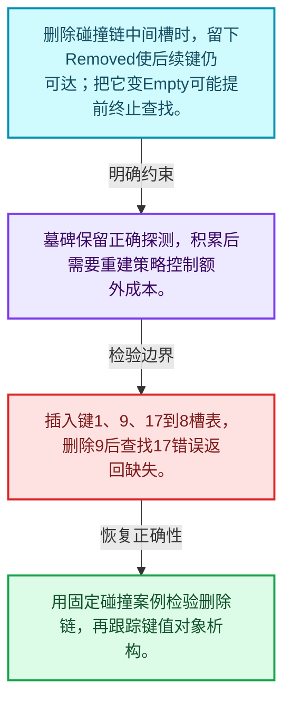
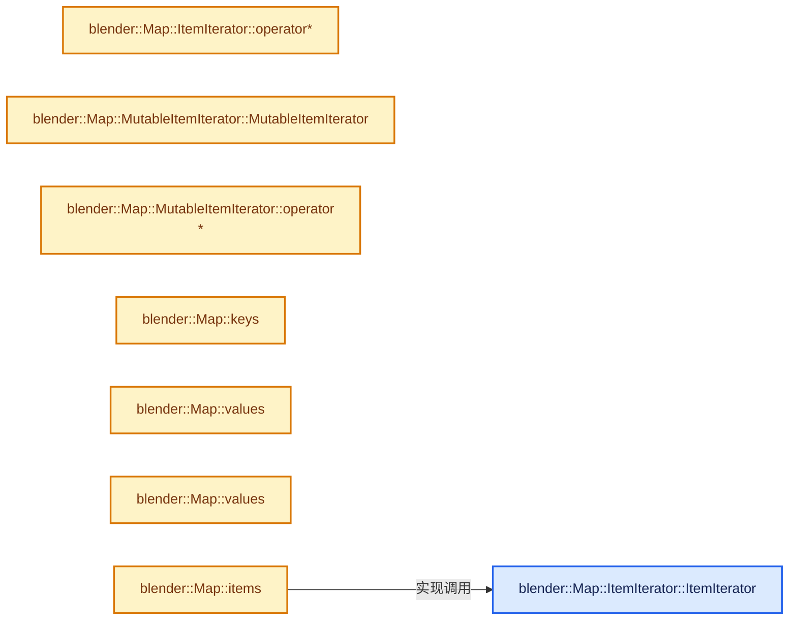
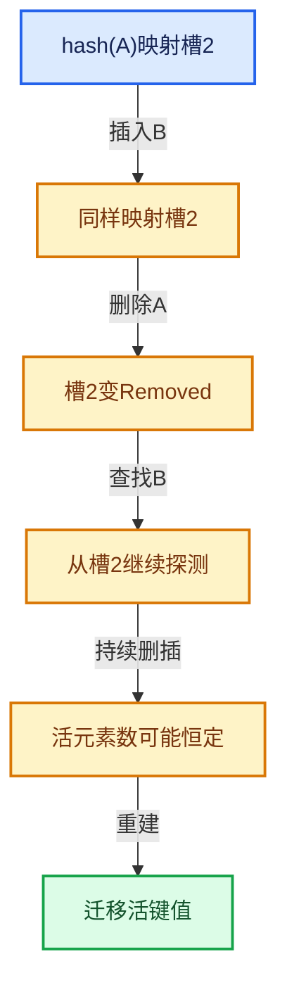

# 02-06 删除墓碑与值销毁

[方向导航](README.md) · [总目录](../README.md) · [实现索引](../00-课程指南/02-源码与提交索引/符号依赖与实现索引.md)

## 从问题到实现

删除后为什么仍要保留部分槽位信息？

元素生命周期终止和探测状态变化是两件事；保留墓碑维持链路，积累墓碑又会增加查找成本。

**数据模型**

删除碰撞链中间槽时，留下Removed使后续键仍可达；把它变Empty可能提前终止查找。

**设计取舍**

墓碑保留正确探测，积累后需要重建策略控制额外成本。

**最小反例**

插入键1、9、17到8槽表，删除9后查找17错误返回缺失。

**推导**

用固定碰撞案例检验删除链，再跟踪键值对象析构。

## 阅读地图与执行推演








图中的数值推演是本方向的教学模型；实际函数之间的调用边与概念分析边分别标注，不能把概念关系当作运行时调度顺序。

## 完整源码单元与就地讲解

中文讲解直接放在相关代码旁，复杂机制在代码下展开。原文折叠区保留基准行号；不需要在行号表和函数之间来回查找。类布局可分段展示，函数实现不按固定行数切开。

### 类型布局、声明与编译条件 · BLI_map.hh L833—L840

<a id="t-740fd5f8c2e3"></a>

<!-- annotated:6927da1107c512 -->

```cpp
  };

  class ItemIterator final : public BaseIteratorRange<ItemIterator> {
   public:
    using value_type = Item;
    using pointer = Item *;
    using reference = Item &;

```

<details>
<summary>核对原始源码：source/blender/blenlib/BLI_map.hh · L833—L840</summary>

<!-- original:6927da1107c512:source/blender/blenlib/BLI_map.hh:833:840 -->

```cpp
  };

  class ItemIterator final : public BaseIteratorRange<ItemIterator> {
   public:
    using value_type = Item;
    using pointer = Item *;
    using reference = Item &;

```

</details>

<a id="f-6fe1b8c5dd23feed"></a>

### `blender::Map::ItemIterator::ItemIterator`

实现位置：[source/blender/blenlib/BLI_map.hh](../../../../../source/blender/blenlib/BLI_map.hh) · L841—L844。

接口参数：

- `const Slot *slots`
- `int64_t total_slots`
- `int64_t current_slot`

**教学注释版**

<!-- annotated:58ee63de5ab62e -->

```cpp
    ItemIterator(const Slot *slots, int64_t total_slots, int64_t current_slot)
        : BaseIteratorRange<ItemIterator>(slots, total_slots, current_slot)
    {
    }
```

<details>
<summary>核对原始源码：source/blender/blenlib/BLI_map.hh · L841—L844</summary>

<!-- original:58ee63de5ab62e:source/blender/blenlib/BLI_map.hh:841:844 -->

```cpp
    ItemIterator(const Slot *slots, int64_t total_slots, int64_t current_slot)
        : BaseIteratorRange<ItemIterator>(slots, total_slots, current_slot)
    {
    }
```

</details>

**继续追踪实现**

本实现没有需要继续展开的显式调用；检查返回表达式、对象转换和调用者前置条件。

<!-- annotated:1e9072e84e2bc5 -->

```cpp

```

<details>
<summary>核对原始源码：source/blender/blenlib/BLI_map.hh · L845—L845</summary>

<!-- original:1e9072e84e2bc5:source/blender/blenlib/BLI_map.hh:845:845 -->

```cpp

```

</details>

<a id="f-adacabf317edd563"></a>

### `blender::Map::ItemIterator::operator*`

实现位置：[source/blender/blenlib/BLI_map.hh](../../../../../source/blender/blenlib/BLI_map.hh) · L846—L850。

**教学注释版**

<!-- annotated:b2897de553d665 -->

```cpp
    Item operator*() const
    {
      const Slot &slot = this->current_slot();
      return {*slot.key(), *slot.value()};
    }
```

<details>
<summary>核对原始源码：source/blender/blenlib/BLI_map.hh · L846—L850</summary>

<!-- original:b2897de553d665:source/blender/blenlib/BLI_map.hh:846:850 -->

```cpp
    Item operator*() const
    {
      const Slot &slot = this->current_slot();
      return {*slot.key(), *slot.value()};
    }
```

</details>

**结果出口**

- `return {*slot.key(), *slot.value()};`

**继续追踪实现**

- `this->current_slot` → [blender::Map::BaseIterator::current_slot · L751](05-Map插入与回调.md#f-283fe72c7ce12584)。
- `slot.key` → [调用协议](../00-课程指南/01-路线与规范/模板宏与动态分派协议.md)：Slot模板参数提供的操作协议。调用位置L849。
- `slot.value` → [调用协议](../00-课程指南/01-路线与规范/模板宏与动态分派协议.md)：Slot模板参数提供的操作协议。调用位置L849。

### 类型布局、声明与编译条件 · BLI_map.hh L851—L858

<a id="t-ba809bbcd10f"></a>

<!-- annotated:c618a99bce90fb -->

```cpp
  };

  class MutableItemIterator final : public BaseIteratorRange<MutableItemIterator> {
   public:
    using value_type = MutableItem;
    using pointer = MutableItem *;
    using reference = MutableItem &;

```

<details>
<summary>核对原始源码：source/blender/blenlib/BLI_map.hh · L851—L858</summary>

<!-- original:c618a99bce90fb:source/blender/blenlib/BLI_map.hh:851:858 -->

```cpp
  };

  class MutableItemIterator final : public BaseIteratorRange<MutableItemIterator> {
   public:
    using value_type = MutableItem;
    using pointer = MutableItem *;
    using reference = MutableItem &;

```

</details>

<a id="f-3279f61e3bb03dec"></a>

### `blender::Map::MutableItemIterator::MutableItemIterator`

实现位置：[source/blender/blenlib/BLI_map.hh](../../../../../source/blender/blenlib/BLI_map.hh) · L859—L862。

接口参数：

- `Slot *slots`
- `int64_t total_slots`
- `int64_t current_slot`

**教学注释版**

<!-- annotated:b40dd1f3561ea5 -->

```cpp
    MutableItemIterator(Slot *slots, int64_t total_slots, int64_t current_slot)
        : BaseIteratorRange<MutableItemIterator>(slots, total_slots, current_slot)
    {
    }
```

<details>
<summary>核对原始源码：source/blender/blenlib/BLI_map.hh · L859—L862</summary>

<!-- original:b40dd1f3561ea5:source/blender/blenlib/BLI_map.hh:859:862 -->

```cpp
    MutableItemIterator(Slot *slots, int64_t total_slots, int64_t current_slot)
        : BaseIteratorRange<MutableItemIterator>(slots, total_slots, current_slot)
    {
    }
```

</details>

**继续追踪实现**

本实现没有需要继续展开的显式调用；检查返回表达式、对象转换和调用者前置条件。

<!-- annotated:d9d6f2275aa941 -->

```cpp

```

<details>
<summary>核对原始源码：source/blender/blenlib/BLI_map.hh · L863—L863</summary>

<!-- original:d9d6f2275aa941:source/blender/blenlib/BLI_map.hh:863:863 -->

```cpp

```

</details>

<a id="f-fdc4b5f47be09c05"></a>

### `blender::Map::MutableItemIterator::operator*`

实现位置：[source/blender/blenlib/BLI_map.hh](../../../../../source/blender/blenlib/BLI_map.hh) · L864—L868。

**教学注释版**

<!-- annotated:807c46634598da -->

```cpp
    MutableItem operator*() const
    {
      Slot &slot = this->current_slot();
      return {*slot.key(), *slot.value()};
    }
```

<details>
<summary>核对原始源码：source/blender/blenlib/BLI_map.hh · L864—L868</summary>

<!-- original:807c46634598da:source/blender/blenlib/BLI_map.hh:864:868 -->

```cpp
    MutableItem operator*() const
    {
      Slot &slot = this->current_slot();
      return {*slot.key(), *slot.value()};
    }
```

</details>

**结果出口**

- `return {*slot.key(), *slot.value()};`

**继续追踪实现**

- `this->current_slot` → [blender::Map::BaseIterator::current_slot · L751](05-Map插入与回调.md#f-283fe72c7ce12584)。
- `slot.key` → [调用协议](../00-课程指南/01-路线与规范/模板宏与动态分派协议.md)：Slot模板参数提供的操作协议。调用位置L867。
- `slot.value` → [调用协议](../00-课程指南/01-路线与规范/模板宏与动态分派协议.md)：Slot模板参数提供的操作协议。调用位置L867。

### 类型布局、声明与编译条件 · BLI_map.hh L869—L874

<!-- annotated:a145becc339d90 -->

```cpp
  };

  /**
   * Allows writing a range-for loop that iterates over all keys. The iterator is invalidated, when
   * the map is changed.
   */
```

<details>
<summary>核对原始源码：source/blender/blenlib/BLI_map.hh · L869—L874</summary>

<!-- original:a145becc339d90:source/blender/blenlib/BLI_map.hh:869:874 -->

```cpp
  };

  /**
   * Allows writing a range-for loop that iterates over all keys. The iterator is invalidated, when
   * the map is changed.
   */
```

</details>

<a id="f-03712192091336cc"></a>

### `blender::Map::keys`

实现位置：[source/blender/blenlib/BLI_map.hh](../../../../../source/blender/blenlib/BLI_map.hh) · L875—L878。

**教学注释版**

<!-- annotated:db4cbac2ef6aa0 -->

```cpp
  KeyIterator keys() const &
  {
    // [讲解] slots_.size：查询活项数量或键是否存在。
    return KeyIterator(slots_.data(), slots_.size(), 0);
  }
```

<details>
<summary>核对原始源码：source/blender/blenlib/BLI_map.hh · L875—L878</summary>

<!-- original:db4cbac2ef6aa0:source/blender/blenlib/BLI_map.hh:875:878 -->

```cpp
  KeyIterator keys() const &
  {
    return KeyIterator(slots_.data(), slots_.size(), 0);
  }
```

</details>

**结果出口**

- `return KeyIterator(slots_.data(), slots_.size(), 0);`

**继续追踪实现**

- `KeyIterator` → [blender::Map::KeyIterator::KeyIterator · L790](05-Map插入与回调.md#f-5e9806986c193a63)。
- `slots_.data` → [调用协议](../00-课程指南/01-路线与规范/模板宏与动态分派协议.md)：由接收对象具体类型或运行时策略提供实现。调用位置L877。
- `slots_.size` → [blender::Map::size · L976](06-删除墓碑与值销毁.md#f-ac1e466c97fbbebe)。

### 类型布局、声明与编译条件 · BLI_map.hh L879—L883

<!-- annotated:968432063df9a9 -->

```cpp

  /**
   * Returns an iterator over all values in the map. The iterator is invalidated, when the map is
   * changed.
   */
```

<details>
<summary>核对原始源码：source/blender/blenlib/BLI_map.hh · L879—L883</summary>

<!-- original:968432063df9a9:source/blender/blenlib/BLI_map.hh:879:883 -->

```cpp

  /**
   * Returns an iterator over all values in the map. The iterator is invalidated, when the map is
   * changed.
   */
```

</details>

<a id="f-1ac557fce41bc5ad"></a>

### `blender::Map::values`

实现位置：[source/blender/blenlib/BLI_map.hh](../../../../../source/blender/blenlib/BLI_map.hh) · L884—L887。

**教学注释版**

<!-- annotated:26cdcd6beefc36 -->

```cpp
  ValueIterator values() const &
  {
    // [讲解] slots_.size：查询活项数量或键是否存在。
    return ValueIterator(slots_.data(), slots_.size(), 0);
  }
```

<details>
<summary>核对原始源码：source/blender/blenlib/BLI_map.hh · L884—L887</summary>

<!-- original:26cdcd6beefc36:source/blender/blenlib/BLI_map.hh:884:887 -->

```cpp
  ValueIterator values() const &
  {
    return ValueIterator(slots_.data(), slots_.size(), 0);
  }
```

</details>

**结果出口**

- `return ValueIterator(slots_.data(), slots_.size(), 0);`

**继续追踪实现**

- `ValueIterator` → [blender::Map::ValueIterator::ValueIterator · L807](05-Map插入与回调.md#f-6aac7da87f2da164)。
- `slots_.data` → [调用协议](../00-课程指南/01-路线与规范/模板宏与动态分派协议.md)：由接收对象具体类型或运行时策略提供实现。调用位置L886。
- `slots_.size` → [blender::Map::size · L976](06-删除墓碑与值销毁.md#f-ac1e466c97fbbebe)。

### 类型布局、声明与编译条件 · BLI_map.hh L888—L892

<!-- annotated:60fbb2689d2e80 -->

```cpp

  /**
   * Returns an iterator over all values in the map and allows you to change the values. The
   * iterator is invalidated, when the map is changed.
   */
```

<details>
<summary>核对原始源码：source/blender/blenlib/BLI_map.hh · L888—L892</summary>

<!-- original:60fbb2689d2e80:source/blender/blenlib/BLI_map.hh:888:892 -->

```cpp

  /**
   * Returns an iterator over all values in the map and allows you to change the values. The
   * iterator is invalidated, when the map is changed.
   */
```

</details>

<a id="f-990baba928a54f33"></a>

### `blender::Map::values`

实现位置：[source/blender/blenlib/BLI_map.hh](../../../../../source/blender/blenlib/BLI_map.hh) · L893—L896。

**教学注释版**

<!-- annotated:572ad5b770af78 -->

```cpp
  MutableValueIterator values() &
  {
    // [讲解] slots_.size：查询活项数量或键是否存在。
    return MutableValueIterator(slots_.data(), slots_.size(), 0);
  }
```

<details>
<summary>核对原始源码：source/blender/blenlib/BLI_map.hh · L893—L896</summary>

<!-- original:572ad5b770af78:source/blender/blenlib/BLI_map.hh:893:896 -->

```cpp
  MutableValueIterator values() &
  {
    return MutableValueIterator(slots_.data(), slots_.size(), 0);
  }
```

</details>

**结果出口**

- `return MutableValueIterator(slots_.data(), slots_.size(), 0);`

**继续追踪实现**

- `MutableValueIterator` → [blender::Map::MutableValueIterator::MutableValueIterator · L824](05-Map插入与回调.md#f-8e9767a5d701c1bf)。
- `slots_.data` → [调用协议](../00-课程指南/01-路线与规范/模板宏与动态分派协议.md)：由接收对象具体类型或运行时策略提供实现。调用位置L895。
- `slots_.size` → [blender::Map::size · L976](06-删除墓碑与值销毁.md#f-ac1e466c97fbbebe)。

### 类型布局、声明与编译条件 · BLI_map.hh L897—L901

<!-- annotated:60b01a27f3ea02 -->

```cpp

  /**
   * Returns an iterator over all key-value-pairs in the map. The key-value-pairs are stored in a
   * #MapItem. The iterator is invalidated, when the map is changed.
   */
```

<details>
<summary>核对原始源码：source/blender/blenlib/BLI_map.hh · L897—L901</summary>

<!-- original:60b01a27f3ea02:source/blender/blenlib/BLI_map.hh:897:901 -->

```cpp

  /**
   * Returns an iterator over all key-value-pairs in the map. The key-value-pairs are stored in a
   * #MapItem. The iterator is invalidated, when the map is changed.
   */
```

</details>

<a id="f-9ef4f6f70cba8f81"></a>

### `blender::Map::items`

实现位置：[source/blender/blenlib/BLI_map.hh](../../../../../source/blender/blenlib/BLI_map.hh) · L902—L905。

**教学注释版**

<!-- annotated:40eea771c52202 -->

```cpp
  ItemIterator items() const &
  {
    // [讲解] slots_.size：查询活项数量或键是否存在。
    return ItemIterator(slots_.data(), slots_.size(), 0);
  }
```

<details>
<summary>核对原始源码：source/blender/blenlib/BLI_map.hh · L902—L905</summary>

<!-- original:40eea771c52202:source/blender/blenlib/BLI_map.hh:902:905 -->

```cpp
  ItemIterator items() const &
  {
    return ItemIterator(slots_.data(), slots_.size(), 0);
  }
```

</details>

**结果出口**

- `return ItemIterator(slots_.data(), slots_.size(), 0);`

**继续追踪实现**

- `ItemIterator` → [blender::Map::ItemIterator::ItemIterator · L841](06-删除墓碑与值销毁.md#f-6fe1b8c5dd23feed)。
- `slots_.data` → [调用协议](../00-课程指南/01-路线与规范/模板宏与动态分派协议.md)：由接收对象具体类型或运行时策略提供实现。调用位置L904。
- `slots_.size` → [blender::Map::size · L976](06-删除墓碑与值销毁.md#f-ac1e466c97fbbebe)。

### 类型布局、声明与编译条件 · BLI_map.hh L906—L912

<!-- annotated:29f7fc9ac9cc14 -->

```cpp

  /**
   * Returns an iterator over all key-value-pairs in the map. The key-value-pairs are stored in a
   * #MutableMapItem. The iterator is invalidated, when the map is changed.
   *
   * This iterator also allows you to modify the value (but not the key).
   */
```

<details>
<summary>核对原始源码：source/blender/blenlib/BLI_map.hh · L906—L912</summary>

<!-- original:29f7fc9ac9cc14:source/blender/blenlib/BLI_map.hh:906:912 -->

```cpp

  /**
   * Returns an iterator over all key-value-pairs in the map. The key-value-pairs are stored in a
   * #MutableMapItem. The iterator is invalidated, when the map is changed.
   *
   * This iterator also allows you to modify the value (but not the key).
   */
```

</details>

<a id="f-0a69f4e73db8973e"></a>

### `blender::Map::items`

实现位置：[source/blender/blenlib/BLI_map.hh](../../../../../source/blender/blenlib/BLI_map.hh) · L913—L916。

**教学注释版**

<!-- annotated:f5ad6fe8fd737c -->

```cpp
  MutableItemIterator items() &
  {
    // [讲解] slots_.size：查询活项数量或键是否存在。
    return MutableItemIterator(slots_.data(), slots_.size(), 0);
  }
```

<details>
<summary>核对原始源码：source/blender/blenlib/BLI_map.hh · L913—L916</summary>

<!-- original:f5ad6fe8fd737c:source/blender/blenlib/BLI_map.hh:913:916 -->

```cpp
  MutableItemIterator items() &
  {
    return MutableItemIterator(slots_.data(), slots_.size(), 0);
  }
```

</details>

**结果出口**

- `return MutableItemIterator(slots_.data(), slots_.size(), 0);`

**继续追踪实现**

- `MutableItemIterator` → [blender::Map::MutableItemIterator::MutableItemIterator · L859](06-删除墓碑与值销毁.md#f-3279f61e3bb03dec)。
- `slots_.data` → [调用协议](../00-课程指南/01-路线与规范/模板宏与动态分派协议.md)：由接收对象具体类型或运行时策略提供实现。调用位置L915。
- `slots_.size` → [blender::Map::size · L976](06-删除墓碑与值销毁.md#f-ac1e466c97fbbebe)。

### 类型布局、声明与编译条件 · BLI_map.hh L917—L922

<!-- annotated:7fd1a284787395 -->

```cpp

  /**
   * Avoid common bug when trying to do something like this: `for (auto key : get_map().keys())`.
   * This does not work, because the compiler does not extend the lifetime of the map for the
   * duration of the loop.
   */
```

<details>
<summary>核对原始源码：source/blender/blenlib/BLI_map.hh · L917—L922</summary>

<!-- original:7fd1a284787395:source/blender/blenlib/BLI_map.hh:917:922 -->

```cpp

  /**
   * Avoid common bug when trying to do something like this: `for (auto key : get_map().keys())`.
   * This does not work, because the compiler does not extend the lifetime of the map for the
   * duration of the loop.
   */
```

</details>

<a id="f-94cdd669fbc1a03d"></a>

### `blender::Map::keys`

实现位置：[source/blender/blenlib/BLI_map.hh](../../../../../source/blender/blenlib/BLI_map.hh) · L923—L923。

**教学注释版**

<!-- annotated:2ab7b4427b59b5 -->

```cpp
  KeyIterator keys() const && = delete;
```

<details>
<summary>核对原始源码：source/blender/blenlib/BLI_map.hh · L923—L923</summary>

<!-- original:2ab7b4427b59b5:source/blender/blenlib/BLI_map.hh:923:923 -->

```cpp
  KeyIterator keys() const && = delete;
```

</details>

**继续追踪实现**

本实现没有需要继续展开的显式调用；检查返回表达式、对象转换和调用者前置条件。

<a id="f-170edfefcc9656c1"></a>

### `blender::Map::values`

实现位置：[source/blender/blenlib/BLI_map.hh](../../../../../source/blender/blenlib/BLI_map.hh) · L924—L924。

**教学注释版**

<!-- annotated:910d71acc04e82 -->

```cpp
  MutableValueIterator values() && = delete;
```

<details>
<summary>核对原始源码：source/blender/blenlib/BLI_map.hh · L924—L924</summary>

<!-- original:910d71acc04e82:source/blender/blenlib/BLI_map.hh:924:924 -->

```cpp
  MutableValueIterator values() && = delete;
```

</details>

**继续追踪实现**

本实现没有需要继续展开的显式调用；检查返回表达式、对象转换和调用者前置条件。

<a id="f-b7260376cafdd01d"></a>

### `blender::Map::values`

实现位置：[source/blender/blenlib/BLI_map.hh](../../../../../source/blender/blenlib/BLI_map.hh) · L925—L925。

**教学注释版**

<!-- annotated:9f0fb5f23cf68a -->

```cpp
  ValueIterator values() const && = delete;
```

<details>
<summary>核对原始源码：source/blender/blenlib/BLI_map.hh · L925—L925</summary>

<!-- original:9f0fb5f23cf68a:source/blender/blenlib/BLI_map.hh:925:925 -->

```cpp
  ValueIterator values() const && = delete;
```

</details>

**继续追踪实现**

本实现没有需要继续展开的显式调用；检查返回表达式、对象转换和调用者前置条件。

<a id="f-092add737130dcfb"></a>

### `blender::Map::items`

实现位置：[source/blender/blenlib/BLI_map.hh](../../../../../source/blender/blenlib/BLI_map.hh) · L926—L926。

**教学注释版**

<!-- annotated:30f90cc764a99b -->

```cpp
  ItemIterator items() const && = delete;
```

<details>
<summary>核对原始源码：source/blender/blenlib/BLI_map.hh · L926—L926</summary>

<!-- original:30f90cc764a99b:source/blender/blenlib/BLI_map.hh:926:926 -->

```cpp
  ItemIterator items() const && = delete;
```

</details>

**继续追踪实现**

本实现没有需要继续展开的显式调用；检查返回表达式、对象转换和调用者前置条件。

<a id="f-4bfc999f60cdede4"></a>

### `blender::Map::items`

实现位置：[source/blender/blenlib/BLI_map.hh](../../../../../source/blender/blenlib/BLI_map.hh) · L927—L927。

**教学注释版**

<!-- annotated:f5e1bf74cdc0a2 -->

```cpp
  MutableItemIterator items() && = delete;
```

<details>
<summary>核对原始源码：source/blender/blenlib/BLI_map.hh · L927—L927</summary>

<!-- original:f5e1bf74cdc0a2:source/blender/blenlib/BLI_map.hh:927:927 -->

```cpp
  MutableItemIterator items() && = delete;
```

</details>

**继续追踪实现**

本实现没有需要继续展开的显式调用；检查返回表达式、对象转换和调用者前置条件。

### 类型布局、声明与编译条件 · BLI_map.hh L928—L933

<!-- annotated:71b1a29b1b0d2c -->

```cpp

  /**
   * Remove the key-value-pair that the iterator is currently pointing at.
   * It is valid to call this method while iterating over the map. However, after this method has
   * been called, the removed element must not be accessed anymore.
   */
```

<details>
<summary>核对原始源码：source/blender/blenlib/BLI_map.hh · L928—L933</summary>

<!-- original:71b1a29b1b0d2c:source/blender/blenlib/BLI_map.hh:928:933 -->

```cpp

  /**
   * Remove the key-value-pair that the iterator is currently pointing at.
   * It is valid to call this method while iterating over the map. However, after this method has
   * been called, the removed element must not be accessed anymore.
   */
```

</details>

<a id="f-91af8d68066c586e"></a>

### `blender::Map::remove`

移除占用项并维护探测状态。

实现位置：[source/blender/blenlib/BLI_map.hh](../../../../../source/blender/blenlib/BLI_map.hh) · L934—L940。

接口参数：

- `const BaseIterator &iterator`

**教学注释版**

<!-- annotated:c8af60c588f9a6 -->

```cpp
  void remove(const BaseIterator &iterator)
  {
    Slot &slot = iterator.current_slot();
    BLI_assert(slot.is_occupied());
    slot.remove();
    removed_slots_++;
  }
```

<details>
<summary>核对原始源码：source/blender/blenlib/BLI_map.hh · L934—L940</summary>

<!-- original:c8af60c588f9a6:source/blender/blenlib/BLI_map.hh:934:940 -->

```cpp
  void remove(const BaseIterator &iterator)
  {
    Slot &slot = iterator.current_slot();
    BLI_assert(slot.is_occupied());
    slot.remove();
    removed_slots_++;
  }
```

</details>

**接口与不变量**

对象销毁与留下删除槽标记是不同步骤，直接把碰撞链中间槽变成Empty可能截断后续查找。

**继续追踪实现**

- `iterator.current_slot` → [blender::Map::BaseIterator::current_slot · L751](05-Map插入与回调.md#f-283fe72c7ce12584)。
- `BLI_assert` → [BLI_assert · L48](../90-实现依赖专题/01-BLI基础库/BLI_assert.hh.md#m-57a88495704d)；[BLI_assert · L63](../90-实现依赖专题/01-BLI基础库/BLI_assert.hh.md#m-d07050020cb5)。宏定义由构建条件选择。
- `slot.is_occupied` → [调用协议](../00-课程指南/01-路线与规范/模板宏与动态分派协议.md)：Slot模板参数提供的操作协议。调用位置L937。
- `slot.remove` → [调用协议](../00-课程指南/01-路线与规范/模板宏与动态分派协议.md)：Slot模板参数提供的操作协议。调用位置L938。

### 类型布局、声明与编译条件 · BLI_map.hh L941—L947

<!-- annotated:2ac03bfb92be05 -->

```cpp

  /**
   * Remove all key-value-pairs for that the given predicate is true and return the number of
   * removed pairs.
   *
   * This is similar to std::erase_if.
   */
```

<details>
<summary>核对原始源码：source/blender/blenlib/BLI_map.hh · L941—L947</summary>

<!-- original:2ac03bfb92be05:source/blender/blenlib/BLI_map.hh:941:947 -->

```cpp

  /**
   * Remove all key-value-pairs for that the given predicate is true and return the number of
   * removed pairs.
   *
   * This is similar to std::erase_if.
   */
```

</details>

<a id="f-a790019b18a8b8f4"></a>

### `blender::Map::remove_if`

实现位置：[source/blender/blenlib/BLI_map.hh](../../../../../source/blender/blenlib/BLI_map.hh) · L948—L962。

接口参数：

- `Predicate &&predicate`

**教学注释版**

<!-- annotated:0ee175c722b1d2 -->

```cpp
  template<typename Predicate> int64_t remove_if(Predicate &&predicate)
  {
    // [讲解] this->size：查询活项数量或键是否存在。
    const int64_t prev_size = this->size();
    for (Slot &slot : slots_) {
      if (slot.is_occupied()) {
        const Key &key = *slot.key();
        Value &value = *slot.value();
        if (predicate(MutableItem{key, value})) {
          slot.remove();
          removed_slots_++;
        }
      }
    }
    return prev_size - this->size();
  }
```

<details>
<summary>核对原始源码：source/blender/blenlib/BLI_map.hh · L948—L962</summary>

<!-- original:0ee175c722b1d2:source/blender/blenlib/BLI_map.hh:948:962 -->

```cpp
  template<typename Predicate> int64_t remove_if(Predicate &&predicate)
  {
    const int64_t prev_size = this->size();
    for (Slot &slot : slots_) {
      if (slot.is_occupied()) {
        const Key &key = *slot.key();
        Value &value = *slot.value();
        if (predicate(MutableItem{key, value})) {
          slot.remove();
          removed_slots_++;
        }
      }
    }
    return prev_size - this->size();
  }
```

</details>

**结果出口**

- `return prev_size - this->size();`

**继续追踪实现**

- `this->size` → [blender::Map::size · L976](06-删除墓碑与值销毁.md#f-ac1e466c97fbbebe)。
- `slot.is_occupied` → [blender::SimpleMapSlot::is_occupied · L147](03-槽位状态与探测.md#f-77cf8800a3021e47)。
- `slot.key` → [blender::SimpleMapSlot::key · L115](03-槽位状态与探测.md#f-5c6518e27184d9c6)；[blender::SimpleMapSlot::key · L123](03-槽位状态与探测.md#f-e6492f49ecf89e3b)。同名重载需按实参类型选择。
- `slot.value` → [blender::SimpleMapSlot::value · L131](03-槽位状态与探测.md#f-9481808b45bd9676)；[blender::SimpleMapSlot::value · L139](03-槽位状态与探测.md#f-e44306ec91903240)。同名重载需按实参类型选择。
- `predicate` → [调用协议](../00-课程指南/01-路线与规范/模板宏与动态分派协议.md)：局部可调用对象，须结合其初始化与捕获环境。调用位置L955。
- `slot.remove` → [blender::SimpleMapSlot::remove · L218](03-槽位状态与探测.md#f-51097f9581fdd5cb)。

### 类型布局、声明与编译条件 · BLI_map.hh L963—L966

<!-- annotated:ea6640d493df2a -->

```cpp

  /**
   * Print common statistics like size and collision count. This is useful for debugging purposes.
   */
```

<details>
<summary>核对原始源码：source/blender/blenlib/BLI_map.hh · L963—L966</summary>

<!-- original:ea6640d493df2a:source/blender/blenlib/BLI_map.hh:963:966 -->

```cpp

  /**
   * Print common statistics like size and collision count. This is useful for debugging purposes.
   */
```

</details>

<a id="f-b6bc3220bef1bf5f"></a>

### `blender::Map::print_stats`

实现位置：[source/blender/blenlib/BLI_map.hh](../../../../../source/blender/blenlib/BLI_map.hh) · L967—L971。

接口参数：

- `const char *name`

**教学注释版**

<!-- annotated:ed9d7118cb28a7 -->

```cpp
  void print_stats(const char *name) const
  {
    HashTableStats stats(*this, this->keys());
    stats.print(name);
  }
```

<details>
<summary>核对原始源码：source/blender/blenlib/BLI_map.hh · L967—L971</summary>

<!-- original:ed9d7118cb28a7:source/blender/blenlib/BLI_map.hh:967:971 -->

```cpp
  void print_stats(const char *name) const
  {
    HashTableStats stats(*this, this->keys());
    stats.print(name);
  }
```

</details>

**继续追踪实现**

- `this->keys` → [blender::Map::keys · L875](06-删除墓碑与值销毁.md#f-03712192091336cc)；[blender::Map::keys · L923](06-删除墓碑与值销毁.md#f-94cdd669fbc1a03d)。同名重载需按实参类型选择。
- `stats.print` → [blender::HashTableStats::print · L16](../90-实现依赖专题/01-BLI基础库/intern/hash_tables.cc.md#f-be761e16ade883cd)。

### 类型布局、声明与编译条件 · BLI_map.hh L972—L975

<!-- annotated:64ad50b5e664ed -->

```cpp

  /**
   * Return the number of key-value-pairs that are stored in the map.
   */
```

<details>
<summary>核对原始源码：source/blender/blenlib/BLI_map.hh · L972—L975</summary>

<!-- original:64ad50b5e664ed:source/blender/blenlib/BLI_map.hh:972:975 -->

```cpp

  /**
   * Return the number of key-value-pairs that are stored in the map.
   */
```

</details>

<a id="f-ac1e466c97fbbebe"></a>

### `blender::Map::size`

查询活项数量或键是否存在。

实现位置：[source/blender/blenlib/BLI_map.hh](../../../../../source/blender/blenlib/BLI_map.hh) · L976—L979。

**教学注释版**

<!-- annotated:9f006ef30114e6 -->

```cpp
  int64_t size() const
  {
    return occupied_and_removed_slots_ - removed_slots_;
  }
```

<details>
<summary>核对原始源码：source/blender/blenlib/BLI_map.hh · L976—L979</summary>

<!-- original:9f006ef30114e6:source/blender/blenlib/BLI_map.hh:976:979 -->

```cpp
  int64_t size() const
  {
    return occupied_and_removed_slots_ - removed_slots_;
  }
```

</details>

**接口与不变量**

活项数量与删除槽数量不同，探测成本不能只看size。

**结果出口**

- `return occupied_and_removed_slots_ - removed_slots_;`

**继续追踪实现**

本实现没有需要继续展开的显式调用；检查返回表达式、对象转换和调用者前置条件。

### 类型布局、声明与编译条件 · BLI_map.hh L980—L985

<!-- annotated:a353477f101bb1 -->

```cpp

  /**
   * Returns true if there are no elements in the map.
   *
   * This is similar to std::unordered_map::empty.
   */
```

<details>
<summary>核对原始源码：source/blender/blenlib/BLI_map.hh · L980—L985</summary>

<!-- original:a353477f101bb1:source/blender/blenlib/BLI_map.hh:980:985 -->

```cpp

  /**
   * Returns true if there are no elements in the map.
   *
   * This is similar to std::unordered_map::empty.
   */
```

</details>

<a id="f-1f8d9e6725234656"></a>

### `blender::Map::is_empty`

查询活项数量或键是否存在。

实现位置：[source/blender/blenlib/BLI_map.hh](../../../../../source/blender/blenlib/BLI_map.hh) · L986—L989。

**教学注释版**

<!-- annotated:f870633feb32d7 -->

```cpp
  bool is_empty() const
  {
    return occupied_and_removed_slots_ == removed_slots_;
  }
```

<details>
<summary>核对原始源码：source/blender/blenlib/BLI_map.hh · L986—L989</summary>

<!-- original:f870633feb32d7:source/blender/blenlib/BLI_map.hh:986:989 -->

```cpp
  bool is_empty() const
  {
    return occupied_and_removed_slots_ == removed_slots_;
  }
```

</details>

**接口与不变量**

活项数量与删除槽数量不同，探测成本不能只看size。

**结果出口**

- `return occupied_and_removed_slots_ == removed_slots_;`

**继续追踪实现**

本实现没有需要继续展开的显式调用；检查返回表达式、对象转换和调用者前置条件。

### 类型布局、声明与编译条件 · BLI_map.hh L990—L993

<!-- annotated:bd6bcd5309e5d7 -->

```cpp

  /**
   * Returns the number of available slots. This is mostly for debugging purposes.
   */
```

<details>
<summary>核对原始源码：source/blender/blenlib/BLI_map.hh · L990—L993</summary>

<!-- original:bd6bcd5309e5d7:source/blender/blenlib/BLI_map.hh:990:993 -->

```cpp

  /**
   * Returns the number of available slots. This is mostly for debugging purposes.
   */
```

</details>

<a id="f-e6ccc650b1e864dc"></a>

### `blender::Map::capacity`

实现位置：[source/blender/blenlib/BLI_map.hh](../../../../../source/blender/blenlib/BLI_map.hh) · L994—L997。

**教学注释版**

<!-- annotated:d134ec63ecd65e -->

```cpp
  int64_t capacity() const
  {
    // [讲解] slots_.size：查询活项数量或键是否存在。
    return slots_.size();
  }
```

<details>
<summary>核对原始源码：source/blender/blenlib/BLI_map.hh · L994—L997</summary>

<!-- original:d134ec63ecd65e:source/blender/blenlib/BLI_map.hh:994:997 -->

```cpp
  int64_t capacity() const
  {
    return slots_.size();
  }
```

</details>

**结果出口**

- `return slots_.size();`

**继续追踪实现**

- `slots_.size` → [blender::Map::size · L976](06-删除墓碑与值销毁.md#f-ac1e466c97fbbebe)。

### 类型布局、声明与编译条件 · BLI_map.hh L998—L1001

<!-- annotated:6ac93e9e984275 -->

```cpp

  /**
   * Returns the amount of removed slots in the set. This is mostly for debugging purposes.
   */
```

<details>
<summary>核对原始源码：source/blender/blenlib/BLI_map.hh · L998—L1001</summary>

<!-- original:6ac93e9e984275:source/blender/blenlib/BLI_map.hh:998:1001 -->

```cpp

  /**
   * Returns the amount of removed slots in the set. This is mostly for debugging purposes.
   */
```

</details>

<a id="f-3954198a5b4e2617"></a>

### `blender::Map::removed_amount`

实现位置：[source/blender/blenlib/BLI_map.hh](../../../../../source/blender/blenlib/BLI_map.hh) · L1002—L1005。

**教学注释版**

<!-- annotated:8dc655dde62e3a -->

```cpp
  int64_t removed_amount() const
  {
    return removed_slots_;
  }
```

<details>
<summary>核对原始源码：source/blender/blenlib/BLI_map.hh · L1002—L1005</summary>

<!-- original:8dc655dde62e3a:source/blender/blenlib/BLI_map.hh:1002:1005 -->

```cpp
  int64_t removed_amount() const
  {
    return removed_slots_;
  }
```

</details>

**结果出口**

- `return removed_slots_;`

**继续追踪实现**

本实现没有需要继续展开的显式调用；检查返回表达式、对象转换和调用者前置条件。

### 类型布局、声明与编译条件 · BLI_map.hh L1006—L1009

<!-- annotated:b5cb3e9b2a92c0 -->

```cpp

  /**
   * Returns the bytes required per element. This is mostly for debugging purposes.
   */
```

<details>
<summary>核对原始源码：source/blender/blenlib/BLI_map.hh · L1006—L1009</summary>

<!-- original:b5cb3e9b2a92c0:source/blender/blenlib/BLI_map.hh:1006:1009 -->

```cpp

  /**
   * Returns the bytes required per element. This is mostly for debugging purposes.
   */
```

</details>

<a id="f-3698f10ea24289a2"></a>

### `blender::Map::size_per_element`

实现位置：[source/blender/blenlib/BLI_map.hh](../../../../../source/blender/blenlib/BLI_map.hh) · L1010—L1013。

**教学注释版**

<!-- annotated:e46c07d878035e -->

```cpp
  int64_t size_per_element() const
  {
    return sizeof(Slot);
  }
```

<details>
<summary>核对原始源码：source/blender/blenlib/BLI_map.hh · L1010—L1013</summary>

<!-- original:e46c07d878035e:source/blender/blenlib/BLI_map.hh:1010:1013 -->

```cpp
  int64_t size_per_element() const
  {
    return sizeof(Slot);
  }
```

</details>

**结果出口**

- `return sizeof(Slot);`

**继续追踪实现**

本实现没有需要继续展开的显式调用；检查返回表达式、对象转换和调用者前置条件。

### 类型布局、声明与编译条件 · BLI_map.hh L1014—L1018

<!-- annotated:3a7ac19b834169 -->

```cpp

  /**
   * Returns the approximate memory requirements of the map in bytes. This becomes more exact the
   * larger the map becomes.
   */
```

<details>
<summary>核对原始源码：source/blender/blenlib/BLI_map.hh · L1014—L1018</summary>

<!-- original:3a7ac19b834169:source/blender/blenlib/BLI_map.hh:1014:1018 -->

```cpp

  /**
   * Returns the approximate memory requirements of the map in bytes. This becomes more exact the
   * larger the map becomes.
   */
```

</details>

<a id="f-51be54743088cfbc"></a>

### `blender::Map::size_in_bytes`

实现位置：[source/blender/blenlib/BLI_map.hh](../../../../../source/blender/blenlib/BLI_map.hh) · L1019—L1022。

**教学注释版**

<!-- annotated:e90b27ab80aea8 -->

```cpp
  int64_t size_in_bytes() const
  {
    // [讲解] slots_.size：查询活项数量或键是否存在。
    return int64_t(sizeof(Slot) * slots_.size());
  }
```

<details>
<summary>核对原始源码：source/blender/blenlib/BLI_map.hh · L1019—L1022</summary>

<!-- original:e90b27ab80aea8:source/blender/blenlib/BLI_map.hh:1019:1022 -->

```cpp
  int64_t size_in_bytes() const
  {
    return int64_t(sizeof(Slot) * slots_.size());
  }
```

</details>

**结果出口**

- `return int64_t(sizeof(Slot) * slots_.size());`

**继续追踪实现**

- `slots_.size` → [blender::Map::size · L976](06-删除墓碑与值销毁.md#f-ac1e466c97fbbebe)。

### 类型布局、声明与编译条件 · BLI_map.hh L1023—L1027

<!-- annotated:87617ab76f6812 -->

```cpp

  /**
   * Potentially resize the map such that the specified number of elements can be added without
   * another grow operation.
   */
```

<details>
<summary>核对原始源码：source/blender/blenlib/BLI_map.hh · L1023—L1027</summary>

<!-- original:87617ab76f6812:source/blender/blenlib/BLI_map.hh:1023:1027 -->

```cpp

  /**
   * Potentially resize the map such that the specified number of elements can be added without
   * another grow operation.
   */
```

</details>

<a id="f-03761191d90c03e9"></a>

### `blender::Map::reserve`

重新组织槽位或准备容量。

实现位置：[source/blender/blenlib/BLI_map.hh](../../../../../source/blender/blenlib/BLI_map.hh) · L1028—L1033。

接口参数：

- `int64_t n`

**教学注释版**

<!-- annotated:90b9640a9d927a -->

```cpp
  void reserve(int64_t n)
  {
    if (usable_slots_ < n) {
      // [讲解] this->realloc_and_reinsert：重新组织槽位或准备容量。
      this->realloc_and_reinsert(n);
    }
  }
```

<details>
<summary>核对原始源码：source/blender/blenlib/BLI_map.hh · L1028—L1033</summary>

<!-- original:90b9640a9d927a:source/blender/blenlib/BLI_map.hh:1028:1033 -->

```cpp
  void reserve(int64_t n)
  {
    if (usable_slots_ < n) {
      this->realloc_and_reinsert(n);
    }
  }
```

</details>

**接口与不变量**

重建后需同步计数和寻址掩码，原键值地址或元素索引是否稳定按容器约定判断。

**继续追踪实现**

- `this->realloc_and_reinsert` → [blender::Map::realloc_and_reinsert · L1099](07-重建与摊还复杂度.md#f-9722cb90385659a2)。

### 类型布局、声明与编译条件 · BLI_map.hh L1034—L1037

<!-- annotated:7b2548988e32c9 -->

```cpp

  /**
   * Remove all elements. Under some circumstances #clear_and_keep_capacity may be more efficient.
   */
```

<details>
<summary>核对原始源码：source/blender/blenlib/BLI_map.hh · L1034—L1037</summary>

<!-- original:7b2548988e32c9:source/blender/blenlib/BLI_map.hh:1034:1037 -->

```cpp

  /**
   * Remove all elements. Under some circumstances #clear_and_keep_capacity may be more efficient.
   */
```

</details>

<a id="f-c58ca43ed9dafe4a"></a>

### `blender::Map::clear`

移除全部活项，并按接口决定是否归还存储。

实现位置：[source/blender/blenlib/BLI_map.hh](../../../../../source/blender/blenlib/BLI_map.hh) · L1038—L1042。

**教学注释版**

<!-- annotated:5665053c43824b -->

```cpp
  void clear()
  {
    std::destroy_at(this);
    new (this) Map(NoExceptConstructor{});
  }
```

<details>
<summary>核对原始源码：source/blender/blenlib/BLI_map.hh · L1038—L1042</summary>

<!-- original:5665053c43824b:source/blender/blenlib/BLI_map.hh:1038:1042 -->

```cpp
  void clear()
  {
    std::destroy_at(this);
    new (this) Map(NoExceptConstructor{});
  }
```

</details>

**接口与不变量**

只销毁真实占用槽中的对象；空槽和删除槽的旧值不能被再次析构。

**继续追踪实现**

- `std::destroy_at` → [外部契约](https://eel.is/c++draft/)：这个边界按实际表达式及所属类型核对参数、返回值、寿命与失败行为。这里提供接口入口，不声称已解释该第三方版本的内部实现。

### 类型布局、声明与编译条件 · BLI_map.hh L1043—L1050

<!-- annotated:b9695f6688e2b3 -->

```cpp

  /**
   * Remove all elements, but don't free the underlying memory.
   *
   * This can be more efficient than using #clear if approximately the same or more elements are
   * added again afterwards. If way fewer elements are added instead, the cost of maintaining a
   * large hash table can lead to very bad worst-case performance.
   */
```

<details>
<summary>核对原始源码：source/blender/blenlib/BLI_map.hh · L1043—L1050</summary>

<!-- original:b9695f6688e2b3:source/blender/blenlib/BLI_map.hh:1043:1050 -->

```cpp

  /**
   * Remove all elements, but don't free the underlying memory.
   *
   * This can be more efficient than using #clear if approximately the same or more elements are
   * added again afterwards. If way fewer elements are added instead, the cost of maintaining a
   * large hash table can lead to very bad worst-case performance.
   */
```

</details>

<a id="f-ddfdc91e9bf77fbe"></a>

### `blender::Map::clear_and_keep_capacity`

实现位置：[source/blender/blenlib/BLI_map.hh](../../../../../source/blender/blenlib/BLI_map.hh) · L1051—L1060。

**教学注释版**

<!-- annotated:e242b0ea45f876 -->

```cpp
  void clear_and_keep_capacity()
  {
    for (Slot &slot : slots_) {
      slot.~Slot();
      new (&slot) Slot();
    }

    // [讲解] 更新删除槽计数；重建后旧墓碑不再保留。
    removed_slots_ = 0;
    // [讲解] 更新占用与删除槽合计，不能把它当作纯活元素数。
    occupied_and_removed_slots_ = 0;
  }
```

<details>
<summary>核对原始源码：source/blender/blenlib/BLI_map.hh · L1051—L1060</summary>

<!-- original:e242b0ea45f876:source/blender/blenlib/BLI_map.hh:1051:1060 -->

```cpp
  void clear_and_keep_capacity()
  {
    for (Slot &slot : slots_) {
      slot.~Slot();
      new (&slot) Slot();
    }

    removed_slots_ = 0;
    occupied_and_removed_slots_ = 0;
  }
```

</details>

**沿实际写入检查状态**

- `removed_slots_ = 0;`：更新删除槽计数；重建后旧墓碑不再保留。
- `occupied_and_removed_slots_ = 0;`：更新占用与删除槽合计，不能把它当作纯活元素数。

**继续追踪实现**

- `slot.~Slot` → [blender::animrig::Slot::~Slot · L994](../90-实现依赖专题/08-其他Blender模块/animrig/intern/action.cc.md#f-d520ece4c5c4f41e)。

### 类型布局、声明与编译条件 · BLI_map.hh L1061—L1065

<!-- annotated:1e56bab242fc6c -->

```cpp

  /**
   * Get the number of collisions that the probing strategy has to go through to find the key or
   * determine that it is not in the map.
   */
```

<details>
<summary>核对原始源码：source/blender/blenlib/BLI_map.hh · L1061—L1065</summary>

<!-- original:1e56bab242fc6c:source/blender/blenlib/BLI_map.hh:1061:1065 -->

```cpp

  /**
   * Get the number of collisions that the probing strategy has to go through to find the key or
   * determine that it is not in the map.
   */
```

</details>

<a id="f-3de8bcc37cfa24be"></a>

### `blender::Map::count_collisions`

实现位置：[source/blender/blenlib/BLI_map.hh](../../../../../source/blender/blenlib/BLI_map.hh) · L1066—L1069。

接口参数：

- `const Key &key`

**教学注释版**

<!-- annotated:f42e92c13dade7 -->

```cpp
  int64_t count_collisions(const Key &key) const
  {
    return this->count_collisions__impl(key, hash_(key));
  }
```

<details>
<summary>核对原始源码：source/blender/blenlib/BLI_map.hh · L1066—L1069</summary>

<!-- original:f42e92c13dade7:source/blender/blenlib/BLI_map.hh:1066:1069 -->

```cpp
  int64_t count_collisions(const Key &key) const
  {
    return this->count_collisions__impl(key, hash_(key));
  }
```

</details>

**结果出口**

- `return this->count_collisions__impl(key, hash_(key));`

**继续追踪实现**

- `this->count_collisions__impl` → [blender::Map::count_collisions__impl · L1342](07-重建与摊还复杂度.md#f-b4c19a82eea275ee)。
- `hash_` → [调用协议](../00-课程指南/01-路线与规范/模板宏与动态分派协议.md)：函数指针、局部可调用对象或未展开的宏；必须结合调用者环境。调用位置L1068。

### 类型布局、声明与编译条件 · BLI_map.hh L1070—L1073

<!-- annotated:5ff99b651c78f3 -->

```cpp

  /**
   * True if both maps have the same key-value-pairs.
   */
```

<details>
<summary>核对原始源码：source/blender/blenlib/BLI_map.hh · L1070—L1073</summary>

<!-- original:5ff99b651c78f3:source/blender/blenlib/BLI_map.hh:1070:1073 -->

```cpp

  /**
   * True if both maps have the same key-value-pairs.
   */
```

</details>

<a id="f-e9325eb90e7ff57e"></a>

### `blender::Map::operator==`

实现位置：[source/blender/blenlib/BLI_map.hh](../../../../../source/blender/blenlib/BLI_map.hh) · L1074—L1091。

接口参数：

- `const Map &a`
- `const Map &b`

**教学注释版**

<!-- annotated:03bbcf56b4d76c -->

```cpp
  friend bool operator==(const Map &a, const Map &b)
  {
    // [讲解] a.size：查询活项数量或键是否存在。
    if (a.size() != b.size()) {
      return false;
    }
    for (const Item item : a.items()) {
      const Key &key = item.key;
      const Value &value_a = item.value;
      // [讲解] b.lookup_ptr：按键查找对应项。
      const Value *value_b = b.lookup_ptr(key);
      if (value_b == nullptr) {
        return false;
      }
      if (value_a != *value_b) {
        return false;
      }
    }
    return true;
  }
```

<details>
<summary>核对原始源码：source/blender/blenlib/BLI_map.hh · L1074—L1091</summary>

<!-- original:03bbcf56b4d76c:source/blender/blenlib/BLI_map.hh:1074:1091 -->

```cpp
  friend bool operator==(const Map &a, const Map &b)
  {
    if (a.size() != b.size()) {
      return false;
    }
    for (const Item item : a.items()) {
      const Key &key = item.key;
      const Value &value_a = item.value;
      const Value *value_b = b.lookup_ptr(key);
      if (value_b == nullptr) {
        return false;
      }
      if (value_a != *value_b) {
        return false;
      }
    }
    return true;
  }
```

</details>

**结果出口**

- `return false;`
- `return true;`

**继续追踪实现**

- `a.size` → [blender::Map::size · L976](06-删除墓碑与值销毁.md#f-ac1e466c97fbbebe)。
- `b.size` → [blender::Map::size · L976](06-删除墓碑与值销毁.md#f-ac1e466c97fbbebe)。
- `a.items` → [blender::Map::items · L902](06-删除墓碑与值销毁.md#f-9ef4f6f70cba8f81)；[blender::Map::items · L913](06-删除墓碑与值销毁.md#f-0a69f4e73db8973e)；[blender::Map::items · L926](06-删除墓碑与值销毁.md#f-092add737130dcfb)；[blender::Map::items · L927](06-删除墓碑与值销毁.md#f-4bfc999f60cdede4)。同名重载需按实参类型选择。
- `b.lookup_ptr` → [blender::Map::lookup_ptr · L508](04-Map查找与键访问.md#f-90844510a761dcb2)；[blender::Map::lookup_ptr · L512](04-Map查找与键访问.md#f-ce017485b88f4b2c)。同名重载需按实参类型选择。

<!-- annotated:0f507dbc460d36 -->

```cpp

```

<details>
<summary>核对原始源码：source/blender/blenlib/BLI_map.hh · L1092—L1092</summary>

<!-- original:0f507dbc460d36:source/blender/blenlib/BLI_map.hh:1092:1092 -->

```cpp

```

</details>

<a id="f-d752b4f69a172565"></a>

### `blender::Map::operator!=`

实现位置：[source/blender/blenlib/BLI_map.hh](../../../../../source/blender/blenlib/BLI_map.hh) · L1093—L1096。

接口参数：

- `const Map &a`
- `const Map &b`

**教学注释版**

<!-- annotated:934f6df764b27b -->

```cpp
  friend bool operator!=(const Map &a, const Map &b)
  {
    return !(a == b);
  }
```

<details>
<summary>核对原始源码：source/blender/blenlib/BLI_map.hh · L1093—L1096</summary>

<!-- original:934f6df764b27b:source/blender/blenlib/BLI_map.hh:1093:1096 -->

```cpp
  friend bool operator!=(const Map &a, const Map &b)
  {
    return !(a == b);
  }
```

</details>

**结果出口**

- `return !(a == b);`

**继续追踪实现**

本实现没有需要继续展开的显式调用；检查返回表达式、对象转换和调用者前置条件。

### 类型布局、声明与编译条件 · BLI_map.hh L1097—L1098

<!-- annotated:5d3ef186324a6f -->

```cpp

 private:
```

<details>
<summary>核对原始源码：source/blender/blenlib/BLI_map.hh · L1097—L1098</summary>

<!-- original:5d3ef186324a6f:source/blender/blenlib/BLI_map.hh:1097:1098 -->

```cpp

 private:
```

</details>

## 语法与相关类型

### 模板 template

模板把类型或常量作为生成实现的参数。读声明时先列出类型参数、非类型参数和默认值，再看使用者实际实例化了什么。模板声明本身不意味着每种T都支持其全部成员。

把T替换为int、string、只能移动的类型，分别检查每个被调用操作是否成立。

### 依赖名称 typename

typename既可引入类型模板参数，也可告诉编译器某个依赖名称是类型。它不创建运行时对象；解析期确认语法类别与实例化期检查具体类型是不同阶段。

区分typename T::value_type和T::size()，前者标记类型，后者是表达式。

### 只读限定 const

const约束当前访问路径可做的修改。const指针、指向const的指针、const视图对象、const元素是不同位置的限定；其他别名可能仍可修改原对象。

分别写T* const、const T*与const T* const，并画出不可修改的层次。

### 异常边界 try与catch

try定义异常传播的局部边界。失败路径需要销毁已经成功构造的部分并释放相应存储；未构造的对象不能被析构。

在第k次构造失败，列出已经存在的对象集合与待释放缓冲。

### 对象表示 sizeof

sizeof给出对象表示大小，不是其引用的所有堆内存总量。sizeof视图很小并不说明底层数组很小。

分别统计容器对象、容量字节和元素拥有的间接资源。

### 构造与new表达式

普通new可能分配并构造；placement new在给定地址构造，存储由其他机制提供。失败回滚应区分两类责任。

追踪地址来自哪里、构造何时成功、由谁析构、由谁释放。

### 内部断言 assert

断言表达开发者预期成立的内部契约，发布构建可能关闭。它不能替代对不可信输入的完整错误处理，也不保证后续操作被运行时保护。

对每条断言构造违反条件的输入，区分调用者错误与应向用户报告的错误。

### 受控访问 friend

friend授予指定函数或类访问非公开成员的权限，并不意味着继承，也不自动扩展到友元的派生类。

解释执行器为何需要访问包装器的内部映射，同时检查边界是否仍清楚。

### 类型别名 using

类型别名为已有类型建立名字，不创建运行期对象。它常把模板内部使用的类型统一暴露给泛型调用者。

展开别名直到基础类型，区分类型别名和变量声明。

## 实现练习与验证

跟踪擦除string键值时的析构，并画出剩余探测路径。

参考推理：用固定碰撞案例检验删除链，再跟踪键值对象析构。

每个活键从其探测起点可达；不存在的键可终止；析构仅命中占用状态的真实对象。

## 历史、跨库比较与证据

对比std::unordered_map、Abseil flat_hash_map与node_hash_map时，优先比较地址稳定性、键值搬移要求和删除行为；不同实现的平均常数及负载策略需要测量。

[历史提交索引](../00-课程指南/02-源码与提交索引/历史提交与设计演化索引.md) · [源码基准](../00-课程指南/02-源码与提交索引/源码版本与覆盖索引.md) · [验收报告](../00-课程指南/03-验收报告/验收报告.md)
