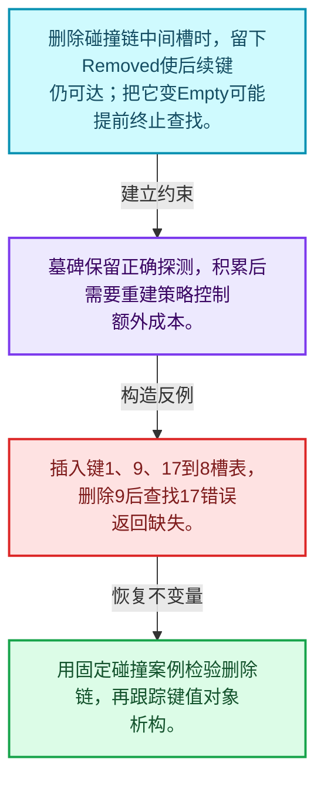
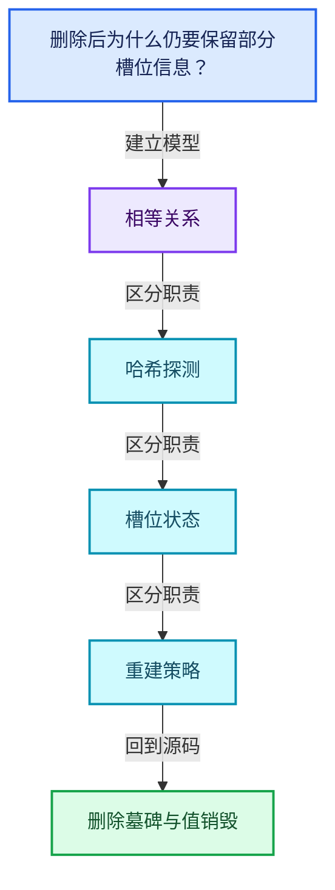
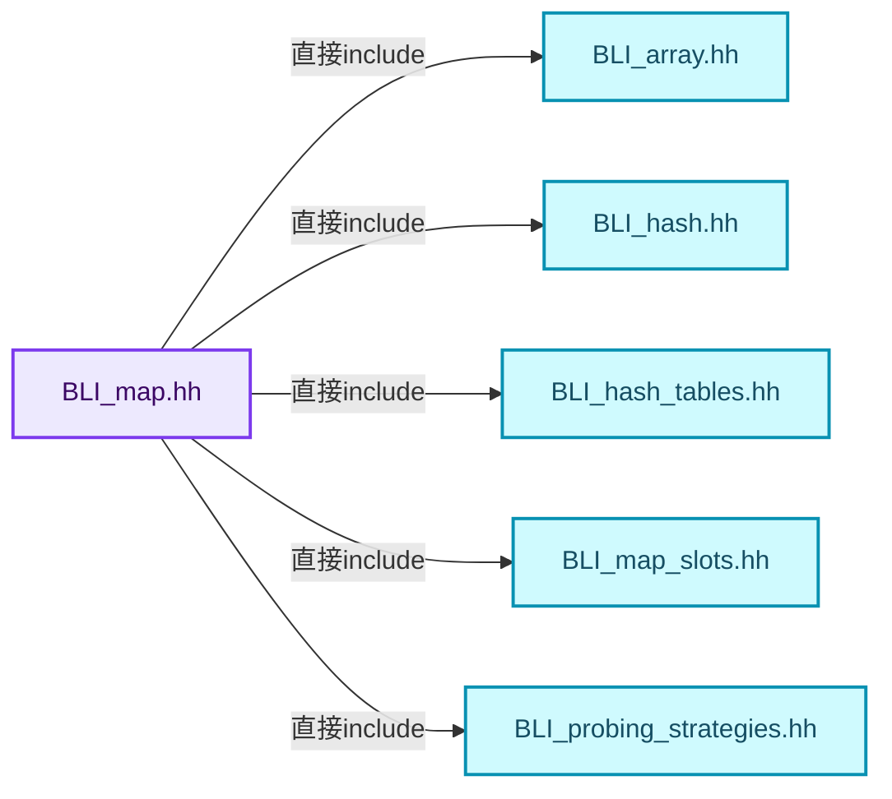
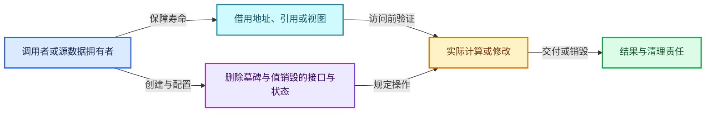
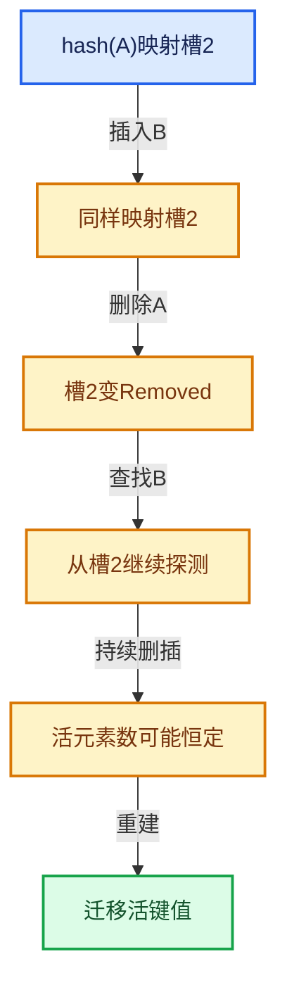

# 02-06 删除墓碑与值销毁

[方向导航](README.md) · [总目录](../README.md) · [覆盖索引](../%E6%BA%90%E7%A0%81%E7%89%88%E6%9C%AC%E4%B8%8E%E8%A6%86%E7%9B%96%E7%B4%A2%E5%BC%95.md)

> 阅读顺序：问题与数据模型 → 语法与类型 → 源码逐行 → 调用线索 → 历史与取舍 → 推演和练习。

- 基准 HEAD：`cbda6b96c26c0dee3c3b5cbb93960c4ac06a6b30`。
- 记录日期：2026-10-14。
- 教学示例状态：正文中的推演不是本机性能实测；已运行练习见验收报告。

## 一、从问题到设计

删除后为什么仍要保留部分槽位信息？

元素生命周期终止和探测状态变化是两件事；保留墓碑维持链路，积累墓碑又会增加查找成本。

本篇把语法、数据语义和系统取舍连接起来。相等与哈希是基础契约；探测、删除和增长共同决定复杂度。

### 本篇独立模型与设计推理

删除碰撞链中间槽时，留下Removed使后续键仍可达；把它变Empty可能提前终止查找。

设计取舍：墓碑保留正确探测，积累后需要重建策略控制额外成本。

最小反例：插入键1、9、17到8槽表，删除9后查找17错误返回缺失。

推导与处理：用固定碰撞案例检验删除链，再跟踪键值对象析构。



### 源码范围与相邻篇章

| 文件 | 本篇逐行范围 | 基准SHA-256 |
|---|---|---|
| [source/blender/blenlib/BLI_map.hh](../../../../../source/blender/blenlib/BLI_map.hh) | L833—L1098 | `236ceadf1c36a6e452538529f550bb9a61c4d2efc16cbb8419861fdd638bd5c7` |

同一主讲文件可能分多篇覆盖；超出本篇范围的符号通过覆盖索引定位。空行与纯注释保留在源码摘录中，逐行表解释有效语句与语法边界；许可证头统一保留。

前篇：[Map插入与回调](05-Map%E6%8F%92%E5%85%A5%E4%B8%8E%E5%9B%9E%E8%B0%83.md).

后篇：[重建与摊还复杂度](07-%E9%87%8D%E5%BB%BA%E4%B8%8E%E6%91%8A%E8%BF%98%E5%A4%8D%E6%9D%82%E5%BA%A6.md).

## 二、类型、数据与阅读地图



这是概念依赖图，边表示阅读关系，不声称是运行时调用顺序。

### 直接编译依赖



箭头只表示头文件包含关系；完整调用线索见后面的符号定位表。

## 三、关键词、语法与类型角色

### 模板 template

模板把类型或常量作为生成实现的参数。读声明时先列出类型参数、非类型参数和默认值，再看使用者实际实例化了什么。模板声明本身不意味着每种T都支持其全部成员。

具体检查：把T替换为int、string、只能移动的类型，分别检查每个被调用操作是否成立。

### 依赖名称 typename

typename既可引入类型模板参数，也可告诉编译器某个依赖名称是类型。它不创建运行时对象；解析期确认语法类别与实例化期检查具体类型是不同阶段。

具体检查：区分typename T::value_type和T::size()，前者标记类型，后者是表达式。

### 只读限定 const

const约束当前访问路径可做的修改。const指针、指向const的指针、const视图对象、const元素是不同位置的限定；其他别名可能仍可修改原对象。

具体检查：分别写T* const、const T*与const T* const，并画出不可修改的层次。

### 异常边界 try与catch

try定义异常传播的局部边界。失败路径需要销毁已经成功构造的部分并释放相应存储；未构造的对象不能被析构。

具体检查：在第k次构造失败，列出已经存在的对象集合与待释放缓冲。

### 对象表示 sizeof

sizeof给出对象表示大小，不是其引用的所有堆内存总量。sizeof视图很小并不说明底层数组很小。

具体检查：分别统计容器对象、容量字节和元素拥有的间接资源。

### 构造与new表达式

普通new可能分配并构造；placement new在给定地址构造，存储由其他机制提供。失败回滚应区分两类责任。

具体检查：追踪地址来自哪里、构造何时成功、由谁析构、由谁释放。

### 内部断言 assert

断言表达开发者预期成立的内部契约，发布构建可能关闭。它不能替代对不可信输入的完整错误处理，也不保证后续操作被运行时保护。

具体检查：对每条断言构造违反条件的输入，区分调用者错误与应向用户报告的错误。

### 受控访问 friend

friend授予指定函数或类访问非公开成员的权限，并不意味着继承，也不自动扩展到友元的派生类。

具体检查：解释执行器为何需要访问包装器的内部映射，同时检查边界是否仍清楚。

### 类型别名 using

类型别名为已有类型建立名字，不创建运行期对象。它常把模板内部使用的类型统一暴露给泛型调用者。

具体检查：展开别名直到基础类型，区分类型别名和变量声明。

## 四、真实源码与逐行讲解

源码块保持原行内容，原始行号由小节标题及逐行表给出。表中的调用定位是静态阅读辅助；重载、模板实例化、宏展开和虚调用需结合完整声明，不能仅凭词法出现证明动态调用。

### BLI_map.hh：L833—L878

<!-- source:source/blender/blenlib/BLI_map.hh:833:878 -->

```cpp
  };

  class ItemIterator final : public BaseIteratorRange<ItemIterator> {
   public:
    using value_type = Item;
    using pointer = Item *;
    using reference = Item &;

    ItemIterator(const Slot *slots, int64_t total_slots, int64_t current_slot)
        : BaseIteratorRange<ItemIterator>(slots, total_slots, current_slot)
    {
    }

    Item operator*() const
    {
      const Slot &slot = this->current_slot();
      return {*slot.key(), *slot.value()};
    }
  };

  class MutableItemIterator final : public BaseIteratorRange<MutableItemIterator> {
   public:
    using value_type = MutableItem;
    using pointer = MutableItem *;
    using reference = MutableItem &;

    MutableItemIterator(Slot *slots, int64_t total_slots, int64_t current_slot)
        : BaseIteratorRange<MutableItemIterator>(slots, total_slots, current_slot)
    {
    }

    MutableItem operator*() const
    {
      Slot &slot = this->current_slot();
      return {*slot.key(), *slot.value()};
    }
  };

  /**
   * Allows writing a range-for loop that iterates over all keys. The iterator is invalidated, when
   * the map is changed.
   */
  KeyIterator keys() const &
  {
    return KeyIterator(slots_.data(), slots_.size(), 0);
  }
```

本段语义重点：

- `slots_`：哈希槽数组，其中对象存活与槽位状态必须一致。

| 原始行 | 语义、约束与检查 |
|---|---|
| L833 | 结束当前语法单元。局部自动对象在离开其作用域时按规则销毁；这不等于所有被引用的外部数据也被释放。 |
| L835 | 声明或定义类型 `class ItemIterator final : public BaseIteratorRange<ItemIterator>`。结合继承、访问权限和成员布局确认接口与拥有关系；前向声明本身没有完整对象布局。 |
| L836 | 切换成员访问权限为 public；它是编译期接口边界，不是线程同步或内存保护。 |
| L837 | 定义类型别名 `using value_type = Item`，为模板接口或内部实现统一命名；本行不分配该类型对象。 |
| L838 | 定义类型别名 `using pointer = Item *`，为模板接口或内部实现统一命名；本行不分配该类型对象。 |
| L839 | 定义类型别名 `using reference = Item &`，为模板接口或内部实现统一命名；本行不分配该类型对象。 |
| L841 | 出现调用或函数声明 `ItemIterator`，对应表达式为 `ItemIterator(const Slot *slots, int64_t total_slots, int64_t current_slot)`。参数求值、返回类型与重载需结合前后完整语句；静态文本引用不能证明动态目标。 |
| L842 | 出现调用或函数声明 `BaseIteratorRange`，对应表达式为 `: BaseIteratorRange<ItemIterator>(slots, total_slots, current_slot)`。参数求值、返回类型与重载需结合前后完整语句；静态文本引用不能证明动态目标。 |
| L843 | 连接上一行的声明或控制结构与其语句块；后续行在这个作用域中执行或声明。 |
| L844 | 结束当前语法单元。局部自动对象在离开其作用域时按规则销毁；这不等于所有被引用的外部数据也被释放。 |
| L846 | 运算符重载声明、定义或显式调用：`Item operator*() const`。结合参数和返回类型判断是赋值、索引、比较还是转换；operator=声明中的等号不是在给名为operator的变量赋值。 |
| L847 | 连接上一行的声明或控制结构与其语句块；后续行在这个作用域中执行或声明。 |
| L848 | 把右侧 `this->current_slot()` 用于初始化或更新左侧 `const Slot &slot`。声明初始化与已有对象赋值应按上下文区分；有资源的类型会调用相应特殊成员。 |
| L849 | 返回表达式 `{*slot.key(), *slot.value()}`。结合函数声明检查返回值是否借用原存储，借用值不会自动延长其寿命。 |
| L850 | 结束当前语法单元。局部自动对象在离开其作用域时按规则销毁；这不等于所有被引用的外部数据也被释放。 |
| L851 | 结束当前语法单元。局部自动对象在离开其作用域时按规则销毁；这不等于所有被引用的外部数据也被释放。 |
| L853 | 声明或定义类型 `class MutableItemIterator final : public BaseIteratorRange<MutableItemIterator>`。结合继承、访问权限和成员布局确认接口与拥有关系；前向声明本身没有完整对象布局。 |
| L854 | 切换成员访问权限为 public；它是编译期接口边界，不是线程同步或内存保护。 |
| L855 | 定义类型别名 `using value_type = MutableItem`，为模板接口或内部实现统一命名；本行不分配该类型对象。 |
| L856 | 定义类型别名 `using pointer = MutableItem *`，为模板接口或内部实现统一命名；本行不分配该类型对象。 |
| L857 | 定义类型别名 `using reference = MutableItem &`，为模板接口或内部实现统一命名；本行不分配该类型对象。 |
| L859 | 出现调用或函数声明 `MutableItemIterator`，对应表达式为 `MutableItemIterator(Slot *slots, int64_t total_slots, int64_t current_slot)`。参数求值、返回类型与重载需结合前后完整语句；静态文本引用不能证明动态目标。 |
| L860 | 出现调用或函数声明 `BaseIteratorRange`，对应表达式为 `: BaseIteratorRange<MutableItemIterator>(slots, total_slots, current_slot)`。参数求值、返回类型与重载需结合前后完整语句；静态文本引用不能证明动态目标。 |
| L861 | 连接上一行的声明或控制结构与其语句块；后续行在这个作用域中执行或声明。 |
| L862 | 结束当前语法单元。局部自动对象在离开其作用域时按规则销毁；这不等于所有被引用的外部数据也被释放。 |
| L864 | 运算符重载声明、定义或显式调用：`MutableItem operator*() const`。结合参数和返回类型判断是赋值、索引、比较还是转换；operator=声明中的等号不是在给名为operator的变量赋值。 |
| L865 | 连接上一行的声明或控制结构与其语句块；后续行在这个作用域中执行或声明。 |
| L866 | 把右侧 `this->current_slot()` 用于初始化或更新左侧 `Slot &slot`。声明初始化与已有对象赋值应按上下文区分；有资源的类型会调用相应特殊成员。 |
| L867 | 返回表达式 `{*slot.key(), *slot.value()}`。结合函数声明检查返回值是否借用原存储，借用值不会自动延长其寿命。 |
| L868 | 结束当前语法单元。局部自动对象在离开其作用域时按规则销毁；这不等于所有被引用的外部数据也被释放。 |
| L869 | 结束当前语法单元。局部自动对象在离开其作用域时按规则销毁；这不等于所有被引用的外部数据也被释放。 |
| L875 | 出现调用或函数声明 `keys`，对应表达式为 `KeyIterator keys() const &`。参数求值、返回类型与重载需结合前后完整语句；静态文本引用不能证明动态目标。 |
| L876 | 连接上一行的声明或控制结构与其语句块；后续行在这个作用域中执行或声明。 |
| L877 | 返回表达式 `KeyIterator(slots_.data(), slots_.size(), 0)`。 |
| L878 | 结束当前语法单元。局部自动对象在离开其作用域时按规则销毁；这不等于所有被引用的外部数据也被释放。 |

### BLI_map.hh：L879—L926

<!-- source:source/blender/blenlib/BLI_map.hh:879:926 -->

```cpp

  /**
   * Returns an iterator over all values in the map. The iterator is invalidated, when the map is
   * changed.
   */
  ValueIterator values() const &
  {
    return ValueIterator(slots_.data(), slots_.size(), 0);
  }

  /**
   * Returns an iterator over all values in the map and allows you to change the values. The
   * iterator is invalidated, when the map is changed.
   */
  MutableValueIterator values() &
  {
    return MutableValueIterator(slots_.data(), slots_.size(), 0);
  }

  /**
   * Returns an iterator over all key-value-pairs in the map. The key-value-pairs are stored in a
   * #MapItem. The iterator is invalidated, when the map is changed.
   */
  ItemIterator items() const &
  {
    return ItemIterator(slots_.data(), slots_.size(), 0);
  }

  /**
   * Returns an iterator over all key-value-pairs in the map. The key-value-pairs are stored in a
   * #MutableMapItem. The iterator is invalidated, when the map is changed.
   *
   * This iterator also allows you to modify the value (but not the key).
   */
  MutableItemIterator items() &
  {
    return MutableItemIterator(slots_.data(), slots_.size(), 0);
  }

  /**
   * Avoid common bug when trying to do something like this: `for (auto key : get_map().keys())`.
   * This does not work, because the compiler does not extend the lifetime of the map for the
   * duration of the loop.
   */
  KeyIterator keys() const && = delete;
  MutableValueIterator values() && = delete;
  ValueIterator values() const && = delete;
  ItemIterator items() const && = delete;
```

本段语义重点：

- `slots_`：哈希槽数组，其中对象存活与槽位状态必须一致。

| 原始行 | 语义、约束与检查 |
|---|---|
| L884 | 出现调用或函数声明 `values`，对应表达式为 `ValueIterator values() const &`。参数求值、返回类型与重载需结合前后完整语句；静态文本引用不能证明动态目标。 |
| L885 | 连接上一行的声明或控制结构与其语句块；后续行在这个作用域中执行或声明。 |
| L886 | 返回表达式 `ValueIterator(slots_.data(), slots_.size(), 0)`。 |
| L887 | 结束当前语法单元。局部自动对象在离开其作用域时按规则销毁；这不等于所有被引用的外部数据也被释放。 |
| L893 | 出现调用或函数声明 `values`，对应表达式为 `MutableValueIterator values() &`。参数求值、返回类型与重载需结合前后完整语句；静态文本引用不能证明动态目标。 |
| L894 | 连接上一行的声明或控制结构与其语句块；后续行在这个作用域中执行或声明。 |
| L895 | 返回表达式 `MutableValueIterator(slots_.data(), slots_.size(), 0)`。 |
| L896 | 结束当前语法单元。局部自动对象在离开其作用域时按规则销毁；这不等于所有被引用的外部数据也被释放。 |
| L902 | 出现调用或函数声明 `items`，对应表达式为 `ItemIterator items() const &`。参数求值、返回类型与重载需结合前后完整语句；静态文本引用不能证明动态目标。 |
| L903 | 连接上一行的声明或控制结构与其语句块；后续行在这个作用域中执行或声明。 |
| L904 | 返回表达式 `ItemIterator(slots_.data(), slots_.size(), 0)`。 |
| L905 | 结束当前语法单元。局部自动对象在离开其作用域时按规则销毁；这不等于所有被引用的外部数据也被释放。 |
| L913 | 出现调用或函数声明 `items`，对应表达式为 `MutableItemIterator items() &`。参数求值、返回类型与重载需结合前后完整语句；静态文本引用不能证明动态目标。 |
| L914 | 连接上一行的声明或控制结构与其语句块；后续行在这个作用域中执行或声明。 |
| L915 | 返回表达式 `MutableItemIterator(slots_.data(), slots_.size(), 0)`。 |
| L916 | 结束当前语法单元。局部自动对象在离开其作用域时按规则销毁；这不等于所有被引用的外部数据也被释放。 |
| L923 | 显式禁止接口：`KeyIterator keys() const && = delete;`。调用会在编译期被拒绝，常用于禁止复制或移动；这里没有释放对象或删除文件的运行时动作。 |
| L924 | 显式禁止接口：`MutableValueIterator values() && = delete;`。调用会在编译期被拒绝，常用于禁止复制或移动；这里没有释放对象或删除文件的运行时动作。 |
| L925 | 显式禁止接口：`ValueIterator values() const && = delete;`。调用会在编译期被拒绝，常用于禁止复制或移动；这里没有释放对象或删除文件的运行时动作。 |
| L926 | 显式禁止接口：`ItemIterator items() const && = delete;`。调用会在编译期被拒绝，常用于禁止复制或移动；这里没有释放对象或删除文件的运行时动作。 |

### BLI_map.hh：L927—L971

<!-- source:source/blender/blenlib/BLI_map.hh:927:971 -->

```cpp
  MutableItemIterator items() && = delete;

  /**
   * Remove the key-value-pair that the iterator is currently pointing at.
   * It is valid to call this method while iterating over the map. However, after this method has
   * been called, the removed element must not be accessed anymore.
   */
  void remove(const BaseIterator &iterator)
  {
    Slot &slot = iterator.current_slot();
    BLI_assert(slot.is_occupied());
    slot.remove();
    removed_slots_++;
  }

  /**
   * Remove all key-value-pairs for that the given predicate is true and return the number of
   * removed pairs.
   *
   * This is similar to std::erase_if.
   */
  template<typename Predicate> int64_t remove_if(Predicate &&predicate)
  {
    const int64_t prev_size = this->size();
    for (Slot &slot : slots_) {
      if (slot.is_occupied()) {
        const Key &key = *slot.key();
        Value &value = *slot.value();
        if (predicate(MutableItem{key, value})) {
          slot.remove();
          removed_slots_++;
        }
      }
    }
    return prev_size - this->size();
  }

  /**
   * Print common statistics like size and collision count. This is useful for debugging purposes.
   */
  void print_stats(const char *name) const
  {
    HashTableStats stats(*this, this->keys());
    stats.print(name);
  }
```

本段语义重点：

- `removed_slots_`：删除标记计数，影响重建判断及探测长度。
- `slots_`：哈希槽数组，其中对象存活与槽位状态必须一致。

| 原始行 | 语义、约束与检查 |
|---|---|
| L927 | 显式禁止接口：`MutableItemIterator items() && = delete;`。调用会在编译期被拒绝，常用于禁止复制或移动；这里没有释放对象或删除文件的运行时动作。 |
| L934 | 出现调用或函数声明 `remove`，对应表达式为 `void remove(const BaseIterator &iterator)`。参数求值、返回类型与重载需结合前后完整语句；静态文本引用不能证明动态目标。 |
| L935 | 连接上一行的声明或控制结构与其语句块；后续行在这个作用域中执行或声明。 |
| L936 | 把右侧 `iterator.current_slot()` 用于初始化或更新左侧 `Slot &slot`。声明初始化与已有对象赋值应按上下文区分；有资源的类型会调用相应特殊成员。 |
| L937 | 断言约束 `BLI_assert(slot.is_occupied());`。条件是后续访问的内部前置条件；发布构建可能不执行，不能把断言当作输入修复。 |
| L938 | 出现调用或函数声明 `remove`，对应表达式为 `slot.remove();`。参数求值、返回类型与重载需结合前后完整语句；静态文本引用不能证明动态目标。 |
| L939 | 递增或递减现有状态：`removed_slots_++;`。这改变计数或游标；检查边界、计数单位，以及并发访问是否有相应保护。 |
| L940 | 结束当前语法单元。局部自动对象在离开其作用域时按规则销毁；这不等于所有被引用的外部数据也被释放。 |
| L948 | 声明模板参数 `template<typename Predicate> int64_t remove_if(Predicate &&predicate)`。类型参数决定生成操作的类型，非类型参数可决定内嵌容量或编译期分支。 |
| L949 | 连接上一行的声明或控制结构与其语句块；后续行在这个作用域中执行或声明。 |
| L950 | 把右侧 `this->size()` 用于初始化或更新左侧 `const int64_t prev_size`。声明初始化与已有对象赋值应按上下文区分；有资源的类型会调用相应特殊成员。 |
| L951 | 按 `for (Slot &slot : slots_)` 指定的范围或条件重复执行。对照循环变量与真实元素编号；循环内调用成本乘以实际迭代次数。 |
| L952 | 判断 `slot.is_occupied()`，成立时进入本分支，否则继续后续路径。 |
| L953 | 把右侧 `*slot.key()` 用于初始化或更新左侧 `const Key &key`。声明初始化与已有对象赋值应按上下文区分；有资源的类型会调用相应特殊成员。 |
| L954 | 把右侧 `*slot.value()` 用于初始化或更新左侧 `Value &value`。声明初始化与已有对象赋值应按上下文区分；有资源的类型会调用相应特殊成员。 |
| L955 | 判断 `predicate(MutableItem{key, value})`，成立时进入本分支，否则继续后续路径。 |
| L956 | 出现调用或函数声明 `remove`，对应表达式为 `slot.remove();`。参数求值、返回类型与重载需结合前后完整语句；静态文本引用不能证明动态目标。 |
| L957 | 递增或递减现有状态：`removed_slots_++;`。这改变计数或游标；检查边界、计数单位，以及并发访问是否有相应保护。 |
| L958 | 结束当前语法单元。局部自动对象在离开其作用域时按规则销毁；这不等于所有被引用的外部数据也被释放。 |
| L959 | 结束当前语法单元。局部自动对象在离开其作用域时按规则销毁；这不等于所有被引用的外部数据也被释放。 |
| L960 | 结束当前语法单元。局部自动对象在离开其作用域时按规则销毁；这不等于所有被引用的外部数据也被释放。 |
| L961 | 返回表达式 `prev_size - this->size()`。 |
| L962 | 结束当前语法单元。局部自动对象在离开其作用域时按规则销毁；这不等于所有被引用的外部数据也被释放。 |
| L967 | 出现调用或函数声明 `print_stats`，对应表达式为 `void print_stats(const char *name) const`。参数求值、返回类型与重载需结合前后完整语句；静态文本引用不能证明动态目标。 |
| L968 | 连接上一行的声明或控制结构与其语句块；后续行在这个作用域中执行或声明。 |
| L969 | 出现调用或函数声明 `stats`，对应表达式为 `HashTableStats stats(*this, this->keys());`。参数求值、返回类型与重载需结合前后完整语句；静态文本引用不能证明动态目标。 |
| L970 | 出现调用或函数声明 `print`，对应表达式为 `stats.print(name);`。参数求值、返回类型与重载需结合前后完整语句；静态文本引用不能证明动态目标。 |
| L971 | 结束当前语法单元。局部自动对象在离开其作用域时按规则销毁；这不等于所有被引用的外部数据也被释放。 |

### BLI_map.hh：L972—L1022

<!-- source:source/blender/blenlib/BLI_map.hh:972:1022 -->

```cpp

  /**
   * Return the number of key-value-pairs that are stored in the map.
   */
  int64_t size() const
  {
    return occupied_and_removed_slots_ - removed_slots_;
  }

  /**
   * Returns true if there are no elements in the map.
   *
   * This is similar to std::unordered_map::empty.
   */
  bool is_empty() const
  {
    return occupied_and_removed_slots_ == removed_slots_;
  }

  /**
   * Returns the number of available slots. This is mostly for debugging purposes.
   */
  int64_t capacity() const
  {
    return slots_.size();
  }

  /**
   * Returns the amount of removed slots in the set. This is mostly for debugging purposes.
   */
  int64_t removed_amount() const
  {
    return removed_slots_;
  }

  /**
   * Returns the bytes required per element. This is mostly for debugging purposes.
   */
  int64_t size_per_element() const
  {
    return sizeof(Slot);
  }

  /**
   * Returns the approximate memory requirements of the map in bytes. This becomes more exact the
   * larger the map becomes.
   */
  int64_t size_in_bytes() const
  {
    return int64_t(sizeof(Slot) * slots_.size());
  }
```

本段语义重点：

- `removed_slots_`：删除标记计数，影响重建判断及探测长度。
- `occupied_and_removed_slots_`：占用与删除状态总量，不能替代活元素数量。
- `slots_`：哈希槽数组，其中对象存活与槽位状态必须一致。

| 原始行 | 语义、约束与检查 |
|---|---|
| L976 | 出现调用或函数声明 `size`，对应表达式为 `int64_t size() const`。参数求值、返回类型与重载需结合前后完整语句；静态文本引用不能证明动态目标。 |
| L977 | 连接上一行的声明或控制结构与其语句块；后续行在这个作用域中执行或声明。 |
| L978 | 返回表达式 `occupied_and_removed_slots_ - removed_slots_`。 |
| L979 | 结束当前语法单元。局部自动对象在离开其作用域时按规则销毁；这不等于所有被引用的外部数据也被释放。 |
| L986 | 出现调用或函数声明 `is_empty`，对应表达式为 `bool is_empty() const`。参数求值、返回类型与重载需结合前后完整语句；静态文本引用不能证明动态目标。 |
| L987 | 连接上一行的声明或控制结构与其语句块；后续行在这个作用域中执行或声明。 |
| L988 | 返回表达式 `occupied_and_removed_slots_ == removed_slots_`。 |
| L989 | 结束当前语法单元。局部自动对象在离开其作用域时按规则销毁；这不等于所有被引用的外部数据也被释放。 |
| L994 | 出现调用或函数声明 `capacity`，对应表达式为 `int64_t capacity() const`。参数求值、返回类型与重载需结合前后完整语句；静态文本引用不能证明动态目标。 |
| L995 | 连接上一行的声明或控制结构与其语句块；后续行在这个作用域中执行或声明。 |
| L996 | 返回表达式 `slots_.size()`。 |
| L997 | 结束当前语法单元。局部自动对象在离开其作用域时按规则销毁；这不等于所有被引用的外部数据也被释放。 |
| L1002 | 出现调用或函数声明 `removed_amount`，对应表达式为 `int64_t removed_amount() const`。参数求值、返回类型与重载需结合前后完整语句；静态文本引用不能证明动态目标。 |
| L1003 | 连接上一行的声明或控制结构与其语句块；后续行在这个作用域中执行或声明。 |
| L1004 | 返回表达式 `removed_slots_`。 |
| L1005 | 结束当前语法单元。局部自动对象在离开其作用域时按规则销毁；这不等于所有被引用的外部数据也被释放。 |
| L1010 | 出现调用或函数声明 `size_per_element`，对应表达式为 `int64_t size_per_element() const`。参数求值、返回类型与重载需结合前后完整语句；静态文本引用不能证明动态目标。 |
| L1011 | 连接上一行的声明或控制结构与其语句块；后续行在这个作用域中执行或声明。 |
| L1012 | 返回表达式 `sizeof(Slot)`。 |
| L1013 | 结束当前语法单元。局部自动对象在离开其作用域时按规则销毁；这不等于所有被引用的外部数据也被释放。 |
| L1019 | 出现调用或函数声明 `size_in_bytes`，对应表达式为 `int64_t size_in_bytes() const`。参数求值、返回类型与重载需结合前后完整语句；静态文本引用不能证明动态目标。 |
| L1020 | 连接上一行的声明或控制结构与其语句块；后续行在这个作用域中执行或声明。 |
| L1021 | 返回表达式 `int64_t(sizeof(Slot) * slots_.size())`。 |
| L1022 | 结束当前语法单元。局部自动对象在离开其作用域时按规则销毁；这不等于所有被引用的外部数据也被释放。 |

### BLI_map.hh：L1023—L1069

<!-- source:source/blender/blenlib/BLI_map.hh:1023:1069 -->

```cpp

  /**
   * Potentially resize the map such that the specified number of elements can be added without
   * another grow operation.
   */
  void reserve(int64_t n)
  {
    if (usable_slots_ < n) {
      this->realloc_and_reinsert(n);
    }
  }

  /**
   * Remove all elements. Under some circumstances #clear_and_keep_capacity may be more efficient.
   */
  void clear()
  {
    std::destroy_at(this);
    new (this) Map(NoExceptConstructor{});
  }

  /**
   * Remove all elements, but don't free the underlying memory.
   *
   * This can be more efficient than using #clear if approximately the same or more elements are
   * added again afterwards. If way fewer elements are added instead, the cost of maintaining a
   * large hash table can lead to very bad worst-case performance.
   */
  void clear_and_keep_capacity()
  {
    for (Slot &slot : slots_) {
      slot.~Slot();
      new (&slot) Slot();
    }

    removed_slots_ = 0;
    occupied_and_removed_slots_ = 0;
  }

  /**
   * Get the number of collisions that the probing strategy has to go through to find the key or
   * determine that it is not in the map.
   */
  int64_t count_collisions(const Key &key) const
  {
    return this->count_collisions__impl(key, hash_(key));
  }
```

本段语义重点：

- `realloc_and_reinsert`：重新组织哈希槽并重插活元素；槽位改变但键值相等语义应保持。
- `removed_slots_`：删除标记计数，影响重建判断及探测长度。
- `occupied_and_removed_slots_`：占用与删除状态总量，不能替代活元素数量。
- `usable_slots_`：受负载约束允许使用的槽位数，与物理总槽数不同。
- `slots_`：哈希槽数组，其中对象存活与槽位状态必须一致。

| 原始行 | 语义、约束与检查 |
|---|---|
| L1028 | 出现调用或函数声明 `reserve`，对应表达式为 `void reserve(int64_t n)`。参数求值、返回类型与重载需结合前后完整语句；静态文本引用不能证明动态目标。 |
| L1029 | 连接上一行的声明或控制结构与其语句块；后续行在这个作用域中执行或声明。 |
| L1030 | 判断 `usable_slots_ < n`，成立时进入本分支，否则继续后续路径。 |
| L1031 | 本行使用 `realloc_and_reinsert`：重新组织哈希槽并重插活元素；槽位改变但键值相等语义应保持。 |
| L1032 | 结束当前语法单元。局部自动对象在离开其作用域时按规则销毁；这不等于所有被引用的外部数据也被释放。 |
| L1033 | 结束当前语法单元。局部自动对象在离开其作用域时按规则销毁；这不等于所有被引用的外部数据也被释放。 |
| L1038 | 出现调用或函数声明 `clear`，对应表达式为 `void clear()`。参数求值、返回类型与重载需结合前后完整语句；静态文本引用不能证明动态目标。 |
| L1039 | 连接上一行的声明或控制结构与其语句块；后续行在这个作用域中执行或声明。 |
| L1040 | 出现调用或函数声明 `std::destroy_at`，对应表达式为 `std::destroy_at(this);`。参数求值、返回类型与重载需结合前后完整语句；静态文本引用不能证明动态目标。 |
| L1041 | 出现调用或函数声明 `new`，对应表达式为 `new (this) Map(NoExceptConstructor{});`。参数求值、返回类型与重载需结合前后完整语句；静态文本引用不能证明动态目标。 |
| L1042 | 结束当前语法单元。局部自动对象在离开其作用域时按规则销毁；这不等于所有被引用的外部数据也被释放。 |
| L1051 | 出现调用或函数声明 `clear_and_keep_capacity`，对应表达式为 `void clear_and_keep_capacity()`。参数求值、返回类型与重载需结合前后完整语句；静态文本引用不能证明动态目标。 |
| L1052 | 连接上一行的声明或控制结构与其语句块；后续行在这个作用域中执行或声明。 |
| L1053 | 按 `for (Slot &slot : slots_)` 指定的范围或条件重复执行。对照循环变量与真实元素编号；循环内调用成本乘以实际迭代次数。 |
| L1054 | 涉及析构接口或显式析构：`slot.~Slot();`。检查目标对象已成功构造，且资源不会在另一条清理路径再次销毁。 |
| L1055 | 出现调用或函数声明 `new`，对应表达式为 `new (&slot) Slot();`。参数求值、返回类型与重载需结合前后完整语句；静态文本引用不能证明动态目标。 |
| L1056 | 结束当前语法单元。局部自动对象在离开其作用域时按规则销毁；这不等于所有被引用的外部数据也被释放。 |
| L1058 | 建立或更新 `removed_slots_`：删除标记计数，影响重建判断及探测长度。本行的具体值关系为 `removed_slots_ = 0`；对照更新前后相应范围或状态是否一致。 |
| L1059 | 建立或更新 `occupied_and_removed_slots_`：占用与删除状态总量，不能替代活元素数量。本行的具体值关系为 `occupied_and_removed_slots_ = 0`；对照更新前后相应范围或状态是否一致。 |
| L1060 | 结束当前语法单元。局部自动对象在离开其作用域时按规则销毁；这不等于所有被引用的外部数据也被释放。 |
| L1066 | 出现调用或函数声明 `count_collisions`，对应表达式为 `int64_t count_collisions(const Key &key) const`。参数求值、返回类型与重载需结合前后完整语句；静态文本引用不能证明动态目标。 |
| L1067 | 连接上一行的声明或控制结构与其语句块；后续行在这个作用域中执行或声明。 |
| L1068 | 返回表达式 `this->count_collisions__impl(key, hash_(key))`。 |
| L1069 | 结束当前语法单元。局部自动对象在离开其作用域时按规则销毁；这不等于所有被引用的外部数据也被释放。 |

### BLI_map.hh：L1070—L1098

<!-- source:source/blender/blenlib/BLI_map.hh:1070:1098 -->

```cpp

  /**
   * True if both maps have the same key-value-pairs.
   */
  friend bool operator==(const Map &a, const Map &b)
  {
    if (a.size() != b.size()) {
      return false;
    }
    for (const Item item : a.items()) {
      const Key &key = item.key;
      const Value &value_a = item.value;
      const Value *value_b = b.lookup_ptr(key);
      if (value_b == nullptr) {
        return false;
      }
      if (value_a != *value_b) {
        return false;
      }
    }
    return true;
  }

  friend bool operator!=(const Map &a, const Map &b)
  {
    return !(a == b);
  }

 private:
```

本段语义重点：

- 分支证据 `a.size() != b.size())`：分别推演条件成立与不成立，核对相同出口处的状态。
- 分支证据 `value_b == nullptr)`：分别推演条件成立与不成立，核对相同出口处的状态。

| 原始行 | 语义、约束与检查 |
|---|---|
| L1074 | 运算符重载声明、定义或显式调用：`friend bool operator==(const Map &a, const Map &b)`。结合参数和返回类型判断是赋值、索引、比较还是转换；operator=声明中的等号不是在给名为operator的变量赋值。 |
| L1075 | 连接上一行的声明或控制结构与其语句块；后续行在这个作用域中执行或声明。 |
| L1076 | 判断 `a.size() != b.size()`，成立时进入本分支，否则继续后续路径。该边界影响可访问元素或可用容量，两者要按各变量的定义区分。 |
| L1077 | 返回表达式 `false`。这是本路径的布尔结果，具体成功、存在或状态含义由函数接口规定。 |
| L1078 | 结束当前语法单元。局部自动对象在离开其作用域时按规则销毁；这不等于所有被引用的外部数据也被释放。 |
| L1079 | 按 `for (const Item item : a.items())` 指定的范围或条件重复执行。对照循环变量与真实元素编号；循环内调用成本乘以实际迭代次数。 |
| L1080 | 把右侧 `item.key` 用于初始化或更新左侧 `const Key &key`。声明初始化与已有对象赋值应按上下文区分；有资源的类型会调用相应特殊成员。 |
| L1081 | 把右侧 `item.value` 用于初始化或更新左侧 `const Value &value_a`。声明初始化与已有对象赋值应按上下文区分；有资源的类型会调用相应特殊成员。 |
| L1082 | 把右侧 `b.lookup_ptr(key)` 用于初始化或更新左侧 `const Value *value_b`。声明初始化与已有对象赋值应按上下文区分；有资源的类型会调用相应特殊成员。 |
| L1083 | 判断 `value_b == nullptr`，成立时进入本分支，否则继续后续路径。这里区分空地址与可用地址，但非空本身仍不能证明对象存活。 |
| L1084 | 返回表达式 `false`。这是本路径的布尔结果，具体成功、存在或状态含义由函数接口规定。 |
| L1085 | 结束当前语法单元。局部自动对象在离开其作用域时按规则销毁；这不等于所有被引用的外部数据也被释放。 |
| L1086 | 判断 `value_a != *value_b`，成立时进入本分支，否则继续后续路径。 |
| L1087 | 返回表达式 `false`。这是本路径的布尔结果，具体成功、存在或状态含义由函数接口规定。 |
| L1088 | 结束当前语法单元。局部自动对象在离开其作用域时按规则销毁；这不等于所有被引用的外部数据也被释放。 |
| L1089 | 结束当前语法单元。局部自动对象在离开其作用域时按规则销毁；这不等于所有被引用的外部数据也被释放。 |
| L1090 | 返回表达式 `true`。这是本路径的布尔结果，具体成功、存在或状态含义由函数接口规定。 |
| L1091 | 结束当前语法单元。局部自动对象在离开其作用域时按规则销毁；这不等于所有被引用的外部数据也被释放。 |
| L1093 | 运算符重载声明、定义或显式调用：`friend bool operator!=(const Map &a, const Map &b)`。结合参数和返回类型判断是赋值、索引、比较还是转换；operator=声明中的等号不是在给名为operator的变量赋值。 |
| L1094 | 连接上一行的声明或控制结构与其语句块；后续行在这个作用域中执行或声明。 |
| L1095 | 返回表达式 `!(a == b)`。 |
| L1096 | 结束当前语法单元。局部自动对象在离开其作用域时按规则销毁；这不等于所有被引用的外部数据也被释放。 |
| L1098 | 切换成员访问权限为 private；它是编译期接口边界，不是线程同步或内存保护。 |

## 五、接口定位、调用线索与生命周期

### 本篇声明与实现入口

| 源码位置 | 实际声明片段 |
|---|---|
| [BLI_map.hh:L835](../../../../../source/blender/blenlib/BLI_map.hh#L835) | `class ItemIterator final : public BaseIteratorRange<ItemIterator>` |
| [BLI_map.hh:L841](../../../../../source/blender/blenlib/BLI_map.hh#L841) | `ItemIterator(const Slot *slots, int64_t total_slots, int64_t current_slot)` |
| [BLI_map.hh:L853](../../../../../source/blender/blenlib/BLI_map.hh#L853) | `class MutableItemIterator final : public BaseIteratorRange<MutableItemIterator>` |
| [BLI_map.hh:L859](../../../../../source/blender/blenlib/BLI_map.hh#L859) | `MutableItemIterator(Slot *slots, int64_t total_slots, int64_t current_slot)` |
| [BLI_map.hh:L875](../../../../../source/blender/blenlib/BLI_map.hh#L875) | `KeyIterator keys() const &` |
| [BLI_map.hh:L884](../../../../../source/blender/blenlib/BLI_map.hh#L884) | `ValueIterator values() const &` |
| [BLI_map.hh:L893](../../../../../source/blender/blenlib/BLI_map.hh#L893) | `MutableValueIterator values() &` |
| [BLI_map.hh:L902](../../../../../source/blender/blenlib/BLI_map.hh#L902) | `ItemIterator items() const &` |
| [BLI_map.hh:L913](../../../../../source/blender/blenlib/BLI_map.hh#L913) | `MutableItemIterator items() &` |
| [BLI_map.hh:L923](../../../../../source/blender/blenlib/BLI_map.hh#L923) | `KeyIterator keys() const && = delete;` |
| [BLI_map.hh:L924](../../../../../source/blender/blenlib/BLI_map.hh#L924) | `MutableValueIterator values() && = delete;` |
| [BLI_map.hh:L925](../../../../../source/blender/blenlib/BLI_map.hh#L925) | `ValueIterator values() const && = delete;` |
| [BLI_map.hh:L926](../../../../../source/blender/blenlib/BLI_map.hh#L926) | `ItemIterator items() const && = delete;` |
| [BLI_map.hh:L927](../../../../../source/blender/blenlib/BLI_map.hh#L927) | `MutableItemIterator items() && = delete;` |
| [BLI_map.hh:L934](../../../../../source/blender/blenlib/BLI_map.hh#L934) | `void remove(const BaseIterator &iterator)` |
| [BLI_map.hh:L948](../../../../../source/blender/blenlib/BLI_map.hh#L948) | `template<typename Predicate> int64_t remove_if(Predicate &&predicate)` |
| [BLI_map.hh:L967](../../../../../source/blender/blenlib/BLI_map.hh#L967) | `void print_stats(const char *name) const` |
| [BLI_map.hh:L969](../../../../../source/blender/blenlib/BLI_map.hh#L969) | `HashTableStats stats(*this, this->keys());` |
| [BLI_map.hh:L976](../../../../../source/blender/blenlib/BLI_map.hh#L976) | `int64_t size() const` |
| [BLI_map.hh:L986](../../../../../source/blender/blenlib/BLI_map.hh#L986) | `bool is_empty() const` |
| [BLI_map.hh:L994](../../../../../source/blender/blenlib/BLI_map.hh#L994) | `int64_t capacity() const` |
| [BLI_map.hh:L1002](../../../../../source/blender/blenlib/BLI_map.hh#L1002) | `int64_t removed_amount() const` |
| [BLI_map.hh:L1010](../../../../../source/blender/blenlib/BLI_map.hh#L1010) | `int64_t size_per_element() const` |
| [BLI_map.hh:L1019](../../../../../source/blender/blenlib/BLI_map.hh#L1019) | `int64_t size_in_bytes() const` |
| [BLI_map.hh:L1028](../../../../../source/blender/blenlib/BLI_map.hh#L1028) | `void reserve(int64_t n)` |
| [BLI_map.hh:L1038](../../../../../source/blender/blenlib/BLI_map.hh#L1038) | `void clear()` |
| [BLI_map.hh:L1051](../../../../../source/blender/blenlib/BLI_map.hh#L1051) | `void clear_and_keep_capacity()` |
| [BLI_map.hh:L1066](../../../../../source/blender/blenlib/BLI_map.hh#L1066) | `int64_t count_collisions(const Key &key) const` |

### 同名符号出现位置

以下表提供跨文件阅读入口，包含声明、调用或测试使用；没有经过完整C++名称解析，不把它命名为已证明的运行时调用图。

| 符号 | 位置 | 文本证据 |
|---|---|---|
| `keys` | [BLI_multi_value_map.hh:L155](../../../../../source/blender/blenlib/BLI_multi_value_map.hh#L155) | `typename MapType::KeyIterator keys() const` |
| `keys` | [BLI_multi_value_map.hh:L157](../../../../../source/blender/blenlib/BLI_multi_value_map.hh#L157) | `return map_.keys();` |
| `keys` | [geometry_nodes_lazy_function.cc:L2634](../../../../../source/blender/nodes/intern/geometry_nodes_lazy_function.cc#L2634) | `for (const bNodeSocket *bsocket : lf_reference_set_input_by_output.keys()) {` |
| `values` | [geometry_fields.cc:L808](../../../../../source/blender/blenkernel/intern/geometry_fields.cc#L808) | `GArray<> values(cpp_type, src_domain_size);` |
| `values` | [BLI_multi_value_map.hh:L163](../../../../../source/blender/blenlib/BLI_multi_value_map.hh#L163) | `typename MapType::ValueIterator values() const` |
| `values` | [BLI_multi_value_map.hh:L165](../../../../../source/blender/blenlib/BLI_multi_value_map.hh#L165) | `return map_.values();` |
| `items` | [BLI_multi_value_map.hh:L139](../../../../../source/blender/blenlib/BLI_multi_value_map.hh#L139) | `typename MapType::ItemIterator items() const` |
| `items` | [BLI_multi_value_map.hh:L141](../../../../../source/blender/blenlib/BLI_multi_value_map.hh#L141) | `return map_.items();` |
| `items` | [BLI_multi_value_map.hh:L147](../../../../../source/blender/blenlib/BLI_multi_value_map.hh#L147) | `typename MapType::MutableItemIterator items()` |
| `remove` | [BKE_attribute.hh:L809](../../../../../source/blender/blenkernel/BKE_attribute.hh#L809) | `if (!this->remove(name)) {` |
| `remove` | [BKE_attribute.hh:L1007](../../../../../source/blender/blenkernel/BKE_attribute.hh#L1007) | `bool remove(const StringRef name)` |
| `remove` | [BKE_attribute.hh:L1009](../../../../../source/blender/blenkernel/BKE_attribute.hh#L1009) | `return fn_->remove(owner_, name);` |
| `remove_if` | [BLI_set.hh:L534](../../../../../source/blender/blenlib/BLI_set.hh#L534) | `template<typename Predicate> int64_t remove_if(Predicate &&predicate)` |
| `remove_if` | [BLI_vector.hh:L900](../../../../../source/blender/blenlib/BLI_vector.hh#L900) | `template<typename Predicate> int64_t remove_if(Predicate &&predicate)` |
| `remove_if` | [BLI_vector.hh:L903](../../../../../source/blender/blenlib/BLI_vector.hh#L903) | `end_ = std::remove_if(this->begin(), this->end(), predicate);` |
| `print_stats` | [BLI_set.hh:L552](../../../../../source/blender/blenlib/BLI_set.hh#L552) | `void print_stats(const char *name) const` |
| `print_stats` | [BLI_vector.hh:L1102](../../../../../source/blender/blenlib/BLI_vector.hh#L1102) | `void print_stats(const char *name) const` |
| `print_stats` | [BLI_vector_set.hh:L597](../../../../../source/blender/blenlib/BLI_vector_set.hh#L597) | `void print_stats(const char *name) const` |
| `stats` | [BLI_set.hh:L554](../../../../../source/blender/blenlib/BLI_set.hh#L554) | `HashTableStats stats(*this, *this);` |
| `stats` | [BLI_vector_set.hh:L599](../../../../../source/blender/blenlib/BLI_vector_set.hh#L599) | `HashTableStats stats(*this, this->as_span());` |
| `size` | [BKE_curves.hh:L599](../../../../../source/blender/blenkernel/BKE_curves.hh#L599) | `return {curve_index + points.start(), points.size() + 1};` |
| `size` | [BKE_curves.hh:L1085](../../../../../source/blender/blenkernel/BKE_curves.hh#L1085) | `return {start, curves::segments_num(points.size(), cyclic)};` |
| `size` | [BKE_mesh.hh:L308](../../../../../source/blender/blenkernel/BKE_mesh.hh#L308) | `return corner - 1 + (corner == face.start()) * face.size();` |
| `is_empty` | [BKE_attribute.hh:L780](../../../../../source/blender/blenkernel/BKE_attribute.hh#L780) | `if (name.is_empty()) {` |
| `is_empty` | [BKE_attribute.hh:L798](../../../../../source/blender/blenkernel/BKE_attribute.hh#L798) | `if (name.is_empty()) {` |
| `is_empty` | [BKE_curves.hh:L185](../../../../../source/blender/blenkernel/BKE_curves.hh#L185) | `bool is_empty() const;` |
| `capacity` | [BLI_bit_vector.hh:L206](../../../../../source/blender/blenlib/BLI_bit_vector.hh#L206) | `int64_t capacity() const` |
| `capacity` | [BLI_hash_tables.hh:L253](../../../../../source/blender/blenlib/BLI_hash_tables.hh#L253) | `capacity_ = hash_table.capacity();` |
| `capacity` | [BLI_set.hh:L622](../../../../../source/blender/blenlib/BLI_set.hh#L622) | `int64_t capacity() const` |
| `removed_amount` | [BLI_hash_tables.hh:L254](../../../../../source/blender/blenlib/BLI_hash_tables.hh#L254) | `removed_amount_ = hash_table.removed_amount();` |
| `removed_amount` | [BLI_set.hh:L630](../../../../../source/blender/blenlib/BLI_set.hh#L630) | `int64_t removed_amount() const` |
| `removed_amount` | [BLI_vector_set.hh:L635](../../../../../source/blender/blenlib/BLI_vector_set.hh#L635) | `int64_t removed_amount() const` |

### 生命周期推理图



这是审查生命周期的通用模型。具体类是否拥有数据由本篇成员、构造、析构和调用者一起证明；任何箭头都不自动代表shared_ptr。

## 六、把代码放进具体数据中推演

本方向的共同数值模型如下。本篇的专门检查是：跟踪擦除string键值时的析构，并画出剩余探测路径。

| 步骤 | 数据或状态 | 为什么需要这一步 |
|---|---|---|
| 插入A | hash(A)映射槽2 | 槽2变Occupied |
| 插入B | 同样映射槽2 | 沿探测序列找到后续空槽 |
| 删除A | 槽2变Removed | B仍须可达 |
| 查找B | 从槽2继续探测 | Removed不能当作Empty终止 |
| 持续删插 | 活元素数可能恒定 | 墓碑和探测长度仍可能增长 |
| 重建 | 迁移活键值 | 去掉旧删除状态并恢复足够空间 |



图是教学推演模型；精确分支与状态更新以本篇摘录及调用契约为准。

### 本篇独立练习与参考思路

跟踪擦除string键值时的析构，并画出剩余探测路径。

参考思路：元素生命周期终止和探测状态变化是两件事；保留墓碑维持链路，积累墓碑又会增加查找成本。

将输入、预期结果和资源责任分成三张清单。先用最直接的实现给出可核对的答案，再替换成对应源码使用的表示；比较结果不变的条件，而不是只比较接口名字。

验收依据：每个活键从其探测起点可达；不存在的键可终止；析构仅命中占用状态的真实对象。

## 七、复杂度、设计取舍与其他基础库

对比std::unordered_map、Abseil flat_hash_map与node_hash_map时，优先比较地址稳定性、键值搬移要求和删除行为；不同实现的平均常数及负载策略需要测量。

本篇的具体取舍：元素生命周期终止和探测状态变化是两件事；保留墓碑维持链路，积累墓碑又会增加查找成本。

| 观察维度 | 从源码取得证据的方法 | 本篇要避免的误判 |
|---|---|---|
| 时间 | 对循环次数、分派次数和重建频率分别计数 | 看到单次常数操作就断定整个操作序列是常数成本 |
| 内存 | 区分对象本体、容量存储、间接资源和共享控制块 | 用sizeof代替总内存 |
| 安全 | 沿构造、失败回滚、销毁与失效逐路径检查 | 把断言或非空指针当作完整安全证明 |
| 并发 | 逐字段确认锁、发布顺序和借用寿命 | 把引用计数线程安全等同数据读写线程安全 |

相关一手资料：

- [C++公开工作草案](https://eel.is/c++draft/)：持续更新的工作草案；语言与标准库语义以相应章节为准。
- [Abseil Containers](https://abseil.io/docs/cpp/guides/container)：在线版，2026-10-14查阅；引用失效按具体容器契约检查。

资料用于核对契约和进一步阅读；这里没有声称外部库与Blender实现相同，也没有把上游性能数字当作本机实测。

## 八、历史提交与设计演化

### 2025-12-12 · Jacques Lucke

[Fix: BLI: bad performance edge case in hash table implementations](https://projects.blender.org/blender/blender/commit/b242c618450e3c0011914112c3ffe31ae2e96028)

完整哈希：`b242c618450e3c0011914112c3ffe31ae2e96028`。提交标题与作者日期来自本地Git对象。

提交说明原文（历史证据，不能直接作为当前API说明）：

```text
Fix: BLI: bad performance edge case in hash table implementations

The issue happened when the hash table (e.g. Map) has close to a power of two
number of elements and repeatedly deletes and adds values. In this case the map
is rebuild more often than is necessary, and in the worst case a rebuild happens
each time something is removed and added again.

The fix here is to make sure that each call to `realloc_and_reinsert` is
actually worth it by making it grow the map in some cases where it previously
wouldn't. A similar optimization already exists in
`Vector::realloc_to_at_least`.

An alternative would be to support overriding removed-slots in `Map::add`, but
that has negative performance implications for the most common case when no
elements are ever removed.

This brings back performance to the same level before #150009:
`60k_cubes_same_mesh.blend: old: 11.3s, main: 70s, this patch: 11.3s`

Pull Request: https://projects.blender.org/blender/blender/pulls/151502
```

阅读任务：先根据说明复述旧问题，提出一个自己的修复方案，再对照diff。结合本篇重点“删除后为什么仍要保留部分槽位信息？”判断方案改变的是表示、接口、生命周期还是调度。

### 2026-06-11 · Jacques Lucke

[BLI: assert on hash table keys not comparing equal to themselves](https://projects.blender.org/blender/blender/commit/44a1dc7055466e153b4ab66628034d8561f540bf)

完整哈希：`44a1dc7055466e153b4ab66628034d8561f540bf`。提交标题与作者日期来自本地Git对象。

提交说明原文（历史证据，不能直接作为当前API说明）：

```text
BLI: assert on hash table keys not comparing equal to themselves

This helps finding issues with bad data (especially nan values) earlier.

Pull Request: https://projects.blender.org/blender/blender/pulls/159974
```

阅读任务：先根据说明复述旧问题，提出一个自己的修复方案，再对照diff。结合本篇重点“删除后为什么仍要保留部分槽位信息？”判断方案改变的是表示、接口、生命周期还是调度。

## 九、反例、测试入口与掌握标准

仓库测试入口：

- [BLI_map_test.cc](../../../../../source/blender/blenlib/tests/BLI_map_test.cc)：阅读输入、断言与覆盖边界；本篇不把“存在测试”写成“本轮已运行”。

需要实际构造的反例：

- 空输入或没有结果需求：确认接口允许的空状态与不允许访问的操作。
- 边界位置和退化结构：把长度为1、末尾位置、重复值或深链代入真实分支。
- 生命周期结束或修改之后：检查保存的指针、引用、结果视图是否仍有效。
- 与本篇核心不变量相冲突的输入：跟踪擦除string键值时的析构，并画出剩余探测路径。

### 可运行的教学参考程序

[reference_exercises.cc](../_tools/reference_exercises.cc)包含独立于Blender的C++20参考检查：视图、简化SmallVector、异常回滚、哈希碰撞与删除、偏移数组、拓扑映射、共享缓存、表达式、惰性分支、闭包和暴力最近邻。

参考程序有意省略生产实现的完整能力。例如SmallVector禁止复制移动容器，不支持只能移动的元素，并禁止append参数别名到自身元素；TinyMap固定8槽，不提供增长。程序通过不能替代Blender实现测试。实际运行结果、编译器与命令见验收报告。

掌握标准：离开源码解释“删除后为什么仍要保留部分槽位信息？”；独立完成上述练习；能指出一个会破坏相等关系相关约束的最小反例，并用具体代码行说明检查或修复应放在哪里。
