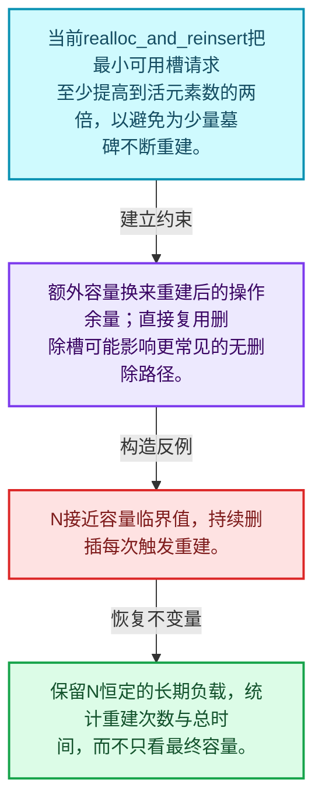
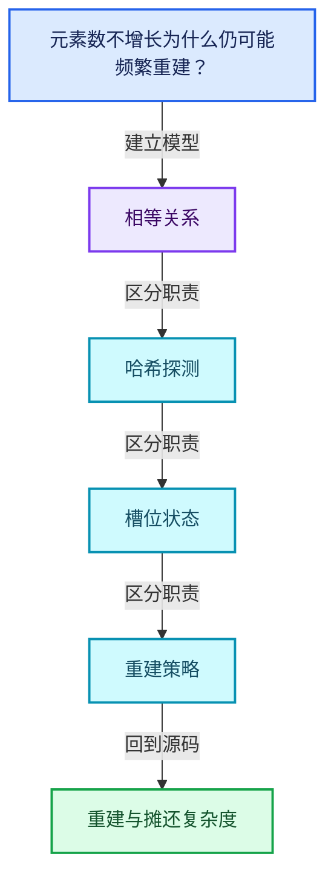
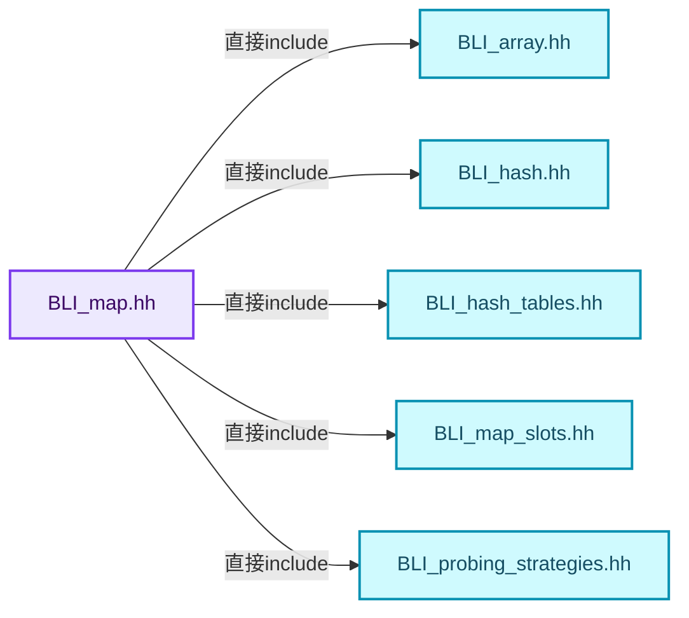
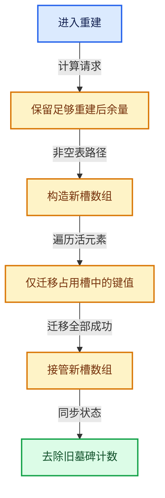
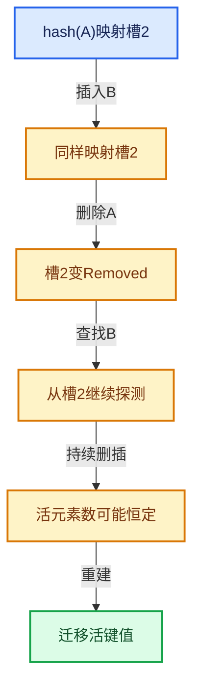

# 02-07 重建与摊还复杂度

[方向导航](README.md) · [总目录](../README.md) · [覆盖索引](../%E6%BA%90%E7%A0%81%E7%89%88%E6%9C%AC%E4%B8%8E%E8%A6%86%E7%9B%96%E7%B4%A2%E5%BC%95.md)

> 阅读顺序：问题与数据模型 → 语法与类型 → 源码逐行 → 调用线索 → 历史与取舍 → 推演和练习。

- 基准 HEAD：`cbda6b96c26c0dee3c3b5cbb93960c4ac06a6b30`。
- 记录日期：2026-10-14。
- 教学示例状态：正文中的推演不是本机性能实测；已运行练习见验收报告。

## 一、从问题到设计

元素数不增长为什么仍可能频繁重建？

删除插入序列可能积累不可复用状态；增长策略要保证重建能换来足够未来操作，不能只看瞬时负载。

本篇把语法、数据语义和系统取舍连接起来。相等与哈希是基础契约；探测、删除和增长共同决定复杂度。

### 本篇独立模型与设计推理

当前realloc_and_reinsert把最小可用槽请求至少提高到活元素数的两倍，以避免为少量墓碑不断重建。

设计取舍：额外容量换来重建后的操作余量；直接复用删除槽可能影响更常见的无删除路径。

最小反例：N接近容量临界值，持续删插每次触发重建。

推导与处理：保留N恒定的长期负载，统计重建次数与总时间，而不只看最终容量。



### 源码范围与相邻篇章

| 文件 | 本篇逐行范围 | 基准SHA-256 |
|---|---|---|
| [source/blender/blenlib/BLI_map.hh](../../../../../source/blender/blenlib/BLI_map.hh) | L1099—L1383 | `236ceadf1c36a6e452538529f550bb9a61c4d2efc16cbb8419861fdd638bd5c7` |

同一主讲文件可能分多篇覆盖；超出本篇范围的符号通过覆盖索引定位。空行与纯注释保留在源码摘录中，逐行表解释有效语句与语法边界；许可证头统一保留。

前篇：[删除墓碑与值销毁](06-%E5%88%A0%E9%99%A4%E5%A2%93%E7%A2%91%E4%B8%8E%E5%80%BC%E9%94%80%E6%AF%81.md).

后篇：[Set与集合语义](08-Set%E4%B8%8E%E9%9B%86%E5%90%88%E8%AF%AD%E4%B9%89.md).

## 二、类型、数据与阅读地图



这是概念依赖图，边表示阅读关系，不声称是运行时调用顺序。

### 直接编译依赖



箭头只表示头文件包含关系；完整调用线索见后面的符号定位表。

## 三、关键词、语法与类型角色

### 模板 template

模板把类型或常量作为生成实现的参数。读声明时先列出类型参数、非类型参数和默认值，再看使用者实际实例化了什么。模板声明本身不意味着每种T都支持其全部成员。

具体检查：把T替换为int、string、只能移动的类型，分别检查每个被调用操作是否成立。

### 依赖名称 typename

typename既可引入类型模板参数，也可告诉编译器某个依赖名称是类型。它不创建运行时对象；解析期确认语法类别与实例化期检查具体类型是不同阶段。

具体检查：区分typename T::value_type和T::size()，前者标记类型，后者是表达式。

### 常量求值 constexpr

constexpr声明允许相应实体参与常量求值，但constexpr函数仍可以在运行时执行。是否常量求值由调用场景和表达式合法性共同决定。

具体检查：比较constexpr变量初始化和从运行时输入调用同一函数。

### 只读限定 const

const约束当前访问路径可做的修改。const指针、指向const的指针、const视图对象、const元素是不同位置的限定；其他别名可能仍可修改原对象。

具体检查：分别写T* const、const T*与const T* const，并画出不可修改的层次。

### 移动转换 std::move

std::move把表达式转换为可供移动重载选择的值类别，实际资源转移发生在被选中的构造或赋值中。对const对象move可能仍调用复制，对视图move也不会获得底层数据所有权。

具体检查：记录移动构造调用次数，不用变量名或std::move的出现次数替代测量。

### 完美转发 std::forward

std::forward在转发引用模板中恢复调用者原来的值类别。它依赖推导出的模板实参；无条件move会改变左值调用者的语义。

具体检查：对同一接口分别传入左值、临时对象和const左值，记录实际重载。

### 异常约定 noexcept

noexcept表达式可以依赖类型特征。违反不抛异常约定会终止程序；它不是自动捕获异常，也不是资源回滚代码。

具体检查：找出声明的条件与实际可能抛出的分配、构造操作是否一致。

### 异常边界 try与catch

try定义异常传播的局部边界。失败路径需要销毁已经成功构造的部分并释放相应存储；未构造的对象不能被析构。

具体检查：在第k次构造失败，列出已经存在的对象集合与待释放缓冲。

### 显式静态转换 static_cast

static_cast表达编译期允许的转换，不会自动验证运行时真实类型、指针寿命或索引边界。由void指针恢复T指针时，调用者仍须保证实际存储中确有合法T对象。

具体检查：标出转换前后的类型以及正确性依据来自哪里。

### 限定转换 const_cast

const_cast可以改变访问路径的限定，但不能让本来就是const的对象合法可写。常用于复用只读实现时，仍需检查底层对象是否实际可变。

具体检查：对非const对象的const引用与真正const对象分别分析修改是否合法。

### 对象表示 sizeof

sizeof给出对象表示大小，不是其引用的所有堆内存总量。sizeof视图很小并不说明底层数组很小。

具体检查：分别统计容器对象、容量字节和元素拥有的间接资源。

### 构造与new表达式

普通new可能分配并构造；placement new在给定地址构造，存储由其他机制提供。失败回滚应区分两类责任。

具体检查：追踪地址来自哪里、构造何时成功、由谁析构、由谁释放。

### 内部断言 assert

断言表达开发者预期成立的内部契约，发布构建可能关闭。它不能替代对不可信输入的完整错误处理，也不保证后续操作被运行时保护。

具体检查：对每条断言构造违反条件的输入，区分调用者错误与应向用户报告的错误。

### 编译期分支 if constexpr

条件在实例化时决定被保留的分支，这常用于不同类型的合法操作选择。它与运行时if有不同的实例化检查规则。

具体检查：找出每个分支依赖哪些类型特征，再使用满足与不满足条件的类型。

### 类型别名 using

类型别名为已有类型建立名字，不创建运行期对象。它常把模板内部使用的类型统一暴露给泛型调用者。

具体检查：展开别名直到基础类型，区分类型别名和变量声明。

## 四、真实源码与逐行讲解

源码块保持原行内容，原始行号由小节标题及逐行表给出。表中的调用定位是静态阅读辅助；重载、模板实例化、宏展开和虚调用需结合完整声明，不能仅凭词法出现证明动态调用。

### BLI_map.hh：L1099—L1149

<!-- source:source/blender/blenlib/BLI_map.hh:1099:1149 -->

```cpp
  BLI_NOINLINE void realloc_and_reinsert(int64_t min_usable_slots)
  {
    /* Avoid rebuilding the hash table just to get rid of a few removed slots. In this case, also
     * increase the map size to avoid a bad edge case. */
    min_usable_slots = std::max(min_usable_slots, this->size() * 2);

    int64_t total_slots, usable_slots;
    max_load_factor_.compute_total_and_usable_slots(
        SlotArray::inline_buffer_capacity(), min_usable_slots, &total_slots, &usable_slots);
    BLI_assert(total_slots >= 1);
    const uint64_t new_slot_mask = uint64_t(total_slots) - 1;

    /**
     * Optimize the case when the map was empty beforehand. We can avoid some copies here.
     */
    if (this->size() == 0) {
      try {
        slots_.reinitialize(total_slots);
      }
      catch (...) {
        this->noexcept_reset();
        throw;
      }
      removed_slots_ = 0;
      occupied_and_removed_slots_ = 0;
      usable_slots_ = usable_slots;
      slot_mask_ = new_slot_mask;
      return;
    }

    SlotArray new_slots(total_slots);

    try {
      for (Slot &slot : slots_) {
        if (slot.is_occupied()) {
          this->add_after_grow(slot, new_slots, new_slot_mask);
          slot.remove();
        }
      }
      slots_ = std::move(new_slots);
    }
    catch (...) {
      this->noexcept_reset();
      throw;
    }

    occupied_and_removed_slots_ -= removed_slots_;
    usable_slots_ = usable_slots;
    removed_slots_ = 0;
    slot_mask_ = new_slot_mask;
  }
```

本段语义重点：

- `realloc_and_reinsert`：重新组织哈希槽并重插活元素；槽位改变但键值相等语义应保持。
- `std::max`：取较大值，在容量计算中常用于同时满足请求量和增长策略。
- `removed_slots_`：删除标记计数，影响重建判断及探测长度。
- `occupied_and_removed_slots_`：占用与删除状态总量，不能替代活元素数量。
- `usable_slots_`：受负载约束允许使用的槽位数，与物理总槽数不同。

| 原始行 | 语义、约束与检查 |
|---|---|
| L1099 | 出现调用或函数声明 `realloc_and_reinsert`，对应表达式为 `BLI_NOINLINE void realloc_and_reinsert(int64_t min_usable_slots)`。参数求值、返回类型与重载需结合前后完整语句；静态文本引用不能证明动态目标。 |
| L1100 | 连接上一行的声明或控制结构与其语句块；后续行在这个作用域中执行或声明。 |
| L1103 | 本行使用 `std::max`：取较大值，在容量计算中常用于同时满足请求量和增长策略。 |
| L1105 | 声明成员、局部对象或完成语句 `int64_t total_slots, usable_slots`。若为指针或引用，它本身不说明拥有；若为值对象，其构造析构由所在作用域或外层对象管理。 |
| L1106 | 出现调用或函数声明 `compute_total_and_usable_slots`，对应表达式为 `max_load_factor_.compute_total_and_usable_slots(`。参数求值、返回类型与重载需结合前后完整语句；静态文本引用不能证明动态目标。 |
| L1107 | 出现调用或函数声明 `SlotArray::inline_buffer_capacity`，对应表达式为 `SlotArray::inline_buffer_capacity(), min_usable_slots, &total_slots, &usable_slots);`。参数求值、返回类型与重载需结合前后完整语句；静态文本引用不能证明动态目标。 |
| L1108 | 断言约束 `BLI_assert(total_slots >= 1);`。条件是后续访问的内部前置条件；发布构建可能不执行，不能把断言当作输入修复。 |
| L1109 | 把右侧 `uint64_t(total_slots) - 1` 用于初始化或更新左侧 `const uint64_t new_slot_mask`。声明初始化与已有对象赋值应按上下文区分；有资源的类型会调用相应特殊成员。 |
| L1114 | 判断 `this->size() == 0`，成立时进入本分支，否则继续后续路径。该边界影响可访问元素或可用容量，两者要按各变量的定义区分。 |
| L1115 | 开始可能抛异常的操作区间；下面catch负责局部回滚，需精确区分已经构造和尚未构造对象。 |
| L1116 | 本行涉及 `slots_`：哈希槽数组，其中对象存活与槽位状态必须一致。按此语义解读 `slots_.reinitialize(total_slots)`，不要把地址、数量或状态混用。 |
| L1117 | 结束当前语法单元。局部自动对象在离开其作用域时按规则销毁；这不等于所有被引用的外部数据也被释放。 |
| L1118 | 进入异常清理路径；随后应释放本路径新取得的资源，同时遵守源对象已经发生的状态变化。 |
| L1119 | 出现调用或函数声明 `noexcept_reset`，对应表达式为 `this->noexcept_reset();`。参数求值、返回类型与重载需结合前后完整语句；静态文本引用不能证明动态目标。 |
| L1120 | 继续传播异常或抛出新异常；在执行前必须完成本层负责的资源清理。 |
| L1121 | 结束当前语法单元。局部自动对象在离开其作用域时按规则销毁；这不等于所有被引用的外部数据也被释放。 |
| L1122 | 建立或更新 `removed_slots_`：删除标记计数，影响重建判断及探测长度。本行的具体值关系为 `removed_slots_ = 0`；对照更新前后相应范围或状态是否一致。 |
| L1123 | 建立或更新 `occupied_and_removed_slots_`：占用与删除状态总量，不能替代活元素数量。本行的具体值关系为 `occupied_and_removed_slots_ = 0`；对照更新前后相应范围或状态是否一致。 |
| L1124 | 建立或更新 `usable_slots_`：受负载约束允许使用的槽位数，与物理总槽数不同。本行的具体值关系为 `usable_slots_ = usable_slots`；对照更新前后相应范围或状态是否一致。 |
| L1125 | 建立或更新 `slot_mask_`：槽位寻址掩码；其有效性依赖容量布局约定。本行的具体值关系为 `slot_mask_ = new_slot_mask`；对照更新前后相应范围或状态是否一致。 |
| L1126 | 结束当前函数，本路径不再执行后续语句；局部对象按作用域规则清理。 |
| L1127 | 结束当前语法单元。局部自动对象在离开其作用域时按规则销毁；这不等于所有被引用的外部数据也被释放。 |
| L1129 | 出现调用或函数声明 `new_slots`，对应表达式为 `SlotArray new_slots(total_slots);`。参数求值、返回类型与重载需结合前后完整语句；静态文本引用不能证明动态目标。 |
| L1131 | 开始可能抛异常的操作区间；下面catch负责局部回滚，需精确区分已经构造和尚未构造对象。 |
| L1132 | 按 `for (Slot &slot : slots_)` 指定的范围或条件重复执行。对照循环变量与真实元素编号；循环内调用成本乘以实际迭代次数。 |
| L1133 | 判断 `slot.is_occupied()`，成立时进入本分支，否则继续后续路径。 |
| L1134 | 出现调用或函数声明 `add_after_grow`，对应表达式为 `this->add_after_grow(slot, new_slots, new_slot_mask);`。参数求值、返回类型与重载需结合前后完整语句；静态文本引用不能证明动态目标。 |
| L1135 | 出现调用或函数声明 `remove`，对应表达式为 `slot.remove();`。参数求值、返回类型与重载需结合前后完整语句；静态文本引用不能证明动态目标。 |
| L1136 | 结束当前语法单元。局部自动对象在离开其作用域时按规则销毁；这不等于所有被引用的外部数据也被释放。 |
| L1137 | 结束当前语法单元。局部自动对象在离开其作用域时按规则销毁；这不等于所有被引用的外部数据也被释放。 |
| L1138 | 建立或更新 `slots_`：哈希槽数组，其中对象存活与槽位状态必须一致。本行的具体值关系为 `slots_ = std::move(new_slots)`；对照更新前后相应范围或状态是否一致。 |
| L1139 | 结束当前语法单元。局部自动对象在离开其作用域时按规则销毁；这不等于所有被引用的外部数据也被释放。 |
| L1140 | 进入异常清理路径；随后应释放本路径新取得的资源，同时遵守源对象已经发生的状态变化。 |
| L1141 | 出现调用或函数声明 `noexcept_reset`，对应表达式为 `this->noexcept_reset();`。参数求值、返回类型与重载需结合前后完整语句；静态文本引用不能证明动态目标。 |
| L1142 | 继续传播异常或抛出新异常；在执行前必须完成本层负责的资源清理。 |
| L1143 | 结束当前语法单元。局部自动对象在离开其作用域时按规则销毁；这不等于所有被引用的外部数据也被释放。 |
| L1145 | 复合更新 `occupied_and_removed_slots_ -= removed_slots_`：读取左侧现有值，与右侧按`-=`对应操作组合后写回。检查数值边界、位掩码或共享状态保护；它不是新对象的构造。 |
| L1146 | 建立或更新 `usable_slots_`：受负载约束允许使用的槽位数，与物理总槽数不同。本行的具体值关系为 `usable_slots_ = usable_slots`；对照更新前后相应范围或状态是否一致。 |
| L1147 | 建立或更新 `removed_slots_`：删除标记计数，影响重建判断及探测长度。本行的具体值关系为 `removed_slots_ = 0`；对照更新前后相应范围或状态是否一致。 |
| L1148 | 建立或更新 `slot_mask_`：槽位寻址掩码；其有效性依赖容量布局约定。本行的具体值关系为 `slot_mask_ = new_slot_mask`；对照更新前后相应范围或状态是否一致。 |
| L1149 | 结束当前语法单元。局部自动对象在离开其作用域时按规则销毁；这不等于所有被引用的外部数据也被释放。 |

### BLI_map.hh：L1150—L1188

<!-- source:source/blender/blenlib/BLI_map.hh:1150:1188 -->

```cpp

  void add_after_grow(Slot &old_slot, SlotArray &new_slots, uint64_t new_slot_mask)
  {
    uint64_t hash = old_slot.get_hash(Hash());
    SLOT_PROBING_BEGIN (ProbingStrategy, hash, new_slot_mask, slot_index) {
      Slot &slot = new_slots[slot_index];
      if (slot.is_empty()) {
        slot.occupy(std::move(*old_slot.key()), hash, std::move(*old_slot.value()));
        return;
      }
    }
    SLOT_PROBING_END();
  }

  void noexcept_reset() noexcept
  {
    Allocator allocator = slots_.allocator();
    this->~Map();
    new (this) Map(NoExceptConstructor(), allocator);
  }

  template<typename ForwardKey, typename... ForwardValue>
  void add_new__impl(ForwardKey &&key, uint64_t hash, ForwardValue &&...value)
  {
    BLI_assert(!this->contains_as(key));

    this->ensure_can_add();

    MAP_SLOT_PROBING_BEGIN (hash, slot) {
      if (slot.is_empty()) {
        slot.occupy(std::forward<ForwardKey>(key), hash, std::forward<ForwardValue>(value)...);
        BLI_assert(hash_(*slot.key()) == hash);
        BLI_assert(is_equal_(*slot.key(), *slot.key()));
        occupied_and_removed_slots_++;
        return;
      }
    }
    MAP_SLOT_PROBING_END();
  }
```

本段语义重点：

- `occupied_and_removed_slots_`：占用与删除状态总量，不能替代活元素数量。
- `slots_`：哈希槽数组，其中对象存活与槽位状态必须一致。

| 原始行 | 语义、约束与检查 |
|---|---|
| L1151 | 出现调用或函数声明 `add_after_grow`，对应表达式为 `void add_after_grow(Slot &old_slot, SlotArray &new_slots, uint64_t new_slot_mask)`。参数求值、返回类型与重载需结合前后完整语句；静态文本引用不能证明动态目标。 |
| L1152 | 连接上一行的声明或控制结构与其语句块；后续行在这个作用域中执行或声明。 |
| L1153 | 把右侧 `old_slot.get_hash(Hash())` 用于初始化或更新左侧 `uint64_t hash`。声明初始化与已有对象赋值应按上下文区分；有资源的类型会调用相应特殊成员。 |
| L1154 | 出现调用或函数声明 `SLOT_PROBING_BEGIN`，对应表达式为 `SLOT_PROBING_BEGIN (ProbingStrategy, hash, new_slot_mask, slot_index) {`。参数求值、返回类型与重载需结合前后完整语句；静态文本引用不能证明动态目标。 |
| L1155 | 把右侧 `new_slots[slot_index]` 用于初始化或更新左侧 `Slot &slot`。声明初始化与已有对象赋值应按上下文区分；有资源的类型会调用相应特殊成员。 |
| L1156 | 判断 `slot.is_empty()`，成立时进入本分支，否则继续后续路径。 |
| L1157 | 出现调用或函数声明 `occupy`，对应表达式为 `slot.occupy(std::move(*old_slot.key()), hash, std::move(*old_slot.value()));`。参数求值、返回类型与重载需结合前后完整语句；静态文本引用不能证明动态目标。 |
| L1158 | 结束当前函数，本路径不再执行后续语句；局部对象按作用域规则清理。 |
| L1159 | 结束当前语法单元。局部自动对象在离开其作用域时按规则销毁；这不等于所有被引用的外部数据也被释放。 |
| L1160 | 结束当前语法单元。局部自动对象在离开其作用域时按规则销毁；这不等于所有被引用的外部数据也被释放。 |
| L1161 | 出现调用或函数声明 `SLOT_PROBING_END`，对应表达式为 `SLOT_PROBING_END();`。参数求值、返回类型与重载需结合前后完整语句；静态文本引用不能证明动态目标。 |
| L1162 | 结束当前语法单元。局部自动对象在离开其作用域时按规则销毁；这不等于所有被引用的外部数据也被释放。 |
| L1164 | 出现调用或函数声明 `noexcept_reset`，对应表达式为 `void noexcept_reset() noexcept`。参数求值、返回类型与重载需结合前后完整语句；静态文本引用不能证明动态目标。 |
| L1165 | 连接上一行的声明或控制结构与其语句块；后续行在这个作用域中执行或声明。 |
| L1166 | 建立或更新 `slots_`：哈希槽数组，其中对象存活与槽位状态必须一致。本行的具体值关系为 `Allocator allocator = slots_.allocator()`；对照更新前后相应范围或状态是否一致。 |
| L1167 | 涉及析构接口或显式析构：`this->~Map();`。检查目标对象已成功构造，且资源不会在另一条清理路径再次销毁。 |
| L1168 | 出现调用或函数声明 `new`，对应表达式为 `new (this) Map(NoExceptConstructor(), allocator);`。参数求值、返回类型与重载需结合前后完整语句；静态文本引用不能证明动态目标。 |
| L1169 | 结束当前语法单元。局部自动对象在离开其作用域时按规则销毁；这不等于所有被引用的外部数据也被释放。 |
| L1171 | 声明模板参数 `template<typename ForwardKey, typename... ForwardValue>`。类型参数决定生成操作的类型，非类型参数可决定内嵌容量或编译期分支。 |
| L1172 | 出现调用或函数声明 `add_new__impl`，对应表达式为 `void add_new__impl(ForwardKey &&key, uint64_t hash, ForwardValue &&...value)`。参数求值、返回类型与重载需结合前后完整语句；静态文本引用不能证明动态目标。 |
| L1173 | 连接上一行的声明或控制结构与其语句块；后续行在这个作用域中执行或声明。 |
| L1174 | 断言约束 `BLI_assert(!this->contains_as(key));`。条件是后续访问的内部前置条件；发布构建可能不执行，不能把断言当作输入修复。 |
| L1176 | 出现调用或函数声明 `ensure_can_add`，对应表达式为 `this->ensure_can_add();`。参数求值、返回类型与重载需结合前后完整语句；静态文本引用不能证明动态目标。 |
| L1178 | 出现调用或函数声明 `MAP_SLOT_PROBING_BEGIN`，对应表达式为 `MAP_SLOT_PROBING_BEGIN (hash, slot) {`。参数求值、返回类型与重载需结合前后完整语句；静态文本引用不能证明动态目标。 |
| L1179 | 判断 `slot.is_empty()`，成立时进入本分支，否则继续后续路径。 |
| L1180 | 出现调用或函数声明 `occupy`，对应表达式为 `slot.occupy(std::forward<ForwardKey>(key), hash, std::forward<ForwardValue>(value)...);`。参数求值、返回类型与重载需结合前后完整语句；静态文本引用不能证明动态目标。 |
| L1181 | 断言约束 `BLI_assert(hash_(*slot.key()) == hash);`。条件是后续访问的内部前置条件；发布构建可能不执行，不能把断言当作输入修复。 |
| L1182 | 断言约束 `BLI_assert(is_equal_(*slot.key(), *slot.key()));`。条件是后续访问的内部前置条件；发布构建可能不执行，不能把断言当作输入修复。 |
| L1183 | 递增或递减现有状态：`occupied_and_removed_slots_++;`。这改变计数或游标；检查边界、计数单位，以及并发访问是否有相应保护。 |
| L1184 | 结束当前函数，本路径不再执行后续语句；局部对象按作用域规则清理。 |
| L1185 | 结束当前语法单元。局部自动对象在离开其作用域时按规则销毁；这不等于所有被引用的外部数据也被释放。 |
| L1186 | 结束当前语法单元。局部自动对象在离开其作用域时按规则销毁；这不等于所有被引用的外部数据也被释放。 |
| L1187 | 出现调用或函数声明 `MAP_SLOT_PROBING_END`，对应表达式为 `MAP_SLOT_PROBING_END();`。参数求值、返回类型与重载需结合前后完整语句；静态文本引用不能证明动态目标。 |
| L1188 | 结束当前语法单元。局部自动对象在离开其作用域时按规则销毁；这不等于所有被引用的外部数据也被释放。 |

### BLI_map.hh：L1189—L1249

<!-- source:source/blender/blenlib/BLI_map.hh:1189:1249 -->

```cpp

  template<typename ForwardKey, typename... ForwardValue>
  bool add__impl(ForwardKey &&key, uint64_t hash, ForwardValue &&...value)
  {
    this->ensure_can_add();

    MAP_SLOT_PROBING_BEGIN (hash, slot) {
      if (slot.is_empty()) {
        slot.occupy(std::forward<ForwardKey>(key), hash, std::forward<ForwardValue>(value)...);
        BLI_assert(hash_(*slot.key()) == hash);
        BLI_assert(is_equal_(*slot.key(), *slot.key()));
        occupied_and_removed_slots_++;
        return true;
      }
      if (slot.contains(key, is_equal_, hash)) {
        return false;
      }
      /* This intentionally does not check if the slot is in removed state because that would cause
       * additional overhead in the common case when nothing is ever removed from the map. These
       * slots will be cleaned up when the map is rebuilt. There could be alternative methods or
       * template arguments in the future to enable overriding removed slots here. */
    }
    MAP_SLOT_PROBING_END();
  }

  template<typename ForwardKey, typename CreateValueF, typename ModifyValueF>
  auto add_or_modify__impl(ForwardKey &&key,
                           const CreateValueF &create_value,
                           const ModifyValueF &modify_value,
                           uint64_t hash) -> decltype(create_value(nullptr))
  {
    using CreateReturnT = decltype(create_value(nullptr));
    using ModifyReturnT = decltype(modify_value(nullptr));
    BLI_STATIC_ASSERT((std::is_same_v<CreateReturnT, ModifyReturnT>),
                      "Both callbacks should return the same type.");

    this->ensure_can_add();

    MAP_SLOT_PROBING_BEGIN (hash, slot) {
      if (slot.is_empty()) {
        Value *value_ptr = slot.value();
        if constexpr (std::is_void_v<CreateReturnT>) {
          create_value(value_ptr);
          slot.occupy_no_value(std::forward<ForwardKey>(key), hash);
          occupied_and_removed_slots_++;
          return;
        }
        else {
          auto &&return_value = create_value(value_ptr);
          slot.occupy_no_value(std::forward<ForwardKey>(key), hash);
          occupied_and_removed_slots_++;
          return return_value;
        }
      }
      if (slot.contains(key, is_equal_, hash)) {
        Value *value_ptr = slot.value();
        return modify_value(value_ptr);
      }
    }
    MAP_SLOT_PROBING_END();
  }
```

本段语义重点：

- `occupied_and_removed_slots_`：占用与删除状态总量，不能替代活元素数量。

| 原始行 | 语义、约束与检查 |
|---|---|
| L1190 | 声明模板参数 `template<typename ForwardKey, typename... ForwardValue>`。类型参数决定生成操作的类型，非类型参数可决定内嵌容量或编译期分支。 |
| L1191 | 出现调用或函数声明 `add__impl`，对应表达式为 `bool add__impl(ForwardKey &&key, uint64_t hash, ForwardValue &&...value)`。参数求值、返回类型与重载需结合前后完整语句；静态文本引用不能证明动态目标。 |
| L1192 | 连接上一行的声明或控制结构与其语句块；后续行在这个作用域中执行或声明。 |
| L1193 | 出现调用或函数声明 `ensure_can_add`，对应表达式为 `this->ensure_can_add();`。参数求值、返回类型与重载需结合前后完整语句；静态文本引用不能证明动态目标。 |
| L1195 | 出现调用或函数声明 `MAP_SLOT_PROBING_BEGIN`，对应表达式为 `MAP_SLOT_PROBING_BEGIN (hash, slot) {`。参数求值、返回类型与重载需结合前后完整语句；静态文本引用不能证明动态目标。 |
| L1196 | 判断 `slot.is_empty()`，成立时进入本分支，否则继续后续路径。 |
| L1197 | 出现调用或函数声明 `occupy`，对应表达式为 `slot.occupy(std::forward<ForwardKey>(key), hash, std::forward<ForwardValue>(value)...);`。参数求值、返回类型与重载需结合前后完整语句；静态文本引用不能证明动态目标。 |
| L1198 | 断言约束 `BLI_assert(hash_(*slot.key()) == hash);`。条件是后续访问的内部前置条件；发布构建可能不执行，不能把断言当作输入修复。 |
| L1199 | 断言约束 `BLI_assert(is_equal_(*slot.key(), *slot.key()));`。条件是后续访问的内部前置条件；发布构建可能不执行，不能把断言当作输入修复。 |
| L1200 | 递增或递减现有状态：`occupied_and_removed_slots_++;`。这改变计数或游标；检查边界、计数单位，以及并发访问是否有相应保护。 |
| L1201 | 返回表达式 `true`。这是本路径的布尔结果，具体成功、存在或状态含义由函数接口规定。 |
| L1202 | 结束当前语法单元。局部自动对象在离开其作用域时按规则销毁；这不等于所有被引用的外部数据也被释放。 |
| L1203 | 判断 `slot.contains(key, is_equal_, hash)`，成立时进入本分支，否则继续后续路径。 |
| L1204 | 返回表达式 `false`。这是本路径的布尔结果，具体成功、存在或状态含义由函数接口规定。 |
| L1205 | 结束当前语法单元。局部自动对象在离开其作用域时按规则销毁；这不等于所有被引用的外部数据也被释放。 |
| L1210 | 结束当前语法单元。局部自动对象在离开其作用域时按规则销毁；这不等于所有被引用的外部数据也被释放。 |
| L1211 | 出现调用或函数声明 `MAP_SLOT_PROBING_END`，对应表达式为 `MAP_SLOT_PROBING_END();`。参数求值、返回类型与重载需结合前后完整语句；静态文本引用不能证明动态目标。 |
| L1212 | 结束当前语法单元。局部自动对象在离开其作用域时按规则销毁；这不等于所有被引用的外部数据也被释放。 |
| L1214 | 声明模板参数 `template<typename ForwardKey, typename CreateValueF, typename ModifyValueF>`。类型参数决定生成操作的类型，非类型参数可决定内嵌容量或编译期分支。 |
| L1215 | 出现调用或函数声明 `add_or_modify__impl`，对应表达式为 `auto add_or_modify__impl(ForwardKey &&key,`。参数求值、返回类型与重载需结合前后完整语句；静态文本引用不能证明动态目标。 |
| L1216 | 本行是连续声明或表达式的一部分：`const CreateValueF &create_value,`。与本段前后行合读；逗号、括号和限定符决定它属于参数、初始化列表还是实际计算。 |
| L1217 | 本行是连续声明或表达式的一部分：`const ModifyValueF &modify_value,`。与本段前后行合读；逗号、括号和限定符决定它属于参数、初始化列表还是实际计算。 |
| L1218 | 出现调用或函数声明 `decltype`，对应表达式为 `uint64_t hash) -> decltype(create_value(nullptr))`。参数求值、返回类型与重载需结合前后完整语句；静态文本引用不能证明动态目标。 |
| L1219 | 连接上一行的声明或控制结构与其语句块；后续行在这个作用域中执行或声明。 |
| L1220 | 定义类型别名 `using CreateReturnT = decltype(create_value(nullptr))`，为模板接口或内部实现统一命名；本行不分配该类型对象。 |
| L1221 | 定义类型别名 `using ModifyReturnT = decltype(modify_value(nullptr))`，为模板接口或内部实现统一命名；本行不分配该类型对象。 |
| L1222 | 出现调用或函数声明 `BLI_STATIC_ASSERT`，对应表达式为 `BLI_STATIC_ASSERT((std::is_same_v<CreateReturnT, ModifyReturnT>),`。参数求值、返回类型与重载需结合前后完整语句；静态文本引用不能证明动态目标。 |
| L1223 | 声明成员、局部对象或完成语句 `"Both callbacks should return the same type.")`。若为指针或引用，它本身不说明拥有；若为值对象，其构造析构由所在作用域或外层对象管理。 |
| L1225 | 出现调用或函数声明 `ensure_can_add`，对应表达式为 `this->ensure_can_add();`。参数求值、返回类型与重载需结合前后完整语句；静态文本引用不能证明动态目标。 |
| L1227 | 出现调用或函数声明 `MAP_SLOT_PROBING_BEGIN`，对应表达式为 `MAP_SLOT_PROBING_BEGIN (hash, slot) {`。参数求值、返回类型与重载需结合前后完整语句；静态文本引用不能证明动态目标。 |
| L1228 | 判断 `slot.is_empty()`，成立时进入本分支，否则继续后续路径。 |
| L1229 | 把右侧 `slot.value()` 用于初始化或更新左侧 `Value *value_ptr`。声明初始化与已有对象赋值应按上下文区分；有资源的类型会调用相应特殊成员。 |
| L1230 | 编译期条件分支 `if constexpr (std::is_void_v<CreateReturnT>)`。按实例化类型选择相应实现；被舍弃分支和运行期if具有不同检查规则，不能当作运行时输入验证。 |
| L1231 | 出现调用或函数声明 `create_value`，对应表达式为 `create_value(value_ptr);`。参数求值、返回类型与重载需结合前后完整语句；静态文本引用不能证明动态目标。 |
| L1232 | 出现调用或函数声明 `occupy_no_value`，对应表达式为 `slot.occupy_no_value(std::forward<ForwardKey>(key), hash);`。参数求值、返回类型与重载需结合前后完整语句；静态文本引用不能证明动态目标。 |
| L1233 | 递增或递减现有状态：`occupied_and_removed_slots_++;`。这改变计数或游标；检查边界、计数单位，以及并发访问是否有相应保护。 |
| L1234 | 结束当前函数，本路径不再执行后续语句；局部对象按作用域规则清理。 |
| L1235 | 结束当前语法单元。局部自动对象在离开其作用域时按规则销毁；这不等于所有被引用的外部数据也被释放。 |
| L1236 | 处理前一条件不成立的互补路径。比较两条路径最后是否恢复同一不变量，以及是否产生不同的资源责任。 |
| L1237 | 把右侧 `create_value(value_ptr)` 用于初始化或更新左侧 `auto &&return_value`。声明初始化与已有对象赋值应按上下文区分；有资源的类型会调用相应特殊成员。 |
| L1238 | 出现调用或函数声明 `occupy_no_value`，对应表达式为 `slot.occupy_no_value(std::forward<ForwardKey>(key), hash);`。参数求值、返回类型与重载需结合前后完整语句；静态文本引用不能证明动态目标。 |
| L1239 | 递增或递减现有状态：`occupied_and_removed_slots_++;`。这改变计数或游标；检查边界、计数单位，以及并发访问是否有相应保护。 |
| L1240 | 返回表达式 `return_value`。 |
| L1241 | 结束当前语法单元。局部自动对象在离开其作用域时按规则销毁；这不等于所有被引用的外部数据也被释放。 |
| L1242 | 结束当前语法单元。局部自动对象在离开其作用域时按规则销毁；这不等于所有被引用的外部数据也被释放。 |
| L1243 | 判断 `slot.contains(key, is_equal_, hash)`，成立时进入本分支，否则继续后续路径。 |
| L1244 | 把右侧 `slot.value()` 用于初始化或更新左侧 `Value *value_ptr`。声明初始化与已有对象赋值应按上下文区分；有资源的类型会调用相应特殊成员。 |
| L1245 | 返回表达式 `modify_value(value_ptr)`。结合函数声明检查返回值是否借用原存储，借用值不会自动延长其寿命。 |
| L1246 | 结束当前语法单元。局部自动对象在离开其作用域时按规则销毁；这不等于所有被引用的外部数据也被释放。 |
| L1247 | 结束当前语法单元。局部自动对象在离开其作用域时按规则销毁；这不等于所有被引用的外部数据也被释放。 |
| L1248 | 出现调用或函数声明 `MAP_SLOT_PROBING_END`，对应表达式为 `MAP_SLOT_PROBING_END();`。参数求值、返回类型与重载需结合前后完整语句；静态文本引用不能证明动态目标。 |
| L1249 | 结束当前语法单元。局部自动对象在离开其作用域时按规则销毁；这不等于所有被引用的外部数据也被释放。 |

### BLI_map.hh：L1250—L1304

<!-- source:source/blender/blenlib/BLI_map.hh:1250:1304 -->

```cpp

  template<typename ForwardKey, typename CreateValueF>
  Value &lookup_or_add_cb__impl(ForwardKey &&key, const CreateValueF &create_value, uint64_t hash)
  {
    this->ensure_can_add();

    MAP_SLOT_PROBING_BEGIN (hash, slot) {
      if (slot.is_empty()) {
        slot.occupy(std::forward<ForwardKey>(key), hash, create_value());
        BLI_assert(hash_(*slot.key()) == hash);
        BLI_assert(is_equal_(*slot.key(), *slot.key()));
        occupied_and_removed_slots_++;
        return *slot.value();
      }
      if (slot.contains(key, is_equal_, hash)) {
        return *slot.value();
      }
    }
    MAP_SLOT_PROBING_END();
  }

  template<typename ForwardKey, typename... ForwardValue>
  Value &lookup_or_add__impl(ForwardKey &&key, uint64_t hash, ForwardValue &&...value)
  {
    this->ensure_can_add();

    MAP_SLOT_PROBING_BEGIN (hash, slot) {
      if (slot.is_empty()) {
        slot.occupy(std::forward<ForwardKey>(key), hash, std::forward<ForwardValue>(value)...);
        BLI_assert(hash_(*slot.key()) == hash);
        BLI_assert(is_equal_(*slot.key(), *slot.key()));
        occupied_and_removed_slots_++;
        return *slot.value();
      }
      if (slot.contains(key, is_equal_, hash)) {
        return *slot.value();
      }
    }
    MAP_SLOT_PROBING_END();
  }

  template<typename ForwardKey, typename... ForwardValue>
  bool add_overwrite__impl(ForwardKey &&key, uint64_t hash, ForwardValue &&...value)
  {
    auto create_func = [&](Value *ptr) {
      new (static_cast<void *>(ptr)) Value(std::forward<ForwardValue>(value)...);
      return true;
    };
    auto modify_func = [&](Value *ptr) {
      *ptr = Value(std::forward<ForwardValue>(value)...);
      return false;
    };
    return this->add_or_modify__impl(
        std::forward<ForwardKey>(key), create_func, modify_func, hash);
  }
```

本段语义重点：

- `lookup_or_add_cb`：合并查找和延迟创建；键已存在时应检查回调是否跳过。
- `occupied_and_removed_slots_`：占用与删除状态总量，不能替代活元素数量。

| 原始行 | 语义、约束与检查 |
|---|---|
| L1251 | 声明模板参数 `template<typename ForwardKey, typename CreateValueF>`。类型参数决定生成操作的类型，非类型参数可决定内嵌容量或编译期分支。 |
| L1252 | 出现调用或函数声明 `lookup_or_add_cb__impl`，对应表达式为 `Value &lookup_or_add_cb__impl(ForwardKey &&key, const CreateValueF &create_value, uint64_t hash)`。参数求值、返回类型与重载需结合前后完整语句；静态文本引用不能证明动态目标。 |
| L1253 | 连接上一行的声明或控制结构与其语句块；后续行在这个作用域中执行或声明。 |
| L1254 | 出现调用或函数声明 `ensure_can_add`，对应表达式为 `this->ensure_can_add();`。参数求值、返回类型与重载需结合前后完整语句；静态文本引用不能证明动态目标。 |
| L1256 | 出现调用或函数声明 `MAP_SLOT_PROBING_BEGIN`，对应表达式为 `MAP_SLOT_PROBING_BEGIN (hash, slot) {`。参数求值、返回类型与重载需结合前后完整语句；静态文本引用不能证明动态目标。 |
| L1257 | 判断 `slot.is_empty()`，成立时进入本分支，否则继续后续路径。 |
| L1258 | 出现调用或函数声明 `occupy`，对应表达式为 `slot.occupy(std::forward<ForwardKey>(key), hash, create_value());`。参数求值、返回类型与重载需结合前后完整语句；静态文本引用不能证明动态目标。 |
| L1259 | 断言约束 `BLI_assert(hash_(*slot.key()) == hash);`。条件是后续访问的内部前置条件；发布构建可能不执行，不能把断言当作输入修复。 |
| L1260 | 断言约束 `BLI_assert(is_equal_(*slot.key(), *slot.key()));`。条件是后续访问的内部前置条件；发布构建可能不执行，不能把断言当作输入修复。 |
| L1261 | 递增或递减现有状态：`occupied_and_removed_slots_++;`。这改变计数或游标；检查边界、计数单位，以及并发访问是否有相应保护。 |
| L1262 | 返回表达式 `*slot.value()`。 |
| L1263 | 结束当前语法单元。局部自动对象在离开其作用域时按规则销毁；这不等于所有被引用的外部数据也被释放。 |
| L1264 | 判断 `slot.contains(key, is_equal_, hash)`，成立时进入本分支，否则继续后续路径。 |
| L1265 | 返回表达式 `*slot.value()`。 |
| L1266 | 结束当前语法单元。局部自动对象在离开其作用域时按规则销毁；这不等于所有被引用的外部数据也被释放。 |
| L1267 | 结束当前语法单元。局部自动对象在离开其作用域时按规则销毁；这不等于所有被引用的外部数据也被释放。 |
| L1268 | 出现调用或函数声明 `MAP_SLOT_PROBING_END`，对应表达式为 `MAP_SLOT_PROBING_END();`。参数求值、返回类型与重载需结合前后完整语句；静态文本引用不能证明动态目标。 |
| L1269 | 结束当前语法单元。局部自动对象在离开其作用域时按规则销毁；这不等于所有被引用的外部数据也被释放。 |
| L1271 | 声明模板参数 `template<typename ForwardKey, typename... ForwardValue>`。类型参数决定生成操作的类型，非类型参数可决定内嵌容量或编译期分支。 |
| L1272 | 出现调用或函数声明 `lookup_or_add__impl`，对应表达式为 `Value &lookup_or_add__impl(ForwardKey &&key, uint64_t hash, ForwardValue &&...value)`。参数求值、返回类型与重载需结合前后完整语句；静态文本引用不能证明动态目标。 |
| L1273 | 连接上一行的声明或控制结构与其语句块；后续行在这个作用域中执行或声明。 |
| L1274 | 出现调用或函数声明 `ensure_can_add`，对应表达式为 `this->ensure_can_add();`。参数求值、返回类型与重载需结合前后完整语句；静态文本引用不能证明动态目标。 |
| L1276 | 出现调用或函数声明 `MAP_SLOT_PROBING_BEGIN`，对应表达式为 `MAP_SLOT_PROBING_BEGIN (hash, slot) {`。参数求值、返回类型与重载需结合前后完整语句；静态文本引用不能证明动态目标。 |
| L1277 | 判断 `slot.is_empty()`，成立时进入本分支，否则继续后续路径。 |
| L1278 | 出现调用或函数声明 `occupy`，对应表达式为 `slot.occupy(std::forward<ForwardKey>(key), hash, std::forward<ForwardValue>(value)...);`。参数求值、返回类型与重载需结合前后完整语句；静态文本引用不能证明动态目标。 |
| L1279 | 断言约束 `BLI_assert(hash_(*slot.key()) == hash);`。条件是后续访问的内部前置条件；发布构建可能不执行，不能把断言当作输入修复。 |
| L1280 | 断言约束 `BLI_assert(is_equal_(*slot.key(), *slot.key()));`。条件是后续访问的内部前置条件；发布构建可能不执行，不能把断言当作输入修复。 |
| L1281 | 递增或递减现有状态：`occupied_and_removed_slots_++;`。这改变计数或游标；检查边界、计数单位，以及并发访问是否有相应保护。 |
| L1282 | 返回表达式 `*slot.value()`。 |
| L1283 | 结束当前语法单元。局部自动对象在离开其作用域时按规则销毁；这不等于所有被引用的外部数据也被释放。 |
| L1284 | 判断 `slot.contains(key, is_equal_, hash)`，成立时进入本分支，否则继续后续路径。 |
| L1285 | 返回表达式 `*slot.value()`。 |
| L1286 | 结束当前语法单元。局部自动对象在离开其作用域时按规则销毁；这不等于所有被引用的外部数据也被释放。 |
| L1287 | 结束当前语法单元。局部自动对象在离开其作用域时按规则销毁；这不等于所有被引用的外部数据也被释放。 |
| L1288 | 出现调用或函数声明 `MAP_SLOT_PROBING_END`，对应表达式为 `MAP_SLOT_PROBING_END();`。参数求值、返回类型与重载需结合前后完整语句；静态文本引用不能证明动态目标。 |
| L1289 | 结束当前语法单元。局部自动对象在离开其作用域时按规则销毁；这不等于所有被引用的外部数据也被释放。 |
| L1291 | 声明模板参数 `template<typename ForwardKey, typename... ForwardValue>`。类型参数决定生成操作的类型，非类型参数可决定内嵌容量或编译期分支。 |
| L1292 | 出现调用或函数声明 `add_overwrite__impl`，对应表达式为 `bool add_overwrite__impl(ForwardKey &&key, uint64_t hash, ForwardValue &&...value)`。参数求值、返回类型与重载需结合前后完整语句；静态文本引用不能证明动态目标。 |
| L1293 | 连接上一行的声明或控制结构与其语句块；后续行在这个作用域中执行或声明。 |
| L1294 | 把右侧 `[&](Value *ptr) {` 用于初始化或更新左侧 `auto create_func`。声明初始化与已有对象赋值应按上下文区分；有资源的类型会调用相应特殊成员。 |
| L1295 | 出现调用或函数声明 `new`，对应表达式为 `new (static_cast<void *>(ptr)) Value(std::forward<ForwardValue>(value)...);`。参数求值、返回类型与重载需结合前后完整语句；静态文本引用不能证明动态目标。 |
| L1296 | 返回表达式 `true`。这是本路径的布尔结果，具体成功、存在或状态含义由函数接口规定。 |
| L1297 | 结束当前语法单元。局部自动对象在离开其作用域时按规则销毁；这不等于所有被引用的外部数据也被释放。 |
| L1298 | 把右侧 `[&](Value *ptr) {` 用于初始化或更新左侧 `auto modify_func`。声明初始化与已有对象赋值应按上下文区分；有资源的类型会调用相应特殊成员。 |
| L1299 | 把右侧 `Value(std::forward<ForwardValue>(value)...)` 用于初始化或更新左侧 `*ptr`。声明初始化与已有对象赋值应按上下文区分；有资源的类型会调用相应特殊成员。 |
| L1300 | 返回表达式 `false`。这是本路径的布尔结果，具体成功、存在或状态含义由函数接口规定。 |
| L1301 | 结束当前语法单元。局部自动对象在离开其作用域时按规则销毁；这不等于所有被引用的外部数据也被释放。 |
| L1302 | 返回表达式 `this->add_or_modify__impl(`。 |
| L1303 | 出现调用或函数声明 `std::forward`，对应表达式为 `std::forward<ForwardKey>(key), create_func, modify_func, hash);`。参数求值、返回类型与重载需结合前后完整语句；静态文本引用不能证明动态目标。 |
| L1304 | 结束当前语法单元。局部自动对象在离开其作用域时按规则销毁；这不等于所有被引用的外部数据也被释放。 |

### BLI_map.hh：L1305—L1357

<!-- source:source/blender/blenlib/BLI_map.hh:1305:1357 -->

```cpp

  template<typename ForwardKey>
  const Slot &lookup_slot(const ForwardKey &key, const uint64_t hash) const
  {
    BLI_assert(this->contains_as(key));
    MAP_SLOT_PROBING_BEGIN (hash, slot) {
      if (slot.contains(key, is_equal_, hash)) {
        return slot;
      }
    }
    MAP_SLOT_PROBING_END();
  }

  template<typename ForwardKey> Slot &lookup_slot(const ForwardKey &key, const uint64_t hash)
  {
    return const_cast<Slot &>(const_cast<const Map *>(this)->lookup_slot(key, hash));
  }

  template<typename ForwardKey>
  const Slot *lookup_slot_ptr(const ForwardKey &key, const uint64_t hash) const
  {
    MAP_SLOT_PROBING_BEGIN (hash, slot) {
      if (slot.contains(key, is_equal_, hash)) {
        return &slot;
      }
      if (slot.is_empty()) {
        return nullptr;
      }
    }
    MAP_SLOT_PROBING_END();
  }

  template<typename ForwardKey> Slot *lookup_slot_ptr(const ForwardKey &key, const uint64_t hash)
  {
    return const_cast<Slot *>(const_cast<const Map *>(this)->lookup_slot_ptr(key, hash));
  }

  template<typename ForwardKey>
  int64_t count_collisions__impl(const ForwardKey &key, uint64_t hash) const
  {
    int64_t collisions = 0;

    MAP_SLOT_PROBING_BEGIN (hash, slot) {
      if (slot.contains(key, is_equal_, hash)) {
        return collisions;
      }
      if (slot.is_empty()) {
        return collisions;
      }
      collisions++;
    }
    MAP_SLOT_PROBING_END();
  }
```

本段语义重点：

- 分支证据 `slot.contains(key, is_equal_, hash))`：分别推演条件成立与不成立，核对相同出口处的状态。
- 分支证据 `slot.contains(key, is_equal_, hash))`：分别推演条件成立与不成立，核对相同出口处的状态。

| 原始行 | 语义、约束与检查 |
|---|---|
| L1306 | 声明模板参数 `template<typename ForwardKey>`。类型参数决定生成操作的类型，非类型参数可决定内嵌容量或编译期分支。 |
| L1307 | 出现调用或函数声明 `lookup_slot`，对应表达式为 `const Slot &lookup_slot(const ForwardKey &key, const uint64_t hash) const`。参数求值、返回类型与重载需结合前后完整语句；静态文本引用不能证明动态目标。 |
| L1308 | 连接上一行的声明或控制结构与其语句块；后续行在这个作用域中执行或声明。 |
| L1309 | 断言约束 `BLI_assert(this->contains_as(key));`。条件是后续访问的内部前置条件；发布构建可能不执行，不能把断言当作输入修复。 |
| L1310 | 出现调用或函数声明 `MAP_SLOT_PROBING_BEGIN`，对应表达式为 `MAP_SLOT_PROBING_BEGIN (hash, slot) {`。参数求值、返回类型与重载需结合前后完整语句；静态文本引用不能证明动态目标。 |
| L1311 | 判断 `slot.contains(key, is_equal_, hash)`，成立时进入本分支，否则继续后续路径。 |
| L1312 | 返回表达式 `slot`。 |
| L1313 | 结束当前语法单元。局部自动对象在离开其作用域时按规则销毁；这不等于所有被引用的外部数据也被释放。 |
| L1314 | 结束当前语法单元。局部自动对象在离开其作用域时按规则销毁；这不等于所有被引用的外部数据也被释放。 |
| L1315 | 出现调用或函数声明 `MAP_SLOT_PROBING_END`，对应表达式为 `MAP_SLOT_PROBING_END();`。参数求值、返回类型与重载需结合前后完整语句；静态文本引用不能证明动态目标。 |
| L1316 | 结束当前语法单元。局部自动对象在离开其作用域时按规则销毁；这不等于所有被引用的外部数据也被释放。 |
| L1318 | 声明模板参数 `template<typename ForwardKey> Slot &lookup_slot(const ForwardKey &key, const uint64_t hash)`。类型参数决定生成操作的类型，非类型参数可决定内嵌容量或编译期分支。 |
| L1319 | 连接上一行的声明或控制结构与其语句块；后续行在这个作用域中执行或声明。 |
| L1320 | 返回表达式 `const_cast<Slot &>(const_cast<const Map *>(this)->lookup_slot(key, hash))`。 |
| L1321 | 结束当前语法单元。局部自动对象在离开其作用域时按规则销毁；这不等于所有被引用的外部数据也被释放。 |
| L1323 | 声明模板参数 `template<typename ForwardKey>`。类型参数决定生成操作的类型，非类型参数可决定内嵌容量或编译期分支。 |
| L1324 | 出现调用或函数声明 `lookup_slot_ptr`，对应表达式为 `const Slot *lookup_slot_ptr(const ForwardKey &key, const uint64_t hash) const`。参数求值、返回类型与重载需结合前后完整语句；静态文本引用不能证明动态目标。 |
| L1325 | 连接上一行的声明或控制结构与其语句块；后续行在这个作用域中执行或声明。 |
| L1326 | 出现调用或函数声明 `MAP_SLOT_PROBING_BEGIN`，对应表达式为 `MAP_SLOT_PROBING_BEGIN (hash, slot) {`。参数求值、返回类型与重载需结合前后完整语句；静态文本引用不能证明动态目标。 |
| L1327 | 判断 `slot.contains(key, is_equal_, hash)`，成立时进入本分支，否则继续后续路径。 |
| L1328 | 返回表达式 `&slot`。 |
| L1329 | 结束当前语法单元。局部自动对象在离开其作用域时按规则销毁；这不等于所有被引用的外部数据也被释放。 |
| L1330 | 判断 `slot.is_empty()`，成立时进入本分支，否则继续后续路径。 |
| L1331 | 返回表达式 `nullptr`。 |
| L1332 | 结束当前语法单元。局部自动对象在离开其作用域时按规则销毁；这不等于所有被引用的外部数据也被释放。 |
| L1333 | 结束当前语法单元。局部自动对象在离开其作用域时按规则销毁；这不等于所有被引用的外部数据也被释放。 |
| L1334 | 出现调用或函数声明 `MAP_SLOT_PROBING_END`，对应表达式为 `MAP_SLOT_PROBING_END();`。参数求值、返回类型与重载需结合前后完整语句；静态文本引用不能证明动态目标。 |
| L1335 | 结束当前语法单元。局部自动对象在离开其作用域时按规则销毁；这不等于所有被引用的外部数据也被释放。 |
| L1337 | 声明模板参数 `template<typename ForwardKey> Slot *lookup_slot_ptr(const ForwardKey &key, const uint64_t hash)`。类型参数决定生成操作的类型，非类型参数可决定内嵌容量或编译期分支。 |
| L1338 | 连接上一行的声明或控制结构与其语句块；后续行在这个作用域中执行或声明。 |
| L1339 | 返回表达式 `const_cast<Slot *>(const_cast<const Map *>(this)->lookup_slot_ptr(key, hash))`。 |
| L1340 | 结束当前语法单元。局部自动对象在离开其作用域时按规则销毁；这不等于所有被引用的外部数据也被释放。 |
| L1342 | 声明模板参数 `template<typename ForwardKey>`。类型参数决定生成操作的类型，非类型参数可决定内嵌容量或编译期分支。 |
| L1343 | 出现调用或函数声明 `count_collisions__impl`，对应表达式为 `int64_t count_collisions__impl(const ForwardKey &key, uint64_t hash) const`。参数求值、返回类型与重载需结合前后完整语句；静态文本引用不能证明动态目标。 |
| L1344 | 连接上一行的声明或控制结构与其语句块；后续行在这个作用域中执行或声明。 |
| L1345 | 把右侧 `0` 用于初始化或更新左侧 `int64_t collisions`。声明初始化与已有对象赋值应按上下文区分；有资源的类型会调用相应特殊成员。 |
| L1347 | 出现调用或函数声明 `MAP_SLOT_PROBING_BEGIN`，对应表达式为 `MAP_SLOT_PROBING_BEGIN (hash, slot) {`。参数求值、返回类型与重载需结合前后完整语句；静态文本引用不能证明动态目标。 |
| L1348 | 判断 `slot.contains(key, is_equal_, hash)`，成立时进入本分支，否则继续后续路径。 |
| L1349 | 返回表达式 `collisions`。 |
| L1350 | 结束当前语法单元。局部自动对象在离开其作用域时按规则销毁；这不等于所有被引用的外部数据也被释放。 |
| L1351 | 判断 `slot.is_empty()`，成立时进入本分支，否则继续后续路径。 |
| L1352 | 返回表达式 `collisions`。 |
| L1353 | 结束当前语法单元。局部自动对象在离开其作用域时按规则销毁；这不等于所有被引用的外部数据也被释放。 |
| L1354 | 递增或递减现有状态：`collisions++;`。这改变计数或游标；检查边界、计数单位，以及并发访问是否有相应保护。 |
| L1355 | 结束当前语法单元。局部自动对象在离开其作用域时按规则销毁；这不等于所有被引用的外部数据也被释放。 |
| L1356 | 出现调用或函数声明 `MAP_SLOT_PROBING_END`，对应表达式为 `MAP_SLOT_PROBING_END();`。参数求值、返回类型与重载需结合前后完整语句；静态文本引用不能证明动态目标。 |
| L1357 | 结束当前语法单元。局部自动对象在离开其作用域时按规则销毁；这不等于所有被引用的外部数据也被释放。 |

### BLI_map.hh：L1358—L1383

<!-- source:source/blender/blenlib/BLI_map.hh:1358:1383 -->

```cpp

  void ensure_can_add()
  {
    if (occupied_and_removed_slots_ >= usable_slots_) {
      this->realloc_and_reinsert(this->size() + 1);
      BLI_assert(occupied_and_removed_slots_ < usable_slots_);
    }
  }
};

/**
 * Same as a normal Map, but does not use Blender's guarded allocator. This is useful when
 * allocating memory with static storage duration.
 */
template<typename Key,
         typename Value,
         int64_t InlineBufferCapacity = default_inline_buffer_capacity(sizeof(Key) +
                                                                       sizeof(Value)),
         typename ProbingStrategy = DefaultProbingStrategy,
         typename Hash = DefaultHash<Key>,
         typename IsEqual = DefaultEquality<Key>,
         typename Slot = typename DefaultMapSlot<Key, Value>::type>
using RawMap =
    Map<Key, Value, InlineBufferCapacity, ProbingStrategy, Hash, IsEqual, Slot, RawAllocator>;

}  // namespace blender
```

本段语义重点：

- `realloc_and_reinsert`：重新组织哈希槽并重插活元素；槽位改变但键值相等语义应保持。
- `occupied_and_removed_slots_`：占用与删除状态总量，不能替代活元素数量。
- `usable_slots_`：受负载约束允许使用的槽位数，与物理总槽数不同。

| 原始行 | 语义、约束与检查 |
|---|---|
| L1359 | 出现调用或函数声明 `ensure_can_add`，对应表达式为 `void ensure_can_add()`。参数求值、返回类型与重载需结合前后完整语句；静态文本引用不能证明动态目标。 |
| L1360 | 连接上一行的声明或控制结构与其语句块；后续行在这个作用域中执行或声明。 |
| L1361 | 判断 `occupied_and_removed_slots_ >= usable_slots_`，成立时进入本分支，否则继续后续路径。 |
| L1362 | 本行使用 `realloc_and_reinsert`：重新组织哈希槽并重插活元素；槽位改变但键值相等语义应保持。 |
| L1363 | 断言约束 `BLI_assert(occupied_and_removed_slots_ < usable_slots_);`。条件是后续访问的内部前置条件；发布构建可能不执行，不能把断言当作输入修复。 |
| L1364 | 结束当前语法单元。局部自动对象在离开其作用域时按规则销毁；这不等于所有被引用的外部数据也被释放。 |
| L1365 | 结束当前语法单元。局部自动对象在离开其作用域时按规则销毁；这不等于所有被引用的外部数据也被释放。 |
| L1366 | 结束当前语法单元。局部自动对象在离开其作用域时按规则销毁；这不等于所有被引用的外部数据也被释放。 |
| L1372 | 声明模板参数 `template<typename Key,`。类型参数决定生成操作的类型，非类型参数可决定内嵌容量或编译期分支。 |
| L1373 | 本行是连续声明或表达式的一部分：`typename Value,`。与本段前后行合读；逗号、括号和限定符决定它属于参数、初始化列表还是实际计算。 |
| L1374 | 显式采用编译器生成的特殊成员行为：`int64_t InlineBufferCapacity = default_inline_buffer_capacity(sizeof(Key) +`。成员和基类的性质决定该操作是否可用、是否被删除及异常约定，不表示运行时给对象赋值为default。 |
| L1375 | 出现调用或函数声明 `sizeof`，对应表达式为 `sizeof(Value)),`。参数求值、返回类型与重载需结合前后完整语句；静态文本引用不能证明动态目标。 |
| L1376 | 把右侧 `DefaultProbingStrategy,` 用于初始化或更新左侧 `typename ProbingStrategy`。声明初始化与已有对象赋值应按上下文区分；有资源的类型会调用相应特殊成员。 |
| L1377 | 把右侧 `DefaultHash<Key>,` 用于初始化或更新左侧 `typename Hash`。声明初始化与已有对象赋值应按上下文区分；有资源的类型会调用相应特殊成员。 |
| L1378 | 把右侧 `DefaultEquality<Key>,` 用于初始化或更新左侧 `typename IsEqual`。声明初始化与已有对象赋值应按上下文区分；有资源的类型会调用相应特殊成员。 |
| L1379 | 把右侧 `typename DefaultMapSlot<Key, Value>::type>` 用于初始化或更新左侧 `typename Slot`。声明初始化与已有对象赋值应按上下文区分；有资源的类型会调用相应特殊成员。 |
| L1380 | 定义类型别名 `using RawMap =`，为模板接口或内部实现统一命名；本行不分配该类型对象。 |
| L1381 | 声明成员、局部对象或完成语句 `Map<Key, Value, InlineBufferCapacity, ProbingStrategy, Hash, IsEqual, Slot, RawAllocator>`。若为指针或引用，它本身不说明拥有；若为值对象，其构造析构由所在作用域或外层对象管理。 |
| L1383 | 结束当前语法单元。局部自动对象在离开其作用域时按规则销毁；这不等于所有被引用的外部数据也被释放。 |

## 五、接口定位、调用线索与生命周期

### Map重建的状态提交



图只展示非空表成功路径。空表有单独reinitialize分支，异常路径调用noexcept_reset；不能从成功图推断失败后保留所有旧值。

| 阶段 | 源码证据位置 | 实际语句定位 |
|---|---|---|
| 进入重建 | BLI_map.hh [L1099](../../../../../source/blender/blenlib/BLI_map.hh#L1099) | `void realloc_and_reinsert(` |
| 保留足够重建后余量 | BLI_map.hh [L1103](../../../../../source/blender/blenlib/BLI_map.hh#L1103) | `min_usable_slots = std::max` |
| 构造新槽数组 | BLI_map.hh [L1129](../../../../../source/blender/blenlib/BLI_map.hh#L1129) | `SlotArray new_slots(total_slots)` |
| 仅迁移占用槽中的键值 | BLI_map.hh [L1134](../../../../../source/blender/blenlib/BLI_map.hh#L1134) | `this->add_after_grow(slot, new_slots` |
| 接管新槽数组 | BLI_map.hh [L1138](../../../../../source/blender/blenlib/BLI_map.hh#L1138) | `slots_ = std::move(new_slots)` |
| 去除旧墓碑计数 | BLI_map.hh [L1145](../../../../../source/blender/blenlib/BLI_map.hh#L1145) | `occupied_and_removed_slots_ -= removed_slots_` |

图中的条件边必须与对应if、异常路径和提前返回合读；不把未展示分支当作不存在。

### 本篇声明与实现入口

| 源码位置 | 实际声明片段 |
|---|---|
| [BLI_map.hh:L1099](../../../../../source/blender/blenlib/BLI_map.hh#L1099) | `BLI_NOINLINE void realloc_and_reinsert(int64_t min_usable_slots)` |
| [BLI_map.hh:L1129](../../../../../source/blender/blenlib/BLI_map.hh#L1129) | `SlotArray new_slots(total_slots);` |
| [BLI_map.hh:L1151](../../../../../source/blender/blenlib/BLI_map.hh#L1151) | `void add_after_grow(Slot &old_slot, SlotArray &new_slots, uint64_t new_slot_mask)` |
| [BLI_map.hh:L1154](../../../../../source/blender/blenlib/BLI_map.hh#L1154) | `SLOT_PROBING_BEGIN (ProbingStrategy, hash, new_slot_mask, slot_index)` |
| [BLI_map.hh:L1161](../../../../../source/blender/blenlib/BLI_map.hh#L1161) | `SLOT_PROBING_END();` |
| [BLI_map.hh:L1164](../../../../../source/blender/blenlib/BLI_map.hh#L1164) | `void noexcept_reset() noexcept` |
| [BLI_map.hh:L1172](../../../../../source/blender/blenlib/BLI_map.hh#L1172) | `void add_new__impl(ForwardKey &&key, uint64_t hash, ForwardValue &&...value)` |
| [BLI_map.hh:L1178](../../../../../source/blender/blenlib/BLI_map.hh#L1178) | `MAP_SLOT_PROBING_BEGIN (hash, slot)` |
| [BLI_map.hh:L1187](../../../../../source/blender/blenlib/BLI_map.hh#L1187) | `MAP_SLOT_PROBING_END();` |
| [BLI_map.hh:L1191](../../../../../source/blender/blenlib/BLI_map.hh#L1191) | `bool add__impl(ForwardKey &&key, uint64_t hash, ForwardValue &&...value)` |
| [BLI_map.hh:L1195](../../../../../source/blender/blenlib/BLI_map.hh#L1195) | `MAP_SLOT_PROBING_BEGIN (hash, slot)` |
| [BLI_map.hh:L1211](../../../../../source/blender/blenlib/BLI_map.hh#L1211) | `MAP_SLOT_PROBING_END();` |
| [BLI_map.hh:L1215](../../../../../source/blender/blenlib/BLI_map.hh#L1215) | `auto add_or_modify__impl(ForwardKey &&key,` |
| [BLI_map.hh:L1222](../../../../../source/blender/blenlib/BLI_map.hh#L1222) | `BLI_STATIC_ASSERT((std::is_same_v<CreateReturnT, ModifyReturnT>),` |
| [BLI_map.hh:L1227](../../../../../source/blender/blenlib/BLI_map.hh#L1227) | `MAP_SLOT_PROBING_BEGIN (hash, slot)` |
| [BLI_map.hh:L1248](../../../../../source/blender/blenlib/BLI_map.hh#L1248) | `MAP_SLOT_PROBING_END();` |
| [BLI_map.hh:L1252](../../../../../source/blender/blenlib/BLI_map.hh#L1252) | `Value &lookup_or_add_cb__impl(ForwardKey &&key, const CreateValueF &create_value, uint64_t hash)` |
| [BLI_map.hh:L1256](../../../../../source/blender/blenlib/BLI_map.hh#L1256) | `MAP_SLOT_PROBING_BEGIN (hash, slot)` |
| [BLI_map.hh:L1268](../../../../../source/blender/blenlib/BLI_map.hh#L1268) | `MAP_SLOT_PROBING_END();` |
| [BLI_map.hh:L1272](../../../../../source/blender/blenlib/BLI_map.hh#L1272) | `Value &lookup_or_add__impl(ForwardKey &&key, uint64_t hash, ForwardValue &&...value)` |
| [BLI_map.hh:L1276](../../../../../source/blender/blenlib/BLI_map.hh#L1276) | `MAP_SLOT_PROBING_BEGIN (hash, slot)` |
| [BLI_map.hh:L1288](../../../../../source/blender/blenlib/BLI_map.hh#L1288) | `MAP_SLOT_PROBING_END();` |
| [BLI_map.hh:L1292](../../../../../source/blender/blenlib/BLI_map.hh#L1292) | `bool add_overwrite__impl(ForwardKey &&key, uint64_t hash, ForwardValue &&...value)` |
| [BLI_map.hh:L1307](../../../../../source/blender/blenlib/BLI_map.hh#L1307) | `const Slot &lookup_slot(const ForwardKey &key, const uint64_t hash) const` |
| [BLI_map.hh:L1310](../../../../../source/blender/blenlib/BLI_map.hh#L1310) | `MAP_SLOT_PROBING_BEGIN (hash, slot)` |
| [BLI_map.hh:L1315](../../../../../source/blender/blenlib/BLI_map.hh#L1315) | `MAP_SLOT_PROBING_END();` |
| [BLI_map.hh:L1318](../../../../../source/blender/blenlib/BLI_map.hh#L1318) | `template<typename ForwardKey> Slot &lookup_slot(const ForwardKey &key, const uint64_t hash)` |
| [BLI_map.hh:L1324](../../../../../source/blender/blenlib/BLI_map.hh#L1324) | `const Slot *lookup_slot_ptr(const ForwardKey &key, const uint64_t hash) const` |
| [BLI_map.hh:L1326](../../../../../source/blender/blenlib/BLI_map.hh#L1326) | `MAP_SLOT_PROBING_BEGIN (hash, slot)` |
| [BLI_map.hh:L1334](../../../../../source/blender/blenlib/BLI_map.hh#L1334) | `MAP_SLOT_PROBING_END();` |
| [BLI_map.hh:L1337](../../../../../source/blender/blenlib/BLI_map.hh#L1337) | `template<typename ForwardKey> Slot *lookup_slot_ptr(const ForwardKey &key, const uint64_t hash)` |
| [BLI_map.hh:L1343](../../../../../source/blender/blenlib/BLI_map.hh#L1343) | `int64_t count_collisions__impl(const ForwardKey &key, uint64_t hash) const` |
| [BLI_map.hh:L1347](../../../../../source/blender/blenlib/BLI_map.hh#L1347) | `MAP_SLOT_PROBING_BEGIN (hash, slot)` |
| [BLI_map.hh:L1356](../../../../../source/blender/blenlib/BLI_map.hh#L1356) | `MAP_SLOT_PROBING_END();` |
| [BLI_map.hh:L1359](../../../../../source/blender/blenlib/BLI_map.hh#L1359) | `void ensure_can_add()` |

### 同名符号出现位置

以下表提供跨文件阅读入口，包含声明、调用或测试使用；没有经过完整C++名称解析，不把它命名为已证明的运行时调用图。

| 符号 | 位置 | 文本证据 |
|---|---|---|
| `realloc_and_reinsert` | [BLI_set.hh:L600](../../../../../source/blender/blenlib/BLI_set.hh#L600) | `this->realloc_and_reinsert(this->size());` |
| `realloc_and_reinsert` | [BLI_set.hh:L659](../../../../../source/blender/blenlib/BLI_set.hh#L659) | `this->realloc_and_reinsert(n);` |
| `realloc_and_reinsert` | [BLI_set.hh:L708](../../../../../source/blender/blenlib/BLI_set.hh#L708) | `BLI_NOINLINE void realloc_and_reinsert(int64_t min_usable_slots)` |
| `new_slots` | [BLI_set.hh:L739](../../../../../source/blender/blenlib/BLI_set.hh#L739) | `SlotArray new_slots(total_slots);` |
| `new_slots` | [BLI_vector_set.hh:L791](../../../../../source/blender/blenlib/BLI_vector_set.hh#L791) | `SlotArray new_slots(total_slots);` |
| `add_after_grow` | [BLI_set.hh:L744](../../../../../source/blender/blenlib/BLI_set.hh#L744) | `this->add_after_grow(slot, new_slots, new_slot_mask);` |
| `add_after_grow` | [BLI_set.hh:L761](../../../../../source/blender/blenlib/BLI_set.hh#L761) | `void add_after_grow(Slot &old_slot, SlotArray &new_slots, const uint64_t new_slot_mask)` |
| `add_after_grow` | [BLI_vector_set.hh:L796](../../../../../source/blender/blenlib/BLI_vector_set.hh#L796) | `this->add_after_grow(slot, new_slots, new_slot_mask);` |
| `SLOT_PROBING_BEGIN` | [BLI_set.hh:L158](../../../../../source/blender/blenlib/BLI_set.hh#L158) | `SLOT_PROBING_BEGIN (ProbingStrategy, HASH, slot_mask_, SLOT_INDEX) \` |
| `SLOT_PROBING_BEGIN` | [BLI_set.hh:L765](../../../../../source/blender/blenlib/BLI_set.hh#L765) | `SLOT_PROBING_BEGIN (ProbingStrategy, hash, new_slot_mask, slot_index) {` |
| `SLOT_PROBING_BEGIN` | [BLI_vector_set.hh:L155](../../../../../source/blender/blenlib/BLI_vector_set.hh#L155) | `SLOT_PROBING_BEGIN (ProbingStrategy, HASH, slot_mask_, SLOT_INDEX) \` |
| `SLOT_PROBING_END` | [BLI_set.hh:L160](../../../../../source/blender/blenlib/BLI_set.hh#L160) | `#define SET_SLOT_PROBING_END() SLOT_PROBING_END()` |
| `SLOT_PROBING_END` | [BLI_set.hh:L772](../../../../../source/blender/blenlib/BLI_set.hh#L772) | `SLOT_PROBING_END();` |
| `SLOT_PROBING_END` | [BLI_vector_set.hh:L157](../../../../../source/blender/blenlib/BLI_vector_set.hh#L157) | `#define VECTOR_SET_SLOT_PROBING_END() SLOT_PROBING_END()` |
| `noexcept_reset` | [BLI_set.hh:L205](../../../../../source/blender/blenlib/BLI_set.hh#L205) | `other.noexcept_reset();` |
| `noexcept_reset` | [BLI_set.hh:L215](../../../../../source/blender/blenlib/BLI_set.hh#L215) | `other.noexcept_reset();` |
| `noexcept_reset` | [BLI_set.hh:L728](../../../../../source/blender/blenlib/BLI_set.hh#L728) | `this->noexcept_reset();` |
| `add_new__impl` | [BLI_set.hh:L235](../../../../../source/blender/blenlib/BLI_set.hh#L235) | `this->add_new__impl(key, hash_(key));` |
| `add_new__impl` | [BLI_set.hh:L239](../../../../../source/blender/blenlib/BLI_set.hh#L239) | `this->add_new__impl(std::move(key), hash_(key));` |
| `add_new__impl` | [BLI_set.hh:L827](../../../../../source/blender/blenlib/BLI_set.hh#L827) | `template<typename ForwardKey> void add_new__impl(ForwardKey &&key, const uint64_t hash)` |
| `add__impl` | [BLI_set.hh:L258](../../../../../source/blender/blenlib/BLI_set.hh#L258) | `return this->add__impl(std::forward<ForwardKey>(key), hash_(key));` |
| `add__impl` | [BLI_set.hh:L845](../../../../../source/blender/blenlib/BLI_set.hh#L845) | `template<typename ForwardKey> bool add__impl(ForwardKey &&key, const uint64_t hash)` |
| `add__impl` | [BLI_vector_set.hh:L361](../../../../../source/blender/blenlib/BLI_vector_set.hh#L361) | `return this->add__impl(std::forward<ForwardKey>(key), hash_(key));` |
| `BLI_STATIC_ASSERT` | [BKE_geometry_set.hh:L182](../../../../../source/blender/blenkernel/BKE_geometry_set.hh#L182) | `BLI_STATIC_ASSERT(is_geometry_component_v<Component>, "");` |
| `BLI_STATIC_ASSERT` | [BKE_geometry_set.hh:L197](../../../../../source/blender/blenkernel/BKE_geometry_set.hh#L197) | `BLI_STATIC_ASSERT(is_geometry_component_v<Component>, "");` |
| `BLI_STATIC_ASSERT` | [BKE_geometry_set.hh:L204](../../../../../source/blender/blenkernel/BKE_geometry_set.hh#L204) | `BLI_STATIC_ASSERT(is_geometry_component_v<Component>, "");` |
| `add_overwrite__impl` | [BLI_set.hh:L277](../../../../../source/blender/blenlib/BLI_set.hh#L277) | `return this->add_overwrite__impl(std::forward<ForwardKey>(key), hash_(key));` |
| `add_overwrite__impl` | [BLI_set.hh:L864](../../../../../source/blender/blenlib/BLI_set.hh#L864) | `template<typename ForwardKey> bool add_overwrite__impl(ForwardKey &&key, const uint64_t hash)` |
| `add_overwrite__impl` | [BLI_vector_set.hh:L384](../../../../../source/blender/blenlib/BLI_vector_set.hh#L384) | `return this->add_overwrite__impl(std::forward<ForwardKey>(key), hash_(key));` |
| `count_collisions__impl` | [BLI_set.hh:L564](../../../../../source/blender/blenlib/BLI_set.hh#L564) | `return this->count_collisions__impl(key, hash_(key));` |
| `count_collisions__impl` | [BLI_set.hh:L959](../../../../../source/blender/blenlib/BLI_set.hh#L959) | `int64_t count_collisions__impl(const ForwardKey &key, const uint64_t hash) const` |
| `count_collisions__impl` | [BLI_vector_set.hh:L701](../../../../../source/blender/blenlib/BLI_vector_set.hh#L701) | `return this->count_collisions__impl(key, hash_(key));` |

### 生命周期推理图


这是审查生命周期的通用模型。具体类是否拥有数据由本篇成员、构造、析构和调用者一起证明；任何箭头都不自动代表shared_ptr。

## 六、把代码放进具体数据中推演

本方向的共同数值模型如下。本篇的专门检查是：保持N个元素并循环删插，记录每1000步重建次数。

| 步骤 | 数据或状态 | 为什么需要这一步 |
|---|---|---|
| 插入A | hash(A)映射槽2 | 槽2变Occupied |
| 插入B | 同样映射槽2 | 沿探测序列找到后续空槽 |
| 删除A | 槽2变Removed | B仍须可达 |
| 查找B | 从槽2继续探测 | Removed不能当作Empty终止 |
| 持续删插 | 活元素数可能恒定 | 墓碑和探测长度仍可能增长 |
| 重建 | 迁移活键值 | 去掉旧删除状态并恢复足够空间 |



图是教学推演模型；精确分支与状态更新以本篇摘录及调用契约为准。

### 本篇独立练习与参考思路

保持N个元素并循环删插，记录每1000步重建次数。

参考思路：删除插入序列可能积累不可复用状态；增长策略要保证重建能换来足够未来操作，不能只看瞬时负载。

将输入、预期结果和资源责任分成三张清单。先用最直接的实现给出可核对的答案，再替换成对应源码使用的表示；比较结果不变的条件，而不是只比较接口名字。

验收依据：每个活键从其探测起点可达；不存在的键可终止；析构仅命中占用状态的真实对象。

## 七、复杂度、设计取舍与其他基础库

对比std::unordered_map、Abseil flat_hash_map与node_hash_map时，优先比较地址稳定性、键值搬移要求和删除行为；不同实现的平均常数及负载策略需要测量。

本篇的具体取舍：删除插入序列可能积累不可复用状态；增长策略要保证重建能换来足够未来操作，不能只看瞬时负载。

| 观察维度 | 从源码取得证据的方法 | 本篇要避免的误判 |
|---|---|---|
| 时间 | 对循环次数、分派次数和重建频率分别计数 | 看到单次常数操作就断定整个操作序列是常数成本 |
| 内存 | 区分对象本体、容量存储、间接资源和共享控制块 | 用sizeof代替总内存 |
| 安全 | 沿构造、失败回滚、销毁与失效逐路径检查 | 把断言或非空指针当作完整安全证明 |
| 并发 | 逐字段确认锁、发布顺序和借用寿命 | 把引用计数线程安全等同数据读写线程安全 |

相关一手资料：

- [C++公开工作草案](https://eel.is/c++draft/)：持续更新的工作草案；语言与标准库语义以相应章节为准。
- [Abseil Containers](https://abseil.io/docs/cpp/guides/container)：在线版，2026-10-14查阅；引用失效按具体容器契约检查。

资料用于核对契约和进一步阅读；这里没有声称外部库与Blender实现相同，也没有把上游性能数字当作本机实测。

## 八、历史提交与设计演化

### 2025-12-12 · Jacques Lucke

[Fix: BLI: bad performance edge case in hash table implementations](https://projects.blender.org/blender/blender/commit/b242c618450e3c0011914112c3ffe31ae2e96028)

完整哈希：`b242c618450e3c0011914112c3ffe31ae2e96028`。提交标题与作者日期来自本地Git对象。

提交说明原文（历史证据，不能直接作为当前API说明）：

```text
Fix: BLI: bad performance edge case in hash table implementations

The issue happened when the hash table (e.g. Map) has close to a power of two
number of elements and repeatedly deletes and adds values. In this case the map
is rebuild more often than is necessary, and in the worst case a rebuild happens
each time something is removed and added again.

The fix here is to make sure that each call to `realloc_and_reinsert` is
actually worth it by making it grow the map in some cases where it previously
wouldn't. A similar optimization already exists in
`Vector::realloc_to_at_least`.

An alternative would be to support overriding removed-slots in `Map::add`, but
that has negative performance implications for the most common case when no
elements are ever removed.

This brings back performance to the same level before #150009:
`60k_cubes_same_mesh.blend: old: 11.3s, main: 70s, this patch: 11.3s`

Pull Request: https://projects.blender.org/blender/blender/pulls/151502
```

阅读任务：先根据说明复述旧问题，提出一个自己的修复方案，再对照diff。结合本篇重点“元素数不增长为什么仍可能频繁重建？”判断方案改变的是表示、接口、生命周期还是调度。

### 2026-06-11 · Jacques Lucke

[BLI: assert on hash table keys not comparing equal to themselves](https://projects.blender.org/blender/blender/commit/44a1dc7055466e153b4ab66628034d8561f540bf)

完整哈希：`44a1dc7055466e153b4ab66628034d8561f540bf`。提交标题与作者日期来自本地Git对象。

提交说明原文（历史证据，不能直接作为当前API说明）：

```text
BLI: assert on hash table keys not comparing equal to themselves

This helps finding issues with bad data (especially nan values) earlier.

Pull Request: https://projects.blender.org/blender/blender/pulls/159974
```

阅读任务：先根据说明复述旧问题，提出一个自己的修复方案，再对照diff。结合本篇重点“元素数不增长为什么仍可能频繁重建？”判断方案改变的是表示、接口、生命周期还是调度。

## 九、反例、测试入口与掌握标准

仓库测试入口：

- [BLI_map_test.cc](../../../../../source/blender/blenlib/tests/BLI_map_test.cc)：阅读输入、断言与覆盖边界；本篇不把“存在测试”写成“本轮已运行”。

需要实际构造的反例：

- 空输入或没有结果需求：确认接口允许的空状态与不允许访问的操作。
- 边界位置和退化结构：把长度为1、末尾位置、重复值或深链代入真实分支。
- 生命周期结束或修改之后：检查保存的指针、引用、结果视图是否仍有效。
- 与本篇核心不变量相冲突的输入：保持N个元素并循环删插，记录每1000步重建次数。

### 可运行的教学参考程序

[reference_exercises.cc](../_tools/reference_exercises.cc)包含独立于Blender的C++20参考检查：视图、简化SmallVector、异常回滚、哈希碰撞与删除、偏移数组、拓扑映射、共享缓存、表达式、惰性分支、闭包和暴力最近邻。

参考程序有意省略生产实现的完整能力。例如SmallVector禁止复制移动容器，不支持只能移动的元素，并禁止append参数别名到自身元素；TinyMap固定8槽，不提供增长。程序通过不能替代Blender实现测试。实际运行结果、编译器与命令见验收报告。

掌握标准：离开源码解释“元素数不增长为什么仍可能频繁重建？”；独立完成上述练习；能指出一个会破坏相等关系相关约束的最小反例，并用具体代码行说明检查或修复应放在哪里。
