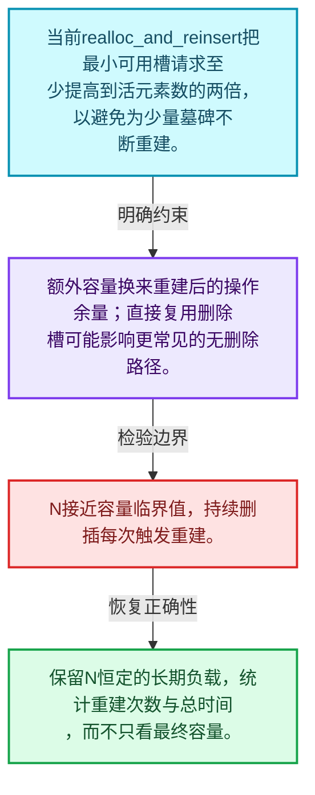
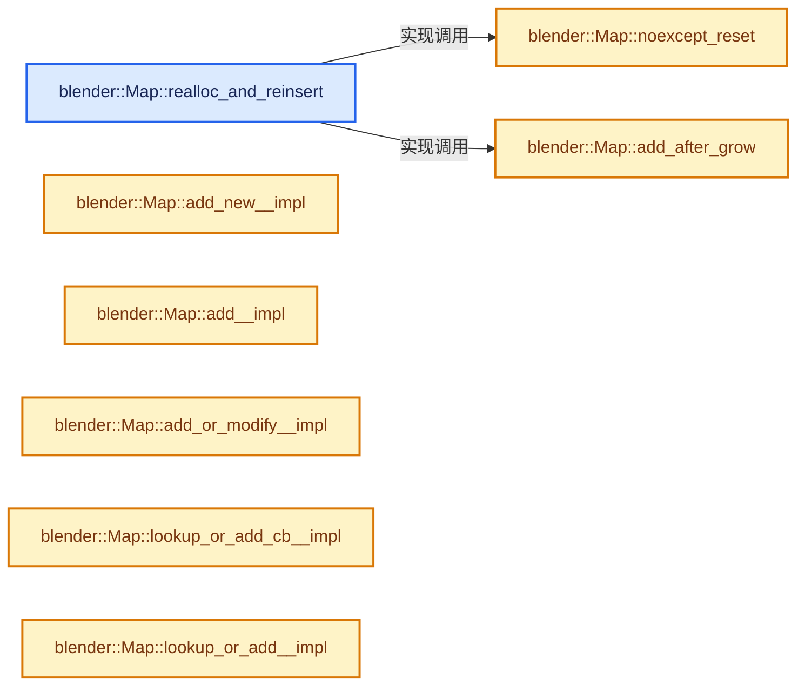
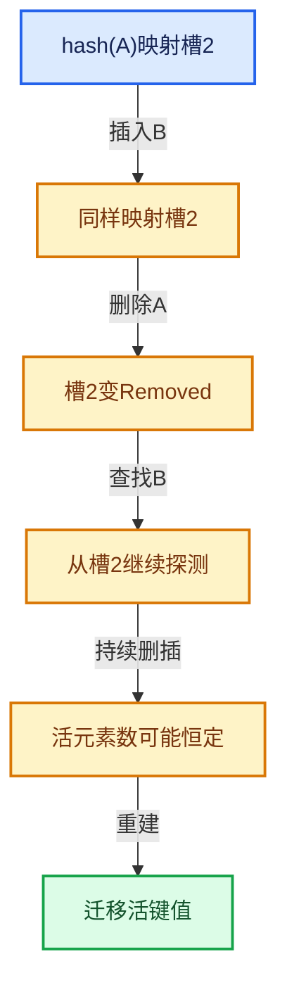

# 02-07 重建与摊还复杂度

[方向导航](README.md) · [总目录](../README.md) · [实现索引](../%E7%AC%A6%E5%8F%B7%E4%BE%9D%E8%B5%96%E4%B8%8E%E5%AE%9E%E7%8E%B0%E7%B4%A2%E5%BC%95.md)

## 从问题到实现

元素数不增长为什么仍可能频繁重建？

删除插入序列可能积累不可复用状态；增长策略要保证重建能换来足够未来操作，不能只看瞬时负载。

**数据模型**

当前realloc_and_reinsert把最小可用槽请求至少提高到活元素数的两倍，以避免为少量墓碑不断重建。

**设计取舍**

额外容量换来重建后的操作余量；直接复用删除槽可能影响更常见的无删除路径。

**最小反例**

N接近容量临界值，持续删插每次触发重建。

**推导**

保留N恒定的长期负载，统计重建次数与总时间，而不只看最终容量。

## 阅读地图与执行推演








图中的数值推演是本方向的教学模型；实际函数之间的调用边与概念分析边分别标注，不能把概念关系当作运行时调度顺序。

## 完整源码单元与就地讲解

中文讲解直接放在相关代码旁，复杂机制在代码下展开。原文折叠区保留基准行号；不需要在行号表和函数之间来回查找。类布局可分段展示，函数实现不按固定行数切开。

<a id="f-9722cb90385659a2"></a>

### `blender::Map::realloc_and_reinsert`

重新组织槽位或准备容量。

实现位置：[source/blender/blenlib/BLI_map.hh](../../../../../source/blender/blenlib/BLI_map.hh) · L1099—L1149。

接口参数：

- `int64_t min_usable_slots`

**教学注释版**

<!-- annotated:371034149661ae -->

```cpp
  BLI_NOINLINE void realloc_and_reinsert(int64_t min_usable_slots)
  {
    /* Avoid rebuilding the hash table just to get rid of a few removed slots. In this case, also
     * increase the map size to avoid a bad edge case. */
    // [讲解] std::max：按比较关系选取较大值。本讲解中的增长公式同时满足最低请求和几何增长；若保存返回引用，还需注意实参寿命。
    min_usable_slots = std::max(min_usable_slots, this->size() * 2);

    int64_t total_slots, usable_slots;
    max_load_factor_.compute_total_and_usable_slots(
        SlotArray::inline_buffer_capacity(), min_usable_slots, &total_slots, &usable_slots);
    BLI_assert(total_slots >= 1);
    const uint64_t new_slot_mask = uint64_t(total_slots) - 1;

    /**
     * Optimize the case when the map was empty beforehand. We can avoid some copies here.
     */
    // [讲解] this->size：查询活项数量或键是否存在。
    if (this->size() == 0) {
      try {
        slots_.reinitialize(total_slots);
      }
      catch (...) {
        this->noexcept_reset();
        throw;
      }
      // [讲解] 更新删除槽计数；重建后旧墓碑不再保留。
      removed_slots_ = 0;
      // [讲解] 更新占用与删除槽合计，不能把它当作纯活元素数。
      occupied_and_removed_slots_ = 0;
      // [讲解] 同步受负载策略限制的可用槽数量。
      usable_slots_ = usable_slots;
      // [讲解] 提交槽位寻址掩码，必须与新槽数组容量对应。
      slot_mask_ = new_slot_mask;
      return;
    }

    SlotArray new_slots(total_slots);

    try {
      for (Slot &slot : slots_) {
        if (slot.is_occupied()) {
          this->add_after_grow(slot, new_slots, new_slot_mask);
          slot.remove();
        }
      }
      // [讲解] std::move：把表达式转换成可供移动重载选择的值类别；不保证真的移动，不结束源对象寿命，对const值可能选择复制。
      slots_ = std::move(new_slots);
    }
    catch (...) {
      this->noexcept_reset();
      throw;
    }

    occupied_and_removed_slots_ -= removed_slots_;
    // [讲解] 同步受负载策略限制的可用槽数量。
    usable_slots_ = usable_slots;
    // [讲解] 更新删除槽计数；重建后旧墓碑不再保留。
    removed_slots_ = 0;
    // [讲解] 提交槽位寻址掩码，必须与新槽数组容量对应。
    slot_mask_ = new_slot_mask;
  }
```

<details>
<summary>核对原始源码：source/blender/blenlib/BLI_map.hh · L1099—L1149</summary>

<!-- original:371034149661ae:source/blender/blenlib/BLI_map.hh:1099:1149 -->

```cpp
  BLI_NOINLINE void realloc_and_reinsert(int64_t min_usable_slots)
  {
    /* Avoid rebuilding the hash table just to get rid of a few removed slots. In this case, also
     * increase the map size to avoid a bad edge case. */
    min_usable_slots = std::max(min_usable_slots, this->size() * 2);

    int64_t total_slots, usable_slots;
    max_load_factor_.compute_total_and_usable_slots(
        SlotArray::inline_buffer_capacity(), min_usable_slots, &total_slots, &usable_slots);
    BLI_assert(total_slots >= 1);
    const uint64_t new_slot_mask = uint64_t(total_slots) - 1;

    /**
     * Optimize the case when the map was empty beforehand. We can avoid some copies here.
     */
    if (this->size() == 0) {
      try {
        slots_.reinitialize(total_slots);
      }
      catch (...) {
        this->noexcept_reset();
        throw;
      }
      removed_slots_ = 0;
      occupied_and_removed_slots_ = 0;
      usable_slots_ = usable_slots;
      slot_mask_ = new_slot_mask;
      return;
    }

    SlotArray new_slots(total_slots);

    try {
      for (Slot &slot : slots_) {
        if (slot.is_occupied()) {
          this->add_after_grow(slot, new_slots, new_slot_mask);
          slot.remove();
        }
      }
      slots_ = std::move(new_slots);
    }
    catch (...) {
      this->noexcept_reset();
      throw;
    }

    occupied_and_removed_slots_ -= removed_slots_;
    usable_slots_ = usable_slots;
    removed_slots_ = 0;
    slot_mask_ = new_slot_mask;
  }
```

</details>

**接口与不变量**

重建后需同步计数和寻址掩码，原键值地址或元素索引是否稳定按容器约定判断。

**沿实际写入检查状态**

- `min_usable_slots = std::max(min_usable_slots, this->size() * 2);`
- `removed_slots_ = 0;`：更新删除槽计数；重建后旧墓碑不再保留。
- `occupied_and_removed_slots_ = 0;`：更新占用与删除槽合计，不能把它当作纯活元素数。
- `usable_slots_ = usable_slots;`：同步受负载策略限制的可用槽数量。
- `slot_mask_ = new_slot_mask;`：提交槽位寻址掩码，必须与新槽数组容量对应。
- `slots_ = std::move(new_slots);`
- `occupied_and_removed_slots_ -= removed_slots_;`：更新占用与删除槽合计，不能把它当作纯活元素数。

**继续追踪实现**

- `std::max` → [外部契约](https://eel.is/c++draft/alg.min.max)：按比较关系选取较大值。本讲解中的增长公式同时满足最低请求和几何增长；若保存返回引用，还需注意实参寿命。
- `this->size` → [blender::Map::size · L976](06-%E5%88%A0%E9%99%A4%E5%A2%93%E7%A2%91%E4%B8%8E%E5%80%BC%E9%94%80%E6%AF%81.md#f-ac1e466c97fbbebe)。
- `max_load_factor_.compute_total_and_usable_slots` → [blender::LoadFactor::compute_total_and_usable_slots · L85](03-%E6%A7%BD%E4%BD%8D%E7%8A%B6%E6%80%81%E4%B8%8E%E6%8E%A2%E6%B5%8B.md#f-23ebf500254e8be7)。
- `SlotArray::inline_buffer_capacity` → [blender::Array::inline_buffer_capacity · L421](../01-%E5%9F%BA%E7%A1%80%E5%AE%B9%E5%99%A8%E4%B8%8E%E7%8E%B0%E4%BB%A3CPP/08-Array%E5%A4%8D%E5%88%B6%E7%A7%BB%E5%8A%A8%E4%B8%8E%E9%94%80%E6%AF%81.md#f-bbe69b0556f92519)。
- `BLI_assert` → [BLI_assert · L48](../01-%E5%9F%BA%E7%A1%80%E5%AE%B9%E5%99%A8%E4%B8%8E%E7%8E%B0%E4%BB%A3CPP/%E4%BE%9D%E8%B5%96-BLI_assert-cc98e8.md#m-57a88495704d)；[BLI_assert · L63](../01-%E5%9F%BA%E7%A1%80%E5%AE%B9%E5%99%A8%E4%B8%8E%E7%8E%B0%E4%BB%A3CPP/%E4%BE%9D%E8%B5%96-BLI_assert-cc98e8.md#m-d07050020cb5)。宏定义由构建条件选择。
- `slots_.reinitialize` → [调用协议](../%E6%A8%A1%E6%9D%BF%E5%AE%8F%E4%B8%8E%E5%8A%A8%E6%80%81%E5%88%86%E6%B4%BE%E5%8D%8F%E8%AE%AE.md)：由接收对象具体类型或运行时策略提供实现。调用位置L1116。
- `this->noexcept_reset` → [blender::Map::noexcept_reset · L1164](07-%E9%87%8D%E5%BB%BA%E4%B8%8E%E6%91%8A%E8%BF%98%E5%A4%8D%E6%9D%82%E5%BA%A6.md#f-2bfb0182821f0fbc)。
- `slot.is_occupied` → [blender::SimpleMapSlot::is_occupied · L147](03-%E6%A7%BD%E4%BD%8D%E7%8A%B6%E6%80%81%E4%B8%8E%E6%8E%A2%E6%B5%8B.md#f-77cf8800a3021e47)。
- `this->add_after_grow` → [blender::Map::add_after_grow · L1151](07-%E9%87%8D%E5%BB%BA%E4%B8%8E%E6%91%8A%E8%BF%98%E5%A4%8D%E6%9D%82%E5%BA%A6.md#f-6714dff0bb459035)。
- `slot.remove` → [blender::SimpleMapSlot::remove · L218](03-%E6%A7%BD%E4%BD%8D%E7%8A%B6%E6%80%81%E4%B8%8E%E6%8E%A2%E6%B5%8B.md#f-51097f9581fdd5cb)。
- `std::move` → [外部契约](https://eel.is/c++draft/utility.forward)：把表达式转换成可供移动重载选择的值类别；不保证真的移动，不结束源对象寿命，对const值可能选择复制。

<!-- annotated:bd6c08942ab42c -->

```cpp

```

<details>
<summary>核对原始源码：source/blender/blenlib/BLI_map.hh · L1150—L1150</summary>

<!-- original:bd6c08942ab42c:source/blender/blenlib/BLI_map.hh:1150:1150 -->

```cpp

```

</details>

<a id="f-6714dff0bb459035"></a>

### `blender::Map::add_after_grow`

实现位置：[source/blender/blenlib/BLI_map.hh](../../../../../source/blender/blenlib/BLI_map.hh) · L1151—L1162。

接口参数：

- `Slot &old_slot`
- `SlotArray &new_slots`
- `uint64_t new_slot_mask`

**教学注释版**

<!-- annotated:07ad02bb3d0a9c -->

```cpp
  void add_after_grow(Slot &old_slot, SlotArray &new_slots, uint64_t new_slot_mask)
  {
    uint64_t hash = old_slot.get_hash(Hash());
    SLOT_PROBING_BEGIN (ProbingStrategy, hash, new_slot_mask, slot_index) {
      Slot &slot = new_slots[slot_index];
      if (slot.is_empty()) {
        // [讲解] std::move：把表达式转换成可供移动重载选择的值类别；不保证真的移动，不结束源对象寿命，对const值可能选择复制。
        slot.occupy(std::move(*old_slot.key()), hash, std::move(*old_slot.value()));
        return;
      }
    }
    SLOT_PROBING_END();
  }
```

<details>
<summary>核对原始源码：source/blender/blenlib/BLI_map.hh · L1151—L1162</summary>

<!-- original:07ad02bb3d0a9c:source/blender/blenlib/BLI_map.hh:1151:1162 -->

```cpp
  void add_after_grow(Slot &old_slot, SlotArray &new_slots, uint64_t new_slot_mask)
  {
    uint64_t hash = old_slot.get_hash(Hash());
    SLOT_PROBING_BEGIN (ProbingStrategy, hash, new_slot_mask, slot_index) {
      Slot &slot = new_slots[slot_index];
      if (slot.is_empty()) {
        slot.occupy(std::move(*old_slot.key()), hash, std::move(*old_slot.value()));
        return;
      }
    }
    SLOT_PROBING_END();
  }
```

</details>

**继续追踪实现**

- `old_slot.get_hash` → [调用协议](../%E6%A8%A1%E6%9D%BF%E5%AE%8F%E4%B8%8E%E5%8A%A8%E6%80%81%E5%88%86%E6%B4%BE%E5%8D%8F%E8%AE%AE.md)：Slot模板参数提供的操作协议。调用位置L1153。
- `Hash` → [SubEdge::Hash](../05-%E5%87%A0%E4%BD%95%E5%AD%98%E5%82%A8%E4%B8%8E%E6%8B%93%E6%89%91%E6%98%A0%E5%B0%84/%E4%BE%9D%E8%B5%96-subpatch-ee57c2.md#t-5fba122deac5)；[ImageCache::DeviceImageKey::Hash](../05-%E5%87%A0%E4%BD%95%E5%AD%98%E5%82%A8%E4%B8%8E%E6%8B%93%E6%89%91%E6%98%A0%E5%B0%84/%E4%BE%9D%E8%B5%96-image_cache-ab8b3b.md#t-6c0191c65525)。
- `slot.is_empty` → [调用协议](../%E6%A8%A1%E6%9D%BF%E5%AE%8F%E4%B8%8E%E5%8A%A8%E6%80%81%E5%88%86%E6%B4%BE%E5%8D%8F%E8%AE%AE.md)：Slot模板参数提供的操作协议。调用位置L1156。
- `slot.occupy` → [调用协议](../%E6%A8%A1%E6%9D%BF%E5%AE%8F%E4%B8%8E%E5%8A%A8%E6%80%81%E5%88%86%E6%B4%BE%E5%8D%8F%E8%AE%AE.md)：Slot模板参数提供的操作协议。调用位置L1157。
- `std::move` → [外部契约](https://eel.is/c++draft/utility.forward)：把表达式转换成可供移动重载选择的值类别；不保证真的移动，不结束源对象寿命，对const值可能选择复制。
- `old_slot.key` → [调用协议](../%E6%A8%A1%E6%9D%BF%E5%AE%8F%E4%B8%8E%E5%8A%A8%E6%80%81%E5%88%86%E6%B4%BE%E5%8D%8F%E8%AE%AE.md)：Slot模板参数提供的操作协议。调用位置L1157。
- `old_slot.value` → [调用协议](../%E6%A8%A1%E6%9D%BF%E5%AE%8F%E4%B8%8E%E5%8A%A8%E6%80%81%E5%88%86%E6%B4%BE%E5%8D%8F%E8%AE%AE.md)：Slot模板参数提供的操作协议。调用位置L1157。
- `SLOT_PROBING_END` → [SLOT_PROBING_END · L225](%E4%BE%9D%E8%B5%96-BLI_probing_strategies-75cda3.md#m-04aac9863679)。宏定义由构建条件选择。

<!-- annotated:ed8b0866a1d6ba -->

```cpp

```

<details>
<summary>核对原始源码：source/blender/blenlib/BLI_map.hh · L1163—L1163</summary>

<!-- original:ed8b0866a1d6ba:source/blender/blenlib/BLI_map.hh:1163:1163 -->

```cpp

```

</details>

<a id="f-2bfb0182821f0fbc"></a>

### `blender::Map::noexcept_reset`

实现位置：[source/blender/blenlib/BLI_map.hh](../../../../../source/blender/blenlib/BLI_map.hh) · L1164—L1169。

**教学注释版**

<!-- annotated:62e670dabc6480 -->

```cpp
  void noexcept_reset() noexcept
  {
    Allocator allocator = slots_.allocator();
    this->~Map();
    new (this) Map(NoExceptConstructor(), allocator);
  }
```

<details>
<summary>核对原始源码：source/blender/blenlib/BLI_map.hh · L1164—L1169</summary>

<!-- original:62e670dabc6480:source/blender/blenlib/BLI_map.hh:1164:1169 -->

```cpp
  void noexcept_reset() noexcept
  {
    Allocator allocator = slots_.allocator();
    this->~Map();
    new (this) Map(NoExceptConstructor(), allocator);
  }
```

</details>

**继续追踪实现**

- `slots_.allocator` → [调用协议](../%E6%A8%A1%E6%9D%BF%E5%AE%8F%E4%B8%8E%E5%8A%A8%E6%80%81%E5%88%86%E6%B4%BE%E5%8D%8F%E8%AE%AE.md)：由接收对象具体类型或运行时策略提供实现。调用位置L1166。
- `this->~Map` → [blender::Map::~Map · L199](02-Map%E6%80%BB%E4%BD%93%E5%B8%83%E5%B1%80.md#f-03613363e331638a)。
- `NoExceptConstructor` → [blender::NoExceptConstructor](../03-%E5%86%85%E5%AD%98%E5%88%86%E9%85%8D%E4%B8%8E%E8%BF%90%E8%A1%8C%E6%97%B6%E7%B1%BB%E5%9E%8B/%E4%BE%9D%E8%B5%96-BLI_memory_utils-e249c3.md#t-4970c3d9f442)。

<!-- annotated:5b81b3bfa3cb70 -->

```cpp

```

<details>
<summary>核对原始源码：source/blender/blenlib/BLI_map.hh · L1170—L1170</summary>

<!-- original:5b81b3bfa3cb70:source/blender/blenlib/BLI_map.hh:1170:1170 -->

```cpp

```

</details>

<a id="f-5c0d112426a8af61"></a>

### `blender::Map::add_new__impl`

实现位置：[source/blender/blenlib/BLI_map.hh](../../../../../source/blender/blenlib/BLI_map.hh) · L1171—L1188。

接口参数：

- `ForwardKey &&key`
- `uint64_t hash`

**教学注释版**

<!-- annotated:7c115b5f6341bd -->

```cpp
  template<typename ForwardKey, typename... ForwardValue>
  void add_new__impl(ForwardKey &&key, uint64_t hash, ForwardValue &&...value)
  {
    // [讲解] this->contains_as：查询活项数量或键是否存在。
    BLI_assert(!this->contains_as(key));

    this->ensure_can_add();

    MAP_SLOT_PROBING_BEGIN (hash, slot) {
      if (slot.is_empty()) {
        // [讲解] std::forward<ForwardKey>：在转发引用中恢复调用者传入的值类别；依赖推导类型，不能与无条件move互换。
        slot.occupy(std::forward<ForwardKey>(key), hash, std::forward<ForwardValue>(value)...);
        BLI_assert(hash_(*slot.key()) == hash);
        BLI_assert(is_equal_(*slot.key(), *slot.key()));
        occupied_and_removed_slots_++;
        return;
      }
    }
    MAP_SLOT_PROBING_END();
  }
```

<details>
<summary>核对原始源码：source/blender/blenlib/BLI_map.hh · L1171—L1188</summary>

<!-- original:7c115b5f6341bd:source/blender/blenlib/BLI_map.hh:1171:1188 -->

```cpp
  template<typename ForwardKey, typename... ForwardValue>
  void add_new__impl(ForwardKey &&key, uint64_t hash, ForwardValue &&...value)
  {
    BLI_assert(!this->contains_as(key));

    this->ensure_can_add();

    MAP_SLOT_PROBING_BEGIN (hash, slot) {
      if (slot.is_empty()) {
        slot.occupy(std::forward<ForwardKey>(key), hash, std::forward<ForwardValue>(value)...);
        BLI_assert(hash_(*slot.key()) == hash);
        BLI_assert(is_equal_(*slot.key(), *slot.key()));
        occupied_and_removed_slots_++;
        return;
      }
    }
    MAP_SLOT_PROBING_END();
  }
```

</details>

**继续追踪实现**

- `BLI_assert` → [BLI_assert · L48](../01-%E5%9F%BA%E7%A1%80%E5%AE%B9%E5%99%A8%E4%B8%8E%E7%8E%B0%E4%BB%A3CPP/%E4%BE%9D%E8%B5%96-BLI_assert-cc98e8.md#m-57a88495704d)；[BLI_assert · L63](../01-%E5%9F%BA%E7%A1%80%E5%AE%B9%E5%99%A8%E4%B8%8E%E7%8E%B0%E4%BB%A3CPP/%E4%BE%9D%E8%B5%96-BLI_assert-cc98e8.md#m-d07050020cb5)。宏定义由构建条件选择。
- `this->contains_as` → [blender::Map::contains_as · L357](04-Map%E6%9F%A5%E6%89%BE%E4%B8%8E%E9%94%AE%E8%AE%BF%E9%97%AE.md#f-4e0b78bed756de2b)。
- `this->ensure_can_add` → [blender::Map::ensure_can_add · L1359](07-%E9%87%8D%E5%BB%BA%E4%B8%8E%E6%91%8A%E8%BF%98%E5%A4%8D%E6%9D%82%E5%BA%A6.md#f-9f80bd27d37042e0)。
- `slot.is_empty` → [blender::SimpleMapSlot::is_empty · L155](03-%E6%A7%BD%E4%BD%8D%E7%8A%B6%E6%80%81%E4%B8%8E%E6%8E%A2%E6%B5%8B.md#f-8a75f6169c2e4f8d)。
- `slot.occupy` → [blender::SimpleMapSlot::occupy · L187](03-%E6%A7%BD%E4%BD%8D%E7%8A%B6%E6%80%81%E4%B8%8E%E6%8E%A2%E6%B5%8B.md#f-e7653618c97d0a90)。
- `std::forward<ForwardKey>` → [外部契约](https://eel.is/c++draft/utility.forward)：在转发引用中恢复调用者传入的值类别；依赖推导类型，不能与无条件move互换。
- `std::forward<ForwardValue>` → [外部契约](https://eel.is/c++draft/utility.forward)：在转发引用中恢复调用者传入的值类别；依赖推导类型，不能与无条件move互换。
- `hash_` → [调用协议](../%E6%A8%A1%E6%9D%BF%E5%AE%8F%E4%B8%8E%E5%8A%A8%E6%80%81%E5%88%86%E6%B4%BE%E5%8D%8F%E8%AE%AE.md)：函数指针、局部可调用对象或未展开的宏；必须结合调用者环境。调用位置L1181。
- `slot.key` → [blender::SimpleMapSlot::key · L115](03-%E6%A7%BD%E4%BD%8D%E7%8A%B6%E6%80%81%E4%B8%8E%E6%8E%A2%E6%B5%8B.md#f-5c6518e27184d9c6)；[blender::SimpleMapSlot::key · L123](03-%E6%A7%BD%E4%BD%8D%E7%8A%B6%E6%80%81%E4%B8%8E%E6%8E%A2%E6%B5%8B.md#f-e6492f49ecf89e3b)。同名重载需按实参类型选择。
- `is_equal_` → [调用协议](../%E6%A8%A1%E6%9D%BF%E5%AE%8F%E4%B8%8E%E5%8A%A8%E6%80%81%E5%88%86%E6%B4%BE%E5%8D%8F%E8%AE%AE.md)：函数指针、局部可调用对象或未展开的宏；必须结合调用者环境。调用位置L1182。
- `MAP_SLOT_PROBING_END` → [MAP_SLOT_PROBING_END · L178](%E4%BE%9D%E8%B5%96-BLI_map-de0221.md#m-9b3d8bc3af93)。宏定义由构建条件选择。

<!-- annotated:c89c020d7f30f6 -->

```cpp

```

<details>
<summary>核对原始源码：source/blender/blenlib/BLI_map.hh · L1189—L1189</summary>

<!-- original:c89c020d7f30f6:source/blender/blenlib/BLI_map.hh:1189:1189 -->

```cpp

```

</details>

<a id="f-28f9b02dc3c96291"></a>

### `blender::Map::add__impl`

实现位置：[source/blender/blenlib/BLI_map.hh](../../../../../source/blender/blenlib/BLI_map.hh) · L1190—L1212。

接口参数：

- `ForwardKey &&key`
- `uint64_t hash`

**教学注释版**

<!-- annotated:d5463fd1f64f63 -->

```cpp
  template<typename ForwardKey, typename... ForwardValue>
  bool add__impl(ForwardKey &&key, uint64_t hash, ForwardValue &&...value)
  {
    this->ensure_can_add();

    MAP_SLOT_PROBING_BEGIN (hash, slot) {
      if (slot.is_empty()) {
        // [讲解] std::forward<ForwardKey>：在转发引用中恢复调用者传入的值类别；依赖推导类型，不能与无条件move互换。
        slot.occupy(std::forward<ForwardKey>(key), hash, std::forward<ForwardValue>(value)...);
        BLI_assert(hash_(*slot.key()) == hash);
        BLI_assert(is_equal_(*slot.key(), *slot.key()));
        occupied_and_removed_slots_++;
        return true;
      }
      if (slot.contains(key, is_equal_, hash)) {
        return false;
      }
      /* This intentionally does not check if the slot is in removed state because that would cause
       * additional overhead in the common case when nothing is ever removed from the map. These
       * slots will be cleaned up when the map is rebuilt. There could be alternative methods or
       * template arguments in the future to enable overriding removed slots here. */
    }
    MAP_SLOT_PROBING_END();
  }
```

<details>
<summary>核对原始源码：source/blender/blenlib/BLI_map.hh · L1190—L1212</summary>

<!-- original:d5463fd1f64f63:source/blender/blenlib/BLI_map.hh:1190:1212 -->

```cpp
  template<typename ForwardKey, typename... ForwardValue>
  bool add__impl(ForwardKey &&key, uint64_t hash, ForwardValue &&...value)
  {
    this->ensure_can_add();

    MAP_SLOT_PROBING_BEGIN (hash, slot) {
      if (slot.is_empty()) {
        slot.occupy(std::forward<ForwardKey>(key), hash, std::forward<ForwardValue>(value)...);
        BLI_assert(hash_(*slot.key()) == hash);
        BLI_assert(is_equal_(*slot.key(), *slot.key()));
        occupied_and_removed_slots_++;
        return true;
      }
      if (slot.contains(key, is_equal_, hash)) {
        return false;
      }
      /* This intentionally does not check if the slot is in removed state because that would cause
       * additional overhead in the common case when nothing is ever removed from the map. These
       * slots will be cleaned up when the map is rebuilt. There could be alternative methods or
       * template arguments in the future to enable overriding removed slots here. */
    }
    MAP_SLOT_PROBING_END();
  }
```

</details>

**结果出口**

- `return true;`
- `return false;`

**继续追踪实现**

- `this->ensure_can_add` → [blender::Map::ensure_can_add · L1359](07-%E9%87%8D%E5%BB%BA%E4%B8%8E%E6%91%8A%E8%BF%98%E5%A4%8D%E6%9D%82%E5%BA%A6.md#f-9f80bd27d37042e0)。
- `slot.is_empty` → [blender::SimpleMapSlot::is_empty · L155](03-%E6%A7%BD%E4%BD%8D%E7%8A%B6%E6%80%81%E4%B8%8E%E6%8E%A2%E6%B5%8B.md#f-8a75f6169c2e4f8d)。
- `slot.occupy` → [blender::SimpleMapSlot::occupy · L187](03-%E6%A7%BD%E4%BD%8D%E7%8A%B6%E6%80%81%E4%B8%8E%E6%8E%A2%E6%B5%8B.md#f-e7653618c97d0a90)。
- `std::forward<ForwardKey>` → [外部契约](https://eel.is/c++draft/utility.forward)：在转发引用中恢复调用者传入的值类别；依赖推导类型，不能与无条件move互换。
- `std::forward<ForwardValue>` → [外部契约](https://eel.is/c++draft/utility.forward)：在转发引用中恢复调用者传入的值类别；依赖推导类型，不能与无条件move互换。
- `BLI_assert` → [BLI_assert · L48](../01-%E5%9F%BA%E7%A1%80%E5%AE%B9%E5%99%A8%E4%B8%8E%E7%8E%B0%E4%BB%A3CPP/%E4%BE%9D%E8%B5%96-BLI_assert-cc98e8.md#m-57a88495704d)；[BLI_assert · L63](../01-%E5%9F%BA%E7%A1%80%E5%AE%B9%E5%99%A8%E4%B8%8E%E7%8E%B0%E4%BB%A3CPP/%E4%BE%9D%E8%B5%96-BLI_assert-cc98e8.md#m-d07050020cb5)。宏定义由构建条件选择。
- `hash_` → [调用协议](../%E6%A8%A1%E6%9D%BF%E5%AE%8F%E4%B8%8E%E5%8A%A8%E6%80%81%E5%88%86%E6%B4%BE%E5%8D%8F%E8%AE%AE.md)：函数指针、局部可调用对象或未展开的宏；必须结合调用者环境。调用位置L1198。
- `slot.key` → [blender::SimpleMapSlot::key · L115](03-%E6%A7%BD%E4%BD%8D%E7%8A%B6%E6%80%81%E4%B8%8E%E6%8E%A2%E6%B5%8B.md#f-5c6518e27184d9c6)；[blender::SimpleMapSlot::key · L123](03-%E6%A7%BD%E4%BD%8D%E7%8A%B6%E6%80%81%E4%B8%8E%E6%8E%A2%E6%B5%8B.md#f-e6492f49ecf89e3b)。同名重载需按实参类型选择。
- `is_equal_` → [调用协议](../%E6%A8%A1%E6%9D%BF%E5%AE%8F%E4%B8%8E%E5%8A%A8%E6%80%81%E5%88%86%E6%B4%BE%E5%8D%8F%E8%AE%AE.md)：函数指针、局部可调用对象或未展开的宏；必须结合调用者环境。调用位置L1199。
- `slot.contains` → [blender::SimpleMapSlot::contains · L174](03-%E6%A7%BD%E4%BD%8D%E7%8A%B6%E6%80%81%E4%B8%8E%E6%8E%A2%E6%B5%8B.md#f-8b46f4fbdd202cbe)。
- `MAP_SLOT_PROBING_END` → [MAP_SLOT_PROBING_END · L178](%E4%BE%9D%E8%B5%96-BLI_map-de0221.md#m-9b3d8bc3af93)。宏定义由构建条件选择。

<!-- annotated:c9f556fc77528e -->

```cpp

```

<details>
<summary>核对原始源码：source/blender/blenlib/BLI_map.hh · L1213—L1213</summary>

<!-- original:c9f556fc77528e:source/blender/blenlib/BLI_map.hh:1213:1213 -->

```cpp

```

</details>

<a id="f-f36721a3ec1883f8"></a>

### `blender::Map::add_or_modify__impl`

实现位置：[source/blender/blenlib/BLI_map.hh](../../../../../source/blender/blenlib/BLI_map.hh) · L1214—L1249。

接口参数：

- `ForwardKey &&key`
- `const CreateValueF &create_value`
- `const ModifyValueF &modify_value`
- `uint64_t hash`

**教学注释版**

<!-- annotated:37155b94010cd3 -->

```cpp
  template<typename ForwardKey, typename CreateValueF, typename ModifyValueF>
  auto add_or_modify__impl(ForwardKey &&key,
                           const CreateValueF &create_value,
                           const ModifyValueF &modify_value,
                           uint64_t hash) -> decltype(create_value(nullptr))
  {
    using CreateReturnT = decltype(create_value(nullptr));
    using ModifyReturnT = decltype(modify_value(nullptr));
    BLI_STATIC_ASSERT((std::is_same_v<CreateReturnT, ModifyReturnT>),
                      "Both callbacks should return the same type.");

    this->ensure_can_add();

    MAP_SLOT_PROBING_BEGIN (hash, slot) {
      if (slot.is_empty()) {
        Value *value_ptr = slot.value();
        if constexpr (std::is_void_v<CreateReturnT>) {
          create_value(value_ptr);
          // [讲解] std::forward<ForwardKey>：在转发引用中恢复调用者传入的值类别；依赖推导类型，不能与无条件move互换。
          slot.occupy_no_value(std::forward<ForwardKey>(key), hash);
          occupied_and_removed_slots_++;
          return;
        }
        else {
          auto &&return_value = create_value(value_ptr);
          slot.occupy_no_value(std::forward<ForwardKey>(key), hash);
          occupied_and_removed_slots_++;
          return return_value;
        }
      }
      if (slot.contains(key, is_equal_, hash)) {
        Value *value_ptr = slot.value();
        return modify_value(value_ptr);
      }
    }
    MAP_SLOT_PROBING_END();
  }
```

<details>
<summary>核对原始源码：source/blender/blenlib/BLI_map.hh · L1214—L1249</summary>

<!-- original:37155b94010cd3:source/blender/blenlib/BLI_map.hh:1214:1249 -->

```cpp
  template<typename ForwardKey, typename CreateValueF, typename ModifyValueF>
  auto add_or_modify__impl(ForwardKey &&key,
                           const CreateValueF &create_value,
                           const ModifyValueF &modify_value,
                           uint64_t hash) -> decltype(create_value(nullptr))
  {
    using CreateReturnT = decltype(create_value(nullptr));
    using ModifyReturnT = decltype(modify_value(nullptr));
    BLI_STATIC_ASSERT((std::is_same_v<CreateReturnT, ModifyReturnT>),
                      "Both callbacks should return the same type.");

    this->ensure_can_add();

    MAP_SLOT_PROBING_BEGIN (hash, slot) {
      if (slot.is_empty()) {
        Value *value_ptr = slot.value();
        if constexpr (std::is_void_v<CreateReturnT>) {
          create_value(value_ptr);
          slot.occupy_no_value(std::forward<ForwardKey>(key), hash);
          occupied_and_removed_slots_++;
          return;
        }
        else {
          auto &&return_value = create_value(value_ptr);
          slot.occupy_no_value(std::forward<ForwardKey>(key), hash);
          occupied_and_removed_slots_++;
          return return_value;
        }
      }
      if (slot.contains(key, is_equal_, hash)) {
        Value *value_ptr = slot.value();
        return modify_value(value_ptr);
      }
    }
    MAP_SLOT_PROBING_END();
  }
```

</details>

**结果出口**

- `return return_value;`
- `return modify_value(value_ptr);`

**继续追踪实现**

- `create_value` → [调用协议](../%E6%A8%A1%E6%9D%BF%E5%AE%8F%E4%B8%8E%E5%8A%A8%E6%80%81%E5%88%86%E6%B4%BE%E5%8D%8F%E8%AE%AE.md)：局部可调用对象，须结合其初始化与捕获环境。调用位置L1220。
- `modify_value` → [调用协议](../%E6%A8%A1%E6%9D%BF%E5%AE%8F%E4%B8%8E%E5%8A%A8%E6%80%81%E5%88%86%E6%B4%BE%E5%8D%8F%E8%AE%AE.md)：局部可调用对象，须结合其初始化与捕获环境。调用位置L1221。
- `BLI_STATIC_ASSERT` → [BLI_STATIC_ASSERT · L68](../01-%E5%9F%BA%E7%A1%80%E5%AE%B9%E5%99%A8%E4%B8%8E%E7%8E%B0%E4%BB%A3CPP/%E4%BE%9D%E8%B5%96-BLI_assert-cc98e8.md#m-2847bd43464c)；[BLI_STATIC_ASSERT · L37](../05-%E5%87%A0%E4%BD%95%E5%AD%98%E5%82%A8%E4%B8%8E%E6%8B%93%E6%89%91%E6%98%A0%E5%B0%84/%E4%BE%9D%E8%B5%96-GPU_shader_shared_utils-0adda3.md#m-84775b53af8c)；[BLI_STATIC_ASSERT · L58](../05-%E5%87%A0%E4%BD%95%E5%AD%98%E5%82%A8%E4%B8%8E%E6%8B%93%E6%89%91%E6%98%A0%E5%B0%84/%E4%BE%9D%E8%B5%96-GPU_shader_shared_utils-0adda3.md#m-4227322768f0)。宏定义由构建条件选择。
- `this->ensure_can_add` → [blender::Map::ensure_can_add · L1359](07-%E9%87%8D%E5%BB%BA%E4%B8%8E%E6%91%8A%E8%BF%98%E5%A4%8D%E6%9D%82%E5%BA%A6.md#f-9f80bd27d37042e0)。
- `slot.is_empty` → [blender::SimpleMapSlot::is_empty · L155](03-%E6%A7%BD%E4%BD%8D%E7%8A%B6%E6%80%81%E4%B8%8E%E6%8E%A2%E6%B5%8B.md#f-8a75f6169c2e4f8d)。
- `slot.value` → [blender::SimpleMapSlot::value · L131](03-%E6%A7%BD%E4%BD%8D%E7%8A%B6%E6%80%81%E4%B8%8E%E6%8E%A2%E6%B5%8B.md#f-9481808b45bd9676)；[blender::SimpleMapSlot::value · L139](03-%E6%A7%BD%E4%BD%8D%E7%8A%B6%E6%80%81%E4%B8%8E%E6%8E%A2%E6%B5%8B.md#f-e44306ec91903240)。同名重载需按实参类型选择。
- `slot.occupy_no_value` → [blender::SimpleMapSlot::occupy_no_value · L200](03-%E6%A7%BD%E4%BD%8D%E7%8A%B6%E6%80%81%E4%B8%8E%E6%8E%A2%E6%B5%8B.md#f-49c34bfe2aef2528)。
- `std::forward<ForwardKey>` → [外部契约](https://eel.is/c++draft/utility.forward)：在转发引用中恢复调用者传入的值类别；依赖推导类型，不能与无条件move互换。
- `slot.contains` → [blender::SimpleMapSlot::contains · L174](03-%E6%A7%BD%E4%BD%8D%E7%8A%B6%E6%80%81%E4%B8%8E%E6%8E%A2%E6%B5%8B.md#f-8b46f4fbdd202cbe)。
- `MAP_SLOT_PROBING_END` → [MAP_SLOT_PROBING_END · L178](%E4%BE%9D%E8%B5%96-BLI_map-de0221.md#m-9b3d8bc3af93)。宏定义由构建条件选择。

<!-- annotated:0ed59b9e478de9 -->

```cpp

```

<details>
<summary>核对原始源码：source/blender/blenlib/BLI_map.hh · L1250—L1250</summary>

<!-- original:0ed59b9e478de9:source/blender/blenlib/BLI_map.hh:1250:1250 -->

```cpp

```

</details>

<a id="f-04674c71289a8005"></a>

### `blender::Map::lookup_or_add_cb__impl`

实现位置：[source/blender/blenlib/BLI_map.hh](../../../../../source/blender/blenlib/BLI_map.hh) · L1251—L1269。

接口参数：

- `ForwardKey &&key`
- `const CreateValueF &create_value`
- `uint64_t hash`

**教学注释版**

<!-- annotated:762741dd99a047 -->

```cpp
  template<typename ForwardKey, typename CreateValueF>
  Value &lookup_or_add_cb__impl(ForwardKey &&key, const CreateValueF &create_value, uint64_t hash)
  {
    this->ensure_can_add();

    MAP_SLOT_PROBING_BEGIN (hash, slot) {
      if (slot.is_empty()) {
        // [讲解] std::forward<ForwardKey>：在转发引用中恢复调用者传入的值类别；依赖推导类型，不能与无条件move互换。
        slot.occupy(std::forward<ForwardKey>(key), hash, create_value());
        BLI_assert(hash_(*slot.key()) == hash);
        BLI_assert(is_equal_(*slot.key(), *slot.key()));
        occupied_and_removed_slots_++;
        return *slot.value();
      }
      if (slot.contains(key, is_equal_, hash)) {
        return *slot.value();
      }
    }
    MAP_SLOT_PROBING_END();
  }
```

<details>
<summary>核对原始源码：source/blender/blenlib/BLI_map.hh · L1251—L1269</summary>

<!-- original:762741dd99a047:source/blender/blenlib/BLI_map.hh:1251:1269 -->

```cpp
  template<typename ForwardKey, typename CreateValueF>
  Value &lookup_or_add_cb__impl(ForwardKey &&key, const CreateValueF &create_value, uint64_t hash)
  {
    this->ensure_can_add();

    MAP_SLOT_PROBING_BEGIN (hash, slot) {
      if (slot.is_empty()) {
        slot.occupy(std::forward<ForwardKey>(key), hash, create_value());
        BLI_assert(hash_(*slot.key()) == hash);
        BLI_assert(is_equal_(*slot.key(), *slot.key()));
        occupied_and_removed_slots_++;
        return *slot.value();
      }
      if (slot.contains(key, is_equal_, hash)) {
        return *slot.value();
      }
    }
    MAP_SLOT_PROBING_END();
  }
```

</details>

**结果出口**

- `return *slot.value();`

**继续追踪实现**

- `this->ensure_can_add` → [blender::Map::ensure_can_add · L1359](07-%E9%87%8D%E5%BB%BA%E4%B8%8E%E6%91%8A%E8%BF%98%E5%A4%8D%E6%9D%82%E5%BA%A6.md#f-9f80bd27d37042e0)。
- `slot.is_empty` → [blender::SimpleMapSlot::is_empty · L155](03-%E6%A7%BD%E4%BD%8D%E7%8A%B6%E6%80%81%E4%B8%8E%E6%8E%A2%E6%B5%8B.md#f-8a75f6169c2e4f8d)。
- `slot.occupy` → [blender::SimpleMapSlot::occupy · L187](03-%E6%A7%BD%E4%BD%8D%E7%8A%B6%E6%80%81%E4%B8%8E%E6%8E%A2%E6%B5%8B.md#f-e7653618c97d0a90)。
- `std::forward<ForwardKey>` → [外部契约](https://eel.is/c++draft/utility.forward)：在转发引用中恢复调用者传入的值类别；依赖推导类型，不能与无条件move互换。
- `create_value` → [调用协议](../%E6%A8%A1%E6%9D%BF%E5%AE%8F%E4%B8%8E%E5%8A%A8%E6%80%81%E5%88%86%E6%B4%BE%E5%8D%8F%E8%AE%AE.md)：局部可调用对象，须结合其初始化与捕获环境。调用位置L1258。
- `BLI_assert` → [BLI_assert · L48](../01-%E5%9F%BA%E7%A1%80%E5%AE%B9%E5%99%A8%E4%B8%8E%E7%8E%B0%E4%BB%A3CPP/%E4%BE%9D%E8%B5%96-BLI_assert-cc98e8.md#m-57a88495704d)；[BLI_assert · L63](../01-%E5%9F%BA%E7%A1%80%E5%AE%B9%E5%99%A8%E4%B8%8E%E7%8E%B0%E4%BB%A3CPP/%E4%BE%9D%E8%B5%96-BLI_assert-cc98e8.md#m-d07050020cb5)。宏定义由构建条件选择。
- `hash_` → [调用协议](../%E6%A8%A1%E6%9D%BF%E5%AE%8F%E4%B8%8E%E5%8A%A8%E6%80%81%E5%88%86%E6%B4%BE%E5%8D%8F%E8%AE%AE.md)：函数指针、局部可调用对象或未展开的宏；必须结合调用者环境。调用位置L1259。
- `slot.key` → [blender::SimpleMapSlot::key · L115](03-%E6%A7%BD%E4%BD%8D%E7%8A%B6%E6%80%81%E4%B8%8E%E6%8E%A2%E6%B5%8B.md#f-5c6518e27184d9c6)；[blender::SimpleMapSlot::key · L123](03-%E6%A7%BD%E4%BD%8D%E7%8A%B6%E6%80%81%E4%B8%8E%E6%8E%A2%E6%B5%8B.md#f-e6492f49ecf89e3b)。同名重载需按实参类型选择。
- `is_equal_` → [调用协议](../%E6%A8%A1%E6%9D%BF%E5%AE%8F%E4%B8%8E%E5%8A%A8%E6%80%81%E5%88%86%E6%B4%BE%E5%8D%8F%E8%AE%AE.md)：函数指针、局部可调用对象或未展开的宏；必须结合调用者环境。调用位置L1260。
- `slot.value` → [blender::SimpleMapSlot::value · L131](03-%E6%A7%BD%E4%BD%8D%E7%8A%B6%E6%80%81%E4%B8%8E%E6%8E%A2%E6%B5%8B.md#f-9481808b45bd9676)；[blender::SimpleMapSlot::value · L139](03-%E6%A7%BD%E4%BD%8D%E7%8A%B6%E6%80%81%E4%B8%8E%E6%8E%A2%E6%B5%8B.md#f-e44306ec91903240)。同名重载需按实参类型选择。
- `slot.contains` → [blender::SimpleMapSlot::contains · L174](03-%E6%A7%BD%E4%BD%8D%E7%8A%B6%E6%80%81%E4%B8%8E%E6%8E%A2%E6%B5%8B.md#f-8b46f4fbdd202cbe)。
- `MAP_SLOT_PROBING_END` → [MAP_SLOT_PROBING_END · L178](%E4%BE%9D%E8%B5%96-BLI_map-de0221.md#m-9b3d8bc3af93)。宏定义由构建条件选择。

<!-- annotated:c2cb883f0b178a -->

```cpp

```

<details>
<summary>核对原始源码：source/blender/blenlib/BLI_map.hh · L1270—L1270</summary>

<!-- original:c2cb883f0b178a:source/blender/blenlib/BLI_map.hh:1270:1270 -->

```cpp

```

</details>

<a id="f-e91ef5efdcac2964"></a>

### `blender::Map::lookup_or_add__impl`

实现位置：[source/blender/blenlib/BLI_map.hh](../../../../../source/blender/blenlib/BLI_map.hh) · L1271—L1289。

接口参数：

- `ForwardKey &&key`
- `uint64_t hash`

**教学注释版**

<!-- annotated:23615c15ff0800 -->

```cpp
  template<typename ForwardKey, typename... ForwardValue>
  Value &lookup_or_add__impl(ForwardKey &&key, uint64_t hash, ForwardValue &&...value)
  {
    this->ensure_can_add();

    MAP_SLOT_PROBING_BEGIN (hash, slot) {
      if (slot.is_empty()) {
        // [讲解] std::forward<ForwardKey>：在转发引用中恢复调用者传入的值类别；依赖推导类型，不能与无条件move互换。
        slot.occupy(std::forward<ForwardKey>(key), hash, std::forward<ForwardValue>(value)...);
        BLI_assert(hash_(*slot.key()) == hash);
        BLI_assert(is_equal_(*slot.key(), *slot.key()));
        occupied_and_removed_slots_++;
        return *slot.value();
      }
      if (slot.contains(key, is_equal_, hash)) {
        return *slot.value();
      }
    }
    MAP_SLOT_PROBING_END();
  }
```

<details>
<summary>核对原始源码：source/blender/blenlib/BLI_map.hh · L1271—L1289</summary>

<!-- original:23615c15ff0800:source/blender/blenlib/BLI_map.hh:1271:1289 -->

```cpp
  template<typename ForwardKey, typename... ForwardValue>
  Value &lookup_or_add__impl(ForwardKey &&key, uint64_t hash, ForwardValue &&...value)
  {
    this->ensure_can_add();

    MAP_SLOT_PROBING_BEGIN (hash, slot) {
      if (slot.is_empty()) {
        slot.occupy(std::forward<ForwardKey>(key), hash, std::forward<ForwardValue>(value)...);
        BLI_assert(hash_(*slot.key()) == hash);
        BLI_assert(is_equal_(*slot.key(), *slot.key()));
        occupied_and_removed_slots_++;
        return *slot.value();
      }
      if (slot.contains(key, is_equal_, hash)) {
        return *slot.value();
      }
    }
    MAP_SLOT_PROBING_END();
  }
```

</details>

**结果出口**

- `return *slot.value();`

**继续追踪实现**

- `this->ensure_can_add` → [blender::Map::ensure_can_add · L1359](07-%E9%87%8D%E5%BB%BA%E4%B8%8E%E6%91%8A%E8%BF%98%E5%A4%8D%E6%9D%82%E5%BA%A6.md#f-9f80bd27d37042e0)。
- `slot.is_empty` → [blender::SimpleMapSlot::is_empty · L155](03-%E6%A7%BD%E4%BD%8D%E7%8A%B6%E6%80%81%E4%B8%8E%E6%8E%A2%E6%B5%8B.md#f-8a75f6169c2e4f8d)。
- `slot.occupy` → [blender::SimpleMapSlot::occupy · L187](03-%E6%A7%BD%E4%BD%8D%E7%8A%B6%E6%80%81%E4%B8%8E%E6%8E%A2%E6%B5%8B.md#f-e7653618c97d0a90)。
- `std::forward<ForwardKey>` → [外部契约](https://eel.is/c++draft/utility.forward)：在转发引用中恢复调用者传入的值类别；依赖推导类型，不能与无条件move互换。
- `std::forward<ForwardValue>` → [外部契约](https://eel.is/c++draft/utility.forward)：在转发引用中恢复调用者传入的值类别；依赖推导类型，不能与无条件move互换。
- `BLI_assert` → [BLI_assert · L48](../01-%E5%9F%BA%E7%A1%80%E5%AE%B9%E5%99%A8%E4%B8%8E%E7%8E%B0%E4%BB%A3CPP/%E4%BE%9D%E8%B5%96-BLI_assert-cc98e8.md#m-57a88495704d)；[BLI_assert · L63](../01-%E5%9F%BA%E7%A1%80%E5%AE%B9%E5%99%A8%E4%B8%8E%E7%8E%B0%E4%BB%A3CPP/%E4%BE%9D%E8%B5%96-BLI_assert-cc98e8.md#m-d07050020cb5)。宏定义由构建条件选择。
- `hash_` → [调用协议](../%E6%A8%A1%E6%9D%BF%E5%AE%8F%E4%B8%8E%E5%8A%A8%E6%80%81%E5%88%86%E6%B4%BE%E5%8D%8F%E8%AE%AE.md)：函数指针、局部可调用对象或未展开的宏；必须结合调用者环境。调用位置L1279。
- `slot.key` → [blender::SimpleMapSlot::key · L115](03-%E6%A7%BD%E4%BD%8D%E7%8A%B6%E6%80%81%E4%B8%8E%E6%8E%A2%E6%B5%8B.md#f-5c6518e27184d9c6)；[blender::SimpleMapSlot::key · L123](03-%E6%A7%BD%E4%BD%8D%E7%8A%B6%E6%80%81%E4%B8%8E%E6%8E%A2%E6%B5%8B.md#f-e6492f49ecf89e3b)。同名重载需按实参类型选择。
- `is_equal_` → [调用协议](../%E6%A8%A1%E6%9D%BF%E5%AE%8F%E4%B8%8E%E5%8A%A8%E6%80%81%E5%88%86%E6%B4%BE%E5%8D%8F%E8%AE%AE.md)：函数指针、局部可调用对象或未展开的宏；必须结合调用者环境。调用位置L1280。
- `slot.value` → [blender::SimpleMapSlot::value · L131](03-%E6%A7%BD%E4%BD%8D%E7%8A%B6%E6%80%81%E4%B8%8E%E6%8E%A2%E6%B5%8B.md#f-9481808b45bd9676)；[blender::SimpleMapSlot::value · L139](03-%E6%A7%BD%E4%BD%8D%E7%8A%B6%E6%80%81%E4%B8%8E%E6%8E%A2%E6%B5%8B.md#f-e44306ec91903240)。同名重载需按实参类型选择。
- `slot.contains` → [blender::SimpleMapSlot::contains · L174](03-%E6%A7%BD%E4%BD%8D%E7%8A%B6%E6%80%81%E4%B8%8E%E6%8E%A2%E6%B5%8B.md#f-8b46f4fbdd202cbe)。
- `MAP_SLOT_PROBING_END` → [MAP_SLOT_PROBING_END · L178](%E4%BE%9D%E8%B5%96-BLI_map-de0221.md#m-9b3d8bc3af93)。宏定义由构建条件选择。

<!-- annotated:d75e964b94a34e -->

```cpp

```

<details>
<summary>核对原始源码：source/blender/blenlib/BLI_map.hh · L1290—L1290</summary>

<!-- original:d75e964b94a34e:source/blender/blenlib/BLI_map.hh:1290:1290 -->

```cpp

```

</details>

<a id="f-4cc01a88e5ace88d"></a>

### `blender::Map::add_overwrite__impl`

实现位置：[source/blender/blenlib/BLI_map.hh](../../../../../source/blender/blenlib/BLI_map.hh) · L1291—L1304。

接口参数：

- `ForwardKey &&key`
- `uint64_t hash`

**教学注释版**

<!-- annotated:7a9b2bcd6466d2 -->

```cpp
  template<typename ForwardKey, typename... ForwardValue>
  bool add_overwrite__impl(ForwardKey &&key, uint64_t hash, ForwardValue &&...value)
  {
    auto create_func = [&](Value *ptr) {
      // [讲解] std::forward<ForwardValue>：在转发引用中恢复调用者传入的值类别；依赖推导类型，不能与无条件move互换。
      new (static_cast<void *>(ptr)) Value(std::forward<ForwardValue>(value)...);
      return true;
    };
    auto modify_func = [&](Value *ptr) {
      *ptr = Value(std::forward<ForwardValue>(value)...);
      return false;
    };
    return this->add_or_modify__impl(
        std::forward<ForwardKey>(key), create_func, modify_func, hash);
  }
```

<details>
<summary>核对原始源码：source/blender/blenlib/BLI_map.hh · L1291—L1304</summary>

<!-- original:7a9b2bcd6466d2:source/blender/blenlib/BLI_map.hh:1291:1304 -->

```cpp
  template<typename ForwardKey, typename... ForwardValue>
  bool add_overwrite__impl(ForwardKey &&key, uint64_t hash, ForwardValue &&...value)
  {
    auto create_func = [&](Value *ptr) {
      new (static_cast<void *>(ptr)) Value(std::forward<ForwardValue>(value)...);
      return true;
    };
    auto modify_func = [&](Value *ptr) {
      *ptr = Value(std::forward<ForwardValue>(value)...);
      return false;
    };
    return this->add_or_modify__impl(
        std::forward<ForwardKey>(key), create_func, modify_func, hash);
  }
```

</details>

**结果出口**

- `return true;`
- `return false;`
- `return this->add_or_modify__impl(`

**继续追踪实现**

- `std::forward<ForwardValue>` → [外部契约](https://eel.is/c++draft/utility.forward)：在转发引用中恢复调用者传入的值类别；依赖推导类型，不能与无条件move互换。
- `Value` → [blender::io::serialize::Value](../05-%E5%87%A0%E4%BD%95%E5%AD%98%E5%82%A8%E4%B8%8E%E6%8B%93%E6%89%91%E6%98%A0%E5%B0%84/%E4%BE%9D%E8%B5%96-asset_index-66abf0.md#t-12f6bd59d805)；[blender::io::serialize::Value](../01-%E5%9F%BA%E7%A1%80%E5%AE%B9%E5%99%A8%E4%B8%8E%E7%8E%B0%E4%BB%A3CPP/%E4%BE%9D%E8%B5%96-BLI_serialize-5b362e.md#t-68cc6c9eb2b6)；[blender::io::serialize::Value](../01-%E5%9F%BA%E7%A1%80%E5%AE%B9%E5%99%A8%E4%B8%8E%E7%8E%B0%E4%BB%A3CPP/%E4%BE%9D%E8%B5%96-BLI_serialize-5b362e.md#t-6338b3e5fd60)；[blender::math::Axis::Value](../12-%E7%A9%BA%E9%97%B4%E6%95%B0%E6%8D%AE%E7%BB%93%E6%9E%84%E4%B8%8E%E5%87%A0%E4%BD%95%E7%AE%97%E6%B3%95/%E4%BE%9D%E8%B5%96-BLI_math_basis_types-fc7090.md#t-ef2f63ee0ed5)；[blender::math::AxisSigned::Value](../12-%E7%A9%BA%E9%97%B4%E6%95%B0%E6%8D%AE%E7%BB%93%E6%9E%84%E4%B8%8E%E5%87%A0%E4%BD%95%E7%AE%97%E6%B3%95/%E4%BE%9D%E8%B5%96-BLI_math_basis_types-fc7090.md#t-fde967b6970e)；[blender::io::serialize::Value](../05-%E5%87%A0%E4%BD%95%E5%AD%98%E5%82%A8%E4%B8%8E%E6%8B%93%E6%89%91%E6%98%A0%E5%B0%84/%E4%BE%9D%E8%B5%96-BKE_idprop-fe422c.md#t-295d951f0692)；[blender::gpu::shader::SpecializationConstant::Value](../05-%E5%87%A0%E4%BD%95%E5%AD%98%E5%82%A8%E4%B8%8E%E6%8B%93%E6%89%91%E6%98%A0%E5%B0%84/%E4%BE%9D%E8%B5%96-GPU_common_types-5aca01.md#t-8b4628c1c185)；[blender::fn::GFieldRef::Value](../08-Field%E8%A1%A8%E8%BE%BE%E5%BC%8F%E4%B8%8E%E6%B1%82%E5%80%BC/%E4%BE%9D%E8%B5%96-FN_field-351dc0.md#t-c10039d00c56)。
- `this->add_or_modify__impl` → [blender::Map::add_or_modify__impl · L1214](07-%E9%87%8D%E5%BB%BA%E4%B8%8E%E6%91%8A%E8%BF%98%E5%A4%8D%E6%9D%82%E5%BA%A6.md#f-f36721a3ec1883f8)。
- `std::forward<ForwardKey>` → [外部契约](https://eel.is/c++draft/utility.forward)：在转发引用中恢复调用者传入的值类别；依赖推导类型，不能与无条件move互换。

<!-- annotated:0d1a6d8f881b54 -->

```cpp

```

<details>
<summary>核对原始源码：source/blender/blenlib/BLI_map.hh · L1305—L1305</summary>

<!-- original:0d1a6d8f881b54:source/blender/blenlib/BLI_map.hh:1305:1305 -->

```cpp

```

</details>

<a id="f-7180cfdde1dfaf79"></a>

### `blender::Map::lookup_slot`

实现位置：[source/blender/blenlib/BLI_map.hh](../../../../../source/blender/blenlib/BLI_map.hh) · L1306—L1316。

接口参数：

- `const ForwardKey &key`
- `const uint64_t hash`

**教学注释版**

<!-- annotated:aad5d198a9e1b2 -->

```cpp
  template<typename ForwardKey>
  const Slot &lookup_slot(const ForwardKey &key, const uint64_t hash) const
  {
    // [讲解] this->contains_as：查询活项数量或键是否存在。
    BLI_assert(this->contains_as(key));
    MAP_SLOT_PROBING_BEGIN (hash, slot) {
      if (slot.contains(key, is_equal_, hash)) {
        return slot;
      }
    }
    MAP_SLOT_PROBING_END();
  }
```

<details>
<summary>核对原始源码：source/blender/blenlib/BLI_map.hh · L1306—L1316</summary>

<!-- original:aad5d198a9e1b2:source/blender/blenlib/BLI_map.hh:1306:1316 -->

```cpp
  template<typename ForwardKey>
  const Slot &lookup_slot(const ForwardKey &key, const uint64_t hash) const
  {
    BLI_assert(this->contains_as(key));
    MAP_SLOT_PROBING_BEGIN (hash, slot) {
      if (slot.contains(key, is_equal_, hash)) {
        return slot;
      }
    }
    MAP_SLOT_PROBING_END();
  }
```

</details>

**结果出口**

- `return slot;`

**继续追踪实现**

- `BLI_assert` → [BLI_assert · L48](../01-%E5%9F%BA%E7%A1%80%E5%AE%B9%E5%99%A8%E4%B8%8E%E7%8E%B0%E4%BB%A3CPP/%E4%BE%9D%E8%B5%96-BLI_assert-cc98e8.md#m-57a88495704d)；[BLI_assert · L63](../01-%E5%9F%BA%E7%A1%80%E5%AE%B9%E5%99%A8%E4%B8%8E%E7%8E%B0%E4%BB%A3CPP/%E4%BE%9D%E8%B5%96-BLI_assert-cc98e8.md#m-d07050020cb5)。宏定义由构建条件选择。
- `this->contains_as` → [blender::Map::contains_as · L357](04-Map%E6%9F%A5%E6%89%BE%E4%B8%8E%E9%94%AE%E8%AE%BF%E9%97%AE.md#f-4e0b78bed756de2b)。
- `slot.contains` → [blender::SimpleMapSlot::contains · L174](03-%E6%A7%BD%E4%BD%8D%E7%8A%B6%E6%80%81%E4%B8%8E%E6%8E%A2%E6%B5%8B.md#f-8b46f4fbdd202cbe)。
- `MAP_SLOT_PROBING_END` → [MAP_SLOT_PROBING_END · L178](%E4%BE%9D%E8%B5%96-BLI_map-de0221.md#m-9b3d8bc3af93)。宏定义由构建条件选择。

<!-- annotated:b24a9414018104 -->

```cpp

```

<details>
<summary>核对原始源码：source/blender/blenlib/BLI_map.hh · L1317—L1317</summary>

<!-- original:b24a9414018104:source/blender/blenlib/BLI_map.hh:1317:1317 -->

```cpp

```

</details>

<a id="f-94b5328db99e893f"></a>

### `blender::Map::lookup_slot`

实现位置：[source/blender/blenlib/BLI_map.hh](../../../../../source/blender/blenlib/BLI_map.hh) · L1318—L1321。

接口参数：

- `const ForwardKey &key`
- `const uint64_t hash`

**教学注释版**

<!-- annotated:e7b74a3f812bdf -->

```cpp
  template<typename ForwardKey> Slot &lookup_slot(const ForwardKey &key, const uint64_t hash)
  {
    return const_cast<Slot &>(const_cast<const Map *>(this)->lookup_slot(key, hash));
  }
```

<details>
<summary>核对原始源码：source/blender/blenlib/BLI_map.hh · L1318—L1321</summary>

<!-- original:e7b74a3f812bdf:source/blender/blenlib/BLI_map.hh:1318:1321 -->

```cpp
  template<typename ForwardKey> Slot &lookup_slot(const ForwardKey &key, const uint64_t hash)
  {
    return const_cast<Slot &>(const_cast<const Map *>(this)->lookup_slot(key, hash));
  }
```

</details>

**结果出口**

- `return const_cast<Slot &>(const_cast<const Map *>(this)->lookup_slot(key, hash));`

**继续追踪实现**

- `const_cast<const Map *>(this)->lookup_slot` → [调用协议](../%E6%A8%A1%E6%9D%BF%E5%AE%8F%E4%B8%8E%E5%8A%A8%E6%80%81%E5%88%86%E6%B4%BE%E5%8D%8F%E8%AE%AE.md)：接收对象类型依赖auto、返回值或模板实例；不按同名猜测目标。调用位置L1320。

<!-- annotated:b5d5b20cea4cd0 -->

```cpp

```

<details>
<summary>核对原始源码：source/blender/blenlib/BLI_map.hh · L1322—L1322</summary>

<!-- original:b5d5b20cea4cd0:source/blender/blenlib/BLI_map.hh:1322:1322 -->

```cpp

```

</details>

<a id="f-93cb8db01f95f07b"></a>

### `blender::Map::lookup_slot_ptr`

实现位置：[source/blender/blenlib/BLI_map.hh](../../../../../source/blender/blenlib/BLI_map.hh) · L1323—L1335。

接口参数：

- `const ForwardKey &key`
- `const uint64_t hash`

**教学注释版**

<!-- annotated:edc8fdda62c197 -->

```cpp
  template<typename ForwardKey>
  const Slot *lookup_slot_ptr(const ForwardKey &key, const uint64_t hash) const
  {
    MAP_SLOT_PROBING_BEGIN (hash, slot) {
      if (slot.contains(key, is_equal_, hash)) {
        return &slot;
      }
      if (slot.is_empty()) {
        return nullptr;
      }
    }
    MAP_SLOT_PROBING_END();
  }
```

<details>
<summary>核对原始源码：source/blender/blenlib/BLI_map.hh · L1323—L1335</summary>

<!-- original:edc8fdda62c197:source/blender/blenlib/BLI_map.hh:1323:1335 -->

```cpp
  template<typename ForwardKey>
  const Slot *lookup_slot_ptr(const ForwardKey &key, const uint64_t hash) const
  {
    MAP_SLOT_PROBING_BEGIN (hash, slot) {
      if (slot.contains(key, is_equal_, hash)) {
        return &slot;
      }
      if (slot.is_empty()) {
        return nullptr;
      }
    }
    MAP_SLOT_PROBING_END();
  }
```

</details>

**结果出口**

- `return &slot;`
- `return nullptr;`

**继续追踪实现**

- `slot.contains` → [blender::SimpleMapSlot::contains · L174](03-%E6%A7%BD%E4%BD%8D%E7%8A%B6%E6%80%81%E4%B8%8E%E6%8E%A2%E6%B5%8B.md#f-8b46f4fbdd202cbe)。
- `slot.is_empty` → [blender::SimpleMapSlot::is_empty · L155](03-%E6%A7%BD%E4%BD%8D%E7%8A%B6%E6%80%81%E4%B8%8E%E6%8E%A2%E6%B5%8B.md#f-8a75f6169c2e4f8d)。
- `MAP_SLOT_PROBING_END` → [MAP_SLOT_PROBING_END · L178](%E4%BE%9D%E8%B5%96-BLI_map-de0221.md#m-9b3d8bc3af93)。宏定义由构建条件选择。

<!-- annotated:e09039bf09e7aa -->

```cpp

```

<details>
<summary>核对原始源码：source/blender/blenlib/BLI_map.hh · L1336—L1336</summary>

<!-- original:e09039bf09e7aa:source/blender/blenlib/BLI_map.hh:1336:1336 -->

```cpp

```

</details>

<a id="f-eeec937f512ef4fe"></a>

### `blender::Map::lookup_slot_ptr`

实现位置：[source/blender/blenlib/BLI_map.hh](../../../../../source/blender/blenlib/BLI_map.hh) · L1337—L1340。

接口参数：

- `const ForwardKey &key`
- `const uint64_t hash`

**教学注释版**

<!-- annotated:4d8f414c867958 -->

```cpp
  template<typename ForwardKey> Slot *lookup_slot_ptr(const ForwardKey &key, const uint64_t hash)
  {
    return const_cast<Slot *>(const_cast<const Map *>(this)->lookup_slot_ptr(key, hash));
  }
```

<details>
<summary>核对原始源码：source/blender/blenlib/BLI_map.hh · L1337—L1340</summary>

<!-- original:4d8f414c867958:source/blender/blenlib/BLI_map.hh:1337:1340 -->

```cpp
  template<typename ForwardKey> Slot *lookup_slot_ptr(const ForwardKey &key, const uint64_t hash)
  {
    return const_cast<Slot *>(const_cast<const Map *>(this)->lookup_slot_ptr(key, hash));
  }
```

</details>

**结果出口**

- `return const_cast<Slot *>(const_cast<const Map *>(this)->lookup_slot_ptr(key, hash));`

**继续追踪实现**

- `const_cast<const Map *>(this)->lookup_slot_ptr` → [调用协议](../%E6%A8%A1%E6%9D%BF%E5%AE%8F%E4%B8%8E%E5%8A%A8%E6%80%81%E5%88%86%E6%B4%BE%E5%8D%8F%E8%AE%AE.md)：接收对象类型依赖auto、返回值或模板实例；不按同名猜测目标。调用位置L1339。

<!-- annotated:516ee37f4cf6ee -->

```cpp

```

<details>
<summary>核对原始源码：source/blender/blenlib/BLI_map.hh · L1341—L1341</summary>

<!-- original:516ee37f4cf6ee:source/blender/blenlib/BLI_map.hh:1341:1341 -->

```cpp

```

</details>

<a id="f-b4c19a82eea275ee"></a>

### `blender::Map::count_collisions__impl`

实现位置：[source/blender/blenlib/BLI_map.hh](../../../../../source/blender/blenlib/BLI_map.hh) · L1342—L1357。

接口参数：

- `const ForwardKey &key`
- `uint64_t hash`

**教学注释版**

<!-- annotated:26855b18f87e1c -->

```cpp
  template<typename ForwardKey>
  int64_t count_collisions__impl(const ForwardKey &key, uint64_t hash) const
  {
    int64_t collisions = 0;

    MAP_SLOT_PROBING_BEGIN (hash, slot) {
      if (slot.contains(key, is_equal_, hash)) {
        return collisions;
      }
      if (slot.is_empty()) {
        return collisions;
      }
      collisions++;
    }
    MAP_SLOT_PROBING_END();
  }
```

<details>
<summary>核对原始源码：source/blender/blenlib/BLI_map.hh · L1342—L1357</summary>

<!-- original:26855b18f87e1c:source/blender/blenlib/BLI_map.hh:1342:1357 -->

```cpp
  template<typename ForwardKey>
  int64_t count_collisions__impl(const ForwardKey &key, uint64_t hash) const
  {
    int64_t collisions = 0;

    MAP_SLOT_PROBING_BEGIN (hash, slot) {
      if (slot.contains(key, is_equal_, hash)) {
        return collisions;
      }
      if (slot.is_empty()) {
        return collisions;
      }
      collisions++;
    }
    MAP_SLOT_PROBING_END();
  }
```

</details>

**结果出口**

- `return collisions;`

**继续追踪实现**

- `slot.contains` → [blender::SimpleMapSlot::contains · L174](03-%E6%A7%BD%E4%BD%8D%E7%8A%B6%E6%80%81%E4%B8%8E%E6%8E%A2%E6%B5%8B.md#f-8b46f4fbdd202cbe)。
- `slot.is_empty` → [blender::SimpleMapSlot::is_empty · L155](03-%E6%A7%BD%E4%BD%8D%E7%8A%B6%E6%80%81%E4%B8%8E%E6%8E%A2%E6%B5%8B.md#f-8a75f6169c2e4f8d)。
- `MAP_SLOT_PROBING_END` → [MAP_SLOT_PROBING_END · L178](%E4%BE%9D%E8%B5%96-BLI_map-de0221.md#m-9b3d8bc3af93)。宏定义由构建条件选择。

<!-- annotated:0b4a5571937749 -->

```cpp

```

<details>
<summary>核对原始源码：source/blender/blenlib/BLI_map.hh · L1358—L1358</summary>

<!-- original:0b4a5571937749:source/blender/blenlib/BLI_map.hh:1358:1358 -->

```cpp

```

</details>

<a id="f-9f80bd27d37042e0"></a>

### `blender::Map::ensure_can_add`

实现位置：[source/blender/blenlib/BLI_map.hh](../../../../../source/blender/blenlib/BLI_map.hh) · L1359—L1365。

**教学注释版**

<!-- annotated:4a5e93da46c077 -->

```cpp
  void ensure_can_add()
  {
    if (occupied_and_removed_slots_ >= usable_slots_) {
      // [讲解] this->realloc_and_reinsert：重新组织槽位或准备容量。
      this->realloc_and_reinsert(this->size() + 1);
      BLI_assert(occupied_and_removed_slots_ < usable_slots_);
    }
  }
```

<details>
<summary>核对原始源码：source/blender/blenlib/BLI_map.hh · L1359—L1365</summary>

<!-- original:4a5e93da46c077:source/blender/blenlib/BLI_map.hh:1359:1365 -->

```cpp
  void ensure_can_add()
  {
    if (occupied_and_removed_slots_ >= usable_slots_) {
      this->realloc_and_reinsert(this->size() + 1);
      BLI_assert(occupied_and_removed_slots_ < usable_slots_);
    }
  }
```

</details>

**继续追踪实现**

- `this->realloc_and_reinsert` → [blender::Map::realloc_and_reinsert · L1099](07-%E9%87%8D%E5%BB%BA%E4%B8%8E%E6%91%8A%E8%BF%98%E5%A4%8D%E6%9D%82%E5%BA%A6.md#f-9722cb90385659a2)。
- `this->size` → [blender::Map::size · L976](06-%E5%88%A0%E9%99%A4%E5%A2%93%E7%A2%91%E4%B8%8E%E5%80%BC%E9%94%80%E6%AF%81.md#f-ac1e466c97fbbebe)。
- `BLI_assert` → [BLI_assert · L48](../01-%E5%9F%BA%E7%A1%80%E5%AE%B9%E5%99%A8%E4%B8%8E%E7%8E%B0%E4%BB%A3CPP/%E4%BE%9D%E8%B5%96-BLI_assert-cc98e8.md#m-57a88495704d)；[BLI_assert · L63](../01-%E5%9F%BA%E7%A1%80%E5%AE%B9%E5%99%A8%E4%B8%8E%E7%8E%B0%E4%BB%A3CPP/%E4%BE%9D%E8%B5%96-BLI_assert-cc98e8.md#m-d07050020cb5)。宏定义由构建条件选择。

### 类型布局、声明与编译条件 · BLI_map.hh L1366—L1383

<!-- annotated:e5ac6f3a304b81 -->

```cpp
};

/**
 * Same as a normal Map, but does not use Blender's guarded allocator. This is useful when
 * allocating memory with static storage duration.
 */
template<typename Key,
         typename Value,
         int64_t InlineBufferCapacity = default_inline_buffer_capacity(sizeof(Key) +
                                                                       sizeof(Value)),
         typename ProbingStrategy = DefaultProbingStrategy,
         typename Hash = DefaultHash<Key>,
         typename IsEqual = DefaultEquality<Key>,
         typename Slot = typename DefaultMapSlot<Key, Value>::type>
using RawMap =
    Map<Key, Value, InlineBufferCapacity, ProbingStrategy, Hash, IsEqual, Slot, RawAllocator>;

}  // namespace blender
```

<details>
<summary>核对原始源码：source/blender/blenlib/BLI_map.hh · L1366—L1383</summary>

<!-- original:e5ac6f3a304b81:source/blender/blenlib/BLI_map.hh:1366:1383 -->

```cpp
};

/**
 * Same as a normal Map, but does not use Blender's guarded allocator. This is useful when
 * allocating memory with static storage duration.
 */
template<typename Key,
         typename Value,
         int64_t InlineBufferCapacity = default_inline_buffer_capacity(sizeof(Key) +
                                                                       sizeof(Value)),
         typename ProbingStrategy = DefaultProbingStrategy,
         typename Hash = DefaultHash<Key>,
         typename IsEqual = DefaultEquality<Key>,
         typename Slot = typename DefaultMapSlot<Key, Value>::type>
using RawMap =
    Map<Key, Value, InlineBufferCapacity, ProbingStrategy, Hash, IsEqual, Slot, RawAllocator>;

}  // namespace blender
```

</details>

## 语法与相关类型

### 模板 template

模板把类型或常量作为生成实现的参数。读声明时先列出类型参数、非类型参数和默认值，再看使用者实际实例化了什么。模板声明本身不意味着每种T都支持其全部成员。

把T替换为int、string、只能移动的类型，分别检查每个被调用操作是否成立。

### 依赖名称 typename

typename既可引入类型模板参数，也可告诉编译器某个依赖名称是类型。它不创建运行时对象；解析期确认语法类别与实例化期检查具体类型是不同阶段。

区分typename T::value_type和T::size()，前者标记类型，后者是表达式。

### 常量求值 constexpr

constexpr声明允许相应实体参与常量求值，但constexpr函数仍可以在运行时执行。是否常量求值由调用场景和表达式合法性共同决定。

比较constexpr变量初始化和从运行时输入调用同一函数。

### 只读限定 const

const约束当前访问路径可做的修改。const指针、指向const的指针、const视图对象、const元素是不同位置的限定；其他别名可能仍可修改原对象。

分别写T* const、const T*与const T* const，并画出不可修改的层次。

### 移动转换 std::move

std::move把表达式转换为可供移动重载选择的值类别，实际资源转移发生在被选中的构造或赋值中。对const对象move可能仍调用复制，对视图move也不会获得底层数据所有权。

记录移动构造调用次数，不用变量名或std::move的出现次数替代测量。

### 完美转发 std::forward

std::forward在转发引用模板中恢复调用者原来的值类别。它依赖推导出的模板实参；无条件move会改变左值调用者的语义。

对同一接口分别传入左值、临时对象和const左值，记录实际重载。

### 异常约定 noexcept

noexcept表达式可以依赖类型特征。违反不抛异常约定会终止程序；它不是自动捕获异常，也不是资源回滚代码。

找出声明的条件与实际可能抛出的分配、构造操作是否一致。

### 异常边界 try与catch

try定义异常传播的局部边界。失败路径需要销毁已经成功构造的部分并释放相应存储；未构造的对象不能被析构。

在第k次构造失败，列出已经存在的对象集合与待释放缓冲。

### 显式静态转换 static_cast

static_cast表达编译期允许的转换，不会自动验证运行时真实类型、指针寿命或索引边界。由void指针恢复T指针时，调用者仍须保证实际存储中确有合法T对象。

标出转换前后的类型以及正确性依据来自哪里。

### 限定转换 const_cast

const_cast可以改变访问路径的限定，但不能让本来就是const的对象合法可写。常用于复用只读实现时，仍需检查底层对象是否实际可变。

对非const对象的const引用与真正const对象分别分析修改是否合法。

### 对象表示 sizeof

sizeof给出对象表示大小，不是其引用的所有堆内存总量。sizeof视图很小并不说明底层数组很小。

分别统计容器对象、容量字节和元素拥有的间接资源。

### 构造与new表达式

普通new可能分配并构造；placement new在给定地址构造，存储由其他机制提供。失败回滚应区分两类责任。

追踪地址来自哪里、构造何时成功、由谁析构、由谁释放。

### 内部断言 assert

断言表达开发者预期成立的内部契约，发布构建可能关闭。它不能替代对不可信输入的完整错误处理，也不保证后续操作被运行时保护。

对每条断言构造违反条件的输入，区分调用者错误与应向用户报告的错误。

### 编译期分支 if constexpr

条件在实例化时决定被保留的分支，这常用于不同类型的合法操作选择。它与运行时if有不同的实例化检查规则。

找出每个分支依赖哪些类型特征，再使用满足与不满足条件的类型。

### 类型别名 using

类型别名为已有类型建立名字，不创建运行期对象。它常把模板内部使用的类型统一暴露给泛型调用者。

展开别名直到基础类型，区分类型别名和变量声明。

## 实现练习与验证

保持N个元素并循环删插，记录每1000步重建次数。

参考推理：保留N恒定的长期负载，统计重建次数与总时间，而不只看最终容量。

每个活键从其探测起点可达；不存在的键可终止；析构仅命中占用状态的真实对象。

## 历史、跨库比较与证据

对比std::unordered_map、Abseil flat_hash_map与node_hash_map时，优先比较地址稳定性、键值搬移要求和删除行为；不同实现的平均常数及负载策略需要测量。

[历史提交索引](../%E5%8E%86%E5%8F%B2%E6%8F%90%E4%BA%A4%E4%B8%8E%E8%AE%BE%E8%AE%A1%E6%BC%94%E5%8C%96%E7%B4%A2%E5%BC%95.md) · [源码基准](../%E6%BA%90%E7%A0%81%E7%89%88%E6%9C%AC%E4%B8%8E%E8%A6%86%E7%9B%96%E7%B4%A2%E5%BC%95.md) · [验收报告](../%E9%AA%8C%E6%94%B6%E6%8A%A5%E5%91%8A.md)
