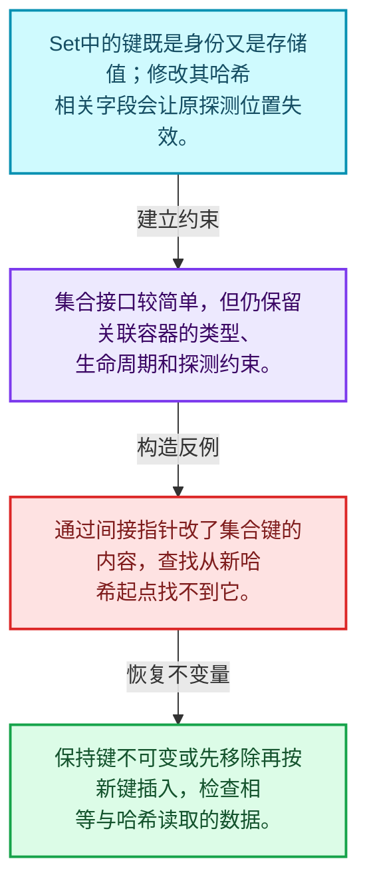
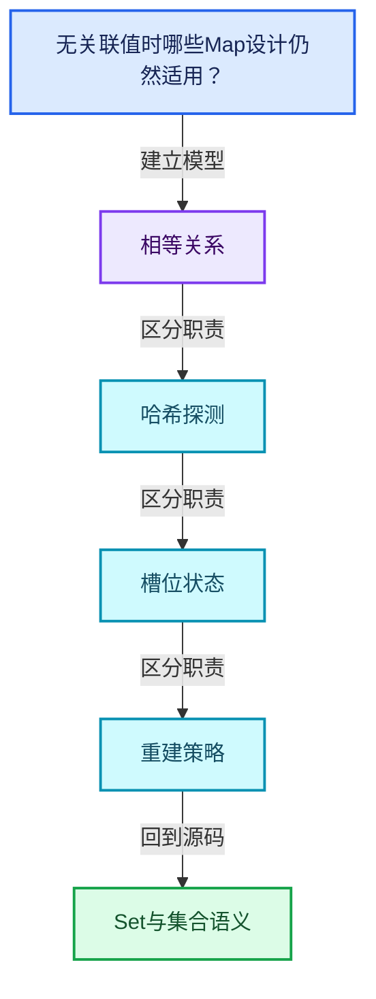
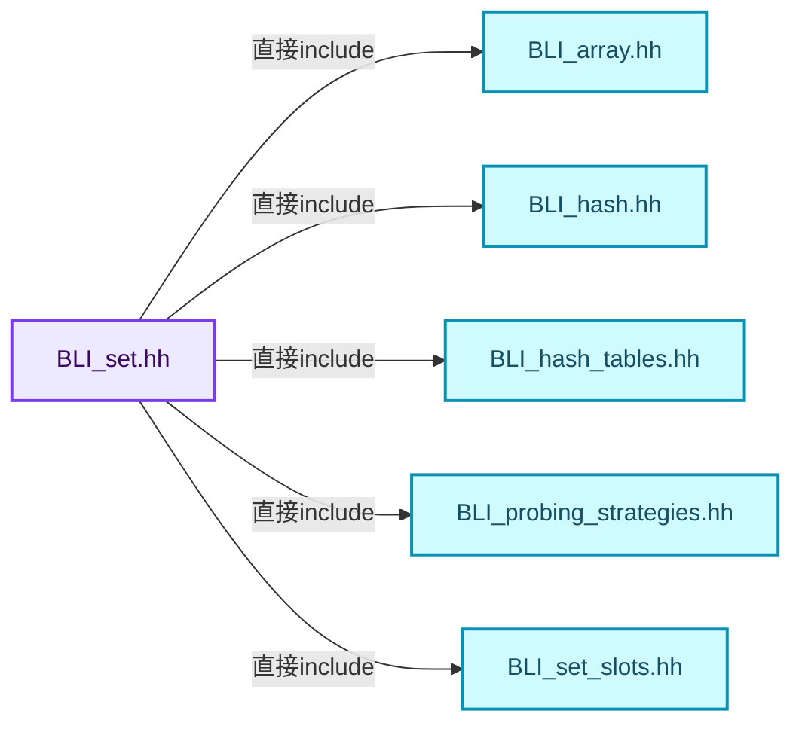
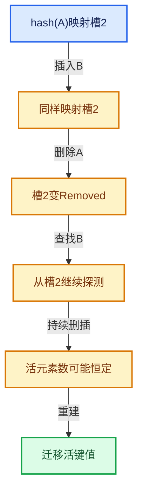

# 02-08 Set与集合语义

[方向导航](README.md) · [总目录](../README.md) · [覆盖索引](../%E6%BA%90%E7%A0%81%E7%89%88%E6%9C%AC%E4%B8%8E%E8%A6%86%E7%9B%96%E7%B4%A2%E5%BC%95.md)

> 阅读顺序：问题与数据模型 → 语法与类型 → 源码逐行 → 调用线索 → 历史与取舍 → 推演和练习。

- 基准 HEAD：`cbda6b96c26c0dee3c3b5cbb93960c4ac06a6b30`。
- 记录日期：2026-10-14。
- 教学示例状态：正文中的推演不是本机性能实测；已运行练习见验收报告。

## 一、从问题到设计

无关联值时哪些Map设计仍然适用？

Set仍需处理哈希、相等、槽位和删除；键本身在容器中不能随意改成另一个哈希值。

本篇把语法、数据语义和系统取舍连接起来。相等与哈希是基础契约；探测、删除和增长共同决定复杂度。

### 本篇独立模型与设计推理

Set中的键既是身份又是存储值；修改其哈希相关字段会让原探测位置失效。

设计取舍：集合接口较简单，但仍保留关联容器的类型、生命周期和探测约束。

最小反例：通过间接指针改了集合键的内容，查找从新哈希起点找不到它。

推导与处理：保持键不可变或先移除再按新键插入，检查相等与哈希读取的数据。



### 源码范围与相邻篇章

| 文件 | 本篇逐行范围 | 基准SHA-256 |
|---|---|---|
| [source/blender/blenlib/BLI_set.hh](../../../../../source/blender/blenlib/BLI_set.hh) | L1—L996 | `c7b4a167fbbc3db175e51373abb85bd0cbe1263e2bd68cc31cd9717a24ce0b09` |

同一主讲文件可能分多篇覆盖；超出本篇范围的符号通过覆盖索引定位。空行与纯注释保留在源码摘录中，逐行表解释有效语句与语法边界；许可证头统一保留。

前篇：[重建与摊还复杂度](07-%E9%87%8D%E5%BB%BA%E4%B8%8E%E6%91%8A%E8%BF%98%E5%A4%8D%E6%9D%82%E5%BA%A6.md).

后篇：[MultiValueMap一键多值](09-MultiValueMap%E4%B8%80%E9%94%AE%E5%A4%9A%E5%80%BC.md).

## 二、类型、数据与阅读地图



这是概念依赖图，边表示阅读关系，不声称是运行时调用顺序。

### 直接编译依赖



箭头只表示头文件包含关系；完整调用线索见后面的符号定位表。

## 三、关键词、语法与类型角色

### 模板 template

模板把类型或常量作为生成实现的参数。读声明时先列出类型参数、非类型参数和默认值，再看使用者实际实例化了什么。模板声明本身不意味着每种T都支持其全部成员。

具体检查：把T替换为int、string、只能移动的类型，分别检查每个被调用操作是否成立。

### 依赖名称 typename

typename既可引入类型模板参数，也可告诉编译器某个依赖名称是类型。它不创建运行时对象；解析期确认语法类别与实例化期检查具体类型是不同阶段。

具体检查：区分typename T::value_type和T::size()，前者标记类型，后者是表达式。

### 常量求值 constexpr

constexpr声明允许相应实体参与常量求值，但constexpr函数仍可以在运行时执行。是否常量求值由调用场景和表达式合法性共同决定。

具体检查：比较constexpr变量初始化和从运行时输入调用同一函数。

### 只读限定 const

const约束当前访问路径可做的修改。const指针、指向const的指针、const视图对象、const元素是不同位置的限定；其他别名可能仍可修改原对象。

具体检查：分别写T* const、const T*与const T* const，并画出不可修改的层次。

### 移动转换 std::move

std::move把表达式转换为可供移动重载选择的值类别，实际资源转移发生在被选中的构造或赋值中。对const对象move可能仍调用复制，对视图move也不会获得底层数据所有权。

具体检查：记录移动构造调用次数，不用变量名或std::move的出现次数替代测量。

### 完美转发 std::forward

std::forward在转发引用模板中恢复调用者原来的值类别。它依赖推导出的模板实参；无条件move会改变左值调用者的语义。

具体检查：对同一接口分别传入左值、临时对象和const左值，记录实际重载。

### 异常约定 noexcept

noexcept表达式可以依赖类型特征。违反不抛异常约定会终止程序；它不是自动捕获异常，也不是资源回滚代码。

具体检查：找出声明的条件与实际可能抛出的分配、构造操作是否一致。

### 异常边界 try与catch

try定义异常传播的局部边界。失败路径需要销毁已经成功构造的部分并释放相应存储；未构造的对象不能被析构。

具体检查：在第k次构造失败，列出已经存在的对象集合与待释放缓冲。

### 限定转换 const_cast

const_cast可以改变访问路径的限定，但不能让本来就是const的对象合法可写。常用于复用只读实现时，仍需检查底层对象是否实际可变。

具体检查：对非const对象的const引用与真正const对象分别分析修改是否合法。

### 对象表示 sizeof

sizeof给出对象表示大小，不是其引用的所有堆内存总量。sizeof视图很小并不说明底层数组很小。

具体检查：分别统计容器对象、容量字节和元素拥有的间接资源。

### 构造与new表达式

普通new可能分配并构造；placement new在给定地址构造，存储由其他机制提供。失败回滚应区分两类责任。

具体检查：追踪地址来自哪里、构造何时成功、由谁析构、由谁释放。

### 内部断言 assert

断言表达开发者预期成立的内部契约，发布构建可能关闭。它不能替代对不可信输入的完整错误处理，也不保证后续操作被运行时保护。

具体检查：对每条断言构造违反条件的输入，区分调用者错误与应向用户报告的错误。

### 编译期分支 if constexpr

条件在实例化时决定被保留的分支，这常用于不同类型的合法操作选择。它与运行时if有不同的实例化检查规则。

具体检查：找出每个分支依赖哪些类型特征，再使用满足与不满足条件的类型。

### 受控访问 friend

friend授予指定函数或类访问非公开成员的权限，并不意味着继承，也不自动扩展到友元的派生类。

具体检查：解释执行器为何需要访问包装器的内部映射，同时检查边界是否仍清楚。

### 类型别名 using

类型别名为已有类型建立名字，不创建运行期对象。它常把模板内部使用的类型统一暴露给泛型调用者。

具体检查：展开别名直到基础类型，区分类型别名和变量声明。

## 四、真实源码与逐行讲解

源码块保持原行内容，原始行号由小节标题及逐行表给出。表中的调用定位是静态阅读辅助；重载、模板实例化、宏展开和虚调用需结合完整声明，不能仅凭词法出现证明动态调用。

### BLI_set.hh：L1—L58

<!-- source:source/blender/blenlib/BLI_set.hh:1:58 -->

```cpp
/* SPDX-FileCopyrightText: 2023 Blender Authors
 *
 * SPDX-License-Identifier: GPL-2.0-or-later */

#pragma once

/** \file
 * \ingroup bli
 *
 * A `Set<Key>` is an unordered container for unique elements of type `Key`. It is
 * designed to be a more convenient and efficient replacement for `std::unordered_set`. All core
 * operations (add, remove and contains) can be done in O(1) amortized expected time.
 *
 * In most cases, your default choice for a hash set in Blender should be `Set`.
 *
 * Set is implemented using open addressing in a slot array with a power-of-two size.
 * Every slot is in one of three states: empty, occupied or removed. If a slot is occupied, it
 * contains an instance of the key type.
 *
 * Bench-marking and comparing hash tables is hard, because many factors influence the result. The
 * performance of a hash table depends on the combination of the hash function, probing strategy,
 * max load factor, key type, slot type and the data distribution. This implementation is designed
 * to be relatively fast by default in all cases. However, it also offers many customization
 * points that allow it to be optimized for a specific use case.
 *
 * A rudimentary benchmark can be found in `BLI_set_test.cc`. The results of that benchmark are
 * there as well. The numbers show that in this specific case #Set outperforms
 * #std::unordered_set consistently by a good amount.
 *
 * Some noteworthy information:
 * - Key must be a movable type.
 * - Pointers to keys might be invalidated when the set is changed or moved.
 * - The hash function can be customized. See BLI_hash.hh for details.
 * - The probing strategy can be customized. See BLI_probing_stragies.hh for details.
 * - The slot type can be customized. See BLI_set_slots.hh for details.
 * - Small buffer optimization is enabled by default, if the key is not too large.
 * - The methods `add_new` and `remove_contained` should be used instead of `add` and `remove`
 *   whenever appropriate. Assumptions and intention are described better this way.
 * - Lookups can be performed using types other than Key without conversion. For that use the
 *   methods ending with `_as`. The template parameters Hash and #IsEqual have to support the other
 *   key type. This can greatly improve performance when the set contains strings.
 * - The default constructor is cheap, even when a large #InlineBufferCapacity is used. A large
 *   slot array will only be initialized when the first key is added.
 * - The `print_stats` method can be used to get information about the distribution of keys and
 *   memory usage of the set.
 * - The method names don't follow the std::unordered_set names in many cases. Searching for such
 *   names in this file will usually let you discover the new name.
 *
 * Possible Improvements:
 * - Use a branch-less loop over slots in grow function (measured ~10% performance improvement when
 *   the distribution of occupied slots is sufficiently random).
 * - Support max load factor customization.
 * - Improve performance with large data sets through software prefetching. I got fairly
 *   significant improvements in simple tests (~30% faster). It still needs to be investigated how
 *   to make a nice interface for this functionality.
 */

#include "BLI_array.hh"
```

| 原始行 | 语义、约束与检查 |
|---|---|
| L5 | 防止同一头文件在一个翻译单元中重复展开；不控制多个源文件之间的链接或对象寿命。 |
| L58 | 引入编译依赖 "BLI_array.hh"；这是声明可见性关系，不表示运行时一定调用该文件的所有接口。 |

### BLI_set.hh：L59—L107

<!-- source:source/blender/blenlib/BLI_set.hh:59:107 -->

```cpp
#include "BLI_hash.hh"
#include "BLI_hash_tables.hh"
#include "BLI_probing_strategies.hh"
#include "BLI_set_slots.hh"

namespace blender {

template<
    /**
     * Type of the elements that are stored in this set. It has to be movable.
     * Furthermore, the hash and is-equal functions have to support it.
     */
    typename Key,
    /**
     * The minimum number of elements that can be stored in this Set without doing a heap
     * allocation. This is useful when you expect to have many small sets. However, keep in mind
     * that (unlike vector) initializing a set has a O(n) cost in the number of slots.
     */
    int64_t InlineBufferCapacity = default_inline_buffer_capacity(sizeof(Key)),
    /**
     * The strategy used to deal with collisions. They are defined in BLI_probing_strategies.hh.
     */
    typename ProbingStrategy = DefaultProbingStrategy,
    /**
     * The hash function used to hash the keys. There is a default for many types. See BLI_hash.hh
     * for examples on how to define a custom hash function.
     */
    typename Hash = DefaultHash<Key>,
    /**
     * The equality operator used to compare keys. By default it will simply compare keys using the
     * `==` operator.
     */
    typename IsEqual = DefaultEquality<Key>,
    /**
     * This is what will actually be stored in the hash table array. At a minimum a slot has to
     * be able to hold a key and information about whether the slot is empty, occupied or removed.
     * Using a non-standard slot type can improve performance or reduce the memory footprint. For
     * example, a hash can be stored in the slot, to make inequality checks more efficient. Some
     * types have special values that can represent an empty or removed state, eliminating the need
     * for an additional variable. Also see BLI_set_slots.hh.
     */
    typename Slot = typename DefaultSetSlot<Key>::type,
    /**
     * The allocator used by this set. Should rarely be changed, except when you don't want that
     * MEM_* is used internally.
     */
    typename Allocator = GuardedAllocator>
class Set {
 public:
```

| 原始行 | 语义、约束与检查 |
|---|---|
| L59 | 引入编译依赖 "BLI_hash.hh"；这是声明可见性关系，不表示运行时一定调用该文件的所有接口。 |
| L60 | 引入编译依赖 "BLI_hash_tables.hh"；这是声明可见性关系，不表示运行时一定调用该文件的所有接口。 |
| L61 | 引入编译依赖 "BLI_probing_strategies.hh"；这是声明可见性关系，不表示运行时一定调用该文件的所有接口。 |
| L62 | 引入编译依赖 "BLI_set_slots.hh"；这是声明可见性关系，不表示运行时一定调用该文件的所有接口。 |
| L64 | 把后续声明放入 blender 命名空间，影响名称查找和符号归属，不创建运行时对象。 |
| L66 | 声明模板参数 `template<`。类型参数决定生成操作的类型，非类型参数可决定内嵌容量或编译期分支。 |
| L71 | 本行是连续声明或表达式的一部分：`typename Key,`。与本段前后行合读；逗号、括号和限定符决定它属于参数、初始化列表还是实际计算。 |
| L77 | 显式采用编译器生成的特殊成员行为：`int64_t InlineBufferCapacity = default_inline_buffer_capacity(sizeof(Key)),`。成员和基类的性质决定该操作是否可用、是否被删除及异常约定，不表示运行时给对象赋值为default。 |
| L81 | 把右侧 `DefaultProbingStrategy,` 用于初始化或更新左侧 `typename ProbingStrategy`。声明初始化与已有对象赋值应按上下文区分；有资源的类型会调用相应特殊成员。 |
| L86 | 把右侧 `DefaultHash<Key>,` 用于初始化或更新左侧 `typename Hash`。声明初始化与已有对象赋值应按上下文区分；有资源的类型会调用相应特殊成员。 |
| L91 | 把右侧 `DefaultEquality<Key>,` 用于初始化或更新左侧 `typename IsEqual`。声明初始化与已有对象赋值应按上下文区分；有资源的类型会调用相应特殊成员。 |
| L100 | 把右侧 `typename DefaultSetSlot<Key>::type,` 用于初始化或更新左侧 `typename Slot`。声明初始化与已有对象赋值应按上下文区分；有资源的类型会调用相应特殊成员。 |
| L105 | 把右侧 `GuardedAllocator>` 用于初始化或更新左侧 `typename Allocator`。声明初始化与已有对象赋值应按上下文区分；有资源的类型会调用相应特殊成员。 |
| L106 | 声明或定义类型 `class Set`。结合继承、访问权限和成员布局确认接口与拥有关系；前向声明本身没有完整对象布局。 |
| L107 | 切换成员访问权限为 public；它是编译期接口边界，不是线程同步或内存保护。 |

### BLI_set.hh：L108—L154

<!-- source:source/blender/blenlib/BLI_set.hh:108:154 -->

```cpp
  class Iterator;
  using value_type = Key;
  using pointer = Key *;
  using const_pointer = const Key *;
  using reference = Key &;
  using const_reference = const Key &;
  using iterator = Iterator;
  using size_type = int64_t;

 private:
  /**
   * Slots are either empty, occupied or removed. The number of occupied slots can be computed by
   * subtracting the removed slots from the occupied-and-removed slots.
   */
  int64_t removed_slots_;
  int64_t occupied_and_removed_slots_;

  /**
   * The maximum number of slots that can be used (either occupied or removed) until the set has to
   * grow. This is the total number of slots times the max load factor.
   */
  int64_t usable_slots_;

  /**
   * The number of slots minus one. This is a bit mask that can be used to turn any integer into a
   * valid slot index efficiently.
   */
  uint64_t slot_mask_;

  /** This is called to hash incoming keys. */
  BLI_NO_UNIQUE_ADDRESS Hash hash_;

  /** This is called to check equality of two keys. */
  BLI_NO_UNIQUE_ADDRESS IsEqual is_equal_;

  /** The max load factor is 1/2 = 50% by default. */
#define LOAD_FACTOR 1, 2
  static constexpr LoadFactor max_load_factor_ = LoadFactor(LOAD_FACTOR);
  using SlotArray =
      Array<Slot, LoadFactor::compute_total_slots(InlineBufferCapacity, LOAD_FACTOR), Allocator>;
#undef LOAD_FACTOR

  /**
   * This is the array that contains the actual slots. There is always at least one empty slot and
   * the size of the array is a power of two.
   */
  SlotArray slots_;
```

本段语义重点：

- `removed_slots_`：删除标记计数，影响重建判断及探测长度。
- `occupied_and_removed_slots_`：占用与删除状态总量，不能替代活元素数量。
- `usable_slots_`：受负载约束允许使用的槽位数，与物理总槽数不同。
- `slot_mask_`：槽位寻址掩码；其有效性依赖容量布局约定。
- `slots_`：哈希槽数组，其中对象存活与槽位状态必须一致。

| 原始行 | 语义、约束与检查 |
|---|---|
| L108 | 声明或定义类型 `class Iterator`。结合继承、访问权限和成员布局确认接口与拥有关系；前向声明本身没有完整对象布局。 |
| L109 | 定义类型别名 `using value_type = Key`，为模板接口或内部实现统一命名；本行不分配该类型对象。 |
| L110 | 定义类型别名 `using pointer = Key *`，为模板接口或内部实现统一命名；本行不分配该类型对象。 |
| L111 | 定义类型别名 `using const_pointer = const Key *`，为模板接口或内部实现统一命名；本行不分配该类型对象。 |
| L112 | 定义类型别名 `using reference = Key &`，为模板接口或内部实现统一命名；本行不分配该类型对象。 |
| L113 | 定义类型别名 `using const_reference = const Key &`，为模板接口或内部实现统一命名；本行不分配该类型对象。 |
| L114 | 定义类型别名 `using iterator = Iterator`，为模板接口或内部实现统一命名；本行不分配该类型对象。 |
| L115 | 定义类型别名 `using size_type = int64_t`，为模板接口或内部实现统一命名；本行不分配该类型对象。 |
| L117 | 切换成员访问权限为 private；它是编译期接口边界，不是线程同步或内存保护。 |
| L122 | 本行涉及 `removed_slots_`：删除标记计数，影响重建判断及探测长度。按此语义解读 `int64_t removed_slots_`，不要把地址、数量或状态混用。 |
| L123 | 本行涉及 `occupied_and_removed_slots_`：占用与删除状态总量，不能替代活元素数量。按此语义解读 `int64_t occupied_and_removed_slots_`，不要把地址、数量或状态混用。 |
| L129 | 本行涉及 `usable_slots_`：受负载约束允许使用的槽位数，与物理总槽数不同。按此语义解读 `int64_t usable_slots_`，不要把地址、数量或状态混用。 |
| L135 | 本行涉及 `slot_mask_`：槽位寻址掩码；其有效性依赖容量布局约定。按此语义解读 `uint64_t slot_mask_`，不要把地址、数量或状态混用。 |
| L138 | 声明成员、局部对象或完成语句 `BLI_NO_UNIQUE_ADDRESS Hash hash_`。若为指针或引用，它本身不说明拥有；若为值对象，其构造析构由所在作用域或外层对象管理。 |
| L141 | 声明成员、局部对象或完成语句 `BLI_NO_UNIQUE_ADDRESS IsEqual is_equal_`。若为指针或引用，它本身不说明拥有；若为值对象，其构造析构由所在作用域或外层对象管理。 |
| L144 | 预处理阶段处理 #define LOAD_FACTOR 1, 2。它决定哪些代码进入编译，不是运行时分支；阅读行为时必须结合实际构建宏。 |
| L145 | 把右侧 `LoadFactor(LOAD_FACTOR)` 用于初始化或更新左侧 `static constexpr LoadFactor max_load_factor_`。声明初始化与已有对象赋值应按上下文区分；有资源的类型会调用相应特殊成员。 |
| L146 | 定义类型别名 `using SlotArray =`，为模板接口或内部实现统一命名；本行不分配该类型对象。 |
| L147 | 出现调用或函数声明 `LoadFactor::compute_total_slots`，对应表达式为 `Array<Slot, LoadFactor::compute_total_slots(InlineBufferCapacity, LOAD_FACTOR), Allocator>;`。参数求值、返回类型与重载需结合前后完整语句；静态文本引用不能证明动态目标。 |
| L148 | 预处理阶段处理 #undef LOAD_FACTOR。它决定哪些代码进入编译，不是运行时分支；阅读行为时必须结合实际构建宏。 |
| L154 | 本行涉及 `slots_`：哈希槽数组，其中对象存活与槽位状态必须一致。按此语义解读 `SlotArray slots_`，不要把地址、数量或状态混用。 |

### BLI_set.hh：L155—L191

<!-- source:source/blender/blenlib/BLI_set.hh:155:191 -->

```cpp

  /** Iterate over a slot index sequence for a given hash. */
#define SET_SLOT_PROBING_BEGIN(HASH, R_SLOT) \
  SLOT_PROBING_BEGIN (ProbingStrategy, HASH, slot_mask_, SLOT_INDEX) \
    auto &R_SLOT = slots_[SLOT_INDEX];
#define SET_SLOT_PROBING_END() SLOT_PROBING_END()

 public:
  /**
   * Initialize an empty set. This is a cheap operation no matter how large the inline buffer
   * is. This is necessary to avoid a high cost when no elements are added at all. An optimized
   * grow operation is performed on the first insertion.
   */
  Set(Allocator allocator = {}) noexcept
      : removed_slots_(0),
        occupied_and_removed_slots_(0),
        usable_slots_(0),
        slot_mask_(0),
        slots_(1, allocator)
  {
  }

  Set(NoExceptConstructor, Allocator allocator = {}) noexcept : Set(allocator) {}

  Set(Span<Key> values, Allocator allocator = {}) : Set(NoExceptConstructor(), allocator)
  {
    this->add_multiple(values);
  }

  /**
   * Construct a set that contains the given keys. Duplicates will be removed automatically.
   */
  Set(const std::initializer_list<Key> &values) : Set(Span<Key>(values)) {}

  ~Set() = default;

  Set(const Set &other) = default;
```

本段语义重点：

- `removed_slots_`：删除标记计数，影响重建判断及探测长度。
- `occupied_and_removed_slots_`：占用与删除状态总量，不能替代活元素数量。
- `usable_slots_`：受负载约束允许使用的槽位数，与物理总槽数不同。
- `slot_mask_`：槽位寻址掩码；其有效性依赖容量布局约定。
- `slots_`：哈希槽数组，其中对象存活与槽位状态必须一致。

| 原始行 | 语义、约束与检查 |
|---|---|
| L157 | 预处理阶段处理 #define SET_SLOT_PROBING_BEGIN(HASH, R_SLOT) \。它决定哪些代码进入编译，不是运行时分支；阅读行为时必须结合实际构建宏。 |
| L158 | 本行涉及 `slot_mask_`：槽位寻址掩码；其有效性依赖容量布局约定。按此语义解读 `SLOT_PROBING_BEGIN (ProbingStrategy, HASH, slot_mask_, SLOT_INDEX) \`，不要把地址、数量或状态混用。 |
| L159 | 建立或更新 `slots_`：哈希槽数组，其中对象存活与槽位状态必须一致。本行的具体值关系为 `auto &R_SLOT = slots_[SLOT_INDEX]`；对照更新前后相应范围或状态是否一致。 |
| L160 | 预处理阶段处理 #define SET_SLOT_PROBING_END() SLOT_PROBING_END()。它决定哪些代码进入编译，不是运行时分支；阅读行为时必须结合实际构建宏。 |
| L162 | 切换成员访问权限为 public；它是编译期接口边界，不是线程同步或内存保护。 |
| L168 | 把右侧 `{}) noexcept` 用于初始化或更新左侧 `Set(Allocator allocator`。声明初始化与已有对象赋值应按上下文区分；有资源的类型会调用相应特殊成员。 |
| L169 | 本行涉及 `removed_slots_`：删除标记计数，影响重建判断及探测长度。按此语义解读 `: removed_slots_(0),`，不要把地址、数量或状态混用。 |
| L170 | 本行涉及 `occupied_and_removed_slots_`：占用与删除状态总量，不能替代活元素数量。按此语义解读 `occupied_and_removed_slots_(0),`，不要把地址、数量或状态混用。 |
| L171 | 本行涉及 `usable_slots_`：受负载约束允许使用的槽位数，与物理总槽数不同。按此语义解读 `usable_slots_(0),`，不要把地址、数量或状态混用。 |
| L172 | 本行涉及 `slot_mask_`：槽位寻址掩码；其有效性依赖容量布局约定。按此语义解读 `slot_mask_(0),`，不要把地址、数量或状态混用。 |
| L173 | 本行涉及 `slots_`：哈希槽数组，其中对象存活与槽位状态必须一致。按此语义解读 `slots_(1, allocator)`，不要把地址、数量或状态混用。 |
| L174 | 连接上一行的声明或控制结构与其语句块；后续行在这个作用域中执行或声明。 |
| L175 | 结束当前语法单元。局部自动对象在离开其作用域时按规则销毁；这不等于所有被引用的外部数据也被释放。 |
| L177 | 把右侧 `{}) noexcept : Set(allocator) {}` 用于初始化或更新左侧 `Set(NoExceptConstructor, Allocator allocator`。声明初始化与已有对象赋值应按上下文区分；有资源的类型会调用相应特殊成员。 |
| L179 | 把右侧 `{}) : Set(NoExceptConstructor(), allocator)` 用于初始化或更新左侧 `Set(Span<Key> values, Allocator allocator`。声明初始化与已有对象赋值应按上下文区分；有资源的类型会调用相应特殊成员。 |
| L180 | 连接上一行的声明或控制结构与其语句块；后续行在这个作用域中执行或声明。 |
| L181 | 出现调用或函数声明 `add_multiple`，对应表达式为 `this->add_multiple(values);`。参数求值、返回类型与重载需结合前后完整语句；静态文本引用不能证明动态目标。 |
| L182 | 结束当前语法单元。局部自动对象在离开其作用域时按规则销毁；这不等于所有被引用的外部数据也被释放。 |
| L187 | 出现调用或函数声明 `Set`，对应表达式为 `Set(const std::initializer_list<Key> &values) : Set(Span<Key>(values)) {}`。参数求值、返回类型与重载需结合前后完整语句；静态文本引用不能证明动态目标。 |
| L189 | 显式采用编译器生成的特殊成员行为：`~Set() = default;`。成员和基类的性质决定该操作是否可用、是否被删除及异常约定，不表示运行时给对象赋值为default。 |
| L191 | 显式采用编译器生成的特殊成员行为：`Set(const Set &other) = default;`。成员和基类的性质决定该操作是否可用、是否被删除及异常约定，不表示运行时给对象赋值为default。 |

### BLI_set.hh：L192—L240

<!-- source:source/blender/blenlib/BLI_set.hh:192:240 -->

```cpp

  Set(Set &&other) noexcept(std::is_nothrow_move_constructible_v<SlotArray>)
      : Set(NoExceptConstructor(), other.slots_.allocator())

  {
    if constexpr (std::is_nothrow_move_constructible_v<SlotArray>) {
      slots_ = std::move(other.slots_);
    }
    else {
      try {
        slots_ = std::move(other.slots_);
      }
      catch (...) {
        other.noexcept_reset();
        throw;
      }
    }
    removed_slots_ = other.removed_slots_;
    occupied_and_removed_slots_ = other.occupied_and_removed_slots_;
    usable_slots_ = other.usable_slots_;
    slot_mask_ = other.slot_mask_;
    hash_ = std::move(other.hash_);
    is_equal_ = std::move(other.is_equal_);
    other.noexcept_reset();
  }

  Set &operator=(const Set &other)
  {
    return copy_assign_container(*this, other);
  }

  Set &operator=(Set &&other)
  {
    return move_assign_container(*this, std::move(other));
  }

  /**
   * Add a new key to the set. This invokes undefined behavior when the key is in the set already.
   * When you know for certain that a key is not in the set yet, use this method for better
   * performance. This also expresses the intent better.
   */
  void add_new(const Key &key)
  {
    this->add_new__impl(key, hash_(key));
  }
  void add_new(Key &&key)
  {
    this->add_new__impl(std::move(key), hash_(key));
  }
```

本段语义重点：

- `removed_slots_`：删除标记计数，影响重建判断及探测长度。
- `occupied_and_removed_slots_`：占用与删除状态总量，不能替代活元素数量。
- `usable_slots_`：受负载约束允许使用的槽位数，与物理总槽数不同。
- `slot_mask_`：槽位寻址掩码；其有效性依赖容量布局约定。
- `slots_`：哈希槽数组，其中对象存活与槽位状态必须一致。

| 原始行 | 语义、约束与检查 |
|---|---|
| L193 | 出现调用或函数声明 `Set`，对应表达式为 `Set(Set &&other) noexcept(std::is_nothrow_move_constructible_v<SlotArray>)`。参数求值、返回类型与重载需结合前后完整语句；静态文本引用不能证明动态目标。 |
| L194 | 本行涉及 `slots_`：哈希槽数组，其中对象存活与槽位状态必须一致。按此语义解读 `: Set(NoExceptConstructor(), other.slots_.allocator())`，不要把地址、数量或状态混用。 |
| L196 | 连接上一行的声明或控制结构与其语句块；后续行在这个作用域中执行或声明。 |
| L197 | 编译期条件分支 `if constexpr (std::is_nothrow_move_constructible_v<SlotArray>)`。按实例化类型选择相应实现；被舍弃分支和运行期if具有不同检查规则，不能当作运行时输入验证。 |
| L198 | 建立或更新 `slots_`：哈希槽数组，其中对象存活与槽位状态必须一致。本行的具体值关系为 `slots_ = std::move(other.slots_)`；对照更新前后相应范围或状态是否一致。 |
| L199 | 结束当前语法单元。局部自动对象在离开其作用域时按规则销毁；这不等于所有被引用的外部数据也被释放。 |
| L200 | 处理前一条件不成立的互补路径。比较两条路径最后是否恢复同一不变量，以及是否产生不同的资源责任。 |
| L201 | 开始可能抛异常的操作区间；下面catch负责局部回滚，需精确区分已经构造和尚未构造对象。 |
| L202 | 建立或更新 `slots_`：哈希槽数组，其中对象存活与槽位状态必须一致。本行的具体值关系为 `slots_ = std::move(other.slots_)`；对照更新前后相应范围或状态是否一致。 |
| L203 | 结束当前语法单元。局部自动对象在离开其作用域时按规则销毁；这不等于所有被引用的外部数据也被释放。 |
| L204 | 进入异常清理路径；随后应释放本路径新取得的资源，同时遵守源对象已经发生的状态变化。 |
| L205 | 出现调用或函数声明 `noexcept_reset`，对应表达式为 `other.noexcept_reset();`。参数求值、返回类型与重载需结合前后完整语句；静态文本引用不能证明动态目标。 |
| L206 | 继续传播异常或抛出新异常；在执行前必须完成本层负责的资源清理。 |
| L207 | 结束当前语法单元。局部自动对象在离开其作用域时按规则销毁；这不等于所有被引用的外部数据也被释放。 |
| L208 | 结束当前语法单元。局部自动对象在离开其作用域时按规则销毁；这不等于所有被引用的外部数据也被释放。 |
| L209 | 建立或更新 `removed_slots_`：删除标记计数，影响重建判断及探测长度。本行的具体值关系为 `removed_slots_ = other.removed_slots_`；对照更新前后相应范围或状态是否一致。 |
| L210 | 建立或更新 `occupied_and_removed_slots_`：占用与删除状态总量，不能替代活元素数量。本行的具体值关系为 `occupied_and_removed_slots_ = other.occupied_and_removed_slots_`；对照更新前后相应范围或状态是否一致。 |
| L211 | 建立或更新 `usable_slots_`：受负载约束允许使用的槽位数，与物理总槽数不同。本行的具体值关系为 `usable_slots_ = other.usable_slots_`；对照更新前后相应范围或状态是否一致。 |
| L212 | 建立或更新 `slot_mask_`：槽位寻址掩码；其有效性依赖容量布局约定。本行的具体值关系为 `slot_mask_ = other.slot_mask_`；对照更新前后相应范围或状态是否一致。 |
| L213 | 把右侧 `std::move(other.hash_)` 用于初始化或更新左侧 `hash_`。声明初始化与已有对象赋值应按上下文区分；有资源的类型会调用相应特殊成员。 |
| L214 | 把右侧 `std::move(other.is_equal_)` 用于初始化或更新左侧 `is_equal_`。声明初始化与已有对象赋值应按上下文区分；有资源的类型会调用相应特殊成员。 |
| L215 | 出现调用或函数声明 `noexcept_reset`，对应表达式为 `other.noexcept_reset();`。参数求值、返回类型与重载需结合前后完整语句；静态文本引用不能证明动态目标。 |
| L216 | 结束当前语法单元。局部自动对象在离开其作用域时按规则销毁；这不等于所有被引用的外部数据也被释放。 |
| L218 | 运算符重载声明、定义或显式调用：`Set &operator=(const Set &other)`。结合参数和返回类型判断是赋值、索引、比较还是转换；operator=声明中的等号不是在给名为operator的变量赋值。 |
| L219 | 连接上一行的声明或控制结构与其语句块；后续行在这个作用域中执行或声明。 |
| L220 | 返回表达式 `copy_assign_container(*this, other)`。 |
| L221 | 结束当前语法单元。局部自动对象在离开其作用域时按规则销毁；这不等于所有被引用的外部数据也被释放。 |
| L223 | 运算符重载声明、定义或显式调用：`Set &operator=(Set &&other)`。结合参数和返回类型判断是赋值、索引、比较还是转换；operator=声明中的等号不是在给名为operator的变量赋值。 |
| L224 | 连接上一行的声明或控制结构与其语句块；后续行在这个作用域中执行或声明。 |
| L225 | 返回表达式 `move_assign_container(*this, std::move(other))`。 |
| L226 | 结束当前语法单元。局部自动对象在离开其作用域时按规则销毁；这不等于所有被引用的外部数据也被释放。 |
| L233 | 出现调用或函数声明 `add_new`，对应表达式为 `void add_new(const Key &key)`。参数求值、返回类型与重载需结合前后完整语句；静态文本引用不能证明动态目标。 |
| L234 | 连接上一行的声明或控制结构与其语句块；后续行在这个作用域中执行或声明。 |
| L235 | 出现调用或函数声明 `add_new__impl`，对应表达式为 `this->add_new__impl(key, hash_(key));`。参数求值、返回类型与重载需结合前后完整语句；静态文本引用不能证明动态目标。 |
| L236 | 结束当前语法单元。局部自动对象在离开其作用域时按规则销毁；这不等于所有被引用的外部数据也被释放。 |
| L237 | 出现调用或函数声明 `add_new`，对应表达式为 `void add_new(Key &&key)`。参数求值、返回类型与重载需结合前后完整语句；静态文本引用不能证明动态目标。 |
| L238 | 连接上一行的声明或控制结构与其语句块；后续行在这个作用域中执行或声明。 |
| L239 | 出现调用或函数声明 `add_new__impl`，对应表达式为 `this->add_new__impl(std::move(key), hash_(key));`。参数求值、返回类型与重载需结合前后完整语句；静态文本引用不能证明动态目标。 |
| L240 | 结束当前语法单元。局部自动对象在离开其作用域时按规则销毁；这不等于所有被引用的外部数据也被释放。 |

### BLI_set.hh：L241—L292

<!-- source:source/blender/blenlib/BLI_set.hh:241:292 -->

```cpp

  /**
   * Add a key to the set. If the key exists in the set already, nothing is done. The return value
   * is true if the key was newly added to the set.
   *
   * This is similar to std::unordered_set::insert.
   */
  bool add(const Key &key)
  {
    return this->add_as(key);
  }
  bool add(Key &&key)
  {
    return this->add_as(std::move(key));
  }
  template<typename ForwardKey> bool add_as(ForwardKey &&key)
  {
    return this->add__impl(std::forward<ForwardKey>(key), hash_(key));
  }

  /**
   * Similar to #add but reinserts the key if it already exists. Using this only makes sense if the
   * key contains additional data besides what affects the hash.
   *
   * \return True if the key was newly added, false if it was already present and was overwritten.
   */
  bool add_overwrite(const Key &key)
  {
    return this->add_overwrite_as(key);
  }
  bool add_overwrite(Key &&key)
  {
    return this->add_overwrite_as(std::move(key));
  }
  template<typename ForwardKey> bool add_overwrite_as(ForwardKey &&key)
  {
    return this->add_overwrite__impl(std::forward<ForwardKey>(key), hash_(key));
  }

  /**
   * Convenience function to add many keys to the set at once. Duplicates are removed
   * automatically.
   *
   * We might be able to make this faster than sequentially adding all keys, but that is not
   * implemented yet.
   */
  void add_multiple(Span<Key> keys)
  {
    for (const Key &key : keys) {
      this->add(key);
    }
  }
```

| 原始行 | 语义、约束与检查 |
|---|---|
| L248 | 出现调用或函数声明 `add`，对应表达式为 `bool add(const Key &key)`。参数求值、返回类型与重载需结合前后完整语句；静态文本引用不能证明动态目标。 |
| L249 | 连接上一行的声明或控制结构与其语句块；后续行在这个作用域中执行或声明。 |
| L250 | 返回表达式 `this->add_as(key)`。 |
| L251 | 结束当前语法单元。局部自动对象在离开其作用域时按规则销毁；这不等于所有被引用的外部数据也被释放。 |
| L252 | 出现调用或函数声明 `add`，对应表达式为 `bool add(Key &&key)`。参数求值、返回类型与重载需结合前后完整语句；静态文本引用不能证明动态目标。 |
| L253 | 连接上一行的声明或控制结构与其语句块；后续行在这个作用域中执行或声明。 |
| L254 | 返回表达式 `this->add_as(std::move(key))`。 |
| L255 | 结束当前语法单元。局部自动对象在离开其作用域时按规则销毁；这不等于所有被引用的外部数据也被释放。 |
| L256 | 声明模板参数 `template<typename ForwardKey> bool add_as(ForwardKey &&key)`。类型参数决定生成操作的类型，非类型参数可决定内嵌容量或编译期分支。 |
| L257 | 连接上一行的声明或控制结构与其语句块；后续行在这个作用域中执行或声明。 |
| L258 | 返回表达式 `this->add__impl(std::forward<ForwardKey>(key), hash_(key))`。 |
| L259 | 结束当前语法单元。局部自动对象在离开其作用域时按规则销毁；这不等于所有被引用的外部数据也被释放。 |
| L267 | 出现调用或函数声明 `add_overwrite`，对应表达式为 `bool add_overwrite(const Key &key)`。参数求值、返回类型与重载需结合前后完整语句；静态文本引用不能证明动态目标。 |
| L268 | 连接上一行的声明或控制结构与其语句块；后续行在这个作用域中执行或声明。 |
| L269 | 返回表达式 `this->add_overwrite_as(key)`。 |
| L270 | 结束当前语法单元。局部自动对象在离开其作用域时按规则销毁；这不等于所有被引用的外部数据也被释放。 |
| L271 | 出现调用或函数声明 `add_overwrite`，对应表达式为 `bool add_overwrite(Key &&key)`。参数求值、返回类型与重载需结合前后完整语句；静态文本引用不能证明动态目标。 |
| L272 | 连接上一行的声明或控制结构与其语句块；后续行在这个作用域中执行或声明。 |
| L273 | 返回表达式 `this->add_overwrite_as(std::move(key))`。 |
| L274 | 结束当前语法单元。局部自动对象在离开其作用域时按规则销毁；这不等于所有被引用的外部数据也被释放。 |
| L275 | 声明模板参数 `template<typename ForwardKey> bool add_overwrite_as(ForwardKey &&key)`。类型参数决定生成操作的类型，非类型参数可决定内嵌容量或编译期分支。 |
| L276 | 连接上一行的声明或控制结构与其语句块；后续行在这个作用域中执行或声明。 |
| L277 | 返回表达式 `this->add_overwrite__impl(std::forward<ForwardKey>(key), hash_(key))`。 |
| L278 | 结束当前语法单元。局部自动对象在离开其作用域时按规则销毁；这不等于所有被引用的外部数据也被释放。 |
| L287 | 出现调用或函数声明 `add_multiple`，对应表达式为 `void add_multiple(Span<Key> keys)`。参数求值、返回类型与重载需结合前后完整语句；静态文本引用不能证明动态目标。 |
| L288 | 连接上一行的声明或控制结构与其语句块；后续行在这个作用域中执行或声明。 |
| L289 | 按 `for (const Key &key : keys)` 指定的范围或条件重复执行。对照循环变量与真实元素编号；循环内调用成本乘以实际迭代次数。 |
| L290 | 出现调用或函数声明 `add`，对应表达式为 `this->add(key);`。参数求值、返回类型与重载需结合前后完整语句；静态文本引用不能证明动态目标。 |
| L291 | 结束当前语法单元。局部自动对象在离开其作用域时按规则销毁；这不等于所有被引用的外部数据也被释放。 |
| L292 | 结束当前语法单元。局部自动对象在离开其作用域时按规则销毁；这不等于所有被引用的外部数据也被释放。 |

### BLI_set.hh：L293—L339

<!-- source:source/blender/blenlib/BLI_set.hh:293:339 -->

```cpp

  /**
   * Convenience function to add many new keys to the set at once. The keys must not exist in the
   * set before and there must not be duplicates in the array.
   */
  void add_multiple_new(Span<Key> keys)
  {
    for (const Key &key : keys) {
      this->add_new(key);
    }
  }

  /**
   * Returns true if the key is in the set.
   *
   * This is similar to std::unordered_set::find() != std::unordered_set::end().
   */
  bool contains(const Key &key) const
  {
    return this->contains_as(key);
  }
  template<typename ForwardKey> bool contains_as(const ForwardKey &key) const
  {
    return this->contains__impl(key, hash_(key));
  }

  /**
   * Returns the key that is stored in the set that compares equal to the given key. This invokes
   * undefined behavior when the key is not in the set.
   */
  const Key &lookup_key(const Key &key) const
  {
    return this->lookup_key_as(key);
  }
  template<typename ForwardKey> const Key &lookup_key_as(const ForwardKey &key) const
  {
    return this->lookup_key__impl(key, hash_(key));
  }

  /**
   * Returns the key that is stored in the set that compares equal to the given key. If the key is
   * not in the set, the given default value is returned instead.
   */
  const Key &lookup_key_default(const Key &key, const Key &default_value) const
  {
    return this->lookup_key_default_as(key, default_value);
  }
```

| 原始行 | 语义、约束与检查 |
|---|---|
| L298 | 出现调用或函数声明 `add_multiple_new`，对应表达式为 `void add_multiple_new(Span<Key> keys)`。参数求值、返回类型与重载需结合前后完整语句；静态文本引用不能证明动态目标。 |
| L299 | 连接上一行的声明或控制结构与其语句块；后续行在这个作用域中执行或声明。 |
| L300 | 按 `for (const Key &key : keys)` 指定的范围或条件重复执行。对照循环变量与真实元素编号；循环内调用成本乘以实际迭代次数。 |
| L301 | 出现调用或函数声明 `add_new`，对应表达式为 `this->add_new(key);`。参数求值、返回类型与重载需结合前后完整语句；静态文本引用不能证明动态目标。 |
| L302 | 结束当前语法单元。局部自动对象在离开其作用域时按规则销毁；这不等于所有被引用的外部数据也被释放。 |
| L303 | 结束当前语法单元。局部自动对象在离开其作用域时按规则销毁；这不等于所有被引用的外部数据也被释放。 |
| L310 | 出现调用或函数声明 `contains`，对应表达式为 `bool contains(const Key &key) const`。参数求值、返回类型与重载需结合前后完整语句；静态文本引用不能证明动态目标。 |
| L311 | 连接上一行的声明或控制结构与其语句块；后续行在这个作用域中执行或声明。 |
| L312 | 返回表达式 `this->contains_as(key)`。 |
| L313 | 结束当前语法单元。局部自动对象在离开其作用域时按规则销毁；这不等于所有被引用的外部数据也被释放。 |
| L314 | 声明模板参数 `template<typename ForwardKey> bool contains_as(const ForwardKey &key) const`。类型参数决定生成操作的类型，非类型参数可决定内嵌容量或编译期分支。 |
| L315 | 连接上一行的声明或控制结构与其语句块；后续行在这个作用域中执行或声明。 |
| L316 | 返回表达式 `this->contains__impl(key, hash_(key))`。 |
| L317 | 结束当前语法单元。局部自动对象在离开其作用域时按规则销毁；这不等于所有被引用的外部数据也被释放。 |
| L323 | 出现调用或函数声明 `lookup_key`，对应表达式为 `const Key &lookup_key(const Key &key) const`。参数求值、返回类型与重载需结合前后完整语句；静态文本引用不能证明动态目标。 |
| L324 | 连接上一行的声明或控制结构与其语句块；后续行在这个作用域中执行或声明。 |
| L325 | 返回表达式 `this->lookup_key_as(key)`。 |
| L326 | 结束当前语法单元。局部自动对象在离开其作用域时按规则销毁；这不等于所有被引用的外部数据也被释放。 |
| L327 | 声明模板参数 `template<typename ForwardKey> const Key &lookup_key_as(const ForwardKey &key) const`。类型参数决定生成操作的类型，非类型参数可决定内嵌容量或编译期分支。 |
| L328 | 连接上一行的声明或控制结构与其语句块；后续行在这个作用域中执行或声明。 |
| L329 | 返回表达式 `this->lookup_key__impl(key, hash_(key))`。 |
| L330 | 结束当前语法单元。局部自动对象在离开其作用域时按规则销毁；这不等于所有被引用的外部数据也被释放。 |
| L336 | 出现调用或函数声明 `lookup_key_default`，对应表达式为 `const Key &lookup_key_default(const Key &key, const Key &default_value) const`。参数求值、返回类型与重载需结合前后完整语句；静态文本引用不能证明动态目标。 |
| L337 | 连接上一行的声明或控制结构与其语句块；后续行在这个作用域中执行或声明。 |
| L338 | 返回表达式 `this->lookup_key_default_as(key, default_value)`。 |
| L339 | 结束当前语法单元。局部自动对象在离开其作用域时按规则销毁；这不等于所有被引用的外部数据也被释放。 |

### BLI_set.hh：L340—L391

<!-- source:source/blender/blenlib/BLI_set.hh:340:391 -->

```cpp
  template<typename ForwardKey>
  const Key &lookup_key_default_as(const ForwardKey &key, const Key &default_key) const
  {
    const Key *ptr = this->lookup_key_ptr__impl(key, hash_(key));
    if (ptr == nullptr) {
      return default_key;
    }
    return *ptr;
  }

  /**
   * Returns a pointer to the key that is stored in the set that compares equal to the given key.
   * If the key is not in the set, nullptr is returned instead.
   */
  const Key *lookup_key_ptr(const Key &key) const
  {
    return this->lookup_key_ptr_as(key);
  }
  template<typename ForwardKey> const Key *lookup_key_ptr_as(const ForwardKey &key) const
  {
    return this->lookup_key_ptr__impl(key, hash_(key));
  }

  /**
   * Returns the key in the set that compares equal to the given key. If it does not exist, the key
   * is newly added.
   */
  const Key &lookup_key_or_add(const Key &key)
  {
    return this->lookup_key_or_add_as(key);
  }
  const Key &lookup_key_or_add(Key &&key)
  {
    return this->lookup_key_or_add_as(std::move(key));
  }
  template<typename ForwardKey> const Key &lookup_key_or_add_as(ForwardKey &&key)
  {
    return this->lookup_key_or_add__impl(std::forward<ForwardKey>(key), hash_(key));
  }

  /**
   * Returns the key in the set that is equal to the given key. If the key does not exist, a new
   * key is created with the callback, added to the set and returned.
   *
   * Note, the value created by the callback has to compare equal to the given key and also has to
   * have the same hash.
   */
  template<typename CreateValueF>
  const Key &lookup_key_or_add_cb(const Key &key, CreateValueF &&create_value)
  {
    return this->lookup_key_or_add_cb_as(key, std::forward<CreateValueF>(create_value));
  }
```

本段语义重点：

- 分支证据 `ptr == nullptr)`：分别推演条件成立与不成立，核对相同出口处的状态。

| 原始行 | 语义、约束与检查 |
|---|---|
| L340 | 声明模板参数 `template<typename ForwardKey>`。类型参数决定生成操作的类型，非类型参数可决定内嵌容量或编译期分支。 |
| L341 | 出现调用或函数声明 `lookup_key_default_as`，对应表达式为 `const Key &lookup_key_default_as(const ForwardKey &key, const Key &default_key) const`。参数求值、返回类型与重载需结合前后完整语句；静态文本引用不能证明动态目标。 |
| L342 | 连接上一行的声明或控制结构与其语句块；后续行在这个作用域中执行或声明。 |
| L343 | 把右侧 `this->lookup_key_ptr__impl(key, hash_(key))` 用于初始化或更新左侧 `const Key *ptr`。声明初始化与已有对象赋值应按上下文区分；有资源的类型会调用相应特殊成员。 |
| L344 | 判断 `ptr == nullptr`，成立时进入本分支，否则继续后续路径。这里区分空地址与可用地址，但非空本身仍不能证明对象存活。 |
| L345 | 返回表达式 `default_key`。 |
| L346 | 结束当前语法单元。局部自动对象在离开其作用域时按规则销毁；这不等于所有被引用的外部数据也被释放。 |
| L347 | 返回表达式 `*ptr`。 |
| L348 | 结束当前语法单元。局部自动对象在离开其作用域时按规则销毁；这不等于所有被引用的外部数据也被释放。 |
| L354 | 出现调用或函数声明 `lookup_key_ptr`，对应表达式为 `const Key *lookup_key_ptr(const Key &key) const`。参数求值、返回类型与重载需结合前后完整语句；静态文本引用不能证明动态目标。 |
| L355 | 连接上一行的声明或控制结构与其语句块；后续行在这个作用域中执行或声明。 |
| L356 | 返回表达式 `this->lookup_key_ptr_as(key)`。 |
| L357 | 结束当前语法单元。局部自动对象在离开其作用域时按规则销毁；这不等于所有被引用的外部数据也被释放。 |
| L358 | 声明模板参数 `template<typename ForwardKey> const Key *lookup_key_ptr_as(const ForwardKey &key) const`。类型参数决定生成操作的类型，非类型参数可决定内嵌容量或编译期分支。 |
| L359 | 连接上一行的声明或控制结构与其语句块；后续行在这个作用域中执行或声明。 |
| L360 | 返回表达式 `this->lookup_key_ptr__impl(key, hash_(key))`。 |
| L361 | 结束当前语法单元。局部自动对象在离开其作用域时按规则销毁；这不等于所有被引用的外部数据也被释放。 |
| L367 | 出现调用或函数声明 `lookup_key_or_add`，对应表达式为 `const Key &lookup_key_or_add(const Key &key)`。参数求值、返回类型与重载需结合前后完整语句；静态文本引用不能证明动态目标。 |
| L368 | 连接上一行的声明或控制结构与其语句块；后续行在这个作用域中执行或声明。 |
| L369 | 返回表达式 `this->lookup_key_or_add_as(key)`。 |
| L370 | 结束当前语法单元。局部自动对象在离开其作用域时按规则销毁；这不等于所有被引用的外部数据也被释放。 |
| L371 | 出现调用或函数声明 `lookup_key_or_add`，对应表达式为 `const Key &lookup_key_or_add(Key &&key)`。参数求值、返回类型与重载需结合前后完整语句；静态文本引用不能证明动态目标。 |
| L372 | 连接上一行的声明或控制结构与其语句块；后续行在这个作用域中执行或声明。 |
| L373 | 返回表达式 `this->lookup_key_or_add_as(std::move(key))`。 |
| L374 | 结束当前语法单元。局部自动对象在离开其作用域时按规则销毁；这不等于所有被引用的外部数据也被释放。 |
| L375 | 声明模板参数 `template<typename ForwardKey> const Key &lookup_key_or_add_as(ForwardKey &&key)`。类型参数决定生成操作的类型，非类型参数可决定内嵌容量或编译期分支。 |
| L376 | 连接上一行的声明或控制结构与其语句块；后续行在这个作用域中执行或声明。 |
| L377 | 返回表达式 `this->lookup_key_or_add__impl(std::forward<ForwardKey>(key), hash_(key))`。 |
| L378 | 结束当前语法单元。局部自动对象在离开其作用域时按规则销毁；这不等于所有被引用的外部数据也被释放。 |
| L387 | 声明模板参数 `template<typename CreateValueF>`。类型参数决定生成操作的类型，非类型参数可决定内嵌容量或编译期分支。 |
| L388 | 出现调用或函数声明 `lookup_key_or_add_cb`，对应表达式为 `const Key &lookup_key_or_add_cb(const Key &key, CreateValueF &&create_value)`。参数求值、返回类型与重载需结合前后完整语句；静态文本引用不能证明动态目标。 |
| L389 | 连接上一行的声明或控制结构与其语句块；后续行在这个作用域中执行或声明。 |
| L390 | 返回表达式 `this->lookup_key_or_add_cb_as(key, std::forward<CreateValueF>(create_value))`。 |
| L391 | 结束当前语法单元。局部自动对象在离开其作用域时按规则销毁；这不等于所有被引用的外部数据也被释放。 |

### BLI_set.hh：L392—L438

<!-- source:source/blender/blenlib/BLI_set.hh:392:438 -->

```cpp
  template<typename ForwardKey, typename CreateValueF>
  const Key &lookup_key_or_add_cb_as(ForwardKey &&key, CreateValueF &&create_value)
  {
    return this->lookup_key_or_add_cb__impl(
        std::forward<ForwardKey>(key), hash_(key), std::forward<CreateValueF>(create_value));
  }

  /**
   * Deletes the key from the set. Returns true when the key did exist beforehand, otherwise false.
   *
   * This is similar to std::unordered_set::erase.
   */
  bool remove(const Key &key)
  {
    return this->remove_as(key);
  }
  template<typename ForwardKey> bool remove_as(const ForwardKey &key)
  {
    return this->remove__impl(key, hash_(key));
  }

  /**
   * Deletes the key from the set. This invokes undefined behavior when the key is not in the map.
   */
  void remove_contained(const Key &key)
  {
    this->remove_contained_as(key);
  }
  template<typename ForwardKey> void remove_contained_as(const ForwardKey &key)
  {
    this->remove_contained__impl(key, hash_(key));
  }

  /**
   * An iterator that can iterate over all keys in the set. The iterator is invalidated when the
   * set is moved or when it is grown.
   *
   * Keys returned by this iterator are always const. They should not change, because this might
   * also change their hash.
   */
  class Iterator {
   public:
    using iterator_category = std::forward_iterator_tag;
    using value_type = Key;
    using pointer = const Key *;
    using reference = const Key &;
    using difference_type = std::ptrdiff_t;
```

| 原始行 | 语义、约束与检查 |
|---|---|
| L392 | 声明模板参数 `template<typename ForwardKey, typename CreateValueF>`。类型参数决定生成操作的类型，非类型参数可决定内嵌容量或编译期分支。 |
| L393 | 出现调用或函数声明 `lookup_key_or_add_cb_as`，对应表达式为 `const Key &lookup_key_or_add_cb_as(ForwardKey &&key, CreateValueF &&create_value)`。参数求值、返回类型与重载需结合前后完整语句；静态文本引用不能证明动态目标。 |
| L394 | 连接上一行的声明或控制结构与其语句块；后续行在这个作用域中执行或声明。 |
| L395 | 返回表达式 `this->lookup_key_or_add_cb__impl(`。 |
| L396 | 出现调用或函数声明 `std::forward`，对应表达式为 `std::forward<ForwardKey>(key), hash_(key), std::forward<CreateValueF>(create_value));`。参数求值、返回类型与重载需结合前后完整语句；静态文本引用不能证明动态目标。 |
| L397 | 结束当前语法单元。局部自动对象在离开其作用域时按规则销毁；这不等于所有被引用的外部数据也被释放。 |
| L404 | 出现调用或函数声明 `remove`，对应表达式为 `bool remove(const Key &key)`。参数求值、返回类型与重载需结合前后完整语句；静态文本引用不能证明动态目标。 |
| L405 | 连接上一行的声明或控制结构与其语句块；后续行在这个作用域中执行或声明。 |
| L406 | 返回表达式 `this->remove_as(key)`。 |
| L407 | 结束当前语法单元。局部自动对象在离开其作用域时按规则销毁；这不等于所有被引用的外部数据也被释放。 |
| L408 | 声明模板参数 `template<typename ForwardKey> bool remove_as(const ForwardKey &key)`。类型参数决定生成操作的类型，非类型参数可决定内嵌容量或编译期分支。 |
| L409 | 连接上一行的声明或控制结构与其语句块；后续行在这个作用域中执行或声明。 |
| L410 | 返回表达式 `this->remove__impl(key, hash_(key))`。 |
| L411 | 结束当前语法单元。局部自动对象在离开其作用域时按规则销毁；这不等于所有被引用的外部数据也被释放。 |
| L416 | 出现调用或函数声明 `remove_contained`，对应表达式为 `void remove_contained(const Key &key)`。参数求值、返回类型与重载需结合前后完整语句；静态文本引用不能证明动态目标。 |
| L417 | 连接上一行的声明或控制结构与其语句块；后续行在这个作用域中执行或声明。 |
| L418 | 出现调用或函数声明 `remove_contained_as`，对应表达式为 `this->remove_contained_as(key);`。参数求值、返回类型与重载需结合前后完整语句；静态文本引用不能证明动态目标。 |
| L419 | 结束当前语法单元。局部自动对象在离开其作用域时按规则销毁；这不等于所有被引用的外部数据也被释放。 |
| L420 | 声明模板参数 `template<typename ForwardKey> void remove_contained_as(const ForwardKey &key)`。类型参数决定生成操作的类型，非类型参数可决定内嵌容量或编译期分支。 |
| L421 | 连接上一行的声明或控制结构与其语句块；后续行在这个作用域中执行或声明。 |
| L422 | 出现调用或函数声明 `remove_contained__impl`，对应表达式为 `this->remove_contained__impl(key, hash_(key));`。参数求值、返回类型与重载需结合前后完整语句；静态文本引用不能证明动态目标。 |
| L423 | 结束当前语法单元。局部自动对象在离开其作用域时按规则销毁；这不等于所有被引用的外部数据也被释放。 |
| L432 | 声明或定义类型 `class Iterator`。结合继承、访问权限和成员布局确认接口与拥有关系；前向声明本身没有完整对象布局。 |
| L433 | 切换成员访问权限为 public；它是编译期接口边界，不是线程同步或内存保护。 |
| L434 | 定义类型别名 `using iterator_category = std::forward_iterator_tag`，为模板接口或内部实现统一命名；本行不分配该类型对象。 |
| L435 | 定义类型别名 `using value_type = Key`，为模板接口或内部实现统一命名；本行不分配该类型对象。 |
| L436 | 定义类型别名 `using pointer = const Key *`，为模板接口或内部实现统一命名；本行不分配该类型对象。 |
| L437 | 定义类型别名 `using reference = const Key &`，为模板接口或内部实现统一命名；本行不分配该类型对象。 |
| L438 | 定义类型别名 `using difference_type = std::ptrdiff_t`，为模板接口或内部实现统一命名；本行不分配该类型对象。 |

### BLI_set.hh：L439—L485

<!-- source:source/blender/blenlib/BLI_set.hh:439:485 -->

```cpp

   private:
    const Slot *slots_;
    int64_t total_slots_;
    int64_t current_slot_;

    friend Set;

   public:
    Iterator(const Slot *slots, int64_t total_slots, int64_t current_slot)
        : slots_(slots), total_slots_(total_slots), current_slot_(current_slot)
    {
    }

    Iterator &operator++()
    {
      while (++current_slot_ < total_slots_) {
        if (slots_[current_slot_].is_occupied()) {
          break;
        }
      }
      return *this;
    }

    Iterator operator++(int)
    {
      Iterator copied_iterator = *this;
      ++(*this);
      return copied_iterator;
    }

    const Key &operator*() const
    {
      return *slots_[current_slot_].key();
    }

    const Key *operator->() const
    {
      return slots_[current_slot_].key();
    }

    friend bool operator!=(const Iterator &a, const Iterator &b)
    {
      BLI_assert(a.slots_ == b.slots_);
      BLI_assert(a.total_slots_ == b.total_slots_);
      return a.current_slot_ != b.current_slot_;
    }
```

本段语义重点：

- `slots_`：哈希槽数组，其中对象存活与槽位状态必须一致。

| 原始行 | 语义、约束与检查 |
|---|---|
| L440 | 切换成员访问权限为 private；它是编译期接口边界，不是线程同步或内存保护。 |
| L441 | 本行涉及 `slots_`：哈希槽数组，其中对象存活与槽位状态必须一致。按此语义解读 `const Slot *slots_`，不要把地址、数量或状态混用。 |
| L442 | 声明成员、局部对象或完成语句 `int64_t total_slots_`。若为指针或引用，它本身不说明拥有；若为值对象，其构造析构由所在作用域或外层对象管理。 |
| L443 | 声明成员、局部对象或完成语句 `int64_t current_slot_`。若为指针或引用，它本身不说明拥有；若为值对象，其构造析构由所在作用域或外层对象管理。 |
| L445 | 声明成员、局部对象或完成语句 `friend Set`。若为指针或引用，它本身不说明拥有；若为值对象，其构造析构由所在作用域或外层对象管理。 |
| L447 | 切换成员访问权限为 public；它是编译期接口边界，不是线程同步或内存保护。 |
| L448 | 出现调用或函数声明 `Iterator`，对应表达式为 `Iterator(const Slot *slots, int64_t total_slots, int64_t current_slot)`。参数求值、返回类型与重载需结合前后完整语句；静态文本引用不能证明动态目标。 |
| L449 | 本行涉及 `slots_`：哈希槽数组，其中对象存活与槽位状态必须一致。按此语义解读 `: slots_(slots), total_slots_(total_slots), current_slot_(current_slot)`，不要把地址、数量或状态混用。 |
| L450 | 连接上一行的声明或控制结构与其语句块；后续行在这个作用域中执行或声明。 |
| L451 | 结束当前语法单元。局部自动对象在离开其作用域时按规则销毁；这不等于所有被引用的外部数据也被释放。 |
| L453 | 运算符重载声明、定义或显式调用：`Iterator &operator++()`。结合参数和返回类型判断是赋值、索引、比较还是转换；operator=声明中的等号不是在给名为operator的变量赋值。 |
| L454 | 连接上一行的声明或控制结构与其语句块；后续行在这个作用域中执行或声明。 |
| L455 | 按 `while (++current_slot_ < total_slots_)` 指定的范围或条件重复执行。对照循环变量与真实元素编号；循环内调用成本乘以实际迭代次数。 |
| L456 | 判断 `slots_[current_slot_].is_occupied()`，成立时进入本分支，否则继续后续路径。 |
| L457 | 离开最近的循环或switch；不是离开整个函数，后续清理和提交代码可能仍会执行。 |
| L458 | 结束当前语法单元。局部自动对象在离开其作用域时按规则销毁；这不等于所有被引用的外部数据也被释放。 |
| L459 | 结束当前语法单元。局部自动对象在离开其作用域时按规则销毁；这不等于所有被引用的外部数据也被释放。 |
| L460 | 返回表达式 `*this`。返回当前对象；返回类型决定它是引用还是值，不能仅凭表达式假定复制。 |
| L461 | 结束当前语法单元。局部自动对象在离开其作用域时按规则销毁；这不等于所有被引用的外部数据也被释放。 |
| L463 | 运算符重载声明、定义或显式调用：`Iterator operator++(int)`。结合参数和返回类型判断是赋值、索引、比较还是转换；operator=声明中的等号不是在给名为operator的变量赋值。 |
| L464 | 连接上一行的声明或控制结构与其语句块；后续行在这个作用域中执行或声明。 |
| L465 | 把右侧 `*this` 用于初始化或更新左侧 `Iterator copied_iterator`。声明初始化与已有对象赋值应按上下文区分；有资源的类型会调用相应特殊成员。 |
| L466 | 声明成员、局部对象或完成语句 `++(*this)`。若为指针或引用，它本身不说明拥有；若为值对象，其构造析构由所在作用域或外层对象管理。 |
| L467 | 返回表达式 `copied_iterator`。结合函数声明检查返回值是否借用原存储，借用值不会自动延长其寿命。 |
| L468 | 结束当前语法单元。局部自动对象在离开其作用域时按规则销毁；这不等于所有被引用的外部数据也被释放。 |
| L470 | 运算符重载声明、定义或显式调用：`const Key &operator*() const`。结合参数和返回类型判断是赋值、索引、比较还是转换；operator=声明中的等号不是在给名为operator的变量赋值。 |
| L471 | 连接上一行的声明或控制结构与其语句块；后续行在这个作用域中执行或声明。 |
| L472 | 返回表达式 `*slots_[current_slot_].key()`。 |
| L473 | 结束当前语法单元。局部自动对象在离开其作用域时按规则销毁；这不等于所有被引用的外部数据也被释放。 |
| L475 | 运算符重载声明、定义或显式调用：`const Key *operator->() const`。结合参数和返回类型判断是赋值、索引、比较还是转换；operator=声明中的等号不是在给名为operator的变量赋值。 |
| L476 | 连接上一行的声明或控制结构与其语句块；后续行在这个作用域中执行或声明。 |
| L477 | 返回表达式 `slots_[current_slot_].key()`。 |
| L478 | 结束当前语法单元。局部自动对象在离开其作用域时按规则销毁；这不等于所有被引用的外部数据也被释放。 |
| L480 | 运算符重载声明、定义或显式调用：`friend bool operator!=(const Iterator &a, const Iterator &b)`。结合参数和返回类型判断是赋值、索引、比较还是转换；operator=声明中的等号不是在给名为operator的变量赋值。 |
| L481 | 连接上一行的声明或控制结构与其语句块；后续行在这个作用域中执行或声明。 |
| L482 | 断言约束 `BLI_assert(a.slots_ == b.slots_);`。条件是后续访问的内部前置条件；发布构建可能不执行，不能把断言当作输入修复。 |
| L483 | 断言约束 `BLI_assert(a.total_slots_ == b.total_slots_);`。条件是后续访问的内部前置条件；发布构建可能不执行，不能把断言当作输入修复。 |
| L484 | 返回表达式 `a.current_slot_ != b.current_slot_`。 |
| L485 | 结束当前语法单元。局部自动对象在离开其作用域时按规则销毁；这不等于所有被引用的外部数据也被释放。 |

### BLI_set.hh：L486—L526

<!-- source:source/blender/blenlib/BLI_set.hh:486:526 -->

```cpp

    friend bool operator==(const Iterator &a, const Iterator &b)
    {
      return !(a != b);
    }

   protected:
    const Slot &current_slot() const
    {
      return slots_[current_slot_];
    }
  };

  Iterator begin() const
  {
    for (int64_t i = 0; i < slots_.size(); i++) {
      if (slots_[i].is_occupied()) {
        return Iterator(slots_.data(), slots_.size(), i);
      }
    }
    return this->end();
  }

  Iterator end() const
  {
    return Iterator(slots_.data(), slots_.size(), slots_.size());
  }

  /**
   * Remove the key that the iterator is currently pointing at. It is valid to call this method
   * while iterating over the set. However, after this method has been called, the removed element
   * must not be accessed anymore.
   */
  void remove(const Iterator &it)
  {
    /* The const cast is valid because this method itself is not const. */
    Slot &slot = const_cast<Slot &>(it.current_slot());
    BLI_assert(slot.is_occupied());
    slot.remove();
    removed_slots_++;
  }
```

本段语义重点：

- `removed_slots_`：删除标记计数，影响重建判断及探测长度。
- `slots_`：哈希槽数组，其中对象存活与槽位状态必须一致。

| 原始行 | 语义、约束与检查 |
|---|---|
| L487 | 运算符重载声明、定义或显式调用：`friend bool operator==(const Iterator &a, const Iterator &b)`。结合参数和返回类型判断是赋值、索引、比较还是转换；operator=声明中的等号不是在给名为operator的变量赋值。 |
| L488 | 连接上一行的声明或控制结构与其语句块；后续行在这个作用域中执行或声明。 |
| L489 | 返回表达式 `!(a != b)`。 |
| L490 | 结束当前语法单元。局部自动对象在离开其作用域时按规则销毁；这不等于所有被引用的外部数据也被释放。 |
| L492 | 切换成员访问权限为 protected；它是编译期接口边界，不是线程同步或内存保护。 |
| L493 | 出现调用或函数声明 `current_slot`，对应表达式为 `const Slot &current_slot() const`。参数求值、返回类型与重载需结合前后完整语句；静态文本引用不能证明动态目标。 |
| L494 | 连接上一行的声明或控制结构与其语句块；后续行在这个作用域中执行或声明。 |
| L495 | 返回表达式 `slots_[current_slot_]`。 |
| L496 | 结束当前语法单元。局部自动对象在离开其作用域时按规则销毁；这不等于所有被引用的外部数据也被释放。 |
| L497 | 结束当前语法单元。局部自动对象在离开其作用域时按规则销毁；这不等于所有被引用的外部数据也被释放。 |
| L499 | 出现调用或函数声明 `begin`，对应表达式为 `Iterator begin() const`。参数求值、返回类型与重载需结合前后完整语句；静态文本引用不能证明动态目标。 |
| L500 | 连接上一行的声明或控制结构与其语句块；后续行在这个作用域中执行或声明。 |
| L501 | 纯虚接口声明：`for (int64_t i = 0; i < slots_.size(); i++) {`。等号零标记抽象接口，需要按继承约定提供覆写；不表示执行函数并把结果设为零。 |
| L502 | 判断 `slots_[i].is_occupied()`，成立时进入本分支，否则继续后续路径。 |
| L503 | 返回表达式 `Iterator(slots_.data(), slots_.size(), i)`。 |
| L504 | 结束当前语法单元。局部自动对象在离开其作用域时按规则销毁；这不等于所有被引用的外部数据也被释放。 |
| L505 | 结束当前语法单元。局部自动对象在离开其作用域时按规则销毁；这不等于所有被引用的外部数据也被释放。 |
| L506 | 返回表达式 `this->end()`。 |
| L507 | 结束当前语法单元。局部自动对象在离开其作用域时按规则销毁；这不等于所有被引用的外部数据也被释放。 |
| L509 | 出现调用或函数声明 `end`，对应表达式为 `Iterator end() const`。参数求值、返回类型与重载需结合前后完整语句；静态文本引用不能证明动态目标。 |
| L510 | 连接上一行的声明或控制结构与其语句块；后续行在这个作用域中执行或声明。 |
| L511 | 返回表达式 `Iterator(slots_.data(), slots_.size(), slots_.size())`。 |
| L512 | 结束当前语法单元。局部自动对象在离开其作用域时按规则销毁；这不等于所有被引用的外部数据也被释放。 |
| L519 | 出现调用或函数声明 `remove`，对应表达式为 `void remove(const Iterator &it)`。参数求值、返回类型与重载需结合前后完整语句；静态文本引用不能证明动态目标。 |
| L520 | 连接上一行的声明或控制结构与其语句块；后续行在这个作用域中执行或声明。 |
| L522 | 把右侧 `const_cast<Slot &>(it.current_slot())` 用于初始化或更新左侧 `Slot &slot`。声明初始化与已有对象赋值应按上下文区分；有资源的类型会调用相应特殊成员。 |
| L523 | 断言约束 `BLI_assert(slot.is_occupied());`。条件是后续访问的内部前置条件；发布构建可能不执行，不能把断言当作输入修复。 |
| L524 | 出现调用或函数声明 `remove`，对应表达式为 `slot.remove();`。参数求值、返回类型与重载需结合前后完整语句；静态文本引用不能证明动态目标。 |
| L525 | 递增或递减现有状态：`removed_slots_++;`。这改变计数或游标；检查边界、计数单位，以及并发访问是否有相应保护。 |
| L526 | 结束当前语法单元。局部自动对象在离开其作用域时按规则销毁；这不等于所有被引用的外部数据也被释放。 |

### BLI_set.hh：L527—L574

<!-- source:source/blender/blenlib/BLI_set.hh:527:574 -->

```cpp

  /**
   * Remove all values for which the given predicate is true and return the number of removed
   * values.
   *
   * This is similar to std::erase_if.
   */
  template<typename Predicate> int64_t remove_if(Predicate &&predicate)
  {
    const int64_t prev_size = this->size();
    for (Slot &slot : slots_) {
      if (slot.is_occupied()) {
        const Key &key = *slot.key();
        if (predicate(key)) {
          slot.remove();
          removed_slots_++;
        }
      }
    }
    return prev_size - this->size();
  }

  /**
   * Print common statistics like size and collision count. This is useful for debugging purposes.
   */
  void print_stats(const char *name) const
  {
    HashTableStats stats(*this, *this);
    stats.print(name);
  }

  /**
   * Get the number of collisions that the probing strategy has to go through to find the key or
   * determine that it is not in the set.
   */
  int64_t count_collisions(const Key &key) const
  {
    return this->count_collisions__impl(key, hash_(key));
  }

  /**
   * Remove all elements. Under some circumstances #clear_and_keep_capacity may be more efficient.
   */
  void clear()
  {
    std::destroy_at(this);
    new (this) Set(NoExceptConstructor{});
  }
```

本段语义重点：

- `removed_slots_`：删除标记计数，影响重建判断及探测长度。
- `slots_`：哈希槽数组，其中对象存活与槽位状态必须一致。

| 原始行 | 语义、约束与检查 |
|---|---|
| L534 | 声明模板参数 `template<typename Predicate> int64_t remove_if(Predicate &&predicate)`。类型参数决定生成操作的类型，非类型参数可决定内嵌容量或编译期分支。 |
| L535 | 连接上一行的声明或控制结构与其语句块；后续行在这个作用域中执行或声明。 |
| L536 | 把右侧 `this->size()` 用于初始化或更新左侧 `const int64_t prev_size`。声明初始化与已有对象赋值应按上下文区分；有资源的类型会调用相应特殊成员。 |
| L537 | 按 `for (Slot &slot : slots_)` 指定的范围或条件重复执行。对照循环变量与真实元素编号；循环内调用成本乘以实际迭代次数。 |
| L538 | 判断 `slot.is_occupied()`，成立时进入本分支，否则继续后续路径。 |
| L539 | 把右侧 `*slot.key()` 用于初始化或更新左侧 `const Key &key`。声明初始化与已有对象赋值应按上下文区分；有资源的类型会调用相应特殊成员。 |
| L540 | 判断 `predicate(key)`，成立时进入本分支，否则继续后续路径。 |
| L541 | 出现调用或函数声明 `remove`，对应表达式为 `slot.remove();`。参数求值、返回类型与重载需结合前后完整语句；静态文本引用不能证明动态目标。 |
| L542 | 递增或递减现有状态：`removed_slots_++;`。这改变计数或游标；检查边界、计数单位，以及并发访问是否有相应保护。 |
| L543 | 结束当前语法单元。局部自动对象在离开其作用域时按规则销毁；这不等于所有被引用的外部数据也被释放。 |
| L544 | 结束当前语法单元。局部自动对象在离开其作用域时按规则销毁；这不等于所有被引用的外部数据也被释放。 |
| L545 | 结束当前语法单元。局部自动对象在离开其作用域时按规则销毁；这不等于所有被引用的外部数据也被释放。 |
| L546 | 返回表达式 `prev_size - this->size()`。 |
| L547 | 结束当前语法单元。局部自动对象在离开其作用域时按规则销毁；这不等于所有被引用的外部数据也被释放。 |
| L552 | 出现调用或函数声明 `print_stats`，对应表达式为 `void print_stats(const char *name) const`。参数求值、返回类型与重载需结合前后完整语句；静态文本引用不能证明动态目标。 |
| L553 | 连接上一行的声明或控制结构与其语句块；后续行在这个作用域中执行或声明。 |
| L554 | 出现调用或函数声明 `stats`，对应表达式为 `HashTableStats stats(*this, *this);`。参数求值、返回类型与重载需结合前后完整语句；静态文本引用不能证明动态目标。 |
| L555 | 出现调用或函数声明 `print`，对应表达式为 `stats.print(name);`。参数求值、返回类型与重载需结合前后完整语句；静态文本引用不能证明动态目标。 |
| L556 | 结束当前语法单元。局部自动对象在离开其作用域时按规则销毁；这不等于所有被引用的外部数据也被释放。 |
| L562 | 出现调用或函数声明 `count_collisions`，对应表达式为 `int64_t count_collisions(const Key &key) const`。参数求值、返回类型与重载需结合前后完整语句；静态文本引用不能证明动态目标。 |
| L563 | 连接上一行的声明或控制结构与其语句块；后续行在这个作用域中执行或声明。 |
| L564 | 返回表达式 `this->count_collisions__impl(key, hash_(key))`。 |
| L565 | 结束当前语法单元。局部自动对象在离开其作用域时按规则销毁；这不等于所有被引用的外部数据也被释放。 |
| L570 | 出现调用或函数声明 `clear`，对应表达式为 `void clear()`。参数求值、返回类型与重载需结合前后完整语句；静态文本引用不能证明动态目标。 |
| L571 | 连接上一行的声明或控制结构与其语句块；后续行在这个作用域中执行或声明。 |
| L572 | 出现调用或函数声明 `std::destroy_at`，对应表达式为 `std::destroy_at(this);`。参数求值、返回类型与重载需结合前后完整语句；静态文本引用不能证明动态目标。 |
| L573 | 出现调用或函数声明 `new`，对应表达式为 `new (this) Set(NoExceptConstructor{});`。参数求值、返回类型与重载需结合前后完整语句；静态文本引用不能证明动态目标。 |
| L574 | 结束当前语法单元。局部自动对象在离开其作用域时按规则销毁；这不等于所有被引用的外部数据也被释放。 |

### BLI_set.hh：L575—L625

<!-- source:source/blender/blenlib/BLI_set.hh:575:625 -->

```cpp

  /**
   * Remove all elements, but don't free the underlying memory.
   *
   * This can be more efficient than using #clear if approximately the same or more elements are
   * added again afterwards. If way fewer elements are added instead, the cost of maintaining a
   * large hash table can lead to very bad worst-case performance.
   */
  void clear_and_keep_capacity()
  {
    for (Slot &slot : slots_) {
      slot.~Slot();
      new (&slot) Slot();
    }

    removed_slots_ = 0;
    occupied_and_removed_slots_ = 0;
  }

  /**
   * Creates a new slot array and reinserts all keys inside of that. This method can be used to get
   * rid of removed slots. Also this is useful for benchmarking the grow function.
   */
  void rehash()
  {
    this->realloc_and_reinsert(this->size());
  }

  /**
   * Returns the number of keys stored in the set.
   */
  int64_t size() const
  {
    return occupied_and_removed_slots_ - removed_slots_;
  }

  /**
   * Returns true if no keys are stored.
   */
  bool is_empty() const
  {
    return occupied_and_removed_slots_ == removed_slots_;
  }

  /**
   * Returns the number of available slots. This is mostly for debugging purposes.
   */
  int64_t capacity() const
  {
    return slots_.size();
  }
```

本段语义重点：

- `realloc_and_reinsert`：重新组织哈希槽并重插活元素；槽位改变但键值相等语义应保持。
- `removed_slots_`：删除标记计数，影响重建判断及探测长度。
- `occupied_and_removed_slots_`：占用与删除状态总量，不能替代活元素数量。
- `slots_`：哈希槽数组，其中对象存活与槽位状态必须一致。

| 原始行 | 语义、约束与检查 |
|---|---|
| L583 | 出现调用或函数声明 `clear_and_keep_capacity`，对应表达式为 `void clear_and_keep_capacity()`。参数求值、返回类型与重载需结合前后完整语句；静态文本引用不能证明动态目标。 |
| L584 | 连接上一行的声明或控制结构与其语句块；后续行在这个作用域中执行或声明。 |
| L585 | 按 `for (Slot &slot : slots_)` 指定的范围或条件重复执行。对照循环变量与真实元素编号；循环内调用成本乘以实际迭代次数。 |
| L586 | 涉及析构接口或显式析构：`slot.~Slot();`。检查目标对象已成功构造，且资源不会在另一条清理路径再次销毁。 |
| L587 | 出现调用或函数声明 `new`，对应表达式为 `new (&slot) Slot();`。参数求值、返回类型与重载需结合前后完整语句；静态文本引用不能证明动态目标。 |
| L588 | 结束当前语法单元。局部自动对象在离开其作用域时按规则销毁；这不等于所有被引用的外部数据也被释放。 |
| L590 | 建立或更新 `removed_slots_`：删除标记计数，影响重建判断及探测长度。本行的具体值关系为 `removed_slots_ = 0`；对照更新前后相应范围或状态是否一致。 |
| L591 | 建立或更新 `occupied_and_removed_slots_`：占用与删除状态总量，不能替代活元素数量。本行的具体值关系为 `occupied_and_removed_slots_ = 0`；对照更新前后相应范围或状态是否一致。 |
| L592 | 结束当前语法单元。局部自动对象在离开其作用域时按规则销毁；这不等于所有被引用的外部数据也被释放。 |
| L598 | 出现调用或函数声明 `rehash`，对应表达式为 `void rehash()`。参数求值、返回类型与重载需结合前后完整语句；静态文本引用不能证明动态目标。 |
| L599 | 连接上一行的声明或控制结构与其语句块；后续行在这个作用域中执行或声明。 |
| L600 | 本行使用 `realloc_and_reinsert`：重新组织哈希槽并重插活元素；槽位改变但键值相等语义应保持。 |
| L601 | 结束当前语法单元。局部自动对象在离开其作用域时按规则销毁；这不等于所有被引用的外部数据也被释放。 |
| L606 | 出现调用或函数声明 `size`，对应表达式为 `int64_t size() const`。参数求值、返回类型与重载需结合前后完整语句；静态文本引用不能证明动态目标。 |
| L607 | 连接上一行的声明或控制结构与其语句块；后续行在这个作用域中执行或声明。 |
| L608 | 返回表达式 `occupied_and_removed_slots_ - removed_slots_`。 |
| L609 | 结束当前语法单元。局部自动对象在离开其作用域时按规则销毁；这不等于所有被引用的外部数据也被释放。 |
| L614 | 出现调用或函数声明 `is_empty`，对应表达式为 `bool is_empty() const`。参数求值、返回类型与重载需结合前后完整语句；静态文本引用不能证明动态目标。 |
| L615 | 连接上一行的声明或控制结构与其语句块；后续行在这个作用域中执行或声明。 |
| L616 | 返回表达式 `occupied_and_removed_slots_ == removed_slots_`。 |
| L617 | 结束当前语法单元。局部自动对象在离开其作用域时按规则销毁；这不等于所有被引用的外部数据也被释放。 |
| L622 | 出现调用或函数声明 `capacity`，对应表达式为 `int64_t capacity() const`。参数求值、返回类型与重载需结合前后完整语句；静态文本引用不能证明动态目标。 |
| L623 | 连接上一行的声明或控制结构与其语句块；后续行在这个作用域中执行或声明。 |
| L624 | 返回表达式 `slots_.size()`。 |
| L625 | 结束当前语法单元。局部自动对象在离开其作用域时按规则销毁；这不等于所有被引用的外部数据也被释放。 |

### BLI_set.hh：L626—L679

<!-- source:source/blender/blenlib/BLI_set.hh:626:679 -->

```cpp

  /**
   * Returns the amount of removed slots in the set. This is mostly for debugging purposes.
   */
  int64_t removed_amount() const
  {
    return removed_slots_;
  }

  /**
   * Returns the bytes required per element. This is mostly for debugging purposes.
   */
  int64_t size_per_element() const
  {
    return sizeof(Slot);
  }

  /**
   * Returns the approximate memory requirements of the set in bytes. This is more correct for
   * larger sets.
   */
  int64_t size_in_bytes() const
  {
    return sizeof(Slot) * slots_.size();
  }

  /**
   * Potentially resize the set such that it can hold the specified number of keys without another
   * grow operation.
   */
  void reserve(const int64_t n)
  {
    if (usable_slots_ < n) {
      this->realloc_and_reinsert(n);
    }
  }

  /**
   * Returns true if there is a key that exists in both sets.
   */
  static bool Intersects(const Set &a, const Set &b)
  {
    /* Make sure we iterate over the shorter set. */
    if (a.size() > b.size()) {
      return Intersects(b, a);
    }

    for (const Key &key : a) {
      if (b.contains(key)) {
        return true;
      }
    }
    return false;
  }
```

本段语义重点：

- `realloc_and_reinsert`：重新组织哈希槽并重插活元素；槽位改变但键值相等语义应保持。
- `removed_slots_`：删除标记计数，影响重建判断及探测长度。
- `usable_slots_`：受负载约束允许使用的槽位数，与物理总槽数不同。
- `slots_`：哈希槽数组，其中对象存活与槽位状态必须一致。

| 原始行 | 语义、约束与检查 |
|---|---|
| L630 | 出现调用或函数声明 `removed_amount`，对应表达式为 `int64_t removed_amount() const`。参数求值、返回类型与重载需结合前后完整语句；静态文本引用不能证明动态目标。 |
| L631 | 连接上一行的声明或控制结构与其语句块；后续行在这个作用域中执行或声明。 |
| L632 | 返回表达式 `removed_slots_`。 |
| L633 | 结束当前语法单元。局部自动对象在离开其作用域时按规则销毁；这不等于所有被引用的外部数据也被释放。 |
| L638 | 出现调用或函数声明 `size_per_element`，对应表达式为 `int64_t size_per_element() const`。参数求值、返回类型与重载需结合前后完整语句；静态文本引用不能证明动态目标。 |
| L639 | 连接上一行的声明或控制结构与其语句块；后续行在这个作用域中执行或声明。 |
| L640 | 返回表达式 `sizeof(Slot)`。 |
| L641 | 结束当前语法单元。局部自动对象在离开其作用域时按规则销毁；这不等于所有被引用的外部数据也被释放。 |
| L647 | 出现调用或函数声明 `size_in_bytes`，对应表达式为 `int64_t size_in_bytes() const`。参数求值、返回类型与重载需结合前后完整语句；静态文本引用不能证明动态目标。 |
| L648 | 连接上一行的声明或控制结构与其语句块；后续行在这个作用域中执行或声明。 |
| L649 | 返回表达式 `sizeof(Slot) * slots_.size()`。 |
| L650 | 结束当前语法单元。局部自动对象在离开其作用域时按规则销毁；这不等于所有被引用的外部数据也被释放。 |
| L656 | 出现调用或函数声明 `reserve`，对应表达式为 `void reserve(const int64_t n)`。参数求值、返回类型与重载需结合前后完整语句；静态文本引用不能证明动态目标。 |
| L657 | 连接上一行的声明或控制结构与其语句块；后续行在这个作用域中执行或声明。 |
| L658 | 判断 `usable_slots_ < n`，成立时进入本分支，否则继续后续路径。 |
| L659 | 本行使用 `realloc_and_reinsert`：重新组织哈希槽并重插活元素；槽位改变但键值相等语义应保持。 |
| L660 | 结束当前语法单元。局部自动对象在离开其作用域时按规则销毁；这不等于所有被引用的外部数据也被释放。 |
| L661 | 结束当前语法单元。局部自动对象在离开其作用域时按规则销毁；这不等于所有被引用的外部数据也被释放。 |
| L666 | 出现调用或函数声明 `Intersects`，对应表达式为 `static bool Intersects(const Set &a, const Set &b)`。参数求值、返回类型与重载需结合前后完整语句；静态文本引用不能证明动态目标。 |
| L667 | 连接上一行的声明或控制结构与其语句块；后续行在这个作用域中执行或声明。 |
| L669 | 判断 `a.size() > b.size()`，成立时进入本分支，否则继续后续路径。该边界影响可访问元素或可用容量，两者要按各变量的定义区分。 |
| L670 | 返回表达式 `Intersects(b, a)`。 |
| L671 | 结束当前语法单元。局部自动对象在离开其作用域时按规则销毁；这不等于所有被引用的外部数据也被释放。 |
| L673 | 按 `for (const Key &key : a)` 指定的范围或条件重复执行。对照循环变量与真实元素编号；循环内调用成本乘以实际迭代次数。 |
| L674 | 判断 `b.contains(key)`，成立时进入本分支，否则继续后续路径。 |
| L675 | 返回表达式 `true`。这是本路径的布尔结果，具体成功、存在或状态含义由函数接口规定。 |
| L676 | 结束当前语法单元。局部自动对象在离开其作用域时按规则销毁；这不等于所有被引用的外部数据也被释放。 |
| L677 | 结束当前语法单元。局部自动对象在离开其作用域时按规则销毁；这不等于所有被引用的外部数据也被释放。 |
| L678 | 返回表达式 `false`。这是本路径的布尔结果，具体成功、存在或状态含义由函数接口规定。 |
| L679 | 结束当前语法单元。局部自动对象在离开其作用域时按规则销毁；这不等于所有被引用的外部数据也被释放。 |

### BLI_set.hh：L680—L707

<!-- source:source/blender/blenlib/BLI_set.hh:680:707 -->

```cpp

  /**
   * Returns true if no key from a is also in b and vice versa.
   */
  static bool Disjoint(const Set &a, const Set &b)
  {
    return !Intersects(a, b);
  }

  friend bool operator==(const Set &a, const Set &b)
  {
    if (a.size() != b.size()) {
      return false;
    }
    for (const Key &key : a) {
      if (!b.contains(key)) {
        return false;
      }
    }
    return true;
  }

  friend bool operator!=(const Set &a, const Set &b)
  {
    return !(a == b);
  }

 private:
```

本段语义重点：

- 分支证据 `a.size() != b.size())`：分别推演条件成立与不成立，核对相同出口处的状态。
- 分支证据 `!b.contains(key))`：分别推演条件成立与不成立，核对相同出口处的状态。

| 原始行 | 语义、约束与检查 |
|---|---|
| L684 | 出现调用或函数声明 `Disjoint`，对应表达式为 `static bool Disjoint(const Set &a, const Set &b)`。参数求值、返回类型与重载需结合前后完整语句；静态文本引用不能证明动态目标。 |
| L685 | 连接上一行的声明或控制结构与其语句块；后续行在这个作用域中执行或声明。 |
| L686 | 返回表达式 `!Intersects(a, b)`。 |
| L687 | 结束当前语法单元。局部自动对象在离开其作用域时按规则销毁；这不等于所有被引用的外部数据也被释放。 |
| L689 | 运算符重载声明、定义或显式调用：`friend bool operator==(const Set &a, const Set &b)`。结合参数和返回类型判断是赋值、索引、比较还是转换；operator=声明中的等号不是在给名为operator的变量赋值。 |
| L690 | 连接上一行的声明或控制结构与其语句块；后续行在这个作用域中执行或声明。 |
| L691 | 判断 `a.size() != b.size()`，成立时进入本分支，否则继续后续路径。该边界影响可访问元素或可用容量，两者要按各变量的定义区分。 |
| L692 | 返回表达式 `false`。这是本路径的布尔结果，具体成功、存在或状态含义由函数接口规定。 |
| L693 | 结束当前语法单元。局部自动对象在离开其作用域时按规则销毁；这不等于所有被引用的外部数据也被释放。 |
| L694 | 按 `for (const Key &key : a)` 指定的范围或条件重复执行。对照循环变量与真实元素编号；循环内调用成本乘以实际迭代次数。 |
| L695 | 判断 `!b.contains(key)`，成立时进入本分支，否则继续后续路径。 |
| L696 | 返回表达式 `false`。这是本路径的布尔结果，具体成功、存在或状态含义由函数接口规定。 |
| L697 | 结束当前语法单元。局部自动对象在离开其作用域时按规则销毁；这不等于所有被引用的外部数据也被释放。 |
| L698 | 结束当前语法单元。局部自动对象在离开其作用域时按规则销毁；这不等于所有被引用的外部数据也被释放。 |
| L699 | 返回表达式 `true`。这是本路径的布尔结果，具体成功、存在或状态含义由函数接口规定。 |
| L700 | 结束当前语法单元。局部自动对象在离开其作用域时按规则销毁；这不等于所有被引用的外部数据也被释放。 |
| L702 | 运算符重载声明、定义或显式调用：`friend bool operator!=(const Set &a, const Set &b)`。结合参数和返回类型判断是赋值、索引、比较还是转换；operator=声明中的等号不是在给名为operator的变量赋值。 |
| L703 | 连接上一行的声明或控制结构与其语句块；后续行在这个作用域中执行或声明。 |
| L704 | 返回表达式 `!(a == b)`。 |
| L705 | 结束当前语法单元。局部自动对象在离开其作用域时按规则销毁；这不等于所有被引用的外部数据也被释放。 |
| L707 | 切换成员访问权限为 private；它是编译期接口边界，不是线程同步或内存保护。 |

### BLI_set.hh：L708—L759

<!-- source:source/blender/blenlib/BLI_set.hh:708:759 -->

```cpp
  BLI_NOINLINE void realloc_and_reinsert(int64_t min_usable_slots)
  {
    /* Avoid rebuilding the hash table just to get rid of a few removed slots. In this case, also
     * increase the set size to avoid a bad edge case. */
    min_usable_slots = std::max(min_usable_slots, this->size() * 2);

    int64_t total_slots, usable_slots;
    max_load_factor_.compute_total_and_usable_slots(
        SlotArray::inline_buffer_capacity(), min_usable_slots, &total_slots, &usable_slots);
    BLI_assert(total_slots >= 1);
    const uint64_t new_slot_mask = uint64_t(total_slots) - 1;

    /**
     * Optimize the case when the set was empty beforehand. We can avoid some copies here.
     */
    if (this->size() == 0) {
      try {
        slots_.reinitialize(total_slots);
      }
      catch (...) {
        this->noexcept_reset();
        throw;
      }
      removed_slots_ = 0;
      occupied_and_removed_slots_ = 0;
      usable_slots_ = usable_slots;
      slot_mask_ = new_slot_mask;
      return;
    }

    /* The grown array that we insert the keys into. */
    SlotArray new_slots(total_slots);

    try {
      for (Slot &slot : slots_) {
        if (slot.is_occupied()) {
          this->add_after_grow(slot, new_slots, new_slot_mask);
          slot.remove();
        }
      }
      slots_ = std::move(new_slots);
    }
    catch (...) {
      this->noexcept_reset();
      throw;
    }

    occupied_and_removed_slots_ -= removed_slots_;
    usable_slots_ = usable_slots;
    removed_slots_ = 0;
    slot_mask_ = new_slot_mask;
  }
```

本段语义重点：

- `realloc_and_reinsert`：重新组织哈希槽并重插活元素；槽位改变但键值相等语义应保持。
- `std::max`：取较大值，在容量计算中常用于同时满足请求量和增长策略。
- `removed_slots_`：删除标记计数，影响重建判断及探测长度。
- `occupied_and_removed_slots_`：占用与删除状态总量，不能替代活元素数量。
- `usable_slots_`：受负载约束允许使用的槽位数，与物理总槽数不同。

| 原始行 | 语义、约束与检查 |
|---|---|
| L708 | 出现调用或函数声明 `realloc_and_reinsert`，对应表达式为 `BLI_NOINLINE void realloc_and_reinsert(int64_t min_usable_slots)`。参数求值、返回类型与重载需结合前后完整语句；静态文本引用不能证明动态目标。 |
| L709 | 连接上一行的声明或控制结构与其语句块；后续行在这个作用域中执行或声明。 |
| L712 | 本行使用 `std::max`：取较大值，在容量计算中常用于同时满足请求量和增长策略。 |
| L714 | 声明成员、局部对象或完成语句 `int64_t total_slots, usable_slots`。若为指针或引用，它本身不说明拥有；若为值对象，其构造析构由所在作用域或外层对象管理。 |
| L715 | 出现调用或函数声明 `compute_total_and_usable_slots`，对应表达式为 `max_load_factor_.compute_total_and_usable_slots(`。参数求值、返回类型与重载需结合前后完整语句；静态文本引用不能证明动态目标。 |
| L716 | 出现调用或函数声明 `SlotArray::inline_buffer_capacity`，对应表达式为 `SlotArray::inline_buffer_capacity(), min_usable_slots, &total_slots, &usable_slots);`。参数求值、返回类型与重载需结合前后完整语句；静态文本引用不能证明动态目标。 |
| L717 | 断言约束 `BLI_assert(total_slots >= 1);`。条件是后续访问的内部前置条件；发布构建可能不执行，不能把断言当作输入修复。 |
| L718 | 把右侧 `uint64_t(total_slots) - 1` 用于初始化或更新左侧 `const uint64_t new_slot_mask`。声明初始化与已有对象赋值应按上下文区分；有资源的类型会调用相应特殊成员。 |
| L723 | 判断 `this->size() == 0`，成立时进入本分支，否则继续后续路径。该边界影响可访问元素或可用容量，两者要按各变量的定义区分。 |
| L724 | 开始可能抛异常的操作区间；下面catch负责局部回滚，需精确区分已经构造和尚未构造对象。 |
| L725 | 本行涉及 `slots_`：哈希槽数组，其中对象存活与槽位状态必须一致。按此语义解读 `slots_.reinitialize(total_slots)`，不要把地址、数量或状态混用。 |
| L726 | 结束当前语法单元。局部自动对象在离开其作用域时按规则销毁；这不等于所有被引用的外部数据也被释放。 |
| L727 | 进入异常清理路径；随后应释放本路径新取得的资源，同时遵守源对象已经发生的状态变化。 |
| L728 | 出现调用或函数声明 `noexcept_reset`，对应表达式为 `this->noexcept_reset();`。参数求值、返回类型与重载需结合前后完整语句；静态文本引用不能证明动态目标。 |
| L729 | 继续传播异常或抛出新异常；在执行前必须完成本层负责的资源清理。 |
| L730 | 结束当前语法单元。局部自动对象在离开其作用域时按规则销毁；这不等于所有被引用的外部数据也被释放。 |
| L731 | 建立或更新 `removed_slots_`：删除标记计数，影响重建判断及探测长度。本行的具体值关系为 `removed_slots_ = 0`；对照更新前后相应范围或状态是否一致。 |
| L732 | 建立或更新 `occupied_and_removed_slots_`：占用与删除状态总量，不能替代活元素数量。本行的具体值关系为 `occupied_and_removed_slots_ = 0`；对照更新前后相应范围或状态是否一致。 |
| L733 | 建立或更新 `usable_slots_`：受负载约束允许使用的槽位数，与物理总槽数不同。本行的具体值关系为 `usable_slots_ = usable_slots`；对照更新前后相应范围或状态是否一致。 |
| L734 | 建立或更新 `slot_mask_`：槽位寻址掩码；其有效性依赖容量布局约定。本行的具体值关系为 `slot_mask_ = new_slot_mask`；对照更新前后相应范围或状态是否一致。 |
| L735 | 结束当前函数，本路径不再执行后续语句；局部对象按作用域规则清理。 |
| L736 | 结束当前语法单元。局部自动对象在离开其作用域时按规则销毁；这不等于所有被引用的外部数据也被释放。 |
| L739 | 出现调用或函数声明 `new_slots`，对应表达式为 `SlotArray new_slots(total_slots);`。参数求值、返回类型与重载需结合前后完整语句；静态文本引用不能证明动态目标。 |
| L741 | 开始可能抛异常的操作区间；下面catch负责局部回滚，需精确区分已经构造和尚未构造对象。 |
| L742 | 按 `for (Slot &slot : slots_)` 指定的范围或条件重复执行。对照循环变量与真实元素编号；循环内调用成本乘以实际迭代次数。 |
| L743 | 判断 `slot.is_occupied()`，成立时进入本分支，否则继续后续路径。 |
| L744 | 出现调用或函数声明 `add_after_grow`，对应表达式为 `this->add_after_grow(slot, new_slots, new_slot_mask);`。参数求值、返回类型与重载需结合前后完整语句；静态文本引用不能证明动态目标。 |
| L745 | 出现调用或函数声明 `remove`，对应表达式为 `slot.remove();`。参数求值、返回类型与重载需结合前后完整语句；静态文本引用不能证明动态目标。 |
| L746 | 结束当前语法单元。局部自动对象在离开其作用域时按规则销毁；这不等于所有被引用的外部数据也被释放。 |
| L747 | 结束当前语法单元。局部自动对象在离开其作用域时按规则销毁；这不等于所有被引用的外部数据也被释放。 |
| L748 | 建立或更新 `slots_`：哈希槽数组，其中对象存活与槽位状态必须一致。本行的具体值关系为 `slots_ = std::move(new_slots)`；对照更新前后相应范围或状态是否一致。 |
| L749 | 结束当前语法单元。局部自动对象在离开其作用域时按规则销毁；这不等于所有被引用的外部数据也被释放。 |
| L750 | 进入异常清理路径；随后应释放本路径新取得的资源，同时遵守源对象已经发生的状态变化。 |
| L751 | 出现调用或函数声明 `noexcept_reset`，对应表达式为 `this->noexcept_reset();`。参数求值、返回类型与重载需结合前后完整语句；静态文本引用不能证明动态目标。 |
| L752 | 继续传播异常或抛出新异常；在执行前必须完成本层负责的资源清理。 |
| L753 | 结束当前语法单元。局部自动对象在离开其作用域时按规则销毁；这不等于所有被引用的外部数据也被释放。 |
| L755 | 复合更新 `occupied_and_removed_slots_ -= removed_slots_`：读取左侧现有值，与右侧按`-=`对应操作组合后写回。检查数值边界、位掩码或共享状态保护；它不是新对象的构造。 |
| L756 | 建立或更新 `usable_slots_`：受负载约束允许使用的槽位数，与物理总槽数不同。本行的具体值关系为 `usable_slots_ = usable_slots`；对照更新前后相应范围或状态是否一致。 |
| L757 | 建立或更新 `removed_slots_`：删除标记计数，影响重建判断及探测长度。本行的具体值关系为 `removed_slots_ = 0`；对照更新前后相应范围或状态是否一致。 |
| L758 | 建立或更新 `slot_mask_`：槽位寻址掩码；其有效性依赖容量布局约定。本行的具体值关系为 `slot_mask_ = new_slot_mask`；对照更新前后相应范围或状态是否一致。 |
| L759 | 结束当前语法单元。局部自动对象在离开其作用域时按规则销毁；这不等于所有被引用的外部数据也被释放。 |

### BLI_set.hh：L760—L811

<!-- source:source/blender/blenlib/BLI_set.hh:760:811 -->

```cpp

  void add_after_grow(Slot &old_slot, SlotArray &new_slots, const uint64_t new_slot_mask)
  {
    const uint64_t hash = old_slot.get_hash(Hash());

    SLOT_PROBING_BEGIN (ProbingStrategy, hash, new_slot_mask, slot_index) {
      Slot &slot = new_slots[slot_index];
      if (slot.is_empty()) {
        slot.occupy(std::move(*old_slot.key()), hash);
        return;
      }
    }
    SLOT_PROBING_END();
  }

  /**
   * In some cases when exceptions are thrown, it's best to just reset the entire container to make
   * sure that invariants are maintained. This should happen very rarely in practice.
   */
  void noexcept_reset() noexcept
  {
    Allocator allocator = slots_.allocator();
    this->~Set();
    new (this) Set(NoExceptConstructor(), allocator);
  }

  template<typename ForwardKey>
  bool contains__impl(const ForwardKey &key, const uint64_t hash) const
  {
    SET_SLOT_PROBING_BEGIN (hash, slot) {
      if (slot.is_empty()) {
        return false;
      }
      if (slot.contains(key, is_equal_, hash)) {
        return true;
      }
    }
    SET_SLOT_PROBING_END();
  }

  template<typename ForwardKey>
  const Key &lookup_key__impl(const ForwardKey &key, const uint64_t hash) const
  {
    BLI_assert(this->contains_as(key));

    SET_SLOT_PROBING_BEGIN (hash, slot) {
      if (slot.contains(key, is_equal_, hash)) {
        return *slot.key();
      }
    }
    SET_SLOT_PROBING_END();
  }
```

本段语义重点：

- `slots_`：哈希槽数组，其中对象存活与槽位状态必须一致。

| 原始行 | 语义、约束与检查 |
|---|---|
| L761 | 出现调用或函数声明 `add_after_grow`，对应表达式为 `void add_after_grow(Slot &old_slot, SlotArray &new_slots, const uint64_t new_slot_mask)`。参数求值、返回类型与重载需结合前后完整语句；静态文本引用不能证明动态目标。 |
| L762 | 连接上一行的声明或控制结构与其语句块；后续行在这个作用域中执行或声明。 |
| L763 | 把右侧 `old_slot.get_hash(Hash())` 用于初始化或更新左侧 `const uint64_t hash`。声明初始化与已有对象赋值应按上下文区分；有资源的类型会调用相应特殊成员。 |
| L765 | 出现调用或函数声明 `SLOT_PROBING_BEGIN`，对应表达式为 `SLOT_PROBING_BEGIN (ProbingStrategy, hash, new_slot_mask, slot_index) {`。参数求值、返回类型与重载需结合前后完整语句；静态文本引用不能证明动态目标。 |
| L766 | 把右侧 `new_slots[slot_index]` 用于初始化或更新左侧 `Slot &slot`。声明初始化与已有对象赋值应按上下文区分；有资源的类型会调用相应特殊成员。 |
| L767 | 判断 `slot.is_empty()`，成立时进入本分支，否则继续后续路径。 |
| L768 | 出现调用或函数声明 `occupy`，对应表达式为 `slot.occupy(std::move(*old_slot.key()), hash);`。参数求值、返回类型与重载需结合前后完整语句；静态文本引用不能证明动态目标。 |
| L769 | 结束当前函数，本路径不再执行后续语句；局部对象按作用域规则清理。 |
| L770 | 结束当前语法单元。局部自动对象在离开其作用域时按规则销毁；这不等于所有被引用的外部数据也被释放。 |
| L771 | 结束当前语法单元。局部自动对象在离开其作用域时按规则销毁；这不等于所有被引用的外部数据也被释放。 |
| L772 | 出现调用或函数声明 `SLOT_PROBING_END`，对应表达式为 `SLOT_PROBING_END();`。参数求值、返回类型与重载需结合前后完整语句；静态文本引用不能证明动态目标。 |
| L773 | 结束当前语法单元。局部自动对象在离开其作用域时按规则销毁；这不等于所有被引用的外部数据也被释放。 |
| L779 | 出现调用或函数声明 `noexcept_reset`，对应表达式为 `void noexcept_reset() noexcept`。参数求值、返回类型与重载需结合前后完整语句；静态文本引用不能证明动态目标。 |
| L780 | 连接上一行的声明或控制结构与其语句块；后续行在这个作用域中执行或声明。 |
| L781 | 建立或更新 `slots_`：哈希槽数组，其中对象存活与槽位状态必须一致。本行的具体值关系为 `Allocator allocator = slots_.allocator()`；对照更新前后相应范围或状态是否一致。 |
| L782 | 涉及析构接口或显式析构：`this->~Set();`。检查目标对象已成功构造，且资源不会在另一条清理路径再次销毁。 |
| L783 | 出现调用或函数声明 `new`，对应表达式为 `new (this) Set(NoExceptConstructor(), allocator);`。参数求值、返回类型与重载需结合前后完整语句；静态文本引用不能证明动态目标。 |
| L784 | 结束当前语法单元。局部自动对象在离开其作用域时按规则销毁；这不等于所有被引用的外部数据也被释放。 |
| L786 | 声明模板参数 `template<typename ForwardKey>`。类型参数决定生成操作的类型，非类型参数可决定内嵌容量或编译期分支。 |
| L787 | 出现调用或函数声明 `contains__impl`，对应表达式为 `bool contains__impl(const ForwardKey &key, const uint64_t hash) const`。参数求值、返回类型与重载需结合前后完整语句；静态文本引用不能证明动态目标。 |
| L788 | 连接上一行的声明或控制结构与其语句块；后续行在这个作用域中执行或声明。 |
| L789 | 出现调用或函数声明 `SET_SLOT_PROBING_BEGIN`，对应表达式为 `SET_SLOT_PROBING_BEGIN (hash, slot) {`。参数求值、返回类型与重载需结合前后完整语句；静态文本引用不能证明动态目标。 |
| L790 | 判断 `slot.is_empty()`，成立时进入本分支，否则继续后续路径。 |
| L791 | 返回表达式 `false`。这是本路径的布尔结果，具体成功、存在或状态含义由函数接口规定。 |
| L792 | 结束当前语法单元。局部自动对象在离开其作用域时按规则销毁；这不等于所有被引用的外部数据也被释放。 |
| L793 | 判断 `slot.contains(key, is_equal_, hash)`，成立时进入本分支，否则继续后续路径。 |
| L794 | 返回表达式 `true`。这是本路径的布尔结果，具体成功、存在或状态含义由函数接口规定。 |
| L795 | 结束当前语法单元。局部自动对象在离开其作用域时按规则销毁；这不等于所有被引用的外部数据也被释放。 |
| L796 | 结束当前语法单元。局部自动对象在离开其作用域时按规则销毁；这不等于所有被引用的外部数据也被释放。 |
| L797 | 出现调用或函数声明 `SET_SLOT_PROBING_END`，对应表达式为 `SET_SLOT_PROBING_END();`。参数求值、返回类型与重载需结合前后完整语句；静态文本引用不能证明动态目标。 |
| L798 | 结束当前语法单元。局部自动对象在离开其作用域时按规则销毁；这不等于所有被引用的外部数据也被释放。 |
| L800 | 声明模板参数 `template<typename ForwardKey>`。类型参数决定生成操作的类型，非类型参数可决定内嵌容量或编译期分支。 |
| L801 | 出现调用或函数声明 `lookup_key__impl`，对应表达式为 `const Key &lookup_key__impl(const ForwardKey &key, const uint64_t hash) const`。参数求值、返回类型与重载需结合前后完整语句；静态文本引用不能证明动态目标。 |
| L802 | 连接上一行的声明或控制结构与其语句块；后续行在这个作用域中执行或声明。 |
| L803 | 断言约束 `BLI_assert(this->contains_as(key));`。条件是后续访问的内部前置条件；发布构建可能不执行，不能把断言当作输入修复。 |
| L805 | 出现调用或函数声明 `SET_SLOT_PROBING_BEGIN`，对应表达式为 `SET_SLOT_PROBING_BEGIN (hash, slot) {`。参数求值、返回类型与重载需结合前后完整语句；静态文本引用不能证明动态目标。 |
| L806 | 判断 `slot.contains(key, is_equal_, hash)`，成立时进入本分支，否则继续后续路径。 |
| L807 | 返回表达式 `*slot.key()`。 |
| L808 | 结束当前语法单元。局部自动对象在离开其作用域时按规则销毁；这不等于所有被引用的外部数据也被释放。 |
| L809 | 结束当前语法单元。局部自动对象在离开其作用域时按规则销毁；这不等于所有被引用的外部数据也被释放。 |
| L810 | 出现调用或函数声明 `SET_SLOT_PROBING_END`，对应表达式为 `SET_SLOT_PROBING_END();`。参数求值、返回类型与重载需结合前后完整语句；静态文本引用不能证明动态目标。 |
| L811 | 结束当前语法单元。局部自动对象在离开其作用域时按规则销毁；这不等于所有被引用的外部数据也被释放。 |

### BLI_set.hh：L812—L862

<!-- source:source/blender/blenlib/BLI_set.hh:812:862 -->

```cpp

  template<typename ForwardKey>
  const Key *lookup_key_ptr__impl(const ForwardKey &key, const uint64_t hash) const
  {
    SET_SLOT_PROBING_BEGIN (hash, slot) {
      if (slot.contains(key, is_equal_, hash)) {
        return slot.key();
      }
      if (slot.is_empty()) {
        return nullptr;
      }
    }
    SET_SLOT_PROBING_END();
  }

  template<typename ForwardKey> void add_new__impl(ForwardKey &&key, const uint64_t hash)
  {
    BLI_assert(!this->contains_as(key));

    this->ensure_can_add();

    SET_SLOT_PROBING_BEGIN (hash, slot) {
      if (slot.is_empty()) {
        slot.occupy(std::forward<ForwardKey>(key), hash);
        BLI_assert(hash_(*slot.key()) == hash);
        BLI_assert(is_equal_(*slot.key(), *slot.key()));
        occupied_and_removed_slots_++;
        return;
      }
    }
    SET_SLOT_PROBING_END();
  }

  template<typename ForwardKey> bool add__impl(ForwardKey &&key, const uint64_t hash)
  {
    this->ensure_can_add();

    SET_SLOT_PROBING_BEGIN (hash, slot) {
      if (slot.is_empty()) {
        slot.occupy(std::forward<ForwardKey>(key), hash);
        BLI_assert(hash_(*slot.key()) == hash);
        BLI_assert(is_equal_(*slot.key(), *slot.key()));
        occupied_and_removed_slots_++;
        return true;
      }
      if (slot.contains(key, is_equal_, hash)) {
        return false;
      }
    }
    SET_SLOT_PROBING_END();
  }
```

本段语义重点：

- `occupied_and_removed_slots_`：占用与删除状态总量，不能替代活元素数量。

| 原始行 | 语义、约束与检查 |
|---|---|
| L813 | 声明模板参数 `template<typename ForwardKey>`。类型参数决定生成操作的类型，非类型参数可决定内嵌容量或编译期分支。 |
| L814 | 出现调用或函数声明 `lookup_key_ptr__impl`，对应表达式为 `const Key *lookup_key_ptr__impl(const ForwardKey &key, const uint64_t hash) const`。参数求值、返回类型与重载需结合前后完整语句；静态文本引用不能证明动态目标。 |
| L815 | 连接上一行的声明或控制结构与其语句块；后续行在这个作用域中执行或声明。 |
| L816 | 出现调用或函数声明 `SET_SLOT_PROBING_BEGIN`，对应表达式为 `SET_SLOT_PROBING_BEGIN (hash, slot) {`。参数求值、返回类型与重载需结合前后完整语句；静态文本引用不能证明动态目标。 |
| L817 | 判断 `slot.contains(key, is_equal_, hash)`，成立时进入本分支，否则继续后续路径。 |
| L818 | 返回表达式 `slot.key()`。 |
| L819 | 结束当前语法单元。局部自动对象在离开其作用域时按规则销毁；这不等于所有被引用的外部数据也被释放。 |
| L820 | 判断 `slot.is_empty()`，成立时进入本分支，否则继续后续路径。 |
| L821 | 返回表达式 `nullptr`。 |
| L822 | 结束当前语法单元。局部自动对象在离开其作用域时按规则销毁；这不等于所有被引用的外部数据也被释放。 |
| L823 | 结束当前语法单元。局部自动对象在离开其作用域时按规则销毁；这不等于所有被引用的外部数据也被释放。 |
| L824 | 出现调用或函数声明 `SET_SLOT_PROBING_END`，对应表达式为 `SET_SLOT_PROBING_END();`。参数求值、返回类型与重载需结合前后完整语句；静态文本引用不能证明动态目标。 |
| L825 | 结束当前语法单元。局部自动对象在离开其作用域时按规则销毁；这不等于所有被引用的外部数据也被释放。 |
| L827 | 声明模板参数 `template<typename ForwardKey> void add_new__impl(ForwardKey &&key, const uint64_t hash)`。类型参数决定生成操作的类型，非类型参数可决定内嵌容量或编译期分支。 |
| L828 | 连接上一行的声明或控制结构与其语句块；后续行在这个作用域中执行或声明。 |
| L829 | 断言约束 `BLI_assert(!this->contains_as(key));`。条件是后续访问的内部前置条件；发布构建可能不执行，不能把断言当作输入修复。 |
| L831 | 出现调用或函数声明 `ensure_can_add`，对应表达式为 `this->ensure_can_add();`。参数求值、返回类型与重载需结合前后完整语句；静态文本引用不能证明动态目标。 |
| L833 | 出现调用或函数声明 `SET_SLOT_PROBING_BEGIN`，对应表达式为 `SET_SLOT_PROBING_BEGIN (hash, slot) {`。参数求值、返回类型与重载需结合前后完整语句；静态文本引用不能证明动态目标。 |
| L834 | 判断 `slot.is_empty()`，成立时进入本分支，否则继续后续路径。 |
| L835 | 出现调用或函数声明 `occupy`，对应表达式为 `slot.occupy(std::forward<ForwardKey>(key), hash);`。参数求值、返回类型与重载需结合前后完整语句；静态文本引用不能证明动态目标。 |
| L836 | 断言约束 `BLI_assert(hash_(*slot.key()) == hash);`。条件是后续访问的内部前置条件；发布构建可能不执行，不能把断言当作输入修复。 |
| L837 | 断言约束 `BLI_assert(is_equal_(*slot.key(), *slot.key()));`。条件是后续访问的内部前置条件；发布构建可能不执行，不能把断言当作输入修复。 |
| L838 | 递增或递减现有状态：`occupied_and_removed_slots_++;`。这改变计数或游标；检查边界、计数单位，以及并发访问是否有相应保护。 |
| L839 | 结束当前函数，本路径不再执行后续语句；局部对象按作用域规则清理。 |
| L840 | 结束当前语法单元。局部自动对象在离开其作用域时按规则销毁；这不等于所有被引用的外部数据也被释放。 |
| L841 | 结束当前语法单元。局部自动对象在离开其作用域时按规则销毁；这不等于所有被引用的外部数据也被释放。 |
| L842 | 出现调用或函数声明 `SET_SLOT_PROBING_END`，对应表达式为 `SET_SLOT_PROBING_END();`。参数求值、返回类型与重载需结合前后完整语句；静态文本引用不能证明动态目标。 |
| L843 | 结束当前语法单元。局部自动对象在离开其作用域时按规则销毁；这不等于所有被引用的外部数据也被释放。 |
| L845 | 声明模板参数 `template<typename ForwardKey> bool add__impl(ForwardKey &&key, const uint64_t hash)`。类型参数决定生成操作的类型，非类型参数可决定内嵌容量或编译期分支。 |
| L846 | 连接上一行的声明或控制结构与其语句块；后续行在这个作用域中执行或声明。 |
| L847 | 出现调用或函数声明 `ensure_can_add`，对应表达式为 `this->ensure_can_add();`。参数求值、返回类型与重载需结合前后完整语句；静态文本引用不能证明动态目标。 |
| L849 | 出现调用或函数声明 `SET_SLOT_PROBING_BEGIN`，对应表达式为 `SET_SLOT_PROBING_BEGIN (hash, slot) {`。参数求值、返回类型与重载需结合前后完整语句；静态文本引用不能证明动态目标。 |
| L850 | 判断 `slot.is_empty()`，成立时进入本分支，否则继续后续路径。 |
| L851 | 出现调用或函数声明 `occupy`，对应表达式为 `slot.occupy(std::forward<ForwardKey>(key), hash);`。参数求值、返回类型与重载需结合前后完整语句；静态文本引用不能证明动态目标。 |
| L852 | 断言约束 `BLI_assert(hash_(*slot.key()) == hash);`。条件是后续访问的内部前置条件；发布构建可能不执行，不能把断言当作输入修复。 |
| L853 | 断言约束 `BLI_assert(is_equal_(*slot.key(), *slot.key()));`。条件是后续访问的内部前置条件；发布构建可能不执行，不能把断言当作输入修复。 |
| L854 | 递增或递减现有状态：`occupied_and_removed_slots_++;`。这改变计数或游标；检查边界、计数单位，以及并发访问是否有相应保护。 |
| L855 | 返回表达式 `true`。这是本路径的布尔结果，具体成功、存在或状态含义由函数接口规定。 |
| L856 | 结束当前语法单元。局部自动对象在离开其作用域时按规则销毁；这不等于所有被引用的外部数据也被释放。 |
| L857 | 判断 `slot.contains(key, is_equal_, hash)`，成立时进入本分支，否则继续后续路径。 |
| L858 | 返回表达式 `false`。这是本路径的布尔结果，具体成功、存在或状态含义由函数接口规定。 |
| L859 | 结束当前语法单元。局部自动对象在离开其作用域时按规则销毁；这不等于所有被引用的外部数据也被释放。 |
| L860 | 结束当前语法单元。局部自动对象在离开其作用域时按规则销毁；这不等于所有被引用的外部数据也被释放。 |
| L861 | 出现调用或函数声明 `SET_SLOT_PROBING_END`，对应表达式为 `SET_SLOT_PROBING_END();`。参数求值、返回类型与重载需结合前后完整语句；静态文本引用不能证明动态目标。 |
| L862 | 结束当前语法单元。局部自动对象在离开其作用域时按规则销毁；这不等于所有被引用的外部数据也被释放。 |

### BLI_set.hh：L863—L914

<!-- source:source/blender/blenlib/BLI_set.hh:863:914 -->

```cpp

  template<typename ForwardKey> bool add_overwrite__impl(ForwardKey &&key, const uint64_t hash)
  {
    this->ensure_can_add();

    SET_SLOT_PROBING_BEGIN (hash, slot) {
      if (slot.is_empty()) {
        slot.occupy(std::forward<ForwardKey>(key), hash);
        BLI_assert(hash_(*slot.key()) == hash);
        BLI_assert(is_equal_(*slot.key(), *slot.key()));
        occupied_and_removed_slots_++;
        return true;
      }
      if (slot.contains(key, is_equal_, hash)) {
        Key &stored_key = *slot.key();
        stored_key = std::forward<ForwardKey>(key);
        BLI_assert(hash_(stored_key) == hash);
        return false;
      }
    }
    SET_SLOT_PROBING_END();
  }

  template<typename ForwardKey> bool remove__impl(const ForwardKey &key, const uint64_t hash)
  {
    SET_SLOT_PROBING_BEGIN (hash, slot) {
      if (slot.contains(key, is_equal_, hash)) {
        slot.remove();
        removed_slots_++;
        return true;
      }
      if (slot.is_empty()) {
        return false;
      }
    }
    SET_SLOT_PROBING_END();
  }

  template<typename ForwardKey>
  void remove_contained__impl(const ForwardKey &key, const uint64_t hash)
  {
    BLI_assert(this->contains_as(key));

    SET_SLOT_PROBING_BEGIN (hash, slot) {
      if (slot.contains(key, is_equal_, hash)) {
        slot.remove();
        removed_slots_++;
        return;
      }
    }
    SET_SLOT_PROBING_END();
  }
```

本段语义重点：

- `removed_slots_`：删除标记计数，影响重建判断及探测长度。
- `occupied_and_removed_slots_`：占用与删除状态总量，不能替代活元素数量。

| 原始行 | 语义、约束与检查 |
|---|---|
| L864 | 声明模板参数 `template<typename ForwardKey> bool add_overwrite__impl(ForwardKey &&key, const uint64_t hash)`。类型参数决定生成操作的类型，非类型参数可决定内嵌容量或编译期分支。 |
| L865 | 连接上一行的声明或控制结构与其语句块；后续行在这个作用域中执行或声明。 |
| L866 | 出现调用或函数声明 `ensure_can_add`，对应表达式为 `this->ensure_can_add();`。参数求值、返回类型与重载需结合前后完整语句；静态文本引用不能证明动态目标。 |
| L868 | 出现调用或函数声明 `SET_SLOT_PROBING_BEGIN`，对应表达式为 `SET_SLOT_PROBING_BEGIN (hash, slot) {`。参数求值、返回类型与重载需结合前后完整语句；静态文本引用不能证明动态目标。 |
| L869 | 判断 `slot.is_empty()`，成立时进入本分支，否则继续后续路径。 |
| L870 | 出现调用或函数声明 `occupy`，对应表达式为 `slot.occupy(std::forward<ForwardKey>(key), hash);`。参数求值、返回类型与重载需结合前后完整语句；静态文本引用不能证明动态目标。 |
| L871 | 断言约束 `BLI_assert(hash_(*slot.key()) == hash);`。条件是后续访问的内部前置条件；发布构建可能不执行，不能把断言当作输入修复。 |
| L872 | 断言约束 `BLI_assert(is_equal_(*slot.key(), *slot.key()));`。条件是后续访问的内部前置条件；发布构建可能不执行，不能把断言当作输入修复。 |
| L873 | 递增或递减现有状态：`occupied_and_removed_slots_++;`。这改变计数或游标；检查边界、计数单位，以及并发访问是否有相应保护。 |
| L874 | 返回表达式 `true`。这是本路径的布尔结果，具体成功、存在或状态含义由函数接口规定。 |
| L875 | 结束当前语法单元。局部自动对象在离开其作用域时按规则销毁；这不等于所有被引用的外部数据也被释放。 |
| L876 | 判断 `slot.contains(key, is_equal_, hash)`，成立时进入本分支，否则继续后续路径。 |
| L877 | 把右侧 `*slot.key()` 用于初始化或更新左侧 `Key &stored_key`。声明初始化与已有对象赋值应按上下文区分；有资源的类型会调用相应特殊成员。 |
| L878 | 把右侧 `std::forward<ForwardKey>(key)` 用于初始化或更新左侧 `stored_key`。声明初始化与已有对象赋值应按上下文区分；有资源的类型会调用相应特殊成员。 |
| L879 | 断言约束 `BLI_assert(hash_(stored_key) == hash);`。条件是后续访问的内部前置条件；发布构建可能不执行，不能把断言当作输入修复。 |
| L880 | 返回表达式 `false`。这是本路径的布尔结果，具体成功、存在或状态含义由函数接口规定。 |
| L881 | 结束当前语法单元。局部自动对象在离开其作用域时按规则销毁；这不等于所有被引用的外部数据也被释放。 |
| L882 | 结束当前语法单元。局部自动对象在离开其作用域时按规则销毁；这不等于所有被引用的外部数据也被释放。 |
| L883 | 出现调用或函数声明 `SET_SLOT_PROBING_END`，对应表达式为 `SET_SLOT_PROBING_END();`。参数求值、返回类型与重载需结合前后完整语句；静态文本引用不能证明动态目标。 |
| L884 | 结束当前语法单元。局部自动对象在离开其作用域时按规则销毁；这不等于所有被引用的外部数据也被释放。 |
| L886 | 声明模板参数 `template<typename ForwardKey> bool remove__impl(const ForwardKey &key, const uint64_t hash)`。类型参数决定生成操作的类型，非类型参数可决定内嵌容量或编译期分支。 |
| L887 | 连接上一行的声明或控制结构与其语句块；后续行在这个作用域中执行或声明。 |
| L888 | 出现调用或函数声明 `SET_SLOT_PROBING_BEGIN`，对应表达式为 `SET_SLOT_PROBING_BEGIN (hash, slot) {`。参数求值、返回类型与重载需结合前后完整语句；静态文本引用不能证明动态目标。 |
| L889 | 判断 `slot.contains(key, is_equal_, hash)`，成立时进入本分支，否则继续后续路径。 |
| L890 | 出现调用或函数声明 `remove`，对应表达式为 `slot.remove();`。参数求值、返回类型与重载需结合前后完整语句；静态文本引用不能证明动态目标。 |
| L891 | 递增或递减现有状态：`removed_slots_++;`。这改变计数或游标；检查边界、计数单位，以及并发访问是否有相应保护。 |
| L892 | 返回表达式 `true`。这是本路径的布尔结果，具体成功、存在或状态含义由函数接口规定。 |
| L893 | 结束当前语法单元。局部自动对象在离开其作用域时按规则销毁；这不等于所有被引用的外部数据也被释放。 |
| L894 | 判断 `slot.is_empty()`，成立时进入本分支，否则继续后续路径。 |
| L895 | 返回表达式 `false`。这是本路径的布尔结果，具体成功、存在或状态含义由函数接口规定。 |
| L896 | 结束当前语法单元。局部自动对象在离开其作用域时按规则销毁；这不等于所有被引用的外部数据也被释放。 |
| L897 | 结束当前语法单元。局部自动对象在离开其作用域时按规则销毁；这不等于所有被引用的外部数据也被释放。 |
| L898 | 出现调用或函数声明 `SET_SLOT_PROBING_END`，对应表达式为 `SET_SLOT_PROBING_END();`。参数求值、返回类型与重载需结合前后完整语句；静态文本引用不能证明动态目标。 |
| L899 | 结束当前语法单元。局部自动对象在离开其作用域时按规则销毁；这不等于所有被引用的外部数据也被释放。 |
| L901 | 声明模板参数 `template<typename ForwardKey>`。类型参数决定生成操作的类型，非类型参数可决定内嵌容量或编译期分支。 |
| L902 | 出现调用或函数声明 `remove_contained__impl`，对应表达式为 `void remove_contained__impl(const ForwardKey &key, const uint64_t hash)`。参数求值、返回类型与重载需结合前后完整语句；静态文本引用不能证明动态目标。 |
| L903 | 连接上一行的声明或控制结构与其语句块；后续行在这个作用域中执行或声明。 |
| L904 | 断言约束 `BLI_assert(this->contains_as(key));`。条件是后续访问的内部前置条件；发布构建可能不执行，不能把断言当作输入修复。 |
| L906 | 出现调用或函数声明 `SET_SLOT_PROBING_BEGIN`，对应表达式为 `SET_SLOT_PROBING_BEGIN (hash, slot) {`。参数求值、返回类型与重载需结合前后完整语句；静态文本引用不能证明动态目标。 |
| L907 | 判断 `slot.contains(key, is_equal_, hash)`，成立时进入本分支，否则继续后续路径。 |
| L908 | 出现调用或函数声明 `remove`，对应表达式为 `slot.remove();`。参数求值、返回类型与重载需结合前后完整语句；静态文本引用不能证明动态目标。 |
| L909 | 递增或递减现有状态：`removed_slots_++;`。这改变计数或游标；检查边界、计数单位，以及并发访问是否有相应保护。 |
| L910 | 结束当前函数，本路径不再执行后续语句；局部对象按作用域规则清理。 |
| L911 | 结束当前语法单元。局部自动对象在离开其作用域时按规则销毁；这不等于所有被引用的外部数据也被释放。 |
| L912 | 结束当前语法单元。局部自动对象在离开其作用域时按规则销毁；这不等于所有被引用的外部数据也被释放。 |
| L913 | 出现调用或函数声明 `SET_SLOT_PROBING_END`，对应表达式为 `SET_SLOT_PROBING_END();`。参数求值、返回类型与重载需结合前后完整语句；静态文本引用不能证明动态目标。 |
| L914 | 结束当前语法单元。局部自动对象在离开其作用域时按规则销毁；这不等于所有被引用的外部数据也被释放。 |

### BLI_set.hh：L915—L956

<!-- source:source/blender/blenlib/BLI_set.hh:915:956 -->

```cpp

  template<typename ForwardKey>
  const Key &lookup_key_or_add__impl(ForwardKey &&key, const uint64_t hash)
  {
    this->ensure_can_add();

    SET_SLOT_PROBING_BEGIN (hash, slot) {
      if (slot.contains(key, is_equal_, hash)) {
        return *slot.key();
      }
      if (slot.is_empty()) {
        slot.occupy(std::forward<ForwardKey>(key), hash);
        BLI_assert(hash_(*slot.key()) == hash);
        BLI_assert(is_equal_(*slot.key(), *slot.key()));
        occupied_and_removed_slots_++;
        return *slot.key();
      }
    }
    SET_SLOT_PROBING_END();
  }

  template<typename ForwardKey, typename CreateKeyF>
  const Key &lookup_key_or_add_cb__impl(ForwardKey &&key,
                                        const uint64_t hash,
                                        CreateKeyF &&create_key)
  {
    this->ensure_can_add();

    SET_SLOT_PROBING_BEGIN (hash, slot) {
      if (slot.contains(key, is_equal_, hash)) {
        return *slot.key();
      }
      if (slot.is_empty()) {
        slot.occupy(create_key(), hash);
        BLI_assert(hash_(*slot.key()) == hash);
        BLI_assert(is_equal_(*slot.key(), *slot.key()));
        occupied_and_removed_slots_++;
        return *slot.key();
      }
    }
    SET_SLOT_PROBING_END();
  }
```

本段语义重点：

- `occupied_and_removed_slots_`：占用与删除状态总量，不能替代活元素数量。

| 原始行 | 语义、约束与检查 |
|---|---|
| L916 | 声明模板参数 `template<typename ForwardKey>`。类型参数决定生成操作的类型，非类型参数可决定内嵌容量或编译期分支。 |
| L917 | 出现调用或函数声明 `lookup_key_or_add__impl`，对应表达式为 `const Key &lookup_key_or_add__impl(ForwardKey &&key, const uint64_t hash)`。参数求值、返回类型与重载需结合前后完整语句；静态文本引用不能证明动态目标。 |
| L918 | 连接上一行的声明或控制结构与其语句块；后续行在这个作用域中执行或声明。 |
| L919 | 出现调用或函数声明 `ensure_can_add`，对应表达式为 `this->ensure_can_add();`。参数求值、返回类型与重载需结合前后完整语句；静态文本引用不能证明动态目标。 |
| L921 | 出现调用或函数声明 `SET_SLOT_PROBING_BEGIN`，对应表达式为 `SET_SLOT_PROBING_BEGIN (hash, slot) {`。参数求值、返回类型与重载需结合前后完整语句；静态文本引用不能证明动态目标。 |
| L922 | 判断 `slot.contains(key, is_equal_, hash)`，成立时进入本分支，否则继续后续路径。 |
| L923 | 返回表达式 `*slot.key()`。 |
| L924 | 结束当前语法单元。局部自动对象在离开其作用域时按规则销毁；这不等于所有被引用的外部数据也被释放。 |
| L925 | 判断 `slot.is_empty()`，成立时进入本分支，否则继续后续路径。 |
| L926 | 出现调用或函数声明 `occupy`，对应表达式为 `slot.occupy(std::forward<ForwardKey>(key), hash);`。参数求值、返回类型与重载需结合前后完整语句；静态文本引用不能证明动态目标。 |
| L927 | 断言约束 `BLI_assert(hash_(*slot.key()) == hash);`。条件是后续访问的内部前置条件；发布构建可能不执行，不能把断言当作输入修复。 |
| L928 | 断言约束 `BLI_assert(is_equal_(*slot.key(), *slot.key()));`。条件是后续访问的内部前置条件；发布构建可能不执行，不能把断言当作输入修复。 |
| L929 | 递增或递减现有状态：`occupied_and_removed_slots_++;`。这改变计数或游标；检查边界、计数单位，以及并发访问是否有相应保护。 |
| L930 | 返回表达式 `*slot.key()`。 |
| L931 | 结束当前语法单元。局部自动对象在离开其作用域时按规则销毁；这不等于所有被引用的外部数据也被释放。 |
| L932 | 结束当前语法单元。局部自动对象在离开其作用域时按规则销毁；这不等于所有被引用的外部数据也被释放。 |
| L933 | 出现调用或函数声明 `SET_SLOT_PROBING_END`，对应表达式为 `SET_SLOT_PROBING_END();`。参数求值、返回类型与重载需结合前后完整语句；静态文本引用不能证明动态目标。 |
| L934 | 结束当前语法单元。局部自动对象在离开其作用域时按规则销毁；这不等于所有被引用的外部数据也被释放。 |
| L936 | 声明模板参数 `template<typename ForwardKey, typename CreateKeyF>`。类型参数决定生成操作的类型，非类型参数可决定内嵌容量或编译期分支。 |
| L937 | 出现调用或函数声明 `lookup_key_or_add_cb__impl`，对应表达式为 `const Key &lookup_key_or_add_cb__impl(ForwardKey &&key,`。参数求值、返回类型与重载需结合前后完整语句；静态文本引用不能证明动态目标。 |
| L938 | 本行是连续声明或表达式的一部分：`const uint64_t hash,`。与本段前后行合读；逗号、括号和限定符决定它属于参数、初始化列表还是实际计算。 |
| L939 | 本行是连续声明或表达式的一部分：`CreateKeyF &&create_key)`。与本段前后行合读；逗号、括号和限定符决定它属于参数、初始化列表还是实际计算。 |
| L940 | 连接上一行的声明或控制结构与其语句块；后续行在这个作用域中执行或声明。 |
| L941 | 出现调用或函数声明 `ensure_can_add`，对应表达式为 `this->ensure_can_add();`。参数求值、返回类型与重载需结合前后完整语句；静态文本引用不能证明动态目标。 |
| L943 | 出现调用或函数声明 `SET_SLOT_PROBING_BEGIN`，对应表达式为 `SET_SLOT_PROBING_BEGIN (hash, slot) {`。参数求值、返回类型与重载需结合前后完整语句；静态文本引用不能证明动态目标。 |
| L944 | 判断 `slot.contains(key, is_equal_, hash)`，成立时进入本分支，否则继续后续路径。 |
| L945 | 返回表达式 `*slot.key()`。 |
| L946 | 结束当前语法单元。局部自动对象在离开其作用域时按规则销毁；这不等于所有被引用的外部数据也被释放。 |
| L947 | 判断 `slot.is_empty()`，成立时进入本分支，否则继续后续路径。 |
| L948 | 出现调用或函数声明 `occupy`，对应表达式为 `slot.occupy(create_key(), hash);`。参数求值、返回类型与重载需结合前后完整语句；静态文本引用不能证明动态目标。 |
| L949 | 断言约束 `BLI_assert(hash_(*slot.key()) == hash);`。条件是后续访问的内部前置条件；发布构建可能不执行，不能把断言当作输入修复。 |
| L950 | 断言约束 `BLI_assert(is_equal_(*slot.key(), *slot.key()));`。条件是后续访问的内部前置条件；发布构建可能不执行，不能把断言当作输入修复。 |
| L951 | 递增或递减现有状态：`occupied_and_removed_slots_++;`。这改变计数或游标；检查边界、计数单位，以及并发访问是否有相应保护。 |
| L952 | 返回表达式 `*slot.key()`。 |
| L953 | 结束当前语法单元。局部自动对象在离开其作用域时按规则销毁；这不等于所有被引用的外部数据也被释放。 |
| L954 | 结束当前语法单元。局部自动对象在离开其作用域时按规则销毁；这不等于所有被引用的外部数据也被释放。 |
| L955 | 出现调用或函数声明 `SET_SLOT_PROBING_END`，对应表达式为 `SET_SLOT_PROBING_END();`。参数求值、返回类型与重载需结合前后完整语句；静态文本引用不能证明动态目标。 |
| L956 | 结束当前语法单元。局部自动对象在离开其作用域时按规则销毁；这不等于所有被引用的外部数据也被释放。 |

### BLI_set.hh：L957—L996

<!-- source:source/blender/blenlib/BLI_set.hh:957:996 -->

```cpp

  template<typename ForwardKey>
  int64_t count_collisions__impl(const ForwardKey &key, const uint64_t hash) const
  {
    int64_t collisions = 0;

    SET_SLOT_PROBING_BEGIN (hash, slot) {
      if (slot.contains(key, is_equal_, hash)) {
        return collisions;
      }
      if (slot.is_empty()) {
        return collisions;
      }
      collisions++;
    }
    SET_SLOT_PROBING_END();
  }

  void ensure_can_add()
  {
    if (occupied_and_removed_slots_ >= usable_slots_) {
      this->realloc_and_reinsert(this->size() + 1);
      BLI_assert(occupied_and_removed_slots_ < usable_slots_);
    }
  }
};

/**
 * Same as a normal Set, but does not use Blender's guarded allocator. This is useful when
 * allocating memory with static storage duration.
 */
template<typename Key,
         int64_t InlineBufferCapacity = default_inline_buffer_capacity(sizeof(Key)),
         typename ProbingStrategy = DefaultProbingStrategy,
         typename Hash = DefaultHash<Key>,
         typename IsEqual = DefaultEquality<Key>,
         typename Slot = typename DefaultSetSlot<Key>::type>
using RawSet = Set<Key, InlineBufferCapacity, ProbingStrategy, Hash, IsEqual, Slot, RawAllocator>;

}  // namespace blender
```

本段语义重点：

- `realloc_and_reinsert`：重新组织哈希槽并重插活元素；槽位改变但键值相等语义应保持。
- `occupied_and_removed_slots_`：占用与删除状态总量，不能替代活元素数量。
- `usable_slots_`：受负载约束允许使用的槽位数，与物理总槽数不同。

| 原始行 | 语义、约束与检查 |
|---|---|
| L958 | 声明模板参数 `template<typename ForwardKey>`。类型参数决定生成操作的类型，非类型参数可决定内嵌容量或编译期分支。 |
| L959 | 出现调用或函数声明 `count_collisions__impl`，对应表达式为 `int64_t count_collisions__impl(const ForwardKey &key, const uint64_t hash) const`。参数求值、返回类型与重载需结合前后完整语句；静态文本引用不能证明动态目标。 |
| L960 | 连接上一行的声明或控制结构与其语句块；后续行在这个作用域中执行或声明。 |
| L961 | 把右侧 `0` 用于初始化或更新左侧 `int64_t collisions`。声明初始化与已有对象赋值应按上下文区分；有资源的类型会调用相应特殊成员。 |
| L963 | 出现调用或函数声明 `SET_SLOT_PROBING_BEGIN`，对应表达式为 `SET_SLOT_PROBING_BEGIN (hash, slot) {`。参数求值、返回类型与重载需结合前后完整语句；静态文本引用不能证明动态目标。 |
| L964 | 判断 `slot.contains(key, is_equal_, hash)`，成立时进入本分支，否则继续后续路径。 |
| L965 | 返回表达式 `collisions`。 |
| L966 | 结束当前语法单元。局部自动对象在离开其作用域时按规则销毁；这不等于所有被引用的外部数据也被释放。 |
| L967 | 判断 `slot.is_empty()`，成立时进入本分支，否则继续后续路径。 |
| L968 | 返回表达式 `collisions`。 |
| L969 | 结束当前语法单元。局部自动对象在离开其作用域时按规则销毁；这不等于所有被引用的外部数据也被释放。 |
| L970 | 递增或递减现有状态：`collisions++;`。这改变计数或游标；检查边界、计数单位，以及并发访问是否有相应保护。 |
| L971 | 结束当前语法单元。局部自动对象在离开其作用域时按规则销毁；这不等于所有被引用的外部数据也被释放。 |
| L972 | 出现调用或函数声明 `SET_SLOT_PROBING_END`，对应表达式为 `SET_SLOT_PROBING_END();`。参数求值、返回类型与重载需结合前后完整语句；静态文本引用不能证明动态目标。 |
| L973 | 结束当前语法单元。局部自动对象在离开其作用域时按规则销毁；这不等于所有被引用的外部数据也被释放。 |
| L975 | 出现调用或函数声明 `ensure_can_add`，对应表达式为 `void ensure_can_add()`。参数求值、返回类型与重载需结合前后完整语句；静态文本引用不能证明动态目标。 |
| L976 | 连接上一行的声明或控制结构与其语句块；后续行在这个作用域中执行或声明。 |
| L977 | 判断 `occupied_and_removed_slots_ >= usable_slots_`，成立时进入本分支，否则继续后续路径。 |
| L978 | 本行使用 `realloc_and_reinsert`：重新组织哈希槽并重插活元素；槽位改变但键值相等语义应保持。 |
| L979 | 断言约束 `BLI_assert(occupied_and_removed_slots_ < usable_slots_);`。条件是后续访问的内部前置条件；发布构建可能不执行，不能把断言当作输入修复。 |
| L980 | 结束当前语法单元。局部自动对象在离开其作用域时按规则销毁；这不等于所有被引用的外部数据也被释放。 |
| L981 | 结束当前语法单元。局部自动对象在离开其作用域时按规则销毁；这不等于所有被引用的外部数据也被释放。 |
| L982 | 结束当前语法单元。局部自动对象在离开其作用域时按规则销毁；这不等于所有被引用的外部数据也被释放。 |
| L988 | 声明模板参数 `template<typename Key,`。类型参数决定生成操作的类型，非类型参数可决定内嵌容量或编译期分支。 |
| L989 | 显式采用编译器生成的特殊成员行为：`int64_t InlineBufferCapacity = default_inline_buffer_capacity(sizeof(Key)),`。成员和基类的性质决定该操作是否可用、是否被删除及异常约定，不表示运行时给对象赋值为default。 |
| L990 | 把右侧 `DefaultProbingStrategy,` 用于初始化或更新左侧 `typename ProbingStrategy`。声明初始化与已有对象赋值应按上下文区分；有资源的类型会调用相应特殊成员。 |
| L991 | 把右侧 `DefaultHash<Key>,` 用于初始化或更新左侧 `typename Hash`。声明初始化与已有对象赋值应按上下文区分；有资源的类型会调用相应特殊成员。 |
| L992 | 把右侧 `DefaultEquality<Key>,` 用于初始化或更新左侧 `typename IsEqual`。声明初始化与已有对象赋值应按上下文区分；有资源的类型会调用相应特殊成员。 |
| L993 | 把右侧 `typename DefaultSetSlot<Key>::type>` 用于初始化或更新左侧 `typename Slot`。声明初始化与已有对象赋值应按上下文区分；有资源的类型会调用相应特殊成员。 |
| L994 | 定义类型别名 `using RawSet = Set<Key, InlineBufferCapacity, ProbingStrategy, Hash, IsEqual, Slot, RawAllocator>`，为模板接口或内部实现统一命名；本行不分配该类型对象。 |
| L996 | 结束当前语法单元。局部自动对象在离开其作用域时按规则销毁；这不等于所有被引用的外部数据也被释放。 |

## 五、接口定位、调用线索与生命周期

### 本篇声明与实现入口

| 源码位置 | 实际声明片段 |
|---|---|
| [BLI_set.hh:L106](../../../../../source/blender/blenlib/BLI_set.hh#L106) | `class Set` |
| [BLI_set.hh:L108](../../../../../source/blender/blenlib/BLI_set.hh#L108) | `class Iterator;` |
| [BLI_set.hh:L158](../../../../../source/blender/blenlib/BLI_set.hh#L158) | `SLOT_PROBING_BEGIN (ProbingStrategy, HASH, slot_mask_, SLOT_INDEX) \` |
| [BLI_set.hh:L168](../../../../../source/blender/blenlib/BLI_set.hh#L168) | `Set(Allocator allocator = {}) noexcept` |
| [BLI_set.hh:L169](../../../../../source/blender/blenlib/BLI_set.hh#L169) | `: removed_slots_(0),` |
| [BLI_set.hh:L177](../../../../../source/blender/blenlib/BLI_set.hh#L177) | `Set(NoExceptConstructor, Allocator allocator = {}) noexcept : Set(allocator) {}` |
| [BLI_set.hh:L179](../../../../../source/blender/blenlib/BLI_set.hh#L179) | `Set(Span<Key> values, Allocator allocator = {}) : Set(NoExceptConstructor(), allocator)` |
| [BLI_set.hh:L187](../../../../../source/blender/blenlib/BLI_set.hh#L187) | `Set(const std::initializer_list<Key> &values) : Set(Span<Key>(values)) {}` |
| [BLI_set.hh:L191](../../../../../source/blender/blenlib/BLI_set.hh#L191) | `Set(const Set &other) = default;` |
| [BLI_set.hh:L193](../../../../../source/blender/blenlib/BLI_set.hh#L193) | `Set(Set &&other) noexcept(std::is_nothrow_move_constructible_v<SlotArray>)` |
| [BLI_set.hh:L194](../../../../../source/blender/blenlib/BLI_set.hh#L194) | `: Set(NoExceptConstructor(), other.slots_.allocator())` |
| [BLI_set.hh:L233](../../../../../source/blender/blenlib/BLI_set.hh#L233) | `void add_new(const Key &key)` |
| [BLI_set.hh:L237](../../../../../source/blender/blenlib/BLI_set.hh#L237) | `void add_new(Key &&key)` |
| [BLI_set.hh:L248](../../../../../source/blender/blenlib/BLI_set.hh#L248) | `bool add(const Key &key)` |
| [BLI_set.hh:L252](../../../../../source/blender/blenlib/BLI_set.hh#L252) | `bool add(Key &&key)` |
| [BLI_set.hh:L256](../../../../../source/blender/blenlib/BLI_set.hh#L256) | `template<typename ForwardKey> bool add_as(ForwardKey &&key)` |
| [BLI_set.hh:L267](../../../../../source/blender/blenlib/BLI_set.hh#L267) | `bool add_overwrite(const Key &key)` |
| [BLI_set.hh:L271](../../../../../source/blender/blenlib/BLI_set.hh#L271) | `bool add_overwrite(Key &&key)` |
| [BLI_set.hh:L275](../../../../../source/blender/blenlib/BLI_set.hh#L275) | `template<typename ForwardKey> bool add_overwrite_as(ForwardKey &&key)` |
| [BLI_set.hh:L287](../../../../../source/blender/blenlib/BLI_set.hh#L287) | `void add_multiple(Span<Key> keys)` |
| [BLI_set.hh:L298](../../../../../source/blender/blenlib/BLI_set.hh#L298) | `void add_multiple_new(Span<Key> keys)` |
| [BLI_set.hh:L310](../../../../../source/blender/blenlib/BLI_set.hh#L310) | `bool contains(const Key &key) const` |
| [BLI_set.hh:L314](../../../../../source/blender/blenlib/BLI_set.hh#L314) | `template<typename ForwardKey> bool contains_as(const ForwardKey &key) const` |
| [BLI_set.hh:L323](../../../../../source/blender/blenlib/BLI_set.hh#L323) | `const Key &lookup_key(const Key &key) const` |
| [BLI_set.hh:L327](../../../../../source/blender/blenlib/BLI_set.hh#L327) | `template<typename ForwardKey> const Key &lookup_key_as(const ForwardKey &key) const` |
| [BLI_set.hh:L336](../../../../../source/blender/blenlib/BLI_set.hh#L336) | `const Key &lookup_key_default(const Key &key, const Key &default_value) const` |
| [BLI_set.hh:L341](../../../../../source/blender/blenlib/BLI_set.hh#L341) | `const Key &lookup_key_default_as(const ForwardKey &key, const Key &default_key) const` |
| [BLI_set.hh:L354](../../../../../source/blender/blenlib/BLI_set.hh#L354) | `const Key *lookup_key_ptr(const Key &key) const` |
| [BLI_set.hh:L358](../../../../../source/blender/blenlib/BLI_set.hh#L358) | `template<typename ForwardKey> const Key *lookup_key_ptr_as(const ForwardKey &key) const` |
| [BLI_set.hh:L367](../../../../../source/blender/blenlib/BLI_set.hh#L367) | `const Key &lookup_key_or_add(const Key &key)` |
| [BLI_set.hh:L371](../../../../../source/blender/blenlib/BLI_set.hh#L371) | `const Key &lookup_key_or_add(Key &&key)` |
| [BLI_set.hh:L375](../../../../../source/blender/blenlib/BLI_set.hh#L375) | `template<typename ForwardKey> const Key &lookup_key_or_add_as(ForwardKey &&key)` |
| [BLI_set.hh:L388](../../../../../source/blender/blenlib/BLI_set.hh#L388) | `const Key &lookup_key_or_add_cb(const Key &key, CreateValueF &&create_value)` |
| [BLI_set.hh:L393](../../../../../source/blender/blenlib/BLI_set.hh#L393) | `const Key &lookup_key_or_add_cb_as(ForwardKey &&key, CreateValueF &&create_value)` |
| [BLI_set.hh:L404](../../../../../source/blender/blenlib/BLI_set.hh#L404) | `bool remove(const Key &key)` |
| [BLI_set.hh:L408](../../../../../source/blender/blenlib/BLI_set.hh#L408) | `template<typename ForwardKey> bool remove_as(const ForwardKey &key)` |
| [BLI_set.hh:L416](../../../../../source/blender/blenlib/BLI_set.hh#L416) | `void remove_contained(const Key &key)` |
| [BLI_set.hh:L420](../../../../../source/blender/blenlib/BLI_set.hh#L420) | `template<typename ForwardKey> void remove_contained_as(const ForwardKey &key)` |
| [BLI_set.hh:L432](../../../../../source/blender/blenlib/BLI_set.hh#L432) | `class Iterator` |
| [BLI_set.hh:L448](../../../../../source/blender/blenlib/BLI_set.hh#L448) | `Iterator(const Slot *slots, int64_t total_slots, int64_t current_slot)` |
| [BLI_set.hh:L449](../../../../../source/blender/blenlib/BLI_set.hh#L449) | `: slots_(slots), total_slots_(total_slots), current_slot_(current_slot)` |
| [BLI_set.hh:L493](../../../../../source/blender/blenlib/BLI_set.hh#L493) | `const Slot &current_slot() const` |
| [BLI_set.hh:L499](../../../../../source/blender/blenlib/BLI_set.hh#L499) | `Iterator begin() const` |
| [BLI_set.hh:L509](../../../../../source/blender/blenlib/BLI_set.hh#L509) | `Iterator end() const` |
| [BLI_set.hh:L519](../../../../../source/blender/blenlib/BLI_set.hh#L519) | `void remove(const Iterator &it)` |
| [BLI_set.hh:L534](../../../../../source/blender/blenlib/BLI_set.hh#L534) | `template<typename Predicate> int64_t remove_if(Predicate &&predicate)` |
| [BLI_set.hh:L552](../../../../../source/blender/blenlib/BLI_set.hh#L552) | `void print_stats(const char *name) const` |
| [BLI_set.hh:L554](../../../../../source/blender/blenlib/BLI_set.hh#L554) | `HashTableStats stats(*this, *this);` |
| [BLI_set.hh:L562](../../../../../source/blender/blenlib/BLI_set.hh#L562) | `int64_t count_collisions(const Key &key) const` |
| [BLI_set.hh:L570](../../../../../source/blender/blenlib/BLI_set.hh#L570) | `void clear()` |
| [BLI_set.hh:L583](../../../../../source/blender/blenlib/BLI_set.hh#L583) | `void clear_and_keep_capacity()` |
| [BLI_set.hh:L598](../../../../../source/blender/blenlib/BLI_set.hh#L598) | `void rehash()` |
| [BLI_set.hh:L606](../../../../../source/blender/blenlib/BLI_set.hh#L606) | `int64_t size() const` |
| [BLI_set.hh:L614](../../../../../source/blender/blenlib/BLI_set.hh#L614) | `bool is_empty() const` |
| [BLI_set.hh:L622](../../../../../source/blender/blenlib/BLI_set.hh#L622) | `int64_t capacity() const` |
| [BLI_set.hh:L630](../../../../../source/blender/blenlib/BLI_set.hh#L630) | `int64_t removed_amount() const` |
| [BLI_set.hh:L638](../../../../../source/blender/blenlib/BLI_set.hh#L638) | `int64_t size_per_element() const` |
| [BLI_set.hh:L647](../../../../../source/blender/blenlib/BLI_set.hh#L647) | `int64_t size_in_bytes() const` |
| [BLI_set.hh:L656](../../../../../source/blender/blenlib/BLI_set.hh#L656) | `void reserve(const int64_t n)` |
| [BLI_set.hh:L666](../../../../../source/blender/blenlib/BLI_set.hh#L666) | `static bool Intersects(const Set &a, const Set &b)` |
| [BLI_set.hh:L684](../../../../../source/blender/blenlib/BLI_set.hh#L684) | `static bool Disjoint(const Set &a, const Set &b)` |
| [BLI_set.hh:L708](../../../../../source/blender/blenlib/BLI_set.hh#L708) | `BLI_NOINLINE void realloc_and_reinsert(int64_t min_usable_slots)` |
| [BLI_set.hh:L739](../../../../../source/blender/blenlib/BLI_set.hh#L739) | `SlotArray new_slots(total_slots);` |
| [BLI_set.hh:L761](../../../../../source/blender/blenlib/BLI_set.hh#L761) | `void add_after_grow(Slot &old_slot, SlotArray &new_slots, const uint64_t new_slot_mask)` |
| [BLI_set.hh:L765](../../../../../source/blender/blenlib/BLI_set.hh#L765) | `SLOT_PROBING_BEGIN (ProbingStrategy, hash, new_slot_mask, slot_index)` |
| [BLI_set.hh:L772](../../../../../source/blender/blenlib/BLI_set.hh#L772) | `SLOT_PROBING_END();` |
| [BLI_set.hh:L779](../../../../../source/blender/blenlib/BLI_set.hh#L779) | `void noexcept_reset() noexcept` |
| [BLI_set.hh:L787](../../../../../source/blender/blenlib/BLI_set.hh#L787) | `bool contains__impl(const ForwardKey &key, const uint64_t hash) const` |
| [BLI_set.hh:L789](../../../../../source/blender/blenlib/BLI_set.hh#L789) | `SET_SLOT_PROBING_BEGIN (hash, slot)` |
| [BLI_set.hh:L797](../../../../../source/blender/blenlib/BLI_set.hh#L797) | `SET_SLOT_PROBING_END();` |
| [BLI_set.hh:L801](../../../../../source/blender/blenlib/BLI_set.hh#L801) | `const Key &lookup_key__impl(const ForwardKey &key, const uint64_t hash) const` |
| [BLI_set.hh:L805](../../../../../source/blender/blenlib/BLI_set.hh#L805) | `SET_SLOT_PROBING_BEGIN (hash, slot)` |
| [BLI_set.hh:L810](../../../../../source/blender/blenlib/BLI_set.hh#L810) | `SET_SLOT_PROBING_END();` |
| [BLI_set.hh:L814](../../../../../source/blender/blenlib/BLI_set.hh#L814) | `const Key *lookup_key_ptr__impl(const ForwardKey &key, const uint64_t hash) const` |
| [BLI_set.hh:L816](../../../../../source/blender/blenlib/BLI_set.hh#L816) | `SET_SLOT_PROBING_BEGIN (hash, slot)` |
| [BLI_set.hh:L824](../../../../../source/blender/blenlib/BLI_set.hh#L824) | `SET_SLOT_PROBING_END();` |
| [BLI_set.hh:L827](../../../../../source/blender/blenlib/BLI_set.hh#L827) | `template<typename ForwardKey> void add_new__impl(ForwardKey &&key, const uint64_t hash)` |
| [BLI_set.hh:L833](../../../../../source/blender/blenlib/BLI_set.hh#L833) | `SET_SLOT_PROBING_BEGIN (hash, slot)` |
| [BLI_set.hh:L842](../../../../../source/blender/blenlib/BLI_set.hh#L842) | `SET_SLOT_PROBING_END();` |
| [BLI_set.hh:L845](../../../../../source/blender/blenlib/BLI_set.hh#L845) | `template<typename ForwardKey> bool add__impl(ForwardKey &&key, const uint64_t hash)` |
| [BLI_set.hh:L849](../../../../../source/blender/blenlib/BLI_set.hh#L849) | `SET_SLOT_PROBING_BEGIN (hash, slot)` |
| [BLI_set.hh:L861](../../../../../source/blender/blenlib/BLI_set.hh#L861) | `SET_SLOT_PROBING_END();` |
| [BLI_set.hh:L864](../../../../../source/blender/blenlib/BLI_set.hh#L864) | `template<typename ForwardKey> bool add_overwrite__impl(ForwardKey &&key, const uint64_t hash)` |
| [BLI_set.hh:L868](../../../../../source/blender/blenlib/BLI_set.hh#L868) | `SET_SLOT_PROBING_BEGIN (hash, slot)` |
| [BLI_set.hh:L883](../../../../../source/blender/blenlib/BLI_set.hh#L883) | `SET_SLOT_PROBING_END();` |
| [BLI_set.hh:L886](../../../../../source/blender/blenlib/BLI_set.hh#L886) | `template<typename ForwardKey> bool remove__impl(const ForwardKey &key, const uint64_t hash)` |
| [BLI_set.hh:L888](../../../../../source/blender/blenlib/BLI_set.hh#L888) | `SET_SLOT_PROBING_BEGIN (hash, slot)` |
| [BLI_set.hh:L898](../../../../../source/blender/blenlib/BLI_set.hh#L898) | `SET_SLOT_PROBING_END();` |
| [BLI_set.hh:L902](../../../../../source/blender/blenlib/BLI_set.hh#L902) | `void remove_contained__impl(const ForwardKey &key, const uint64_t hash)` |
| [BLI_set.hh:L906](../../../../../source/blender/blenlib/BLI_set.hh#L906) | `SET_SLOT_PROBING_BEGIN (hash, slot)` |
| [BLI_set.hh:L913](../../../../../source/blender/blenlib/BLI_set.hh#L913) | `SET_SLOT_PROBING_END();` |
| [BLI_set.hh:L917](../../../../../source/blender/blenlib/BLI_set.hh#L917) | `const Key &lookup_key_or_add__impl(ForwardKey &&key, const uint64_t hash)` |
| [BLI_set.hh:L921](../../../../../source/blender/blenlib/BLI_set.hh#L921) | `SET_SLOT_PROBING_BEGIN (hash, slot)` |
| [BLI_set.hh:L933](../../../../../source/blender/blenlib/BLI_set.hh#L933) | `SET_SLOT_PROBING_END();` |
| [BLI_set.hh:L937](../../../../../source/blender/blenlib/BLI_set.hh#L937) | `const Key &lookup_key_or_add_cb__impl(ForwardKey &&key,` |
| [BLI_set.hh:L943](../../../../../source/blender/blenlib/BLI_set.hh#L943) | `SET_SLOT_PROBING_BEGIN (hash, slot)` |
| [BLI_set.hh:L955](../../../../../source/blender/blenlib/BLI_set.hh#L955) | `SET_SLOT_PROBING_END();` |
| [BLI_set.hh:L959](../../../../../source/blender/blenlib/BLI_set.hh#L959) | `int64_t count_collisions__impl(const ForwardKey &key, const uint64_t hash) const` |
| [BLI_set.hh:L963](../../../../../source/blender/blenlib/BLI_set.hh#L963) | `SET_SLOT_PROBING_BEGIN (hash, slot)` |
| [BLI_set.hh:L972](../../../../../source/blender/blenlib/BLI_set.hh#L972) | `SET_SLOT_PROBING_END();` |
| [BLI_set.hh:L975](../../../../../source/blender/blenlib/BLI_set.hh#L975) | `void ensure_can_add()` |

### 同名符号出现位置

以下表提供跨文件阅读入口，包含声明、调用或测试使用；没有经过完整C++名称解析，不把它命名为已证明的运行时调用图。

| 符号 | 位置 | 文本证据 |
|---|---|---|
| `SLOT_PROBING_BEGIN` | [BLI_map.hh:L176](../../../../../source/blender/blenlib/BLI_map.hh#L176) | `SLOT_PROBING_BEGIN (ProbingStrategy, HASH, slot_mask_, SLOT_INDEX) \` |
| `SLOT_PROBING_BEGIN` | [BLI_map.hh:L1154](../../../../../source/blender/blenlib/BLI_map.hh#L1154) | `SLOT_PROBING_BEGIN (ProbingStrategy, hash, new_slot_mask, slot_index) {` |
| `SLOT_PROBING_BEGIN` | [BLI_vector_set.hh:L155](../../../../../source/blender/blenlib/BLI_vector_set.hh#L155) | `SLOT_PROBING_BEGIN (ProbingStrategy, HASH, slot_mask_, SLOT_INDEX) \` |
| `removed_slots_` | [BLI_map.hh:L187](../../../../../source/blender/blenlib/BLI_map.hh#L187) | `: removed_slots_(0),` |
| `removed_slots_` | [BLI_vector_set.hh:L179](../../../../../source/blender/blenlib/BLI_vector_set.hh#L179) | `: removed_slots_(0),` |
| `removed_slots_` | [BLI_vector_set.hh:L248](../../../../../source/blender/blenlib/BLI_vector_set.hh#L248) | `: removed_slots_(other.removed_slots_),` |
| `add_new` | [mesh.cc:L1313](../../../../../source/blender/blenkernel/intern/mesh.cc#L1313) | `names.add_new(iter.name);` |
| `add_new` | [mesh.cc:L2045](../../../../../source/blender/blenkernel/intern/mesh.cc#L2045) | `r_data.add_new(i);` |
| `add_new` | [BLI_map.hh:L265](../../../../../source/blender/blenlib/BLI_map.hh#L265) | `void add_new(const Key &key, const Value &value)` |
| `add` | [BKE_attribute.hh:L769](../../../../../source/blender/blenkernel/BKE_attribute.hh#L769) | `bool add(const StringRef name,` |
| `add` | [BKE_attribute.hh:L783](../../../../../source/blender/blenkernel/BKE_attribute.hh#L783) | `return fn_->add(owner_, name, domain, data_type, initializer);` |
| `add` | [BKE_attribute.hh:L786](../../../../../source/blender/blenkernel/BKE_attribute.hh#L786) | `bool add(const StringRef name, const AttrDomain domain, const AttributeInit &initializer)` |
| `add_as` | [BLI_map.hh:L297](../../../../../source/blender/blenlib/BLI_map.hh#L297) | `return this->add_as(key, value);` |
| `add_as` | [BLI_map.hh:L301](../../../../../source/blender/blenlib/BLI_map.hh#L301) | `return this->add_as(key, std::move(value));` |
| `add_as` | [BLI_map.hh:L305](../../../../../source/blender/blenlib/BLI_map.hh#L305) | `return this->add_as(std::move(key), value);` |
| `add_overwrite` | [BLI_map.hh:L325](../../../../../source/blender/blenlib/BLI_map.hh#L325) | `bool add_overwrite(const Key &key, const Value &value)` |
| `add_overwrite` | [BLI_map.hh:L329](../../../../../source/blender/blenlib/BLI_map.hh#L329) | `bool add_overwrite(const Key &key, Value &&value)` |
| `add_overwrite` | [BLI_map.hh:L333](../../../../../source/blender/blenlib/BLI_map.hh#L333) | `bool add_overwrite(Key &&key, const Value &value)` |
| `add_overwrite_as` | [BLI_map.hh:L327](../../../../../source/blender/blenlib/BLI_map.hh#L327) | `return this->add_overwrite_as(key, value);` |
| `add_overwrite_as` | [BLI_map.hh:L331](../../../../../source/blender/blenlib/BLI_map.hh#L331) | `return this->add_overwrite_as(key, std::move(value));` |
| `add_overwrite_as` | [BLI_map.hh:L335](../../../../../source/blender/blenlib/BLI_map.hh#L335) | `return this->add_overwrite_as(std::move(key), value);` |
| `add_multiple` | [mesh.cc:L823](../../../../../source/blender/blenkernel/intern/mesh.cc#L823) | `verts.add_multiple(corner_verts.slice(face));` |
| `add_multiple` | [BLI_multi_value_map.hh:L73](../../../../../source/blender/blenlib/BLI_multi_value_map.hh#L73) | `void add_multiple(const Key &key, Span<Value> values)` |
| `add_multiple` | [BLI_multi_value_map.hh:L77](../../../../../source/blender/blenlib/BLI_multi_value_map.hh#L77) | `void add_multiple(Key &&key, Span<Value> values)` |
| `contains` | [BKE_attribute.hh:L525](../../../../../source/blender/blenkernel/BKE_attribute.hh#L525) | `bool contains(StringRef name) const` |
| `contains` | [BKE_attribute.hh:L777](../../../../../source/blender/blenkernel/BKE_attribute.hh#L777) | `if (this->contains(name)) {` |
| `contains` | [BKE_attribute.hh:L818](../../../../../source/blender/blenkernel/BKE_attribute.hh#L818) | `BLI_assert(this->contains(name));` |
| `contains_as` | [BKE_attribute_filters.hh:L55](../../../../../source/blender/blenkernel/BKE_attribute_filters.hh#L55) | `if (skip.contains_as(name)) {` |
| `contains_as` | [BKE_attribute_filters.hh:L80](../../../../../source/blender/blenkernel/BKE_attribute_filters.hh#L80) | `if (skip.contains_as(name)) {` |
| `contains_as` | [BLI_map.hh:L355](../../../../../source/blender/blenlib/BLI_map.hh#L355) | `return this->contains_as(key);` |

### 生命周期推理图


这是审查生命周期的通用模型。具体类是否拥有数据由本篇成员、构造、析构和调用者一起证明；任何箭头都不自动代表shared_ptr。

## 六、把代码放进具体数据中推演

本方向的共同数值模型如下。本篇的专门检查是：实现交并差基线，并用碰撞键验证结果。

| 步骤 | 数据或状态 | 为什么需要这一步 |
|---|---|---|
| 插入A | hash(A)映射槽2 | 槽2变Occupied |
| 插入B | 同样映射槽2 | 沿探测序列找到后续空槽 |
| 删除A | 槽2变Removed | B仍须可达 |
| 查找B | 从槽2继续探测 | Removed不能当作Empty终止 |
| 持续删插 | 活元素数可能恒定 | 墓碑和探测长度仍可能增长 |
| 重建 | 迁移活键值 | 去掉旧删除状态并恢复足够空间 |



图是教学推演模型；精确分支与状态更新以本篇摘录及调用契约为准。

### 本篇独立练习与参考思路

实现交并差基线，并用碰撞键验证结果。

参考思路：Set仍需处理哈希、相等、槽位和删除；键本身在容器中不能随意改成另一个哈希值。

将输入、预期结果和资源责任分成三张清单。先用最直接的实现给出可核对的答案，再替换成对应源码使用的表示；比较结果不变的条件，而不是只比较接口名字。

验收依据：每个活键从其探测起点可达；不存在的键可终止；析构仅命中占用状态的真实对象。

## 七、复杂度、设计取舍与其他基础库

对比std::unordered_map、Abseil flat_hash_map与node_hash_map时，优先比较地址稳定性、键值搬移要求和删除行为；不同实现的平均常数及负载策略需要测量。

本篇的具体取舍：Set仍需处理哈希、相等、槽位和删除；键本身在容器中不能随意改成另一个哈希值。

| 观察维度 | 从源码取得证据的方法 | 本篇要避免的误判 |
|---|---|---|
| 时间 | 对循环次数、分派次数和重建频率分别计数 | 看到单次常数操作就断定整个操作序列是常数成本 |
| 内存 | 区分对象本体、容量存储、间接资源和共享控制块 | 用sizeof代替总内存 |
| 安全 | 沿构造、失败回滚、销毁与失效逐路径检查 | 把断言或非空指针当作完整安全证明 |
| 并发 | 逐字段确认锁、发布顺序和借用寿命 | 把引用计数线程安全等同数据读写线程安全 |

相关一手资料：

- [C++公开工作草案](https://eel.is/c++draft/)：持续更新的工作草案；语言与标准库语义以相应章节为准。
- [Abseil Containers](https://abseil.io/docs/cpp/guides/container)：在线版，2026-10-14查阅；引用失效按具体容器契约检查。

资料用于核对契约和进一步阅读；这里没有声称外部库与Blender实现相同，也没有把上游性能数字当作本机实测。

## 八、历史提交与设计演化

### 2025-12-12 · Jacques Lucke

[Fix: BLI: bad performance edge case in hash table implementations](https://projects.blender.org/blender/blender/commit/b242c618450e3c0011914112c3ffe31ae2e96028)

完整哈希：`b242c618450e3c0011914112c3ffe31ae2e96028`。提交标题与作者日期来自本地Git对象。

提交说明原文（历史证据，不能直接作为当前API说明）：

```text
Fix: BLI: bad performance edge case in hash table implementations

The issue happened when the hash table (e.g. Map) has close to a power of two
number of elements and repeatedly deletes and adds values. In this case the map
is rebuild more often than is necessary, and in the worst case a rebuild happens
each time something is removed and added again.

The fix here is to make sure that each call to `realloc_and_reinsert` is
actually worth it by making it grow the map in some cases where it previously
wouldn't. A similar optimization already exists in
`Vector::realloc_to_at_least`.

An alternative would be to support overriding removed-slots in `Map::add`, but
that has negative performance implications for the most common case when no
elements are ever removed.

This brings back performance to the same level before #150009:
`60k_cubes_same_mesh.blend: old: 11.3s, main: 70s, this patch: 11.3s`

Pull Request: https://projects.blender.org/blender/blender/pulls/151502
```

阅读任务：先根据说明复述旧问题，提出一个自己的修复方案，再对照diff。结合本篇重点“无关联值时哪些Map设计仍然适用？”判断方案改变的是表示、接口、生命周期还是调度。

### 2026-06-11 · Jacques Lucke

[BLI: assert on hash table keys not comparing equal to themselves](https://projects.blender.org/blender/blender/commit/44a1dc7055466e153b4ab66628034d8561f540bf)

完整哈希：`44a1dc7055466e153b4ab66628034d8561f540bf`。提交标题与作者日期来自本地Git对象。

提交说明原文（历史证据，不能直接作为当前API说明）：

```text
BLI: assert on hash table keys not comparing equal to themselves

This helps finding issues with bad data (especially nan values) earlier.

Pull Request: https://projects.blender.org/blender/blender/pulls/159974
```

阅读任务：先根据说明复述旧问题，提出一个自己的修复方案，再对照diff。结合本篇重点“无关联值时哪些Map设计仍然适用？”判断方案改变的是表示、接口、生命周期还是调度。

## 九、反例、测试入口与掌握标准

仓库测试入口：

- [BLI_set_test.cc](../../../../../source/blender/blenlib/tests/BLI_set_test.cc)：阅读输入、断言与覆盖边界；本篇不把“存在测试”写成“本轮已运行”。

需要实际构造的反例：

- 空输入或没有结果需求：确认接口允许的空状态与不允许访问的操作。
- 边界位置和退化结构：把长度为1、末尾位置、重复值或深链代入真实分支。
- 生命周期结束或修改之后：检查保存的指针、引用、结果视图是否仍有效。
- 与本篇核心不变量相冲突的输入：实现交并差基线，并用碰撞键验证结果。

### 可运行的教学参考程序

[reference_exercises.cc](../_tools/reference_exercises.cc)包含独立于Blender的C++20参考检查：视图、简化SmallVector、异常回滚、哈希碰撞与删除、偏移数组、拓扑映射、共享缓存、表达式、惰性分支、闭包和暴力最近邻。

参考程序有意省略生产实现的完整能力。例如SmallVector禁止复制移动容器，不支持只能移动的元素，并禁止append参数别名到自身元素；TinyMap固定8槽，不提供增长。程序通过不能替代Blender实现测试。实际运行结果、编译器与命令见验收报告。

掌握标准：离开源码解释“无关联值时哪些Map设计仍然适用？”；独立完成上述练习；能指出一个会破坏相等关系相关约束的最小反例，并用具体代码行说明检查或修复应放在哪里。
