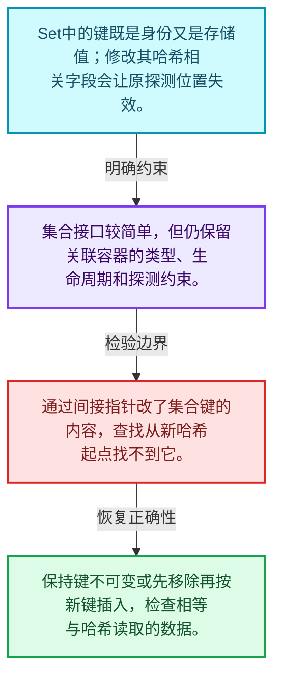
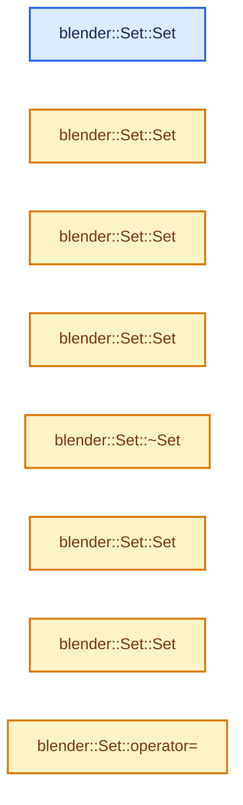
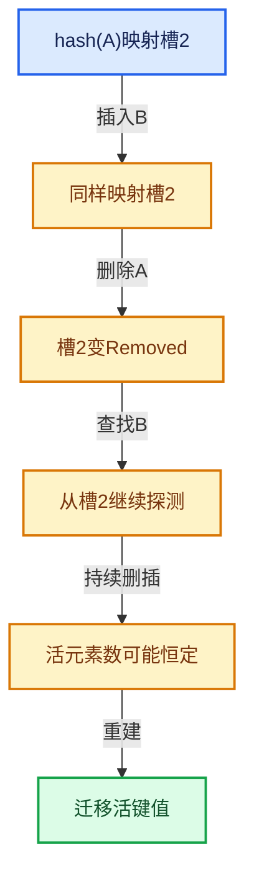

# 02-08 Set与集合语义

[方向导航](README.md) · [总目录](../README.md) · [实现索引](../%E7%AC%A6%E5%8F%B7%E4%BE%9D%E8%B5%96%E4%B8%8E%E5%AE%9E%E7%8E%B0%E7%B4%A2%E5%BC%95.md)

## 从问题到实现

无关联值时哪些Map设计仍然适用？

Set仍需处理哈希、相等、槽位和删除；键本身在容器中不能随意改成另一个哈希值。

**数据模型**

Set中的键既是身份又是存储值；修改其哈希相关字段会让原探测位置失效。

**设计取舍**

集合接口较简单，但仍保留关联容器的类型、生命周期和探测约束。

**最小反例**

通过间接指针改了集合键的内容，查找从新哈希起点找不到它。

**推导**

保持键不可变或先移除再按新键插入，检查相等与哈希读取的数据。

## 阅读地图与执行推演








图中的数值推演是本方向的教学模型；实际函数之间的调用边与概念分析边分别标注，不能把概念关系当作运行时调度顺序。

## 完整源码单元与就地讲解

中文讲解直接放在相关代码旁，复杂机制在代码下展开。原文折叠区保留基准行号；不需要在行号表和函数之间来回查找。类布局可分段展示，函数实现不按固定行数切开。

### 类型布局、声明与编译条件 · BLI_set.hh L1—L167

<a id="t-9eb5ca8aa369"></a>

`Set`在这里声明的数据成员：

- `int64_t removed_slots_`
- `int64_t occupied_and_removed_slots_`
- `int64_t usable_slots_`
- `uint64_t slot_mask_`
- `BLI_NO_UNIQUE_ADDRESS hash_`
- `BLI_NO_UNIQUE_ADDRESS is_equal_`
- `LoadFactor max_load_factor_`
- `SlotArray slots_`

<a id="t-d3045b1e87c4"></a>

<!-- annotated:b62beb79e3688f -->

```cpp
/* SPDX-FileCopyrightText: 2023 Blender Authors
 *
 * SPDX-License-Identifier: GPL-2.0-or-later */

#pragma once

/** \file
 * \ingroup bli
 *
 * A `Set<Key>` is an unordered container for unique elements of type `Key`. It is
 * designed to be a more convenient and efficient replacement for `std::unordered_set`. All core
 * operations (add, remove and contains) can be done in O(1) amortized expected time.
 *
 * In most cases, your default choice for a hash set in Blender should be `Set`.
 *
 * Set is implemented using open addressing in a slot array with a power-of-two size.
 * Every slot is in one of three states: empty, occupied or removed. If a slot is occupied, it
 * contains an instance of the key type.
 *
 * Bench-marking and comparing hash tables is hard, because many factors influence the result. The
 * performance of a hash table depends on the combination of the hash function, probing strategy,
 * max load factor, key type, slot type and the data distribution. This implementation is designed
 * to be relatively fast by default in all cases. However, it also offers many customization
 * points that allow it to be optimized for a specific use case.
 *
 * A rudimentary benchmark can be found in `BLI_set_test.cc`. The results of that benchmark are
 * there as well. The numbers show that in this specific case #Set outperforms
 * #std::unordered_set consistently by a good amount.
 *
 * Some noteworthy information:
 * - Key must be a movable type.
 * - Pointers to keys might be invalidated when the set is changed or moved.
 * - The hash function can be customized. See BLI_hash.hh for details.
 * - The probing strategy can be customized. See BLI_probing_stragies.hh for details.
 * - The slot type can be customized. See BLI_set_slots.hh for details.
 * - Small buffer optimization is enabled by default, if the key is not too large.
 * - The methods `add_new` and `remove_contained` should be used instead of `add` and `remove`
 *   whenever appropriate. Assumptions and intention are described better this way.
 * - Lookups can be performed using types other than Key without conversion. For that use the
 *   methods ending with `_as`. The template parameters Hash and #IsEqual have to support the other
 *   key type. This can greatly improve performance when the set contains strings.
 * - The default constructor is cheap, even when a large #InlineBufferCapacity is used. A large
 *   slot array will only be initialized when the first key is added.
 * - The `print_stats` method can be used to get information about the distribution of keys and
 *   memory usage of the set.
 * - The method names don't follow the std::unordered_set names in many cases. Searching for such
 *   names in this file will usually let you discover the new name.
 *
 * Possible Improvements:
 * - Use a branch-less loop over slots in grow function (measured ~10% performance improvement when
 *   the distribution of occupied slots is sufficiently random).
 * - Support max load factor customization.
 * - Improve performance with large data sets through software prefetching. I got fairly
 *   significant improvements in simple tests (~30% faster). It still needs to be investigated how
 *   to make a nice interface for this functionality.
 */

#include "BLI_array.hh"
#include "BLI_hash.hh"
#include "BLI_hash_tables.hh"
#include "BLI_probing_strategies.hh"
#include "BLI_set_slots.hh"

namespace blender {

template<
    /**
     * Type of the elements that are stored in this set. It has to be movable.
     * Furthermore, the hash and is-equal functions have to support it.
     */
    typename Key,
    /**
     * The minimum number of elements that can be stored in this Set without doing a heap
     * allocation. This is useful when you expect to have many small sets. However, keep in mind
     * that (unlike vector) initializing a set has a O(n) cost in the number of slots.
     */
    int64_t InlineBufferCapacity = default_inline_buffer_capacity(sizeof(Key)),
    /**
     * The strategy used to deal with collisions. They are defined in BLI_probing_strategies.hh.
     */
    typename ProbingStrategy = DefaultProbingStrategy,
    /**
     * The hash function used to hash the keys. There is a default for many types. See BLI_hash.hh
     * for examples on how to define a custom hash function.
     */
    typename Hash = DefaultHash<Key>,
    /**
     * The equality operator used to compare keys. By default it will simply compare keys using the
     * `==` operator.
     */
    typename IsEqual = DefaultEquality<Key>,
    /**
     * This is what will actually be stored in the hash table array. At a minimum a slot has to
     * be able to hold a key and information about whether the slot is empty, occupied or removed.
     * Using a non-standard slot type can improve performance or reduce the memory footprint. For
     * example, a hash can be stored in the slot, to make inequality checks more efficient. Some
     * types have special values that can represent an empty or removed state, eliminating the need
     * for an additional variable. Also see BLI_set_slots.hh.
     */
    typename Slot = typename DefaultSetSlot<Key>::type,
    /**
     * The allocator used by this set. Should rarely be changed, except when you don't want that
     * MEM_* is used internally.
     */
    typename Allocator = GuardedAllocator>
class Set {
 public:
  class Iterator;
  using value_type = Key;
  using pointer = Key *;
  using const_pointer = const Key *;
  using reference = Key &;
  using const_reference = const Key &;
  using iterator = Iterator;
  using size_type = int64_t;

 private:
  /**
   * Slots are either empty, occupied or removed. The number of occupied slots can be computed by
   * subtracting the removed slots from the occupied-and-removed slots.
   */
  int64_t removed_slots_;
  int64_t occupied_and_removed_slots_;

  /**
   * The maximum number of slots that can be used (either occupied or removed) until the set has to
   * grow. This is the total number of slots times the max load factor.
   */
  int64_t usable_slots_;

  /**
   * The number of slots minus one. This is a bit mask that can be used to turn any integer into a
   * valid slot index efficiently.
   */
  uint64_t slot_mask_;

  /** This is called to hash incoming keys. */
  BLI_NO_UNIQUE_ADDRESS Hash hash_;

  /** This is called to check equality of two keys. */
  BLI_NO_UNIQUE_ADDRESS IsEqual is_equal_;

  /** The max load factor is 1/2 = 50% by default. */
#define LOAD_FACTOR 1, 2
  static constexpr LoadFactor max_load_factor_ = LoadFactor(LOAD_FACTOR);
  using SlotArray =
      Array<Slot, LoadFactor::compute_total_slots(InlineBufferCapacity, LOAD_FACTOR), Allocator>;
#undef LOAD_FACTOR

  /**
   * This is the array that contains the actual slots. There is always at least one empty slot and
   * the size of the array is a power of two.
   */
  SlotArray slots_;

  /** Iterate over a slot index sequence for a given hash. */
#define SET_SLOT_PROBING_BEGIN(HASH, R_SLOT) \
  SLOT_PROBING_BEGIN (ProbingStrategy, HASH, slot_mask_, SLOT_INDEX) \
    auto &R_SLOT = slots_[SLOT_INDEX];
#define SET_SLOT_PROBING_END() SLOT_PROBING_END()

 public:
  /**
   * Initialize an empty set. This is a cheap operation no matter how large the inline buffer
   * is. This is necessary to avoid a high cost when no elements are added at all. An optimized
   * grow operation is performed on the first insertion.
   */
```

<details>
<summary>核对原始源码：source/blender/blenlib/BLI_set.hh · L1—L167</summary>

<!-- original:b62beb79e3688f:source/blender/blenlib/BLI_set.hh:1:167 -->

```cpp
/* SPDX-FileCopyrightText: 2023 Blender Authors
 *
 * SPDX-License-Identifier: GPL-2.0-or-later */

#pragma once

/** \file
 * \ingroup bli
 *
 * A `Set<Key>` is an unordered container for unique elements of type `Key`. It is
 * designed to be a more convenient and efficient replacement for `std::unordered_set`. All core
 * operations (add, remove and contains) can be done in O(1) amortized expected time.
 *
 * In most cases, your default choice for a hash set in Blender should be `Set`.
 *
 * Set is implemented using open addressing in a slot array with a power-of-two size.
 * Every slot is in one of three states: empty, occupied or removed. If a slot is occupied, it
 * contains an instance of the key type.
 *
 * Bench-marking and comparing hash tables is hard, because many factors influence the result. The
 * performance of a hash table depends on the combination of the hash function, probing strategy,
 * max load factor, key type, slot type and the data distribution. This implementation is designed
 * to be relatively fast by default in all cases. However, it also offers many customization
 * points that allow it to be optimized for a specific use case.
 *
 * A rudimentary benchmark can be found in `BLI_set_test.cc`. The results of that benchmark are
 * there as well. The numbers show that in this specific case #Set outperforms
 * #std::unordered_set consistently by a good amount.
 *
 * Some noteworthy information:
 * - Key must be a movable type.
 * - Pointers to keys might be invalidated when the set is changed or moved.
 * - The hash function can be customized. See BLI_hash.hh for details.
 * - The probing strategy can be customized. See BLI_probing_stragies.hh for details.
 * - The slot type can be customized. See BLI_set_slots.hh for details.
 * - Small buffer optimization is enabled by default, if the key is not too large.
 * - The methods `add_new` and `remove_contained` should be used instead of `add` and `remove`
 *   whenever appropriate. Assumptions and intention are described better this way.
 * - Lookups can be performed using types other than Key without conversion. For that use the
 *   methods ending with `_as`. The template parameters Hash and #IsEqual have to support the other
 *   key type. This can greatly improve performance when the set contains strings.
 * - The default constructor is cheap, even when a large #InlineBufferCapacity is used. A large
 *   slot array will only be initialized when the first key is added.
 * - The `print_stats` method can be used to get information about the distribution of keys and
 *   memory usage of the set.
 * - The method names don't follow the std::unordered_set names in many cases. Searching for such
 *   names in this file will usually let you discover the new name.
 *
 * Possible Improvements:
 * - Use a branch-less loop over slots in grow function (measured ~10% performance improvement when
 *   the distribution of occupied slots is sufficiently random).
 * - Support max load factor customization.
 * - Improve performance with large data sets through software prefetching. I got fairly
 *   significant improvements in simple tests (~30% faster). It still needs to be investigated how
 *   to make a nice interface for this functionality.
 */

#include "BLI_array.hh"
#include "BLI_hash.hh"
#include "BLI_hash_tables.hh"
#include "BLI_probing_strategies.hh"
#include "BLI_set_slots.hh"

namespace blender {

template<
    /**
     * Type of the elements that are stored in this set. It has to be movable.
     * Furthermore, the hash and is-equal functions have to support it.
     */
    typename Key,
    /**
     * The minimum number of elements that can be stored in this Set without doing a heap
     * allocation. This is useful when you expect to have many small sets. However, keep in mind
     * that (unlike vector) initializing a set has a O(n) cost in the number of slots.
     */
    int64_t InlineBufferCapacity = default_inline_buffer_capacity(sizeof(Key)),
    /**
     * The strategy used to deal with collisions. They are defined in BLI_probing_strategies.hh.
     */
    typename ProbingStrategy = DefaultProbingStrategy,
    /**
     * The hash function used to hash the keys. There is a default for many types. See BLI_hash.hh
     * for examples on how to define a custom hash function.
     */
    typename Hash = DefaultHash<Key>,
    /**
     * The equality operator used to compare keys. By default it will simply compare keys using the
     * `==` operator.
     */
    typename IsEqual = DefaultEquality<Key>,
    /**
     * This is what will actually be stored in the hash table array. At a minimum a slot has to
     * be able to hold a key and information about whether the slot is empty, occupied or removed.
     * Using a non-standard slot type can improve performance or reduce the memory footprint. For
     * example, a hash can be stored in the slot, to make inequality checks more efficient. Some
     * types have special values that can represent an empty or removed state, eliminating the need
     * for an additional variable. Also see BLI_set_slots.hh.
     */
    typename Slot = typename DefaultSetSlot<Key>::type,
    /**
     * The allocator used by this set. Should rarely be changed, except when you don't want that
     * MEM_* is used internally.
     */
    typename Allocator = GuardedAllocator>
class Set {
 public:
  class Iterator;
  using value_type = Key;
  using pointer = Key *;
  using const_pointer = const Key *;
  using reference = Key &;
  using const_reference = const Key &;
  using iterator = Iterator;
  using size_type = int64_t;

 private:
  /**
   * Slots are either empty, occupied or removed. The number of occupied slots can be computed by
   * subtracting the removed slots from the occupied-and-removed slots.
   */
  int64_t removed_slots_;
  int64_t occupied_and_removed_slots_;

  /**
   * The maximum number of slots that can be used (either occupied or removed) until the set has to
   * grow. This is the total number of slots times the max load factor.
   */
  int64_t usable_slots_;

  /**
   * The number of slots minus one. This is a bit mask that can be used to turn any integer into a
   * valid slot index efficiently.
   */
  uint64_t slot_mask_;

  /** This is called to hash incoming keys. */
  BLI_NO_UNIQUE_ADDRESS Hash hash_;

  /** This is called to check equality of two keys. */
  BLI_NO_UNIQUE_ADDRESS IsEqual is_equal_;

  /** The max load factor is 1/2 = 50% by default. */
#define LOAD_FACTOR 1, 2
  static constexpr LoadFactor max_load_factor_ = LoadFactor(LOAD_FACTOR);
  using SlotArray =
      Array<Slot, LoadFactor::compute_total_slots(InlineBufferCapacity, LOAD_FACTOR), Allocator>;
#undef LOAD_FACTOR

  /**
   * This is the array that contains the actual slots. There is always at least one empty slot and
   * the size of the array is a power of two.
   */
  SlotArray slots_;

  /** Iterate over a slot index sequence for a given hash. */
#define SET_SLOT_PROBING_BEGIN(HASH, R_SLOT) \
  SLOT_PROBING_BEGIN (ProbingStrategy, HASH, slot_mask_, SLOT_INDEX) \
    auto &R_SLOT = slots_[SLOT_INDEX];
#define SET_SLOT_PROBING_END() SLOT_PROBING_END()

 public:
  /**
   * Initialize an empty set. This is a cheap operation no matter how large the inline buffer
   * is. This is necessary to avoid a high cost when no elements are added at all. An optimized
   * grow operation is performed on the first insertion.
   */
```

</details>

<a id="f-90ed819a0d9f9bb9"></a>

### `blender::Set::Set`

实现位置：[source/blender/blenlib/BLI_set.hh](../../../../../source/blender/blenlib/BLI_set.hh) · L168—L175。

接口参数：

- `Allocator allocator = {}`

**教学注释版**

<!-- annotated:8ae49e4af89ecb -->

```cpp
  Set(Allocator allocator = {}) noexcept
      : removed_slots_(0),
        occupied_and_removed_slots_(0),
        usable_slots_(0),
        slot_mask_(0),
        slots_(1, allocator)
  {
  }
```

<details>
<summary>核对原始源码：source/blender/blenlib/BLI_set.hh · L168—L175</summary>

<!-- original:8ae49e4af89ecb:source/blender/blenlib/BLI_set.hh:168:175 -->

```cpp
  Set(Allocator allocator = {}) noexcept
      : removed_slots_(0),
        occupied_and_removed_slots_(0),
        usable_slots_(0),
        slot_mask_(0),
        slots_(1, allocator)
  {
  }
```

</details>

**继续追踪实现**

本实现没有需要继续展开的显式调用；检查返回表达式、对象转换和调用者前置条件。

<!-- annotated:242b538e26cd9d -->

```cpp

```

<details>
<summary>核对原始源码：source/blender/blenlib/BLI_set.hh · L176—L176</summary>

<!-- original:242b538e26cd9d:source/blender/blenlib/BLI_set.hh:176:176 -->

```cpp

```

</details>

<a id="f-c9b8f9a3408eebf2"></a>

### `blender::Set::Set`

实现位置：[source/blender/blenlib/BLI_set.hh](../../../../../source/blender/blenlib/BLI_set.hh) · L177—L177。

接口参数：

- `NoExceptConstructor`
- `Allocator allocator = {}`

**教学注释版**

<!-- annotated:372249aed8457f -->

```cpp
  Set(NoExceptConstructor, Allocator allocator = {}) noexcept : Set(allocator) {}
```

<details>
<summary>核对原始源码：source/blender/blenlib/BLI_set.hh · L177—L177</summary>

<!-- original:372249aed8457f:source/blender/blenlib/BLI_set.hh:177:177 -->

```cpp
  Set(NoExceptConstructor, Allocator allocator = {}) noexcept : Set(allocator) {}
```

</details>

**继续追踪实现**

本实现没有需要继续展开的显式调用；检查返回表达式、对象转换和调用者前置条件。

<!-- annotated:6f75b1cdc76bdf -->

```cpp

```

<details>
<summary>核对原始源码：source/blender/blenlib/BLI_set.hh · L178—L178</summary>

<!-- original:6f75b1cdc76bdf:source/blender/blenlib/BLI_set.hh:178:178 -->

```cpp

```

</details>

<a id="f-ee3bc759853aea7c"></a>

### `blender::Set::Set`

实现位置：[source/blender/blenlib/BLI_set.hh](../../../../../source/blender/blenlib/BLI_set.hh) · L179—L182。

接口参数：

- `Span<Key> values`
- `Allocator allocator = {}`

**教学注释版**

<!-- annotated:c3855f85d3ecc5 -->

```cpp
  Set(Span<Key> values, Allocator allocator = {}) : Set(NoExceptConstructor(), allocator)
  {
    this->add_multiple(values);
  }
```

<details>
<summary>核对原始源码：source/blender/blenlib/BLI_set.hh · L179—L182</summary>

<!-- original:c3855f85d3ecc5:source/blender/blenlib/BLI_set.hh:179:182 -->

```cpp
  Set(Span<Key> values, Allocator allocator = {}) : Set(NoExceptConstructor(), allocator)
  {
    this->add_multiple(values);
  }
```

</details>

**继续追踪实现**

- `this->add_multiple` → [blender::Set::add_multiple · L287](08-Set%E4%B8%8E%E9%9B%86%E5%90%88%E8%AF%AD%E4%B9%89.md#f-18a099a39b0fcf37)。

### 类型布局、声明与编译条件 · BLI_set.hh L183—L186

<!-- annotated:c870ed8eb37fb6 -->

```cpp

  /**
   * Construct a set that contains the given keys. Duplicates will be removed automatically.
   */
```

<details>
<summary>核对原始源码：source/blender/blenlib/BLI_set.hh · L183—L186</summary>

<!-- original:c870ed8eb37fb6:source/blender/blenlib/BLI_set.hh:183:186 -->

```cpp

  /**
   * Construct a set that contains the given keys. Duplicates will be removed automatically.
   */
```

</details>

<a id="f-e445c4d2f90ade85"></a>

### `blender::Set::Set`

实现位置：[source/blender/blenlib/BLI_set.hh](../../../../../source/blender/blenlib/BLI_set.hh) · L187—L187。

接口参数：

- `const std::initializer_list<Key> &values`

**教学注释版**

<!-- annotated:1f3b2c18b09576 -->

```cpp
  Set(const std::initializer_list<Key> &values) : Set(Span<Key>(values)) {}
```

<details>
<summary>核对原始源码：source/blender/blenlib/BLI_set.hh · L187—L187</summary>

<!-- original:1f3b2c18b09576:source/blender/blenlib/BLI_set.hh:187:187 -->

```cpp
  Set(const std::initializer_list<Key> &values) : Set(Span<Key>(values)) {}
```

</details>

**继续追踪实现**

本实现没有需要继续展开的显式调用；检查返回表达式、对象转换和调用者前置条件。

<!-- annotated:2385a70676a3d3 -->

```cpp

```

<details>
<summary>核对原始源码：source/blender/blenlib/BLI_set.hh · L188—L188</summary>

<!-- original:2385a70676a3d3:source/blender/blenlib/BLI_set.hh:188:188 -->

```cpp

```

</details>

<a id="f-6de785e3b9e53f8d"></a>

### `blender::Set::~Set`

实现位置：[source/blender/blenlib/BLI_set.hh](../../../../../source/blender/blenlib/BLI_set.hh) · L189—L189。

**教学注释版**

<!-- annotated:23db609341ff67 -->

```cpp
  ~Set() = default;
```

<details>
<summary>核对原始源码：source/blender/blenlib/BLI_set.hh · L189—L189</summary>

<!-- original:23db609341ff67:source/blender/blenlib/BLI_set.hh:189:189 -->

```cpp
  ~Set() = default;
```

</details>

**继续追踪实现**

本实现没有需要继续展开的显式调用；检查返回表达式、对象转换和调用者前置条件。

<!-- annotated:cf1dbf0e435880 -->

```cpp

```

<details>
<summary>核对原始源码：source/blender/blenlib/BLI_set.hh · L190—L190</summary>

<!-- original:cf1dbf0e435880:source/blender/blenlib/BLI_set.hh:190:190 -->

```cpp

```

</details>

<a id="f-a94620600dd86254"></a>

### `blender::Set::Set`

实现位置：[source/blender/blenlib/BLI_set.hh](../../../../../source/blender/blenlib/BLI_set.hh) · L191—L191。

接口参数：

- `const Set &other`

**教学注释版**

<!-- annotated:fa04ca19ab786c -->

```cpp
  Set(const Set &other) = default;
```

<details>
<summary>核对原始源码：source/blender/blenlib/BLI_set.hh · L191—L191</summary>

<!-- original:fa04ca19ab786c:source/blender/blenlib/BLI_set.hh:191:191 -->

```cpp
  Set(const Set &other) = default;
```

</details>

**继续追踪实现**

本实现没有需要继续展开的显式调用；检查返回表达式、对象转换和调用者前置条件。

<!-- annotated:5c9be1ef2dd412 -->

```cpp

```

<details>
<summary>核对原始源码：source/blender/blenlib/BLI_set.hh · L192—L192</summary>

<!-- original:5c9be1ef2dd412:source/blender/blenlib/BLI_set.hh:192:192 -->

```cpp

```

</details>

<a id="f-4889adf4964a0a54"></a>

### `blender::Set::Set`

实现位置：[source/blender/blenlib/BLI_set.hh](../../../../../source/blender/blenlib/BLI_set.hh) · L193—L216。

接口参数：

- `Set &&other`

**教学注释版**

<!-- annotated:aca7def71d69ff -->

```cpp
  Set(Set &&other) noexcept(std::is_nothrow_move_constructible_v<SlotArray>)
      : Set(NoExceptConstructor(), other.slots_.allocator())

  {
    if constexpr (std::is_nothrow_move_constructible_v<SlotArray>) {
      // [讲解] std::move：把表达式转换成可供移动重载选择的值类别；不保证真的移动，不结束源对象寿命，对const值可能选择复制。
      slots_ = std::move(other.slots_);
    }
    else {
      try {
        slots_ = std::move(other.slots_);
      }
      catch (...) {
        other.noexcept_reset();
        throw;
      }
    }
    removed_slots_ = other.removed_slots_;
    occupied_and_removed_slots_ = other.occupied_and_removed_slots_;
    usable_slots_ = other.usable_slots_;
    slot_mask_ = other.slot_mask_;
    hash_ = std::move(other.hash_);
    is_equal_ = std::move(other.is_equal_);
    other.noexcept_reset();
  }
```

<details>
<summary>核对原始源码：source/blender/blenlib/BLI_set.hh · L193—L216</summary>

<!-- original:aca7def71d69ff:source/blender/blenlib/BLI_set.hh:193:216 -->

```cpp
  Set(Set &&other) noexcept(std::is_nothrow_move_constructible_v<SlotArray>)
      : Set(NoExceptConstructor(), other.slots_.allocator())

  {
    if constexpr (std::is_nothrow_move_constructible_v<SlotArray>) {
      slots_ = std::move(other.slots_);
    }
    else {
      try {
        slots_ = std::move(other.slots_);
      }
      catch (...) {
        other.noexcept_reset();
        throw;
      }
    }
    removed_slots_ = other.removed_slots_;
    occupied_and_removed_slots_ = other.occupied_and_removed_slots_;
    usable_slots_ = other.usable_slots_;
    slot_mask_ = other.slot_mask_;
    hash_ = std::move(other.hash_);
    is_equal_ = std::move(other.is_equal_);
    other.noexcept_reset();
  }
```

</details>

**沿实际写入检查状态**

- `slots_ = std::move(other.slots_);`
- `removed_slots_ = other.removed_slots_;`
- `occupied_and_removed_slots_ = other.occupied_and_removed_slots_;`
- `usable_slots_ = other.usable_slots_;`
- `slot_mask_ = other.slot_mask_;`
- `hash_ = std::move(other.hash_);`
- `is_equal_ = std::move(other.is_equal_);`

**继续追踪实现**

- `std::move` → [外部契约](https://eel.is/c++draft/utility.forward)：把表达式转换成可供移动重载选择的值类别；不保证真的移动，不结束源对象寿命，对const值可能选择复制。
- `other.noexcept_reset` → [blender::Set::noexcept_reset · L779](08-Set%E4%B8%8E%E9%9B%86%E5%90%88%E8%AF%AD%E4%B9%89.md#f-8e129637c06ba7df)。

<!-- annotated:5f178c6ff389fd -->

```cpp

```

<details>
<summary>核对原始源码：source/blender/blenlib/BLI_set.hh · L217—L217</summary>

<!-- original:5f178c6ff389fd:source/blender/blenlib/BLI_set.hh:217:217 -->

```cpp

```

</details>

<a id="f-cd8970db93b0c160"></a>

### `blender::Set::operator=`

实现位置：[source/blender/blenlib/BLI_set.hh](../../../../../source/blender/blenlib/BLI_set.hh) · L218—L221。

接口参数：

- `const Set &other`

**教学注释版**

<!-- annotated:34a2407329f8f9 -->

```cpp
  Set &operator=(const Set &other)
  {
    return copy_assign_container(*this, other);
  }
```

<details>
<summary>核对原始源码：source/blender/blenlib/BLI_set.hh · L218—L221</summary>

<!-- original:34a2407329f8f9:source/blender/blenlib/BLI_set.hh:218:221 -->

```cpp
  Set &operator=(const Set &other)
  {
    return copy_assign_container(*this, other);
  }
```

</details>

**结果出口**

- `return copy_assign_container(*this, other);`

**继续追踪实现**

- `copy_assign_container` → [blender::copy_assign_container · L284](../03-%E5%86%85%E5%AD%98%E5%88%86%E9%85%8D%E4%B8%8E%E8%BF%90%E8%A1%8C%E6%97%B6%E7%B1%BB%E5%9E%8B/01-%E5%AF%B9%E9%BD%90%E4%B8%8E%E6%9C%AA%E5%88%9D%E5%A7%8B%E5%8C%96%E5%AD%98%E5%82%A8.md#f-546a45b4d8b5ab44)。

<!-- annotated:a49b0fb14f8e6e -->

```cpp

```

<details>
<summary>核对原始源码：source/blender/blenlib/BLI_set.hh · L222—L222</summary>

<!-- original:a49b0fb14f8e6e:source/blender/blenlib/BLI_set.hh:222:222 -->

```cpp

```

</details>

<a id="f-7c07cb70a94a8f07"></a>

### `blender::Set::operator=`

实现位置：[source/blender/blenlib/BLI_set.hh](../../../../../source/blender/blenlib/BLI_set.hh) · L223—L226。

接口参数：

- `Set &&other`

**教学注释版**

<!-- annotated:cec5b085f9f181 -->

```cpp
  Set &operator=(Set &&other)
  {
    // [讲解] std::move：把表达式转换成可供移动重载选择的值类别；不保证真的移动，不结束源对象寿命，对const值可能选择复制。
    return move_assign_container(*this, std::move(other));
  }
```

<details>
<summary>核对原始源码：source/blender/blenlib/BLI_set.hh · L223—L226</summary>

<!-- original:cec5b085f9f181:source/blender/blenlib/BLI_set.hh:223:226 -->

```cpp
  Set &operator=(Set &&other)
  {
    return move_assign_container(*this, std::move(other));
  }
```

</details>

**结果出口**

- `return move_assign_container(*this, std::move(other));`

**继续追踪实现**

- `move_assign_container` → [blender::move_assign_container · L300](../03-%E5%86%85%E5%AD%98%E5%88%86%E9%85%8D%E4%B8%8E%E8%BF%90%E8%A1%8C%E6%97%B6%E7%B1%BB%E5%9E%8B/01-%E5%AF%B9%E9%BD%90%E4%B8%8E%E6%9C%AA%E5%88%9D%E5%A7%8B%E5%8C%96%E5%AD%98%E5%82%A8.md#f-5144b56be86e6f42)。
- `std::move` → [外部契约](https://eel.is/c++draft/utility.forward)：把表达式转换成可供移动重载选择的值类别；不保证真的移动，不结束源对象寿命，对const值可能选择复制。

### 类型布局、声明与编译条件 · BLI_set.hh L227—L232

<!-- annotated:701c0584f00fb5 -->

```cpp

  /**
   * Add a new key to the set. This invokes undefined behavior when the key is in the set already.
   * When you know for certain that a key is not in the set yet, use this method for better
   * performance. This also expresses the intent better.
   */
```

<details>
<summary>核对原始源码：source/blender/blenlib/BLI_set.hh · L227—L232</summary>

<!-- original:701c0584f00fb5:source/blender/blenlib/BLI_set.hh:227:232 -->

```cpp

  /**
   * Add a new key to the set. This invokes undefined behavior when the key is in the set already.
   * When you know for certain that a key is not in the set yet, use this method for better
   * performance. This also expresses the intent better.
   */
```

</details>

<a id="f-12f4dd65a3abaaac"></a>

### `blender::Set::add_new`

按哈希与相等关系加入键或键值。

实现位置：[source/blender/blenlib/BLI_set.hh](../../../../../source/blender/blenlib/BLI_set.hh) · L233—L236。

接口参数：

- `const Key &key`

**教学注释版**

<!-- annotated:76830de5827cc0 -->

```cpp
  void add_new(const Key &key)
  {
    this->add_new__impl(key, hash_(key));
  }
```

<details>
<summary>核对原始源码：source/blender/blenlib/BLI_set.hh · L233—L236</summary>

<!-- original:76830de5827cc0:source/blender/blenlib/BLI_set.hh:233:236 -->

```cpp
  void add_new(const Key &key)
  {
    this->add_new__impl(key, hash_(key));
  }
```

</details>

**接口与不变量**

存在键与不存在键的接口承诺不同；add_new需要调用者保证键尚不存在。

**继续追踪实现**

- `this->add_new__impl` → [blender::Set::add_new__impl · L827](08-Set%E4%B8%8E%E9%9B%86%E5%90%88%E8%AF%AD%E4%B9%89.md#f-bc4ae48abcde6959)。
- `hash_` → [调用协议](../%E6%A8%A1%E6%9D%BF%E5%AE%8F%E4%B8%8E%E5%8A%A8%E6%80%81%E5%88%86%E6%B4%BE%E5%8D%8F%E8%AE%AE.md)：函数指针、局部可调用对象或未展开的宏；必须结合调用者环境。调用位置L235。

<a id="f-9c46c167cdd9bb73"></a>

### `blender::Set::add_new`

按哈希与相等关系加入键或键值。

实现位置：[source/blender/blenlib/BLI_set.hh](../../../../../source/blender/blenlib/BLI_set.hh) · L237—L240。

接口参数：

- `Key &&key`

**教学注释版**

<!-- annotated:6d95abfdc368a8 -->

```cpp
  void add_new(Key &&key)
  {
    // [讲解] std::move：把表达式转换成可供移动重载选择的值类别；不保证真的移动，不结束源对象寿命，对const值可能选择复制。
    this->add_new__impl(std::move(key), hash_(key));
  }
```

<details>
<summary>核对原始源码：source/blender/blenlib/BLI_set.hh · L237—L240</summary>

<!-- original:6d95abfdc368a8:source/blender/blenlib/BLI_set.hh:237:240 -->

```cpp
  void add_new(Key &&key)
  {
    this->add_new__impl(std::move(key), hash_(key));
  }
```

</details>

**接口与不变量**

存在键与不存在键的接口承诺不同；add_new需要调用者保证键尚不存在。

**继续追踪实现**

- `this->add_new__impl` → [blender::Set::add_new__impl · L827](08-Set%E4%B8%8E%E9%9B%86%E5%90%88%E8%AF%AD%E4%B9%89.md#f-bc4ae48abcde6959)。
- `std::move` → [外部契约](https://eel.is/c++draft/utility.forward)：把表达式转换成可供移动重载选择的值类别；不保证真的移动，不结束源对象寿命，对const值可能选择复制。
- `hash_` → [调用协议](../%E6%A8%A1%E6%9D%BF%E5%AE%8F%E4%B8%8E%E5%8A%A8%E6%80%81%E5%88%86%E6%B4%BE%E5%8D%8F%E8%AE%AE.md)：函数指针、局部可调用对象或未展开的宏；必须结合调用者环境。调用位置L239。

### 类型布局、声明与编译条件 · BLI_set.hh L241—L247

<!-- annotated:0d3ba13f5868ae -->

```cpp

  /**
   * Add a key to the set. If the key exists in the set already, nothing is done. The return value
   * is true if the key was newly added to the set.
   *
   * This is similar to std::unordered_set::insert.
   */
```

<details>
<summary>核对原始源码：source/blender/blenlib/BLI_set.hh · L241—L247</summary>

<!-- original:0d3ba13f5868ae:source/blender/blenlib/BLI_set.hh:241:247 -->

```cpp

  /**
   * Add a key to the set. If the key exists in the set already, nothing is done. The return value
   * is true if the key was newly added to the set.
   *
   * This is similar to std::unordered_set::insert.
   */
```

</details>

<a id="f-c7498809c2327fba"></a>

### `blender::Set::add`

按哈希与相等关系加入键或键值。

实现位置：[source/blender/blenlib/BLI_set.hh](../../../../../source/blender/blenlib/BLI_set.hh) · L248—L251。

接口参数：

- `const Key &key`

**教学注释版**

<!-- annotated:34ed71eb919784 -->

```cpp
  bool add(const Key &key)
  {
    // [讲解] this->add_as：按哈希与相等关系加入键或键值。
    return this->add_as(key);
  }
```

<details>
<summary>核对原始源码：source/blender/blenlib/BLI_set.hh · L248—L251</summary>

<!-- original:34ed71eb919784:source/blender/blenlib/BLI_set.hh:248:251 -->

```cpp
  bool add(const Key &key)
  {
    return this->add_as(key);
  }
```

</details>

**接口与不变量**

存在键与不存在键的接口承诺不同；add_new需要调用者保证键尚不存在。

**结果出口**

- `return this->add_as(key);`

**继续追踪实现**

- `this->add_as` → [blender::Set::add_as · L256](08-Set%E4%B8%8E%E9%9B%86%E5%90%88%E8%AF%AD%E4%B9%89.md#f-ce49561a490e821a)。

<a id="f-e3ac8d1c52c03c2b"></a>

### `blender::Set::add`

按哈希与相等关系加入键或键值。

实现位置：[source/blender/blenlib/BLI_set.hh](../../../../../source/blender/blenlib/BLI_set.hh) · L252—L255。

接口参数：

- `Key &&key`

**教学注释版**

<!-- annotated:2b60448ca6b0ef -->

```cpp
  bool add(Key &&key)
  {
    // [讲解] this->add_as：按哈希与相等关系加入键或键值。
    return this->add_as(std::move(key));
  }
```

<details>
<summary>核对原始源码：source/blender/blenlib/BLI_set.hh · L252—L255</summary>

<!-- original:2b60448ca6b0ef:source/blender/blenlib/BLI_set.hh:252:255 -->

```cpp
  bool add(Key &&key)
  {
    return this->add_as(std::move(key));
  }
```

</details>

**接口与不变量**

存在键与不存在键的接口承诺不同；add_new需要调用者保证键尚不存在。

**结果出口**

- `return this->add_as(std::move(key));`

**继续追踪实现**

- `this->add_as` → [blender::Set::add_as · L256](08-Set%E4%B8%8E%E9%9B%86%E5%90%88%E8%AF%AD%E4%B9%89.md#f-ce49561a490e821a)。
- `std::move` → [外部契约](https://eel.is/c++draft/utility.forward)：把表达式转换成可供移动重载选择的值类别；不保证真的移动，不结束源对象寿命，对const值可能选择复制。

<a id="f-ce49561a490e821a"></a>

### `blender::Set::add_as`

按哈希与相等关系加入键或键值。

实现位置：[source/blender/blenlib/BLI_set.hh](../../../../../source/blender/blenlib/BLI_set.hh) · L256—L259。

接口参数：

- `ForwardKey &&key`

**教学注释版**

<!-- annotated:63c0e0895733a1 -->

```cpp
  template<typename ForwardKey> bool add_as(ForwardKey &&key)
  {
    // [讲解] std::forward<ForwardKey>：在转发引用中恢复调用者传入的值类别；依赖推导类型，不能与无条件move互换。
    return this->add__impl(std::forward<ForwardKey>(key), hash_(key));
  }
```

<details>
<summary>核对原始源码：source/blender/blenlib/BLI_set.hh · L256—L259</summary>

<!-- original:63c0e0895733a1:source/blender/blenlib/BLI_set.hh:256:259 -->

```cpp
  template<typename ForwardKey> bool add_as(ForwardKey &&key)
  {
    return this->add__impl(std::forward<ForwardKey>(key), hash_(key));
  }
```

</details>

**接口与不变量**

存在键与不存在键的接口承诺不同；add_new需要调用者保证键尚不存在。

**结果出口**

- `return this->add__impl(std::forward<ForwardKey>(key), hash_(key));`

**继续追踪实现**

- `this->add__impl` → [blender::Set::add__impl · L845](08-Set%E4%B8%8E%E9%9B%86%E5%90%88%E8%AF%AD%E4%B9%89.md#f-f71ddee9127387aa)。
- `std::forward<ForwardKey>` → [外部契约](https://eel.is/c++draft/utility.forward)：在转发引用中恢复调用者传入的值类别；依赖推导类型，不能与无条件move互换。
- `hash_` → [调用协议](../%E6%A8%A1%E6%9D%BF%E5%AE%8F%E4%B8%8E%E5%8A%A8%E6%80%81%E5%88%86%E6%B4%BE%E5%8D%8F%E8%AE%AE.md)：函数指针、局部可调用对象或未展开的宏；必须结合调用者环境。调用位置L258。

### 类型布局、声明与编译条件 · BLI_set.hh L260—L266

<!-- annotated:23cebf883050cb -->

```cpp

  /**
   * Similar to #add but reinserts the key if it already exists. Using this only makes sense if the
   * key contains additional data besides what affects the hash.
   *
   * \return True if the key was newly added, false if it was already present and was overwritten.
   */
```

<details>
<summary>核对原始源码：source/blender/blenlib/BLI_set.hh · L260—L266</summary>

<!-- original:23cebf883050cb:source/blender/blenlib/BLI_set.hh:260:266 -->

```cpp

  /**
   * Similar to #add but reinserts the key if it already exists. Using this only makes sense if the
   * key contains additional data besides what affects the hash.
   *
   * \return True if the key was newly added, false if it was already present and was overwritten.
   */
```

</details>

<a id="f-647c919fe97d16c2"></a>

### `blender::Set::add_overwrite`

实现位置：[source/blender/blenlib/BLI_set.hh](../../../../../source/blender/blenlib/BLI_set.hh) · L267—L270。

接口参数：

- `const Key &key`

**教学注释版**

<!-- annotated:9b71bb4b2768a8 -->

```cpp
  bool add_overwrite(const Key &key)
  {
    return this->add_overwrite_as(key);
  }
```

<details>
<summary>核对原始源码：source/blender/blenlib/BLI_set.hh · L267—L270</summary>

<!-- original:9b71bb4b2768a8:source/blender/blenlib/BLI_set.hh:267:270 -->

```cpp
  bool add_overwrite(const Key &key)
  {
    return this->add_overwrite_as(key);
  }
```

</details>

**结果出口**

- `return this->add_overwrite_as(key);`

**继续追踪实现**

- `this->add_overwrite_as` → [blender::Set::add_overwrite_as · L275](08-Set%E4%B8%8E%E9%9B%86%E5%90%88%E8%AF%AD%E4%B9%89.md#f-ac8df34dd60f4eda)。

<a id="f-2811f2e733a12f8f"></a>

### `blender::Set::add_overwrite`

实现位置：[source/blender/blenlib/BLI_set.hh](../../../../../source/blender/blenlib/BLI_set.hh) · L271—L274。

接口参数：

- `Key &&key`

**教学注释版**

<!-- annotated:330280d4ea2477 -->

```cpp
  bool add_overwrite(Key &&key)
  {
    // [讲解] std::move：把表达式转换成可供移动重载选择的值类别；不保证真的移动，不结束源对象寿命，对const值可能选择复制。
    return this->add_overwrite_as(std::move(key));
  }
```

<details>
<summary>核对原始源码：source/blender/blenlib/BLI_set.hh · L271—L274</summary>

<!-- original:330280d4ea2477:source/blender/blenlib/BLI_set.hh:271:274 -->

```cpp
  bool add_overwrite(Key &&key)
  {
    return this->add_overwrite_as(std::move(key));
  }
```

</details>

**结果出口**

- `return this->add_overwrite_as(std::move(key));`

**继续追踪实现**

- `this->add_overwrite_as` → [blender::Set::add_overwrite_as · L275](08-Set%E4%B8%8E%E9%9B%86%E5%90%88%E8%AF%AD%E4%B9%89.md#f-ac8df34dd60f4eda)。
- `std::move` → [外部契约](https://eel.is/c++draft/utility.forward)：把表达式转换成可供移动重载选择的值类别；不保证真的移动，不结束源对象寿命，对const值可能选择复制。

<a id="f-ac8df34dd60f4eda"></a>

### `blender::Set::add_overwrite_as`

实现位置：[source/blender/blenlib/BLI_set.hh](../../../../../source/blender/blenlib/BLI_set.hh) · L275—L278。

接口参数：

- `ForwardKey &&key`

**教学注释版**

<!-- annotated:4549331b770e52 -->

```cpp
  template<typename ForwardKey> bool add_overwrite_as(ForwardKey &&key)
  {
    // [讲解] std::forward<ForwardKey>：在转发引用中恢复调用者传入的值类别；依赖推导类型，不能与无条件move互换。
    return this->add_overwrite__impl(std::forward<ForwardKey>(key), hash_(key));
  }
```

<details>
<summary>核对原始源码：source/blender/blenlib/BLI_set.hh · L275—L278</summary>

<!-- original:4549331b770e52:source/blender/blenlib/BLI_set.hh:275:278 -->

```cpp
  template<typename ForwardKey> bool add_overwrite_as(ForwardKey &&key)
  {
    return this->add_overwrite__impl(std::forward<ForwardKey>(key), hash_(key));
  }
```

</details>

**结果出口**

- `return this->add_overwrite__impl(std::forward<ForwardKey>(key), hash_(key));`

**继续追踪实现**

- `this->add_overwrite__impl` → [blender::Set::add_overwrite__impl · L864](08-Set%E4%B8%8E%E9%9B%86%E5%90%88%E8%AF%AD%E4%B9%89.md#f-021aba3aad404275)。
- `std::forward<ForwardKey>` → [外部契约](https://eel.is/c++draft/utility.forward)：在转发引用中恢复调用者传入的值类别；依赖推导类型，不能与无条件move互换。
- `hash_` → [调用协议](../%E6%A8%A1%E6%9D%BF%E5%AE%8F%E4%B8%8E%E5%8A%A8%E6%80%81%E5%88%86%E6%B4%BE%E5%8D%8F%E8%AE%AE.md)：函数指针、局部可调用对象或未展开的宏；必须结合调用者环境。调用位置L277。

### 类型布局、声明与编译条件 · BLI_set.hh L279—L286

<!-- annotated:f4719b0690b015 -->

```cpp

  /**
   * Convenience function to add many keys to the set at once. Duplicates are removed
   * automatically.
   *
   * We might be able to make this faster than sequentially adding all keys, but that is not
   * implemented yet.
   */
```

<details>
<summary>核对原始源码：source/blender/blenlib/BLI_set.hh · L279—L286</summary>

<!-- original:f4719b0690b015:source/blender/blenlib/BLI_set.hh:279:286 -->

```cpp

  /**
   * Convenience function to add many keys to the set at once. Duplicates are removed
   * automatically.
   *
   * We might be able to make this faster than sequentially adding all keys, but that is not
   * implemented yet.
   */
```

</details>

<a id="f-18a099a39b0fcf37"></a>

### `blender::Set::add_multiple`

实现位置：[source/blender/blenlib/BLI_set.hh](../../../../../source/blender/blenlib/BLI_set.hh) · L287—L292。

接口参数：

- `Span<Key> keys`

**教学注释版**

<!-- annotated:09705186e2f8a0 -->

```cpp
  void add_multiple(Span<Key> keys)
  {
    for (const Key &key : keys) {
      // [讲解] this->add：按哈希与相等关系加入键或键值。
      this->add(key);
    }
  }
```

<details>
<summary>核对原始源码：source/blender/blenlib/BLI_set.hh · L287—L292</summary>

<!-- original:09705186e2f8a0:source/blender/blenlib/BLI_set.hh:287:292 -->

```cpp
  void add_multiple(Span<Key> keys)
  {
    for (const Key &key : keys) {
      this->add(key);
    }
  }
```

</details>

**继续追踪实现**

- `this->add` → [blender::Set::add · L248](08-Set%E4%B8%8E%E9%9B%86%E5%90%88%E8%AF%AD%E4%B9%89.md#f-c7498809c2327fba)；[blender::Set::add · L252](08-Set%E4%B8%8E%E9%9B%86%E5%90%88%E8%AF%AD%E4%B9%89.md#f-e3ac8d1c52c03c2b)。同名重载需按实参类型选择。

### 类型布局、声明与编译条件 · BLI_set.hh L293—L297

<!-- annotated:bc16a702274a3b -->

```cpp

  /**
   * Convenience function to add many new keys to the set at once. The keys must not exist in the
   * set before and there must not be duplicates in the array.
   */
```

<details>
<summary>核对原始源码：source/blender/blenlib/BLI_set.hh · L293—L297</summary>

<!-- original:bc16a702274a3b:source/blender/blenlib/BLI_set.hh:293:297 -->

```cpp

  /**
   * Convenience function to add many new keys to the set at once. The keys must not exist in the
   * set before and there must not be duplicates in the array.
   */
```

</details>

<a id="f-d3ed25b77a7be06e"></a>

### `blender::Set::add_multiple_new`

实现位置：[source/blender/blenlib/BLI_set.hh](../../../../../source/blender/blenlib/BLI_set.hh) · L298—L303。

接口参数：

- `Span<Key> keys`

**教学注释版**

<!-- annotated:3a0a3d2b6d8bf8 -->

```cpp
  void add_multiple_new(Span<Key> keys)
  {
    for (const Key &key : keys) {
      // [讲解] this->add_new：按哈希与相等关系加入键或键值。
      this->add_new(key);
    }
  }
```

<details>
<summary>核对原始源码：source/blender/blenlib/BLI_set.hh · L298—L303</summary>

<!-- original:3a0a3d2b6d8bf8:source/blender/blenlib/BLI_set.hh:298:303 -->

```cpp
  void add_multiple_new(Span<Key> keys)
  {
    for (const Key &key : keys) {
      this->add_new(key);
    }
  }
```

</details>

**继续追踪实现**

- `this->add_new` → [blender::Set::add_new · L233](08-Set%E4%B8%8E%E9%9B%86%E5%90%88%E8%AF%AD%E4%B9%89.md#f-12f4dd65a3abaaac)；[blender::Set::add_new · L237](08-Set%E4%B8%8E%E9%9B%86%E5%90%88%E8%AF%AD%E4%B9%89.md#f-9c46c167cdd9bb73)。同名重载需按实参类型选择。

### 类型布局、声明与编译条件 · BLI_set.hh L304—L309

<!-- annotated:3057566a58a749 -->

```cpp

  /**
   * Returns true if the key is in the set.
   *
   * This is similar to std::unordered_set::find() != std::unordered_set::end().
   */
```

<details>
<summary>核对原始源码：source/blender/blenlib/BLI_set.hh · L304—L309</summary>

<!-- original:3057566a58a749:source/blender/blenlib/BLI_set.hh:304:309 -->

```cpp

  /**
   * Returns true if the key is in the set.
   *
   * This is similar to std::unordered_set::find() != std::unordered_set::end().
   */
```

</details>

<a id="f-af7099799494350e"></a>

### `blender::Set::contains`

查询活项数量或键是否存在。

实现位置：[source/blender/blenlib/BLI_set.hh](../../../../../source/blender/blenlib/BLI_set.hh) · L310—L313。

接口参数：

- `const Key &key`

**教学注释版**

<!-- annotated:74fc4cee14276f -->

```cpp
  bool contains(const Key &key) const
  {
    // [讲解] this->contains_as：查询活项数量或键是否存在。
    return this->contains_as(key);
  }
```

<details>
<summary>核对原始源码：source/blender/blenlib/BLI_set.hh · L310—L313</summary>

<!-- original:74fc4cee14276f:source/blender/blenlib/BLI_set.hh:310:313 -->

```cpp
  bool contains(const Key &key) const
  {
    return this->contains_as(key);
  }
```

</details>

**接口与不变量**

活项数量与删除槽数量不同，探测成本不能只看size。

**结果出口**

- `return this->contains_as(key);`

**继续追踪实现**

- `this->contains_as` → [blender::Set::contains_as · L314](08-Set%E4%B8%8E%E9%9B%86%E5%90%88%E8%AF%AD%E4%B9%89.md#f-cfb34e01adf42d3a)。

<a id="f-cfb34e01adf42d3a"></a>

### `blender::Set::contains_as`

查询活项数量或键是否存在。

实现位置：[source/blender/blenlib/BLI_set.hh](../../../../../source/blender/blenlib/BLI_set.hh) · L314—L317。

接口参数：

- `const ForwardKey &key`

**教学注释版**

<!-- annotated:1f08e7b0447f58 -->

```cpp
  template<typename ForwardKey> bool contains_as(const ForwardKey &key) const
  {
    return this->contains__impl(key, hash_(key));
  }
```

<details>
<summary>核对原始源码：source/blender/blenlib/BLI_set.hh · L314—L317</summary>

<!-- original:1f08e7b0447f58:source/blender/blenlib/BLI_set.hh:314:317 -->

```cpp
  template<typename ForwardKey> bool contains_as(const ForwardKey &key) const
  {
    return this->contains__impl(key, hash_(key));
  }
```

</details>

**接口与不变量**

活项数量与删除槽数量不同，探测成本不能只看size。

**结果出口**

- `return this->contains__impl(key, hash_(key));`

**继续追踪实现**

- `this->contains__impl` → [blender::Set::contains__impl · L786](08-Set%E4%B8%8E%E9%9B%86%E5%90%88%E8%AF%AD%E4%B9%89.md#f-c5ed4ac8fe44e158)。
- `hash_` → [调用协议](../%E6%A8%A1%E6%9D%BF%E5%AE%8F%E4%B8%8E%E5%8A%A8%E6%80%81%E5%88%86%E6%B4%BE%E5%8D%8F%E8%AE%AE.md)：函数指针、局部可调用对象或未展开的宏；必须结合调用者环境。调用位置L316。

### 类型布局、声明与编译条件 · BLI_set.hh L318—L322

<!-- annotated:281c1ee8790705 -->

```cpp

  /**
   * Returns the key that is stored in the set that compares equal to the given key. This invokes
   * undefined behavior when the key is not in the set.
   */
```

<details>
<summary>核对原始源码：source/blender/blenlib/BLI_set.hh · L318—L322</summary>

<!-- original:281c1ee8790705:source/blender/blenlib/BLI_set.hh:318:322 -->

```cpp

  /**
   * Returns the key that is stored in the set that compares equal to the given key. This invokes
   * undefined behavior when the key is not in the set.
   */
```

</details>

<a id="f-223b6788d784103f"></a>

### `blender::Set::lookup_key`

实现位置：[source/blender/blenlib/BLI_set.hh](../../../../../source/blender/blenlib/BLI_set.hh) · L323—L326。

接口参数：

- `const Key &key`

**教学注释版**

<!-- annotated:f7bb8143940775 -->

```cpp
  const Key &lookup_key(const Key &key) const
  {
    return this->lookup_key_as(key);
  }
```

<details>
<summary>核对原始源码：source/blender/blenlib/BLI_set.hh · L323—L326</summary>

<!-- original:f7bb8143940775:source/blender/blenlib/BLI_set.hh:323:326 -->

```cpp
  const Key &lookup_key(const Key &key) const
  {
    return this->lookup_key_as(key);
  }
```

</details>

**结果出口**

- `return this->lookup_key_as(key);`

**继续追踪实现**

- `this->lookup_key_as` → [blender::Set::lookup_key_as · L327](08-Set%E4%B8%8E%E9%9B%86%E5%90%88%E8%AF%AD%E4%B9%89.md#f-359a668340af93c8)。

<a id="f-359a668340af93c8"></a>

### `blender::Set::lookup_key_as`

实现位置：[source/blender/blenlib/BLI_set.hh](../../../../../source/blender/blenlib/BLI_set.hh) · L327—L330。

接口参数：

- `const ForwardKey &key`

**教学注释版**

<!-- annotated:6c894d55bfba3f -->

```cpp
  template<typename ForwardKey> const Key &lookup_key_as(const ForwardKey &key) const
  {
    return this->lookup_key__impl(key, hash_(key));
  }
```

<details>
<summary>核对原始源码：source/blender/blenlib/BLI_set.hh · L327—L330</summary>

<!-- original:6c894d55bfba3f:source/blender/blenlib/BLI_set.hh:327:330 -->

```cpp
  template<typename ForwardKey> const Key &lookup_key_as(const ForwardKey &key) const
  {
    return this->lookup_key__impl(key, hash_(key));
  }
```

</details>

**结果出口**

- `return this->lookup_key__impl(key, hash_(key));`

**继续追踪实现**

- `this->lookup_key__impl` → [blender::Set::lookup_key__impl · L800](08-Set%E4%B8%8E%E9%9B%86%E5%90%88%E8%AF%AD%E4%B9%89.md#f-4d6ee914c304e771)。
- `hash_` → [调用协议](../%E6%A8%A1%E6%9D%BF%E5%AE%8F%E4%B8%8E%E5%8A%A8%E6%80%81%E5%88%86%E6%B4%BE%E5%8D%8F%E8%AE%AE.md)：函数指针、局部可调用对象或未展开的宏；必须结合调用者环境。调用位置L329。

### 类型布局、声明与编译条件 · BLI_set.hh L331—L335

<!-- annotated:736d7ca47e7b0f -->

```cpp

  /**
   * Returns the key that is stored in the set that compares equal to the given key. If the key is
   * not in the set, the given default value is returned instead.
   */
```

<details>
<summary>核对原始源码：source/blender/blenlib/BLI_set.hh · L331—L335</summary>

<!-- original:736d7ca47e7b0f:source/blender/blenlib/BLI_set.hh:331:335 -->

```cpp

  /**
   * Returns the key that is stored in the set that compares equal to the given key. If the key is
   * not in the set, the given default value is returned instead.
   */
```

</details>

<a id="f-868d5a2e0ec7ead6"></a>

### `blender::Set::lookup_key_default`

实现位置：[source/blender/blenlib/BLI_set.hh](../../../../../source/blender/blenlib/BLI_set.hh) · L336—L339。

接口参数：

- `const Key &key`
- `const Key &default_value`

**教学注释版**

<!-- annotated:179c09b9b3aa86 -->

```cpp
  const Key &lookup_key_default(const Key &key, const Key &default_value) const
  {
    return this->lookup_key_default_as(key, default_value);
  }
```

<details>
<summary>核对原始源码：source/blender/blenlib/BLI_set.hh · L336—L339</summary>

<!-- original:179c09b9b3aa86:source/blender/blenlib/BLI_set.hh:336:339 -->

```cpp
  const Key &lookup_key_default(const Key &key, const Key &default_value) const
  {
    return this->lookup_key_default_as(key, default_value);
  }
```

</details>

**结果出口**

- `return this->lookup_key_default_as(key, default_value);`

**继续追踪实现**

- `this->lookup_key_default_as` → [blender::Set::lookup_key_default_as · L340](08-Set%E4%B8%8E%E9%9B%86%E5%90%88%E8%AF%AD%E4%B9%89.md#f-a7d935a275a2a042)。

<a id="f-a7d935a275a2a042"></a>

### `blender::Set::lookup_key_default_as`

实现位置：[source/blender/blenlib/BLI_set.hh](../../../../../source/blender/blenlib/BLI_set.hh) · L340—L348。

接口参数：

- `const ForwardKey &key`
- `const Key &default_key`

**教学注释版**

<!-- annotated:5c7aed5aeb944f -->

```cpp
  template<typename ForwardKey>
  const Key &lookup_key_default_as(const ForwardKey &key, const Key &default_key) const
  {
    const Key *ptr = this->lookup_key_ptr__impl(key, hash_(key));
    if (ptr == nullptr) {
      return default_key;
    }
    return *ptr;
  }
```

<details>
<summary>核对原始源码：source/blender/blenlib/BLI_set.hh · L340—L348</summary>

<!-- original:5c7aed5aeb944f:source/blender/blenlib/BLI_set.hh:340:348 -->

```cpp
  template<typename ForwardKey>
  const Key &lookup_key_default_as(const ForwardKey &key, const Key &default_key) const
  {
    const Key *ptr = this->lookup_key_ptr__impl(key, hash_(key));
    if (ptr == nullptr) {
      return default_key;
    }
    return *ptr;
  }
```

</details>

**结果出口**

- `return default_key;`
- `return *ptr;`

**继续追踪实现**

- `this->lookup_key_ptr__impl` → [blender::Set::lookup_key_ptr__impl · L813](08-Set%E4%B8%8E%E9%9B%86%E5%90%88%E8%AF%AD%E4%B9%89.md#f-8bc0730a5900e50c)。
- `hash_` → [调用协议](../%E6%A8%A1%E6%9D%BF%E5%AE%8F%E4%B8%8E%E5%8A%A8%E6%80%81%E5%88%86%E6%B4%BE%E5%8D%8F%E8%AE%AE.md)：函数指针、局部可调用对象或未展开的宏；必须结合调用者环境。调用位置L343。

### 类型布局、声明与编译条件 · BLI_set.hh L349—L353

<!-- annotated:fce46bfc84fd5f -->

```cpp

  /**
   * Returns a pointer to the key that is stored in the set that compares equal to the given key.
   * If the key is not in the set, nullptr is returned instead.
   */
```

<details>
<summary>核对原始源码：source/blender/blenlib/BLI_set.hh · L349—L353</summary>

<!-- original:fce46bfc84fd5f:source/blender/blenlib/BLI_set.hh:349:353 -->

```cpp

  /**
   * Returns a pointer to the key that is stored in the set that compares equal to the given key.
   * If the key is not in the set, nullptr is returned instead.
   */
```

</details>

<a id="f-4b63f4d782804c8e"></a>

### `blender::Set::lookup_key_ptr`

实现位置：[source/blender/blenlib/BLI_set.hh](../../../../../source/blender/blenlib/BLI_set.hh) · L354—L357。

接口参数：

- `const Key &key`

**教学注释版**

<!-- annotated:cdebb6fddade9b -->

```cpp
  const Key *lookup_key_ptr(const Key &key) const
  {
    return this->lookup_key_ptr_as(key);
  }
```

<details>
<summary>核对原始源码：source/blender/blenlib/BLI_set.hh · L354—L357</summary>

<!-- original:cdebb6fddade9b:source/blender/blenlib/BLI_set.hh:354:357 -->

```cpp
  const Key *lookup_key_ptr(const Key &key) const
  {
    return this->lookup_key_ptr_as(key);
  }
```

</details>

**结果出口**

- `return this->lookup_key_ptr_as(key);`

**继续追踪实现**

- `this->lookup_key_ptr_as` → [blender::Set::lookup_key_ptr_as · L358](08-Set%E4%B8%8E%E9%9B%86%E5%90%88%E8%AF%AD%E4%B9%89.md#f-4547118d8b516515)。

<a id="f-4547118d8b516515"></a>

### `blender::Set::lookup_key_ptr_as`

实现位置：[source/blender/blenlib/BLI_set.hh](../../../../../source/blender/blenlib/BLI_set.hh) · L358—L361。

接口参数：

- `const ForwardKey &key`

**教学注释版**

<!-- annotated:467b5f24943702 -->

```cpp
  template<typename ForwardKey> const Key *lookup_key_ptr_as(const ForwardKey &key) const
  {
    return this->lookup_key_ptr__impl(key, hash_(key));
  }
```

<details>
<summary>核对原始源码：source/blender/blenlib/BLI_set.hh · L358—L361</summary>

<!-- original:467b5f24943702:source/blender/blenlib/BLI_set.hh:358:361 -->

```cpp
  template<typename ForwardKey> const Key *lookup_key_ptr_as(const ForwardKey &key) const
  {
    return this->lookup_key_ptr__impl(key, hash_(key));
  }
```

</details>

**结果出口**

- `return this->lookup_key_ptr__impl(key, hash_(key));`

**继续追踪实现**

- `this->lookup_key_ptr__impl` → [blender::Set::lookup_key_ptr__impl · L813](08-Set%E4%B8%8E%E9%9B%86%E5%90%88%E8%AF%AD%E4%B9%89.md#f-8bc0730a5900e50c)。
- `hash_` → [调用协议](../%E6%A8%A1%E6%9D%BF%E5%AE%8F%E4%B8%8E%E5%8A%A8%E6%80%81%E5%88%86%E6%B4%BE%E5%8D%8F%E8%AE%AE.md)：函数指针、局部可调用对象或未展开的宏；必须结合调用者环境。调用位置L360。

### 类型布局、声明与编译条件 · BLI_set.hh L362—L366

<!-- annotated:640014bebfb51a -->

```cpp

  /**
   * Returns the key in the set that compares equal to the given key. If it does not exist, the key
   * is newly added.
   */
```

<details>
<summary>核对原始源码：source/blender/blenlib/BLI_set.hh · L362—L366</summary>

<!-- original:640014bebfb51a:source/blender/blenlib/BLI_set.hh:362:366 -->

```cpp

  /**
   * Returns the key in the set that compares equal to the given key. If it does not exist, the key
   * is newly added.
   */
```

</details>

<a id="f-3464e5a6b866af8a"></a>

### `blender::Set::lookup_key_or_add`

实现位置：[source/blender/blenlib/BLI_set.hh](../../../../../source/blender/blenlib/BLI_set.hh) · L367—L370。

接口参数：

- `const Key &key`

**教学注释版**

<!-- annotated:bf9cb860dd1dd2 -->

```cpp
  const Key &lookup_key_or_add(const Key &key)
  {
    return this->lookup_key_or_add_as(key);
  }
```

<details>
<summary>核对原始源码：source/blender/blenlib/BLI_set.hh · L367—L370</summary>

<!-- original:bf9cb860dd1dd2:source/blender/blenlib/BLI_set.hh:367:370 -->

```cpp
  const Key &lookup_key_or_add(const Key &key)
  {
    return this->lookup_key_or_add_as(key);
  }
```

</details>

**结果出口**

- `return this->lookup_key_or_add_as(key);`

**继续追踪实现**

- `this->lookup_key_or_add_as` → [blender::Set::lookup_key_or_add_as · L375](08-Set%E4%B8%8E%E9%9B%86%E5%90%88%E8%AF%AD%E4%B9%89.md#f-6eb644d4a23c98f3)。

<a id="f-b2bddb4323cfb56b"></a>

### `blender::Set::lookup_key_or_add`

实现位置：[source/blender/blenlib/BLI_set.hh](../../../../../source/blender/blenlib/BLI_set.hh) · L371—L374。

接口参数：

- `Key &&key`

**教学注释版**

<!-- annotated:082961cae41c80 -->

```cpp
  const Key &lookup_key_or_add(Key &&key)
  {
    // [讲解] std::move：把表达式转换成可供移动重载选择的值类别；不保证真的移动，不结束源对象寿命，对const值可能选择复制。
    return this->lookup_key_or_add_as(std::move(key));
  }
```

<details>
<summary>核对原始源码：source/blender/blenlib/BLI_set.hh · L371—L374</summary>

<!-- original:082961cae41c80:source/blender/blenlib/BLI_set.hh:371:374 -->

```cpp
  const Key &lookup_key_or_add(Key &&key)
  {
    return this->lookup_key_or_add_as(std::move(key));
  }
```

</details>

**结果出口**

- `return this->lookup_key_or_add_as(std::move(key));`

**继续追踪实现**

- `this->lookup_key_or_add_as` → [blender::Set::lookup_key_or_add_as · L375](08-Set%E4%B8%8E%E9%9B%86%E5%90%88%E8%AF%AD%E4%B9%89.md#f-6eb644d4a23c98f3)。
- `std::move` → [外部契约](https://eel.is/c++draft/utility.forward)：把表达式转换成可供移动重载选择的值类别；不保证真的移动，不结束源对象寿命，对const值可能选择复制。

<a id="f-6eb644d4a23c98f3"></a>

### `blender::Set::lookup_key_or_add_as`

实现位置：[source/blender/blenlib/BLI_set.hh](../../../../../source/blender/blenlib/BLI_set.hh) · L375—L378。

接口参数：

- `ForwardKey &&key`

**教学注释版**

<!-- annotated:596da2531d70d0 -->

```cpp
  template<typename ForwardKey> const Key &lookup_key_or_add_as(ForwardKey &&key)
  {
    // [讲解] std::forward<ForwardKey>：在转发引用中恢复调用者传入的值类别；依赖推导类型，不能与无条件move互换。
    return this->lookup_key_or_add__impl(std::forward<ForwardKey>(key), hash_(key));
  }
```

<details>
<summary>核对原始源码：source/blender/blenlib/BLI_set.hh · L375—L378</summary>

<!-- original:596da2531d70d0:source/blender/blenlib/BLI_set.hh:375:378 -->

```cpp
  template<typename ForwardKey> const Key &lookup_key_or_add_as(ForwardKey &&key)
  {
    return this->lookup_key_or_add__impl(std::forward<ForwardKey>(key), hash_(key));
  }
```

</details>

**结果出口**

- `return this->lookup_key_or_add__impl(std::forward<ForwardKey>(key), hash_(key));`

**继续追踪实现**

- `this->lookup_key_or_add__impl` → [blender::Set::lookup_key_or_add__impl · L916](08-Set%E4%B8%8E%E9%9B%86%E5%90%88%E8%AF%AD%E4%B9%89.md#f-77b743a659c803a6)。
- `std::forward<ForwardKey>` → [外部契约](https://eel.is/c++draft/utility.forward)：在转发引用中恢复调用者传入的值类别；依赖推导类型，不能与无条件move互换。
- `hash_` → [调用协议](../%E6%A8%A1%E6%9D%BF%E5%AE%8F%E4%B8%8E%E5%8A%A8%E6%80%81%E5%88%86%E6%B4%BE%E5%8D%8F%E8%AE%AE.md)：函数指针、局部可调用对象或未展开的宏；必须结合调用者环境。调用位置L377。

### 类型布局、声明与编译条件 · BLI_set.hh L379—L386

<!-- annotated:eec32c13801498 -->

```cpp

  /**
   * Returns the key in the set that is equal to the given key. If the key does not exist, a new
   * key is created with the callback, added to the set and returned.
   *
   * Note, the value created by the callback has to compare equal to the given key and also has to
   * have the same hash.
   */
```

<details>
<summary>核对原始源码：source/blender/blenlib/BLI_set.hh · L379—L386</summary>

<!-- original:eec32c13801498:source/blender/blenlib/BLI_set.hh:379:386 -->

```cpp

  /**
   * Returns the key in the set that is equal to the given key. If the key does not exist, a new
   * key is created with the callback, added to the set and returned.
   *
   * Note, the value created by the callback has to compare equal to the given key and also has to
   * have the same hash.
   */
```

</details>

<a id="f-023d6e6ec0da1d67"></a>

### `blender::Set::lookup_key_or_add_cb`

实现位置：[source/blender/blenlib/BLI_set.hh](../../../../../source/blender/blenlib/BLI_set.hh) · L387—L391。

接口参数：

- `const Key &key`
- `CreateValueF &&create_value`

**教学注释版**

<!-- annotated:6a85bdec1ade86 -->

```cpp
  template<typename CreateValueF>
  const Key &lookup_key_or_add_cb(const Key &key, CreateValueF &&create_value)
  {
    // [讲解] std::forward<CreateValueF>：在转发引用中恢复调用者传入的值类别；依赖推导类型，不能与无条件move互换。
    return this->lookup_key_or_add_cb_as(key, std::forward<CreateValueF>(create_value));
  }
```

<details>
<summary>核对原始源码：source/blender/blenlib/BLI_set.hh · L387—L391</summary>

<!-- original:6a85bdec1ade86:source/blender/blenlib/BLI_set.hh:387:391 -->

```cpp
  template<typename CreateValueF>
  const Key &lookup_key_or_add_cb(const Key &key, CreateValueF &&create_value)
  {
    return this->lookup_key_or_add_cb_as(key, std::forward<CreateValueF>(create_value));
  }
```

</details>

**结果出口**

- `return this->lookup_key_or_add_cb_as(key, std::forward<CreateValueF>(create_value));`

**继续追踪实现**

- `this->lookup_key_or_add_cb_as` → [blender::Set::lookup_key_or_add_cb_as · L392](08-Set%E4%B8%8E%E9%9B%86%E5%90%88%E8%AF%AD%E4%B9%89.md#f-f57e06eca9772802)。
- `std::forward<CreateValueF>` → [外部契约](https://eel.is/c++draft/utility.forward)：在转发引用中恢复调用者传入的值类别；依赖推导类型，不能与无条件move互换。

<a id="f-f57e06eca9772802"></a>

### `blender::Set::lookup_key_or_add_cb_as`

实现位置：[source/blender/blenlib/BLI_set.hh](../../../../../source/blender/blenlib/BLI_set.hh) · L392—L397。

接口参数：

- `ForwardKey &&key`
- `CreateValueF &&create_value`

**教学注释版**

<!-- annotated:aaf837d6d8deb1 -->

```cpp
  template<typename ForwardKey, typename CreateValueF>
  const Key &lookup_key_or_add_cb_as(ForwardKey &&key, CreateValueF &&create_value)
  {
    return this->lookup_key_or_add_cb__impl(
        // [讲解] std::forward<ForwardKey>：在转发引用中恢复调用者传入的值类别；依赖推导类型，不能与无条件move互换。
        std::forward<ForwardKey>(key), hash_(key), std::forward<CreateValueF>(create_value));
  }
```

<details>
<summary>核对原始源码：source/blender/blenlib/BLI_set.hh · L392—L397</summary>

<!-- original:aaf837d6d8deb1:source/blender/blenlib/BLI_set.hh:392:397 -->

```cpp
  template<typename ForwardKey, typename CreateValueF>
  const Key &lookup_key_or_add_cb_as(ForwardKey &&key, CreateValueF &&create_value)
  {
    return this->lookup_key_or_add_cb__impl(
        std::forward<ForwardKey>(key), hash_(key), std::forward<CreateValueF>(create_value));
  }
```

</details>

**结果出口**

- `return this->lookup_key_or_add_cb__impl(`

**继续追踪实现**

- `this->lookup_key_or_add_cb__impl` → [blender::Set::lookup_key_or_add_cb__impl · L936](08-Set%E4%B8%8E%E9%9B%86%E5%90%88%E8%AF%AD%E4%B9%89.md#f-05077930ab750268)。
- `std::forward<ForwardKey>` → [外部契约](https://eel.is/c++draft/utility.forward)：在转发引用中恢复调用者传入的值类别；依赖推导类型，不能与无条件move互换。
- `hash_` → [调用协议](../%E6%A8%A1%E6%9D%BF%E5%AE%8F%E4%B8%8E%E5%8A%A8%E6%80%81%E5%88%86%E6%B4%BE%E5%8D%8F%E8%AE%AE.md)：函数指针、局部可调用对象或未展开的宏；必须结合调用者环境。调用位置L396。
- `std::forward<CreateValueF>` → [外部契约](https://eel.is/c++draft/utility.forward)：在转发引用中恢复调用者传入的值类别；依赖推导类型，不能与无条件move互换。

### 类型布局、声明与编译条件 · BLI_set.hh L398—L403

<!-- annotated:7f7bcc144dac7f -->

```cpp

  /**
   * Deletes the key from the set. Returns true when the key did exist beforehand, otherwise false.
   *
   * This is similar to std::unordered_set::erase.
   */
```

<details>
<summary>核对原始源码：source/blender/blenlib/BLI_set.hh · L398—L403</summary>

<!-- original:7f7bcc144dac7f:source/blender/blenlib/BLI_set.hh:398:403 -->

```cpp

  /**
   * Deletes the key from the set. Returns true when the key did exist beforehand, otherwise false.
   *
   * This is similar to std::unordered_set::erase.
   */
```

</details>

<a id="f-15d39dbe8a968718"></a>

### `blender::Set::remove`

移除占用项并维护探测状态。

实现位置：[source/blender/blenlib/BLI_set.hh](../../../../../source/blender/blenlib/BLI_set.hh) · L404—L407。

接口参数：

- `const Key &key`

**教学注释版**

<!-- annotated:324756f44ba046 -->

```cpp
  bool remove(const Key &key)
  {
    // [讲解] this->remove_as：移除占用项并维护探测状态。
    return this->remove_as(key);
  }
```

<details>
<summary>核对原始源码：source/blender/blenlib/BLI_set.hh · L404—L407</summary>

<!-- original:324756f44ba046:source/blender/blenlib/BLI_set.hh:404:407 -->

```cpp
  bool remove(const Key &key)
  {
    return this->remove_as(key);
  }
```

</details>

**接口与不变量**

对象销毁与留下删除槽标记是不同步骤，直接把碰撞链中间槽变成Empty可能截断后续查找。

**结果出口**

- `return this->remove_as(key);`

**继续追踪实现**

- `this->remove_as` → [blender::Set::remove_as · L408](08-Set%E4%B8%8E%E9%9B%86%E5%90%88%E8%AF%AD%E4%B9%89.md#f-20dd5d8116cacb91)。

<a id="f-20dd5d8116cacb91"></a>

### `blender::Set::remove_as`

移除占用项并维护探测状态。

实现位置：[source/blender/blenlib/BLI_set.hh](../../../../../source/blender/blenlib/BLI_set.hh) · L408—L411。

接口参数：

- `const ForwardKey &key`

**教学注释版**

<!-- annotated:b3e103d8824947 -->

```cpp
  template<typename ForwardKey> bool remove_as(const ForwardKey &key)
  {
    return this->remove__impl(key, hash_(key));
  }
```

<details>
<summary>核对原始源码：source/blender/blenlib/BLI_set.hh · L408—L411</summary>

<!-- original:b3e103d8824947:source/blender/blenlib/BLI_set.hh:408:411 -->

```cpp
  template<typename ForwardKey> bool remove_as(const ForwardKey &key)
  {
    return this->remove__impl(key, hash_(key));
  }
```

</details>

**接口与不变量**

对象销毁与留下删除槽标记是不同步骤，直接把碰撞链中间槽变成Empty可能截断后续查找。

**结果出口**

- `return this->remove__impl(key, hash_(key));`

**继续追踪实现**

- `this->remove__impl` → [blender::Set::remove__impl · L886](08-Set%E4%B8%8E%E9%9B%86%E5%90%88%E8%AF%AD%E4%B9%89.md#f-eb2a1637047acb99)。
- `hash_` → [调用协议](../%E6%A8%A1%E6%9D%BF%E5%AE%8F%E4%B8%8E%E5%8A%A8%E6%80%81%E5%88%86%E6%B4%BE%E5%8D%8F%E8%AE%AE.md)：函数指针、局部可调用对象或未展开的宏；必须结合调用者环境。调用位置L410。

### 类型布局、声明与编译条件 · BLI_set.hh L412—L415

<!-- annotated:89aede4c44891c -->

```cpp

  /**
   * Deletes the key from the set. This invokes undefined behavior when the key is not in the map.
   */
```

<details>
<summary>核对原始源码：source/blender/blenlib/BLI_set.hh · L412—L415</summary>

<!-- original:89aede4c44891c:source/blender/blenlib/BLI_set.hh:412:415 -->

```cpp

  /**
   * Deletes the key from the set. This invokes undefined behavior when the key is not in the map.
   */
```

</details>

<a id="f-81c553c1cf89015f"></a>

### `blender::Set::remove_contained`

移除占用项并维护探测状态。

实现位置：[source/blender/blenlib/BLI_set.hh](../../../../../source/blender/blenlib/BLI_set.hh) · L416—L419。

接口参数：

- `const Key &key`

**教学注释版**

<!-- annotated:e1789b115053bd -->

```cpp
  void remove_contained(const Key &key)
  {
    // [讲解] this->remove_contained_as：移除占用项并维护探测状态。
    this->remove_contained_as(key);
  }
```

<details>
<summary>核对原始源码：source/blender/blenlib/BLI_set.hh · L416—L419</summary>

<!-- original:e1789b115053bd:source/blender/blenlib/BLI_set.hh:416:419 -->

```cpp
  void remove_contained(const Key &key)
  {
    this->remove_contained_as(key);
  }
```

</details>

**接口与不变量**

对象销毁与留下删除槽标记是不同步骤，直接把碰撞链中间槽变成Empty可能截断后续查找。

**继续追踪实现**

- `this->remove_contained_as` → [blender::Set::remove_contained_as · L420](08-Set%E4%B8%8E%E9%9B%86%E5%90%88%E8%AF%AD%E4%B9%89.md#f-eba96bdcf980f7fb)。

<a id="f-eba96bdcf980f7fb"></a>

### `blender::Set::remove_contained_as`

移除占用项并维护探测状态。

实现位置：[source/blender/blenlib/BLI_set.hh](../../../../../source/blender/blenlib/BLI_set.hh) · L420—L423。

接口参数：

- `const ForwardKey &key`

**教学注释版**

<!-- annotated:6aeb87c326d676 -->

```cpp
  template<typename ForwardKey> void remove_contained_as(const ForwardKey &key)
  {
    this->remove_contained__impl(key, hash_(key));
  }
```

<details>
<summary>核对原始源码：source/blender/blenlib/BLI_set.hh · L420—L423</summary>

<!-- original:6aeb87c326d676:source/blender/blenlib/BLI_set.hh:420:423 -->

```cpp
  template<typename ForwardKey> void remove_contained_as(const ForwardKey &key)
  {
    this->remove_contained__impl(key, hash_(key));
  }
```

</details>

**接口与不变量**

对象销毁与留下删除槽标记是不同步骤，直接把碰撞链中间槽变成Empty可能截断后续查找。

**继续追踪实现**

- `this->remove_contained__impl` → [blender::Set::remove_contained__impl · L901](08-Set%E4%B8%8E%E9%9B%86%E5%90%88%E8%AF%AD%E4%B9%89.md#f-7dfbc6e4ad863afb)。
- `hash_` → [调用协议](../%E6%A8%A1%E6%9D%BF%E5%AE%8F%E4%B8%8E%E5%8A%A8%E6%80%81%E5%88%86%E6%B4%BE%E5%8D%8F%E8%AE%AE.md)：函数指针、局部可调用对象或未展开的宏；必须结合调用者环境。调用位置L422。

### 类型布局、声明与编译条件 · BLI_set.hh L424—L447

<a id="t-1c1b4bc125c6"></a>

`Iterator`在这里声明的数据成员：

- `Slot slots_`
- `int64_t total_slots_`
- `int64_t current_slot_`

<!-- annotated:9226a4a6f2f125 -->

```cpp

  /**
   * An iterator that can iterate over all keys in the set. The iterator is invalidated when the
   * set is moved or when it is grown.
   *
   * Keys returned by this iterator are always const. They should not change, because this might
   * also change their hash.
   */
  class Iterator {
   public:
    using iterator_category = std::forward_iterator_tag;
    using value_type = Key;
    using pointer = const Key *;
    using reference = const Key &;
    using difference_type = std::ptrdiff_t;

   private:
    const Slot *slots_;
    int64_t total_slots_;
    int64_t current_slot_;

    friend Set;

   public:
```

<details>
<summary>核对原始源码：source/blender/blenlib/BLI_set.hh · L424—L447</summary>

<!-- original:9226a4a6f2f125:source/blender/blenlib/BLI_set.hh:424:447 -->

```cpp

  /**
   * An iterator that can iterate over all keys in the set. The iterator is invalidated when the
   * set is moved or when it is grown.
   *
   * Keys returned by this iterator are always const. They should not change, because this might
   * also change their hash.
   */
  class Iterator {
   public:
    using iterator_category = std::forward_iterator_tag;
    using value_type = Key;
    using pointer = const Key *;
    using reference = const Key &;
    using difference_type = std::ptrdiff_t;

   private:
    const Slot *slots_;
    int64_t total_slots_;
    int64_t current_slot_;

    friend Set;

   public:
```

</details>

<a id="f-bae639d92797fd81"></a>

### `blender::Set::Iterator::Iterator`

实现位置：[source/blender/blenlib/BLI_set.hh](../../../../../source/blender/blenlib/BLI_set.hh) · L448—L451。

接口参数：

- `const Slot *slots`
- `int64_t total_slots`
- `int64_t current_slot`

**教学注释版**

<!-- annotated:d672e10b8a3e6a -->

```cpp
    Iterator(const Slot *slots, int64_t total_slots, int64_t current_slot)
        : slots_(slots), total_slots_(total_slots), current_slot_(current_slot)
    {
    }
```

<details>
<summary>核对原始源码：source/blender/blenlib/BLI_set.hh · L448—L451</summary>

<!-- original:d672e10b8a3e6a:source/blender/blenlib/BLI_set.hh:448:451 -->

```cpp
    Iterator(const Slot *slots, int64_t total_slots, int64_t current_slot)
        : slots_(slots), total_slots_(total_slots), current_slot_(current_slot)
    {
    }
```

</details>

**继续追踪实现**

本实现没有需要继续展开的显式调用；检查返回表达式、对象转换和调用者前置条件。

<!-- annotated:f1e1e213efe525 -->

```cpp

```

<details>
<summary>核对原始源码：source/blender/blenlib/BLI_set.hh · L452—L452</summary>

<!-- original:f1e1e213efe525:source/blender/blenlib/BLI_set.hh:452:452 -->

```cpp

```

</details>

<a id="f-9d894c2270fe7957"></a>

### `blender::Set::Iterator::operator++`

实现位置：[source/blender/blenlib/BLI_set.hh](../../../../../source/blender/blenlib/BLI_set.hh) · L453—L461。

**教学注释版**

<!-- annotated:0309c3dad99092 -->

```cpp
    Iterator &operator++()
    {
      while (++current_slot_ < total_slots_) {
        if (slots_[current_slot_].is_occupied()) {
          break;
        }
      }
      return *this;
    }
```

<details>
<summary>核对原始源码：source/blender/blenlib/BLI_set.hh · L453—L461</summary>

<!-- original:0309c3dad99092:source/blender/blenlib/BLI_set.hh:453:461 -->

```cpp
    Iterator &operator++()
    {
      while (++current_slot_ < total_slots_) {
        if (slots_[current_slot_].is_occupied()) {
          break;
        }
      }
      return *this;
    }
```

</details>

**结果出口**

- `return *this;`

**继续追踪实现**

- `slots_[current_slot_].is_occupied` → [调用协议](../%E6%A8%A1%E6%9D%BF%E5%AE%8F%E4%B8%8E%E5%8A%A8%E6%80%81%E5%88%86%E6%B4%BE%E5%8D%8F%E8%AE%AE.md)：接收对象类型依赖auto、返回值或模板实例；不按同名猜测目标。调用位置L456。

<!-- annotated:660cb42f9c9bb8 -->

```cpp

```

<details>
<summary>核对原始源码：source/blender/blenlib/BLI_set.hh · L462—L462</summary>

<!-- original:660cb42f9c9bb8:source/blender/blenlib/BLI_set.hh:462:462 -->

```cpp

```

</details>

<a id="f-ddee9b5479acc743"></a>

### `blender::Set::Iterator::operator++`

实现位置：[source/blender/blenlib/BLI_set.hh](../../../../../source/blender/blenlib/BLI_set.hh) · L463—L468。

接口参数：

- `int`

**教学注释版**

<!-- annotated:36b659e93f494f -->

```cpp
    Iterator operator++(int)
    {
      Iterator copied_iterator = *this;
      ++(*this);
      return copied_iterator;
    }
```

<details>
<summary>核对原始源码：source/blender/blenlib/BLI_set.hh · L463—L468</summary>

<!-- original:36b659e93f494f:source/blender/blenlib/BLI_set.hh:463:468 -->

```cpp
    Iterator operator++(int)
    {
      Iterator copied_iterator = *this;
      ++(*this);
      return copied_iterator;
    }
```

</details>

**结果出口**

- `return copied_iterator;`

**继续追踪实现**

本实现没有需要继续展开的显式调用；检查返回表达式、对象转换和调用者前置条件。

<!-- annotated:79bc252d0fb775 -->

```cpp

```

<details>
<summary>核对原始源码：source/blender/blenlib/BLI_set.hh · L469—L469</summary>

<!-- original:79bc252d0fb775:source/blender/blenlib/BLI_set.hh:469:469 -->

```cpp

```

</details>

<a id="f-fd48a20b30b5e263"></a>

### `blender::Set::Iterator::operator*`

实现位置：[source/blender/blenlib/BLI_set.hh](../../../../../source/blender/blenlib/BLI_set.hh) · L470—L473。

**教学注释版**

<!-- annotated:f0bb8e3ca8cb1a -->

```cpp
    const Key &operator*() const
    {
      return *slots_[current_slot_].key();
    }
```

<details>
<summary>核对原始源码：source/blender/blenlib/BLI_set.hh · L470—L473</summary>

<!-- original:f0bb8e3ca8cb1a:source/blender/blenlib/BLI_set.hh:470:473 -->

```cpp
    const Key &operator*() const
    {
      return *slots_[current_slot_].key();
    }
```

</details>

**结果出口**

- `return *slots_[current_slot_].key();`

**继续追踪实现**

- `slots_[current_slot_].key` → [调用协议](../%E6%A8%A1%E6%9D%BF%E5%AE%8F%E4%B8%8E%E5%8A%A8%E6%80%81%E5%88%86%E6%B4%BE%E5%8D%8F%E8%AE%AE.md)：接收对象类型依赖auto、返回值或模板实例；不按同名猜测目标。调用位置L472。

<!-- annotated:f28a1024af3ddd -->

```cpp

```

<details>
<summary>核对原始源码：source/blender/blenlib/BLI_set.hh · L474—L474</summary>

<!-- original:f28a1024af3ddd:source/blender/blenlib/BLI_set.hh:474:474 -->

```cpp

```

</details>

<a id="f-d8831a06f788ec90"></a>

### `blender::Set::Iterator::operator->`

实现位置：[source/blender/blenlib/BLI_set.hh](../../../../../source/blender/blenlib/BLI_set.hh) · L475—L478。

**教学注释版**

<!-- annotated:eb70b8dab5c09e -->

```cpp
    const Key *operator->() const
    {
      return slots_[current_slot_].key();
    }
```

<details>
<summary>核对原始源码：source/blender/blenlib/BLI_set.hh · L475—L478</summary>

<!-- original:eb70b8dab5c09e:source/blender/blenlib/BLI_set.hh:475:478 -->

```cpp
    const Key *operator->() const
    {
      return slots_[current_slot_].key();
    }
```

</details>

**结果出口**

- `return slots_[current_slot_].key();`

**继续追踪实现**

- `slots_[current_slot_].key` → [调用协议](../%E6%A8%A1%E6%9D%BF%E5%AE%8F%E4%B8%8E%E5%8A%A8%E6%80%81%E5%88%86%E6%B4%BE%E5%8D%8F%E8%AE%AE.md)：接收对象类型依赖auto、返回值或模板实例；不按同名猜测目标。调用位置L477。

<!-- annotated:a1b0c81584f053 -->

```cpp

```

<details>
<summary>核对原始源码：source/blender/blenlib/BLI_set.hh · L479—L479</summary>

<!-- original:a1b0c81584f053:source/blender/blenlib/BLI_set.hh:479:479 -->

```cpp

```

</details>

<a id="f-323da7bfc4ce98dc"></a>

### `blender::Set::Iterator::operator!=`

实现位置：[source/blender/blenlib/BLI_set.hh](../../../../../source/blender/blenlib/BLI_set.hh) · L480—L485。

接口参数：

- `const Iterator &a`
- `const Iterator &b`

**教学注释版**

<!-- annotated:4a1b94c0a74bfd -->

```cpp
    friend bool operator!=(const Iterator &a, const Iterator &b)
    {
      BLI_assert(a.slots_ == b.slots_);
      BLI_assert(a.total_slots_ == b.total_slots_);
      return a.current_slot_ != b.current_slot_;
    }
```

<details>
<summary>核对原始源码：source/blender/blenlib/BLI_set.hh · L480—L485</summary>

<!-- original:4a1b94c0a74bfd:source/blender/blenlib/BLI_set.hh:480:485 -->

```cpp
    friend bool operator!=(const Iterator &a, const Iterator &b)
    {
      BLI_assert(a.slots_ == b.slots_);
      BLI_assert(a.total_slots_ == b.total_slots_);
      return a.current_slot_ != b.current_slot_;
    }
```

</details>

**结果出口**

- `return a.current_slot_ != b.current_slot_;`

**继续追踪实现**

- `BLI_assert` → [BLI_assert · L48](../01-%E5%9F%BA%E7%A1%80%E5%AE%B9%E5%99%A8%E4%B8%8E%E7%8E%B0%E4%BB%A3CPP/%E4%BE%9D%E8%B5%96-BLI_assert-cc98e8.md#m-57a88495704d)；[BLI_assert · L63](../01-%E5%9F%BA%E7%A1%80%E5%AE%B9%E5%99%A8%E4%B8%8E%E7%8E%B0%E4%BB%A3CPP/%E4%BE%9D%E8%B5%96-BLI_assert-cc98e8.md#m-d07050020cb5)。宏定义由构建条件选择。

<!-- annotated:d01a07168db40b -->

```cpp

```

<details>
<summary>核对原始源码：source/blender/blenlib/BLI_set.hh · L486—L486</summary>

<!-- original:d01a07168db40b:source/blender/blenlib/BLI_set.hh:486:486 -->

```cpp

```

</details>

<a id="f-5090905f991b2e8e"></a>

### `blender::Set::Iterator::operator==`

实现位置：[source/blender/blenlib/BLI_set.hh](../../../../../source/blender/blenlib/BLI_set.hh) · L487—L490。

接口参数：

- `const Iterator &a`
- `const Iterator &b`

**教学注释版**

<!-- annotated:b6697566d03595 -->

```cpp
    friend bool operator==(const Iterator &a, const Iterator &b)
    {
      return !(a != b);
    }
```

<details>
<summary>核对原始源码：source/blender/blenlib/BLI_set.hh · L487—L490</summary>

<!-- original:b6697566d03595:source/blender/blenlib/BLI_set.hh:487:490 -->

```cpp
    friend bool operator==(const Iterator &a, const Iterator &b)
    {
      return !(a != b);
    }
```

</details>

**结果出口**

- `return !(a != b);`

**继续追踪实现**

本实现没有需要继续展开的显式调用；检查返回表达式、对象转换和调用者前置条件。

### 类型布局、声明与编译条件 · BLI_set.hh L491—L492

<!-- annotated:3c801328b07a46 -->

```cpp

   protected:
```

<details>
<summary>核对原始源码：source/blender/blenlib/BLI_set.hh · L491—L492</summary>

<!-- original:3c801328b07a46:source/blender/blenlib/BLI_set.hh:491:492 -->

```cpp

   protected:
```

</details>

<a id="f-beed03e57500adc6"></a>

### `blender::Set::Iterator::current_slot`

实现位置：[source/blender/blenlib/BLI_set.hh](../../../../../source/blender/blenlib/BLI_set.hh) · L493—L496。

**教学注释版**

<!-- annotated:3ac08b93facf91 -->

```cpp
    const Slot &current_slot() const
    {
      return slots_[current_slot_];
    }
```

<details>
<summary>核对原始源码：source/blender/blenlib/BLI_set.hh · L493—L496</summary>

<!-- original:3ac08b93facf91:source/blender/blenlib/BLI_set.hh:493:496 -->

```cpp
    const Slot &current_slot() const
    {
      return slots_[current_slot_];
    }
```

</details>

**结果出口**

- `return slots_[current_slot_];`

**继续追踪实现**

本实现没有需要继续展开的显式调用；检查返回表达式、对象转换和调用者前置条件。

### 类型布局、声明与编译条件 · BLI_set.hh L497—L498

<!-- annotated:e761b6171c3552 -->

```cpp
  };

```

<details>
<summary>核对原始源码：source/blender/blenlib/BLI_set.hh · L497—L498</summary>

<!-- original:e761b6171c3552:source/blender/blenlib/BLI_set.hh:497:498 -->

```cpp
  };

```

</details>

<a id="f-2885cc115ca7486f"></a>

### `blender::Set::begin`

实现位置：[source/blender/blenlib/BLI_set.hh](../../../../../source/blender/blenlib/BLI_set.hh) · L499—L507。

**教学注释版**

<!-- annotated:ef46fec9aafa15 -->

```cpp
  Iterator begin() const
  {
    // [讲解] slots_.size：查询活项数量或键是否存在。
    for (int64_t i = 0; i < slots_.size(); i++) {
      if (slots_[i].is_occupied()) {
        return Iterator(slots_.data(), slots_.size(), i);
      }
    }
    return this->end();
  }
```

<details>
<summary>核对原始源码：source/blender/blenlib/BLI_set.hh · L499—L507</summary>

<!-- original:ef46fec9aafa15:source/blender/blenlib/BLI_set.hh:499:507 -->

```cpp
  Iterator begin() const
  {
    for (int64_t i = 0; i < slots_.size(); i++) {
      if (slots_[i].is_occupied()) {
        return Iterator(slots_.data(), slots_.size(), i);
      }
    }
    return this->end();
  }
```

</details>

**结果出口**

- `return Iterator(slots_.data(), slots_.size(), i);`
- `return this->end();`

**继续追踪实现**

- `slots_.size` → [blender::Set::size · L606](08-Set%E4%B8%8E%E9%9B%86%E5%90%88%E8%AF%AD%E4%B9%89.md#f-4f8f88fffeb44b15)。
- `slots_[i].is_occupied` → [调用协议](../%E6%A8%A1%E6%9D%BF%E5%AE%8F%E4%B8%8E%E5%8A%A8%E6%80%81%E5%88%86%E6%B4%BE%E5%8D%8F%E8%AE%AE.md)：接收对象类型依赖auto、返回值或模板实例；不按同名猜测目标。调用位置L502。
- `Iterator` → [blender::Set::Iterator::Iterator · L448](08-Set%E4%B8%8E%E9%9B%86%E5%90%88%E8%AF%AD%E4%B9%89.md#f-bae639d92797fd81)。
- `slots_.data` → [调用协议](../%E6%A8%A1%E6%9D%BF%E5%AE%8F%E4%B8%8E%E5%8A%A8%E6%80%81%E5%88%86%E6%B4%BE%E5%8D%8F%E8%AE%AE.md)：由接收对象具体类型或运行时策略提供实现。调用位置L503。
- `this->end` → [blender::Set::end · L509](08-Set%E4%B8%8E%E9%9B%86%E5%90%88%E8%AF%AD%E4%B9%89.md#f-553fc42e3d469eaa)。

<!-- annotated:2e0c76d3fe409b -->

```cpp

```

<details>
<summary>核对原始源码：source/blender/blenlib/BLI_set.hh · L508—L508</summary>

<!-- original:2e0c76d3fe409b:source/blender/blenlib/BLI_set.hh:508:508 -->

```cpp

```

</details>

<a id="f-553fc42e3d469eaa"></a>

### `blender::Set::end`

实现位置：[source/blender/blenlib/BLI_set.hh](../../../../../source/blender/blenlib/BLI_set.hh) · L509—L512。

**教学注释版**

<!-- annotated:6f196ee55979e7 -->

```cpp
  Iterator end() const
  {
    // [讲解] slots_.size：查询活项数量或键是否存在。
    return Iterator(slots_.data(), slots_.size(), slots_.size());
  }
```

<details>
<summary>核对原始源码：source/blender/blenlib/BLI_set.hh · L509—L512</summary>

<!-- original:6f196ee55979e7:source/blender/blenlib/BLI_set.hh:509:512 -->

```cpp
  Iterator end() const
  {
    return Iterator(slots_.data(), slots_.size(), slots_.size());
  }
```

</details>

**结果出口**

- `return Iterator(slots_.data(), slots_.size(), slots_.size());`

**继续追踪实现**

- `Iterator` → [blender::Set::Iterator::Iterator · L448](08-Set%E4%B8%8E%E9%9B%86%E5%90%88%E8%AF%AD%E4%B9%89.md#f-bae639d92797fd81)。
- `slots_.data` → [调用协议](../%E6%A8%A1%E6%9D%BF%E5%AE%8F%E4%B8%8E%E5%8A%A8%E6%80%81%E5%88%86%E6%B4%BE%E5%8D%8F%E8%AE%AE.md)：由接收对象具体类型或运行时策略提供实现。调用位置L511。
- `slots_.size` → [blender::Set::size · L606](08-Set%E4%B8%8E%E9%9B%86%E5%90%88%E8%AF%AD%E4%B9%89.md#f-4f8f88fffeb44b15)。

### 类型布局、声明与编译条件 · BLI_set.hh L513—L518

<!-- annotated:6f11c6455f5323 -->

```cpp

  /**
   * Remove the key that the iterator is currently pointing at. It is valid to call this method
   * while iterating over the set. However, after this method has been called, the removed element
   * must not be accessed anymore.
   */
```

<details>
<summary>核对原始源码：source/blender/blenlib/BLI_set.hh · L513—L518</summary>

<!-- original:6f11c6455f5323:source/blender/blenlib/BLI_set.hh:513:518 -->

```cpp

  /**
   * Remove the key that the iterator is currently pointing at. It is valid to call this method
   * while iterating over the set. However, after this method has been called, the removed element
   * must not be accessed anymore.
   */
```

</details>

<a id="f-c9547a19dae5001b"></a>

### `blender::Set::remove`

移除占用项并维护探测状态。

实现位置：[source/blender/blenlib/BLI_set.hh](../../../../../source/blender/blenlib/BLI_set.hh) · L519—L526。

接口参数：

- `const Iterator &it`

**教学注释版**

<!-- annotated:3b3f9ba1820c76 -->

```cpp
  void remove(const Iterator &it)
  {
    /* The const cast is valid because this method itself is not const. */
    Slot &slot = const_cast<Slot &>(it.current_slot());
    BLI_assert(slot.is_occupied());
    slot.remove();
    removed_slots_++;
  }
```

<details>
<summary>核对原始源码：source/blender/blenlib/BLI_set.hh · L519—L526</summary>

<!-- original:3b3f9ba1820c76:source/blender/blenlib/BLI_set.hh:519:526 -->

```cpp
  void remove(const Iterator &it)
  {
    /* The const cast is valid because this method itself is not const. */
    Slot &slot = const_cast<Slot &>(it.current_slot());
    BLI_assert(slot.is_occupied());
    slot.remove();
    removed_slots_++;
  }
```

</details>

**接口与不变量**

对象销毁与留下删除槽标记是不同步骤，直接把碰撞链中间槽变成Empty可能截断后续查找。

**继续追踪实现**

- `it.current_slot` → [blender::Set::Iterator::current_slot · L493](08-Set%E4%B8%8E%E9%9B%86%E5%90%88%E8%AF%AD%E4%B9%89.md#f-beed03e57500adc6)。
- `BLI_assert` → [BLI_assert · L48](../01-%E5%9F%BA%E7%A1%80%E5%AE%B9%E5%99%A8%E4%B8%8E%E7%8E%B0%E4%BB%A3CPP/%E4%BE%9D%E8%B5%96-BLI_assert-cc98e8.md#m-57a88495704d)；[BLI_assert · L63](../01-%E5%9F%BA%E7%A1%80%E5%AE%B9%E5%99%A8%E4%B8%8E%E7%8E%B0%E4%BB%A3CPP/%E4%BE%9D%E8%B5%96-BLI_assert-cc98e8.md#m-d07050020cb5)。宏定义由构建条件选择。
- `slot.is_occupied` → [调用协议](../%E6%A8%A1%E6%9D%BF%E5%AE%8F%E4%B8%8E%E5%8A%A8%E6%80%81%E5%88%86%E6%B4%BE%E5%8D%8F%E8%AE%AE.md)：Slot模板参数提供的操作协议。调用位置L523。
- `slot.remove` → [调用协议](../%E6%A8%A1%E6%9D%BF%E5%AE%8F%E4%B8%8E%E5%8A%A8%E6%80%81%E5%88%86%E6%B4%BE%E5%8D%8F%E8%AE%AE.md)：Slot模板参数提供的操作协议。调用位置L524。

### 类型布局、声明与编译条件 · BLI_set.hh L527—L533

<!-- annotated:7f44959b1f681e -->

```cpp

  /**
   * Remove all values for which the given predicate is true and return the number of removed
   * values.
   *
   * This is similar to std::erase_if.
   */
```

<details>
<summary>核对原始源码：source/blender/blenlib/BLI_set.hh · L527—L533</summary>

<!-- original:7f44959b1f681e:source/blender/blenlib/BLI_set.hh:527:533 -->

```cpp

  /**
   * Remove all values for which the given predicate is true and return the number of removed
   * values.
   *
   * This is similar to std::erase_if.
   */
```

</details>

<a id="f-01add0e8479a54a0"></a>

### `blender::Set::remove_if`

实现位置：[source/blender/blenlib/BLI_set.hh](../../../../../source/blender/blenlib/BLI_set.hh) · L534—L547。

接口参数：

- `Predicate &&predicate`

**教学注释版**

<!-- annotated:7ba979ecb3d33a -->

```cpp
  template<typename Predicate> int64_t remove_if(Predicate &&predicate)
  {
    // [讲解] this->size：查询活项数量或键是否存在。
    const int64_t prev_size = this->size();
    for (Slot &slot : slots_) {
      if (slot.is_occupied()) {
        const Key &key = *slot.key();
        if (predicate(key)) {
          slot.remove();
          removed_slots_++;
        }
      }
    }
    return prev_size - this->size();
  }
```

<details>
<summary>核对原始源码：source/blender/blenlib/BLI_set.hh · L534—L547</summary>

<!-- original:7ba979ecb3d33a:source/blender/blenlib/BLI_set.hh:534:547 -->

```cpp
  template<typename Predicate> int64_t remove_if(Predicate &&predicate)
  {
    const int64_t prev_size = this->size();
    for (Slot &slot : slots_) {
      if (slot.is_occupied()) {
        const Key &key = *slot.key();
        if (predicate(key)) {
          slot.remove();
          removed_slots_++;
        }
      }
    }
    return prev_size - this->size();
  }
```

</details>

**结果出口**

- `return prev_size - this->size();`

**继续追踪实现**

- `this->size` → [blender::Set::size · L606](08-Set%E4%B8%8E%E9%9B%86%E5%90%88%E8%AF%AD%E4%B9%89.md#f-4f8f88fffeb44b15)。
- `slot.is_occupied` → [blender::SimpleSetSlot::is_occupied · L107](10-%E6%B5%AE%E7%82%B9%E4%BF%AE%E5%A4%8D%E4%B8%8E%E5%9F%BA%E7%A1%80%E5%BA%93%E5%AF%B9%E6%AF%94.md#f-5af1a021584cc3de)。
- `slot.key` → [blender::SimpleSetSlot::key · L91](10-%E6%B5%AE%E7%82%B9%E4%BF%AE%E5%A4%8D%E4%B8%8E%E5%9F%BA%E7%A1%80%E5%BA%93%E5%AF%B9%E6%AF%94.md#f-1d88ff991f47d686)；[blender::SimpleSetSlot::key · L99](10-%E6%B5%AE%E7%82%B9%E4%BF%AE%E5%A4%8D%E4%B8%8E%E5%9F%BA%E7%A1%80%E5%BA%93%E5%AF%B9%E6%AF%94.md#f-bf4e750ed64c398c)。同名重载需按实参类型选择。
- `predicate` → [调用协议](../%E6%A8%A1%E6%9D%BF%E5%AE%8F%E4%B8%8E%E5%8A%A8%E6%80%81%E5%88%86%E6%B4%BE%E5%8D%8F%E8%AE%AE.md)：局部可调用对象，须结合其初始化与捕获环境。调用位置L540。
- `slot.remove` → [blender::SimpleSetSlot::remove · L157](10-%E6%B5%AE%E7%82%B9%E4%BF%AE%E5%A4%8D%E4%B8%8E%E5%9F%BA%E7%A1%80%E5%BA%93%E5%AF%B9%E6%AF%94.md#f-d5efb876e6730548)。

### 类型布局、声明与编译条件 · BLI_set.hh L548—L551

<!-- annotated:97e1f997da8ce3 -->

```cpp

  /**
   * Print common statistics like size and collision count. This is useful for debugging purposes.
   */
```

<details>
<summary>核对原始源码：source/blender/blenlib/BLI_set.hh · L548—L551</summary>

<!-- original:97e1f997da8ce3:source/blender/blenlib/BLI_set.hh:548:551 -->

```cpp

  /**
   * Print common statistics like size and collision count. This is useful for debugging purposes.
   */
```

</details>

<a id="f-cc5ba8d9e511d814"></a>

### `blender::Set::print_stats`

实现位置：[source/blender/blenlib/BLI_set.hh](../../../../../source/blender/blenlib/BLI_set.hh) · L552—L556。

接口参数：

- `const char *name`

**教学注释版**

<!-- annotated:0248e38d6bcc21 -->

```cpp
  void print_stats(const char *name) const
  {
    HashTableStats stats(*this, *this);
    stats.print(name);
  }
```

<details>
<summary>核对原始源码：source/blender/blenlib/BLI_set.hh · L552—L556</summary>

<!-- original:0248e38d6bcc21:source/blender/blenlib/BLI_set.hh:552:556 -->

```cpp
  void print_stats(const char *name) const
  {
    HashTableStats stats(*this, *this);
    stats.print(name);
  }
```

</details>

**继续追踪实现**

- `stats.print` → [blender::HashTableStats::print · L16](%E4%BE%9D%E8%B5%96-hash_tables-5853e7.md#f-be761e16ade883cd)。

### 类型布局、声明与编译条件 · BLI_set.hh L557—L561

<!-- annotated:ffba17b623727d -->

```cpp

  /**
   * Get the number of collisions that the probing strategy has to go through to find the key or
   * determine that it is not in the set.
   */
```

<details>
<summary>核对原始源码：source/blender/blenlib/BLI_set.hh · L557—L561</summary>

<!-- original:ffba17b623727d:source/blender/blenlib/BLI_set.hh:557:561 -->

```cpp

  /**
   * Get the number of collisions that the probing strategy has to go through to find the key or
   * determine that it is not in the set.
   */
```

</details>

<a id="f-59fd5b07ca13acb4"></a>

### `blender::Set::count_collisions`

实现位置：[source/blender/blenlib/BLI_set.hh](../../../../../source/blender/blenlib/BLI_set.hh) · L562—L565。

接口参数：

- `const Key &key`

**教学注释版**

<!-- annotated:6e5268acd34e7c -->

```cpp
  int64_t count_collisions(const Key &key) const
  {
    return this->count_collisions__impl(key, hash_(key));
  }
```

<details>
<summary>核对原始源码：source/blender/blenlib/BLI_set.hh · L562—L565</summary>

<!-- original:6e5268acd34e7c:source/blender/blenlib/BLI_set.hh:562:565 -->

```cpp
  int64_t count_collisions(const Key &key) const
  {
    return this->count_collisions__impl(key, hash_(key));
  }
```

</details>

**结果出口**

- `return this->count_collisions__impl(key, hash_(key));`

**继续追踪实现**

- `this->count_collisions__impl` → [blender::Set::count_collisions__impl · L958](08-Set%E4%B8%8E%E9%9B%86%E5%90%88%E8%AF%AD%E4%B9%89.md#f-00c5b7754faa08b8)。
- `hash_` → [调用协议](../%E6%A8%A1%E6%9D%BF%E5%AE%8F%E4%B8%8E%E5%8A%A8%E6%80%81%E5%88%86%E6%B4%BE%E5%8D%8F%E8%AE%AE.md)：函数指针、局部可调用对象或未展开的宏；必须结合调用者环境。调用位置L564。

### 类型布局、声明与编译条件 · BLI_set.hh L566—L569

<!-- annotated:b02749f4c3b706 -->

```cpp

  /**
   * Remove all elements. Under some circumstances #clear_and_keep_capacity may be more efficient.
   */
```

<details>
<summary>核对原始源码：source/blender/blenlib/BLI_set.hh · L566—L569</summary>

<!-- original:b02749f4c3b706:source/blender/blenlib/BLI_set.hh:566:569 -->

```cpp

  /**
   * Remove all elements. Under some circumstances #clear_and_keep_capacity may be more efficient.
   */
```

</details>

<a id="f-ca1071f7960a58f0"></a>

### `blender::Set::clear`

移除全部活项，并按接口决定是否归还存储。

实现位置：[source/blender/blenlib/BLI_set.hh](../../../../../source/blender/blenlib/BLI_set.hh) · L570—L574。

**教学注释版**

<!-- annotated:1a1a7ab3ca8bdf -->

```cpp
  void clear()
  {
    std::destroy_at(this);
    new (this) Set(NoExceptConstructor{});
  }
```

<details>
<summary>核对原始源码：source/blender/blenlib/BLI_set.hh · L570—L574</summary>

<!-- original:1a1a7ab3ca8bdf:source/blender/blenlib/BLI_set.hh:570:574 -->

```cpp
  void clear()
  {
    std::destroy_at(this);
    new (this) Set(NoExceptConstructor{});
  }
```

</details>

**接口与不变量**

只销毁真实占用槽中的对象；空槽和删除槽的旧值不能被再次析构。

**继续追踪实现**

- `std::destroy_at` → [外部契约](https://eel.is/c++draft/)：这个边界按实际表达式及所属类型核对参数、返回值、寿命与失败行为。这里提供接口入口，不声称已解释该第三方版本的内部实现。

### 类型布局、声明与编译条件 · BLI_set.hh L575—L582

<!-- annotated:cde198f3dd4384 -->

```cpp

  /**
   * Remove all elements, but don't free the underlying memory.
   *
   * This can be more efficient than using #clear if approximately the same or more elements are
   * added again afterwards. If way fewer elements are added instead, the cost of maintaining a
   * large hash table can lead to very bad worst-case performance.
   */
```

<details>
<summary>核对原始源码：source/blender/blenlib/BLI_set.hh · L575—L582</summary>

<!-- original:cde198f3dd4384:source/blender/blenlib/BLI_set.hh:575:582 -->

```cpp

  /**
   * Remove all elements, but don't free the underlying memory.
   *
   * This can be more efficient than using #clear if approximately the same or more elements are
   * added again afterwards. If way fewer elements are added instead, the cost of maintaining a
   * large hash table can lead to very bad worst-case performance.
   */
```

</details>

<a id="f-6d1b7ef693ab87df"></a>

### `blender::Set::clear_and_keep_capacity`

实现位置：[source/blender/blenlib/BLI_set.hh](../../../../../source/blender/blenlib/BLI_set.hh) · L583—L592。

**教学注释版**

<!-- annotated:3965eb4ba46ec6 -->

```cpp
  void clear_and_keep_capacity()
  {
    for (Slot &slot : slots_) {
      slot.~Slot();
      new (&slot) Slot();
    }

    removed_slots_ = 0;
    occupied_and_removed_slots_ = 0;
  }
```

<details>
<summary>核对原始源码：source/blender/blenlib/BLI_set.hh · L583—L592</summary>

<!-- original:3965eb4ba46ec6:source/blender/blenlib/BLI_set.hh:583:592 -->

```cpp
  void clear_and_keep_capacity()
  {
    for (Slot &slot : slots_) {
      slot.~Slot();
      new (&slot) Slot();
    }

    removed_slots_ = 0;
    occupied_and_removed_slots_ = 0;
  }
```

</details>

**沿实际写入检查状态**

- `removed_slots_ = 0;`
- `occupied_and_removed_slots_ = 0;`

**继续追踪实现**

- `slot.~Slot` → [blender::animrig::Slot::~Slot · L994](../05-%E5%87%A0%E4%BD%95%E5%AD%98%E5%82%A8%E4%B8%8E%E6%8B%93%E6%89%91%E6%98%A0%E5%B0%84/%E4%BE%9D%E8%B5%96-action-a70714.md#f-d520ece4c5c4f41e)。

### 类型布局、声明与编译条件 · BLI_set.hh L593—L597

<!-- annotated:fadf0078c39676 -->

```cpp

  /**
   * Creates a new slot array and reinserts all keys inside of that. This method can be used to get
   * rid of removed slots. Also this is useful for benchmarking the grow function.
   */
```

<details>
<summary>核对原始源码：source/blender/blenlib/BLI_set.hh · L593—L597</summary>

<!-- original:fadf0078c39676:source/blender/blenlib/BLI_set.hh:593:597 -->

```cpp

  /**
   * Creates a new slot array and reinserts all keys inside of that. This method can be used to get
   * rid of removed slots. Also this is useful for benchmarking the grow function.
   */
```

</details>

<a id="f-cc3aa2ccf6f94081"></a>

### `blender::Set::rehash`

重新组织槽位或准备容量。

实现位置：[source/blender/blenlib/BLI_set.hh](../../../../../source/blender/blenlib/BLI_set.hh) · L598—L601。

**教学注释版**

<!-- annotated:6ce0347a7a78b8 -->

```cpp
  void rehash()
  {
    // [讲解] this->realloc_and_reinsert：重新组织槽位或准备容量。
    this->realloc_and_reinsert(this->size());
  }
```

<details>
<summary>核对原始源码：source/blender/blenlib/BLI_set.hh · L598—L601</summary>

<!-- original:6ce0347a7a78b8:source/blender/blenlib/BLI_set.hh:598:601 -->

```cpp
  void rehash()
  {
    this->realloc_and_reinsert(this->size());
  }
```

</details>

**接口与不变量**

重建后需同步计数和寻址掩码，原键值地址或元素索引是否稳定按容器约定判断。

**继续追踪实现**

- `this->realloc_and_reinsert` → [blender::Set::realloc_and_reinsert · L708](08-Set%E4%B8%8E%E9%9B%86%E5%90%88%E8%AF%AD%E4%B9%89.md#f-649abea6bedaaa95)。
- `this->size` → [blender::Set::size · L606](08-Set%E4%B8%8E%E9%9B%86%E5%90%88%E8%AF%AD%E4%B9%89.md#f-4f8f88fffeb44b15)。

### 类型布局、声明与编译条件 · BLI_set.hh L602—L605

<!-- annotated:7bd3a273161b0d -->

```cpp

  /**
   * Returns the number of keys stored in the set.
   */
```

<details>
<summary>核对原始源码：source/blender/blenlib/BLI_set.hh · L602—L605</summary>

<!-- original:7bd3a273161b0d:source/blender/blenlib/BLI_set.hh:602:605 -->

```cpp

  /**
   * Returns the number of keys stored in the set.
   */
```

</details>

<a id="f-4f8f88fffeb44b15"></a>

### `blender::Set::size`

查询活项数量或键是否存在。

实现位置：[source/blender/blenlib/BLI_set.hh](../../../../../source/blender/blenlib/BLI_set.hh) · L606—L609。

**教学注释版**

<!-- annotated:2eee5e5caa86ad -->

```cpp
  int64_t size() const
  {
    return occupied_and_removed_slots_ - removed_slots_;
  }
```

<details>
<summary>核对原始源码：source/blender/blenlib/BLI_set.hh · L606—L609</summary>

<!-- original:2eee5e5caa86ad:source/blender/blenlib/BLI_set.hh:606:609 -->

```cpp
  int64_t size() const
  {
    return occupied_and_removed_slots_ - removed_slots_;
  }
```

</details>

**接口与不变量**

活项数量与删除槽数量不同，探测成本不能只看size。

**结果出口**

- `return occupied_and_removed_slots_ - removed_slots_;`

**继续追踪实现**

本实现没有需要继续展开的显式调用；检查返回表达式、对象转换和调用者前置条件。

### 类型布局、声明与编译条件 · BLI_set.hh L610—L613

<!-- annotated:05189c1bdba807 -->

```cpp

  /**
   * Returns true if no keys are stored.
   */
```

<details>
<summary>核对原始源码：source/blender/blenlib/BLI_set.hh · L610—L613</summary>

<!-- original:05189c1bdba807:source/blender/blenlib/BLI_set.hh:610:613 -->

```cpp

  /**
   * Returns true if no keys are stored.
   */
```

</details>

<a id="f-5f91040461f7120c"></a>

### `blender::Set::is_empty`

查询活项数量或键是否存在。

实现位置：[source/blender/blenlib/BLI_set.hh](../../../../../source/blender/blenlib/BLI_set.hh) · L614—L617。

**教学注释版**

<!-- annotated:589128ae2fd4ca -->

```cpp
  bool is_empty() const
  {
    return occupied_and_removed_slots_ == removed_slots_;
  }
```

<details>
<summary>核对原始源码：source/blender/blenlib/BLI_set.hh · L614—L617</summary>

<!-- original:589128ae2fd4ca:source/blender/blenlib/BLI_set.hh:614:617 -->

```cpp
  bool is_empty() const
  {
    return occupied_and_removed_slots_ == removed_slots_;
  }
```

</details>

**接口与不变量**

活项数量与删除槽数量不同，探测成本不能只看size。

**结果出口**

- `return occupied_and_removed_slots_ == removed_slots_;`

**继续追踪实现**

本实现没有需要继续展开的显式调用；检查返回表达式、对象转换和调用者前置条件。

### 类型布局、声明与编译条件 · BLI_set.hh L618—L621

<!-- annotated:bd7b1d72617910 -->

```cpp

  /**
   * Returns the number of available slots. This is mostly for debugging purposes.
   */
```

<details>
<summary>核对原始源码：source/blender/blenlib/BLI_set.hh · L618—L621</summary>

<!-- original:bd7b1d72617910:source/blender/blenlib/BLI_set.hh:618:621 -->

```cpp

  /**
   * Returns the number of available slots. This is mostly for debugging purposes.
   */
```

</details>

<a id="f-e94848ccd12a0aef"></a>

### `blender::Set::capacity`

实现位置：[source/blender/blenlib/BLI_set.hh](../../../../../source/blender/blenlib/BLI_set.hh) · L622—L625。

**教学注释版**

<!-- annotated:005d050101e772 -->

```cpp
  int64_t capacity() const
  {
    // [讲解] slots_.size：查询活项数量或键是否存在。
    return slots_.size();
  }
```

<details>
<summary>核对原始源码：source/blender/blenlib/BLI_set.hh · L622—L625</summary>

<!-- original:005d050101e772:source/blender/blenlib/BLI_set.hh:622:625 -->

```cpp
  int64_t capacity() const
  {
    return slots_.size();
  }
```

</details>

**结果出口**

- `return slots_.size();`

**继续追踪实现**

- `slots_.size` → [blender::Set::size · L606](08-Set%E4%B8%8E%E9%9B%86%E5%90%88%E8%AF%AD%E4%B9%89.md#f-4f8f88fffeb44b15)。

### 类型布局、声明与编译条件 · BLI_set.hh L626—L629

<!-- annotated:f696b8512cbfc7 -->

```cpp

  /**
   * Returns the amount of removed slots in the set. This is mostly for debugging purposes.
   */
```

<details>
<summary>核对原始源码：source/blender/blenlib/BLI_set.hh · L626—L629</summary>

<!-- original:f696b8512cbfc7:source/blender/blenlib/BLI_set.hh:626:629 -->

```cpp

  /**
   * Returns the amount of removed slots in the set. This is mostly for debugging purposes.
   */
```

</details>

<a id="f-b496b06b5b9e9e40"></a>

### `blender::Set::removed_amount`

实现位置：[source/blender/blenlib/BLI_set.hh](../../../../../source/blender/blenlib/BLI_set.hh) · L630—L633。

**教学注释版**

<!-- annotated:cc7c5a55a2785f -->

```cpp
  int64_t removed_amount() const
  {
    return removed_slots_;
  }
```

<details>
<summary>核对原始源码：source/blender/blenlib/BLI_set.hh · L630—L633</summary>

<!-- original:cc7c5a55a2785f:source/blender/blenlib/BLI_set.hh:630:633 -->

```cpp
  int64_t removed_amount() const
  {
    return removed_slots_;
  }
```

</details>

**结果出口**

- `return removed_slots_;`

**继续追踪实现**

本实现没有需要继续展开的显式调用；检查返回表达式、对象转换和调用者前置条件。

### 类型布局、声明与编译条件 · BLI_set.hh L634—L637

<!-- annotated:a2635615045e4c -->

```cpp

  /**
   * Returns the bytes required per element. This is mostly for debugging purposes.
   */
```

<details>
<summary>核对原始源码：source/blender/blenlib/BLI_set.hh · L634—L637</summary>

<!-- original:a2635615045e4c:source/blender/blenlib/BLI_set.hh:634:637 -->

```cpp

  /**
   * Returns the bytes required per element. This is mostly for debugging purposes.
   */
```

</details>

<a id="f-87ae76e573c802a1"></a>

### `blender::Set::size_per_element`

实现位置：[source/blender/blenlib/BLI_set.hh](../../../../../source/blender/blenlib/BLI_set.hh) · L638—L641。

**教学注释版**

<!-- annotated:97487e4a362bc8 -->

```cpp
  int64_t size_per_element() const
  {
    return sizeof(Slot);
  }
```

<details>
<summary>核对原始源码：source/blender/blenlib/BLI_set.hh · L638—L641</summary>

<!-- original:97487e4a362bc8:source/blender/blenlib/BLI_set.hh:638:641 -->

```cpp
  int64_t size_per_element() const
  {
    return sizeof(Slot);
  }
```

</details>

**结果出口**

- `return sizeof(Slot);`

**继续追踪实现**

本实现没有需要继续展开的显式调用；检查返回表达式、对象转换和调用者前置条件。

### 类型布局、声明与编译条件 · BLI_set.hh L642—L646

<!-- annotated:79851655617211 -->

```cpp

  /**
   * Returns the approximate memory requirements of the set in bytes. This is more correct for
   * larger sets.
   */
```

<details>
<summary>核对原始源码：source/blender/blenlib/BLI_set.hh · L642—L646</summary>

<!-- original:79851655617211:source/blender/blenlib/BLI_set.hh:642:646 -->

```cpp

  /**
   * Returns the approximate memory requirements of the set in bytes. This is more correct for
   * larger sets.
   */
```

</details>

<a id="f-2549996772571128"></a>

### `blender::Set::size_in_bytes`

实现位置：[source/blender/blenlib/BLI_set.hh](../../../../../source/blender/blenlib/BLI_set.hh) · L647—L650。

**教学注释版**

<!-- annotated:1248b6b9a6b4e1 -->

```cpp
  int64_t size_in_bytes() const
  {
    // [讲解] slots_.size：查询活项数量或键是否存在。
    return sizeof(Slot) * slots_.size();
  }
```

<details>
<summary>核对原始源码：source/blender/blenlib/BLI_set.hh · L647—L650</summary>

<!-- original:1248b6b9a6b4e1:source/blender/blenlib/BLI_set.hh:647:650 -->

```cpp
  int64_t size_in_bytes() const
  {
    return sizeof(Slot) * slots_.size();
  }
```

</details>

**结果出口**

- `return sizeof(Slot) * slots_.size();`

**继续追踪实现**

- `slots_.size` → [blender::Set::size · L606](08-Set%E4%B8%8E%E9%9B%86%E5%90%88%E8%AF%AD%E4%B9%89.md#f-4f8f88fffeb44b15)。

### 类型布局、声明与编译条件 · BLI_set.hh L651—L655

<!-- annotated:b830d044cde877 -->

```cpp

  /**
   * Potentially resize the set such that it can hold the specified number of keys without another
   * grow operation.
   */
```

<details>
<summary>核对原始源码：source/blender/blenlib/BLI_set.hh · L651—L655</summary>

<!-- original:b830d044cde877:source/blender/blenlib/BLI_set.hh:651:655 -->

```cpp

  /**
   * Potentially resize the set such that it can hold the specified number of keys without another
   * grow operation.
   */
```

</details>

<a id="f-95bdc8ebdf9331d4"></a>

### `blender::Set::reserve`

重新组织槽位或准备容量。

实现位置：[source/blender/blenlib/BLI_set.hh](../../../../../source/blender/blenlib/BLI_set.hh) · L656—L661。

接口参数：

- `const int64_t n`

**教学注释版**

<!-- annotated:b29f224d86281a -->

```cpp
  void reserve(const int64_t n)
  {
    if (usable_slots_ < n) {
      // [讲解] this->realloc_and_reinsert：重新组织槽位或准备容量。
      this->realloc_and_reinsert(n);
    }
  }
```

<details>
<summary>核对原始源码：source/blender/blenlib/BLI_set.hh · L656—L661</summary>

<!-- original:b29f224d86281a:source/blender/blenlib/BLI_set.hh:656:661 -->

```cpp
  void reserve(const int64_t n)
  {
    if (usable_slots_ < n) {
      this->realloc_and_reinsert(n);
    }
  }
```

</details>

**接口与不变量**

重建后需同步计数和寻址掩码，原键值地址或元素索引是否稳定按容器约定判断。

**继续追踪实现**

- `this->realloc_and_reinsert` → [blender::Set::realloc_and_reinsert · L708](08-Set%E4%B8%8E%E9%9B%86%E5%90%88%E8%AF%AD%E4%B9%89.md#f-649abea6bedaaa95)。

### 类型布局、声明与编译条件 · BLI_set.hh L662—L665

<!-- annotated:4ed3af254ee8ab -->

```cpp

  /**
   * Returns true if there is a key that exists in both sets.
   */
```

<details>
<summary>核对原始源码：source/blender/blenlib/BLI_set.hh · L662—L665</summary>

<!-- original:4ed3af254ee8ab:source/blender/blenlib/BLI_set.hh:662:665 -->

```cpp

  /**
   * Returns true if there is a key that exists in both sets.
   */
```

</details>

<a id="f-18d6f595c8e87bc5"></a>

### `blender::Set::Intersects`

实现位置：[source/blender/blenlib/BLI_set.hh](../../../../../source/blender/blenlib/BLI_set.hh) · L666—L679。

接口参数：

- `const Set &a`
- `const Set &b`

**教学注释版**

<!-- annotated:69e223269273f5 -->

```cpp
  static bool Intersects(const Set &a, const Set &b)
  {
    /* Make sure we iterate over the shorter set. */
    // [讲解] a.size：查询活项数量或键是否存在。
    if (a.size() > b.size()) {
      return Intersects(b, a);
    }

    for (const Key &key : a) {
      // [讲解] b.contains：查询活项数量或键是否存在。
      if (b.contains(key)) {
        return true;
      }
    }
    return false;
  }
```

<details>
<summary>核对原始源码：source/blender/blenlib/BLI_set.hh · L666—L679</summary>

<!-- original:69e223269273f5:source/blender/blenlib/BLI_set.hh:666:679 -->

```cpp
  static bool Intersects(const Set &a, const Set &b)
  {
    /* Make sure we iterate over the shorter set. */
    if (a.size() > b.size()) {
      return Intersects(b, a);
    }

    for (const Key &key : a) {
      if (b.contains(key)) {
        return true;
      }
    }
    return false;
  }
```

</details>

**结果出口**

- `return Intersects(b, a);`
- `return true;`
- `return false;`

**继续追踪实现**

- `a.size` → [blender::Set::size · L606](08-Set%E4%B8%8E%E9%9B%86%E5%90%88%E8%AF%AD%E4%B9%89.md#f-4f8f88fffeb44b15)。
- `b.size` → [blender::Set::size · L606](08-Set%E4%B8%8E%E9%9B%86%E5%90%88%E8%AF%AD%E4%B9%89.md#f-4f8f88fffeb44b15)。
- `Intersects` → [blender::Set::Intersects · L666](08-Set%E4%B8%8E%E9%9B%86%E5%90%88%E8%AF%AD%E4%B9%89.md#f-18d6f595c8e87bc5)。
- `b.contains` → [blender::Set::contains · L310](08-Set%E4%B8%8E%E9%9B%86%E5%90%88%E8%AF%AD%E4%B9%89.md#f-af7099799494350e)。

### 类型布局、声明与编译条件 · BLI_set.hh L680—L683

<!-- annotated:b7ce0c0c099806 -->

```cpp

  /**
   * Returns true if no key from a is also in b and vice versa.
   */
```

<details>
<summary>核对原始源码：source/blender/blenlib/BLI_set.hh · L680—L683</summary>

<!-- original:b7ce0c0c099806:source/blender/blenlib/BLI_set.hh:680:683 -->

```cpp

  /**
   * Returns true if no key from a is also in b and vice versa.
   */
```

</details>

<a id="f-e9d87230dcbcdfbe"></a>

### `blender::Set::Disjoint`

实现位置：[source/blender/blenlib/BLI_set.hh](../../../../../source/blender/blenlib/BLI_set.hh) · L684—L687。

接口参数：

- `const Set &a`
- `const Set &b`

**教学注释版**

<!-- annotated:f9e2dd03fd1b57 -->

```cpp
  static bool Disjoint(const Set &a, const Set &b)
  {
    return !Intersects(a, b);
  }
```

<details>
<summary>核对原始源码：source/blender/blenlib/BLI_set.hh · L684—L687</summary>

<!-- original:f9e2dd03fd1b57:source/blender/blenlib/BLI_set.hh:684:687 -->

```cpp
  static bool Disjoint(const Set &a, const Set &b)
  {
    return !Intersects(a, b);
  }
```

</details>

**结果出口**

- `return !Intersects(a, b);`

**继续追踪实现**

- `Intersects` → [blender::Set::Intersects · L666](08-Set%E4%B8%8E%E9%9B%86%E5%90%88%E8%AF%AD%E4%B9%89.md#f-18d6f595c8e87bc5)。

<!-- annotated:5811037a0954cc -->

```cpp

```

<details>
<summary>核对原始源码：source/blender/blenlib/BLI_set.hh · L688—L688</summary>

<!-- original:5811037a0954cc:source/blender/blenlib/BLI_set.hh:688:688 -->

```cpp

```

</details>

<a id="f-e083381757edba1c"></a>

### `blender::Set::operator==`

实现位置：[source/blender/blenlib/BLI_set.hh](../../../../../source/blender/blenlib/BLI_set.hh) · L689—L700。

接口参数：

- `const Set &a`
- `const Set &b`

**教学注释版**

<!-- annotated:d284d442f14d24 -->

```cpp
  friend bool operator==(const Set &a, const Set &b)
  {
    // [讲解] a.size：查询活项数量或键是否存在。
    if (a.size() != b.size()) {
      return false;
    }
    for (const Key &key : a) {
      // [讲解] b.contains：查询活项数量或键是否存在。
      if (!b.contains(key)) {
        return false;
      }
    }
    return true;
  }
```

<details>
<summary>核对原始源码：source/blender/blenlib/BLI_set.hh · L689—L700</summary>

<!-- original:d284d442f14d24:source/blender/blenlib/BLI_set.hh:689:700 -->

```cpp
  friend bool operator==(const Set &a, const Set &b)
  {
    if (a.size() != b.size()) {
      return false;
    }
    for (const Key &key : a) {
      if (!b.contains(key)) {
        return false;
      }
    }
    return true;
  }
```

</details>

**结果出口**

- `return false;`
- `return true;`

**继续追踪实现**

- `a.size` → [blender::Set::size · L606](08-Set%E4%B8%8E%E9%9B%86%E5%90%88%E8%AF%AD%E4%B9%89.md#f-4f8f88fffeb44b15)。
- `b.size` → [blender::Set::size · L606](08-Set%E4%B8%8E%E9%9B%86%E5%90%88%E8%AF%AD%E4%B9%89.md#f-4f8f88fffeb44b15)。
- `b.contains` → [blender::Set::contains · L310](08-Set%E4%B8%8E%E9%9B%86%E5%90%88%E8%AF%AD%E4%B9%89.md#f-af7099799494350e)。

<!-- annotated:18ebe9ab0a339b -->

```cpp

```

<details>
<summary>核对原始源码：source/blender/blenlib/BLI_set.hh · L701—L701</summary>

<!-- original:18ebe9ab0a339b:source/blender/blenlib/BLI_set.hh:701:701 -->

```cpp

```

</details>

<a id="f-a7a33c1accc4dfa0"></a>

### `blender::Set::operator!=`

实现位置：[source/blender/blenlib/BLI_set.hh](../../../../../source/blender/blenlib/BLI_set.hh) · L702—L705。

接口参数：

- `const Set &a`
- `const Set &b`

**教学注释版**

<!-- annotated:468bae8fb2cec6 -->

```cpp
  friend bool operator!=(const Set &a, const Set &b)
  {
    return !(a == b);
  }
```

<details>
<summary>核对原始源码：source/blender/blenlib/BLI_set.hh · L702—L705</summary>

<!-- original:468bae8fb2cec6:source/blender/blenlib/BLI_set.hh:702:705 -->

```cpp
  friend bool operator!=(const Set &a, const Set &b)
  {
    return !(a == b);
  }
```

</details>

**结果出口**

- `return !(a == b);`

**继续追踪实现**

本实现没有需要继续展开的显式调用；检查返回表达式、对象转换和调用者前置条件。

### 类型布局、声明与编译条件 · BLI_set.hh L706—L707

<!-- annotated:b2a5230f21a6e1 -->

```cpp

 private:
```

<details>
<summary>核对原始源码：source/blender/blenlib/BLI_set.hh · L706—L707</summary>

<!-- original:b2a5230f21a6e1:source/blender/blenlib/BLI_set.hh:706:707 -->

```cpp

 private:
```

</details>

<a id="f-649abea6bedaaa95"></a>

### `blender::Set::realloc_and_reinsert`

重新组织槽位或准备容量。

实现位置：[source/blender/blenlib/BLI_set.hh](../../../../../source/blender/blenlib/BLI_set.hh) · L708—L759。

接口参数：

- `int64_t min_usable_slots`

**教学注释版**

<!-- annotated:bf5e7627acfd79 -->

```cpp
  BLI_NOINLINE void realloc_and_reinsert(int64_t min_usable_slots)
  {
    /* Avoid rebuilding the hash table just to get rid of a few removed slots. In this case, also
     * increase the set size to avoid a bad edge case. */
    // [讲解] std::max：按比较关系选取较大值。本讲解中的增长公式同时满足最低请求和几何增长；若保存返回引用，还需注意实参寿命。
    min_usable_slots = std::max(min_usable_slots, this->size() * 2);

    int64_t total_slots, usable_slots;
    max_load_factor_.compute_total_and_usable_slots(
        SlotArray::inline_buffer_capacity(), min_usable_slots, &total_slots, &usable_slots);
    BLI_assert(total_slots >= 1);
    const uint64_t new_slot_mask = uint64_t(total_slots) - 1;

    /**
     * Optimize the case when the set was empty beforehand. We can avoid some copies here.
     */
    // [讲解] this->size：查询活项数量或键是否存在。
    if (this->size() == 0) {
      try {
        slots_.reinitialize(total_slots);
      }
      catch (...) {
        this->noexcept_reset();
        throw;
      }
      removed_slots_ = 0;
      occupied_and_removed_slots_ = 0;
      usable_slots_ = usable_slots;
      slot_mask_ = new_slot_mask;
      return;
    }

    /* The grown array that we insert the keys into. */
    SlotArray new_slots(total_slots);

    try {
      for (Slot &slot : slots_) {
        if (slot.is_occupied()) {
          this->add_after_grow(slot, new_slots, new_slot_mask);
          slot.remove();
        }
      }
      // [讲解] std::move：把表达式转换成可供移动重载选择的值类别；不保证真的移动，不结束源对象寿命，对const值可能选择复制。
      slots_ = std::move(new_slots);
    }
    catch (...) {
      this->noexcept_reset();
      throw;
    }

    occupied_and_removed_slots_ -= removed_slots_;
    usable_slots_ = usable_slots;
    removed_slots_ = 0;
    slot_mask_ = new_slot_mask;
  }
```

<details>
<summary>核对原始源码：source/blender/blenlib/BLI_set.hh · L708—L759</summary>

<!-- original:bf5e7627acfd79:source/blender/blenlib/BLI_set.hh:708:759 -->

```cpp
  BLI_NOINLINE void realloc_and_reinsert(int64_t min_usable_slots)
  {
    /* Avoid rebuilding the hash table just to get rid of a few removed slots. In this case, also
     * increase the set size to avoid a bad edge case. */
    min_usable_slots = std::max(min_usable_slots, this->size() * 2);

    int64_t total_slots, usable_slots;
    max_load_factor_.compute_total_and_usable_slots(
        SlotArray::inline_buffer_capacity(), min_usable_slots, &total_slots, &usable_slots);
    BLI_assert(total_slots >= 1);
    const uint64_t new_slot_mask = uint64_t(total_slots) - 1;

    /**
     * Optimize the case when the set was empty beforehand. We can avoid some copies here.
     */
    if (this->size() == 0) {
      try {
        slots_.reinitialize(total_slots);
      }
      catch (...) {
        this->noexcept_reset();
        throw;
      }
      removed_slots_ = 0;
      occupied_and_removed_slots_ = 0;
      usable_slots_ = usable_slots;
      slot_mask_ = new_slot_mask;
      return;
    }

    /* The grown array that we insert the keys into. */
    SlotArray new_slots(total_slots);

    try {
      for (Slot &slot : slots_) {
        if (slot.is_occupied()) {
          this->add_after_grow(slot, new_slots, new_slot_mask);
          slot.remove();
        }
      }
      slots_ = std::move(new_slots);
    }
    catch (...) {
      this->noexcept_reset();
      throw;
    }

    occupied_and_removed_slots_ -= removed_slots_;
    usable_slots_ = usable_slots;
    removed_slots_ = 0;
    slot_mask_ = new_slot_mask;
  }
```

</details>

**接口与不变量**

重建后需同步计数和寻址掩码，原键值地址或元素索引是否稳定按容器约定判断。

**沿实际写入检查状态**

- `min_usable_slots = std::max(min_usable_slots, this->size() * 2);`
- `removed_slots_ = 0;`
- `occupied_and_removed_slots_ = 0;`
- `usable_slots_ = usable_slots;`
- `slot_mask_ = new_slot_mask;`
- `slots_ = std::move(new_slots);`
- `occupied_and_removed_slots_ -= removed_slots_;`

**继续追踪实现**

- `std::max` → [外部契约](https://eel.is/c++draft/alg.min.max)：按比较关系选取较大值。本讲解中的增长公式同时满足最低请求和几何增长；若保存返回引用，还需注意实参寿命。
- `this->size` → [blender::Set::size · L606](08-Set%E4%B8%8E%E9%9B%86%E5%90%88%E8%AF%AD%E4%B9%89.md#f-4f8f88fffeb44b15)。
- `max_load_factor_.compute_total_and_usable_slots` → [blender::LoadFactor::compute_total_and_usable_slots · L85](03-%E6%A7%BD%E4%BD%8D%E7%8A%B6%E6%80%81%E4%B8%8E%E6%8E%A2%E6%B5%8B.md#f-23ebf500254e8be7)。
- `SlotArray::inline_buffer_capacity` → [blender::Array::inline_buffer_capacity · L421](../01-%E5%9F%BA%E7%A1%80%E5%AE%B9%E5%99%A8%E4%B8%8E%E7%8E%B0%E4%BB%A3CPP/08-Array%E5%A4%8D%E5%88%B6%E7%A7%BB%E5%8A%A8%E4%B8%8E%E9%94%80%E6%AF%81.md#f-bbe69b0556f92519)。
- `BLI_assert` → [BLI_assert · L48](../01-%E5%9F%BA%E7%A1%80%E5%AE%B9%E5%99%A8%E4%B8%8E%E7%8E%B0%E4%BB%A3CPP/%E4%BE%9D%E8%B5%96-BLI_assert-cc98e8.md#m-57a88495704d)；[BLI_assert · L63](../01-%E5%9F%BA%E7%A1%80%E5%AE%B9%E5%99%A8%E4%B8%8E%E7%8E%B0%E4%BB%A3CPP/%E4%BE%9D%E8%B5%96-BLI_assert-cc98e8.md#m-d07050020cb5)。宏定义由构建条件选择。
- `slots_.reinitialize` → [调用协议](../%E6%A8%A1%E6%9D%BF%E5%AE%8F%E4%B8%8E%E5%8A%A8%E6%80%81%E5%88%86%E6%B4%BE%E5%8D%8F%E8%AE%AE.md)：由接收对象具体类型或运行时策略提供实现。调用位置L725。
- `this->noexcept_reset` → [blender::Set::noexcept_reset · L779](08-Set%E4%B8%8E%E9%9B%86%E5%90%88%E8%AF%AD%E4%B9%89.md#f-8e129637c06ba7df)。
- `slot.is_occupied` → [blender::SimpleSetSlot::is_occupied · L107](10-%E6%B5%AE%E7%82%B9%E4%BF%AE%E5%A4%8D%E4%B8%8E%E5%9F%BA%E7%A1%80%E5%BA%93%E5%AF%B9%E6%AF%94.md#f-5af1a021584cc3de)。
- `this->add_after_grow` → [blender::Set::add_after_grow · L761](08-Set%E4%B8%8E%E9%9B%86%E5%90%88%E8%AF%AD%E4%B9%89.md#f-70de256afc93e8c8)。
- `slot.remove` → [blender::SimpleSetSlot::remove · L157](10-%E6%B5%AE%E7%82%B9%E4%BF%AE%E5%A4%8D%E4%B8%8E%E5%9F%BA%E7%A1%80%E5%BA%93%E5%AF%B9%E6%AF%94.md#f-d5efb876e6730548)。
- `std::move` → [外部契约](https://eel.is/c++draft/utility.forward)：把表达式转换成可供移动重载选择的值类别；不保证真的移动，不结束源对象寿命，对const值可能选择复制。

<!-- annotated:9850f924c65d37 -->

```cpp

```

<details>
<summary>核对原始源码：source/blender/blenlib/BLI_set.hh · L760—L760</summary>

<!-- original:9850f924c65d37:source/blender/blenlib/BLI_set.hh:760:760 -->

```cpp

```

</details>

<a id="f-70de256afc93e8c8"></a>

### `blender::Set::add_after_grow`

实现位置：[source/blender/blenlib/BLI_set.hh](../../../../../source/blender/blenlib/BLI_set.hh) · L761—L773。

接口参数：

- `Slot &old_slot`
- `SlotArray &new_slots`
- `const uint64_t new_slot_mask`

**教学注释版**

<!-- annotated:4943830f53bbf6 -->

```cpp
  void add_after_grow(Slot &old_slot, SlotArray &new_slots, const uint64_t new_slot_mask)
  {
    const uint64_t hash = old_slot.get_hash(Hash());

    SLOT_PROBING_BEGIN (ProbingStrategy, hash, new_slot_mask, slot_index) {
      Slot &slot = new_slots[slot_index];
      if (slot.is_empty()) {
        // [讲解] std::move：把表达式转换成可供移动重载选择的值类别；不保证真的移动，不结束源对象寿命，对const值可能选择复制。
        slot.occupy(std::move(*old_slot.key()), hash);
        return;
      }
    }
    SLOT_PROBING_END();
  }
```

<details>
<summary>核对原始源码：source/blender/blenlib/BLI_set.hh · L761—L773</summary>

<!-- original:4943830f53bbf6:source/blender/blenlib/BLI_set.hh:761:773 -->

```cpp
  void add_after_grow(Slot &old_slot, SlotArray &new_slots, const uint64_t new_slot_mask)
  {
    const uint64_t hash = old_slot.get_hash(Hash());

    SLOT_PROBING_BEGIN (ProbingStrategy, hash, new_slot_mask, slot_index) {
      Slot &slot = new_slots[slot_index];
      if (slot.is_empty()) {
        slot.occupy(std::move(*old_slot.key()), hash);
        return;
      }
    }
    SLOT_PROBING_END();
  }
```

</details>

**继续追踪实现**

- `old_slot.get_hash` → [调用协议](../%E6%A8%A1%E6%9D%BF%E5%AE%8F%E4%B8%8E%E5%8A%A8%E6%80%81%E5%88%86%E6%B4%BE%E5%8D%8F%E8%AE%AE.md)：Slot模板参数提供的操作协议。调用位置L763。
- `Hash` → [SubEdge::Hash](../05-%E5%87%A0%E4%BD%95%E5%AD%98%E5%82%A8%E4%B8%8E%E6%8B%93%E6%89%91%E6%98%A0%E5%B0%84/%E4%BE%9D%E8%B5%96-subpatch-ee57c2.md#t-5fba122deac5)；[ImageCache::DeviceImageKey::Hash](../05-%E5%87%A0%E4%BD%95%E5%AD%98%E5%82%A8%E4%B8%8E%E6%8B%93%E6%89%91%E6%98%A0%E5%B0%84/%E4%BE%9D%E8%B5%96-image_cache-ab8b3b.md#t-6c0191c65525)。
- `slot.is_empty` → [调用协议](../%E6%A8%A1%E6%9D%BF%E5%AE%8F%E4%B8%8E%E5%8A%A8%E6%80%81%E5%88%86%E6%B4%BE%E5%8D%8F%E8%AE%AE.md)：Slot模板参数提供的操作协议。调用位置L767。
- `slot.occupy` → [调用协议](../%E6%A8%A1%E6%9D%BF%E5%AE%8F%E4%B8%8E%E5%8A%A8%E6%80%81%E5%88%86%E6%B4%BE%E5%8D%8F%E8%AE%AE.md)：Slot模板参数提供的操作协议。调用位置L768。
- `std::move` → [外部契约](https://eel.is/c++draft/utility.forward)：把表达式转换成可供移动重载选择的值类别；不保证真的移动，不结束源对象寿命，对const值可能选择复制。
- `old_slot.key` → [调用协议](../%E6%A8%A1%E6%9D%BF%E5%AE%8F%E4%B8%8E%E5%8A%A8%E6%80%81%E5%88%86%E6%B4%BE%E5%8D%8F%E8%AE%AE.md)：Slot模板参数提供的操作协议。调用位置L768。
- `SLOT_PROBING_END` → [SLOT_PROBING_END · L225](%E4%BE%9D%E8%B5%96-BLI_probing_strategies-75cda3.md#m-04aac9863679)。宏定义由构建条件选择。

### 类型布局、声明与编译条件 · BLI_set.hh L774—L778

<!-- annotated:8da578aaa4b9be -->

```cpp

  /**
   * In some cases when exceptions are thrown, it's best to just reset the entire container to make
   * sure that invariants are maintained. This should happen very rarely in practice.
   */
```

<details>
<summary>核对原始源码：source/blender/blenlib/BLI_set.hh · L774—L778</summary>

<!-- original:8da578aaa4b9be:source/blender/blenlib/BLI_set.hh:774:778 -->

```cpp

  /**
   * In some cases when exceptions are thrown, it's best to just reset the entire container to make
   * sure that invariants are maintained. This should happen very rarely in practice.
   */
```

</details>

<a id="f-8e129637c06ba7df"></a>

### `blender::Set::noexcept_reset`

实现位置：[source/blender/blenlib/BLI_set.hh](../../../../../source/blender/blenlib/BLI_set.hh) · L779—L784。

**教学注释版**

<!-- annotated:df76f4a31ed9ed -->

```cpp
  void noexcept_reset() noexcept
  {
    Allocator allocator = slots_.allocator();
    this->~Set();
    new (this) Set(NoExceptConstructor(), allocator);
  }
```

<details>
<summary>核对原始源码：source/blender/blenlib/BLI_set.hh · L779—L784</summary>

<!-- original:df76f4a31ed9ed:source/blender/blenlib/BLI_set.hh:779:784 -->

```cpp
  void noexcept_reset() noexcept
  {
    Allocator allocator = slots_.allocator();
    this->~Set();
    new (this) Set(NoExceptConstructor(), allocator);
  }
```

</details>

**继续追踪实现**

- `slots_.allocator` → [调用协议](../%E6%A8%A1%E6%9D%BF%E5%AE%8F%E4%B8%8E%E5%8A%A8%E6%80%81%E5%88%86%E6%B4%BE%E5%8D%8F%E8%AE%AE.md)：由接收对象具体类型或运行时策略提供实现。调用位置L781。
- `this->~Set` → [blender::Set::~Set · L189](08-Set%E4%B8%8E%E9%9B%86%E5%90%88%E8%AF%AD%E4%B9%89.md#f-6de785e3b9e53f8d)。
- `NoExceptConstructor` → [blender::NoExceptConstructor](../03-%E5%86%85%E5%AD%98%E5%88%86%E9%85%8D%E4%B8%8E%E8%BF%90%E8%A1%8C%E6%97%B6%E7%B1%BB%E5%9E%8B/%E4%BE%9D%E8%B5%96-BLI_memory_utils-e249c3.md#t-4970c3d9f442)。

<!-- annotated:bbc25c6959f468 -->

```cpp

```

<details>
<summary>核对原始源码：source/blender/blenlib/BLI_set.hh · L785—L785</summary>

<!-- original:bbc25c6959f468:source/blender/blenlib/BLI_set.hh:785:785 -->

```cpp

```

</details>

<a id="f-c5ed4ac8fe44e158"></a>

### `blender::Set::contains__impl`

实现位置：[source/blender/blenlib/BLI_set.hh](../../../../../source/blender/blenlib/BLI_set.hh) · L786—L798。

接口参数：

- `const ForwardKey &key`
- `const uint64_t hash`

**教学注释版**

<!-- annotated:7bd852472ed26b -->

```cpp
  template<typename ForwardKey>
  bool contains__impl(const ForwardKey &key, const uint64_t hash) const
  {
    SET_SLOT_PROBING_BEGIN (hash, slot) {
      if (slot.is_empty()) {
        return false;
      }
      if (slot.contains(key, is_equal_, hash)) {
        return true;
      }
    }
    SET_SLOT_PROBING_END();
  }
```

<details>
<summary>核对原始源码：source/blender/blenlib/BLI_set.hh · L786—L798</summary>

<!-- original:7bd852472ed26b:source/blender/blenlib/BLI_set.hh:786:798 -->

```cpp
  template<typename ForwardKey>
  bool contains__impl(const ForwardKey &key, const uint64_t hash) const
  {
    SET_SLOT_PROBING_BEGIN (hash, slot) {
      if (slot.is_empty()) {
        return false;
      }
      if (slot.contains(key, is_equal_, hash)) {
        return true;
      }
    }
    SET_SLOT_PROBING_END();
  }
```

</details>

**结果出口**

- `return false;`
- `return true;`

**继续追踪实现**

- `slot.is_empty` → [blender::SimpleSetSlot::is_empty · L115](10-%E6%B5%AE%E7%82%B9%E4%BF%AE%E5%A4%8D%E4%B8%8E%E5%9F%BA%E7%A1%80%E5%BA%93%E5%AF%B9%E6%AF%94.md#f-d290f6f957aacbeb)。
- `slot.contains` → [blender::SimpleSetSlot::contains · L134](10-%E6%B5%AE%E7%82%B9%E4%BF%AE%E5%A4%8D%E4%B8%8E%E5%9F%BA%E7%A1%80%E5%BA%93%E5%AF%B9%E6%AF%94.md#f-1077b14d7891c415)。
- `SET_SLOT_PROBING_END` → [SET_SLOT_PROBING_END · L160](%E4%BE%9D%E8%B5%96-BLI_set-c8d5b1.md#m-6735b884cfc3)。宏定义由构建条件选择。

<!-- annotated:fb211295bf9dae -->

```cpp

```

<details>
<summary>核对原始源码：source/blender/blenlib/BLI_set.hh · L799—L799</summary>

<!-- original:fb211295bf9dae:source/blender/blenlib/BLI_set.hh:799:799 -->

```cpp

```

</details>

<a id="f-4d6ee914c304e771"></a>

### `blender::Set::lookup_key__impl`

实现位置：[source/blender/blenlib/BLI_set.hh](../../../../../source/blender/blenlib/BLI_set.hh) · L800—L811。

接口参数：

- `const ForwardKey &key`
- `const uint64_t hash`

**教学注释版**

<!-- annotated:8266a470d6ac40 -->

```cpp
  template<typename ForwardKey>
  const Key &lookup_key__impl(const ForwardKey &key, const uint64_t hash) const
  {
    // [讲解] this->contains_as：查询活项数量或键是否存在。
    BLI_assert(this->contains_as(key));

    SET_SLOT_PROBING_BEGIN (hash, slot) {
      if (slot.contains(key, is_equal_, hash)) {
        return *slot.key();
      }
    }
    SET_SLOT_PROBING_END();
  }
```

<details>
<summary>核对原始源码：source/blender/blenlib/BLI_set.hh · L800—L811</summary>

<!-- original:8266a470d6ac40:source/blender/blenlib/BLI_set.hh:800:811 -->

```cpp
  template<typename ForwardKey>
  const Key &lookup_key__impl(const ForwardKey &key, const uint64_t hash) const
  {
    BLI_assert(this->contains_as(key));

    SET_SLOT_PROBING_BEGIN (hash, slot) {
      if (slot.contains(key, is_equal_, hash)) {
        return *slot.key();
      }
    }
    SET_SLOT_PROBING_END();
  }
```

</details>

**结果出口**

- `return *slot.key();`

**继续追踪实现**

- `BLI_assert` → [BLI_assert · L48](../01-%E5%9F%BA%E7%A1%80%E5%AE%B9%E5%99%A8%E4%B8%8E%E7%8E%B0%E4%BB%A3CPP/%E4%BE%9D%E8%B5%96-BLI_assert-cc98e8.md#m-57a88495704d)；[BLI_assert · L63](../01-%E5%9F%BA%E7%A1%80%E5%AE%B9%E5%99%A8%E4%B8%8E%E7%8E%B0%E4%BB%A3CPP/%E4%BE%9D%E8%B5%96-BLI_assert-cc98e8.md#m-d07050020cb5)。宏定义由构建条件选择。
- `this->contains_as` → [blender::Set::contains_as · L314](08-Set%E4%B8%8E%E9%9B%86%E5%90%88%E8%AF%AD%E4%B9%89.md#f-cfb34e01adf42d3a)。
- `slot.contains` → [blender::SimpleSetSlot::contains · L134](10-%E6%B5%AE%E7%82%B9%E4%BF%AE%E5%A4%8D%E4%B8%8E%E5%9F%BA%E7%A1%80%E5%BA%93%E5%AF%B9%E6%AF%94.md#f-1077b14d7891c415)。
- `slot.key` → [blender::SimpleSetSlot::key · L91](10-%E6%B5%AE%E7%82%B9%E4%BF%AE%E5%A4%8D%E4%B8%8E%E5%9F%BA%E7%A1%80%E5%BA%93%E5%AF%B9%E6%AF%94.md#f-1d88ff991f47d686)；[blender::SimpleSetSlot::key · L99](10-%E6%B5%AE%E7%82%B9%E4%BF%AE%E5%A4%8D%E4%B8%8E%E5%9F%BA%E7%A1%80%E5%BA%93%E5%AF%B9%E6%AF%94.md#f-bf4e750ed64c398c)。同名重载需按实参类型选择。
- `SET_SLOT_PROBING_END` → [SET_SLOT_PROBING_END · L160](%E4%BE%9D%E8%B5%96-BLI_set-c8d5b1.md#m-6735b884cfc3)。宏定义由构建条件选择。

<!-- annotated:daefdfba10200e -->

```cpp

```

<details>
<summary>核对原始源码：source/blender/blenlib/BLI_set.hh · L812—L812</summary>

<!-- original:daefdfba10200e:source/blender/blenlib/BLI_set.hh:812:812 -->

```cpp

```

</details>

<a id="f-8bc0730a5900e50c"></a>

### `blender::Set::lookup_key_ptr__impl`

实现位置：[source/blender/blenlib/BLI_set.hh](../../../../../source/blender/blenlib/BLI_set.hh) · L813—L825。

接口参数：

- `const ForwardKey &key`
- `const uint64_t hash`

**教学注释版**

<!-- annotated:9016871caa1057 -->

```cpp
  template<typename ForwardKey>
  const Key *lookup_key_ptr__impl(const ForwardKey &key, const uint64_t hash) const
  {
    SET_SLOT_PROBING_BEGIN (hash, slot) {
      if (slot.contains(key, is_equal_, hash)) {
        return slot.key();
      }
      if (slot.is_empty()) {
        return nullptr;
      }
    }
    SET_SLOT_PROBING_END();
  }
```

<details>
<summary>核对原始源码：source/blender/blenlib/BLI_set.hh · L813—L825</summary>

<!-- original:9016871caa1057:source/blender/blenlib/BLI_set.hh:813:825 -->

```cpp
  template<typename ForwardKey>
  const Key *lookup_key_ptr__impl(const ForwardKey &key, const uint64_t hash) const
  {
    SET_SLOT_PROBING_BEGIN (hash, slot) {
      if (slot.contains(key, is_equal_, hash)) {
        return slot.key();
      }
      if (slot.is_empty()) {
        return nullptr;
      }
    }
    SET_SLOT_PROBING_END();
  }
```

</details>

**结果出口**

- `return slot.key();`
- `return nullptr;`

**继续追踪实现**

- `slot.contains` → [blender::SimpleSetSlot::contains · L134](10-%E6%B5%AE%E7%82%B9%E4%BF%AE%E5%A4%8D%E4%B8%8E%E5%9F%BA%E7%A1%80%E5%BA%93%E5%AF%B9%E6%AF%94.md#f-1077b14d7891c415)。
- `slot.key` → [blender::SimpleSetSlot::key · L91](10-%E6%B5%AE%E7%82%B9%E4%BF%AE%E5%A4%8D%E4%B8%8E%E5%9F%BA%E7%A1%80%E5%BA%93%E5%AF%B9%E6%AF%94.md#f-1d88ff991f47d686)；[blender::SimpleSetSlot::key · L99](10-%E6%B5%AE%E7%82%B9%E4%BF%AE%E5%A4%8D%E4%B8%8E%E5%9F%BA%E7%A1%80%E5%BA%93%E5%AF%B9%E6%AF%94.md#f-bf4e750ed64c398c)。同名重载需按实参类型选择。
- `slot.is_empty` → [blender::SimpleSetSlot::is_empty · L115](10-%E6%B5%AE%E7%82%B9%E4%BF%AE%E5%A4%8D%E4%B8%8E%E5%9F%BA%E7%A1%80%E5%BA%93%E5%AF%B9%E6%AF%94.md#f-d290f6f957aacbeb)。
- `SET_SLOT_PROBING_END` → [SET_SLOT_PROBING_END · L160](%E4%BE%9D%E8%B5%96-BLI_set-c8d5b1.md#m-6735b884cfc3)。宏定义由构建条件选择。

<!-- annotated:9ef7cbdabc55ca -->

```cpp

```

<details>
<summary>核对原始源码：source/blender/blenlib/BLI_set.hh · L826—L826</summary>

<!-- original:9ef7cbdabc55ca:source/blender/blenlib/BLI_set.hh:826:826 -->

```cpp

```

</details>

<a id="f-bc4ae48abcde6959"></a>

### `blender::Set::add_new__impl`

实现位置：[source/blender/blenlib/BLI_set.hh](../../../../../source/blender/blenlib/BLI_set.hh) · L827—L843。

接口参数：

- `ForwardKey &&key`
- `const uint64_t hash`

**教学注释版**

<!-- annotated:1caa83466ed4fe -->

```cpp
  template<typename ForwardKey> void add_new__impl(ForwardKey &&key, const uint64_t hash)
  {
    // [讲解] this->contains_as：查询活项数量或键是否存在。
    BLI_assert(!this->contains_as(key));

    this->ensure_can_add();

    SET_SLOT_PROBING_BEGIN (hash, slot) {
      if (slot.is_empty()) {
        // [讲解] std::forward<ForwardKey>：在转发引用中恢复调用者传入的值类别；依赖推导类型，不能与无条件move互换。
        slot.occupy(std::forward<ForwardKey>(key), hash);
        BLI_assert(hash_(*slot.key()) == hash);
        BLI_assert(is_equal_(*slot.key(), *slot.key()));
        occupied_and_removed_slots_++;
        return;
      }
    }
    SET_SLOT_PROBING_END();
  }
```

<details>
<summary>核对原始源码：source/blender/blenlib/BLI_set.hh · L827—L843</summary>

<!-- original:1caa83466ed4fe:source/blender/blenlib/BLI_set.hh:827:843 -->

```cpp
  template<typename ForwardKey> void add_new__impl(ForwardKey &&key, const uint64_t hash)
  {
    BLI_assert(!this->contains_as(key));

    this->ensure_can_add();

    SET_SLOT_PROBING_BEGIN (hash, slot) {
      if (slot.is_empty()) {
        slot.occupy(std::forward<ForwardKey>(key), hash);
        BLI_assert(hash_(*slot.key()) == hash);
        BLI_assert(is_equal_(*slot.key(), *slot.key()));
        occupied_and_removed_slots_++;
        return;
      }
    }
    SET_SLOT_PROBING_END();
  }
```

</details>

**继续追踪实现**

- `BLI_assert` → [BLI_assert · L48](../01-%E5%9F%BA%E7%A1%80%E5%AE%B9%E5%99%A8%E4%B8%8E%E7%8E%B0%E4%BB%A3CPP/%E4%BE%9D%E8%B5%96-BLI_assert-cc98e8.md#m-57a88495704d)；[BLI_assert · L63](../01-%E5%9F%BA%E7%A1%80%E5%AE%B9%E5%99%A8%E4%B8%8E%E7%8E%B0%E4%BB%A3CPP/%E4%BE%9D%E8%B5%96-BLI_assert-cc98e8.md#m-d07050020cb5)。宏定义由构建条件选择。
- `this->contains_as` → [blender::Set::contains_as · L314](08-Set%E4%B8%8E%E9%9B%86%E5%90%88%E8%AF%AD%E4%B9%89.md#f-cfb34e01adf42d3a)。
- `this->ensure_can_add` → [blender::Set::ensure_can_add · L975](08-Set%E4%B8%8E%E9%9B%86%E5%90%88%E8%AF%AD%E4%B9%89.md#f-7b03b2102df62235)。
- `slot.is_empty` → [blender::SimpleSetSlot::is_empty · L115](10-%E6%B5%AE%E7%82%B9%E4%BF%AE%E5%A4%8D%E4%B8%8E%E5%9F%BA%E7%A1%80%E5%BA%93%E5%AF%B9%E6%AF%94.md#f-d290f6f957aacbeb)。
- `slot.occupy` → [blender::SimpleSetSlot::occupy · L147](10-%E6%B5%AE%E7%82%B9%E4%BF%AE%E5%A4%8D%E4%B8%8E%E5%9F%BA%E7%A1%80%E5%BA%93%E5%AF%B9%E6%AF%94.md#f-173bd7a5b6441f70)。
- `std::forward<ForwardKey>` → [外部契约](https://eel.is/c++draft/utility.forward)：在转发引用中恢复调用者传入的值类别；依赖推导类型，不能与无条件move互换。
- `hash_` → [调用协议](../%E6%A8%A1%E6%9D%BF%E5%AE%8F%E4%B8%8E%E5%8A%A8%E6%80%81%E5%88%86%E6%B4%BE%E5%8D%8F%E8%AE%AE.md)：函数指针、局部可调用对象或未展开的宏；必须结合调用者环境。调用位置L836。
- `slot.key` → [blender::SimpleSetSlot::key · L91](10-%E6%B5%AE%E7%82%B9%E4%BF%AE%E5%A4%8D%E4%B8%8E%E5%9F%BA%E7%A1%80%E5%BA%93%E5%AF%B9%E6%AF%94.md#f-1d88ff991f47d686)；[blender::SimpleSetSlot::key · L99](10-%E6%B5%AE%E7%82%B9%E4%BF%AE%E5%A4%8D%E4%B8%8E%E5%9F%BA%E7%A1%80%E5%BA%93%E5%AF%B9%E6%AF%94.md#f-bf4e750ed64c398c)。同名重载需按实参类型选择。
- `is_equal_` → [调用协议](../%E6%A8%A1%E6%9D%BF%E5%AE%8F%E4%B8%8E%E5%8A%A8%E6%80%81%E5%88%86%E6%B4%BE%E5%8D%8F%E8%AE%AE.md)：函数指针、局部可调用对象或未展开的宏；必须结合调用者环境。调用位置L837。
- `SET_SLOT_PROBING_END` → [SET_SLOT_PROBING_END · L160](%E4%BE%9D%E8%B5%96-BLI_set-c8d5b1.md#m-6735b884cfc3)。宏定义由构建条件选择。

<!-- annotated:e19495cda5402b -->

```cpp

```

<details>
<summary>核对原始源码：source/blender/blenlib/BLI_set.hh · L844—L844</summary>

<!-- original:e19495cda5402b:source/blender/blenlib/BLI_set.hh:844:844 -->

```cpp

```

</details>

<a id="f-f71ddee9127387aa"></a>

### `blender::Set::add__impl`

实现位置：[source/blender/blenlib/BLI_set.hh](../../../../../source/blender/blenlib/BLI_set.hh) · L845—L862。

接口参数：

- `ForwardKey &&key`
- `const uint64_t hash`

**教学注释版**

<!-- annotated:98b41318a15a3a -->

```cpp
  template<typename ForwardKey> bool add__impl(ForwardKey &&key, const uint64_t hash)
  {
    this->ensure_can_add();

    SET_SLOT_PROBING_BEGIN (hash, slot) {
      if (slot.is_empty()) {
        // [讲解] std::forward<ForwardKey>：在转发引用中恢复调用者传入的值类别；依赖推导类型，不能与无条件move互换。
        slot.occupy(std::forward<ForwardKey>(key), hash);
        BLI_assert(hash_(*slot.key()) == hash);
        BLI_assert(is_equal_(*slot.key(), *slot.key()));
        occupied_and_removed_slots_++;
        return true;
      }
      if (slot.contains(key, is_equal_, hash)) {
        return false;
      }
    }
    SET_SLOT_PROBING_END();
  }
```

<details>
<summary>核对原始源码：source/blender/blenlib/BLI_set.hh · L845—L862</summary>

<!-- original:98b41318a15a3a:source/blender/blenlib/BLI_set.hh:845:862 -->

```cpp
  template<typename ForwardKey> bool add__impl(ForwardKey &&key, const uint64_t hash)
  {
    this->ensure_can_add();

    SET_SLOT_PROBING_BEGIN (hash, slot) {
      if (slot.is_empty()) {
        slot.occupy(std::forward<ForwardKey>(key), hash);
        BLI_assert(hash_(*slot.key()) == hash);
        BLI_assert(is_equal_(*slot.key(), *slot.key()));
        occupied_and_removed_slots_++;
        return true;
      }
      if (slot.contains(key, is_equal_, hash)) {
        return false;
      }
    }
    SET_SLOT_PROBING_END();
  }
```

</details>

**结果出口**

- `return true;`
- `return false;`

**继续追踪实现**

- `this->ensure_can_add` → [blender::Set::ensure_can_add · L975](08-Set%E4%B8%8E%E9%9B%86%E5%90%88%E8%AF%AD%E4%B9%89.md#f-7b03b2102df62235)。
- `slot.is_empty` → [blender::SimpleSetSlot::is_empty · L115](10-%E6%B5%AE%E7%82%B9%E4%BF%AE%E5%A4%8D%E4%B8%8E%E5%9F%BA%E7%A1%80%E5%BA%93%E5%AF%B9%E6%AF%94.md#f-d290f6f957aacbeb)。
- `slot.occupy` → [blender::SimpleSetSlot::occupy · L147](10-%E6%B5%AE%E7%82%B9%E4%BF%AE%E5%A4%8D%E4%B8%8E%E5%9F%BA%E7%A1%80%E5%BA%93%E5%AF%B9%E6%AF%94.md#f-173bd7a5b6441f70)。
- `std::forward<ForwardKey>` → [外部契约](https://eel.is/c++draft/utility.forward)：在转发引用中恢复调用者传入的值类别；依赖推导类型，不能与无条件move互换。
- `BLI_assert` → [BLI_assert · L48](../01-%E5%9F%BA%E7%A1%80%E5%AE%B9%E5%99%A8%E4%B8%8E%E7%8E%B0%E4%BB%A3CPP/%E4%BE%9D%E8%B5%96-BLI_assert-cc98e8.md#m-57a88495704d)；[BLI_assert · L63](../01-%E5%9F%BA%E7%A1%80%E5%AE%B9%E5%99%A8%E4%B8%8E%E7%8E%B0%E4%BB%A3CPP/%E4%BE%9D%E8%B5%96-BLI_assert-cc98e8.md#m-d07050020cb5)。宏定义由构建条件选择。
- `hash_` → [调用协议](../%E6%A8%A1%E6%9D%BF%E5%AE%8F%E4%B8%8E%E5%8A%A8%E6%80%81%E5%88%86%E6%B4%BE%E5%8D%8F%E8%AE%AE.md)：函数指针、局部可调用对象或未展开的宏；必须结合调用者环境。调用位置L852。
- `slot.key` → [blender::SimpleSetSlot::key · L91](10-%E6%B5%AE%E7%82%B9%E4%BF%AE%E5%A4%8D%E4%B8%8E%E5%9F%BA%E7%A1%80%E5%BA%93%E5%AF%B9%E6%AF%94.md#f-1d88ff991f47d686)；[blender::SimpleSetSlot::key · L99](10-%E6%B5%AE%E7%82%B9%E4%BF%AE%E5%A4%8D%E4%B8%8E%E5%9F%BA%E7%A1%80%E5%BA%93%E5%AF%B9%E6%AF%94.md#f-bf4e750ed64c398c)。同名重载需按实参类型选择。
- `is_equal_` → [调用协议](../%E6%A8%A1%E6%9D%BF%E5%AE%8F%E4%B8%8E%E5%8A%A8%E6%80%81%E5%88%86%E6%B4%BE%E5%8D%8F%E8%AE%AE.md)：函数指针、局部可调用对象或未展开的宏；必须结合调用者环境。调用位置L853。
- `slot.contains` → [blender::SimpleSetSlot::contains · L134](10-%E6%B5%AE%E7%82%B9%E4%BF%AE%E5%A4%8D%E4%B8%8E%E5%9F%BA%E7%A1%80%E5%BA%93%E5%AF%B9%E6%AF%94.md#f-1077b14d7891c415)。
- `SET_SLOT_PROBING_END` → [SET_SLOT_PROBING_END · L160](%E4%BE%9D%E8%B5%96-BLI_set-c8d5b1.md#m-6735b884cfc3)。宏定义由构建条件选择。

<!-- annotated:99cfa185ee0a95 -->

```cpp

```

<details>
<summary>核对原始源码：source/blender/blenlib/BLI_set.hh · L863—L863</summary>

<!-- original:99cfa185ee0a95:source/blender/blenlib/BLI_set.hh:863:863 -->

```cpp

```

</details>

<a id="f-021aba3aad404275"></a>

### `blender::Set::add_overwrite__impl`

实现位置：[source/blender/blenlib/BLI_set.hh](../../../../../source/blender/blenlib/BLI_set.hh) · L864—L884。

接口参数：

- `ForwardKey &&key`
- `const uint64_t hash`

**教学注释版**

<!-- annotated:ebffaa1c2c329f -->

```cpp
  template<typename ForwardKey> bool add_overwrite__impl(ForwardKey &&key, const uint64_t hash)
  {
    this->ensure_can_add();

    SET_SLOT_PROBING_BEGIN (hash, slot) {
      if (slot.is_empty()) {
        // [讲解] std::forward<ForwardKey>：在转发引用中恢复调用者传入的值类别；依赖推导类型，不能与无条件move互换。
        slot.occupy(std::forward<ForwardKey>(key), hash);
        BLI_assert(hash_(*slot.key()) == hash);
        BLI_assert(is_equal_(*slot.key(), *slot.key()));
        occupied_and_removed_slots_++;
        return true;
      }
      if (slot.contains(key, is_equal_, hash)) {
        Key &stored_key = *slot.key();
        stored_key = std::forward<ForwardKey>(key);
        BLI_assert(hash_(stored_key) == hash);
        return false;
      }
    }
    SET_SLOT_PROBING_END();
  }
```

<details>
<summary>核对原始源码：source/blender/blenlib/BLI_set.hh · L864—L884</summary>

<!-- original:ebffaa1c2c329f:source/blender/blenlib/BLI_set.hh:864:884 -->

```cpp
  template<typename ForwardKey> bool add_overwrite__impl(ForwardKey &&key, const uint64_t hash)
  {
    this->ensure_can_add();

    SET_SLOT_PROBING_BEGIN (hash, slot) {
      if (slot.is_empty()) {
        slot.occupy(std::forward<ForwardKey>(key), hash);
        BLI_assert(hash_(*slot.key()) == hash);
        BLI_assert(is_equal_(*slot.key(), *slot.key()));
        occupied_and_removed_slots_++;
        return true;
      }
      if (slot.contains(key, is_equal_, hash)) {
        Key &stored_key = *slot.key();
        stored_key = std::forward<ForwardKey>(key);
        BLI_assert(hash_(stored_key) == hash);
        return false;
      }
    }
    SET_SLOT_PROBING_END();
  }
```

</details>

**沿实际写入检查状态**

- `stored_key = std::forward<ForwardKey>(key);`

**结果出口**

- `return true;`
- `return false;`

**继续追踪实现**

- `this->ensure_can_add` → [blender::Set::ensure_can_add · L975](08-Set%E4%B8%8E%E9%9B%86%E5%90%88%E8%AF%AD%E4%B9%89.md#f-7b03b2102df62235)。
- `slot.is_empty` → [blender::SimpleSetSlot::is_empty · L115](10-%E6%B5%AE%E7%82%B9%E4%BF%AE%E5%A4%8D%E4%B8%8E%E5%9F%BA%E7%A1%80%E5%BA%93%E5%AF%B9%E6%AF%94.md#f-d290f6f957aacbeb)。
- `slot.occupy` → [blender::SimpleSetSlot::occupy · L147](10-%E6%B5%AE%E7%82%B9%E4%BF%AE%E5%A4%8D%E4%B8%8E%E5%9F%BA%E7%A1%80%E5%BA%93%E5%AF%B9%E6%AF%94.md#f-173bd7a5b6441f70)。
- `std::forward<ForwardKey>` → [外部契约](https://eel.is/c++draft/utility.forward)：在转发引用中恢复调用者传入的值类别；依赖推导类型，不能与无条件move互换。
- `BLI_assert` → [BLI_assert · L48](../01-%E5%9F%BA%E7%A1%80%E5%AE%B9%E5%99%A8%E4%B8%8E%E7%8E%B0%E4%BB%A3CPP/%E4%BE%9D%E8%B5%96-BLI_assert-cc98e8.md#m-57a88495704d)；[BLI_assert · L63](../01-%E5%9F%BA%E7%A1%80%E5%AE%B9%E5%99%A8%E4%B8%8E%E7%8E%B0%E4%BB%A3CPP/%E4%BE%9D%E8%B5%96-BLI_assert-cc98e8.md#m-d07050020cb5)。宏定义由构建条件选择。
- `hash_` → [调用协议](../%E6%A8%A1%E6%9D%BF%E5%AE%8F%E4%B8%8E%E5%8A%A8%E6%80%81%E5%88%86%E6%B4%BE%E5%8D%8F%E8%AE%AE.md)：函数指针、局部可调用对象或未展开的宏；必须结合调用者环境。调用位置L871。
- `slot.key` → [blender::SimpleSetSlot::key · L91](10-%E6%B5%AE%E7%82%B9%E4%BF%AE%E5%A4%8D%E4%B8%8E%E5%9F%BA%E7%A1%80%E5%BA%93%E5%AF%B9%E6%AF%94.md#f-1d88ff991f47d686)；[blender::SimpleSetSlot::key · L99](10-%E6%B5%AE%E7%82%B9%E4%BF%AE%E5%A4%8D%E4%B8%8E%E5%9F%BA%E7%A1%80%E5%BA%93%E5%AF%B9%E6%AF%94.md#f-bf4e750ed64c398c)。同名重载需按实参类型选择。
- `is_equal_` → [调用协议](../%E6%A8%A1%E6%9D%BF%E5%AE%8F%E4%B8%8E%E5%8A%A8%E6%80%81%E5%88%86%E6%B4%BE%E5%8D%8F%E8%AE%AE.md)：函数指针、局部可调用对象或未展开的宏；必须结合调用者环境。调用位置L872。
- `slot.contains` → [blender::SimpleSetSlot::contains · L134](10-%E6%B5%AE%E7%82%B9%E4%BF%AE%E5%A4%8D%E4%B8%8E%E5%9F%BA%E7%A1%80%E5%BA%93%E5%AF%B9%E6%AF%94.md#f-1077b14d7891c415)。
- `SET_SLOT_PROBING_END` → [SET_SLOT_PROBING_END · L160](%E4%BE%9D%E8%B5%96-BLI_set-c8d5b1.md#m-6735b884cfc3)。宏定义由构建条件选择。

<!-- annotated:f85ab6392b2561 -->

```cpp

```

<details>
<summary>核对原始源码：source/blender/blenlib/BLI_set.hh · L885—L885</summary>

<!-- original:f85ab6392b2561:source/blender/blenlib/BLI_set.hh:885:885 -->

```cpp

```

</details>

<a id="f-eb2a1637047acb99"></a>

### `blender::Set::remove__impl`

实现位置：[source/blender/blenlib/BLI_set.hh](../../../../../source/blender/blenlib/BLI_set.hh) · L886—L899。

接口参数：

- `const ForwardKey &key`
- `const uint64_t hash`

**教学注释版**

<!-- annotated:660c062dc1b638 -->

```cpp
  template<typename ForwardKey> bool remove__impl(const ForwardKey &key, const uint64_t hash)
  {
    SET_SLOT_PROBING_BEGIN (hash, slot) {
      if (slot.contains(key, is_equal_, hash)) {
        slot.remove();
        removed_slots_++;
        return true;
      }
      if (slot.is_empty()) {
        return false;
      }
    }
    SET_SLOT_PROBING_END();
  }
```

<details>
<summary>核对原始源码：source/blender/blenlib/BLI_set.hh · L886—L899</summary>

<!-- original:660c062dc1b638:source/blender/blenlib/BLI_set.hh:886:899 -->

```cpp
  template<typename ForwardKey> bool remove__impl(const ForwardKey &key, const uint64_t hash)
  {
    SET_SLOT_PROBING_BEGIN (hash, slot) {
      if (slot.contains(key, is_equal_, hash)) {
        slot.remove();
        removed_slots_++;
        return true;
      }
      if (slot.is_empty()) {
        return false;
      }
    }
    SET_SLOT_PROBING_END();
  }
```

</details>

**结果出口**

- `return true;`
- `return false;`

**继续追踪实现**

- `slot.contains` → [blender::SimpleSetSlot::contains · L134](10-%E6%B5%AE%E7%82%B9%E4%BF%AE%E5%A4%8D%E4%B8%8E%E5%9F%BA%E7%A1%80%E5%BA%93%E5%AF%B9%E6%AF%94.md#f-1077b14d7891c415)。
- `slot.remove` → [blender::SimpleSetSlot::remove · L157](10-%E6%B5%AE%E7%82%B9%E4%BF%AE%E5%A4%8D%E4%B8%8E%E5%9F%BA%E7%A1%80%E5%BA%93%E5%AF%B9%E6%AF%94.md#f-d5efb876e6730548)。
- `slot.is_empty` → [blender::SimpleSetSlot::is_empty · L115](10-%E6%B5%AE%E7%82%B9%E4%BF%AE%E5%A4%8D%E4%B8%8E%E5%9F%BA%E7%A1%80%E5%BA%93%E5%AF%B9%E6%AF%94.md#f-d290f6f957aacbeb)。
- `SET_SLOT_PROBING_END` → [SET_SLOT_PROBING_END · L160](%E4%BE%9D%E8%B5%96-BLI_set-c8d5b1.md#m-6735b884cfc3)。宏定义由构建条件选择。

<!-- annotated:b02f44be4d3e05 -->

```cpp

```

<details>
<summary>核对原始源码：source/blender/blenlib/BLI_set.hh · L900—L900</summary>

<!-- original:b02f44be4d3e05:source/blender/blenlib/BLI_set.hh:900:900 -->

```cpp

```

</details>

<a id="f-7dfbc6e4ad863afb"></a>

### `blender::Set::remove_contained__impl`

实现位置：[source/blender/blenlib/BLI_set.hh](../../../../../source/blender/blenlib/BLI_set.hh) · L901—L914。

接口参数：

- `const ForwardKey &key`
- `const uint64_t hash`

**教学注释版**

<!-- annotated:91ee4a9eed7ddb -->

```cpp
  template<typename ForwardKey>
  void remove_contained__impl(const ForwardKey &key, const uint64_t hash)
  {
    // [讲解] this->contains_as：查询活项数量或键是否存在。
    BLI_assert(this->contains_as(key));

    SET_SLOT_PROBING_BEGIN (hash, slot) {
      if (slot.contains(key, is_equal_, hash)) {
        slot.remove();
        removed_slots_++;
        return;
      }
    }
    SET_SLOT_PROBING_END();
  }
```

<details>
<summary>核对原始源码：source/blender/blenlib/BLI_set.hh · L901—L914</summary>

<!-- original:91ee4a9eed7ddb:source/blender/blenlib/BLI_set.hh:901:914 -->

```cpp
  template<typename ForwardKey>
  void remove_contained__impl(const ForwardKey &key, const uint64_t hash)
  {
    BLI_assert(this->contains_as(key));

    SET_SLOT_PROBING_BEGIN (hash, slot) {
      if (slot.contains(key, is_equal_, hash)) {
        slot.remove();
        removed_slots_++;
        return;
      }
    }
    SET_SLOT_PROBING_END();
  }
```

</details>

**继续追踪实现**

- `BLI_assert` → [BLI_assert · L48](../01-%E5%9F%BA%E7%A1%80%E5%AE%B9%E5%99%A8%E4%B8%8E%E7%8E%B0%E4%BB%A3CPP/%E4%BE%9D%E8%B5%96-BLI_assert-cc98e8.md#m-57a88495704d)；[BLI_assert · L63](../01-%E5%9F%BA%E7%A1%80%E5%AE%B9%E5%99%A8%E4%B8%8E%E7%8E%B0%E4%BB%A3CPP/%E4%BE%9D%E8%B5%96-BLI_assert-cc98e8.md#m-d07050020cb5)。宏定义由构建条件选择。
- `this->contains_as` → [blender::Set::contains_as · L314](08-Set%E4%B8%8E%E9%9B%86%E5%90%88%E8%AF%AD%E4%B9%89.md#f-cfb34e01adf42d3a)。
- `slot.contains` → [blender::SimpleSetSlot::contains · L134](10-%E6%B5%AE%E7%82%B9%E4%BF%AE%E5%A4%8D%E4%B8%8E%E5%9F%BA%E7%A1%80%E5%BA%93%E5%AF%B9%E6%AF%94.md#f-1077b14d7891c415)。
- `slot.remove` → [blender::SimpleSetSlot::remove · L157](10-%E6%B5%AE%E7%82%B9%E4%BF%AE%E5%A4%8D%E4%B8%8E%E5%9F%BA%E7%A1%80%E5%BA%93%E5%AF%B9%E6%AF%94.md#f-d5efb876e6730548)。
- `SET_SLOT_PROBING_END` → [SET_SLOT_PROBING_END · L160](%E4%BE%9D%E8%B5%96-BLI_set-c8d5b1.md#m-6735b884cfc3)。宏定义由构建条件选择。

<!-- annotated:2d484526cd23e0 -->

```cpp

```

<details>
<summary>核对原始源码：source/blender/blenlib/BLI_set.hh · L915—L915</summary>

<!-- original:2d484526cd23e0:source/blender/blenlib/BLI_set.hh:915:915 -->

```cpp

```

</details>

<a id="f-77b743a659c803a6"></a>

### `blender::Set::lookup_key_or_add__impl`

实现位置：[source/blender/blenlib/BLI_set.hh](../../../../../source/blender/blenlib/BLI_set.hh) · L916—L934。

接口参数：

- `ForwardKey &&key`
- `const uint64_t hash`

**教学注释版**

<!-- annotated:a190ea68d89c39 -->

```cpp
  template<typename ForwardKey>
  const Key &lookup_key_or_add__impl(ForwardKey &&key, const uint64_t hash)
  {
    this->ensure_can_add();

    SET_SLOT_PROBING_BEGIN (hash, slot) {
      if (slot.contains(key, is_equal_, hash)) {
        return *slot.key();
      }
      if (slot.is_empty()) {
        // [讲解] std::forward<ForwardKey>：在转发引用中恢复调用者传入的值类别；依赖推导类型，不能与无条件move互换。
        slot.occupy(std::forward<ForwardKey>(key), hash);
        BLI_assert(hash_(*slot.key()) == hash);
        BLI_assert(is_equal_(*slot.key(), *slot.key()));
        occupied_and_removed_slots_++;
        return *slot.key();
      }
    }
    SET_SLOT_PROBING_END();
  }
```

<details>
<summary>核对原始源码：source/blender/blenlib/BLI_set.hh · L916—L934</summary>

<!-- original:a190ea68d89c39:source/blender/blenlib/BLI_set.hh:916:934 -->

```cpp
  template<typename ForwardKey>
  const Key &lookup_key_or_add__impl(ForwardKey &&key, const uint64_t hash)
  {
    this->ensure_can_add();

    SET_SLOT_PROBING_BEGIN (hash, slot) {
      if (slot.contains(key, is_equal_, hash)) {
        return *slot.key();
      }
      if (slot.is_empty()) {
        slot.occupy(std::forward<ForwardKey>(key), hash);
        BLI_assert(hash_(*slot.key()) == hash);
        BLI_assert(is_equal_(*slot.key(), *slot.key()));
        occupied_and_removed_slots_++;
        return *slot.key();
      }
    }
    SET_SLOT_PROBING_END();
  }
```

</details>

**结果出口**

- `return *slot.key();`

**继续追踪实现**

- `this->ensure_can_add` → [blender::Set::ensure_can_add · L975](08-Set%E4%B8%8E%E9%9B%86%E5%90%88%E8%AF%AD%E4%B9%89.md#f-7b03b2102df62235)。
- `slot.contains` → [blender::SimpleSetSlot::contains · L134](10-%E6%B5%AE%E7%82%B9%E4%BF%AE%E5%A4%8D%E4%B8%8E%E5%9F%BA%E7%A1%80%E5%BA%93%E5%AF%B9%E6%AF%94.md#f-1077b14d7891c415)。
- `slot.key` → [blender::SimpleSetSlot::key · L91](10-%E6%B5%AE%E7%82%B9%E4%BF%AE%E5%A4%8D%E4%B8%8E%E5%9F%BA%E7%A1%80%E5%BA%93%E5%AF%B9%E6%AF%94.md#f-1d88ff991f47d686)；[blender::SimpleSetSlot::key · L99](10-%E6%B5%AE%E7%82%B9%E4%BF%AE%E5%A4%8D%E4%B8%8E%E5%9F%BA%E7%A1%80%E5%BA%93%E5%AF%B9%E6%AF%94.md#f-bf4e750ed64c398c)。同名重载需按实参类型选择。
- `slot.is_empty` → [blender::SimpleSetSlot::is_empty · L115](10-%E6%B5%AE%E7%82%B9%E4%BF%AE%E5%A4%8D%E4%B8%8E%E5%9F%BA%E7%A1%80%E5%BA%93%E5%AF%B9%E6%AF%94.md#f-d290f6f957aacbeb)。
- `slot.occupy` → [blender::SimpleSetSlot::occupy · L147](10-%E6%B5%AE%E7%82%B9%E4%BF%AE%E5%A4%8D%E4%B8%8E%E5%9F%BA%E7%A1%80%E5%BA%93%E5%AF%B9%E6%AF%94.md#f-173bd7a5b6441f70)。
- `std::forward<ForwardKey>` → [外部契约](https://eel.is/c++draft/utility.forward)：在转发引用中恢复调用者传入的值类别；依赖推导类型，不能与无条件move互换。
- `BLI_assert` → [BLI_assert · L48](../01-%E5%9F%BA%E7%A1%80%E5%AE%B9%E5%99%A8%E4%B8%8E%E7%8E%B0%E4%BB%A3CPP/%E4%BE%9D%E8%B5%96-BLI_assert-cc98e8.md#m-57a88495704d)；[BLI_assert · L63](../01-%E5%9F%BA%E7%A1%80%E5%AE%B9%E5%99%A8%E4%B8%8E%E7%8E%B0%E4%BB%A3CPP/%E4%BE%9D%E8%B5%96-BLI_assert-cc98e8.md#m-d07050020cb5)。宏定义由构建条件选择。
- `hash_` → [调用协议](../%E6%A8%A1%E6%9D%BF%E5%AE%8F%E4%B8%8E%E5%8A%A8%E6%80%81%E5%88%86%E6%B4%BE%E5%8D%8F%E8%AE%AE.md)：函数指针、局部可调用对象或未展开的宏；必须结合调用者环境。调用位置L927。
- `is_equal_` → [调用协议](../%E6%A8%A1%E6%9D%BF%E5%AE%8F%E4%B8%8E%E5%8A%A8%E6%80%81%E5%88%86%E6%B4%BE%E5%8D%8F%E8%AE%AE.md)：函数指针、局部可调用对象或未展开的宏；必须结合调用者环境。调用位置L928。
- `SET_SLOT_PROBING_END` → [SET_SLOT_PROBING_END · L160](%E4%BE%9D%E8%B5%96-BLI_set-c8d5b1.md#m-6735b884cfc3)。宏定义由构建条件选择。

<!-- annotated:2d48b089e00b93 -->

```cpp

```

<details>
<summary>核对原始源码：source/blender/blenlib/BLI_set.hh · L935—L935</summary>

<!-- original:2d48b089e00b93:source/blender/blenlib/BLI_set.hh:935:935 -->

```cpp

```

</details>

<a id="f-05077930ab750268"></a>

### `blender::Set::lookup_key_or_add_cb__impl`

实现位置：[source/blender/blenlib/BLI_set.hh](../../../../../source/blender/blenlib/BLI_set.hh) · L936—L956。

接口参数：

- `ForwardKey &&key`
- `const uint64_t hash`
- `CreateKeyF &&create_key`

**教学注释版**

<!-- annotated:64bb1600bcd2c8 -->

```cpp
  template<typename ForwardKey, typename CreateKeyF>
  const Key &lookup_key_or_add_cb__impl(ForwardKey &&key,
                                        const uint64_t hash,
                                        CreateKeyF &&create_key)
  {
    this->ensure_can_add();

    SET_SLOT_PROBING_BEGIN (hash, slot) {
      if (slot.contains(key, is_equal_, hash)) {
        return *slot.key();
      }
      if (slot.is_empty()) {
        slot.occupy(create_key(), hash);
        BLI_assert(hash_(*slot.key()) == hash);
        BLI_assert(is_equal_(*slot.key(), *slot.key()));
        occupied_and_removed_slots_++;
        return *slot.key();
      }
    }
    SET_SLOT_PROBING_END();
  }
```

<details>
<summary>核对原始源码：source/blender/blenlib/BLI_set.hh · L936—L956</summary>

<!-- original:64bb1600bcd2c8:source/blender/blenlib/BLI_set.hh:936:956 -->

```cpp
  template<typename ForwardKey, typename CreateKeyF>
  const Key &lookup_key_or_add_cb__impl(ForwardKey &&key,
                                        const uint64_t hash,
                                        CreateKeyF &&create_key)
  {
    this->ensure_can_add();

    SET_SLOT_PROBING_BEGIN (hash, slot) {
      if (slot.contains(key, is_equal_, hash)) {
        return *slot.key();
      }
      if (slot.is_empty()) {
        slot.occupy(create_key(), hash);
        BLI_assert(hash_(*slot.key()) == hash);
        BLI_assert(is_equal_(*slot.key(), *slot.key()));
        occupied_and_removed_slots_++;
        return *slot.key();
      }
    }
    SET_SLOT_PROBING_END();
  }
```

</details>

**结果出口**

- `return *slot.key();`

**继续追踪实现**

- `this->ensure_can_add` → [blender::Set::ensure_can_add · L975](08-Set%E4%B8%8E%E9%9B%86%E5%90%88%E8%AF%AD%E4%B9%89.md#f-7b03b2102df62235)。
- `slot.contains` → [blender::SimpleSetSlot::contains · L134](10-%E6%B5%AE%E7%82%B9%E4%BF%AE%E5%A4%8D%E4%B8%8E%E5%9F%BA%E7%A1%80%E5%BA%93%E5%AF%B9%E6%AF%94.md#f-1077b14d7891c415)。
- `slot.key` → [blender::SimpleSetSlot::key · L91](10-%E6%B5%AE%E7%82%B9%E4%BF%AE%E5%A4%8D%E4%B8%8E%E5%9F%BA%E7%A1%80%E5%BA%93%E5%AF%B9%E6%AF%94.md#f-1d88ff991f47d686)；[blender::SimpleSetSlot::key · L99](10-%E6%B5%AE%E7%82%B9%E4%BF%AE%E5%A4%8D%E4%B8%8E%E5%9F%BA%E7%A1%80%E5%BA%93%E5%AF%B9%E6%AF%94.md#f-bf4e750ed64c398c)。同名重载需按实参类型选择。
- `slot.is_empty` → [blender::SimpleSetSlot::is_empty · L115](10-%E6%B5%AE%E7%82%B9%E4%BF%AE%E5%A4%8D%E4%B8%8E%E5%9F%BA%E7%A1%80%E5%BA%93%E5%AF%B9%E6%AF%94.md#f-d290f6f957aacbeb)。
- `slot.occupy` → [blender::SimpleSetSlot::occupy · L147](10-%E6%B5%AE%E7%82%B9%E4%BF%AE%E5%A4%8D%E4%B8%8E%E5%9F%BA%E7%A1%80%E5%BA%93%E5%AF%B9%E6%AF%94.md#f-173bd7a5b6441f70)。
- `create_key` → [调用协议](../%E6%A8%A1%E6%9D%BF%E5%AE%8F%E4%B8%8E%E5%8A%A8%E6%80%81%E5%88%86%E6%B4%BE%E5%8D%8F%E8%AE%AE.md)：局部可调用对象，须结合其初始化与捕获环境。调用位置L948。
- `BLI_assert` → [BLI_assert · L48](../01-%E5%9F%BA%E7%A1%80%E5%AE%B9%E5%99%A8%E4%B8%8E%E7%8E%B0%E4%BB%A3CPP/%E4%BE%9D%E8%B5%96-BLI_assert-cc98e8.md#m-57a88495704d)；[BLI_assert · L63](../01-%E5%9F%BA%E7%A1%80%E5%AE%B9%E5%99%A8%E4%B8%8E%E7%8E%B0%E4%BB%A3CPP/%E4%BE%9D%E8%B5%96-BLI_assert-cc98e8.md#m-d07050020cb5)。宏定义由构建条件选择。
- `hash_` → [调用协议](../%E6%A8%A1%E6%9D%BF%E5%AE%8F%E4%B8%8E%E5%8A%A8%E6%80%81%E5%88%86%E6%B4%BE%E5%8D%8F%E8%AE%AE.md)：函数指针、局部可调用对象或未展开的宏；必须结合调用者环境。调用位置L949。
- `is_equal_` → [调用协议](../%E6%A8%A1%E6%9D%BF%E5%AE%8F%E4%B8%8E%E5%8A%A8%E6%80%81%E5%88%86%E6%B4%BE%E5%8D%8F%E8%AE%AE.md)：函数指针、局部可调用对象或未展开的宏；必须结合调用者环境。调用位置L950。
- `SET_SLOT_PROBING_END` → [SET_SLOT_PROBING_END · L160](%E4%BE%9D%E8%B5%96-BLI_set-c8d5b1.md#m-6735b884cfc3)。宏定义由构建条件选择。

<!-- annotated:4fdd502c32f76c -->

```cpp

```

<details>
<summary>核对原始源码：source/blender/blenlib/BLI_set.hh · L957—L957</summary>

<!-- original:4fdd502c32f76c:source/blender/blenlib/BLI_set.hh:957:957 -->

```cpp

```

</details>

<a id="f-00c5b7754faa08b8"></a>

### `blender::Set::count_collisions__impl`

实现位置：[source/blender/blenlib/BLI_set.hh](../../../../../source/blender/blenlib/BLI_set.hh) · L958—L973。

接口参数：

- `const ForwardKey &key`
- `const uint64_t hash`

**教学注释版**

<!-- annotated:a8460a4f1c41e1 -->

```cpp
  template<typename ForwardKey>
  int64_t count_collisions__impl(const ForwardKey &key, const uint64_t hash) const
  {
    int64_t collisions = 0;

    SET_SLOT_PROBING_BEGIN (hash, slot) {
      if (slot.contains(key, is_equal_, hash)) {
        return collisions;
      }
      if (slot.is_empty()) {
        return collisions;
      }
      collisions++;
    }
    SET_SLOT_PROBING_END();
  }
```

<details>
<summary>核对原始源码：source/blender/blenlib/BLI_set.hh · L958—L973</summary>

<!-- original:a8460a4f1c41e1:source/blender/blenlib/BLI_set.hh:958:973 -->

```cpp
  template<typename ForwardKey>
  int64_t count_collisions__impl(const ForwardKey &key, const uint64_t hash) const
  {
    int64_t collisions = 0;

    SET_SLOT_PROBING_BEGIN (hash, slot) {
      if (slot.contains(key, is_equal_, hash)) {
        return collisions;
      }
      if (slot.is_empty()) {
        return collisions;
      }
      collisions++;
    }
    SET_SLOT_PROBING_END();
  }
```

</details>

**结果出口**

- `return collisions;`

**继续追踪实现**

- `slot.contains` → [blender::SimpleSetSlot::contains · L134](10-%E6%B5%AE%E7%82%B9%E4%BF%AE%E5%A4%8D%E4%B8%8E%E5%9F%BA%E7%A1%80%E5%BA%93%E5%AF%B9%E6%AF%94.md#f-1077b14d7891c415)。
- `slot.is_empty` → [blender::SimpleSetSlot::is_empty · L115](10-%E6%B5%AE%E7%82%B9%E4%BF%AE%E5%A4%8D%E4%B8%8E%E5%9F%BA%E7%A1%80%E5%BA%93%E5%AF%B9%E6%AF%94.md#f-d290f6f957aacbeb)。
- `SET_SLOT_PROBING_END` → [SET_SLOT_PROBING_END · L160](%E4%BE%9D%E8%B5%96-BLI_set-c8d5b1.md#m-6735b884cfc3)。宏定义由构建条件选择。

<!-- annotated:231081f994fc3b -->

```cpp

```

<details>
<summary>核对原始源码：source/blender/blenlib/BLI_set.hh · L974—L974</summary>

<!-- original:231081f994fc3b:source/blender/blenlib/BLI_set.hh:974:974 -->

```cpp

```

</details>

<a id="f-7b03b2102df62235"></a>

### `blender::Set::ensure_can_add`

实现位置：[source/blender/blenlib/BLI_set.hh](../../../../../source/blender/blenlib/BLI_set.hh) · L975—L981。

**教学注释版**

<!-- annotated:50c635a3f127a3 -->

```cpp
  void ensure_can_add()
  {
    if (occupied_and_removed_slots_ >= usable_slots_) {
      // [讲解] this->realloc_and_reinsert：重新组织槽位或准备容量。
      this->realloc_and_reinsert(this->size() + 1);
      BLI_assert(occupied_and_removed_slots_ < usable_slots_);
    }
  }
```

<details>
<summary>核对原始源码：source/blender/blenlib/BLI_set.hh · L975—L981</summary>

<!-- original:50c635a3f127a3:source/blender/blenlib/BLI_set.hh:975:981 -->

```cpp
  void ensure_can_add()
  {
    if (occupied_and_removed_slots_ >= usable_slots_) {
      this->realloc_and_reinsert(this->size() + 1);
      BLI_assert(occupied_and_removed_slots_ < usable_slots_);
    }
  }
```

</details>

**继续追踪实现**

- `this->realloc_and_reinsert` → [blender::Set::realloc_and_reinsert · L708](08-Set%E4%B8%8E%E9%9B%86%E5%90%88%E8%AF%AD%E4%B9%89.md#f-649abea6bedaaa95)。
- `this->size` → [blender::Set::size · L606](08-Set%E4%B8%8E%E9%9B%86%E5%90%88%E8%AF%AD%E4%B9%89.md#f-4f8f88fffeb44b15)。
- `BLI_assert` → [BLI_assert · L48](../01-%E5%9F%BA%E7%A1%80%E5%AE%B9%E5%99%A8%E4%B8%8E%E7%8E%B0%E4%BB%A3CPP/%E4%BE%9D%E8%B5%96-BLI_assert-cc98e8.md#m-57a88495704d)；[BLI_assert · L63](../01-%E5%9F%BA%E7%A1%80%E5%AE%B9%E5%99%A8%E4%B8%8E%E7%8E%B0%E4%BB%A3CPP/%E4%BE%9D%E8%B5%96-BLI_assert-cc98e8.md#m-d07050020cb5)。宏定义由构建条件选择。

### 类型布局、声明与编译条件 · BLI_set.hh L982—L996

<!-- annotated:9fb21cdbd73612 -->

```cpp
};

/**
 * Same as a normal Set, but does not use Blender's guarded allocator. This is useful when
 * allocating memory with static storage duration.
 */
template<typename Key,
         int64_t InlineBufferCapacity = default_inline_buffer_capacity(sizeof(Key)),
         typename ProbingStrategy = DefaultProbingStrategy,
         typename Hash = DefaultHash<Key>,
         typename IsEqual = DefaultEquality<Key>,
         typename Slot = typename DefaultSetSlot<Key>::type>
using RawSet = Set<Key, InlineBufferCapacity, ProbingStrategy, Hash, IsEqual, Slot, RawAllocator>;

}  // namespace blender
```

<details>
<summary>核对原始源码：source/blender/blenlib/BLI_set.hh · L982—L996</summary>

<!-- original:9fb21cdbd73612:source/blender/blenlib/BLI_set.hh:982:996 -->

```cpp
};

/**
 * Same as a normal Set, but does not use Blender's guarded allocator. This is useful when
 * allocating memory with static storage duration.
 */
template<typename Key,
         int64_t InlineBufferCapacity = default_inline_buffer_capacity(sizeof(Key)),
         typename ProbingStrategy = DefaultProbingStrategy,
         typename Hash = DefaultHash<Key>,
         typename IsEqual = DefaultEquality<Key>,
         typename Slot = typename DefaultSetSlot<Key>::type>
using RawSet = Set<Key, InlineBufferCapacity, ProbingStrategy, Hash, IsEqual, Slot, RawAllocator>;

}  // namespace blender
```

</details>

## 语法与相关类型

### 模板 template

模板把类型或常量作为生成实现的参数。读声明时先列出类型参数、非类型参数和默认值，再看使用者实际实例化了什么。模板声明本身不意味着每种T都支持其全部成员。

把T替换为int、string、只能移动的类型，分别检查每个被调用操作是否成立。

### 依赖名称 typename

typename既可引入类型模板参数，也可告诉编译器某个依赖名称是类型。它不创建运行时对象；解析期确认语法类别与实例化期检查具体类型是不同阶段。

区分typename T::value_type和T::size()，前者标记类型，后者是表达式。

### 常量求值 constexpr

constexpr声明允许相应实体参与常量求值，但constexpr函数仍可以在运行时执行。是否常量求值由调用场景和表达式合法性共同决定。

比较constexpr变量初始化和从运行时输入调用同一函数。

### 只读限定 const

const约束当前访问路径可做的修改。const指针、指向const的指针、const视图对象、const元素是不同位置的限定；其他别名可能仍可修改原对象。

分别写T* const、const T*与const T* const，并画出不可修改的层次。

### 移动转换 std::move

std::move把表达式转换为可供移动重载选择的值类别，实际资源转移发生在被选中的构造或赋值中。对const对象move可能仍调用复制，对视图move也不会获得底层数据所有权。

记录移动构造调用次数，不用变量名或std::move的出现次数替代测量。

### 完美转发 std::forward

std::forward在转发引用模板中恢复调用者原来的值类别。它依赖推导出的模板实参；无条件move会改变左值调用者的语义。

对同一接口分别传入左值、临时对象和const左值，记录实际重载。

### 异常约定 noexcept

noexcept表达式可以依赖类型特征。违反不抛异常约定会终止程序；它不是自动捕获异常，也不是资源回滚代码。

找出声明的条件与实际可能抛出的分配、构造操作是否一致。

### 异常边界 try与catch

try定义异常传播的局部边界。失败路径需要销毁已经成功构造的部分并释放相应存储；未构造的对象不能被析构。

在第k次构造失败，列出已经存在的对象集合与待释放缓冲。

### 限定转换 const_cast

const_cast可以改变访问路径的限定，但不能让本来就是const的对象合法可写。常用于复用只读实现时，仍需检查底层对象是否实际可变。

对非const对象的const引用与真正const对象分别分析修改是否合法。

### 对象表示 sizeof

sizeof给出对象表示大小，不是其引用的所有堆内存总量。sizeof视图很小并不说明底层数组很小。

分别统计容器对象、容量字节和元素拥有的间接资源。

### 构造与new表达式

普通new可能分配并构造；placement new在给定地址构造，存储由其他机制提供。失败回滚应区分两类责任。

追踪地址来自哪里、构造何时成功、由谁析构、由谁释放。

### 内部断言 assert

断言表达开发者预期成立的内部契约，发布构建可能关闭。它不能替代对不可信输入的完整错误处理，也不保证后续操作被运行时保护。

对每条断言构造违反条件的输入，区分调用者错误与应向用户报告的错误。

### 编译期分支 if constexpr

条件在实例化时决定被保留的分支，这常用于不同类型的合法操作选择。它与运行时if有不同的实例化检查规则。

找出每个分支依赖哪些类型特征，再使用满足与不满足条件的类型。

### 受控访问 friend

friend授予指定函数或类访问非公开成员的权限，并不意味着继承，也不自动扩展到友元的派生类。

解释执行器为何需要访问包装器的内部映射，同时检查边界是否仍清楚。

### 类型别名 using

类型别名为已有类型建立名字，不创建运行期对象。它常把模板内部使用的类型统一暴露给泛型调用者。

展开别名直到基础类型，区分类型别名和变量声明。

## 实现练习与验证

实现交并差基线，并用碰撞键验证结果。

参考推理：保持键不可变或先移除再按新键插入，检查相等与哈希读取的数据。

每个活键从其探测起点可达；不存在的键可终止；析构仅命中占用状态的真实对象。

## 历史、跨库比较与证据

对比std::unordered_map、Abseil flat_hash_map与node_hash_map时，优先比较地址稳定性、键值搬移要求和删除行为；不同实现的平均常数及负载策略需要测量。

[历史提交索引](../%E5%8E%86%E5%8F%B2%E6%8F%90%E4%BA%A4%E4%B8%8E%E8%AE%BE%E8%AE%A1%E6%BC%94%E5%8C%96%E7%B4%A2%E5%BC%95.md) · [源码基准](../%E6%BA%90%E7%A0%81%E7%89%88%E6%9C%AC%E4%B8%8E%E8%A6%86%E7%9B%96%E7%B4%A2%E5%BC%95.md) · [验收报告](../%E9%AA%8C%E6%94%B6%E6%8A%A5%E5%91%8A.md)
