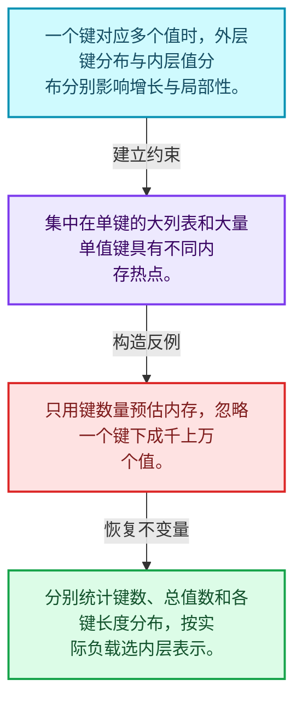
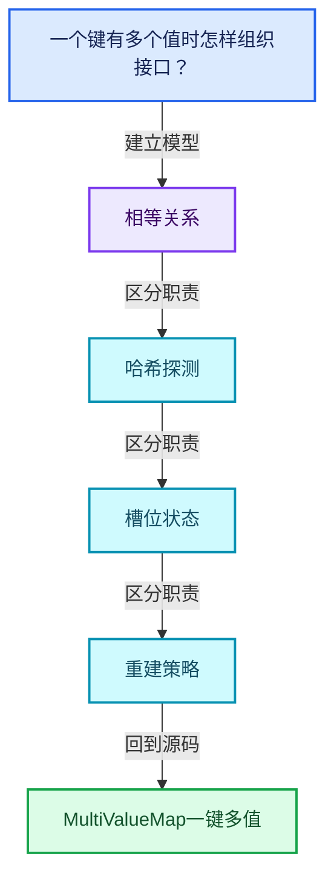
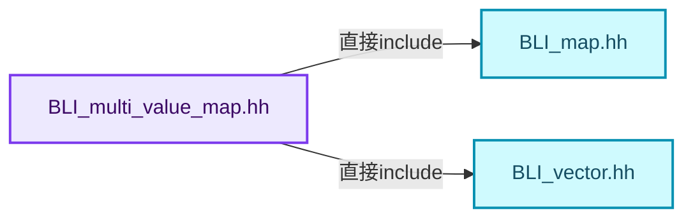
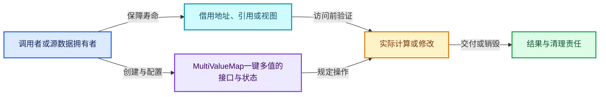
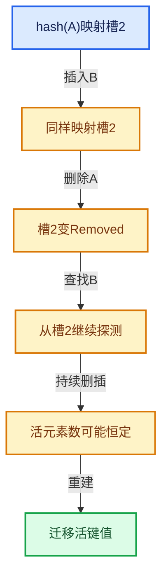

# 02-09 MultiValueMap一键多值

[方向导航](README.md) · [总目录](../README.md) · [覆盖索引](../%E6%BA%90%E7%A0%81%E7%89%88%E6%9C%AC%E4%B8%8E%E8%A6%86%E7%9B%96%E7%B4%A2%E5%BC%95.md)

> 阅读顺序：问题与数据模型 → 语法与类型 → 源码逐行 → 调用线索 → 历史与取舍 → 推演和练习。

- 基准 HEAD：`cbda6b96c26c0dee3c3b5cbb93960c4ac06a6b30`。
- 记录日期：2026-10-14。
- 教学示例状态：正文中的推演不是本机性能实测；已运行练习见验收报告。

## 一、从问题到设计

一个键有多个值时怎样组织接口？

外层哈希定位键，内层集合保存值；热点键与均匀键分布的分配模式不同。

本篇把语法、数据语义和系统取舍连接起来。相等与哈希是基础契约；探测、删除和增长共同决定复杂度。

### 本篇独立模型与设计推理

一个键对应多个值时，外层键分布与内层值分布分别影响增长与局部性。

设计取舍：集中在单键的大列表和大量单值键具有不同内存热点。

最小反例：只用键数量预估内存，忽略一个键下成千上万个值。

推导与处理：分别统计键数、总值数和各键长度分布，按实际负载选内层表示。



### 源码范围与相邻篇章

| 文件 | 本篇逐行范围 | 基准SHA-256 |
|---|---|---|
| [source/blender/blenlib/BLI_multi_value_map.hh](../../../../../source/blender/blenlib/BLI_multi_value_map.hh) | L1—L189 | `bf9045a0d12e196a92f06f3c51ddec834d2e010348ef1daf4e58e40c1384412d` |

同一主讲文件可能分多篇覆盖；超出本篇范围的符号通过覆盖索引定位。空行与纯注释保留在源码摘录中，逐行表解释有效语句与语法边界；许可证头统一保留。

前篇：[Set与集合语义](08-Set%E4%B8%8E%E9%9B%86%E5%90%88%E8%AF%AD%E4%B9%89.md).

后篇：[浮点修复与基础库对比](10-%E6%B5%AE%E7%82%B9%E4%BF%AE%E5%A4%8D%E4%B8%8E%E5%9F%BA%E7%A1%80%E5%BA%93%E5%AF%B9%E6%AF%94.md).

## 二、类型、数据与阅读地图



这是概念依赖图，边表示阅读关系，不声称是运行时调用顺序。

### 直接编译依赖



箭头只表示头文件包含关系；完整调用线索见后面的符号定位表。

## 三、关键词、语法与类型角色

### 模板 template

模板把类型或常量作为生成实现的参数。读声明时先列出类型参数、非类型参数和默认值，再看使用者实际实例化了什么。模板声明本身不意味着每种T都支持其全部成员。

具体检查：把T替换为int、string、只能移动的类型，分别检查每个被调用操作是否成立。

### 依赖名称 typename

typename既可引入类型模板参数，也可告诉编译器某个依赖名称是类型。它不创建运行时对象；解析期确认语法类别与实例化期检查具体类型是不同阶段。

具体检查：区分typename T::value_type和T::size()，前者标记类型，后者是表达式。

### 只读限定 const

const约束当前访问路径可做的修改。const指针、指向const的指针、const视图对象、const元素是不同位置的限定；其他别名可能仍可修改原对象。

具体检查：分别写T* const、const T*与const T* const，并画出不可修改的层次。

### 移动转换 std::move

std::move把表达式转换为可供移动重载选择的值类别，实际资源转移发生在被选中的构造或赋值中。对const对象move可能仍调用复制，对视图move也不会获得底层数据所有权。

具体检查：记录移动构造调用次数，不用变量名或std::move的出现次数替代测量。

### 完美转发 std::forward

std::forward在转发引用模板中恢复调用者原来的值类别。它依赖推导出的模板实参；无条件move会改变左值调用者的语义。

具体检查：对同一接口分别传入左值、临时对象和const左值，记录实际重载。

### 构造与new表达式

普通new可能分配并构造；placement new在给定地址构造，存储由其他机制提供。失败回滚应区分两类责任。

具体检查：追踪地址来自哪里、构造何时成功、由谁析构、由谁释放。

### 受控访问 friend

friend授予指定函数或类访问非公开成员的权限，并不意味着继承，也不自动扩展到友元的派生类。

具体检查：解释执行器为何需要访问包装器的内部映射，同时检查边界是否仍清楚。

### 类型别名 using

类型别名为已有类型建立名字，不创建运行期对象。它常把模板内部使用的类型统一暴露给泛型调用者。

具体检查：展开别名直到基础类型，区分类型别名和变量声明。

## 四、真实源码与逐行讲解

源码块保持原行内容，原始行号由小节标题及逐行表给出。表中的调用定位是静态阅读辅助；重载、模板实例化、宏展开和虚调用需结合完整声明，不能仅凭词法出现证明动态调用。

### BLI_multi_value_map.hh：L1—L48

<!-- source:source/blender/blenlib/BLI_multi_value_map.hh:1:48 -->

```cpp
/* SPDX-FileCopyrightText: 2023 Blender Authors
 *
 * SPDX-License-Identifier: GPL-2.0-or-later */

#pragma once

/** \file
 * \ingroup bli
 *
 * A `MultiValueMap<Key, Value>` is an unordered associative container that stores
 * key-value pairs. It is different from `Map` in that it can store multiple values for
 * the same key. The list of values that corresponds to a specific key can contain duplicates
 * and their order is maintained.
 *
 * This data structure is different from a `std::multi_map`, because multi_map can store the same
 * key more than once and MultiValueMap can't.
 *
 * Currently, this class exists mainly for convenience. There are no performance benefits over
 * using Map<Key, Vector<Value>>. In the future, a better implementation for this data structure
 * can be developed.
 */

#include "BLI_map.hh"
#include "BLI_vector.hh"

namespace blender {

template<typename Key, typename Value> class MultiValueMap {
 public:
  using size_type = int64_t;

 private:
  using MapType = Map<Key, Vector<Value>>;
  MapType map_;

 public:
  /**
   * Add a new value for the given key. If the map contains the key already, the value will be
   * appended to the list of corresponding values.
   */
  void add(const Key &key, const Value &value)
  {
    this->add_as(key, value);
  }
  void add(const Key &key, Value &&value)
  {
    this->add_as(key, std::move(value));
  }
```

| 原始行 | 语义、约束与检查 |
|---|---|
| L5 | 防止同一头文件在一个翻译单元中重复展开；不控制多个源文件之间的链接或对象寿命。 |
| L23 | 引入编译依赖 "BLI_map.hh"；这是声明可见性关系，不表示运行时一定调用该文件的所有接口。 |
| L24 | 引入编译依赖 "BLI_vector.hh"；这是声明可见性关系，不表示运行时一定调用该文件的所有接口。 |
| L26 | 把后续声明放入 blender 命名空间，影响名称查找和符号归属，不创建运行时对象。 |
| L28 | 声明模板参数 `template<typename Key, typename Value> class MultiValueMap {`。类型参数决定生成操作的类型，非类型参数可决定内嵌容量或编译期分支。 |
| L29 | 切换成员访问权限为 public；它是编译期接口边界，不是线程同步或内存保护。 |
| L30 | 定义类型别名 `using size_type = int64_t`，为模板接口或内部实现统一命名；本行不分配该类型对象。 |
| L32 | 切换成员访问权限为 private；它是编译期接口边界，不是线程同步或内存保护。 |
| L33 | 定义类型别名 `using MapType = Map<Key, Vector<Value>>`，为模板接口或内部实现统一命名；本行不分配该类型对象。 |
| L34 | 声明成员、局部对象或完成语句 `MapType map_`。若为指针或引用，它本身不说明拥有；若为值对象，其构造析构由所在作用域或外层对象管理。 |
| L36 | 切换成员访问权限为 public；它是编译期接口边界，不是线程同步或内存保护。 |
| L41 | 出现调用或函数声明 `add`，对应表达式为 `void add(const Key &key, const Value &value)`。参数求值、返回类型与重载需结合前后完整语句；静态文本引用不能证明动态目标。 |
| L42 | 连接上一行的声明或控制结构与其语句块；后续行在这个作用域中执行或声明。 |
| L43 | 出现调用或函数声明 `add_as`，对应表达式为 `this->add_as(key, value);`。参数求值、返回类型与重载需结合前后完整语句；静态文本引用不能证明动态目标。 |
| L44 | 结束当前语法单元。局部自动对象在离开其作用域时按规则销毁；这不等于所有被引用的外部数据也被释放。 |
| L45 | 出现调用或函数声明 `add`，对应表达式为 `void add(const Key &key, Value &&value)`。参数求值、返回类型与重载需结合前后完整语句；静态文本引用不能证明动态目标。 |
| L46 | 连接上一行的声明或控制结构与其语句块；后续行在这个作用域中执行或声明。 |
| L47 | 出现调用或函数声明 `add_as`，对应表达式为 `this->add_as(key, std::move(value));`。参数求值、返回类型与重载需结合前后完整语句；静态文本引用不能证明动态目标。 |
| L48 | 结束当前语法单元。局部自动对象在离开其作用域时按规则销毁；这不等于所有被引用的外部数据也被释放。 |

### BLI_multi_value_map.hh：L49—L93

<!-- source:source/blender/blenlib/BLI_multi_value_map.hh:49:93 -->

```cpp
  void add(Key &&key, const Value &value)
  {
    this->add_as(std::move(key), value);
  }
  void add(Key &&key, Value &&value)
  {
    this->add_as(std::move(key), std::move(value));
  }
  template<typename ForwardKey, typename ForwardValue>
  void add_as(ForwardKey &&key, ForwardValue &&value)
  {
    Vector<Value> &vector = map_.lookup_or_add_default_as(std::forward<ForwardKey>(key));
    vector.append(std::forward<ForwardValue>(value));
  }

  void add_non_duplicates(const Key &key, const Value &value)
  {
    Vector<Value> &vector = map_.lookup_or_add_default_as(key);
    vector.append_non_duplicates(value);
  }

  /**
   * Add all given values to the key.
   */
  void add_multiple(const Key &key, Span<Value> values)
  {
    this->add_multiple_as(key, values);
  }
  void add_multiple(Key &&key, Span<Value> values)
  {
    this->add_multiple_as(std::move(key), values);
  }
  template<typename ForwardKey> void add_multiple_as(ForwardKey &&key, Span<Value> values)
  {
    Vector<Value> &vector = map_.lookup_or_add_default_as(std::forward<ForwardKey>(key));
    vector.extend(values);
  }

  /**
   * Get a span to all the values that are stored for the given key.
   */
  Span<Value> lookup(const Key &key) const
  {
    return this->lookup_as(key);
  }
```

| 原始行 | 语义、约束与检查 |
|---|---|
| L49 | 出现调用或函数声明 `add`，对应表达式为 `void add(Key &&key, const Value &value)`。参数求值、返回类型与重载需结合前后完整语句；静态文本引用不能证明动态目标。 |
| L50 | 连接上一行的声明或控制结构与其语句块；后续行在这个作用域中执行或声明。 |
| L51 | 出现调用或函数声明 `add_as`，对应表达式为 `this->add_as(std::move(key), value);`。参数求值、返回类型与重载需结合前后完整语句；静态文本引用不能证明动态目标。 |
| L52 | 结束当前语法单元。局部自动对象在离开其作用域时按规则销毁；这不等于所有被引用的外部数据也被释放。 |
| L53 | 出现调用或函数声明 `add`，对应表达式为 `void add(Key &&key, Value &&value)`。参数求值、返回类型与重载需结合前后完整语句；静态文本引用不能证明动态目标。 |
| L54 | 连接上一行的声明或控制结构与其语句块；后续行在这个作用域中执行或声明。 |
| L55 | 出现调用或函数声明 `add_as`，对应表达式为 `this->add_as(std::move(key), std::move(value));`。参数求值、返回类型与重载需结合前后完整语句；静态文本引用不能证明动态目标。 |
| L56 | 结束当前语法单元。局部自动对象在离开其作用域时按规则销毁；这不等于所有被引用的外部数据也被释放。 |
| L57 | 声明模板参数 `template<typename ForwardKey, typename ForwardValue>`。类型参数决定生成操作的类型，非类型参数可决定内嵌容量或编译期分支。 |
| L58 | 出现调用或函数声明 `add_as`，对应表达式为 `void add_as(ForwardKey &&key, ForwardValue &&value)`。参数求值、返回类型与重载需结合前后完整语句；静态文本引用不能证明动态目标。 |
| L59 | 连接上一行的声明或控制结构与其语句块；后续行在这个作用域中执行或声明。 |
| L60 | 把右侧 `map_.lookup_or_add_default_as(std::forward<ForwardKey>(key))` 用于初始化或更新左侧 `Vector<Value> &vector`。声明初始化与已有对象赋值应按上下文区分；有资源的类型会调用相应特殊成员。 |
| L61 | 出现调用或函数声明 `append`，对应表达式为 `vector.append(std::forward<ForwardValue>(value));`。参数求值、返回类型与重载需结合前后完整语句；静态文本引用不能证明动态目标。 |
| L62 | 结束当前语法单元。局部自动对象在离开其作用域时按规则销毁；这不等于所有被引用的外部数据也被释放。 |
| L64 | 出现调用或函数声明 `add_non_duplicates`，对应表达式为 `void add_non_duplicates(const Key &key, const Value &value)`。参数求值、返回类型与重载需结合前后完整语句；静态文本引用不能证明动态目标。 |
| L65 | 连接上一行的声明或控制结构与其语句块；后续行在这个作用域中执行或声明。 |
| L66 | 把右侧 `map_.lookup_or_add_default_as(key)` 用于初始化或更新左侧 `Vector<Value> &vector`。声明初始化与已有对象赋值应按上下文区分；有资源的类型会调用相应特殊成员。 |
| L67 | 出现调用或函数声明 `append_non_duplicates`，对应表达式为 `vector.append_non_duplicates(value);`。参数求值、返回类型与重载需结合前后完整语句；静态文本引用不能证明动态目标。 |
| L68 | 结束当前语法单元。局部自动对象在离开其作用域时按规则销毁；这不等于所有被引用的外部数据也被释放。 |
| L73 | 出现调用或函数声明 `add_multiple`，对应表达式为 `void add_multiple(const Key &key, Span<Value> values)`。参数求值、返回类型与重载需结合前后完整语句；静态文本引用不能证明动态目标。 |
| L74 | 连接上一行的声明或控制结构与其语句块；后续行在这个作用域中执行或声明。 |
| L75 | 出现调用或函数声明 `add_multiple_as`，对应表达式为 `this->add_multiple_as(key, values);`。参数求值、返回类型与重载需结合前后完整语句；静态文本引用不能证明动态目标。 |
| L76 | 结束当前语法单元。局部自动对象在离开其作用域时按规则销毁；这不等于所有被引用的外部数据也被释放。 |
| L77 | 出现调用或函数声明 `add_multiple`，对应表达式为 `void add_multiple(Key &&key, Span<Value> values)`。参数求值、返回类型与重载需结合前后完整语句；静态文本引用不能证明动态目标。 |
| L78 | 连接上一行的声明或控制结构与其语句块；后续行在这个作用域中执行或声明。 |
| L79 | 出现调用或函数声明 `add_multiple_as`，对应表达式为 `this->add_multiple_as(std::move(key), values);`。参数求值、返回类型与重载需结合前后完整语句；静态文本引用不能证明动态目标。 |
| L80 | 结束当前语法单元。局部自动对象在离开其作用域时按规则销毁；这不等于所有被引用的外部数据也被释放。 |
| L81 | 声明模板参数 `template<typename ForwardKey> void add_multiple_as(ForwardKey &&key, Span<Value> values)`。类型参数决定生成操作的类型，非类型参数可决定内嵌容量或编译期分支。 |
| L82 | 连接上一行的声明或控制结构与其语句块；后续行在这个作用域中执行或声明。 |
| L83 | 把右侧 `map_.lookup_or_add_default_as(std::forward<ForwardKey>(key))` 用于初始化或更新左侧 `Vector<Value> &vector`。声明初始化与已有对象赋值应按上下文区分；有资源的类型会调用相应特殊成员。 |
| L84 | 出现调用或函数声明 `extend`，对应表达式为 `vector.extend(values);`。参数求值、返回类型与重载需结合前后完整语句；静态文本引用不能证明动态目标。 |
| L85 | 结束当前语法单元。局部自动对象在离开其作用域时按规则销毁；这不等于所有被引用的外部数据也被释放。 |
| L90 | 出现调用或函数声明 `lookup`，对应表达式为 `Span<Value> lookup(const Key &key) const`。参数求值、返回类型与重载需结合前后完整语句；静态文本引用不能证明动态目标。 |
| L91 | 连接上一行的声明或控制结构与其语句块；后续行在这个作用域中执行或声明。 |
| L92 | 返回表达式 `this->lookup_as(key)`。 |
| L93 | 结束当前语法单元。局部自动对象在离开其作用域时按规则销毁；这不等于所有被引用的外部数据也被释放。 |

### BLI_multi_value_map.hh：L94—L142

<!-- source:source/blender/blenlib/BLI_multi_value_map.hh:94:142 -->

```cpp
  template<typename ForwardKey> Span<Value> lookup_as(const ForwardKey &key) const
  {
    const Vector<Value> *vector = map_.lookup_ptr_as(key);
    if (vector != nullptr) {
      return vector->as_span();
    }
    return {};
  }

  /**
   * Get a mutable span to all the values that are stored for the given key.
   */
  MutableSpan<Value> lookup(const Key &key)
  {
    return this->lookup_as(key);
  }
  template<typename ForwardKey> MutableSpan<Value> lookup_as(const ForwardKey &key)
  {
    Vector<Value> *vector = map_.lookup_ptr_as(key);
    if (vector != nullptr) {
      return vector->as_mutable_span();
    }
    return {};
  }

  /**
   * Get the number of keys.
   */
  int64_t size() const
  {
    return map_.size();
  }

  /**
   * Returns true if there are no keys in the map.
   * NOTE: There may be keys without values. In this case the map is not empty.
   */
  bool is_empty() const
  {
    return map_.is_empty();
  }

  /**
   * NOTE: This signature will change when the implementation changes.
   */
  typename MapType::ItemIterator items() const
  {
    return map_.items();
  }
```

本段语义重点：

- 分支证据 `vector != nullptr)`：分别推演条件成立与不成立，核对相同出口处的状态。
- 分支证据 `vector != nullptr)`：分别推演条件成立与不成立，核对相同出口处的状态。

| 原始行 | 语义、约束与检查 |
|---|---|
| L94 | 声明模板参数 `template<typename ForwardKey> Span<Value> lookup_as(const ForwardKey &key) const`。类型参数决定生成操作的类型，非类型参数可决定内嵌容量或编译期分支。 |
| L95 | 连接上一行的声明或控制结构与其语句块；后续行在这个作用域中执行或声明。 |
| L96 | 把右侧 `map_.lookup_ptr_as(key)` 用于初始化或更新左侧 `const Vector<Value> *vector`。声明初始化与已有对象赋值应按上下文区分；有资源的类型会调用相应特殊成员。 |
| L97 | 判断 `vector != nullptr`，成立时进入本分支，否则继续后续路径。这里区分空地址与可用地址，但非空本身仍不能证明对象存活。 |
| L98 | 返回表达式 `vector->as_span()`。 |
| L99 | 结束当前语法单元。局部自动对象在离开其作用域时按规则销毁；这不等于所有被引用的外部数据也被释放。 |
| L100 | 返回表达式 `{}`。 |
| L101 | 结束当前语法单元。局部自动对象在离开其作用域时按规则销毁；这不等于所有被引用的外部数据也被释放。 |
| L106 | 出现调用或函数声明 `lookup`，对应表达式为 `MutableSpan<Value> lookup(const Key &key)`。参数求值、返回类型与重载需结合前后完整语句；静态文本引用不能证明动态目标。 |
| L107 | 连接上一行的声明或控制结构与其语句块；后续行在这个作用域中执行或声明。 |
| L108 | 返回表达式 `this->lookup_as(key)`。 |
| L109 | 结束当前语法单元。局部自动对象在离开其作用域时按规则销毁；这不等于所有被引用的外部数据也被释放。 |
| L110 | 声明模板参数 `template<typename ForwardKey> MutableSpan<Value> lookup_as(const ForwardKey &key)`。类型参数决定生成操作的类型，非类型参数可决定内嵌容量或编译期分支。 |
| L111 | 连接上一行的声明或控制结构与其语句块；后续行在这个作用域中执行或声明。 |
| L112 | 把右侧 `map_.lookup_ptr_as(key)` 用于初始化或更新左侧 `Vector<Value> *vector`。声明初始化与已有对象赋值应按上下文区分；有资源的类型会调用相应特殊成员。 |
| L113 | 判断 `vector != nullptr`，成立时进入本分支，否则继续后续路径。这里区分空地址与可用地址，但非空本身仍不能证明对象存活。 |
| L114 | 返回表达式 `vector->as_mutable_span()`。 |
| L115 | 结束当前语法单元。局部自动对象在离开其作用域时按规则销毁；这不等于所有被引用的外部数据也被释放。 |
| L116 | 返回表达式 `{}`。 |
| L117 | 结束当前语法单元。局部自动对象在离开其作用域时按规则销毁；这不等于所有被引用的外部数据也被释放。 |
| L122 | 出现调用或函数声明 `size`，对应表达式为 `int64_t size() const`。参数求值、返回类型与重载需结合前后完整语句；静态文本引用不能证明动态目标。 |
| L123 | 连接上一行的声明或控制结构与其语句块；后续行在这个作用域中执行或声明。 |
| L124 | 返回表达式 `map_.size()`。 |
| L125 | 结束当前语法单元。局部自动对象在离开其作用域时按规则销毁；这不等于所有被引用的外部数据也被释放。 |
| L131 | 出现调用或函数声明 `is_empty`，对应表达式为 `bool is_empty() const`。参数求值、返回类型与重载需结合前后完整语句；静态文本引用不能证明动态目标。 |
| L132 | 连接上一行的声明或控制结构与其语句块；后续行在这个作用域中执行或声明。 |
| L133 | 返回表达式 `map_.is_empty()`。 |
| L134 | 结束当前语法单元。局部自动对象在离开其作用域时按规则销毁；这不等于所有被引用的外部数据也被释放。 |
| L139 | 出现调用或函数声明 `items`，对应表达式为 `typename MapType::ItemIterator items() const`。参数求值、返回类型与重载需结合前后完整语句；静态文本引用不能证明动态目标。 |
| L140 | 连接上一行的声明或控制结构与其语句块；后续行在这个作用域中执行或声明。 |
| L141 | 返回表达式 `map_.items()`。 |
| L142 | 结束当前语法单元。局部自动对象在离开其作用域时按规则销毁；这不等于所有被引用的外部数据也被释放。 |

### BLI_multi_value_map.hh：L143—L189

<!-- source:source/blender/blenlib/BLI_multi_value_map.hh:143:189 -->

```cpp

  /**
   * NOTE: This signature will change when the implementation changes.
   */
  typename MapType::MutableItemIterator items()
  {
    return map_.items();
  }

  /**
   * NOTE: This signature will change when the implementation changes.
   */
  typename MapType::KeyIterator keys() const
  {
    return map_.keys();
  }

  /**
   * NOTE: This signature will change when the implementation changes.
   */
  typename MapType::ValueIterator values() const
  {
    return map_.values();
  }

  /**
   * NOTE: This signature will change when the implementation changes.
   */
  typename MapType::MutableValueIterator values()
  {
    return map_.values();
  }

  void clear()
  {
    map_.clear();
  }

  void clear_and_shrink()
  {
    map_.clear_and_shrink();
  }

  friend bool operator==(const MultiValueMap &a, const MultiValueMap &b) = default;
};

}  // namespace blender
```

| 原始行 | 语义、约束与检查 |
|---|---|
| L147 | 出现调用或函数声明 `items`，对应表达式为 `typename MapType::MutableItemIterator items()`。参数求值、返回类型与重载需结合前后完整语句；静态文本引用不能证明动态目标。 |
| L148 | 连接上一行的声明或控制结构与其语句块；后续行在这个作用域中执行或声明。 |
| L149 | 返回表达式 `map_.items()`。 |
| L150 | 结束当前语法单元。局部自动对象在离开其作用域时按规则销毁；这不等于所有被引用的外部数据也被释放。 |
| L155 | 出现调用或函数声明 `keys`，对应表达式为 `typename MapType::KeyIterator keys() const`。参数求值、返回类型与重载需结合前后完整语句；静态文本引用不能证明动态目标。 |
| L156 | 连接上一行的声明或控制结构与其语句块；后续行在这个作用域中执行或声明。 |
| L157 | 返回表达式 `map_.keys()`。 |
| L158 | 结束当前语法单元。局部自动对象在离开其作用域时按规则销毁；这不等于所有被引用的外部数据也被释放。 |
| L163 | 出现调用或函数声明 `values`，对应表达式为 `typename MapType::ValueIterator values() const`。参数求值、返回类型与重载需结合前后完整语句；静态文本引用不能证明动态目标。 |
| L164 | 连接上一行的声明或控制结构与其语句块；后续行在这个作用域中执行或声明。 |
| L165 | 返回表达式 `map_.values()`。 |
| L166 | 结束当前语法单元。局部自动对象在离开其作用域时按规则销毁；这不等于所有被引用的外部数据也被释放。 |
| L171 | 出现调用或函数声明 `values`，对应表达式为 `typename MapType::MutableValueIterator values()`。参数求值、返回类型与重载需结合前后完整语句；静态文本引用不能证明动态目标。 |
| L172 | 连接上一行的声明或控制结构与其语句块；后续行在这个作用域中执行或声明。 |
| L173 | 返回表达式 `map_.values()`。 |
| L174 | 结束当前语法单元。局部自动对象在离开其作用域时按规则销毁；这不等于所有被引用的外部数据也被释放。 |
| L176 | 出现调用或函数声明 `clear`，对应表达式为 `void clear()`。参数求值、返回类型与重载需结合前后完整语句；静态文本引用不能证明动态目标。 |
| L177 | 连接上一行的声明或控制结构与其语句块；后续行在这个作用域中执行或声明。 |
| L178 | 出现调用或函数声明 `clear`，对应表达式为 `map_.clear();`。参数求值、返回类型与重载需结合前后完整语句；静态文本引用不能证明动态目标。 |
| L179 | 结束当前语法单元。局部自动对象在离开其作用域时按规则销毁；这不等于所有被引用的外部数据也被释放。 |
| L181 | 出现调用或函数声明 `clear_and_shrink`，对应表达式为 `void clear_and_shrink()`。参数求值、返回类型与重载需结合前后完整语句；静态文本引用不能证明动态目标。 |
| L182 | 连接上一行的声明或控制结构与其语句块；后续行在这个作用域中执行或声明。 |
| L183 | 出现调用或函数声明 `clear_and_shrink`，对应表达式为 `map_.clear_and_shrink();`。参数求值、返回类型与重载需结合前后完整语句；静态文本引用不能证明动态目标。 |
| L184 | 结束当前语法单元。局部自动对象在离开其作用域时按规则销毁；这不等于所有被引用的外部数据也被释放。 |
| L186 | 显式采用编译器生成的特殊成员行为：`friend bool operator==(const MultiValueMap &a, const MultiValueMap &b) = default;`。成员和基类的性质决定该操作是否可用、是否被删除及异常约定，不表示运行时给对象赋值为default。 |
| L187 | 结束当前语法单元。局部自动对象在离开其作用域时按规则销毁；这不等于所有被引用的外部数据也被释放。 |
| L189 | 结束当前语法单元。局部自动对象在离开其作用域时按规则销毁；这不等于所有被引用的外部数据也被释放。 |

## 五、接口定位、调用线索与生命周期

### 本篇声明与实现入口

| 源码位置 | 实际声明片段 |
|---|---|
| [BLI_multi_value_map.hh:L28](../../../../../source/blender/blenlib/BLI_multi_value_map.hh#L28) | `template<typename Key, typename Value> class MultiValueMap` |
| [BLI_multi_value_map.hh:L41](../../../../../source/blender/blenlib/BLI_multi_value_map.hh#L41) | `void add(const Key &key, const Value &value)` |
| [BLI_multi_value_map.hh:L45](../../../../../source/blender/blenlib/BLI_multi_value_map.hh#L45) | `void add(const Key &key, Value &&value)` |
| [BLI_multi_value_map.hh:L49](../../../../../source/blender/blenlib/BLI_multi_value_map.hh#L49) | `void add(Key &&key, const Value &value)` |
| [BLI_multi_value_map.hh:L53](../../../../../source/blender/blenlib/BLI_multi_value_map.hh#L53) | `void add(Key &&key, Value &&value)` |
| [BLI_multi_value_map.hh:L58](../../../../../source/blender/blenlib/BLI_multi_value_map.hh#L58) | `void add_as(ForwardKey &&key, ForwardValue &&value)` |
| [BLI_multi_value_map.hh:L64](../../../../../source/blender/blenlib/BLI_multi_value_map.hh#L64) | `void add_non_duplicates(const Key &key, const Value &value)` |
| [BLI_multi_value_map.hh:L73](../../../../../source/blender/blenlib/BLI_multi_value_map.hh#L73) | `void add_multiple(const Key &key, Span<Value> values)` |
| [BLI_multi_value_map.hh:L77](../../../../../source/blender/blenlib/BLI_multi_value_map.hh#L77) | `void add_multiple(Key &&key, Span<Value> values)` |
| [BLI_multi_value_map.hh:L81](../../../../../source/blender/blenlib/BLI_multi_value_map.hh#L81) | `template<typename ForwardKey> void add_multiple_as(ForwardKey &&key, Span<Value> values)` |
| [BLI_multi_value_map.hh:L90](../../../../../source/blender/blenlib/BLI_multi_value_map.hh#L90) | `Span<Value> lookup(const Key &key) const` |
| [BLI_multi_value_map.hh:L94](../../../../../source/blender/blenlib/BLI_multi_value_map.hh#L94) | `template<typename ForwardKey> Span<Value> lookup_as(const ForwardKey &key) const` |
| [BLI_multi_value_map.hh:L106](../../../../../source/blender/blenlib/BLI_multi_value_map.hh#L106) | `MutableSpan<Value> lookup(const Key &key)` |
| [BLI_multi_value_map.hh:L110](../../../../../source/blender/blenlib/BLI_multi_value_map.hh#L110) | `template<typename ForwardKey> MutableSpan<Value> lookup_as(const ForwardKey &key)` |
| [BLI_multi_value_map.hh:L122](../../../../../source/blender/blenlib/BLI_multi_value_map.hh#L122) | `int64_t size() const` |
| [BLI_multi_value_map.hh:L131](../../../../../source/blender/blenlib/BLI_multi_value_map.hh#L131) | `bool is_empty() const` |
| [BLI_multi_value_map.hh:L139](../../../../../source/blender/blenlib/BLI_multi_value_map.hh#L139) | `typename MapType::ItemIterator items() const` |
| [BLI_multi_value_map.hh:L147](../../../../../source/blender/blenlib/BLI_multi_value_map.hh#L147) | `typename MapType::MutableItemIterator items()` |
| [BLI_multi_value_map.hh:L155](../../../../../source/blender/blenlib/BLI_multi_value_map.hh#L155) | `typename MapType::KeyIterator keys() const` |
| [BLI_multi_value_map.hh:L163](../../../../../source/blender/blenlib/BLI_multi_value_map.hh#L163) | `typename MapType::ValueIterator values() const` |
| [BLI_multi_value_map.hh:L171](../../../../../source/blender/blenlib/BLI_multi_value_map.hh#L171) | `typename MapType::MutableValueIterator values()` |
| [BLI_multi_value_map.hh:L176](../../../../../source/blender/blenlib/BLI_multi_value_map.hh#L176) | `void clear()` |
| [BLI_multi_value_map.hh:L181](../../../../../source/blender/blenlib/BLI_multi_value_map.hh#L181) | `void clear_and_shrink()` |

### 同名符号出现位置

以下表提供跨文件阅读入口，包含声明、调用或测试使用；没有经过完整C++名称解析，不把它命名为已证明的运行时调用图。

| 符号 | 位置 | 文本证据 |
|---|---|---|
| `add` | [BKE_attribute.hh:L769](../../../../../source/blender/blenkernel/BKE_attribute.hh#L769) | `bool add(const StringRef name,` |
| `add` | [BKE_attribute.hh:L783](../../../../../source/blender/blenkernel/BKE_attribute.hh#L783) | `return fn_->add(owner_, name, domain, data_type, initializer);` |
| `add` | [BKE_attribute.hh:L786](../../../../../source/blender/blenkernel/BKE_attribute.hh#L786) | `bool add(const StringRef name, const AttrDomain domain, const AttributeInit &initializer)` |
| `add_as` | [BLI_map.hh:L297](../../../../../source/blender/blenlib/BLI_map.hh#L297) | `return this->add_as(key, value);` |
| `add_as` | [BLI_map.hh:L301](../../../../../source/blender/blenlib/BLI_map.hh#L301) | `return this->add_as(key, std::move(value));` |
| `add_as` | [BLI_map.hh:L305](../../../../../source/blender/blenlib/BLI_map.hh#L305) | `return this->add_as(std::move(key), value);` |
| `add_multiple` | [mesh.cc:L823](../../../../../source/blender/blenkernel/intern/mesh.cc#L823) | `verts.add_multiple(corner_verts.slice(face));` |
| `add_multiple` | [BLI_set.hh:L181](../../../../../source/blender/blenlib/BLI_set.hh#L181) | `this->add_multiple(values);` |
| `add_multiple` | [BLI_set.hh:L287](../../../../../source/blender/blenlib/BLI_set.hh#L287) | `void add_multiple(Span<Key> keys)` |
| `lookup` | [BKE_attribute.hh:L585](../../../../../source/blender/blenkernel/BKE_attribute.hh#L585) | `GAttributeReader lookup(const StringRef name) const` |
| `lookup` | [BKE_attribute.hh:L587](../../../../../source/blender/blenkernel/BKE_attribute.hh#L587) | `return fn_->lookup(owner_, name);` |
| `lookup` | [BKE_attribute.hh:L594](../../../../../source/blender/blenkernel/BKE_attribute.hh#L594) | `GAttributeReader lookup(StringRef name,` |
| `lookup_as` | [BLI_map.hh:L547](../../../../../source/blender/blenlib/BLI_map.hh#L547) | `return this->lookup_as(key);` |
| `lookup_as` | [BLI_map.hh:L551](../../../../../source/blender/blenlib/BLI_map.hh#L551) | `return this->lookup_as(key);` |
| `lookup_as` | [BLI_map.hh:L553](../../../../../source/blender/blenlib/BLI_map.hh#L553) | `template<typename ForwardKey> const Value &lookup_as(const ForwardKey &key) const` |
| `size` | [BKE_curves.hh:L599](../../../../../source/blender/blenkernel/BKE_curves.hh#L599) | `return {curve_index + points.start(), points.size() + 1};` |
| `size` | [BKE_curves.hh:L1085](../../../../../source/blender/blenkernel/BKE_curves.hh#L1085) | `return {start, curves::segments_num(points.size(), cyclic)};` |
| `size` | [BKE_mesh.hh:L308](../../../../../source/blender/blenkernel/BKE_mesh.hh#L308) | `return corner - 1 + (corner == face.start()) * face.size();` |
| `is_empty` | [BKE_attribute.hh:L780](../../../../../source/blender/blenkernel/BKE_attribute.hh#L780) | `if (name.is_empty()) {` |
| `is_empty` | [BKE_attribute.hh:L798](../../../../../source/blender/blenkernel/BKE_attribute.hh#L798) | `if (name.is_empty()) {` |
| `is_empty` | [BKE_curves.hh:L185](../../../../../source/blender/blenkernel/BKE_curves.hh#L185) | `bool is_empty() const;` |
| `items` | [BLI_map.hh:L902](../../../../../source/blender/blenlib/BLI_map.hh#L902) | `ItemIterator items() const &` |
| `items` | [BLI_map.hh:L913](../../../../../source/blender/blenlib/BLI_map.hh#L913) | `MutableItemIterator items() &` |
| `items` | [BLI_map.hh:L926](../../../../../source/blender/blenlib/BLI_map.hh#L926) | `ItemIterator items() const && = delete;` |
| `keys` | [BLI_map.hh:L875](../../../../../source/blender/blenlib/BLI_map.hh#L875) | `KeyIterator keys() const &` |
| `keys` | [BLI_map.hh:L923](../../../../../source/blender/blenlib/BLI_map.hh#L923) | `KeyIterator keys() const && = delete;` |
| `keys` | [BLI_map.hh:L969](../../../../../source/blender/blenlib/BLI_map.hh#L969) | `HashTableStats stats(*this, this->keys());` |
| `values` | [geometry_fields.cc:L808](../../../../../source/blender/blenkernel/intern/geometry_fields.cc#L808) | `GArray<> values(cpp_type, src_domain_size);` |
| `values` | [BLI_map.hh:L884](../../../../../source/blender/blenlib/BLI_map.hh#L884) | `ValueIterator values() const &` |
| `values` | [BLI_map.hh:L893](../../../../../source/blender/blenlib/BLI_map.hh#L893) | `MutableValueIterator values() &` |

### 生命周期推理图



这是审查生命周期的通用模型。具体类是否拥有数据由本篇成员、构造、析构和调用者一起证明；任何箭头都不自动代表shared_ptr。

## 六、把代码放进具体数据中推演

本方向的共同数值模型如下。本篇的专门检查是：比较每键1值和单键10000值的增长行为。

| 步骤 | 数据或状态 | 为什么需要这一步 |
|---|---|---|
| 插入A | hash(A)映射槽2 | 槽2变Occupied |
| 插入B | 同样映射槽2 | 沿探测序列找到后续空槽 |
| 删除A | 槽2变Removed | B仍须可达 |
| 查找B | 从槽2继续探测 | Removed不能当作Empty终止 |
| 持续删插 | 活元素数可能恒定 | 墓碑和探测长度仍可能增长 |
| 重建 | 迁移活键值 | 去掉旧删除状态并恢复足够空间 |



图是教学推演模型；精确分支与状态更新以本篇摘录及调用契约为准。

### 本篇独立练习与参考思路

比较每键1值和单键10000值的增长行为。

参考思路：外层哈希定位键，内层集合保存值；热点键与均匀键分布的分配模式不同。

将输入、预期结果和资源责任分成三张清单。先用最直接的实现给出可核对的答案，再替换成对应源码使用的表示；比较结果不变的条件，而不是只比较接口名字。

验收依据：每个活键从其探测起点可达；不存在的键可终止；析构仅命中占用状态的真实对象。

## 七、复杂度、设计取舍与其他基础库

对比std::unordered_map、Abseil flat_hash_map与node_hash_map时，优先比较地址稳定性、键值搬移要求和删除行为；不同实现的平均常数及负载策略需要测量。

本篇的具体取舍：外层哈希定位键，内层集合保存值；热点键与均匀键分布的分配模式不同。

| 观察维度 | 从源码取得证据的方法 | 本篇要避免的误判 |
|---|---|---|
| 时间 | 对循环次数、分派次数和重建频率分别计数 | 看到单次常数操作就断定整个操作序列是常数成本 |
| 内存 | 区分对象本体、容量存储、间接资源和共享控制块 | 用sizeof代替总内存 |
| 安全 | 沿构造、失败回滚、销毁与失效逐路径检查 | 把断言或非空指针当作完整安全证明 |
| 并发 | 逐字段确认锁、发布顺序和借用寿命 | 把引用计数线程安全等同数据读写线程安全 |

相关一手资料：

- [C++公开工作草案](https://eel.is/c++draft/)：持续更新的工作草案；语言与标准库语义以相应章节为准。
- [Abseil Containers](https://abseil.io/docs/cpp/guides/container)：在线版，2026-10-14查阅；引用失效按具体容器契约检查。

资料用于核对契约和进一步阅读；这里没有声称外部库与Blender实现相同，也没有把上游性能数字当作本机实测。

## 八、历史提交与设计演化

本篇主要讲当前接口或辅助实现，方向导航给出相关架构演化提交；没有把不涉及本篇文件的提交硬写成该实现的引入证据。

## 九、反例、测试入口与掌握标准

仓库测试入口：

- [BLI_multi_value_map_test.cc](../../../../../source/blender/blenlib/tests/BLI_multi_value_map_test.cc)：阅读输入、断言与覆盖边界；本篇不把“存在测试”写成“本轮已运行”。

需要实际构造的反例：

- 空输入或没有结果需求：确认接口允许的空状态与不允许访问的操作。
- 边界位置和退化结构：把长度为1、末尾位置、重复值或深链代入真实分支。
- 生命周期结束或修改之后：检查保存的指针、引用、结果视图是否仍有效。
- 与本篇核心不变量相冲突的输入：比较每键1值和单键10000值的增长行为。

### 可运行的教学参考程序

[reference_exercises.cc](../_tools/reference_exercises.cc)包含独立于Blender的C++20参考检查：视图、简化SmallVector、异常回滚、哈希碰撞与删除、偏移数组、拓扑映射、共享缓存、表达式、惰性分支、闭包和暴力最近邻。

参考程序有意省略生产实现的完整能力。例如SmallVector禁止复制移动容器，不支持只能移动的元素，并禁止append参数别名到自身元素；TinyMap固定8槽，不提供增长。程序通过不能替代Blender实现测试。实际运行结果、编译器与命令见验收报告。

掌握标准：离开源码解释“一个键有多个值时怎样组织接口？”；独立完成上述练习；能指出一个会破坏相等关系相关约束的最小反例，并用具体代码行说明检查或修复应放在哪里。
