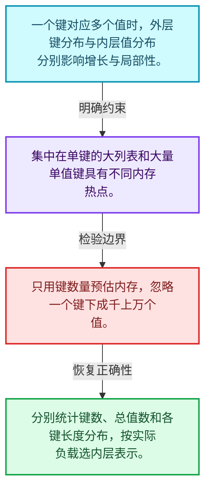
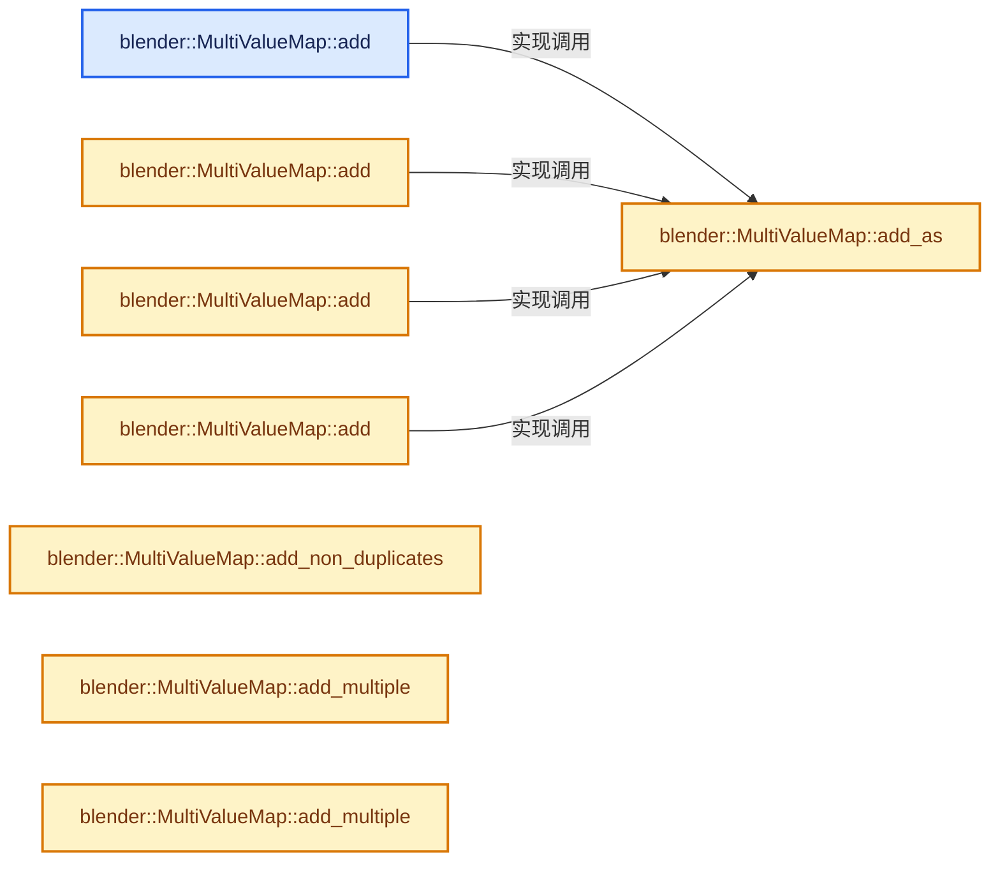
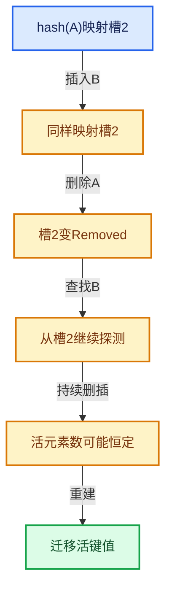

# 02-09 MultiValueMap一键多值

[方向导航](README.md) · [总目录](../README.md) · [实现索引](../%E7%AC%A6%E5%8F%B7%E4%BE%9D%E8%B5%96%E4%B8%8E%E5%AE%9E%E7%8E%B0%E7%B4%A2%E5%BC%95.md)

## 从问题到实现

一个键有多个值时怎样组织接口？

外层哈希定位键，内层集合保存值；热点键与均匀键分布的分配模式不同。

**数据模型**

一个键对应多个值时，外层键分布与内层值分布分别影响增长与局部性。

**设计取舍**

集中在单键的大列表和大量单值键具有不同内存热点。

**最小反例**

只用键数量预估内存，忽略一个键下成千上万个值。

**推导**

分别统计键数、总值数和各键长度分布，按实际负载选内层表示。

## 阅读地图与执行推演








图中的数值推演是本方向的教学模型；实际函数之间的调用边与概念分析边分别标注，不能把概念关系当作运行时调度顺序。

## 完整源码单元与就地讲解

中文讲解直接放在相关代码旁，复杂机制在代码下展开。原文折叠区保留基准行号；不需要在行号表和函数之间来回查找。类布局可分段展示，函数实现不按固定行数切开。

### 类型布局、声明与编译条件 · BLI_multi_value_map.hh L1—L40

<a id="t-c6eda2e18083"></a>

`MultiValueMap`在这里声明的数据成员：

- `MapType map_`

<!-- annotated:e04e421d460fff -->

```cpp
/* SPDX-FileCopyrightText: 2023 Blender Authors
 *
 * SPDX-License-Identifier: GPL-2.0-or-later */

#pragma once

/** \file
 * \ingroup bli
 *
 * A `MultiValueMap<Key, Value>` is an unordered associative container that stores
 * key-value pairs. It is different from `Map` in that it can store multiple values for
 * the same key. The list of values that corresponds to a specific key can contain duplicates
 * and their order is maintained.
 *
 * This data structure is different from a `std::multi_map`, because multi_map can store the same
 * key more than once and MultiValueMap can't.
 *
 * Currently, this class exists mainly for convenience. There are no performance benefits over
 * using Map<Key, Vector<Value>>. In the future, a better implementation for this data structure
 * can be developed.
 */

#include "BLI_map.hh"
#include "BLI_vector.hh"

namespace blender {

template<typename Key, typename Value> class MultiValueMap {
 public:
  using size_type = int64_t;

 private:
  using MapType = Map<Key, Vector<Value>>;
  MapType map_;

 public:
  /**
   * Add a new value for the given key. If the map contains the key already, the value will be
   * appended to the list of corresponding values.
   */
```

<details>
<summary>核对原始源码：source/blender/blenlib/BLI_multi_value_map.hh · L1—L40</summary>

<!-- original:e04e421d460fff:source/blender/blenlib/BLI_multi_value_map.hh:1:40 -->

```cpp
/* SPDX-FileCopyrightText: 2023 Blender Authors
 *
 * SPDX-License-Identifier: GPL-2.0-or-later */

#pragma once

/** \file
 * \ingroup bli
 *
 * A `MultiValueMap<Key, Value>` is an unordered associative container that stores
 * key-value pairs. It is different from `Map` in that it can store multiple values for
 * the same key. The list of values that corresponds to a specific key can contain duplicates
 * and their order is maintained.
 *
 * This data structure is different from a `std::multi_map`, because multi_map can store the same
 * key more than once and MultiValueMap can't.
 *
 * Currently, this class exists mainly for convenience. There are no performance benefits over
 * using Map<Key, Vector<Value>>. In the future, a better implementation for this data structure
 * can be developed.
 */

#include "BLI_map.hh"
#include "BLI_vector.hh"

namespace blender {

template<typename Key, typename Value> class MultiValueMap {
 public:
  using size_type = int64_t;

 private:
  using MapType = Map<Key, Vector<Value>>;
  MapType map_;

 public:
  /**
   * Add a new value for the given key. If the map contains the key already, the value will be
   * appended to the list of corresponding values.
   */
```

</details>

<a id="f-63372b49311db5a5"></a>

### `blender::MultiValueMap::add`

实现位置：[source/blender/blenlib/BLI_multi_value_map.hh](../../../../../source/blender/blenlib/BLI_multi_value_map.hh) · L41—L44。

接口参数：

- `const Key &key`
- `const Value &value`

**教学注释版**

<!-- annotated:67515257890e74 -->

```cpp
  void add(const Key &key, const Value &value)
  {
    this->add_as(key, value);
  }
```

<details>
<summary>核对原始源码：source/blender/blenlib/BLI_multi_value_map.hh · L41—L44</summary>

<!-- original:67515257890e74:source/blender/blenlib/BLI_multi_value_map.hh:41:44 -->

```cpp
  void add(const Key &key, const Value &value)
  {
    this->add_as(key, value);
  }
```

</details>

**继续追踪实现**

- `this->add_as` → [blender::MultiValueMap::add_as · L57](09-MultiValueMap%E4%B8%80%E9%94%AE%E5%A4%9A%E5%80%BC.md#f-9aabcfd35c38bed5)。

<a id="f-05dd4addb1fcb0b0"></a>

### `blender::MultiValueMap::add`

实现位置：[source/blender/blenlib/BLI_multi_value_map.hh](../../../../../source/blender/blenlib/BLI_multi_value_map.hh) · L45—L48。

接口参数：

- `const Key &key`
- `Value &&value`

**教学注释版**

<!-- annotated:4acb71bfd04f0a -->

```cpp
  void add(const Key &key, Value &&value)
  {
    // [讲解] std::move：把表达式转换成可供移动重载选择的值类别；不保证真的移动，不结束源对象寿命，对const值可能选择复制。
    this->add_as(key, std::move(value));
  }
```

<details>
<summary>核对原始源码：source/blender/blenlib/BLI_multi_value_map.hh · L45—L48</summary>

<!-- original:4acb71bfd04f0a:source/blender/blenlib/BLI_multi_value_map.hh:45:48 -->

```cpp
  void add(const Key &key, Value &&value)
  {
    this->add_as(key, std::move(value));
  }
```

</details>

**继续追踪实现**

- `this->add_as` → [blender::MultiValueMap::add_as · L57](09-MultiValueMap%E4%B8%80%E9%94%AE%E5%A4%9A%E5%80%BC.md#f-9aabcfd35c38bed5)。
- `std::move` → [外部契约](https://eel.is/c++draft/utility.forward)：把表达式转换成可供移动重载选择的值类别；不保证真的移动，不结束源对象寿命，对const值可能选择复制。

<a id="f-c897543def377b93"></a>

### `blender::MultiValueMap::add`

实现位置：[source/blender/blenlib/BLI_multi_value_map.hh](../../../../../source/blender/blenlib/BLI_multi_value_map.hh) · L49—L52。

接口参数：

- `Key &&key`
- `const Value &value`

**教学注释版**

<!-- annotated:c57eb75bb4994b -->

```cpp
  void add(Key &&key, const Value &value)
  {
    // [讲解] std::move：把表达式转换成可供移动重载选择的值类别；不保证真的移动，不结束源对象寿命，对const值可能选择复制。
    this->add_as(std::move(key), value);
  }
```

<details>
<summary>核对原始源码：source/blender/blenlib/BLI_multi_value_map.hh · L49—L52</summary>

<!-- original:c57eb75bb4994b:source/blender/blenlib/BLI_multi_value_map.hh:49:52 -->

```cpp
  void add(Key &&key, const Value &value)
  {
    this->add_as(std::move(key), value);
  }
```

</details>

**继续追踪实现**

- `this->add_as` → [blender::MultiValueMap::add_as · L57](09-MultiValueMap%E4%B8%80%E9%94%AE%E5%A4%9A%E5%80%BC.md#f-9aabcfd35c38bed5)。
- `std::move` → [外部契约](https://eel.is/c++draft/utility.forward)：把表达式转换成可供移动重载选择的值类别；不保证真的移动，不结束源对象寿命，对const值可能选择复制。

<a id="f-3cf2c275172b7900"></a>

### `blender::MultiValueMap::add`

实现位置：[source/blender/blenlib/BLI_multi_value_map.hh](../../../../../source/blender/blenlib/BLI_multi_value_map.hh) · L53—L56。

接口参数：

- `Key &&key`
- `Value &&value`

**教学注释版**

<!-- annotated:aec30fea37c235 -->

```cpp
  void add(Key &&key, Value &&value)
  {
    // [讲解] std::move：把表达式转换成可供移动重载选择的值类别；不保证真的移动，不结束源对象寿命，对const值可能选择复制。
    this->add_as(std::move(key), std::move(value));
  }
```

<details>
<summary>核对原始源码：source/blender/blenlib/BLI_multi_value_map.hh · L53—L56</summary>

<!-- original:aec30fea37c235:source/blender/blenlib/BLI_multi_value_map.hh:53:56 -->

```cpp
  void add(Key &&key, Value &&value)
  {
    this->add_as(std::move(key), std::move(value));
  }
```

</details>

**继续追踪实现**

- `this->add_as` → [blender::MultiValueMap::add_as · L57](09-MultiValueMap%E4%B8%80%E9%94%AE%E5%A4%9A%E5%80%BC.md#f-9aabcfd35c38bed5)。
- `std::move` → [外部契约](https://eel.is/c++draft/utility.forward)：把表达式转换成可供移动重载选择的值类别；不保证真的移动，不结束源对象寿命，对const值可能选择复制。

<a id="f-9aabcfd35c38bed5"></a>

### `blender::MultiValueMap::add_as`

实现位置：[source/blender/blenlib/BLI_multi_value_map.hh](../../../../../source/blender/blenlib/BLI_multi_value_map.hh) · L57—L62。

接口参数：

- `ForwardKey &&key`
- `ForwardValue &&value`

**教学注释版**

<!-- annotated:1a9a13f742e94a -->

```cpp
  template<typename ForwardKey, typename ForwardValue>
  void add_as(ForwardKey &&key, ForwardValue &&value)
  {
    // [讲解] std::forward<ForwardKey>：在转发引用中恢复调用者传入的值类别；依赖推导类型，不能与无条件move互换。
    Vector<Value> &vector = map_.lookup_or_add_default_as(std::forward<ForwardKey>(key));
    // [讲解] vector.append：在尾部建立新元素，必要时先扩大存储。
    vector.append(std::forward<ForwardValue>(value));
  }
```

<details>
<summary>核对原始源码：source/blender/blenlib/BLI_multi_value_map.hh · L57—L62</summary>

<!-- original:1a9a13f742e94a:source/blender/blenlib/BLI_multi_value_map.hh:57:62 -->

```cpp
  template<typename ForwardKey, typename ForwardValue>
  void add_as(ForwardKey &&key, ForwardValue &&value)
  {
    Vector<Value> &vector = map_.lookup_or_add_default_as(std::forward<ForwardKey>(key));
    vector.append(std::forward<ForwardValue>(value));
  }
```

</details>

**继续追踪实现**

- `map_.lookup_or_add_default_as` → [blender::Map::lookup_or_add_default_as · L647](05-Map%E6%8F%92%E5%85%A5%E4%B8%8E%E5%9B%9E%E8%B0%83.md#f-85914156c7417813)。
- `std::forward<ForwardKey>` → [外部契约](https://eel.is/c++draft/utility.forward)：在转发引用中恢复调用者传入的值类别；依赖推导类型，不能与无条件move互换。
- `vector.append` → [blender::Vector::append · L498](../01-%E5%9F%BA%E7%A1%80%E5%AE%B9%E5%99%A8%E4%B8%8E%E7%8E%B0%E4%BB%A3CPP/11-Vector%E6%8F%92%E5%85%A5%E5%88%A0%E9%99%A4%E4%B8%8E%E9%87%8D%E6%8E%92.md#f-5bde268a69e443ec)；[blender::Vector::append · L502](../01-%E5%9F%BA%E7%A1%80%E5%AE%B9%E5%99%A8%E4%B8%8E%E7%8E%B0%E4%BB%A3CPP/11-Vector%E6%8F%92%E5%85%A5%E5%88%A0%E9%99%A4%E4%B8%8E%E9%87%8D%E6%8E%92.md#f-591e0b15e6308532)。同名重载需按实参类型选择。
- `std::forward<ForwardValue>` → [外部契约](https://eel.is/c++draft/utility.forward)：在转发引用中恢复调用者传入的值类别；依赖推导类型，不能与无条件move互换。

<!-- annotated:314a2d91157c09 -->

```cpp

```

<details>
<summary>核对原始源码：source/blender/blenlib/BLI_multi_value_map.hh · L63—L63</summary>

<!-- original:314a2d91157c09:source/blender/blenlib/BLI_multi_value_map.hh:63:63 -->

```cpp

```

</details>

<a id="f-2cb28f7abac43da3"></a>

### `blender::MultiValueMap::add_non_duplicates`

实现位置：[source/blender/blenlib/BLI_multi_value_map.hh](../../../../../source/blender/blenlib/BLI_multi_value_map.hh) · L64—L68。

接口参数：

- `const Key &key`
- `const Value &value`

**教学注释版**

<!-- annotated:ca283aa9be54d0 -->

```cpp
  void add_non_duplicates(const Key &key, const Value &value)
  {
    Vector<Value> &vector = map_.lookup_or_add_default_as(key);
    vector.append_non_duplicates(value);
  }
```

<details>
<summary>核对原始源码：source/blender/blenlib/BLI_multi_value_map.hh · L64—L68</summary>

<!-- original:ca283aa9be54d0:source/blender/blenlib/BLI_multi_value_map.hh:64:68 -->

```cpp
  void add_non_duplicates(const Key &key, const Value &value)
  {
    Vector<Value> &vector = map_.lookup_or_add_default_as(key);
    vector.append_non_duplicates(value);
  }
```

</details>

**继续追踪实现**

- `map_.lookup_or_add_default_as` → [blender::Map::lookup_or_add_default_as · L647](05-Map%E6%8F%92%E5%85%A5%E4%B8%8E%E5%9B%9E%E8%B0%83.md#f-85914156c7417813)。
- `vector.append_non_duplicates` → [blender::Vector::append_non_duplicates · L537](../01-%E5%9F%BA%E7%A1%80%E5%AE%B9%E5%99%A8%E4%B8%8E%E7%8E%B0%E4%BB%A3CPP/11-Vector%E6%8F%92%E5%85%A5%E5%88%A0%E9%99%A4%E4%B8%8E%E9%87%8D%E6%8E%92.md#f-7741238254851c96)。

### 类型布局、声明与编译条件 · BLI_multi_value_map.hh L69—L72

<!-- annotated:e82a002b6a3644 -->

```cpp

  /**
   * Add all given values to the key.
   */
```

<details>
<summary>核对原始源码：source/blender/blenlib/BLI_multi_value_map.hh · L69—L72</summary>

<!-- original:e82a002b6a3644:source/blender/blenlib/BLI_multi_value_map.hh:69:72 -->

```cpp

  /**
   * Add all given values to the key.
   */
```

</details>

<a id="f-3236c04d962e940d"></a>

### `blender::MultiValueMap::add_multiple`

实现位置：[source/blender/blenlib/BLI_multi_value_map.hh](../../../../../source/blender/blenlib/BLI_multi_value_map.hh) · L73—L76。

接口参数：

- `const Key &key`
- `Span<Value> values`

**教学注释版**

<!-- annotated:9529a88f945d10 -->

```cpp
  void add_multiple(const Key &key, Span<Value> values)
  {
    this->add_multiple_as(key, values);
  }
```

<details>
<summary>核对原始源码：source/blender/blenlib/BLI_multi_value_map.hh · L73—L76</summary>

<!-- original:9529a88f945d10:source/blender/blenlib/BLI_multi_value_map.hh:73:76 -->

```cpp
  void add_multiple(const Key &key, Span<Value> values)
  {
    this->add_multiple_as(key, values);
  }
```

</details>

**继续追踪实现**

- `this->add_multiple_as` → [blender::MultiValueMap::add_multiple_as · L81](09-MultiValueMap%E4%B8%80%E9%94%AE%E5%A4%9A%E5%80%BC.md#f-18f5156166c5bec0)。

<a id="f-74b742baac3b83e5"></a>

### `blender::MultiValueMap::add_multiple`

实现位置：[source/blender/blenlib/BLI_multi_value_map.hh](../../../../../source/blender/blenlib/BLI_multi_value_map.hh) · L77—L80。

接口参数：

- `Key &&key`
- `Span<Value> values`

**教学注释版**

<!-- annotated:7739dfa81629cc -->

```cpp
  void add_multiple(Key &&key, Span<Value> values)
  {
    // [讲解] std::move：把表达式转换成可供移动重载选择的值类别；不保证真的移动，不结束源对象寿命，对const值可能选择复制。
    this->add_multiple_as(std::move(key), values);
  }
```

<details>
<summary>核对原始源码：source/blender/blenlib/BLI_multi_value_map.hh · L77—L80</summary>

<!-- original:7739dfa81629cc:source/blender/blenlib/BLI_multi_value_map.hh:77:80 -->

```cpp
  void add_multiple(Key &&key, Span<Value> values)
  {
    this->add_multiple_as(std::move(key), values);
  }
```

</details>

**继续追踪实现**

- `this->add_multiple_as` → [blender::MultiValueMap::add_multiple_as · L81](09-MultiValueMap%E4%B8%80%E9%94%AE%E5%A4%9A%E5%80%BC.md#f-18f5156166c5bec0)。
- `std::move` → [外部契约](https://eel.is/c++draft/utility.forward)：把表达式转换成可供移动重载选择的值类别；不保证真的移动，不结束源对象寿命，对const值可能选择复制。

<a id="f-18f5156166c5bec0"></a>

### `blender::MultiValueMap::add_multiple_as`

实现位置：[source/blender/blenlib/BLI_multi_value_map.hh](../../../../../source/blender/blenlib/BLI_multi_value_map.hh) · L81—L85。

接口参数：

- `ForwardKey &&key`
- `Span<Value> values`

**教学注释版**

<!-- annotated:17c74006c6b054 -->

```cpp
  template<typename ForwardKey> void add_multiple_as(ForwardKey &&key, Span<Value> values)
  {
    // [讲解] std::forward<ForwardKey>：在转发引用中恢复调用者传入的值类别；依赖推导类型，不能与无条件move互换。
    Vector<Value> &vector = map_.lookup_or_add_default_as(std::forward<ForwardKey>(key));
    // [讲解] vector.extend：将一段来源元素加入尾部。
    vector.extend(values);
  }
```

<details>
<summary>核对原始源码：source/blender/blenlib/BLI_multi_value_map.hh · L81—L85</summary>

<!-- original:17c74006c6b054:source/blender/blenlib/BLI_multi_value_map.hh:81:85 -->

```cpp
  template<typename ForwardKey> void add_multiple_as(ForwardKey &&key, Span<Value> values)
  {
    Vector<Value> &vector = map_.lookup_or_add_default_as(std::forward<ForwardKey>(key));
    vector.extend(values);
  }
```

</details>

**继续追踪实现**

- `map_.lookup_or_add_default_as` → [blender::Map::lookup_or_add_default_as · L647](05-Map%E6%8F%92%E5%85%A5%E4%B8%8E%E5%9B%9E%E8%B0%83.md#f-85914156c7417813)。
- `std::forward<ForwardKey>` → [外部契约](https://eel.is/c++draft/utility.forward)：在转发引用中恢复调用者传入的值类别；依赖推导类型，不能与无条件move互换。
- `vector.extend` → [blender::Vector::extend · L595](../01-%E5%9F%BA%E7%A1%80%E5%AE%B9%E5%99%A8%E4%B8%8E%E7%8E%B0%E4%BB%A3CPP/11-Vector%E6%8F%92%E5%85%A5%E5%88%A0%E9%99%A4%E4%B8%8E%E9%87%8D%E6%8E%92.md#f-fe6fcb7d09beded9)；[blender::Vector::extend · L599](../01-%E5%9F%BA%E7%A1%80%E5%AE%B9%E5%99%A8%E4%B8%8E%E7%8E%B0%E4%BB%A3CPP/11-Vector%E6%8F%92%E5%85%A5%E5%88%A0%E9%99%A4%E4%B8%8E%E9%87%8D%E6%8E%92.md#f-40095c219019e2f9)；[blender::Vector::extend · L613](../01-%E5%9F%BA%E7%A1%80%E5%AE%B9%E5%99%A8%E4%B8%8E%E7%8E%B0%E4%BB%A3CPP/11-Vector%E6%8F%92%E5%85%A5%E5%88%A0%E9%99%A4%E4%B8%8E%E9%87%8D%E6%8E%92.md#f-4d2e556cd7412fe4)；[blender::Vector::extend · L650](../01-%E5%9F%BA%E7%A1%80%E5%AE%B9%E5%99%A8%E4%B8%8E%E7%8E%B0%E4%BB%A3CPP/11-Vector%E6%8F%92%E5%85%A5%E5%88%A0%E9%99%A4%E4%B8%8E%E9%87%8D%E6%8E%92.md#f-ae44ad8b3f05b082)。同名重载需按实参类型选择。

### 类型布局、声明与编译条件 · BLI_multi_value_map.hh L86—L89

<!-- annotated:805aefeab24996 -->

```cpp

  /**
   * Get a span to all the values that are stored for the given key.
   */
```

<details>
<summary>核对原始源码：source/blender/blenlib/BLI_multi_value_map.hh · L86—L89</summary>

<!-- original:805aefeab24996:source/blender/blenlib/BLI_multi_value_map.hh:86:89 -->

```cpp

  /**
   * Get a span to all the values that are stored for the given key.
   */
```

</details>

<a id="f-f383a2c94301a8b5"></a>

### `blender::MultiValueMap::lookup`

实现位置：[source/blender/blenlib/BLI_multi_value_map.hh](../../../../../source/blender/blenlib/BLI_multi_value_map.hh) · L90—L93。

接口参数：

- `const Key &key`

**教学注释版**

<!-- annotated:a90e42f4e780f2 -->

```cpp
  Span<Value> lookup(const Key &key) const
  {
    return this->lookup_as(key);
  }
```

<details>
<summary>核对原始源码：source/blender/blenlib/BLI_multi_value_map.hh · L90—L93</summary>

<!-- original:a90e42f4e780f2:source/blender/blenlib/BLI_multi_value_map.hh:90:93 -->

```cpp
  Span<Value> lookup(const Key &key) const
  {
    return this->lookup_as(key);
  }
```

</details>

**结果出口**

- `return this->lookup_as(key);`

**继续追踪实现**

- `this->lookup_as` → [blender::MultiValueMap::lookup_as · L94](09-MultiValueMap%E4%B8%80%E9%94%AE%E5%A4%9A%E5%80%BC.md#f-de8c6d22dc599f86)；[blender::MultiValueMap::lookup_as · L110](09-MultiValueMap%E4%B8%80%E9%94%AE%E5%A4%9A%E5%80%BC.md#f-89df1a67deebfae3)。同名重载需按实参类型选择。

<a id="f-de8c6d22dc599f86"></a>

### `blender::MultiValueMap::lookup_as`

实现位置：[source/blender/blenlib/BLI_multi_value_map.hh](../../../../../source/blender/blenlib/BLI_multi_value_map.hh) · L94—L101。

接口参数：

- `const ForwardKey &key`

**教学注释版**

<!-- annotated:95723c411f29b7 -->

```cpp
  template<typename ForwardKey> Span<Value> lookup_as(const ForwardKey &key) const
  {
    // [讲解] map_.lookup_ptr_as：按键查找对应项。
    const Vector<Value> *vector = map_.lookup_ptr_as(key);
    if (vector != nullptr) {
      // [讲解] vector->as_span：构造对当前有效元素区间的借用视图。
      return vector->as_span();
    }
    return {};
  }
```

<details>
<summary>核对原始源码：source/blender/blenlib/BLI_multi_value_map.hh · L94—L101</summary>

<!-- original:95723c411f29b7:source/blender/blenlib/BLI_multi_value_map.hh:94:101 -->

```cpp
  template<typename ForwardKey> Span<Value> lookup_as(const ForwardKey &key) const
  {
    const Vector<Value> *vector = map_.lookup_ptr_as(key);
    if (vector != nullptr) {
      return vector->as_span();
    }
    return {};
  }
```

</details>

**结果出口**

- `return vector->as_span();`
- `return {};`

**继续追踪实现**

- `map_.lookup_ptr_as` → [blender::Map::lookup_ptr_as · L516](04-Map%E6%9F%A5%E6%89%BE%E4%B8%8E%E9%94%AE%E8%AE%BF%E9%97%AE.md#f-c82b929e8b2a18fb)；[blender::Map::lookup_ptr_as · L521](04-Map%E6%9F%A5%E6%89%BE%E4%B8%8E%E9%94%AE%E8%AE%BF%E9%97%AE.md#f-6350d153de2baf1d)。同名重载需按实参类型选择。
- `vector->as_span` → [blender::Vector::as_span · L390](../01-%E5%9F%BA%E7%A1%80%E5%AE%B9%E5%99%A8%E4%B8%8E%E7%8E%B0%E4%BB%A3CPP/10-Vector%E6%89%A9%E5%AE%B9%E4%B8%8E%E5%A2%9E%E9%95%BF.md#f-e2eed03cefcdd2ff)。

### 类型布局、声明与编译条件 · BLI_multi_value_map.hh L102—L105

<!-- annotated:8b1342556eeac1 -->

```cpp

  /**
   * Get a mutable span to all the values that are stored for the given key.
   */
```

<details>
<summary>核对原始源码：source/blender/blenlib/BLI_multi_value_map.hh · L102—L105</summary>

<!-- original:8b1342556eeac1:source/blender/blenlib/BLI_multi_value_map.hh:102:105 -->

```cpp

  /**
   * Get a mutable span to all the values that are stored for the given key.
   */
```

</details>

<a id="f-d41a0c2c200fd60f"></a>

### `blender::MultiValueMap::lookup`

实现位置：[source/blender/blenlib/BLI_multi_value_map.hh](../../../../../source/blender/blenlib/BLI_multi_value_map.hh) · L106—L109。

接口参数：

- `const Key &key`

**教学注释版**

<!-- annotated:1da5d0ecbb6cb7 -->

```cpp
  MutableSpan<Value> lookup(const Key &key)
  {
    return this->lookup_as(key);
  }
```

<details>
<summary>核对原始源码：source/blender/blenlib/BLI_multi_value_map.hh · L106—L109</summary>

<!-- original:1da5d0ecbb6cb7:source/blender/blenlib/BLI_multi_value_map.hh:106:109 -->

```cpp
  MutableSpan<Value> lookup(const Key &key)
  {
    return this->lookup_as(key);
  }
```

</details>

**结果出口**

- `return this->lookup_as(key);`

**继续追踪实现**

- `this->lookup_as` → [blender::MultiValueMap::lookup_as · L94](09-MultiValueMap%E4%B8%80%E9%94%AE%E5%A4%9A%E5%80%BC.md#f-de8c6d22dc599f86)；[blender::MultiValueMap::lookup_as · L110](09-MultiValueMap%E4%B8%80%E9%94%AE%E5%A4%9A%E5%80%BC.md#f-89df1a67deebfae3)。同名重载需按实参类型选择。

<a id="f-89df1a67deebfae3"></a>

### `blender::MultiValueMap::lookup_as`

实现位置：[source/blender/blenlib/BLI_multi_value_map.hh](../../../../../source/blender/blenlib/BLI_multi_value_map.hh) · L110—L117。

接口参数：

- `const ForwardKey &key`

**教学注释版**

<!-- annotated:ef1eabb419b5ac -->

```cpp
  template<typename ForwardKey> MutableSpan<Value> lookup_as(const ForwardKey &key)
  {
    // [讲解] map_.lookup_ptr_as：按键查找对应项。
    Vector<Value> *vector = map_.lookup_ptr_as(key);
    if (vector != nullptr) {
      // [讲解] vector->as_mutable_span：构造对当前有效元素区间的借用视图。
      return vector->as_mutable_span();
    }
    return {};
  }
```

<details>
<summary>核对原始源码：source/blender/blenlib/BLI_multi_value_map.hh · L110—L117</summary>

<!-- original:ef1eabb419b5ac:source/blender/blenlib/BLI_multi_value_map.hh:110:117 -->

```cpp
  template<typename ForwardKey> MutableSpan<Value> lookup_as(const ForwardKey &key)
  {
    Vector<Value> *vector = map_.lookup_ptr_as(key);
    if (vector != nullptr) {
      return vector->as_mutable_span();
    }
    return {};
  }
```

</details>

**结果出口**

- `return vector->as_mutable_span();`
- `return {};`

**继续追踪实现**

- `map_.lookup_ptr_as` → [blender::Map::lookup_ptr_as · L516](04-Map%E6%9F%A5%E6%89%BE%E4%B8%8E%E9%94%AE%E8%AE%BF%E9%97%AE.md#f-c82b929e8b2a18fb)；[blender::Map::lookup_ptr_as · L521](04-Map%E6%9F%A5%E6%89%BE%E4%B8%8E%E9%94%AE%E8%AE%BF%E9%97%AE.md#f-6350d153de2baf1d)。同名重载需按实参类型选择。
- `vector->as_mutable_span` → [blender::Vector::as_mutable_span · L395](../01-%E5%9F%BA%E7%A1%80%E5%AE%B9%E5%99%A8%E4%B8%8E%E7%8E%B0%E4%BB%A3CPP/10-Vector%E6%89%A9%E5%AE%B9%E4%B8%8E%E5%A2%9E%E9%95%BF.md#f-98b7994c0b2e3bae)。

### 类型布局、声明与编译条件 · BLI_multi_value_map.hh L118—L121

<!-- annotated:c47359fad0a7d8 -->

```cpp

  /**
   * Get the number of keys.
   */
```

<details>
<summary>核对原始源码：source/blender/blenlib/BLI_multi_value_map.hh · L118—L121</summary>

<!-- original:c47359fad0a7d8:source/blender/blenlib/BLI_multi_value_map.hh:118:121 -->

```cpp

  /**
   * Get the number of keys.
   */
```

</details>

<a id="f-a847efd2a0e4c5c5"></a>

### `blender::MultiValueMap::size`

实现位置：[source/blender/blenlib/BLI_multi_value_map.hh](../../../../../source/blender/blenlib/BLI_multi_value_map.hh) · L122—L125。

**教学注释版**

<!-- annotated:26c5fb7d468707 -->

```cpp
  int64_t size() const
  {
    return map_.size();
  }
```

<details>
<summary>核对原始源码：source/blender/blenlib/BLI_multi_value_map.hh · L122—L125</summary>

<!-- original:26c5fb7d468707:source/blender/blenlib/BLI_multi_value_map.hh:122:125 -->

```cpp
  int64_t size() const
  {
    return map_.size();
  }
```

</details>

**结果出口**

- `return map_.size();`

**继续追踪实现**

- `map_.size` → [blender::MultiValueMap::size · L122](09-MultiValueMap%E4%B8%80%E9%94%AE%E5%A4%9A%E5%80%BC.md#f-a847efd2a0e4c5c5)。

### 类型布局、声明与编译条件 · BLI_multi_value_map.hh L126—L130

<!-- annotated:1e29e86258e321 -->

```cpp

  /**
   * Returns true if there are no keys in the map.
   * NOTE: There may be keys without values. In this case the map is not empty.
   */
```

<details>
<summary>核对原始源码：source/blender/blenlib/BLI_multi_value_map.hh · L126—L130</summary>

<!-- original:1e29e86258e321:source/blender/blenlib/BLI_multi_value_map.hh:126:130 -->

```cpp

  /**
   * Returns true if there are no keys in the map.
   * NOTE: There may be keys without values. In this case the map is not empty.
   */
```

</details>

<a id="f-5fd2aafc4b38e58d"></a>

### `blender::MultiValueMap::is_empty`

实现位置：[source/blender/blenlib/BLI_multi_value_map.hh](../../../../../source/blender/blenlib/BLI_multi_value_map.hh) · L131—L134。

**教学注释版**

<!-- annotated:633fcbe60b51ca -->

```cpp
  bool is_empty() const
  {
    return map_.is_empty();
  }
```

<details>
<summary>核对原始源码：source/blender/blenlib/BLI_multi_value_map.hh · L131—L134</summary>

<!-- original:633fcbe60b51ca:source/blender/blenlib/BLI_multi_value_map.hh:131:134 -->

```cpp
  bool is_empty() const
  {
    return map_.is_empty();
  }
```

</details>

**结果出口**

- `return map_.is_empty();`

**继续追踪实现**

- `map_.is_empty` → [blender::MultiValueMap::is_empty · L131](09-MultiValueMap%E4%B8%80%E9%94%AE%E5%A4%9A%E5%80%BC.md#f-5fd2aafc4b38e58d)。

### 类型布局、声明与编译条件 · BLI_multi_value_map.hh L135—L138

<!-- annotated:2cbcb590fbcd5c -->

```cpp

  /**
   * NOTE: This signature will change when the implementation changes.
   */
```

<details>
<summary>核对原始源码：source/blender/blenlib/BLI_multi_value_map.hh · L135—L138</summary>

<!-- original:2cbcb590fbcd5c:source/blender/blenlib/BLI_multi_value_map.hh:135:138 -->

```cpp

  /**
   * NOTE: This signature will change when the implementation changes.
   */
```

</details>

<a id="f-f01c75c50f161aa6"></a>

### `blender::MultiValueMap::items`

实现位置：[source/blender/blenlib/BLI_multi_value_map.hh](../../../../../source/blender/blenlib/BLI_multi_value_map.hh) · L139—L142。

**教学注释版**

<!-- annotated:6f502ac04b9ff8 -->

```cpp
  typename MapType::ItemIterator items() const
  {
    return map_.items();
  }
```

<details>
<summary>核对原始源码：source/blender/blenlib/BLI_multi_value_map.hh · L139—L142</summary>

<!-- original:6f502ac04b9ff8:source/blender/blenlib/BLI_multi_value_map.hh:139:142 -->

```cpp
  typename MapType::ItemIterator items() const
  {
    return map_.items();
  }
```

</details>

**结果出口**

- `return map_.items();`

**继续追踪实现**

- `map_.items` → [blender::MultiValueMap::items · L139](09-MultiValueMap%E4%B8%80%E9%94%AE%E5%A4%9A%E5%80%BC.md#f-f01c75c50f161aa6)；[blender::MultiValueMap::items · L147](09-MultiValueMap%E4%B8%80%E9%94%AE%E5%A4%9A%E5%80%BC.md#f-9c4f2e06dc72246a)。同名重载需按实参类型选择。

### 类型布局、声明与编译条件 · BLI_multi_value_map.hh L143—L146

<!-- annotated:b265012d50c0d0 -->

```cpp

  /**
   * NOTE: This signature will change when the implementation changes.
   */
```

<details>
<summary>核对原始源码：source/blender/blenlib/BLI_multi_value_map.hh · L143—L146</summary>

<!-- original:b265012d50c0d0:source/blender/blenlib/BLI_multi_value_map.hh:143:146 -->

```cpp

  /**
   * NOTE: This signature will change when the implementation changes.
   */
```

</details>

<a id="f-9c4f2e06dc72246a"></a>

### `blender::MultiValueMap::items`

实现位置：[source/blender/blenlib/BLI_multi_value_map.hh](../../../../../source/blender/blenlib/BLI_multi_value_map.hh) · L147—L150。

**教学注释版**

<!-- annotated:22ecf76407c9cd -->

```cpp
  typename MapType::MutableItemIterator items()
  {
    return map_.items();
  }
```

<details>
<summary>核对原始源码：source/blender/blenlib/BLI_multi_value_map.hh · L147—L150</summary>

<!-- original:22ecf76407c9cd:source/blender/blenlib/BLI_multi_value_map.hh:147:150 -->

```cpp
  typename MapType::MutableItemIterator items()
  {
    return map_.items();
  }
```

</details>

**结果出口**

- `return map_.items();`

**继续追踪实现**

- `map_.items` → [blender::MultiValueMap::items · L139](09-MultiValueMap%E4%B8%80%E9%94%AE%E5%A4%9A%E5%80%BC.md#f-f01c75c50f161aa6)；[blender::MultiValueMap::items · L147](09-MultiValueMap%E4%B8%80%E9%94%AE%E5%A4%9A%E5%80%BC.md#f-9c4f2e06dc72246a)。同名重载需按实参类型选择。

### 类型布局、声明与编译条件 · BLI_multi_value_map.hh L151—L154

<!-- annotated:727e4699033079 -->

```cpp

  /**
   * NOTE: This signature will change when the implementation changes.
   */
```

<details>
<summary>核对原始源码：source/blender/blenlib/BLI_multi_value_map.hh · L151—L154</summary>

<!-- original:727e4699033079:source/blender/blenlib/BLI_multi_value_map.hh:151:154 -->

```cpp

  /**
   * NOTE: This signature will change when the implementation changes.
   */
```

</details>

<a id="f-18aa5e87c3129d25"></a>

### `blender::MultiValueMap::keys`

实现位置：[source/blender/blenlib/BLI_multi_value_map.hh](../../../../../source/blender/blenlib/BLI_multi_value_map.hh) · L155—L158。

**教学注释版**

<!-- annotated:53d89d57723bb4 -->

```cpp
  typename MapType::KeyIterator keys() const
  {
    return map_.keys();
  }
```

<details>
<summary>核对原始源码：source/blender/blenlib/BLI_multi_value_map.hh · L155—L158</summary>

<!-- original:53d89d57723bb4:source/blender/blenlib/BLI_multi_value_map.hh:155:158 -->

```cpp
  typename MapType::KeyIterator keys() const
  {
    return map_.keys();
  }
```

</details>

**结果出口**

- `return map_.keys();`

**继续追踪实现**

- `map_.keys` → [blender::MultiValueMap::keys · L155](09-MultiValueMap%E4%B8%80%E9%94%AE%E5%A4%9A%E5%80%BC.md#f-18aa5e87c3129d25)。

### 类型布局、声明与编译条件 · BLI_multi_value_map.hh L159—L162

<!-- annotated:a233103c911d58 -->

```cpp

  /**
   * NOTE: This signature will change when the implementation changes.
   */
```

<details>
<summary>核对原始源码：source/blender/blenlib/BLI_multi_value_map.hh · L159—L162</summary>

<!-- original:a233103c911d58:source/blender/blenlib/BLI_multi_value_map.hh:159:162 -->

```cpp

  /**
   * NOTE: This signature will change when the implementation changes.
   */
```

</details>

<a id="f-ed5f936b478b47a3"></a>

### `blender::MultiValueMap::values`

实现位置：[source/blender/blenlib/BLI_multi_value_map.hh](../../../../../source/blender/blenlib/BLI_multi_value_map.hh) · L163—L166。

**教学注释版**

<!-- annotated:f263f292fb3f6b -->

```cpp
  typename MapType::ValueIterator values() const
  {
    return map_.values();
  }
```

<details>
<summary>核对原始源码：source/blender/blenlib/BLI_multi_value_map.hh · L163—L166</summary>

<!-- original:f263f292fb3f6b:source/blender/blenlib/BLI_multi_value_map.hh:163:166 -->

```cpp
  typename MapType::ValueIterator values() const
  {
    return map_.values();
  }
```

</details>

**结果出口**

- `return map_.values();`

**继续追踪实现**

- `map_.values` → [blender::MultiValueMap::values · L163](09-MultiValueMap%E4%B8%80%E9%94%AE%E5%A4%9A%E5%80%BC.md#f-ed5f936b478b47a3)；[blender::MultiValueMap::values · L171](09-MultiValueMap%E4%B8%80%E9%94%AE%E5%A4%9A%E5%80%BC.md#f-6c5f689196887fad)。同名重载需按实参类型选择。

### 类型布局、声明与编译条件 · BLI_multi_value_map.hh L167—L170

<!-- annotated:9a3a7184cce38c -->

```cpp

  /**
   * NOTE: This signature will change when the implementation changes.
   */
```

<details>
<summary>核对原始源码：source/blender/blenlib/BLI_multi_value_map.hh · L167—L170</summary>

<!-- original:9a3a7184cce38c:source/blender/blenlib/BLI_multi_value_map.hh:167:170 -->

```cpp

  /**
   * NOTE: This signature will change when the implementation changes.
   */
```

</details>

<a id="f-6c5f689196887fad"></a>

### `blender::MultiValueMap::values`

实现位置：[source/blender/blenlib/BLI_multi_value_map.hh](../../../../../source/blender/blenlib/BLI_multi_value_map.hh) · L171—L174。

**教学注释版**

<!-- annotated:449f52a42d33f2 -->

```cpp
  typename MapType::MutableValueIterator values()
  {
    return map_.values();
  }
```

<details>
<summary>核对原始源码：source/blender/blenlib/BLI_multi_value_map.hh · L171—L174</summary>

<!-- original:449f52a42d33f2:source/blender/blenlib/BLI_multi_value_map.hh:171:174 -->

```cpp
  typename MapType::MutableValueIterator values()
  {
    return map_.values();
  }
```

</details>

**结果出口**

- `return map_.values();`

**继续追踪实现**

- `map_.values` → [blender::MultiValueMap::values · L163](09-MultiValueMap%E4%B8%80%E9%94%AE%E5%A4%9A%E5%80%BC.md#f-ed5f936b478b47a3)；[blender::MultiValueMap::values · L171](09-MultiValueMap%E4%B8%80%E9%94%AE%E5%A4%9A%E5%80%BC.md#f-6c5f689196887fad)。同名重载需按实参类型选择。

<!-- annotated:8c1019159d5d75 -->

```cpp

```

<details>
<summary>核对原始源码：source/blender/blenlib/BLI_multi_value_map.hh · L175—L175</summary>

<!-- original:8c1019159d5d75:source/blender/blenlib/BLI_multi_value_map.hh:175:175 -->

```cpp

```

</details>

<a id="f-2c6e6f1800f8abbb"></a>

### `blender::MultiValueMap::clear`

实现位置：[source/blender/blenlib/BLI_multi_value_map.hh](../../../../../source/blender/blenlib/BLI_multi_value_map.hh) · L176—L179。

**教学注释版**

<!-- annotated:02ceed60f65259 -->

```cpp
  void clear()
  {
    map_.clear();
  }
```

<details>
<summary>核对原始源码：source/blender/blenlib/BLI_multi_value_map.hh · L176—L179</summary>

<!-- original:02ceed60f65259:source/blender/blenlib/BLI_multi_value_map.hh:176:179 -->

```cpp
  void clear()
  {
    map_.clear();
  }
```

</details>

**继续追踪实现**

- `map_.clear` → [blender::MultiValueMap::clear · L176](09-MultiValueMap%E4%B8%80%E9%94%AE%E5%A4%9A%E5%80%BC.md#f-2c6e6f1800f8abbb)。

<!-- annotated:bb0c580b05de9a -->

```cpp

```

<details>
<summary>核对原始源码：source/blender/blenlib/BLI_multi_value_map.hh · L180—L180</summary>

<!-- original:bb0c580b05de9a:source/blender/blenlib/BLI_multi_value_map.hh:180:180 -->

```cpp

```

</details>

<a id="f-43fba4e38b98f24b"></a>

### `blender::MultiValueMap::clear_and_shrink`

实现位置：[source/blender/blenlib/BLI_multi_value_map.hh](../../../../../source/blender/blenlib/BLI_multi_value_map.hh) · L181—L184。

**教学注释版**

<!-- annotated:0be3fb4ad7f664 -->

```cpp
  void clear_and_shrink()
  {
    map_.clear_and_shrink();
  }
```

<details>
<summary>核对原始源码：source/blender/blenlib/BLI_multi_value_map.hh · L181—L184</summary>

<!-- original:0be3fb4ad7f664:source/blender/blenlib/BLI_multi_value_map.hh:181:184 -->

```cpp
  void clear_and_shrink()
  {
    map_.clear_and_shrink();
  }
```

</details>

**继续追踪实现**

- `map_.clear_and_shrink` → [blender::MultiValueMap::clear_and_shrink · L181](09-MultiValueMap%E4%B8%80%E9%94%AE%E5%A4%9A%E5%80%BC.md#f-43fba4e38b98f24b)。

### 类型布局、声明与编译条件 · BLI_multi_value_map.hh L185—L189

<!-- annotated:a5ccfb10e125da -->

```cpp

  friend bool operator==(const MultiValueMap &a, const MultiValueMap &b) = default;
};

}  // namespace blender
```

<details>
<summary>核对原始源码：source/blender/blenlib/BLI_multi_value_map.hh · L185—L189</summary>

<!-- original:a5ccfb10e125da:source/blender/blenlib/BLI_multi_value_map.hh:185:189 -->

```cpp

  friend bool operator==(const MultiValueMap &a, const MultiValueMap &b) = default;
};

}  // namespace blender
```

</details>

## 语法与相关类型

### 模板 template

模板把类型或常量作为生成实现的参数。读声明时先列出类型参数、非类型参数和默认值，再看使用者实际实例化了什么。模板声明本身不意味着每种T都支持其全部成员。

把T替换为int、string、只能移动的类型，分别检查每个被调用操作是否成立。

### 依赖名称 typename

typename既可引入类型模板参数，也可告诉编译器某个依赖名称是类型。它不创建运行时对象；解析期确认语法类别与实例化期检查具体类型是不同阶段。

区分typename T::value_type和T::size()，前者标记类型，后者是表达式。

### 只读限定 const

const约束当前访问路径可做的修改。const指针、指向const的指针、const视图对象、const元素是不同位置的限定；其他别名可能仍可修改原对象。

分别写T* const、const T*与const T* const，并画出不可修改的层次。

### 移动转换 std::move

std::move把表达式转换为可供移动重载选择的值类别，实际资源转移发生在被选中的构造或赋值中。对const对象move可能仍调用复制，对视图move也不会获得底层数据所有权。

记录移动构造调用次数，不用变量名或std::move的出现次数替代测量。

### 完美转发 std::forward

std::forward在转发引用模板中恢复调用者原来的值类别。它依赖推导出的模板实参；无条件move会改变左值调用者的语义。

对同一接口分别传入左值、临时对象和const左值，记录实际重载。

### 构造与new表达式

普通new可能分配并构造；placement new在给定地址构造，存储由其他机制提供。失败回滚应区分两类责任。

追踪地址来自哪里、构造何时成功、由谁析构、由谁释放。

### 受控访问 friend

friend授予指定函数或类访问非公开成员的权限，并不意味着继承，也不自动扩展到友元的派生类。

解释执行器为何需要访问包装器的内部映射，同时检查边界是否仍清楚。

### 类型别名 using

类型别名为已有类型建立名字，不创建运行期对象。它常把模板内部使用的类型统一暴露给泛型调用者。

展开别名直到基础类型，区分类型别名和变量声明。

## 实现练习与验证

比较每键1值和单键10000值的增长行为。

参考推理：分别统计键数、总值数和各键长度分布，按实际负载选内层表示。

每个活键从其探测起点可达；不存在的键可终止；析构仅命中占用状态的真实对象。

## 历史、跨库比较与证据

对比std::unordered_map、Abseil flat_hash_map与node_hash_map时，优先比较地址稳定性、键值搬移要求和删除行为；不同实现的平均常数及负载策略需要测量。

[历史提交索引](../%E5%8E%86%E5%8F%B2%E6%8F%90%E4%BA%A4%E4%B8%8E%E8%AE%BE%E8%AE%A1%E6%BC%94%E5%8C%96%E7%B4%A2%E5%BC%95.md) · [源码基准](../%E6%BA%90%E7%A0%81%E7%89%88%E6%9C%AC%E4%B8%8E%E8%A6%86%E7%9B%96%E7%B4%A2%E5%BC%95.md) · [验收报告](../%E9%AA%8C%E6%94%B6%E6%8A%A5%E5%91%8A.md)
