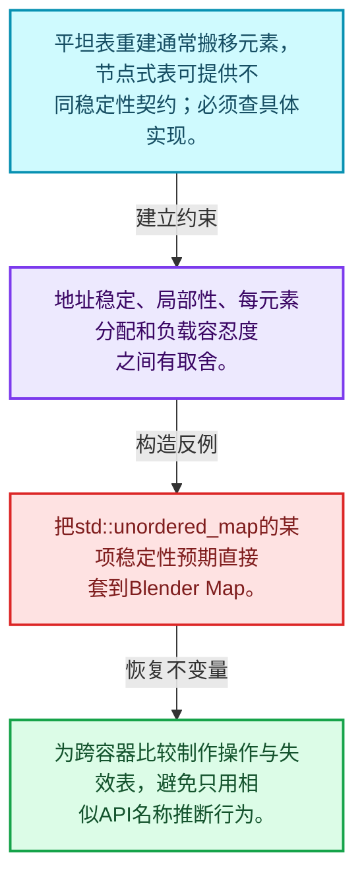
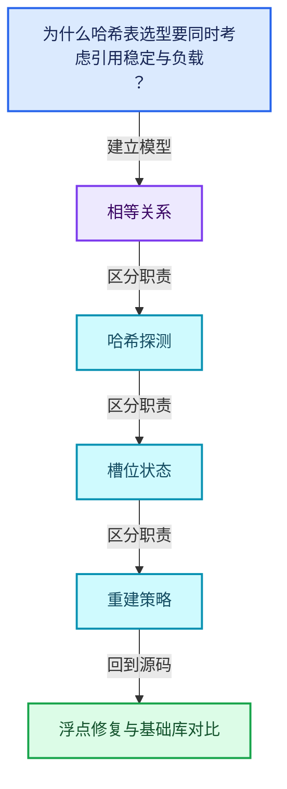
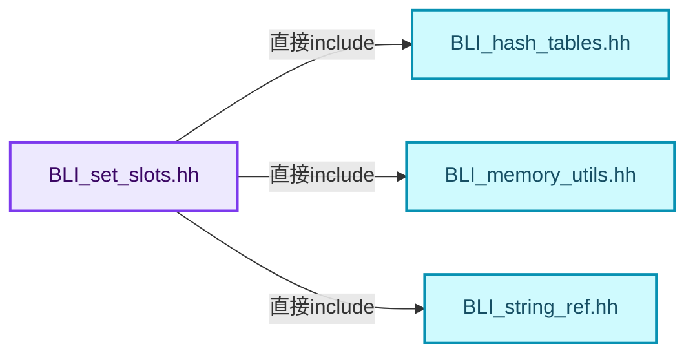
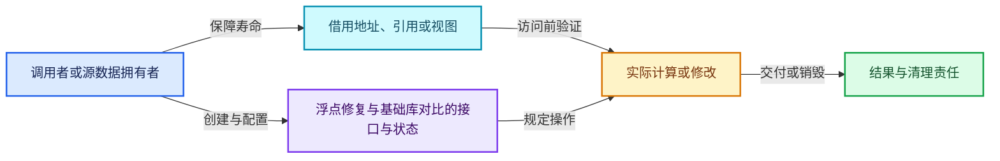
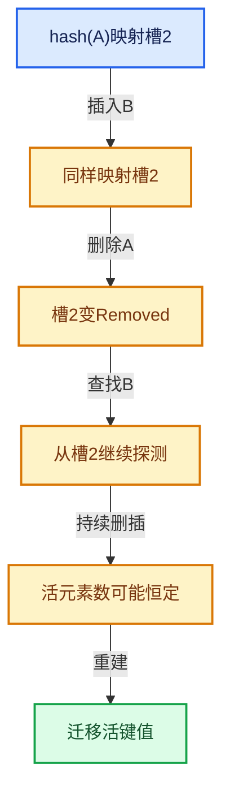

# 02-10 浮点修复与基础库对比

[方向导航](README.md) · [总目录](../README.md) · [覆盖索引](../%E6%BA%90%E7%A0%81%E7%89%88%E6%9C%AC%E4%B8%8E%E8%A6%86%E7%9B%96%E7%B4%A2%E5%BC%95.md)

> 阅读顺序：问题与数据模型 → 语法与类型 → 源码逐行 → 调用线索 → 历史与取舍 → 推演和练习。

- 基准 HEAD：`cbda6b96c26c0dee3c3b5cbb93960c4ac06a6b30`。
- 记录日期：2026-10-14。
- 教学示例状态：正文中的推演不是本机性能实测；已运行练习见验收报告。

## 一、从问题到设计

为什么哈希表选型要同时考虑引用稳定与负载？

平坦存储与节点存储的地址稳定性不同；Blender、标准库、Abseil的契约不能仅凭API相似推断相同。

本篇把语法、数据语义和系统取舍连接起来。相等与哈希是基础契约；探测、删除和增长共同决定复杂度。

### 本篇独立模型与设计推理

平坦表重建通常搬移元素，节点式表可提供不同稳定性契约；必须查具体实现。

设计取舍：地址稳定、局部性、每元素分配和负载容忍度之间有取舍。

最小反例：把std::unordered_map的某项稳定性预期直接套到Blender Map。

推导与处理：为跨容器比较制作操作与失效表，避免只用相似API名称推断行为。



### 源码范围与相邻篇章

| 文件 | 本篇逐行范围 | 基准SHA-256 |
|---|---|---|
| [source/blender/blenlib/BLI_set_slots.hh](../../../../../source/blender/blenlib/BLI_set_slots.hh) | L1—L378 | `e315cc31ba7ecd32f5031d195eeba4f65d3134acb3ca5efdf5ef30a875c8891a` |

同一主讲文件可能分多篇覆盖；超出本篇范围的符号通过覆盖索引定位。空行与纯注释保留在源码摘录中，逐行表解释有效语句与语法边界；许可证头统一保留。

前篇：[MultiValueMap一键多值](09-MultiValueMap%E4%B8%80%E9%94%AE%E5%A4%9A%E5%80%BC.md).

## 二、类型、数据与阅读地图



这是概念依赖图，边表示阅读关系，不声称是运行时调用顺序。

### 直接编译依赖



箭头只表示头文件包含关系；完整调用线索见后面的符号定位表。

## 三、关键词、语法与类型角色

### 模板 template

模板把类型或常量作为生成实现的参数。读声明时先列出类型参数、非类型参数和默认值，再看使用者实际实例化了什么。模板声明本身不意味着每种T都支持其全部成员。

具体检查：把T替换为int、string、只能移动的类型，分别检查每个被调用操作是否成立。

### 依赖名称 typename

typename既可引入类型模板参数，也可告诉编译器某个依赖名称是类型。它不创建运行时对象；解析期确认语法类别与实例化期检查具体类型是不同阶段。

具体检查：区分typename T::value_type和T::size()，前者标记类型，后者是表达式。

### 常量求值 constexpr

constexpr声明允许相应实体参与常量求值，但constexpr函数仍可以在运行时执行。是否常量求值由调用场景和表达式合法性共同决定。

具体检查：比较constexpr变量初始化和从运行时输入调用同一函数。

### 只读限定 const

const约束当前访问路径可做的修改。const指针、指向const的指针、const视图对象、const元素是不同位置的限定；其他别名可能仍可修改原对象。

具体检查：分别写T* const、const T*与const T* const，并画出不可修改的层次。

### 移动转换 std::move

std::move把表达式转换为可供移动重载选择的值类别，实际资源转移发生在被选中的构造或赋值中。对const对象move可能仍调用复制，对视图move也不会获得底层数据所有权。

具体检查：记录移动构造调用次数，不用变量名或std::move的出现次数替代测量。

### 完美转发 std::forward

std::forward在转发引用模板中恢复调用者原来的值类别。它依赖推导出的模板实参；无条件move会改变左值调用者的语义。

具体检查：对同一接口分别传入左值、临时对象和const左值，记录实际重载。

### 异常约定 noexcept

noexcept表达式可以依赖类型特征。违反不抛异常约定会终止程序；它不是自动捕获异常，也不是资源回滚代码。

具体检查：找出声明的条件与实际可能抛出的分配、构造操作是否一致。

### 构造与new表达式

普通new可能分配并构造；placement new在给定地址构造，存储由其他机制提供。失败回滚应区分两类责任。

具体检查：追踪地址来自哪里、构造何时成功、由谁析构、由谁释放。

### 内部断言 assert

断言表达开发者预期成立的内部契约，发布构建可能关闭。它不能替代对不可信输入的完整错误处理，也不保证后续操作被运行时保护。

具体检查：对每条断言构造违反条件的输入，区分调用者错误与应向用户报告的错误。

### 编译期分支 if constexpr

条件在实例化时决定被保留的分支，这常用于不同类型的合法操作选择。它与运行时if有不同的实例化检查规则。

具体检查：找出每个分支依赖哪些类型特征，再使用满足与不满足条件的类型。

### 类型别名 using

类型别名为已有类型建立名字，不创建运行期对象。它常把模板内部使用的类型统一暴露给泛型调用者。

具体检查：展开别名直到基础类型，区分类型别名和变量声明。

### 枚举与状态模型 enum

枚举把有限状态命名；enum class避免许多隐式整数转换。状态机正确性还依赖允许的转移，不能只看有哪些枚举项。

具体检查：列出每个状态的进入条件和离开条件，检查终止状态是否仍可能被调度。

## 四、真实源码与逐行讲解

源码块保持原行内容，原始行号由小节标题及逐行表给出。表中的调用定位是静态阅读辅助；重载、模板实例化、宏展开和虚调用需结合完整声明，不能仅凭词法出现证明动态调用。

### BLI_set_slots.hh：L1—L51

<!-- source:source/blender/blenlib/BLI_set_slots.hh:1:51 -->

```cpp
/* SPDX-FileCopyrightText: 2023 Blender Authors
 *
 * SPDX-License-Identifier: GPL-2.0-or-later */

#pragma once

/** \file
 * \ingroup bli
 *
 * This file contains different slot types that are supposed to be used with Set.
 *
 * Every slot type has to be able to hold a value of the Key type and state information.
 * A set slot has three possible states: empty, occupied and removed.
 *
 * Only when a slot is occupied, it stores an instance of type Key.
 *
 * A set slot type has to implement a couple of methods that are explained in SimpleSetSlot.
 * A slot type is assumed to be trivially destructible, when it is not in occupied state. So the
 * destructor might not be called in that case.
 */

#include "BLI_hash_tables.hh"
#include "BLI_memory_utils.hh"
#include "BLI_string_ref.hh"

namespace blender {

/**
 * The simplest possible set slot. It stores the slot state and the optional key instance in
 * separate variables. Depending on the alignment requirement of the key, many bytes might be
 * wasted.
 */
template<typename Key> class SimpleSetSlot {
 private:
  enum State : uint8_t {
    Empty = 0,
    Occupied = 1,
    Removed = 2,
  };

  State state_;
  TypedBuffer<Key> key_buffer_;

 public:
  /**
   * After the default constructor has run, the slot has to be in the empty state.
   */
  SimpleSetSlot()
  {
    state_ = Empty;
  }
```

本段语义重点：

- `state_`：当前对象记录的状态，后续读取依赖状态不变量。

| 原始行 | 语义、约束与检查 |
|---|---|
| L5 | 防止同一头文件在一个翻译单元中重复展开；不控制多个源文件之间的链接或对象寿命。 |
| L22 | 引入编译依赖 "BLI_hash_tables.hh"；这是声明可见性关系，不表示运行时一定调用该文件的所有接口。 |
| L23 | 引入编译依赖 "BLI_memory_utils.hh"；这是声明可见性关系，不表示运行时一定调用该文件的所有接口。 |
| L24 | 引入编译依赖 "BLI_string_ref.hh"；这是声明可见性关系，不表示运行时一定调用该文件的所有接口。 |
| L26 | 把后续声明放入 blender 命名空间，影响名称查找和符号归属，不创建运行时对象。 |
| L33 | 声明模板参数 `template<typename Key> class SimpleSetSlot {`。类型参数决定生成操作的类型，非类型参数可决定内嵌容量或编译期分支。 |
| L34 | 切换成员访问权限为 private；它是编译期接口边界，不是线程同步或内存保护。 |
| L35 | 声明或定义类型 `enum State : uint8_t`。结合继承、访问权限和成员布局确认接口与拥有关系；前向声明本身没有完整对象布局。 |
| L36 | 把右侧 `0,` 用于初始化或更新左侧 `Empty`。声明初始化与已有对象赋值应按上下文区分；有资源的类型会调用相应特殊成员。 |
| L37 | 把右侧 `1,` 用于初始化或更新左侧 `Occupied`。声明初始化与已有对象赋值应按上下文区分；有资源的类型会调用相应特殊成员。 |
| L38 | 把右侧 `2,` 用于初始化或更新左侧 `Removed`。声明初始化与已有对象赋值应按上下文区分；有资源的类型会调用相应特殊成员。 |
| L39 | 结束当前语法单元。局部自动对象在离开其作用域时按规则销毁；这不等于所有被引用的外部数据也被释放。 |
| L41 | 本行涉及 `state_`：当前对象记录的状态，后续读取依赖状态不变量。按此语义解读 `State state_`，不要把地址、数量或状态混用。 |
| L42 | 声明成员、局部对象或完成语句 `TypedBuffer<Key> key_buffer_`。若为指针或引用，它本身不说明拥有；若为值对象，其构造析构由所在作用域或外层对象管理。 |
| L44 | 切换成员访问权限为 public；它是编译期接口边界，不是线程同步或内存保护。 |
| L48 | 出现调用或函数声明 `SimpleSetSlot`，对应表达式为 `SimpleSetSlot()`。参数求值、返回类型与重载需结合前后完整语句；静态文本引用不能证明动态目标。 |
| L49 | 连接上一行的声明或控制结构与其语句块；后续行在这个作用域中执行或声明。 |
| L50 | 建立或更新 `state_`：当前对象记录的状态，后续读取依赖状态不变量。本行的具体值关系为 `state_ = Empty`；对照更新前后相应范围或状态是否一致。 |
| L51 | 结束当前语法单元。局部自动对象在离开其作用域时按规则销毁；这不等于所有被引用的外部数据也被释放。 |

### BLI_set_slots.hh：L52—L102

<!-- source:source/blender/blenlib/BLI_set_slots.hh:52:102 -->

```cpp

  /**
   * The destructor also has to destruct the key, if the slot is currently occupied.
   */
  ~SimpleSetSlot()
  {
    if (state_ == Occupied) {
      key_buffer_.ref().~Key();
    }
  }

  /**
   * The copy constructor has to copy the state. If the other slot was occupied, a copy of the key
   * has to be made as well.
   */
  SimpleSetSlot(const SimpleSetSlot &other)
  {
    state_ = other.state_;
    if (other.state_ == Occupied) {
      new (&key_buffer_) Key(*other.key_buffer_);
    }
  }

  /**
   * The move constructor has to copy the state. If the other slot was occupied, the key from the
   * other slot has to be moved as well. The other slot stays in the state it was in before. Its
   * optionally stored key remains in a moved-from state.
   */
  SimpleSetSlot(SimpleSetSlot &&other) noexcept(std::is_nothrow_move_constructible_v<Key>)
  {
    state_ = other.state_;
    if (other.state_ == Occupied) {
      new (&key_buffer_) Key(std::move(*other.key_buffer_));
    }
  }

  /**
   * Get a non-const pointer to the position where the key is stored.
   */
  Key *key()
  {
    return key_buffer_;
  }

  /**
   * Get a const pointer to the position where the key is stored.
   */
  const Key *key() const
  {
    return key_buffer_;
  }
```

本段语义重点：

- `state_`：当前对象记录的状态，后续读取依赖状态不变量。

| 原始行 | 语义、约束与检查 |
|---|---|
| L56 | 涉及析构接口或显式析构：`~SimpleSetSlot()`。检查目标对象已成功构造，且资源不会在另一条清理路径再次销毁。 |
| L57 | 连接上一行的声明或控制结构与其语句块；后续行在这个作用域中执行或声明。 |
| L58 | 判断 `state_ == Occupied`，成立时进入本分支，否则继续后续路径。 |
| L59 | 涉及析构接口或显式析构：`key_buffer_.ref().~Key();`。检查目标对象已成功构造，且资源不会在另一条清理路径再次销毁。 |
| L60 | 结束当前语法单元。局部自动对象在离开其作用域时按规则销毁；这不等于所有被引用的外部数据也被释放。 |
| L61 | 结束当前语法单元。局部自动对象在离开其作用域时按规则销毁；这不等于所有被引用的外部数据也被释放。 |
| L67 | 出现调用或函数声明 `SimpleSetSlot`，对应表达式为 `SimpleSetSlot(const SimpleSetSlot &other)`。参数求值、返回类型与重载需结合前后完整语句；静态文本引用不能证明动态目标。 |
| L68 | 连接上一行的声明或控制结构与其语句块；后续行在这个作用域中执行或声明。 |
| L69 | 建立或更新 `state_`：当前对象记录的状态，后续读取依赖状态不变量。本行的具体值关系为 `state_ = other.state_`；对照更新前后相应范围或状态是否一致。 |
| L70 | 判断 `other.state_ == Occupied`，成立时进入本分支，否则继续后续路径。 |
| L71 | 出现调用或函数声明 `new`，对应表达式为 `new (&key_buffer_) Key(*other.key_buffer_);`。参数求值、返回类型与重载需结合前后完整语句；静态文本引用不能证明动态目标。 |
| L72 | 结束当前语法单元。局部自动对象在离开其作用域时按规则销毁；这不等于所有被引用的外部数据也被释放。 |
| L73 | 结束当前语法单元。局部自动对象在离开其作用域时按规则销毁；这不等于所有被引用的外部数据也被释放。 |
| L80 | 出现调用或函数声明 `SimpleSetSlot`，对应表达式为 `SimpleSetSlot(SimpleSetSlot &&other) noexcept(std::is_nothrow_move_constructible_v<Key>)`。参数求值、返回类型与重载需结合前后完整语句；静态文本引用不能证明动态目标。 |
| L81 | 连接上一行的声明或控制结构与其语句块；后续行在这个作用域中执行或声明。 |
| L82 | 建立或更新 `state_`：当前对象记录的状态，后续读取依赖状态不变量。本行的具体值关系为 `state_ = other.state_`；对照更新前后相应范围或状态是否一致。 |
| L83 | 判断 `other.state_ == Occupied`，成立时进入本分支，否则继续后续路径。 |
| L84 | 出现调用或函数声明 `new`，对应表达式为 `new (&key_buffer_) Key(std::move(*other.key_buffer_));`。参数求值、返回类型与重载需结合前后完整语句；静态文本引用不能证明动态目标。 |
| L85 | 结束当前语法单元。局部自动对象在离开其作用域时按规则销毁；这不等于所有被引用的外部数据也被释放。 |
| L86 | 结束当前语法单元。局部自动对象在离开其作用域时按规则销毁；这不等于所有被引用的外部数据也被释放。 |
| L91 | 出现调用或函数声明 `key`，对应表达式为 `Key *key()`。参数求值、返回类型与重载需结合前后完整语句；静态文本引用不能证明动态目标。 |
| L92 | 连接上一行的声明或控制结构与其语句块；后续行在这个作用域中执行或声明。 |
| L93 | 返回表达式 `key_buffer_`。 |
| L94 | 结束当前语法单元。局部自动对象在离开其作用域时按规则销毁；这不等于所有被引用的外部数据也被释放。 |
| L99 | 出现调用或函数声明 `key`，对应表达式为 `const Key *key() const`。参数求值、返回类型与重载需结合前后完整语句；静态文本引用不能证明动态目标。 |
| L100 | 连接上一行的声明或控制结构与其语句块；后续行在这个作用域中执行或声明。 |
| L101 | 返回表达式 `key_buffer_`。 |
| L102 | 结束当前语法单元。局部自动对象在离开其作用域时按规则销毁；这不等于所有被引用的外部数据也被释放。 |

### BLI_set_slots.hh：L103—L152

<!-- source:source/blender/blenlib/BLI_set_slots.hh:103:152 -->

```cpp

  /**
   * Return true if the slot currently contains a key.
   */
  bool is_occupied() const
  {
    return state_ == Occupied;
  }

  /**
   * Return true if the slot is empty, i.e. it does not contain a key and is not in removed state.
   */
  bool is_empty() const
  {
    return state_ == Empty;
  }

  /**
   * Return the hash of the currently stored key. In this simple set slot implementation, we just
   * compute the hash here. Other implementations might store the hash in the slot instead.
   */
  template<typename Hash> uint64_t get_hash(const Hash &hash) const
  {
    BLI_assert(this->is_occupied());
    return hash(*key_buffer_);
  }

  /**
   * Return true, when this slot is occupied and contains a key that compares equal to the given
   * key. The hash is used by other slot implementations to determine inequality faster.
   */
  template<typename ForwardKey, typename IsEqual>
  bool contains(const ForwardKey &key, const IsEqual &is_equal, uint64_t /*hash*/) const
  {
    if (state_ == Occupied) {
      return is_equal(key, *key_buffer_);
    }
    return false;
  }

  /**
   * Change the state of this slot from empty/removed to occupied. The key has to be constructed
   * by calling the constructor with the given key as parameter.
   */
  template<typename ForwardKey> void occupy(ForwardKey &&key, uint64_t /*hash*/)
  {
    BLI_assert(!this->is_occupied());
    new (&key_buffer_) Key(std::forward<ForwardKey>(key));
    state_ = Occupied;
  }
```

本段语义重点：

- `state_`：当前对象记录的状态，后续读取依赖状态不变量。

| 原始行 | 语义、约束与检查 |
|---|---|
| L107 | 出现调用或函数声明 `is_occupied`，对应表达式为 `bool is_occupied() const`。参数求值、返回类型与重载需结合前后完整语句；静态文本引用不能证明动态目标。 |
| L108 | 连接上一行的声明或控制结构与其语句块；后续行在这个作用域中执行或声明。 |
| L109 | 返回表达式 `state_ == Occupied`。 |
| L110 | 结束当前语法单元。局部自动对象在离开其作用域时按规则销毁；这不等于所有被引用的外部数据也被释放。 |
| L115 | 出现调用或函数声明 `is_empty`，对应表达式为 `bool is_empty() const`。参数求值、返回类型与重载需结合前后完整语句；静态文本引用不能证明动态目标。 |
| L116 | 连接上一行的声明或控制结构与其语句块；后续行在这个作用域中执行或声明。 |
| L117 | 返回表达式 `state_ == Empty`。 |
| L118 | 结束当前语法单元。局部自动对象在离开其作用域时按规则销毁；这不等于所有被引用的外部数据也被释放。 |
| L124 | 声明模板参数 `template<typename Hash> uint64_t get_hash(const Hash &hash) const`。类型参数决定生成操作的类型，非类型参数可决定内嵌容量或编译期分支。 |
| L125 | 连接上一行的声明或控制结构与其语句块；后续行在这个作用域中执行或声明。 |
| L126 | 断言约束 `BLI_assert(this->is_occupied());`。条件是后续访问的内部前置条件；发布构建可能不执行，不能把断言当作输入修复。 |
| L127 | 返回表达式 `hash(*key_buffer_)`。 |
| L128 | 结束当前语法单元。局部自动对象在离开其作用域时按规则销毁；这不等于所有被引用的外部数据也被释放。 |
| L134 | 声明模板参数 `template<typename ForwardKey, typename IsEqual>`。类型参数决定生成操作的类型，非类型参数可决定内嵌容量或编译期分支。 |
| L135 | 出现调用或函数声明 `contains`，对应表达式为 `bool contains(const ForwardKey &key, const IsEqual &is_equal, uint64_t ) const`。参数求值、返回类型与重载需结合前后完整语句；静态文本引用不能证明动态目标。 |
| L136 | 连接上一行的声明或控制结构与其语句块；后续行在这个作用域中执行或声明。 |
| L137 | 判断 `state_ == Occupied`，成立时进入本分支，否则继续后续路径。 |
| L138 | 返回表达式 `is_equal(key, *key_buffer_)`。 |
| L139 | 结束当前语法单元。局部自动对象在离开其作用域时按规则销毁；这不等于所有被引用的外部数据也被释放。 |
| L140 | 返回表达式 `false`。这是本路径的布尔结果，具体成功、存在或状态含义由函数接口规定。 |
| L141 | 结束当前语法单元。局部自动对象在离开其作用域时按规则销毁；这不等于所有被引用的外部数据也被释放。 |
| L147 | 声明模板参数 `template<typename ForwardKey> void occupy(ForwardKey &&key, uint64_t )`。类型参数决定生成操作的类型，非类型参数可决定内嵌容量或编译期分支。 |
| L148 | 连接上一行的声明或控制结构与其语句块；后续行在这个作用域中执行或声明。 |
| L149 | 断言约束 `BLI_assert(!this->is_occupied());`。条件是后续访问的内部前置条件；发布构建可能不执行，不能把断言当作输入修复。 |
| L150 | 出现调用或函数声明 `new`，对应表达式为 `new (&key_buffer_) Key(std::forward<ForwardKey>(key));`。参数求值、返回类型与重载需结合前后完整语句；静态文本引用不能证明动态目标。 |
| L151 | 建立或更新 `state_`：当前对象记录的状态，后续读取依赖状态不变量。本行的具体值关系为 `state_ = Occupied`；对照更新前后相应范围或状态是否一致。 |
| L152 | 结束当前语法单元。局部自动对象在离开其作用域时按规则销毁；这不等于所有被引用的外部数据也被释放。 |

### BLI_set_slots.hh：L153—L201

<!-- source:source/blender/blenlib/BLI_set_slots.hh:153:201 -->

```cpp

  /**
   * Change the state of this slot from occupied to removed. The key has to be destructed as well.
   */
  void remove()
  {
    BLI_assert(this->is_occupied());
    key_buffer_.ref().~Key();
    state_ = Removed;
  }
};

/**
 * This set slot implementation stores the hash of the key within the slot. This helps when
 * computing the hash or an equality check is expensive.
 */
template<typename Key> class HashedSetSlot {
 private:
  enum State : uint8_t {
    Empty = 0,
    Occupied = 1,
    Removed = 2,
  };

  uint64_t hash_;
  State state_;
  TypedBuffer<Key> key_buffer_;

 public:
  HashedSetSlot()
  {
    state_ = Empty;
  }

  ~HashedSetSlot()
  {
    if (state_ == Occupied) {
      key_buffer_.ref().~Key();
    }
  }

  HashedSetSlot(const HashedSetSlot &other)
  {
    state_ = other.state_;
    if (other.state_ == Occupied) {
      hash_ = other.hash_;
      new (&key_buffer_) Key(*other.key_buffer_);
    }
  }
```

本段语义重点：

- `state_`：当前对象记录的状态，后续读取依赖状态不变量。

| 原始行 | 语义、约束与检查 |
|---|---|
| L157 | 出现调用或函数声明 `remove`，对应表达式为 `void remove()`。参数求值、返回类型与重载需结合前后完整语句；静态文本引用不能证明动态目标。 |
| L158 | 连接上一行的声明或控制结构与其语句块；后续行在这个作用域中执行或声明。 |
| L159 | 断言约束 `BLI_assert(this->is_occupied());`。条件是后续访问的内部前置条件；发布构建可能不执行，不能把断言当作输入修复。 |
| L160 | 涉及析构接口或显式析构：`key_buffer_.ref().~Key();`。检查目标对象已成功构造，且资源不会在另一条清理路径再次销毁。 |
| L161 | 建立或更新 `state_`：当前对象记录的状态，后续读取依赖状态不变量。本行的具体值关系为 `state_ = Removed`；对照更新前后相应范围或状态是否一致。 |
| L162 | 结束当前语法单元。局部自动对象在离开其作用域时按规则销毁；这不等于所有被引用的外部数据也被释放。 |
| L163 | 结束当前语法单元。局部自动对象在离开其作用域时按规则销毁；这不等于所有被引用的外部数据也被释放。 |
| L169 | 声明模板参数 `template<typename Key> class HashedSetSlot {`。类型参数决定生成操作的类型，非类型参数可决定内嵌容量或编译期分支。 |
| L170 | 切换成员访问权限为 private；它是编译期接口边界，不是线程同步或内存保护。 |
| L171 | 声明或定义类型 `enum State : uint8_t`。结合继承、访问权限和成员布局确认接口与拥有关系；前向声明本身没有完整对象布局。 |
| L172 | 把右侧 `0,` 用于初始化或更新左侧 `Empty`。声明初始化与已有对象赋值应按上下文区分；有资源的类型会调用相应特殊成员。 |
| L173 | 把右侧 `1,` 用于初始化或更新左侧 `Occupied`。声明初始化与已有对象赋值应按上下文区分；有资源的类型会调用相应特殊成员。 |
| L174 | 把右侧 `2,` 用于初始化或更新左侧 `Removed`。声明初始化与已有对象赋值应按上下文区分；有资源的类型会调用相应特殊成员。 |
| L175 | 结束当前语法单元。局部自动对象在离开其作用域时按规则销毁；这不等于所有被引用的外部数据也被释放。 |
| L177 | 声明成员、局部对象或完成语句 `uint64_t hash_`。若为指针或引用，它本身不说明拥有；若为值对象，其构造析构由所在作用域或外层对象管理。 |
| L178 | 本行涉及 `state_`：当前对象记录的状态，后续读取依赖状态不变量。按此语义解读 `State state_`，不要把地址、数量或状态混用。 |
| L179 | 声明成员、局部对象或完成语句 `TypedBuffer<Key> key_buffer_`。若为指针或引用，它本身不说明拥有；若为值对象，其构造析构由所在作用域或外层对象管理。 |
| L181 | 切换成员访问权限为 public；它是编译期接口边界，不是线程同步或内存保护。 |
| L182 | 出现调用或函数声明 `HashedSetSlot`，对应表达式为 `HashedSetSlot()`。参数求值、返回类型与重载需结合前后完整语句；静态文本引用不能证明动态目标。 |
| L183 | 连接上一行的声明或控制结构与其语句块；后续行在这个作用域中执行或声明。 |
| L184 | 建立或更新 `state_`：当前对象记录的状态，后续读取依赖状态不变量。本行的具体值关系为 `state_ = Empty`；对照更新前后相应范围或状态是否一致。 |
| L185 | 结束当前语法单元。局部自动对象在离开其作用域时按规则销毁；这不等于所有被引用的外部数据也被释放。 |
| L187 | 涉及析构接口或显式析构：`~HashedSetSlot()`。检查目标对象已成功构造，且资源不会在另一条清理路径再次销毁。 |
| L188 | 连接上一行的声明或控制结构与其语句块；后续行在这个作用域中执行或声明。 |
| L189 | 判断 `state_ == Occupied`，成立时进入本分支，否则继续后续路径。 |
| L190 | 涉及析构接口或显式析构：`key_buffer_.ref().~Key();`。检查目标对象已成功构造，且资源不会在另一条清理路径再次销毁。 |
| L191 | 结束当前语法单元。局部自动对象在离开其作用域时按规则销毁；这不等于所有被引用的外部数据也被释放。 |
| L192 | 结束当前语法单元。局部自动对象在离开其作用域时按规则销毁；这不等于所有被引用的外部数据也被释放。 |
| L194 | 出现调用或函数声明 `HashedSetSlot`，对应表达式为 `HashedSetSlot(const HashedSetSlot &other)`。参数求值、返回类型与重载需结合前后完整语句；静态文本引用不能证明动态目标。 |
| L195 | 连接上一行的声明或控制结构与其语句块；后续行在这个作用域中执行或声明。 |
| L196 | 建立或更新 `state_`：当前对象记录的状态，后续读取依赖状态不变量。本行的具体值关系为 `state_ = other.state_`；对照更新前后相应范围或状态是否一致。 |
| L197 | 判断 `other.state_ == Occupied`，成立时进入本分支，否则继续后续路径。 |
| L198 | 把右侧 `other.hash_` 用于初始化或更新左侧 `hash_`。声明初始化与已有对象赋值应按上下文区分；有资源的类型会调用相应特殊成员。 |
| L199 | 出现调用或函数声明 `new`，对应表达式为 `new (&key_buffer_) Key(*other.key_buffer_);`。参数求值、返回类型与重载需结合前后完整语句；静态文本引用不能证明动态目标。 |
| L200 | 结束当前语法单元。局部自动对象在离开其作用域时按规则销毁；这不等于所有被引用的外部数据也被释放。 |
| L201 | 结束当前语法单元。局部自动对象在离开其作用域时按规则销毁；这不等于所有被引用的外部数据也被释放。 |

### BLI_set_slots.hh：L202—L248

<!-- source:source/blender/blenlib/BLI_set_slots.hh:202:248 -->

```cpp

  HashedSetSlot(HashedSetSlot &&other) noexcept(std::is_nothrow_move_constructible_v<Key>)
  {
    state_ = other.state_;
    if (other.state_ == Occupied) {
      hash_ = other.hash_;
      new (&key_buffer_) Key(std::move(*other.key_buffer_));
    }
  }

  Key *key()
  {
    return key_buffer_;
  }

  const Key *key() const
  {
    return key_buffer_;
  }

  bool is_occupied() const
  {
    return state_ == Occupied;
  }

  bool is_empty() const
  {
    return state_ == Empty;
  }

  template<typename Hash> uint64_t get_hash(const Hash & /*hash*/) const
  {
    BLI_assert(this->is_occupied());
    return hash_;
  }

  template<typename ForwardKey, typename IsEqual>
  bool contains(const ForwardKey &key, const IsEqual &is_equal, const uint64_t hash) const
  {
    /* `hash_` might be uninitialized here, but that is ok. */
    if (hash_ == hash) {
      if (state_ == Occupied) {
        return is_equal(key, *key_buffer_);
      }
    }
    return false;
  }
```

本段语义重点：

- `state_`：当前对象记录的状态，后续读取依赖状态不变量。

| 原始行 | 语义、约束与检查 |
|---|---|
| L203 | 出现调用或函数声明 `HashedSetSlot`，对应表达式为 `HashedSetSlot(HashedSetSlot &&other) noexcept(std::is_nothrow_move_constructible_v<Key>)`。参数求值、返回类型与重载需结合前后完整语句；静态文本引用不能证明动态目标。 |
| L204 | 连接上一行的声明或控制结构与其语句块；后续行在这个作用域中执行或声明。 |
| L205 | 建立或更新 `state_`：当前对象记录的状态，后续读取依赖状态不变量。本行的具体值关系为 `state_ = other.state_`；对照更新前后相应范围或状态是否一致。 |
| L206 | 判断 `other.state_ == Occupied`，成立时进入本分支，否则继续后续路径。 |
| L207 | 把右侧 `other.hash_` 用于初始化或更新左侧 `hash_`。声明初始化与已有对象赋值应按上下文区分；有资源的类型会调用相应特殊成员。 |
| L208 | 出现调用或函数声明 `new`，对应表达式为 `new (&key_buffer_) Key(std::move(*other.key_buffer_));`。参数求值、返回类型与重载需结合前后完整语句；静态文本引用不能证明动态目标。 |
| L209 | 结束当前语法单元。局部自动对象在离开其作用域时按规则销毁；这不等于所有被引用的外部数据也被释放。 |
| L210 | 结束当前语法单元。局部自动对象在离开其作用域时按规则销毁；这不等于所有被引用的外部数据也被释放。 |
| L212 | 出现调用或函数声明 `key`，对应表达式为 `Key *key()`。参数求值、返回类型与重载需结合前后完整语句；静态文本引用不能证明动态目标。 |
| L213 | 连接上一行的声明或控制结构与其语句块；后续行在这个作用域中执行或声明。 |
| L214 | 返回表达式 `key_buffer_`。 |
| L215 | 结束当前语法单元。局部自动对象在离开其作用域时按规则销毁；这不等于所有被引用的外部数据也被释放。 |
| L217 | 出现调用或函数声明 `key`，对应表达式为 `const Key *key() const`。参数求值、返回类型与重载需结合前后完整语句；静态文本引用不能证明动态目标。 |
| L218 | 连接上一行的声明或控制结构与其语句块；后续行在这个作用域中执行或声明。 |
| L219 | 返回表达式 `key_buffer_`。 |
| L220 | 结束当前语法单元。局部自动对象在离开其作用域时按规则销毁；这不等于所有被引用的外部数据也被释放。 |
| L222 | 出现调用或函数声明 `is_occupied`，对应表达式为 `bool is_occupied() const`。参数求值、返回类型与重载需结合前后完整语句；静态文本引用不能证明动态目标。 |
| L223 | 连接上一行的声明或控制结构与其语句块；后续行在这个作用域中执行或声明。 |
| L224 | 返回表达式 `state_ == Occupied`。 |
| L225 | 结束当前语法单元。局部自动对象在离开其作用域时按规则销毁；这不等于所有被引用的外部数据也被释放。 |
| L227 | 出现调用或函数声明 `is_empty`，对应表达式为 `bool is_empty() const`。参数求值、返回类型与重载需结合前后完整语句；静态文本引用不能证明动态目标。 |
| L228 | 连接上一行的声明或控制结构与其语句块；后续行在这个作用域中执行或声明。 |
| L229 | 返回表达式 `state_ == Empty`。 |
| L230 | 结束当前语法单元。局部自动对象在离开其作用域时按规则销毁；这不等于所有被引用的外部数据也被释放。 |
| L232 | 声明模板参数 `template<typename Hash> uint64_t get_hash(const Hash & ) const`。类型参数决定生成操作的类型，非类型参数可决定内嵌容量或编译期分支。 |
| L233 | 连接上一行的声明或控制结构与其语句块；后续行在这个作用域中执行或声明。 |
| L234 | 断言约束 `BLI_assert(this->is_occupied());`。条件是后续访问的内部前置条件；发布构建可能不执行，不能把断言当作输入修复。 |
| L235 | 返回表达式 `hash_`。 |
| L236 | 结束当前语法单元。局部自动对象在离开其作用域时按规则销毁；这不等于所有被引用的外部数据也被释放。 |
| L238 | 声明模板参数 `template<typename ForwardKey, typename IsEqual>`。类型参数决定生成操作的类型，非类型参数可决定内嵌容量或编译期分支。 |
| L239 | 出现调用或函数声明 `contains`，对应表达式为 `bool contains(const ForwardKey &key, const IsEqual &is_equal, const uint64_t hash) const`。参数求值、返回类型与重载需结合前后完整语句；静态文本引用不能证明动态目标。 |
| L240 | 连接上一行的声明或控制结构与其语句块；后续行在这个作用域中执行或声明。 |
| L242 | 判断 `hash_ == hash`，成立时进入本分支，否则继续后续路径。 |
| L243 | 判断 `state_ == Occupied`，成立时进入本分支，否则继续后续路径。 |
| L244 | 返回表达式 `is_equal(key, *key_buffer_)`。 |
| L245 | 结束当前语法单元。局部自动对象在离开其作用域时按规则销毁；这不等于所有被引用的外部数据也被释放。 |
| L246 | 结束当前语法单元。局部自动对象在离开其作用域时按规则销毁；这不等于所有被引用的外部数据也被释放。 |
| L247 | 返回表达式 `false`。这是本路径的布尔结果，具体成功、存在或状态含义由函数接口规定。 |
| L248 | 结束当前语法单元。局部自动对象在离开其作用域时按规则销毁；这不等于所有被引用的外部数据也被释放。 |

### BLI_set_slots.hh：L249—L298

<!-- source:source/blender/blenlib/BLI_set_slots.hh:249:298 -->

```cpp

  template<typename ForwardKey> void occupy(ForwardKey &&key, const uint64_t hash)
  {
    BLI_assert(!this->is_occupied());
    new (&key_buffer_) Key(std::forward<ForwardKey>(key));
    state_ = Occupied;
    hash_ = hash;
  }

  void remove()
  {
    BLI_assert(this->is_occupied());
    key_buffer_.ref().~Key();
    state_ = Removed;
  }
};

/**
 * An IntrusiveSetSlot uses two special values of the key to indicate whether the slot is empty or
 * removed. This saves some memory in all cases and is more efficient in many cases. The KeyInfo
 * type indicates which specific values are used. An example for a KeyInfo implementation is
 * PointerKeyInfo.
 *
 * The special key values are expected to be trivially destructible.
 */
template<typename Key, typename KeyInfo> class IntrusiveSetSlot {
 private:
  Key key_ = KeyInfo::get_empty();

 public:
  IntrusiveSetSlot() = default;
  ~IntrusiveSetSlot() = default;
  IntrusiveSetSlot(const IntrusiveSetSlot &other) = default;
  IntrusiveSetSlot(IntrusiveSetSlot &&other) noexcept(std::is_nothrow_move_constructible_v<Key>) =
      default;

  Key *key()
  {
    return &key_;
  }

  const Key *key() const
  {
    return &key_;
  }

  bool is_occupied() const
  {
    return KeyInfo::is_not_empty_or_removed(key_);
  }
```

本段语义重点：

- `state_`：当前对象记录的状态，后续读取依赖状态不变量。

| 原始行 | 语义、约束与检查 |
|---|---|
| L250 | 声明模板参数 `template<typename ForwardKey> void occupy(ForwardKey &&key, const uint64_t hash)`。类型参数决定生成操作的类型，非类型参数可决定内嵌容量或编译期分支。 |
| L251 | 连接上一行的声明或控制结构与其语句块；后续行在这个作用域中执行或声明。 |
| L252 | 断言约束 `BLI_assert(!this->is_occupied());`。条件是后续访问的内部前置条件；发布构建可能不执行，不能把断言当作输入修复。 |
| L253 | 出现调用或函数声明 `new`，对应表达式为 `new (&key_buffer_) Key(std::forward<ForwardKey>(key));`。参数求值、返回类型与重载需结合前后完整语句；静态文本引用不能证明动态目标。 |
| L254 | 建立或更新 `state_`：当前对象记录的状态，后续读取依赖状态不变量。本行的具体值关系为 `state_ = Occupied`；对照更新前后相应范围或状态是否一致。 |
| L255 | 把右侧 `hash` 用于初始化或更新左侧 `hash_`。声明初始化与已有对象赋值应按上下文区分；有资源的类型会调用相应特殊成员。 |
| L256 | 结束当前语法单元。局部自动对象在离开其作用域时按规则销毁；这不等于所有被引用的外部数据也被释放。 |
| L258 | 出现调用或函数声明 `remove`，对应表达式为 `void remove()`。参数求值、返回类型与重载需结合前后完整语句；静态文本引用不能证明动态目标。 |
| L259 | 连接上一行的声明或控制结构与其语句块；后续行在这个作用域中执行或声明。 |
| L260 | 断言约束 `BLI_assert(this->is_occupied());`。条件是后续访问的内部前置条件；发布构建可能不执行，不能把断言当作输入修复。 |
| L261 | 涉及析构接口或显式析构：`key_buffer_.ref().~Key();`。检查目标对象已成功构造，且资源不会在另一条清理路径再次销毁。 |
| L262 | 建立或更新 `state_`：当前对象记录的状态，后续读取依赖状态不变量。本行的具体值关系为 `state_ = Removed`；对照更新前后相应范围或状态是否一致。 |
| L263 | 结束当前语法单元。局部自动对象在离开其作用域时按规则销毁；这不等于所有被引用的外部数据也被释放。 |
| L264 | 结束当前语法单元。局部自动对象在离开其作用域时按规则销毁；这不等于所有被引用的外部数据也被释放。 |
| L274 | 声明模板参数 `template<typename Key, typename KeyInfo> class IntrusiveSetSlot {`。类型参数决定生成操作的类型，非类型参数可决定内嵌容量或编译期分支。 |
| L275 | 切换成员访问权限为 private；它是编译期接口边界，不是线程同步或内存保护。 |
| L276 | 把右侧 `KeyInfo::get_empty()` 用于初始化或更新左侧 `Key key_`。声明初始化与已有对象赋值应按上下文区分；有资源的类型会调用相应特殊成员。 |
| L278 | 切换成员访问权限为 public；它是编译期接口边界，不是线程同步或内存保护。 |
| L279 | 显式采用编译器生成的特殊成员行为：`IntrusiveSetSlot() = default;`。成员和基类的性质决定该操作是否可用、是否被删除及异常约定，不表示运行时给对象赋值为default。 |
| L280 | 显式采用编译器生成的特殊成员行为：`~IntrusiveSetSlot() = default;`。成员和基类的性质决定该操作是否可用、是否被删除及异常约定，不表示运行时给对象赋值为default。 |
| L281 | 显式采用编译器生成的特殊成员行为：`IntrusiveSetSlot(const IntrusiveSetSlot &other) = default;`。成员和基类的性质决定该操作是否可用、是否被删除及异常约定，不表示运行时给对象赋值为default。 |
| L282 | 把右侧 `` 用于初始化或更新左侧 `IntrusiveSetSlot(IntrusiveSetSlot &&other) noexcept(std::is_nothrow_move_constructible_v<Key>)`。声明初始化与已有对象赋值应按上下文区分；有资源的类型会调用相应特殊成员。 |
| L283 | 声明成员、局部对象或完成语句 `default`。若为指针或引用，它本身不说明拥有；若为值对象，其构造析构由所在作用域或外层对象管理。 |
| L285 | 出现调用或函数声明 `key`，对应表达式为 `Key *key()`。参数求值、返回类型与重载需结合前后完整语句；静态文本引用不能证明动态目标。 |
| L286 | 连接上一行的声明或控制结构与其语句块；后续行在这个作用域中执行或声明。 |
| L287 | 返回表达式 `&key_`。 |
| L288 | 结束当前语法单元。局部自动对象在离开其作用域时按规则销毁；这不等于所有被引用的外部数据也被释放。 |
| L290 | 出现调用或函数声明 `key`，对应表达式为 `const Key *key() const`。参数求值、返回类型与重载需结合前后完整语句；静态文本引用不能证明动态目标。 |
| L291 | 连接上一行的声明或控制结构与其语句块；后续行在这个作用域中执行或声明。 |
| L292 | 返回表达式 `&key_`。 |
| L293 | 结束当前语法单元。局部自动对象在离开其作用域时按规则销毁；这不等于所有被引用的外部数据也被释放。 |
| L295 | 出现调用或函数声明 `is_occupied`，对应表达式为 `bool is_occupied() const`。参数求值、返回类型与重载需结合前后完整语句；静态文本引用不能证明动态目标。 |
| L296 | 连接上一行的声明或控制结构与其语句块；后续行在这个作用域中执行或声明。 |
| L297 | 返回表达式 `KeyInfo::is_not_empty_or_removed(key_)`。 |
| L298 | 结束当前语法单元。局部自动对象在离开其作用域时按规则销毁；这不等于所有被引用的外部数据也被释放。 |

### BLI_set_slots.hh：L299—L345

<!-- source:source/blender/blenlib/BLI_set_slots.hh:299:345 -->

```cpp

  bool is_empty() const
  {
    return KeyInfo::is_empty(key_);
  }

  template<typename Hash> uint64_t get_hash(const Hash &hash) const
  {
    BLI_assert(this->is_occupied());
    return hash(key_);
  }

  template<typename ForwardKey, typename IsEqual>
  bool contains(const ForwardKey &key, const IsEqual &is_equal, const uint64_t /*hash*/) const
  {
    BLI_assert(KeyInfo::is_not_empty_or_removed(key));
    if constexpr (std::is_same_v<std::decay_t<IsEqual>, DefaultEquality<Key>>) {
      return is_equal(key_, key);
    }
    else {
      if (KeyInfo::is_not_empty_or_removed(key_)) {
        return is_equal(key_, key);
      }
      return false;
    }
  }

  template<typename ForwardKey> void occupy(ForwardKey &&key, const uint64_t /*hash*/)
  {
    BLI_assert(!this->is_occupied());
    BLI_assert(KeyInfo::is_not_empty_or_removed(key));
    key_ = std::forward<ForwardKey>(key);
  }

  void remove()
  {
    BLI_assert(this->is_occupied());
    KeyInfo::remove(key_);
  }
};

/**
 * This exists just to make it more convenient to define which special integer values can be used
 * to indicate an empty and removed value.
 */
template<typename Int, Int EmptyValue, Int RemovedValue>
using IntegerSetSlot = IntrusiveSetSlot<Int, TemplatedKeyInfo<Int, EmptyValue, RemovedValue>>;
```

本段语义重点：

- 分支证据 `KeyInfo::is_not_empty_or_removed(key_))`：分别推演条件成立与不成立，核对相同出口处的状态。

| 原始行 | 语义、约束与检查 |
|---|---|
| L300 | 出现调用或函数声明 `is_empty`，对应表达式为 `bool is_empty() const`。参数求值、返回类型与重载需结合前后完整语句；静态文本引用不能证明动态目标。 |
| L301 | 连接上一行的声明或控制结构与其语句块；后续行在这个作用域中执行或声明。 |
| L302 | 返回表达式 `KeyInfo::is_empty(key_)`。 |
| L303 | 结束当前语法单元。局部自动对象在离开其作用域时按规则销毁；这不等于所有被引用的外部数据也被释放。 |
| L305 | 声明模板参数 `template<typename Hash> uint64_t get_hash(const Hash &hash) const`。类型参数决定生成操作的类型，非类型参数可决定内嵌容量或编译期分支。 |
| L306 | 连接上一行的声明或控制结构与其语句块；后续行在这个作用域中执行或声明。 |
| L307 | 断言约束 `BLI_assert(this->is_occupied());`。条件是后续访问的内部前置条件；发布构建可能不执行，不能把断言当作输入修复。 |
| L308 | 返回表达式 `hash(key_)`。 |
| L309 | 结束当前语法单元。局部自动对象在离开其作用域时按规则销毁；这不等于所有被引用的外部数据也被释放。 |
| L311 | 声明模板参数 `template<typename ForwardKey, typename IsEqual>`。类型参数决定生成操作的类型，非类型参数可决定内嵌容量或编译期分支。 |
| L312 | 出现调用或函数声明 `contains`，对应表达式为 `bool contains(const ForwardKey &key, const IsEqual &is_equal, const uint64_t ) const`。参数求值、返回类型与重载需结合前后完整语句；静态文本引用不能证明动态目标。 |
| L313 | 连接上一行的声明或控制结构与其语句块；后续行在这个作用域中执行或声明。 |
| L314 | 断言约束 `BLI_assert(KeyInfo::is_not_empty_or_removed(key));`。条件是后续访问的内部前置条件；发布构建可能不执行，不能把断言当作输入修复。 |
| L315 | 编译期条件分支 `if constexpr (std::is_same_v<std::decay_t<IsEqual>, DefaultEquality<Key>>)`。按实例化类型选择相应实现；被舍弃分支和运行期if具有不同检查规则，不能当作运行时输入验证。 |
| L316 | 返回表达式 `is_equal(key_, key)`。 |
| L317 | 结束当前语法单元。局部自动对象在离开其作用域时按规则销毁；这不等于所有被引用的外部数据也被释放。 |
| L318 | 处理前一条件不成立的互补路径。比较两条路径最后是否恢复同一不变量，以及是否产生不同的资源责任。 |
| L319 | 判断 `KeyInfo::is_not_empty_or_removed(key_)`，成立时进入本分支，否则继续后续路径。 |
| L320 | 返回表达式 `is_equal(key_, key)`。 |
| L321 | 结束当前语法单元。局部自动对象在离开其作用域时按规则销毁；这不等于所有被引用的外部数据也被释放。 |
| L322 | 返回表达式 `false`。这是本路径的布尔结果，具体成功、存在或状态含义由函数接口规定。 |
| L323 | 结束当前语法单元。局部自动对象在离开其作用域时按规则销毁；这不等于所有被引用的外部数据也被释放。 |
| L324 | 结束当前语法单元。局部自动对象在离开其作用域时按规则销毁；这不等于所有被引用的外部数据也被释放。 |
| L326 | 声明模板参数 `template<typename ForwardKey> void occupy(ForwardKey &&key, const uint64_t )`。类型参数决定生成操作的类型，非类型参数可决定内嵌容量或编译期分支。 |
| L327 | 连接上一行的声明或控制结构与其语句块；后续行在这个作用域中执行或声明。 |
| L328 | 断言约束 `BLI_assert(!this->is_occupied());`。条件是后续访问的内部前置条件；发布构建可能不执行，不能把断言当作输入修复。 |
| L329 | 断言约束 `BLI_assert(KeyInfo::is_not_empty_or_removed(key));`。条件是后续访问的内部前置条件；发布构建可能不执行，不能把断言当作输入修复。 |
| L330 | 把右侧 `std::forward<ForwardKey>(key)` 用于初始化或更新左侧 `key_`。声明初始化与已有对象赋值应按上下文区分；有资源的类型会调用相应特殊成员。 |
| L331 | 结束当前语法单元。局部自动对象在离开其作用域时按规则销毁；这不等于所有被引用的外部数据也被释放。 |
| L333 | 出现调用或函数声明 `remove`，对应表达式为 `void remove()`。参数求值、返回类型与重载需结合前后完整语句；静态文本引用不能证明动态目标。 |
| L334 | 连接上一行的声明或控制结构与其语句块；后续行在这个作用域中执行或声明。 |
| L335 | 断言约束 `BLI_assert(this->is_occupied());`。条件是后续访问的内部前置条件；发布构建可能不执行，不能把断言当作输入修复。 |
| L336 | 出现调用或函数声明 `KeyInfo::remove`，对应表达式为 `KeyInfo::remove(key_);`。参数求值、返回类型与重载需结合前后完整语句；静态文本引用不能证明动态目标。 |
| L337 | 结束当前语法单元。局部自动对象在离开其作用域时按规则销毁；这不等于所有被引用的外部数据也被释放。 |
| L338 | 结束当前语法单元。局部自动对象在离开其作用域时按规则销毁；这不等于所有被引用的外部数据也被释放。 |
| L344 | 声明模板参数 `template<typename Int, Int EmptyValue, Int RemovedValue>`。类型参数决定生成操作的类型，非类型参数可决定内嵌容量或编译期分支。 |
| L345 | 定义类型别名 `using IntegerSetSlot = IntrusiveSetSlot<Int, TemplatedKeyInfo<Int, EmptyValue, RemovedValue>>`，为模板接口或内部实现统一命名；本行不分配该类型对象。 |

### BLI_set_slots.hh：L346—L378

<!-- source:source/blender/blenlib/BLI_set_slots.hh:346:378 -->

```cpp

template<typename Key> struct DefaultSetSlot;

/**
 * Use SimpleSetSlot by default, because it is the smallest slot type that works for all key types.
 */
template<typename Key> struct DefaultSetSlot {
  using type = SimpleSetSlot<Key>;
};

/**
 * Store the hash of a string in the slot by default. Recomputing the hash or doing string
 * comparisons can be relatively costly.
 */
template<> struct DefaultSetSlot<std::string> {
  using type = HashedSetSlot<std::string>;
};
template<> struct DefaultSetSlot<StringRef> {
  using type = HashedSetSlot<StringRef>;
};
template<> struct DefaultSetSlot<StringRefNull> {
  using type = HashedSetSlot<StringRefNull>;
};

/**
 * Use a special slot type for pointer keys, because we can store whether a slot is empty or
 * removed with special pointer values.
 */
template<typename Key> struct DefaultSetSlot<Key *> {
  using type = IntrusiveSetSlot<Key *, PointerKeyInfo<Key *>>;
};

}  // namespace blender
```

| 原始行 | 语义、约束与检查 |
|---|---|
| L347 | 声明模板参数 `template<typename Key> struct DefaultSetSlot;`。类型参数决定生成操作的类型，非类型参数可决定内嵌容量或编译期分支。 |
| L352 | 声明模板参数 `template<typename Key> struct DefaultSetSlot {`。类型参数决定生成操作的类型，非类型参数可决定内嵌容量或编译期分支。 |
| L353 | 定义类型别名 `using type = SimpleSetSlot<Key>`，为模板接口或内部实现统一命名；本行不分配该类型对象。 |
| L354 | 结束当前语法单元。局部自动对象在离开其作用域时按规则销毁；这不等于所有被引用的外部数据也被释放。 |
| L360 | 声明模板参数 `template<> struct DefaultSetSlot<std::string> {`。类型参数决定生成操作的类型，非类型参数可决定内嵌容量或编译期分支。 |
| L361 | 定义类型别名 `using type = HashedSetSlot<std::string>`，为模板接口或内部实现统一命名；本行不分配该类型对象。 |
| L362 | 结束当前语法单元。局部自动对象在离开其作用域时按规则销毁；这不等于所有被引用的外部数据也被释放。 |
| L363 | 声明模板参数 `template<> struct DefaultSetSlot<StringRef> {`。类型参数决定生成操作的类型，非类型参数可决定内嵌容量或编译期分支。 |
| L364 | 定义类型别名 `using type = HashedSetSlot<StringRef>`，为模板接口或内部实现统一命名；本行不分配该类型对象。 |
| L365 | 结束当前语法单元。局部自动对象在离开其作用域时按规则销毁；这不等于所有被引用的外部数据也被释放。 |
| L366 | 声明模板参数 `template<> struct DefaultSetSlot<StringRefNull> {`。类型参数决定生成操作的类型，非类型参数可决定内嵌容量或编译期分支。 |
| L367 | 定义类型别名 `using type = HashedSetSlot<StringRefNull>`，为模板接口或内部实现统一命名；本行不分配该类型对象。 |
| L368 | 结束当前语法单元。局部自动对象在离开其作用域时按规则销毁；这不等于所有被引用的外部数据也被释放。 |
| L374 | 声明模板参数 `template<typename Key> struct DefaultSetSlot<Key *> {`。类型参数决定生成操作的类型，非类型参数可决定内嵌容量或编译期分支。 |
| L375 | 定义类型别名 `using type = IntrusiveSetSlot<Key *, PointerKeyInfo<Key *>>`，为模板接口或内部实现统一命名；本行不分配该类型对象。 |
| L376 | 结束当前语法单元。局部自动对象在离开其作用域时按规则销毁；这不等于所有被引用的外部数据也被释放。 |
| L378 | 结束当前语法单元。局部自动对象在离开其作用域时按规则销毁；这不等于所有被引用的外部数据也被释放。 |

## 五、接口定位、调用线索与生命周期

### 本篇声明与实现入口

| 源码位置 | 实际声明片段 |
|---|---|
| [BLI_set_slots.hh:L33](../../../../../source/blender/blenlib/BLI_set_slots.hh#L33) | `template<typename Key> class SimpleSetSlot` |
| [BLI_set_slots.hh:L48](../../../../../source/blender/blenlib/BLI_set_slots.hh#L48) | `SimpleSetSlot()` |
| [BLI_set_slots.hh:L67](../../../../../source/blender/blenlib/BLI_set_slots.hh#L67) | `SimpleSetSlot(const SimpleSetSlot &other)` |
| [BLI_set_slots.hh:L80](../../../../../source/blender/blenlib/BLI_set_slots.hh#L80) | `SimpleSetSlot(SimpleSetSlot &&other) noexcept(std::is_nothrow_move_constructible_v<Key>)` |
| [BLI_set_slots.hh:L91](../../../../../source/blender/blenlib/BLI_set_slots.hh#L91) | `Key *key()` |
| [BLI_set_slots.hh:L99](../../../../../source/blender/blenlib/BLI_set_slots.hh#L99) | `const Key *key() const` |
| [BLI_set_slots.hh:L107](../../../../../source/blender/blenlib/BLI_set_slots.hh#L107) | `bool is_occupied() const` |
| [BLI_set_slots.hh:L115](../../../../../source/blender/blenlib/BLI_set_slots.hh#L115) | `bool is_empty() const` |
| [BLI_set_slots.hh:L124](../../../../../source/blender/blenlib/BLI_set_slots.hh#L124) | `template<typename Hash> uint64_t get_hash(const Hash &hash) const` |
| [BLI_set_slots.hh:L135](../../../../../source/blender/blenlib/BLI_set_slots.hh#L135) | `bool contains(const ForwardKey &key, const IsEqual &is_equal, uint64_t /*hash*/) const` |
| [BLI_set_slots.hh:L147](../../../../../source/blender/blenlib/BLI_set_slots.hh#L147) | `template<typename ForwardKey> void occupy(ForwardKey &&key, uint64_t /*hash*/)` |
| [BLI_set_slots.hh:L157](../../../../../source/blender/blenlib/BLI_set_slots.hh#L157) | `void remove()` |
| [BLI_set_slots.hh:L169](../../../../../source/blender/blenlib/BLI_set_slots.hh#L169) | `template<typename Key> class HashedSetSlot` |
| [BLI_set_slots.hh:L182](../../../../../source/blender/blenlib/BLI_set_slots.hh#L182) | `HashedSetSlot()` |
| [BLI_set_slots.hh:L194](../../../../../source/blender/blenlib/BLI_set_slots.hh#L194) | `HashedSetSlot(const HashedSetSlot &other)` |
| [BLI_set_slots.hh:L203](../../../../../source/blender/blenlib/BLI_set_slots.hh#L203) | `HashedSetSlot(HashedSetSlot &&other) noexcept(std::is_nothrow_move_constructible_v<Key>)` |
| [BLI_set_slots.hh:L212](../../../../../source/blender/blenlib/BLI_set_slots.hh#L212) | `Key *key()` |
| [BLI_set_slots.hh:L217](../../../../../source/blender/blenlib/BLI_set_slots.hh#L217) | `const Key *key() const` |
| [BLI_set_slots.hh:L222](../../../../../source/blender/blenlib/BLI_set_slots.hh#L222) | `bool is_occupied() const` |
| [BLI_set_slots.hh:L227](../../../../../source/blender/blenlib/BLI_set_slots.hh#L227) | `bool is_empty() const` |
| [BLI_set_slots.hh:L232](../../../../../source/blender/blenlib/BLI_set_slots.hh#L232) | `template<typename Hash> uint64_t get_hash(const Hash & /*hash*/) const` |
| [BLI_set_slots.hh:L239](../../../../../source/blender/blenlib/BLI_set_slots.hh#L239) | `bool contains(const ForwardKey &key, const IsEqual &is_equal, const uint64_t hash) const` |
| [BLI_set_slots.hh:L250](../../../../../source/blender/blenlib/BLI_set_slots.hh#L250) | `template<typename ForwardKey> void occupy(ForwardKey &&key, const uint64_t hash)` |
| [BLI_set_slots.hh:L258](../../../../../source/blender/blenlib/BLI_set_slots.hh#L258) | `void remove()` |
| [BLI_set_slots.hh:L274](../../../../../source/blender/blenlib/BLI_set_slots.hh#L274) | `template<typename Key, typename KeyInfo> class IntrusiveSetSlot` |
| [BLI_set_slots.hh:L279](../../../../../source/blender/blenlib/BLI_set_slots.hh#L279) | `IntrusiveSetSlot() = default;` |
| [BLI_set_slots.hh:L281](../../../../../source/blender/blenlib/BLI_set_slots.hh#L281) | `IntrusiveSetSlot(const IntrusiveSetSlot &other) = default;` |
| [BLI_set_slots.hh:L282](../../../../../source/blender/blenlib/BLI_set_slots.hh#L282) | `IntrusiveSetSlot(IntrusiveSetSlot &&other) noexcept(std::is_nothrow_move_constructible_v<Key>) =` |
| [BLI_set_slots.hh:L285](../../../../../source/blender/blenlib/BLI_set_slots.hh#L285) | `Key *key()` |
| [BLI_set_slots.hh:L290](../../../../../source/blender/blenlib/BLI_set_slots.hh#L290) | `const Key *key() const` |
| [BLI_set_slots.hh:L295](../../../../../source/blender/blenlib/BLI_set_slots.hh#L295) | `bool is_occupied() const` |
| [BLI_set_slots.hh:L300](../../../../../source/blender/blenlib/BLI_set_slots.hh#L300) | `bool is_empty() const` |
| [BLI_set_slots.hh:L305](../../../../../source/blender/blenlib/BLI_set_slots.hh#L305) | `template<typename Hash> uint64_t get_hash(const Hash &hash) const` |
| [BLI_set_slots.hh:L312](../../../../../source/blender/blenlib/BLI_set_slots.hh#L312) | `bool contains(const ForwardKey &key, const IsEqual &is_equal, const uint64_t /*hash*/) const` |
| [BLI_set_slots.hh:L326](../../../../../source/blender/blenlib/BLI_set_slots.hh#L326) | `template<typename ForwardKey> void occupy(ForwardKey &&key, const uint64_t /*hash*/)` |
| [BLI_set_slots.hh:L333](../../../../../source/blender/blenlib/BLI_set_slots.hh#L333) | `void remove()` |
| [BLI_set_slots.hh:L347](../../../../../source/blender/blenlib/BLI_set_slots.hh#L347) | `template<typename Key> struct DefaultSetSlot;` |
| [BLI_set_slots.hh:L352](../../../../../source/blender/blenlib/BLI_set_slots.hh#L352) | `template<typename Key> struct DefaultSetSlot` |
| [BLI_set_slots.hh:L360](../../../../../source/blender/blenlib/BLI_set_slots.hh#L360) | `template<> struct DefaultSetSlot<std::string>` |
| [BLI_set_slots.hh:L363](../../../../../source/blender/blenlib/BLI_set_slots.hh#L363) | `template<> struct DefaultSetSlot<StringRef>` |
| [BLI_set_slots.hh:L366](../../../../../source/blender/blenlib/BLI_set_slots.hh#L366) | `template<> struct DefaultSetSlot<StringRefNull>` |
| [BLI_set_slots.hh:L374](../../../../../source/blender/blenlib/BLI_set_slots.hh#L374) | `template<typename Key> struct DefaultSetSlot<Key *>` |

### 同名符号出现位置

以下表提供跨文件阅读入口，包含声明、调用或测试使用；没有经过完整C++名称解析，不把它命名为已证明的运行时调用图。

| 符号 | 位置 | 文本证据 |
|---|---|---|
| `key` | [BLI_map.hh:L663](../../../../../source/blender/blenlib/BLI_map.hh#L663) | `return *slot.key();` |
| `key` | [BLI_map.hh:L680](../../../../../source/blender/blenlib/BLI_map.hh#L680) | `return slot->key();` |
| `key` | [BLI_map.hh:L693](../../../../../source/blender/blenlib/BLI_map.hh#L693) | `const Key &key = *slot.key();` |
| `is_occupied` | [BLI_map.hh:L692](../../../../../source/blender/blenlib/BLI_map.hh#L692) | `if (slot.is_occupied()) {` |
| `is_occupied` | [BLI_map.hh:L724](../../../../../source/blender/blenlib/BLI_map.hh#L724) | `if (slots_[current_slot_].is_occupied()) {` |
| `is_occupied` | [BLI_map.hh:L771](../../../../../source/blender/blenlib/BLI_map.hh#L771) | `if (this->slots_[i].is_occupied()) {` |
| `is_empty` | [BKE_attribute.hh:L780](../../../../../source/blender/blenkernel/BKE_attribute.hh#L780) | `if (name.is_empty()) {` |
| `is_empty` | [BKE_attribute.hh:L798](../../../../../source/blender/blenkernel/BKE_attribute.hh#L798) | `if (name.is_empty()) {` |
| `is_empty` | [BKE_curves.hh:L185](../../../../../source/blender/blenkernel/BKE_curves.hh#L185) | `bool is_empty() const;` |
| `get_hash` | [BLI_map.hh:L1153](../../../../../source/blender/blenlib/BLI_map.hh#L1153) | `uint64_t hash = old_slot.get_hash(Hash());` |
| `get_hash` | [BLI_map_slots.hh:L164](../../../../../source/blender/blenlib/BLI_map_slots.hh#L164) | `template<typename Hash> uint64_t get_hash(const Hash &hash)` |
| `get_hash` | [BLI_map_slots.hh:L294](../../../../../source/blender/blenlib/BLI_map_slots.hh#L294) | `template<typename Hash> uint64_t get_hash(const Hash &hash)` |
| `contains` | [BKE_attribute.hh:L525](../../../../../source/blender/blenkernel/BKE_attribute.hh#L525) | `bool contains(StringRef name) const` |
| `contains` | [BKE_attribute.hh:L777](../../../../../source/blender/blenkernel/BKE_attribute.hh#L777) | `if (this->contains(name)) {` |
| `contains` | [BKE_attribute.hh:L818](../../../../../source/blender/blenkernel/BKE_attribute.hh#L818) | `BLI_assert(this->contains(name));` |
| `occupy` | [BLI_map.hh:L1157](../../../../../source/blender/blenlib/BLI_map.hh#L1157) | `slot.occupy(std::move(*old_slot.key()), hash, std::move(*old_slot.value()));` |
| `occupy` | [BLI_map.hh:L1180](../../../../../source/blender/blenlib/BLI_map.hh#L1180) | `slot.occupy(std::forward<ForwardKey>(key), hash, std::forward<ForwardValue>(value)...);` |
| `occupy` | [BLI_map.hh:L1197](../../../../../source/blender/blenlib/BLI_map.hh#L1197) | `slot.occupy(std::forward<ForwardKey>(key), hash, std::forward<ForwardValue>(value)...);` |
| `remove` | [BKE_attribute.hh:L809](../../../../../source/blender/blenkernel/BKE_attribute.hh#L809) | `if (!this->remove(name)) {` |
| `remove` | [BKE_attribute.hh:L1007](../../../../../source/blender/blenkernel/BKE_attribute.hh#L1007) | `bool remove(const StringRef name)` |
| `remove` | [BKE_attribute.hh:L1009](../../../../../source/blender/blenkernel/BKE_attribute.hh#L1009) | `return fn_->remove(owner_, name);` |

### 生命周期推理图



这是审查生命周期的通用模型。具体类是否拥有数据由本篇成员、构造、析构和调用者一起证明；任何箭头都不自动代表shared_ptr。

## 六、把代码放进具体数据中推演

本方向的共同数值模型如下。本篇的专门检查是：列出三种容器的失效条件，设计删除密集和查找密集两组负载。

| 步骤 | 数据或状态 | 为什么需要这一步 |
|---|---|---|
| 插入A | hash(A)映射槽2 | 槽2变Occupied |
| 插入B | 同样映射槽2 | 沿探测序列找到后续空槽 |
| 删除A | 槽2变Removed | B仍须可达 |
| 查找B | 从槽2继续探测 | Removed不能当作Empty终止 |
| 持续删插 | 活元素数可能恒定 | 墓碑和探测长度仍可能增长 |
| 重建 | 迁移活键值 | 去掉旧删除状态并恢复足够空间 |



图是教学推演模型；精确分支与状态更新以本篇摘录及调用契约为准。

### 本篇独立练习与参考思路

列出三种容器的失效条件，设计删除密集和查找密集两组负载。

参考思路：平坦存储与节点存储的地址稳定性不同；Blender、标准库、Abseil的契约不能仅凭API相似推断相同。

将输入、预期结果和资源责任分成三张清单。先用最直接的实现给出可核对的答案，再替换成对应源码使用的表示；比较结果不变的条件，而不是只比较接口名字。

验收依据：每个活键从其探测起点可达；不存在的键可终止；析构仅命中占用状态的真实对象。

## 七、复杂度、设计取舍与其他基础库

对比std::unordered_map、Abseil flat_hash_map与node_hash_map时，优先比较地址稳定性、键值搬移要求和删除行为；不同实现的平均常数及负载策略需要测量。

本篇的具体取舍：平坦存储与节点存储的地址稳定性不同；Blender、标准库、Abseil的契约不能仅凭API相似推断相同。

| 观察维度 | 从源码取得证据的方法 | 本篇要避免的误判 |
|---|---|---|
| 时间 | 对循环次数、分派次数和重建频率分别计数 | 看到单次常数操作就断定整个操作序列是常数成本 |
| 内存 | 区分对象本体、容量存储、间接资源和共享控制块 | 用sizeof代替总内存 |
| 安全 | 沿构造、失败回滚、销毁与失效逐路径检查 | 把断言或非空指针当作完整安全证明 |
| 并发 | 逐字段确认锁、发布顺序和借用寿命 | 把引用计数线程安全等同数据读写线程安全 |

相关一手资料：

- [C++公开工作草案](https://eel.is/c++draft/)：持续更新的工作草案；语言与标准库语义以相应章节为准。
- [Abseil Containers](https://abseil.io/docs/cpp/guides/container)：在线版，2026-10-14查阅；引用失效按具体容器契约检查。

资料用于核对契约和进一步阅读；这里没有声称外部库与Blender实现相同，也没有把上游性能数字当作本机实测。

## 八、历史提交与设计演化

本篇主要讲当前接口或辅助实现，方向导航给出相关架构演化提交；没有把不涉及本篇文件的提交硬写成该实现的引入证据。

## 九、反例、测试入口与掌握标准

需要实际构造的反例：

- 空输入或没有结果需求：确认接口允许的空状态与不允许访问的操作。
- 边界位置和退化结构：把长度为1、末尾位置、重复值或深链代入真实分支。
- 生命周期结束或修改之后：检查保存的指针、引用、结果视图是否仍有效。
- 与本篇核心不变量相冲突的输入：列出三种容器的失效条件，设计删除密集和查找密集两组负载。

### 可运行的教学参考程序

[reference_exercises.cc](../_tools/reference_exercises.cc)包含独立于Blender的C++20参考检查：视图、简化SmallVector、异常回滚、哈希碰撞与删除、偏移数组、拓扑映射、共享缓存、表达式、惰性分支、闭包和暴力最近邻。

参考程序有意省略生产实现的完整能力。例如SmallVector禁止复制移动容器，不支持只能移动的元素，并禁止append参数别名到自身元素；TinyMap固定8槽，不提供增长。程序通过不能替代Blender实现测试。实际运行结果、编译器与命令见验收报告。

掌握标准：离开源码解释“为什么哈希表选型要同时考虑引用稳定与负载？”；独立完成上述练习；能指出一个会破坏相等关系相关约束的最小反例，并用具体代码行说明检查或修复应放在哪里。
