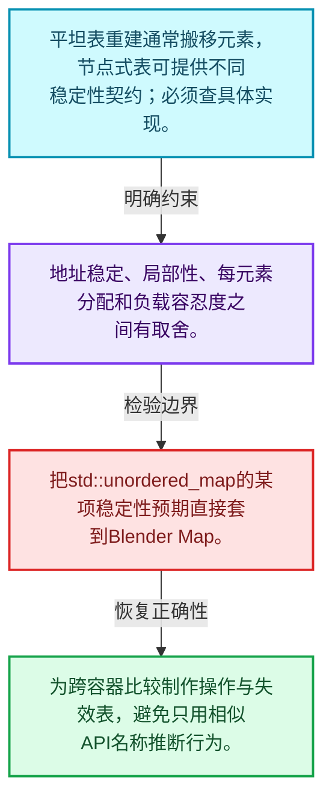
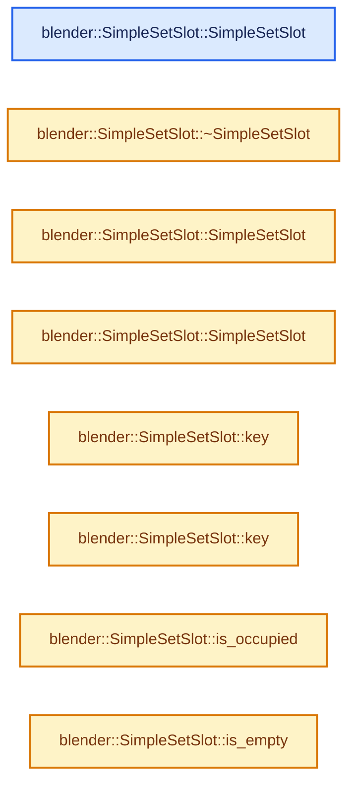
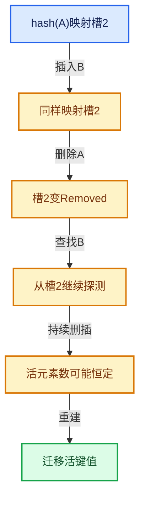

# 02-10 浮点修复与基础库对比

[方向导航](README.md) · [总目录](../README.md) · [实现索引](../00-课程指南/02-源码与提交索引/符号依赖与实现索引.md)

## 从问题到实现

为什么哈希表选型要同时考虑引用稳定与负载？

平坦存储与节点存储的地址稳定性不同；Blender、标准库、Abseil的契约不能仅凭API相似推断相同。

**数据模型**

平坦表重建通常搬移元素，节点式表可提供不同稳定性契约；必须查具体实现。

**设计取舍**

地址稳定、局部性、每元素分配和负载容忍度之间有取舍。

**最小反例**

把std::unordered_map的某项稳定性预期直接套到Blender Map。

**推导**

为跨容器比较制作操作与失效表，避免只用相似API名称推断行为。

## 阅读地图与执行推演








图中的数值推演是本方向的教学模型；实际函数之间的调用边与概念分析边分别标注，不能把概念关系当作运行时调度顺序。

## 完整源码单元与就地讲解

中文讲解直接放在相关代码旁，复杂机制在代码下展开。原文折叠区保留基准行号；不需要在行号表和函数之间来回查找。类布局可分段展示，函数实现不按固定行数切开。

### 类型布局、声明与编译条件 · BLI_set_slots.hh L1—L47

<a id="t-0149498af14d"></a>

`SimpleSetSlot`在这里声明的数据成员：

- `State state_`
- `TypedBuffer<Key> key_buffer_`

<a id="t-095c896f964d"></a>

<!-- annotated:b14e96b2e18a7d -->

```cpp
/* SPDX-FileCopyrightText: 2023 Blender Authors
 *
 * SPDX-License-Identifier: GPL-2.0-or-later */

#pragma once

/** \file
 * \ingroup bli
 *
 * This file contains different slot types that are supposed to be used with Set.
 *
 * Every slot type has to be able to hold a value of the Key type and state information.
 * A set slot has three possible states: empty, occupied and removed.
 *
 * Only when a slot is occupied, it stores an instance of type Key.
 *
 * A set slot type has to implement a couple of methods that are explained in SimpleSetSlot.
 * A slot type is assumed to be trivially destructible, when it is not in occupied state. So the
 * destructor might not be called in that case.
 */

#include "BLI_hash_tables.hh"
#include "BLI_memory_utils.hh"
#include "BLI_string_ref.hh"

namespace blender {

/**
 * The simplest possible set slot. It stores the slot state and the optional key instance in
 * separate variables. Depending on the alignment requirement of the key, many bytes might be
 * wasted.
 */
template<typename Key> class SimpleSetSlot {
 private:
  enum State : uint8_t {
    Empty = 0,
    Occupied = 1,
    Removed = 2,
  };

  State state_;
  TypedBuffer<Key> key_buffer_;

 public:
  /**
   * After the default constructor has run, the slot has to be in the empty state.
   */
```

<details>
<summary>核对原始源码：source/blender/blenlib/BLI_set_slots.hh · L1—L47</summary>

<!-- original:b14e96b2e18a7d:source/blender/blenlib/BLI_set_slots.hh:1:47 -->

```cpp
/* SPDX-FileCopyrightText: 2023 Blender Authors
 *
 * SPDX-License-Identifier: GPL-2.0-or-later */

#pragma once

/** \file
 * \ingroup bli
 *
 * This file contains different slot types that are supposed to be used with Set.
 *
 * Every slot type has to be able to hold a value of the Key type and state information.
 * A set slot has three possible states: empty, occupied and removed.
 *
 * Only when a slot is occupied, it stores an instance of type Key.
 *
 * A set slot type has to implement a couple of methods that are explained in SimpleSetSlot.
 * A slot type is assumed to be trivially destructible, when it is not in occupied state. So the
 * destructor might not be called in that case.
 */

#include "BLI_hash_tables.hh"
#include "BLI_memory_utils.hh"
#include "BLI_string_ref.hh"

namespace blender {

/**
 * The simplest possible set slot. It stores the slot state and the optional key instance in
 * separate variables. Depending on the alignment requirement of the key, many bytes might be
 * wasted.
 */
template<typename Key> class SimpleSetSlot {
 private:
  enum State : uint8_t {
    Empty = 0,
    Occupied = 1,
    Removed = 2,
  };

  State state_;
  TypedBuffer<Key> key_buffer_;

 public:
  /**
   * After the default constructor has run, the slot has to be in the empty state.
   */
```

</details>

<a id="f-b9ee9e2dccee4bfe"></a>

### `blender::SimpleSetSlot::SimpleSetSlot`

实现位置：[source/blender/blenlib/BLI_set_slots.hh](../../../../../source/blender/blenlib/BLI_set_slots.hh) · L48—L51。

**教学注释版**

<!-- annotated:13286a2f6642b1 -->

```cpp
  SimpleSetSlot()
  {
    state_ = Empty;
  }
```

<details>
<summary>核对原始源码：source/blender/blenlib/BLI_set_slots.hh · L48—L51</summary>

<!-- original:13286a2f6642b1:source/blender/blenlib/BLI_set_slots.hh:48:51 -->

```cpp
  SimpleSetSlot()
  {
    state_ = Empty;
  }
```

</details>

**沿实际写入检查状态**

- `state_ = Empty;`

**继续追踪实现**

本实现没有需要继续展开的显式调用；检查返回表达式、对象转换和调用者前置条件。

### 类型布局、声明与编译条件 · BLI_set_slots.hh L52—L55

<!-- annotated:980f7b6f16f51f -->

```cpp

  /**
   * The destructor also has to destruct the key, if the slot is currently occupied.
   */
```

<details>
<summary>核对原始源码：source/blender/blenlib/BLI_set_slots.hh · L52—L55</summary>

<!-- original:980f7b6f16f51f:source/blender/blenlib/BLI_set_slots.hh:52:55 -->

```cpp

  /**
   * The destructor also has to destruct the key, if the slot is currently occupied.
   */
```

</details>

<a id="f-104e3747ed2b3e8d"></a>

### `blender::SimpleSetSlot::~SimpleSetSlot`

实现位置：[source/blender/blenlib/BLI_set_slots.hh](../../../../../source/blender/blenlib/BLI_set_slots.hh) · L56—L61。

**教学注释版**

<!-- annotated:46fdc5a5e52797 -->

```cpp
  ~SimpleSetSlot()
  {
    if (state_ == Occupied) {
      key_buffer_.ref().~Key();
    }
  }
```

<details>
<summary>核对原始源码：source/blender/blenlib/BLI_set_slots.hh · L56—L61</summary>

<!-- original:46fdc5a5e52797:source/blender/blenlib/BLI_set_slots.hh:56:61 -->

```cpp
  ~SimpleSetSlot()
  {
    if (state_ == Occupied) {
      key_buffer_.ref().~Key();
    }
  }
```

</details>

**继续追踪实现**

- `key_buffer_.ref().~Key` → [调用协议](../00-课程指南/01-路线与规范/模板宏与动态分派协议.md)：接收对象类型依赖auto、返回值或模板实例；不按同名猜测目标。调用位置L59。
- `key_buffer_.ref` → [blender::TypedBuffer::ref · L211](../03-内存分配与运行时类型/01-对齐与未初始化存储.md#f-0bc330ab3d8ae4fb)；[blender::TypedBuffer::ref · L216](../03-内存分配与运行时类型/01-对齐与未初始化存储.md#f-373a7ba220c358f0)。同名重载需按实参类型选择。

### 类型布局、声明与编译条件 · BLI_set_slots.hh L62—L66

<!-- annotated:3309b3efc13b7a -->

```cpp

  /**
   * The copy constructor has to copy the state. If the other slot was occupied, a copy of the key
   * has to be made as well.
   */
```

<details>
<summary>核对原始源码：source/blender/blenlib/BLI_set_slots.hh · L62—L66</summary>

<!-- original:3309b3efc13b7a:source/blender/blenlib/BLI_set_slots.hh:62:66 -->

```cpp

  /**
   * The copy constructor has to copy the state. If the other slot was occupied, a copy of the key
   * has to be made as well.
   */
```

</details>

<a id="f-d95efd57bf256619"></a>

### `blender::SimpleSetSlot::SimpleSetSlot`

实现位置：[source/blender/blenlib/BLI_set_slots.hh](../../../../../source/blender/blenlib/BLI_set_slots.hh) · L67—L73。

接口参数：

- `const SimpleSetSlot &other`

**教学注释版**

<!-- annotated:2fd0581320b0fa -->

```cpp
  SimpleSetSlot(const SimpleSetSlot &other)
  {
    state_ = other.state_;
    if (other.state_ == Occupied) {
      new (&key_buffer_) Key(*other.key_buffer_);
    }
  }
```

<details>
<summary>核对原始源码：source/blender/blenlib/BLI_set_slots.hh · L67—L73</summary>

<!-- original:2fd0581320b0fa:source/blender/blenlib/BLI_set_slots.hh:67:73 -->

```cpp
  SimpleSetSlot(const SimpleSetSlot &other)
  {
    state_ = other.state_;
    if (other.state_ == Occupied) {
      new (&key_buffer_) Key(*other.key_buffer_);
    }
  }
```

</details>

**沿实际写入检查状态**

- `state_ = other.state_;`

**继续追踪实现**

本实现没有需要继续展开的显式调用；检查返回表达式、对象转换和调用者前置条件。

### 类型布局、声明与编译条件 · BLI_set_slots.hh L74—L79

<!-- annotated:4a33f2d49abaea -->

```cpp

  /**
   * The move constructor has to copy the state. If the other slot was occupied, the key from the
   * other slot has to be moved as well. The other slot stays in the state it was in before. Its
   * optionally stored key remains in a moved-from state.
   */
```

<details>
<summary>核对原始源码：source/blender/blenlib/BLI_set_slots.hh · L74—L79</summary>

<!-- original:4a33f2d49abaea:source/blender/blenlib/BLI_set_slots.hh:74:79 -->

```cpp

  /**
   * The move constructor has to copy the state. If the other slot was occupied, the key from the
   * other slot has to be moved as well. The other slot stays in the state it was in before. Its
   * optionally stored key remains in a moved-from state.
   */
```

</details>

<a id="f-7b7c486de54ac180"></a>

### `blender::SimpleSetSlot::SimpleSetSlot`

实现位置：[source/blender/blenlib/BLI_set_slots.hh](../../../../../source/blender/blenlib/BLI_set_slots.hh) · L80—L86。

接口参数：

- `SimpleSetSlot &&other`

**教学注释版**

<!-- annotated:71fd3bd79a8817 -->

```cpp
  SimpleSetSlot(SimpleSetSlot &&other) noexcept(std::is_nothrow_move_constructible_v<Key>)
  {
    state_ = other.state_;
    if (other.state_ == Occupied) {
      // [讲解] std::move：把表达式转换成可供移动重载选择的值类别；不保证真的移动，不结束源对象寿命，对const值可能选择复制。
      new (&key_buffer_) Key(std::move(*other.key_buffer_));
    }
  }
```

<details>
<summary>核对原始源码：source/blender/blenlib/BLI_set_slots.hh · L80—L86</summary>

<!-- original:71fd3bd79a8817:source/blender/blenlib/BLI_set_slots.hh:80:86 -->

```cpp
  SimpleSetSlot(SimpleSetSlot &&other) noexcept(std::is_nothrow_move_constructible_v<Key>)
  {
    state_ = other.state_;
    if (other.state_ == Occupied) {
      new (&key_buffer_) Key(std::move(*other.key_buffer_));
    }
  }
```

</details>

**沿实际写入检查状态**

- `state_ = other.state_;`

**继续追踪实现**

- `std::move` → [外部契约](https://eel.is/c++draft/utility.forward)：把表达式转换成可供移动重载选择的值类别；不保证真的移动，不结束源对象寿命，对const值可能选择复制。

### 类型布局、声明与编译条件 · BLI_set_slots.hh L87—L90

<!-- annotated:f94bdbb14aa12e -->

```cpp

  /**
   * Get a non-const pointer to the position where the key is stored.
   */
```

<details>
<summary>核对原始源码：source/blender/blenlib/BLI_set_slots.hh · L87—L90</summary>

<!-- original:f94bdbb14aa12e:source/blender/blenlib/BLI_set_slots.hh:87:90 -->

```cpp

  /**
   * Get a non-const pointer to the position where the key is stored.
   */
```

</details>

<a id="f-1d88ff991f47d686"></a>

### `blender::SimpleSetSlot::key`

实现位置：[source/blender/blenlib/BLI_set_slots.hh](../../../../../source/blender/blenlib/BLI_set_slots.hh) · L91—L94。

**教学注释版**

<!-- annotated:257e6eed62bf4d -->

```cpp
  Key *key()
  {
    return key_buffer_;
  }
```

<details>
<summary>核对原始源码：source/blender/blenlib/BLI_set_slots.hh · L91—L94</summary>

<!-- original:257e6eed62bf4d:source/blender/blenlib/BLI_set_slots.hh:91:94 -->

```cpp
  Key *key()
  {
    return key_buffer_;
  }
```

</details>

**结果出口**

- `return key_buffer_;`

**继续追踪实现**

本实现没有需要继续展开的显式调用；检查返回表达式、对象转换和调用者前置条件。

### 类型布局、声明与编译条件 · BLI_set_slots.hh L95—L98

<!-- annotated:3a5f840d35e3dc -->

```cpp

  /**
   * Get a const pointer to the position where the key is stored.
   */
```

<details>
<summary>核对原始源码：source/blender/blenlib/BLI_set_slots.hh · L95—L98</summary>

<!-- original:3a5f840d35e3dc:source/blender/blenlib/BLI_set_slots.hh:95:98 -->

```cpp

  /**
   * Get a const pointer to the position where the key is stored.
   */
```

</details>

<a id="f-bf4e750ed64c398c"></a>

### `blender::SimpleSetSlot::key`

实现位置：[source/blender/blenlib/BLI_set_slots.hh](../../../../../source/blender/blenlib/BLI_set_slots.hh) · L99—L102。

**教学注释版**

<!-- annotated:faa0f9c57512ac -->

```cpp
  const Key *key() const
  {
    return key_buffer_;
  }
```

<details>
<summary>核对原始源码：source/blender/blenlib/BLI_set_slots.hh · L99—L102</summary>

<!-- original:faa0f9c57512ac:source/blender/blenlib/BLI_set_slots.hh:99:102 -->

```cpp
  const Key *key() const
  {
    return key_buffer_;
  }
```

</details>

**结果出口**

- `return key_buffer_;`

**继续追踪实现**

本实现没有需要继续展开的显式调用；检查返回表达式、对象转换和调用者前置条件。

### 类型布局、声明与编译条件 · BLI_set_slots.hh L103—L106

<!-- annotated:4661e34f28411d -->

```cpp

  /**
   * Return true if the slot currently contains a key.
   */
```

<details>
<summary>核对原始源码：source/blender/blenlib/BLI_set_slots.hh · L103—L106</summary>

<!-- original:4661e34f28411d:source/blender/blenlib/BLI_set_slots.hh:103:106 -->

```cpp

  /**
   * Return true if the slot currently contains a key.
   */
```

</details>

<a id="f-5af1a021584cc3de"></a>

### `blender::SimpleSetSlot::is_occupied`

实现位置：[source/blender/blenlib/BLI_set_slots.hh](../../../../../source/blender/blenlib/BLI_set_slots.hh) · L107—L110。

**教学注释版**

<!-- annotated:3da862906bc8b5 -->

```cpp
  bool is_occupied() const
  {
    return state_ == Occupied;
  }
```

<details>
<summary>核对原始源码：source/blender/blenlib/BLI_set_slots.hh · L107—L110</summary>

<!-- original:3da862906bc8b5:source/blender/blenlib/BLI_set_slots.hh:107:110 -->

```cpp
  bool is_occupied() const
  {
    return state_ == Occupied;
  }
```

</details>

**结果出口**

- `return state_ == Occupied;`

**继续追踪实现**

本实现没有需要继续展开的显式调用；检查返回表达式、对象转换和调用者前置条件。

### 类型布局、声明与编译条件 · BLI_set_slots.hh L111—L114

<!-- annotated:15a751ad0aaaf3 -->

```cpp

  /**
   * Return true if the slot is empty, i.e. it does not contain a key and is not in removed state.
   */
```

<details>
<summary>核对原始源码：source/blender/blenlib/BLI_set_slots.hh · L111—L114</summary>

<!-- original:15a751ad0aaaf3:source/blender/blenlib/BLI_set_slots.hh:111:114 -->

```cpp

  /**
   * Return true if the slot is empty, i.e. it does not contain a key and is not in removed state.
   */
```

</details>

<a id="f-d290f6f957aacbeb"></a>

### `blender::SimpleSetSlot::is_empty`

实现位置：[source/blender/blenlib/BLI_set_slots.hh](../../../../../source/blender/blenlib/BLI_set_slots.hh) · L115—L118。

**教学注释版**

<!-- annotated:ead2818799e6fe -->

```cpp
  bool is_empty() const
  {
    return state_ == Empty;
  }
```

<details>
<summary>核对原始源码：source/blender/blenlib/BLI_set_slots.hh · L115—L118</summary>

<!-- original:ead2818799e6fe:source/blender/blenlib/BLI_set_slots.hh:115:118 -->

```cpp
  bool is_empty() const
  {
    return state_ == Empty;
  }
```

</details>

**结果出口**

- `return state_ == Empty;`

**继续追踪实现**

本实现没有需要继续展开的显式调用；检查返回表达式、对象转换和调用者前置条件。

### 类型布局、声明与编译条件 · BLI_set_slots.hh L119—L123

<!-- annotated:d6e8d9791945fa -->

```cpp

  /**
   * Return the hash of the currently stored key. In this simple set slot implementation, we just
   * compute the hash here. Other implementations might store the hash in the slot instead.
   */
```

<details>
<summary>核对原始源码：source/blender/blenlib/BLI_set_slots.hh · L119—L123</summary>

<!-- original:d6e8d9791945fa:source/blender/blenlib/BLI_set_slots.hh:119:123 -->

```cpp

  /**
   * Return the hash of the currently stored key. In this simple set slot implementation, we just
   * compute the hash here. Other implementations might store the hash in the slot instead.
   */
```

</details>

<a id="f-8da8b2ef71da1b6e"></a>

### `blender::SimpleSetSlot::get_hash`

实现位置：[source/blender/blenlib/BLI_set_slots.hh](../../../../../source/blender/blenlib/BLI_set_slots.hh) · L124—L128。

接口参数：

- `const Hash &hash`

**教学注释版**

<!-- annotated:526bdee276efaa -->

```cpp
  template<typename Hash> uint64_t get_hash(const Hash &hash) const
  {
    BLI_assert(this->is_occupied());
    return hash(*key_buffer_);
  }
```

<details>
<summary>核对原始源码：source/blender/blenlib/BLI_set_slots.hh · L124—L128</summary>

<!-- original:526bdee276efaa:source/blender/blenlib/BLI_set_slots.hh:124:128 -->

```cpp
  template<typename Hash> uint64_t get_hash(const Hash &hash) const
  {
    BLI_assert(this->is_occupied());
    return hash(*key_buffer_);
  }
```

</details>

**结果出口**

- `return hash(*key_buffer_);`

**继续追踪实现**

- `BLI_assert` → [BLI_assert · L48](../90-实现依赖专题/01-BLI基础库/BLI_assert.hh.md#m-57a88495704d)；[BLI_assert · L63](../90-实现依赖专题/01-BLI基础库/BLI_assert.hh.md#m-d07050020cb5)。宏定义由构建条件选择。
- `this->is_occupied` → [blender::SimpleSetSlot::is_occupied · L107](10-浮点修复与基础库对比.md#f-5af1a021584cc3de)。
- `hash` → [调用协议](../00-课程指南/01-路线与规范/模板宏与动态分派协议.md)：局部可调用对象，须结合其初始化与捕获环境。调用位置L127。

### 类型布局、声明与编译条件 · BLI_set_slots.hh L129—L133

<!-- annotated:919066a1ca531c -->

```cpp

  /**
   * Return true, when this slot is occupied and contains a key that compares equal to the given
   * key. The hash is used by other slot implementations to determine inequality faster.
   */
```

<details>
<summary>核对原始源码：source/blender/blenlib/BLI_set_slots.hh · L129—L133</summary>

<!-- original:919066a1ca531c:source/blender/blenlib/BLI_set_slots.hh:129:133 -->

```cpp

  /**
   * Return true, when this slot is occupied and contains a key that compares equal to the given
   * key. The hash is used by other slot implementations to determine inequality faster.
   */
```

</details>

<a id="f-1077b14d7891c415"></a>

### `blender::SimpleSetSlot::contains`

实现位置：[source/blender/blenlib/BLI_set_slots.hh](../../../../../source/blender/blenlib/BLI_set_slots.hh) · L134—L141。

接口参数：

- `const ForwardKey &key`
- `const IsEqual &is_equal`
- `uint64_t`

**教学注释版**

<!-- annotated:554c9552d276fc -->

```cpp
  template<typename ForwardKey, typename IsEqual>
  bool contains(const ForwardKey &key, const IsEqual &is_equal, uint64_t /*hash*/) const
  {
    if (state_ == Occupied) {
      return is_equal(key, *key_buffer_);
    }
    return false;
  }
```

<details>
<summary>核对原始源码：source/blender/blenlib/BLI_set_slots.hh · L134—L141</summary>

<!-- original:554c9552d276fc:source/blender/blenlib/BLI_set_slots.hh:134:141 -->

```cpp
  template<typename ForwardKey, typename IsEqual>
  bool contains(const ForwardKey &key, const IsEqual &is_equal, uint64_t /*hash*/) const
  {
    if (state_ == Occupied) {
      return is_equal(key, *key_buffer_);
    }
    return false;
  }
```

</details>

**结果出口**

- `return is_equal(key, *key_buffer_);`
- `return false;`

**继续追踪实现**

- `is_equal` → [调用协议](../00-课程指南/01-路线与规范/模板宏与动态分派协议.md)：局部可调用对象，须结合其初始化与捕获环境。调用位置L138。

### 类型布局、声明与编译条件 · BLI_set_slots.hh L142—L146

<!-- annotated:c3e30a38a0b7ca -->

```cpp

  /**
   * Change the state of this slot from empty/removed to occupied. The key has to be constructed
   * by calling the constructor with the given key as parameter.
   */
```

<details>
<summary>核对原始源码：source/blender/blenlib/BLI_set_slots.hh · L142—L146</summary>

<!-- original:c3e30a38a0b7ca:source/blender/blenlib/BLI_set_slots.hh:142:146 -->

```cpp

  /**
   * Change the state of this slot from empty/removed to occupied. The key has to be constructed
   * by calling the constructor with the given key as parameter.
   */
```

</details>

<a id="f-173bd7a5b6441f70"></a>

### `blender::SimpleSetSlot::occupy`

实现位置：[source/blender/blenlib/BLI_set_slots.hh](../../../../../source/blender/blenlib/BLI_set_slots.hh) · L147—L152。

接口参数：

- `ForwardKey &&key`
- `uint64_t`

**教学注释版**

<!-- annotated:6044c924e52b89 -->

```cpp
  template<typename ForwardKey> void occupy(ForwardKey &&key, uint64_t /*hash*/)
  {
    BLI_assert(!this->is_occupied());
    // [讲解] std::forward<ForwardKey>：在转发引用中恢复调用者传入的值类别；依赖推导类型，不能与无条件move互换。
    new (&key_buffer_) Key(std::forward<ForwardKey>(key));
    state_ = Occupied;
  }
```

<details>
<summary>核对原始源码：source/blender/blenlib/BLI_set_slots.hh · L147—L152</summary>

<!-- original:6044c924e52b89:source/blender/blenlib/BLI_set_slots.hh:147:152 -->

```cpp
  template<typename ForwardKey> void occupy(ForwardKey &&key, uint64_t /*hash*/)
  {
    BLI_assert(!this->is_occupied());
    new (&key_buffer_) Key(std::forward<ForwardKey>(key));
    state_ = Occupied;
  }
```

</details>

**沿实际写入检查状态**

- `state_ = Occupied;`

**继续追踪实现**

- `BLI_assert` → [BLI_assert · L48](../90-实现依赖专题/01-BLI基础库/BLI_assert.hh.md#m-57a88495704d)；[BLI_assert · L63](../90-实现依赖专题/01-BLI基础库/BLI_assert.hh.md#m-d07050020cb5)。宏定义由构建条件选择。
- `this->is_occupied` → [blender::SimpleSetSlot::is_occupied · L107](10-浮点修复与基础库对比.md#f-5af1a021584cc3de)。
- `std::forward<ForwardKey>` → [外部契约](https://eel.is/c++draft/utility.forward)：在转发引用中恢复调用者传入的值类别；依赖推导类型，不能与无条件move互换。

### 类型布局、声明与编译条件 · BLI_set_slots.hh L153—L156

<!-- annotated:167d863ec51ce3 -->

```cpp

  /**
   * Change the state of this slot from occupied to removed. The key has to be destructed as well.
   */
```

<details>
<summary>核对原始源码：source/blender/blenlib/BLI_set_slots.hh · L153—L156</summary>

<!-- original:167d863ec51ce3:source/blender/blenlib/BLI_set_slots.hh:153:156 -->

```cpp

  /**
   * Change the state of this slot from occupied to removed. The key has to be destructed as well.
   */
```

</details>

<a id="f-d5efb876e6730548"></a>

### `blender::SimpleSetSlot::remove`

实现位置：[source/blender/blenlib/BLI_set_slots.hh](../../../../../source/blender/blenlib/BLI_set_slots.hh) · L157—L162。

**教学注释版**

<!-- annotated:358e92adcd1346 -->

```cpp
  void remove()
  {
    BLI_assert(this->is_occupied());
    key_buffer_.ref().~Key();
    state_ = Removed;
  }
```

<details>
<summary>核对原始源码：source/blender/blenlib/BLI_set_slots.hh · L157—L162</summary>

<!-- original:358e92adcd1346:source/blender/blenlib/BLI_set_slots.hh:157:162 -->

```cpp
  void remove()
  {
    BLI_assert(this->is_occupied());
    key_buffer_.ref().~Key();
    state_ = Removed;
  }
```

</details>

**沿实际写入检查状态**

- `state_ = Removed;`

**继续追踪实现**

- `BLI_assert` → [BLI_assert · L48](../90-实现依赖专题/01-BLI基础库/BLI_assert.hh.md#m-57a88495704d)；[BLI_assert · L63](../90-实现依赖专题/01-BLI基础库/BLI_assert.hh.md#m-d07050020cb5)。宏定义由构建条件选择。
- `this->is_occupied` → [blender::SimpleSetSlot::is_occupied · L107](10-浮点修复与基础库对比.md#f-5af1a021584cc3de)。
- `key_buffer_.ref().~Key` → [调用协议](../00-课程指南/01-路线与规范/模板宏与动态分派协议.md)：接收对象类型依赖auto、返回值或模板实例；不按同名猜测目标。调用位置L160。
- `key_buffer_.ref` → [blender::TypedBuffer::ref · L211](../03-内存分配与运行时类型/01-对齐与未初始化存储.md#f-0bc330ab3d8ae4fb)；[blender::TypedBuffer::ref · L216](../03-内存分配与运行时类型/01-对齐与未初始化存储.md#f-373a7ba220c358f0)。同名重载需按实参类型选择。

### 类型布局、声明与编译条件 · BLI_set_slots.hh L163—L181

<a id="t-2c28fdd2c274"></a>

`HashedSetSlot`在这里声明的数据成员：

- `uint64_t hash_`
- `State state_`
- `TypedBuffer<Key> key_buffer_`

<a id="t-5d32dc251def"></a>

<!-- annotated:ce21b2448141f0 -->

```cpp
};

/**
 * This set slot implementation stores the hash of the key within the slot. This helps when
 * computing the hash or an equality check is expensive.
 */
template<typename Key> class HashedSetSlot {
 private:
  enum State : uint8_t {
    Empty = 0,
    Occupied = 1,
    Removed = 2,
  };

  uint64_t hash_;
  State state_;
  TypedBuffer<Key> key_buffer_;

 public:
```

<details>
<summary>核对原始源码：source/blender/blenlib/BLI_set_slots.hh · L163—L181</summary>

<!-- original:ce21b2448141f0:source/blender/blenlib/BLI_set_slots.hh:163:181 -->

```cpp
};

/**
 * This set slot implementation stores the hash of the key within the slot. This helps when
 * computing the hash or an equality check is expensive.
 */
template<typename Key> class HashedSetSlot {
 private:
  enum State : uint8_t {
    Empty = 0,
    Occupied = 1,
    Removed = 2,
  };

  uint64_t hash_;
  State state_;
  TypedBuffer<Key> key_buffer_;

 public:
```

</details>

<a id="f-61735a2ed5d71c7a"></a>

### `blender::HashedSetSlot::HashedSetSlot`

实现位置：[source/blender/blenlib/BLI_set_slots.hh](../../../../../source/blender/blenlib/BLI_set_slots.hh) · L182—L185。

**教学注释版**

<!-- annotated:89d9a0e5c7405e -->

```cpp
  HashedSetSlot()
  {
    state_ = Empty;
  }
```

<details>
<summary>核对原始源码：source/blender/blenlib/BLI_set_slots.hh · L182—L185</summary>

<!-- original:89d9a0e5c7405e:source/blender/blenlib/BLI_set_slots.hh:182:185 -->

```cpp
  HashedSetSlot()
  {
    state_ = Empty;
  }
```

</details>

**沿实际写入检查状态**

- `state_ = Empty;`

**继续追踪实现**

本实现没有需要继续展开的显式调用；检查返回表达式、对象转换和调用者前置条件。

<!-- annotated:2960b8d31a074f -->

```cpp

```

<details>
<summary>核对原始源码：source/blender/blenlib/BLI_set_slots.hh · L186—L186</summary>

<!-- original:2960b8d31a074f:source/blender/blenlib/BLI_set_slots.hh:186:186 -->

```cpp

```

</details>

<a id="f-ffe9716c51f7d15c"></a>

### `blender::HashedSetSlot::~HashedSetSlot`

实现位置：[source/blender/blenlib/BLI_set_slots.hh](../../../../../source/blender/blenlib/BLI_set_slots.hh) · L187—L192。

**教学注释版**

<!-- annotated:ea1c398e935047 -->

```cpp
  ~HashedSetSlot()
  {
    if (state_ == Occupied) {
      key_buffer_.ref().~Key();
    }
  }
```

<details>
<summary>核对原始源码：source/blender/blenlib/BLI_set_slots.hh · L187—L192</summary>

<!-- original:ea1c398e935047:source/blender/blenlib/BLI_set_slots.hh:187:192 -->

```cpp
  ~HashedSetSlot()
  {
    if (state_ == Occupied) {
      key_buffer_.ref().~Key();
    }
  }
```

</details>

**继续追踪实现**

- `key_buffer_.ref().~Key` → [调用协议](../00-课程指南/01-路线与规范/模板宏与动态分派协议.md)：接收对象类型依赖auto、返回值或模板实例；不按同名猜测目标。调用位置L190。
- `key_buffer_.ref` → [blender::TypedBuffer::ref · L211](../03-内存分配与运行时类型/01-对齐与未初始化存储.md#f-0bc330ab3d8ae4fb)；[blender::TypedBuffer::ref · L216](../03-内存分配与运行时类型/01-对齐与未初始化存储.md#f-373a7ba220c358f0)。同名重载需按实参类型选择。

<!-- annotated:b617195271a5ee -->

```cpp

```

<details>
<summary>核对原始源码：source/blender/blenlib/BLI_set_slots.hh · L193—L193</summary>

<!-- original:b617195271a5ee:source/blender/blenlib/BLI_set_slots.hh:193:193 -->

```cpp

```

</details>

<a id="f-0843ac08048c3047"></a>

### `blender::HashedSetSlot::HashedSetSlot`

实现位置：[source/blender/blenlib/BLI_set_slots.hh](../../../../../source/blender/blenlib/BLI_set_slots.hh) · L194—L201。

接口参数：

- `const HashedSetSlot &other`

**教学注释版**

<!-- annotated:5e3925225a4160 -->

```cpp
  HashedSetSlot(const HashedSetSlot &other)
  {
    state_ = other.state_;
    if (other.state_ == Occupied) {
      hash_ = other.hash_;
      new (&key_buffer_) Key(*other.key_buffer_);
    }
  }
```

<details>
<summary>核对原始源码：source/blender/blenlib/BLI_set_slots.hh · L194—L201</summary>

<!-- original:5e3925225a4160:source/blender/blenlib/BLI_set_slots.hh:194:201 -->

```cpp
  HashedSetSlot(const HashedSetSlot &other)
  {
    state_ = other.state_;
    if (other.state_ == Occupied) {
      hash_ = other.hash_;
      new (&key_buffer_) Key(*other.key_buffer_);
    }
  }
```

</details>

**沿实际写入检查状态**

- `state_ = other.state_;`
- `hash_ = other.hash_;`

**继续追踪实现**

本实现没有需要继续展开的显式调用；检查返回表达式、对象转换和调用者前置条件。

<!-- annotated:463269c94fd658 -->

```cpp

```

<details>
<summary>核对原始源码：source/blender/blenlib/BLI_set_slots.hh · L202—L202</summary>

<!-- original:463269c94fd658:source/blender/blenlib/BLI_set_slots.hh:202:202 -->

```cpp

```

</details>

<a id="f-b0e55caa52cb485d"></a>

### `blender::HashedSetSlot::HashedSetSlot`

实现位置：[source/blender/blenlib/BLI_set_slots.hh](../../../../../source/blender/blenlib/BLI_set_slots.hh) · L203—L210。

接口参数：

- `HashedSetSlot &&other`

**教学注释版**

<!-- annotated:f2e76b854ba9e0 -->

```cpp
  HashedSetSlot(HashedSetSlot &&other) noexcept(std::is_nothrow_move_constructible_v<Key>)
  {
    state_ = other.state_;
    if (other.state_ == Occupied) {
      hash_ = other.hash_;
      // [讲解] std::move：把表达式转换成可供移动重载选择的值类别；不保证真的移动，不结束源对象寿命，对const值可能选择复制。
      new (&key_buffer_) Key(std::move(*other.key_buffer_));
    }
  }
```

<details>
<summary>核对原始源码：source/blender/blenlib/BLI_set_slots.hh · L203—L210</summary>

<!-- original:f2e76b854ba9e0:source/blender/blenlib/BLI_set_slots.hh:203:210 -->

```cpp
  HashedSetSlot(HashedSetSlot &&other) noexcept(std::is_nothrow_move_constructible_v<Key>)
  {
    state_ = other.state_;
    if (other.state_ == Occupied) {
      hash_ = other.hash_;
      new (&key_buffer_) Key(std::move(*other.key_buffer_));
    }
  }
```

</details>

**沿实际写入检查状态**

- `state_ = other.state_;`
- `hash_ = other.hash_;`

**继续追踪实现**

- `std::move` → [外部契约](https://eel.is/c++draft/utility.forward)：把表达式转换成可供移动重载选择的值类别；不保证真的移动，不结束源对象寿命，对const值可能选择复制。

<!-- annotated:27f66984d26acc -->

```cpp

```

<details>
<summary>核对原始源码：source/blender/blenlib/BLI_set_slots.hh · L211—L211</summary>

<!-- original:27f66984d26acc:source/blender/blenlib/BLI_set_slots.hh:211:211 -->

```cpp

```

</details>

<a id="f-3755b812e3ebcadd"></a>

### `blender::HashedSetSlot::key`

实现位置：[source/blender/blenlib/BLI_set_slots.hh](../../../../../source/blender/blenlib/BLI_set_slots.hh) · L212—L215。

**教学注释版**

<!-- annotated:e7d13349e6c699 -->

```cpp
  Key *key()
  {
    return key_buffer_;
  }
```

<details>
<summary>核对原始源码：source/blender/blenlib/BLI_set_slots.hh · L212—L215</summary>

<!-- original:e7d13349e6c699:source/blender/blenlib/BLI_set_slots.hh:212:215 -->

```cpp
  Key *key()
  {
    return key_buffer_;
  }
```

</details>

**结果出口**

- `return key_buffer_;`

**继续追踪实现**

本实现没有需要继续展开的显式调用；检查返回表达式、对象转换和调用者前置条件。

<!-- annotated:7b45289aa3dff0 -->

```cpp

```

<details>
<summary>核对原始源码：source/blender/blenlib/BLI_set_slots.hh · L216—L216</summary>

<!-- original:7b45289aa3dff0:source/blender/blenlib/BLI_set_slots.hh:216:216 -->

```cpp

```

</details>

<a id="f-eb1ad45cf93a2cf6"></a>

### `blender::HashedSetSlot::key`

实现位置：[source/blender/blenlib/BLI_set_slots.hh](../../../../../source/blender/blenlib/BLI_set_slots.hh) · L217—L220。

**教学注释版**

<!-- annotated:65b7a2477b45af -->

```cpp
  const Key *key() const
  {
    return key_buffer_;
  }
```

<details>
<summary>核对原始源码：source/blender/blenlib/BLI_set_slots.hh · L217—L220</summary>

<!-- original:65b7a2477b45af:source/blender/blenlib/BLI_set_slots.hh:217:220 -->

```cpp
  const Key *key() const
  {
    return key_buffer_;
  }
```

</details>

**结果出口**

- `return key_buffer_;`

**继续追踪实现**

本实现没有需要继续展开的显式调用；检查返回表达式、对象转换和调用者前置条件。

<!-- annotated:5e27d7f37a2ca1 -->

```cpp

```

<details>
<summary>核对原始源码：source/blender/blenlib/BLI_set_slots.hh · L221—L221</summary>

<!-- original:5e27d7f37a2ca1:source/blender/blenlib/BLI_set_slots.hh:221:221 -->

```cpp

```

</details>

<a id="f-b9ecb775121fca14"></a>

### `blender::HashedSetSlot::is_occupied`

实现位置：[source/blender/blenlib/BLI_set_slots.hh](../../../../../source/blender/blenlib/BLI_set_slots.hh) · L222—L225。

**教学注释版**

<!-- annotated:710260034f35f7 -->

```cpp
  bool is_occupied() const
  {
    return state_ == Occupied;
  }
```

<details>
<summary>核对原始源码：source/blender/blenlib/BLI_set_slots.hh · L222—L225</summary>

<!-- original:710260034f35f7:source/blender/blenlib/BLI_set_slots.hh:222:225 -->

```cpp
  bool is_occupied() const
  {
    return state_ == Occupied;
  }
```

</details>

**结果出口**

- `return state_ == Occupied;`

**继续追踪实现**

本实现没有需要继续展开的显式调用；检查返回表达式、对象转换和调用者前置条件。

<!-- annotated:9c578fe7dcb58a -->

```cpp

```

<details>
<summary>核对原始源码：source/blender/blenlib/BLI_set_slots.hh · L226—L226</summary>

<!-- original:9c578fe7dcb58a:source/blender/blenlib/BLI_set_slots.hh:226:226 -->

```cpp

```

</details>

<a id="f-576afd87ba3fc920"></a>

### `blender::HashedSetSlot::is_empty`

实现位置：[source/blender/blenlib/BLI_set_slots.hh](../../../../../source/blender/blenlib/BLI_set_slots.hh) · L227—L230。

**教学注释版**

<!-- annotated:26dfe88509a046 -->

```cpp
  bool is_empty() const
  {
    return state_ == Empty;
  }
```

<details>
<summary>核对原始源码：source/blender/blenlib/BLI_set_slots.hh · L227—L230</summary>

<!-- original:26dfe88509a046:source/blender/blenlib/BLI_set_slots.hh:227:230 -->

```cpp
  bool is_empty() const
  {
    return state_ == Empty;
  }
```

</details>

**结果出口**

- `return state_ == Empty;`

**继续追踪实现**

本实现没有需要继续展开的显式调用；检查返回表达式、对象转换和调用者前置条件。

<!-- annotated:8530a2e764390a -->

```cpp

```

<details>
<summary>核对原始源码：source/blender/blenlib/BLI_set_slots.hh · L231—L231</summary>

<!-- original:8530a2e764390a:source/blender/blenlib/BLI_set_slots.hh:231:231 -->

```cpp

```

</details>

<a id="f-2578e8eb8969ae7c"></a>

### `blender::HashedSetSlot::get_hash`

实现位置：[source/blender/blenlib/BLI_set_slots.hh](../../../../../source/blender/blenlib/BLI_set_slots.hh) · L232—L236。

接口参数：

- `const Hash &`

**教学注释版**

<!-- annotated:7787e7214a74f9 -->

```cpp
  template<typename Hash> uint64_t get_hash(const Hash & /*hash*/) const
  {
    BLI_assert(this->is_occupied());
    return hash_;
  }
```

<details>
<summary>核对原始源码：source/blender/blenlib/BLI_set_slots.hh · L232—L236</summary>

<!-- original:7787e7214a74f9:source/blender/blenlib/BLI_set_slots.hh:232:236 -->

```cpp
  template<typename Hash> uint64_t get_hash(const Hash & /*hash*/) const
  {
    BLI_assert(this->is_occupied());
    return hash_;
  }
```

</details>

**结果出口**

- `return hash_;`

**继续追踪实现**

- `BLI_assert` → [BLI_assert · L48](../90-实现依赖专题/01-BLI基础库/BLI_assert.hh.md#m-57a88495704d)；[BLI_assert · L63](../90-实现依赖专题/01-BLI基础库/BLI_assert.hh.md#m-d07050020cb5)。宏定义由构建条件选择。
- `this->is_occupied` → [blender::HashedSetSlot::is_occupied · L222](10-浮点修复与基础库对比.md#f-b9ecb775121fca14)。

<!-- annotated:2d80a993130fcf -->

```cpp

```

<details>
<summary>核对原始源码：source/blender/blenlib/BLI_set_slots.hh · L237—L237</summary>

<!-- original:2d80a993130fcf:source/blender/blenlib/BLI_set_slots.hh:237:237 -->

```cpp

```

</details>

<a id="f-67296f1fb3dc7f2c"></a>

### `blender::HashedSetSlot::contains`

实现位置：[source/blender/blenlib/BLI_set_slots.hh](../../../../../source/blender/blenlib/BLI_set_slots.hh) · L238—L248。

接口参数：

- `const ForwardKey &key`
- `const IsEqual &is_equal`
- `const uint64_t hash`

**教学注释版**

<!-- annotated:3b738aba0c1250 -->

```cpp
  template<typename ForwardKey, typename IsEqual>
  bool contains(const ForwardKey &key, const IsEqual &is_equal, const uint64_t hash) const
  {
    /* `hash_` might be uninitialized here, but that is ok. */
    if (hash_ == hash) {
      if (state_ == Occupied) {
        return is_equal(key, *key_buffer_);
      }
    }
    return false;
  }
```

<details>
<summary>核对原始源码：source/blender/blenlib/BLI_set_slots.hh · L238—L248</summary>

<!-- original:3b738aba0c1250:source/blender/blenlib/BLI_set_slots.hh:238:248 -->

```cpp
  template<typename ForwardKey, typename IsEqual>
  bool contains(const ForwardKey &key, const IsEqual &is_equal, const uint64_t hash) const
  {
    /* `hash_` might be uninitialized here, but that is ok. */
    if (hash_ == hash) {
      if (state_ == Occupied) {
        return is_equal(key, *key_buffer_);
      }
    }
    return false;
  }
```

</details>

**结果出口**

- `return is_equal(key, *key_buffer_);`
- `return false;`

**继续追踪实现**

- `is_equal` → [调用协议](../00-课程指南/01-路线与规范/模板宏与动态分派协议.md)：局部可调用对象，须结合其初始化与捕获环境。调用位置L244。

<!-- annotated:e74dfbba4c09b9 -->

```cpp

```

<details>
<summary>核对原始源码：source/blender/blenlib/BLI_set_slots.hh · L249—L249</summary>

<!-- original:e74dfbba4c09b9:source/blender/blenlib/BLI_set_slots.hh:249:249 -->

```cpp

```

</details>

<a id="f-6c7f7e9e439ed79d"></a>

### `blender::HashedSetSlot::occupy`

实现位置：[source/blender/blenlib/BLI_set_slots.hh](../../../../../source/blender/blenlib/BLI_set_slots.hh) · L250—L256。

接口参数：

- `ForwardKey &&key`
- `const uint64_t hash`

**教学注释版**

<!-- annotated:54ff23fa074d9f -->

```cpp
  template<typename ForwardKey> void occupy(ForwardKey &&key, const uint64_t hash)
  {
    BLI_assert(!this->is_occupied());
    // [讲解] std::forward<ForwardKey>：在转发引用中恢复调用者传入的值类别；依赖推导类型，不能与无条件move互换。
    new (&key_buffer_) Key(std::forward<ForwardKey>(key));
    state_ = Occupied;
    hash_ = hash;
  }
```

<details>
<summary>核对原始源码：source/blender/blenlib/BLI_set_slots.hh · L250—L256</summary>

<!-- original:54ff23fa074d9f:source/blender/blenlib/BLI_set_slots.hh:250:256 -->

```cpp
  template<typename ForwardKey> void occupy(ForwardKey &&key, const uint64_t hash)
  {
    BLI_assert(!this->is_occupied());
    new (&key_buffer_) Key(std::forward<ForwardKey>(key));
    state_ = Occupied;
    hash_ = hash;
  }
```

</details>

**沿实际写入检查状态**

- `state_ = Occupied;`
- `hash_ = hash;`

**继续追踪实现**

- `BLI_assert` → [BLI_assert · L48](../90-实现依赖专题/01-BLI基础库/BLI_assert.hh.md#m-57a88495704d)；[BLI_assert · L63](../90-实现依赖专题/01-BLI基础库/BLI_assert.hh.md#m-d07050020cb5)。宏定义由构建条件选择。
- `this->is_occupied` → [blender::HashedSetSlot::is_occupied · L222](10-浮点修复与基础库对比.md#f-b9ecb775121fca14)。
- `std::forward<ForwardKey>` → [外部契约](https://eel.is/c++draft/utility.forward)：在转发引用中恢复调用者传入的值类别；依赖推导类型，不能与无条件move互换。

<!-- annotated:75945cad6a945f -->

```cpp

```

<details>
<summary>核对原始源码：source/blender/blenlib/BLI_set_slots.hh · L257—L257</summary>

<!-- original:75945cad6a945f:source/blender/blenlib/BLI_set_slots.hh:257:257 -->

```cpp

```

</details>

<a id="f-58801fd411ce115a"></a>

### `blender::HashedSetSlot::remove`

实现位置：[source/blender/blenlib/BLI_set_slots.hh](../../../../../source/blender/blenlib/BLI_set_slots.hh) · L258—L263。

**教学注释版**

<!-- annotated:b7346d22ac28a4 -->

```cpp
  void remove()
  {
    BLI_assert(this->is_occupied());
    key_buffer_.ref().~Key();
    state_ = Removed;
  }
```

<details>
<summary>核对原始源码：source/blender/blenlib/BLI_set_slots.hh · L258—L263</summary>

<!-- original:b7346d22ac28a4:source/blender/blenlib/BLI_set_slots.hh:258:263 -->

```cpp
  void remove()
  {
    BLI_assert(this->is_occupied());
    key_buffer_.ref().~Key();
    state_ = Removed;
  }
```

</details>

**沿实际写入检查状态**

- `state_ = Removed;`

**继续追踪实现**

- `BLI_assert` → [BLI_assert · L48](../90-实现依赖专题/01-BLI基础库/BLI_assert.hh.md#m-57a88495704d)；[BLI_assert · L63](../90-实现依赖专题/01-BLI基础库/BLI_assert.hh.md#m-d07050020cb5)。宏定义由构建条件选择。
- `this->is_occupied` → [blender::HashedSetSlot::is_occupied · L222](10-浮点修复与基础库对比.md#f-b9ecb775121fca14)。
- `key_buffer_.ref().~Key` → [调用协议](../00-课程指南/01-路线与规范/模板宏与动态分派协议.md)：接收对象类型依赖auto、返回值或模板实例；不按同名猜测目标。调用位置L261。
- `key_buffer_.ref` → [blender::TypedBuffer::ref · L211](../03-内存分配与运行时类型/01-对齐与未初始化存储.md#f-0bc330ab3d8ae4fb)；[blender::TypedBuffer::ref · L216](../03-内存分配与运行时类型/01-对齐与未初始化存储.md#f-373a7ba220c358f0)。同名重载需按实参类型选择。

### 类型布局、声明与编译条件 · BLI_set_slots.hh L264—L278

<a id="t-29c2e0a7ea4b"></a>

`IntrusiveSetSlot`在这里声明的数据成员：

- `Key key_`

<!-- annotated:9cc4d4055df821 -->

```cpp
};

/**
 * An IntrusiveSetSlot uses two special values of the key to indicate whether the slot is empty or
 * removed. This saves some memory in all cases and is more efficient in many cases. The KeyInfo
 * type indicates which specific values are used. An example for a KeyInfo implementation is
 * PointerKeyInfo.
 *
 * The special key values are expected to be trivially destructible.
 */
template<typename Key, typename KeyInfo> class IntrusiveSetSlot {
 private:
  Key key_ = KeyInfo::get_empty();

 public:
```

<details>
<summary>核对原始源码：source/blender/blenlib/BLI_set_slots.hh · L264—L278</summary>

<!-- original:9cc4d4055df821:source/blender/blenlib/BLI_set_slots.hh:264:278 -->

```cpp
};

/**
 * An IntrusiveSetSlot uses two special values of the key to indicate whether the slot is empty or
 * removed. This saves some memory in all cases and is more efficient in many cases. The KeyInfo
 * type indicates which specific values are used. An example for a KeyInfo implementation is
 * PointerKeyInfo.
 *
 * The special key values are expected to be trivially destructible.
 */
template<typename Key, typename KeyInfo> class IntrusiveSetSlot {
 private:
  Key key_ = KeyInfo::get_empty();

 public:
```

</details>

<a id="f-9bc6b595263a9577"></a>

### `blender::IntrusiveSetSlot::IntrusiveSetSlot`

实现位置：[source/blender/blenlib/BLI_set_slots.hh](../../../../../source/blender/blenlib/BLI_set_slots.hh) · L279—L279。

**教学注释版**

<!-- annotated:deb481ff5a7755 -->

```cpp
  IntrusiveSetSlot() = default;
```

<details>
<summary>核对原始源码：source/blender/blenlib/BLI_set_slots.hh · L279—L279</summary>

<!-- original:deb481ff5a7755:source/blender/blenlib/BLI_set_slots.hh:279:279 -->

```cpp
  IntrusiveSetSlot() = default;
```

</details>

**继续追踪实现**

本实现没有需要继续展开的显式调用；检查返回表达式、对象转换和调用者前置条件。

<a id="f-1a6470792b3fe3b4"></a>

### `blender::IntrusiveSetSlot::~IntrusiveSetSlot`

实现位置：[source/blender/blenlib/BLI_set_slots.hh](../../../../../source/blender/blenlib/BLI_set_slots.hh) · L280—L280。

**教学注释版**

<!-- annotated:a9b5b7a8ba2766 -->

```cpp
  ~IntrusiveSetSlot() = default;
```

<details>
<summary>核对原始源码：source/blender/blenlib/BLI_set_slots.hh · L280—L280</summary>

<!-- original:a9b5b7a8ba2766:source/blender/blenlib/BLI_set_slots.hh:280:280 -->

```cpp
  ~IntrusiveSetSlot() = default;
```

</details>

**继续追踪实现**

本实现没有需要继续展开的显式调用；检查返回表达式、对象转换和调用者前置条件。

<a id="f-976b80fb16a6e80f"></a>

### `blender::IntrusiveSetSlot::IntrusiveSetSlot`

实现位置：[source/blender/blenlib/BLI_set_slots.hh](../../../../../source/blender/blenlib/BLI_set_slots.hh) · L281—L281。

接口参数：

- `const IntrusiveSetSlot &other`

**教学注释版**

<!-- annotated:88767998f2d515 -->

```cpp
  IntrusiveSetSlot(const IntrusiveSetSlot &other) = default;
```

<details>
<summary>核对原始源码：source/blender/blenlib/BLI_set_slots.hh · L281—L281</summary>

<!-- original:88767998f2d515:source/blender/blenlib/BLI_set_slots.hh:281:281 -->

```cpp
  IntrusiveSetSlot(const IntrusiveSetSlot &other) = default;
```

</details>

**继续追踪实现**

本实现没有需要继续展开的显式调用；检查返回表达式、对象转换和调用者前置条件。

<a id="f-24153995f9bd81d2"></a>

### `blender::IntrusiveSetSlot::IntrusiveSetSlot`

实现位置：[source/blender/blenlib/BLI_set_slots.hh](../../../../../source/blender/blenlib/BLI_set_slots.hh) · L282—L283。

接口参数：

- `IntrusiveSetSlot &&other`

**教学注释版**

<!-- annotated:d4f2730da6f056 -->

```cpp
  IntrusiveSetSlot(IntrusiveSetSlot &&other) noexcept(std::is_nothrow_move_constructible_v<Key>) =
      default;
```

<details>
<summary>核对原始源码：source/blender/blenlib/BLI_set_slots.hh · L282—L283</summary>

<!-- original:d4f2730da6f056:source/blender/blenlib/BLI_set_slots.hh:282:283 -->

```cpp
  IntrusiveSetSlot(IntrusiveSetSlot &&other) noexcept(std::is_nothrow_move_constructible_v<Key>) =
      default;
```

</details>

**继续追踪实现**

本实现没有需要继续展开的显式调用；检查返回表达式、对象转换和调用者前置条件。

<!-- annotated:bcc25b30b9cb59 -->

```cpp

```

<details>
<summary>核对原始源码：source/blender/blenlib/BLI_set_slots.hh · L284—L284</summary>

<!-- original:bcc25b30b9cb59:source/blender/blenlib/BLI_set_slots.hh:284:284 -->

```cpp

```

</details>

<a id="f-d546033d35967af9"></a>

### `blender::IntrusiveSetSlot::key`

实现位置：[source/blender/blenlib/BLI_set_slots.hh](../../../../../source/blender/blenlib/BLI_set_slots.hh) · L285—L288。

**教学注释版**

<!-- annotated:4449b27b75bdaf -->

```cpp
  Key *key()
  {
    return &key_;
  }
```

<details>
<summary>核对原始源码：source/blender/blenlib/BLI_set_slots.hh · L285—L288</summary>

<!-- original:4449b27b75bdaf:source/blender/blenlib/BLI_set_slots.hh:285:288 -->

```cpp
  Key *key()
  {
    return &key_;
  }
```

</details>

**结果出口**

- `return &key_;`

**继续追踪实现**

本实现没有需要继续展开的显式调用；检查返回表达式、对象转换和调用者前置条件。

<!-- annotated:ca27c2e6527602 -->

```cpp

```

<details>
<summary>核对原始源码：source/blender/blenlib/BLI_set_slots.hh · L289—L289</summary>

<!-- original:ca27c2e6527602:source/blender/blenlib/BLI_set_slots.hh:289:289 -->

```cpp

```

</details>

<a id="f-bd4433fd49d28412"></a>

### `blender::IntrusiveSetSlot::key`

实现位置：[source/blender/blenlib/BLI_set_slots.hh](../../../../../source/blender/blenlib/BLI_set_slots.hh) · L290—L293。

**教学注释版**

<!-- annotated:f029b535660f57 -->

```cpp
  const Key *key() const
  {
    return &key_;
  }
```

<details>
<summary>核对原始源码：source/blender/blenlib/BLI_set_slots.hh · L290—L293</summary>

<!-- original:f029b535660f57:source/blender/blenlib/BLI_set_slots.hh:290:293 -->

```cpp
  const Key *key() const
  {
    return &key_;
  }
```

</details>

**结果出口**

- `return &key_;`

**继续追踪实现**

本实现没有需要继续展开的显式调用；检查返回表达式、对象转换和调用者前置条件。

<!-- annotated:6cdaa93aa7165a -->

```cpp

```

<details>
<summary>核对原始源码：source/blender/blenlib/BLI_set_slots.hh · L294—L294</summary>

<!-- original:6cdaa93aa7165a:source/blender/blenlib/BLI_set_slots.hh:294:294 -->

```cpp

```

</details>

<a id="f-f5b6c56c03d77357"></a>

### `blender::IntrusiveSetSlot::is_occupied`

实现位置：[source/blender/blenlib/BLI_set_slots.hh](../../../../../source/blender/blenlib/BLI_set_slots.hh) · L295—L298。

**教学注释版**

<!-- annotated:8d68c61786e7ac -->

```cpp
  bool is_occupied() const
  {
    return KeyInfo::is_not_empty_or_removed(key_);
  }
```

<details>
<summary>核对原始源码：source/blender/blenlib/BLI_set_slots.hh · L295—L298</summary>

<!-- original:8d68c61786e7ac:source/blender/blenlib/BLI_set_slots.hh:295:298 -->

```cpp
  bool is_occupied() const
  {
    return KeyInfo::is_not_empty_or_removed(key_);
  }
```

</details>

**结果出口**

- `return KeyInfo::is_not_empty_or_removed(key_);`

**继续追踪实现**

- `KeyInfo::is_not_empty_or_removed` → [blender::TemplatedKeyInfo::is_not_empty_or_removed · L171](03-槽位状态与探测.md#f-aea94ce38373c158)；[blender::PointerKeyInfo::is_not_empty_or_removed · L206](03-槽位状态与探测.md#f-58b0259b21a3e5fd)。同名重载需按实参类型选择。

<!-- annotated:5fd1aa6b2e8cc7 -->

```cpp

```

<details>
<summary>核对原始源码：source/blender/blenlib/BLI_set_slots.hh · L299—L299</summary>

<!-- original:5fd1aa6b2e8cc7:source/blender/blenlib/BLI_set_slots.hh:299:299 -->

```cpp

```

</details>

<a id="f-a92d47603dac492d"></a>

### `blender::IntrusiveSetSlot::is_empty`

实现位置：[source/blender/blenlib/BLI_set_slots.hh](../../../../../source/blender/blenlib/BLI_set_slots.hh) · L300—L303。

**教学注释版**

<!-- annotated:0b9dce072d9a19 -->

```cpp
  bool is_empty() const
  {
    return KeyInfo::is_empty(key_);
  }
```

<details>
<summary>核对原始源码：source/blender/blenlib/BLI_set_slots.hh · L300—L303</summary>

<!-- original:0b9dce072d9a19:source/blender/blenlib/BLI_set_slots.hh:300:303 -->

```cpp
  bool is_empty() const
  {
    return KeyInfo::is_empty(key_);
  }
```

</details>

**结果出口**

- `return KeyInfo::is_empty(key_);`

**继续追踪实现**

- `KeyInfo::is_empty` → [blender::IntrusiveSetSlot::is_empty · L300](10-浮点修复与基础库对比.md#f-a92d47603dac492d)。

<!-- annotated:b737f5b2d5c88d -->

```cpp

```

<details>
<summary>核对原始源码：source/blender/blenlib/BLI_set_slots.hh · L304—L304</summary>

<!-- original:b737f5b2d5c88d:source/blender/blenlib/BLI_set_slots.hh:304:304 -->

```cpp

```

</details>

<a id="f-6afc44e9706a4fe3"></a>

### `blender::IntrusiveSetSlot::get_hash`

实现位置：[source/blender/blenlib/BLI_set_slots.hh](../../../../../source/blender/blenlib/BLI_set_slots.hh) · L305—L309。

接口参数：

- `const Hash &hash`

**教学注释版**

<!-- annotated:4ccb561085e5e2 -->

```cpp
  template<typename Hash> uint64_t get_hash(const Hash &hash) const
  {
    BLI_assert(this->is_occupied());
    return hash(key_);
  }
```

<details>
<summary>核对原始源码：source/blender/blenlib/BLI_set_slots.hh · L305—L309</summary>

<!-- original:4ccb561085e5e2:source/blender/blenlib/BLI_set_slots.hh:305:309 -->

```cpp
  template<typename Hash> uint64_t get_hash(const Hash &hash) const
  {
    BLI_assert(this->is_occupied());
    return hash(key_);
  }
```

</details>

**结果出口**

- `return hash(key_);`

**继续追踪实现**

- `BLI_assert` → [BLI_assert · L48](../90-实现依赖专题/01-BLI基础库/BLI_assert.hh.md#m-57a88495704d)；[BLI_assert · L63](../90-实现依赖专题/01-BLI基础库/BLI_assert.hh.md#m-d07050020cb5)。宏定义由构建条件选择。
- `this->is_occupied` → [blender::IntrusiveSetSlot::is_occupied · L295](10-浮点修复与基础库对比.md#f-f5b6c56c03d77357)。
- `hash` → [调用协议](../00-课程指南/01-路线与规范/模板宏与动态分派协议.md)：局部可调用对象，须结合其初始化与捕获环境。调用位置L308。

<!-- annotated:7477caae3b9138 -->

```cpp

```

<details>
<summary>核对原始源码：source/blender/blenlib/BLI_set_slots.hh · L310—L310</summary>

<!-- original:7477caae3b9138:source/blender/blenlib/BLI_set_slots.hh:310:310 -->

```cpp

```

</details>

<a id="f-9d4ca6d590c113a2"></a>

### `blender::IntrusiveSetSlot::contains`

实现位置：[source/blender/blenlib/BLI_set_slots.hh](../../../../../source/blender/blenlib/BLI_set_slots.hh) · L311—L324。

接口参数：

- `const ForwardKey &key`
- `const IsEqual &is_equal`
- `const uint64_t`

**教学注释版**

<!-- annotated:4f75ad5d278a99 -->

```cpp
  template<typename ForwardKey, typename IsEqual>
  bool contains(const ForwardKey &key, const IsEqual &is_equal, const uint64_t /*hash*/) const
  {
    BLI_assert(KeyInfo::is_not_empty_or_removed(key));
    if constexpr (std::is_same_v<std::decay_t<IsEqual>, DefaultEquality<Key>>) {
      return is_equal(key_, key);
    }
    else {
      if (KeyInfo::is_not_empty_or_removed(key_)) {
        return is_equal(key_, key);
      }
      return false;
    }
  }
```

<details>
<summary>核对原始源码：source/blender/blenlib/BLI_set_slots.hh · L311—L324</summary>

<!-- original:4f75ad5d278a99:source/blender/blenlib/BLI_set_slots.hh:311:324 -->

```cpp
  template<typename ForwardKey, typename IsEqual>
  bool contains(const ForwardKey &key, const IsEqual &is_equal, const uint64_t /*hash*/) const
  {
    BLI_assert(KeyInfo::is_not_empty_or_removed(key));
    if constexpr (std::is_same_v<std::decay_t<IsEqual>, DefaultEquality<Key>>) {
      return is_equal(key_, key);
    }
    else {
      if (KeyInfo::is_not_empty_or_removed(key_)) {
        return is_equal(key_, key);
      }
      return false;
    }
  }
```

</details>

**结果出口**

- `return is_equal(key_, key);`
- `return false;`

**继续追踪实现**

- `BLI_assert` → [BLI_assert · L48](../90-实现依赖专题/01-BLI基础库/BLI_assert.hh.md#m-57a88495704d)；[BLI_assert · L63](../90-实现依赖专题/01-BLI基础库/BLI_assert.hh.md#m-d07050020cb5)。宏定义由构建条件选择。
- `KeyInfo::is_not_empty_or_removed` → [blender::TemplatedKeyInfo::is_not_empty_or_removed · L171](03-槽位状态与探测.md#f-aea94ce38373c158)；[blender::PointerKeyInfo::is_not_empty_or_removed · L206](03-槽位状态与探测.md#f-58b0259b21a3e5fd)。同名重载需按实参类型选择。
- `is_equal` → [调用协议](../00-课程指南/01-路线与规范/模板宏与动态分派协议.md)：局部可调用对象，须结合其初始化与捕获环境。调用位置L316。

<!-- annotated:3de79914c24bf9 -->

```cpp

```

<details>
<summary>核对原始源码：source/blender/blenlib/BLI_set_slots.hh · L325—L325</summary>

<!-- original:3de79914c24bf9:source/blender/blenlib/BLI_set_slots.hh:325:325 -->

```cpp

```

</details>

<a id="f-437d6f1e3f2c91b0"></a>

### `blender::IntrusiveSetSlot::occupy`

实现位置：[source/blender/blenlib/BLI_set_slots.hh](../../../../../source/blender/blenlib/BLI_set_slots.hh) · L326—L331。

接口参数：

- `ForwardKey &&key`
- `const uint64_t`

**教学注释版**

<!-- annotated:15d9b778962f80 -->

```cpp
  template<typename ForwardKey> void occupy(ForwardKey &&key, const uint64_t /*hash*/)
  {
    BLI_assert(!this->is_occupied());
    BLI_assert(KeyInfo::is_not_empty_or_removed(key));
    // [讲解] std::forward<ForwardKey>：在转发引用中恢复调用者传入的值类别；依赖推导类型，不能与无条件move互换。
    key_ = std::forward<ForwardKey>(key);
  }
```

<details>
<summary>核对原始源码：source/blender/blenlib/BLI_set_slots.hh · L326—L331</summary>

<!-- original:15d9b778962f80:source/blender/blenlib/BLI_set_slots.hh:326:331 -->

```cpp
  template<typename ForwardKey> void occupy(ForwardKey &&key, const uint64_t /*hash*/)
  {
    BLI_assert(!this->is_occupied());
    BLI_assert(KeyInfo::is_not_empty_or_removed(key));
    key_ = std::forward<ForwardKey>(key);
  }
```

</details>

**沿实际写入检查状态**

- `key_ = std::forward<ForwardKey>(key);`

**继续追踪实现**

- `BLI_assert` → [BLI_assert · L48](../90-实现依赖专题/01-BLI基础库/BLI_assert.hh.md#m-57a88495704d)；[BLI_assert · L63](../90-实现依赖专题/01-BLI基础库/BLI_assert.hh.md#m-d07050020cb5)。宏定义由构建条件选择。
- `this->is_occupied` → [blender::IntrusiveSetSlot::is_occupied · L295](10-浮点修复与基础库对比.md#f-f5b6c56c03d77357)。
- `KeyInfo::is_not_empty_or_removed` → [blender::TemplatedKeyInfo::is_not_empty_or_removed · L171](03-槽位状态与探测.md#f-aea94ce38373c158)；[blender::PointerKeyInfo::is_not_empty_or_removed · L206](03-槽位状态与探测.md#f-58b0259b21a3e5fd)。同名重载需按实参类型选择。
- `std::forward<ForwardKey>` → [外部契约](https://eel.is/c++draft/utility.forward)：在转发引用中恢复调用者传入的值类别；依赖推导类型，不能与无条件move互换。

<!-- annotated:8a28cce09d9727 -->

```cpp

```

<details>
<summary>核对原始源码：source/blender/blenlib/BLI_set_slots.hh · L332—L332</summary>

<!-- original:8a28cce09d9727:source/blender/blenlib/BLI_set_slots.hh:332:332 -->

```cpp

```

</details>

<a id="f-36ae9db309c88a22"></a>

### `blender::IntrusiveSetSlot::remove`

实现位置：[source/blender/blenlib/BLI_set_slots.hh](../../../../../source/blender/blenlib/BLI_set_slots.hh) · L333—L337。

**教学注释版**

<!-- annotated:301c5ee9c80589 -->

```cpp
  void remove()
  {
    BLI_assert(this->is_occupied());
    KeyInfo::remove(key_);
  }
```

<details>
<summary>核对原始源码：source/blender/blenlib/BLI_set_slots.hh · L333—L337</summary>

<!-- original:301c5ee9c80589:source/blender/blenlib/BLI_set_slots.hh:333:337 -->

```cpp
  void remove()
  {
    BLI_assert(this->is_occupied());
    KeyInfo::remove(key_);
  }
```

</details>

**继续追踪实现**

- `BLI_assert` → [BLI_assert · L48](../90-实现依赖专题/01-BLI基础库/BLI_assert.hh.md#m-57a88495704d)；[BLI_assert · L63](../90-实现依赖专题/01-BLI基础库/BLI_assert.hh.md#m-d07050020cb5)。宏定义由构建条件选择。
- `this->is_occupied` → [blender::IntrusiveSetSlot::is_occupied · L295](10-浮点修复与基础库对比.md#f-f5b6c56c03d77357)。
- `KeyInfo::remove` → [blender::IntrusiveSetSlot::remove · L333](10-浮点修复与基础库对比.md#f-36ae9db309c88a22)。

### 类型布局、声明与编译条件 · BLI_set_slots.hh L338—L378

<a id="t-273e89052fb4"></a>

<a id="t-cf4cf77b060a"></a>

<a id="t-56b309537633"></a>

<a id="t-b2729dc33d41"></a>

<a id="t-62bb95a0a6bb"></a>

<a id="t-1962ae8fc5ae"></a>

<!-- annotated:ddd91efd8d3700 -->

```cpp
};

/**
 * This exists just to make it more convenient to define which special integer values can be used
 * to indicate an empty and removed value.
 */
template<typename Int, Int EmptyValue, Int RemovedValue>
using IntegerSetSlot = IntrusiveSetSlot<Int, TemplatedKeyInfo<Int, EmptyValue, RemovedValue>>;

template<typename Key> struct DefaultSetSlot;

/**
 * Use SimpleSetSlot by default, because it is the smallest slot type that works for all key types.
 */
template<typename Key> struct DefaultSetSlot {
  using type = SimpleSetSlot<Key>;
};

/**
 * Store the hash of a string in the slot by default. Recomputing the hash or doing string
 * comparisons can be relatively costly.
 */
template<> struct DefaultSetSlot<std::string> {
  using type = HashedSetSlot<std::string>;
};
template<> struct DefaultSetSlot<StringRef> {
  using type = HashedSetSlot<StringRef>;
};
template<> struct DefaultSetSlot<StringRefNull> {
  using type = HashedSetSlot<StringRefNull>;
};

/**
 * Use a special slot type for pointer keys, because we can store whether a slot is empty or
 * removed with special pointer values.
 */
template<typename Key> struct DefaultSetSlot<Key *> {
  using type = IntrusiveSetSlot<Key *, PointerKeyInfo<Key *>>;
};

}  // namespace blender
```

<details>
<summary>核对原始源码：source/blender/blenlib/BLI_set_slots.hh · L338—L378</summary>

<!-- original:ddd91efd8d3700:source/blender/blenlib/BLI_set_slots.hh:338:378 -->

```cpp
};

/**
 * This exists just to make it more convenient to define which special integer values can be used
 * to indicate an empty and removed value.
 */
template<typename Int, Int EmptyValue, Int RemovedValue>
using IntegerSetSlot = IntrusiveSetSlot<Int, TemplatedKeyInfo<Int, EmptyValue, RemovedValue>>;

template<typename Key> struct DefaultSetSlot;

/**
 * Use SimpleSetSlot by default, because it is the smallest slot type that works for all key types.
 */
template<typename Key> struct DefaultSetSlot {
  using type = SimpleSetSlot<Key>;
};

/**
 * Store the hash of a string in the slot by default. Recomputing the hash or doing string
 * comparisons can be relatively costly.
 */
template<> struct DefaultSetSlot<std::string> {
  using type = HashedSetSlot<std::string>;
};
template<> struct DefaultSetSlot<StringRef> {
  using type = HashedSetSlot<StringRef>;
};
template<> struct DefaultSetSlot<StringRefNull> {
  using type = HashedSetSlot<StringRefNull>;
};

/**
 * Use a special slot type for pointer keys, because we can store whether a slot is empty or
 * removed with special pointer values.
 */
template<typename Key> struct DefaultSetSlot<Key *> {
  using type = IntrusiveSetSlot<Key *, PointerKeyInfo<Key *>>;
};

}  // namespace blender
```

</details>

## 语法与相关类型

### 模板 template

模板把类型或常量作为生成实现的参数。读声明时先列出类型参数、非类型参数和默认值，再看使用者实际实例化了什么。模板声明本身不意味着每种T都支持其全部成员。

把T替换为int、string、只能移动的类型，分别检查每个被调用操作是否成立。

### 依赖名称 typename

typename既可引入类型模板参数，也可告诉编译器某个依赖名称是类型。它不创建运行时对象；解析期确认语法类别与实例化期检查具体类型是不同阶段。

区分typename T::value_type和T::size()，前者标记类型，后者是表达式。

### 常量求值 constexpr

constexpr声明允许相应实体参与常量求值，但constexpr函数仍可以在运行时执行。是否常量求值由调用场景和表达式合法性共同决定。

比较constexpr变量初始化和从运行时输入调用同一函数。

### 只读限定 const

const约束当前访问路径可做的修改。const指针、指向const的指针、const视图对象、const元素是不同位置的限定；其他别名可能仍可修改原对象。

分别写T* const、const T*与const T* const，并画出不可修改的层次。

### 移动转换 std::move

std::move把表达式转换为可供移动重载选择的值类别，实际资源转移发生在被选中的构造或赋值中。对const对象move可能仍调用复制，对视图move也不会获得底层数据所有权。

记录移动构造调用次数，不用变量名或std::move的出现次数替代测量。

### 完美转发 std::forward

std::forward在转发引用模板中恢复调用者原来的值类别。它依赖推导出的模板实参；无条件move会改变左值调用者的语义。

对同一接口分别传入左值、临时对象和const左值，记录实际重载。

### 异常约定 noexcept

noexcept表达式可以依赖类型特征。违反不抛异常约定会终止程序；它不是自动捕获异常，也不是资源回滚代码。

找出声明的条件与实际可能抛出的分配、构造操作是否一致。

### 构造与new表达式

普通new可能分配并构造；placement new在给定地址构造，存储由其他机制提供。失败回滚应区分两类责任。

追踪地址来自哪里、构造何时成功、由谁析构、由谁释放。

### 内部断言 assert

断言表达开发者预期成立的内部契约，发布构建可能关闭。它不能替代对不可信输入的完整错误处理，也不保证后续操作被运行时保护。

对每条断言构造违反条件的输入，区分调用者错误与应向用户报告的错误。

### 编译期分支 if constexpr

条件在实例化时决定被保留的分支，这常用于不同类型的合法操作选择。它与运行时if有不同的实例化检查规则。

找出每个分支依赖哪些类型特征，再使用满足与不满足条件的类型。

### 类型别名 using

类型别名为已有类型建立名字，不创建运行期对象。它常把模板内部使用的类型统一暴露给泛型调用者。

展开别名直到基础类型，区分类型别名和变量声明。

### 枚举与状态模型 enum

枚举把有限状态命名；enum class避免许多隐式整数转换。状态机正确性还依赖允许的转移，不能只看有哪些枚举项。

列出每个状态的进入条件和离开条件，检查终止状态是否仍可能被调度。

## 实现练习与验证

列出三种容器的失效条件，设计删除密集和查找密集两组负载。

参考推理：为跨容器比较制作操作与失效表，避免只用相似API名称推断行为。

每个活键从其探测起点可达；不存在的键可终止；析构仅命中占用状态的真实对象。

## 历史、跨库比较与证据

对比std::unordered_map、Abseil flat_hash_map与node_hash_map时，优先比较地址稳定性、键值搬移要求和删除行为；不同实现的平均常数及负载策略需要测量。

[历史提交索引](../00-课程指南/02-源码与提交索引/历史提交与设计演化索引.md) · [源码基准](../00-课程指南/02-源码与提交索引/源码版本与覆盖索引.md) · [验收报告](../00-课程指南/03-验收报告/验收报告.md)
