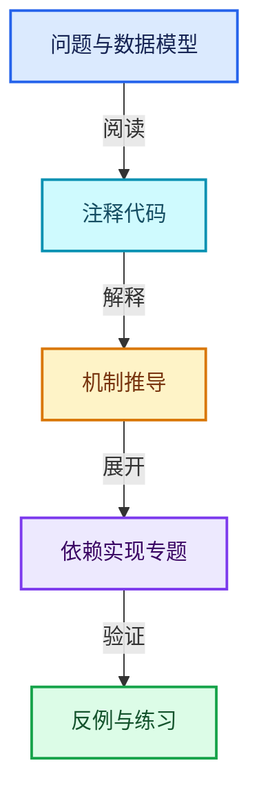
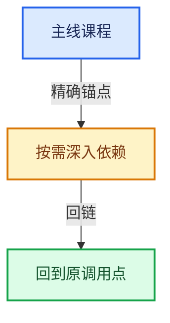

# 02-哈希表与关联数据结构

[总目录](../README.md) · [实现索引](../%E7%AC%A6%E5%8F%B7%E4%BE%9D%E8%B5%96%E4%B8%8E%E5%AE%9E%E7%8E%B0%E7%B4%A2%E5%BC%95.md)

## 主线课程

- [02-01 哈希与相等契约](01-%E5%93%88%E5%B8%8C%E4%B8%8E%E7%9B%B8%E7%AD%89%E5%A5%91%E7%BA%A6.md)
- [02-02 Map总体布局](02-Map%E6%80%BB%E4%BD%93%E5%B8%83%E5%B1%80.md)
- [02-03 槽位状态与探测](03-%E6%A7%BD%E4%BD%8D%E7%8A%B6%E6%80%81%E4%B8%8E%E6%8E%A2%E6%B5%8B.md)
- [02-04 Map查找与键访问](04-Map%E6%9F%A5%E6%89%BE%E4%B8%8E%E9%94%AE%E8%AE%BF%E9%97%AE.md)
- [02-05 Map插入与回调](05-Map%E6%8F%92%E5%85%A5%E4%B8%8E%E5%9B%9E%E8%B0%83.md)
- [02-06 删除墓碑与值销毁](06-%E5%88%A0%E9%99%A4%E5%A2%93%E7%A2%91%E4%B8%8E%E5%80%BC%E9%94%80%E6%AF%81.md)
- [02-07 重建与摊还复杂度](07-%E9%87%8D%E5%BB%BA%E4%B8%8E%E6%91%8A%E8%BF%98%E5%A4%8D%E6%9D%82%E5%BA%A6.md)
- [02-08 Set与集合语义](08-Set%E4%B8%8E%E9%9B%86%E5%90%88%E8%AF%AD%E4%B9%89.md)
- [02-09 MultiValueMap一键多值](09-MultiValueMap%E4%B8%80%E9%94%AE%E5%A4%9A%E5%80%BC.md)
- [02-10 浮点修复与基础库对比](10-%E6%B5%AE%E7%82%B9%E4%BF%AE%E5%A4%8D%E4%B8%8E%E5%9F%BA%E7%A1%80%E5%BA%93%E5%AF%B9%E6%AF%94.md)

## 共享实现专题

- [source/blender/blenlib/BLI_bitmap.hh](%E4%BE%9D%E8%B5%96-BLI_bitmap-693b86.md)
- [source/blender/blenlib/BLI_disjoint_set.hh](%E4%BE%9D%E8%B5%96-BLI_disjoint_set-9f0869.md)
- [source/blender/blenlib/BLI_ghash.hh](%E4%BE%9D%E8%B5%96-BLI_ghash-8a027a.md)
- [source/blender/blenlib/BLI_hash.hh](%E4%BE%9D%E8%B5%96-BLI_hash-574293.md)
- [source/blender/blenlib/BLI_hash_c.hh](%E4%BE%9D%E8%B5%96-BLI_hash_c-2ab8ea.md)
- [source/blender/blenlib/BLI_map.hh](%E4%BE%9D%E8%B5%96-BLI_map-de0221.md)
- [source/blender/blenlib/BLI_offset_indices.hh](%E4%BE%9D%E8%B5%96-BLI_offset_indices-e86682.md)
- [source/blender/blenlib/BLI_offset_span.hh](%E4%BE%9D%E8%B5%96-BLI_offset_span-adb8e0.md)
- [source/blender/blenlib/BLI_probing_strategies.hh](%E4%BE%9D%E8%B5%96-BLI_probing_strategies-75cda3.md)
- [source/blender/blenlib/BLI_set.hh](%E4%BE%9D%E8%B5%96-BLI_set-c8d5b1.md)
- [source/blender/blenlib/BLI_unique_hash.hh](%E4%BE%9D%E8%B5%96-BLI_unique_hash-5663a0.md)
- [source/blender/blenlib/BLI_vector_set.hh](%E4%BE%9D%E8%B5%96-BLI_vector_set-e2d790.md)
- [source/blender/blenlib/intern/BLI_ghash.cc](%E4%BE%9D%E8%B5%96-BLI_ghash-ceaea0.md)
- [source/blender/blenlib/intern/BLI_ghash_utils.cc](%E4%BE%9D%E8%B5%96-BLI_ghash_utils-cd85d4.md)
- [source/blender/blenlib/intern/BLI_mmap.cc](%E4%BE%9D%E8%B5%96-BLI_mmap-6be541.md)
- [source/blender/blenlib/intern/bitmap.cc](%E4%BE%9D%E8%B5%96-bitmap-56367d.md)
- [source/blender/blenlib/intern/hash_md5.cc](%E4%BE%9D%E8%B5%96-hash_md5-d0adfd.md)
- [source/blender/blenlib/intern/hash_mm2a.cc](%E4%BE%9D%E8%B5%96-hash_mm2a-fe59c3.md)
- [source/blender/blenlib/intern/hash_tables.cc](%E4%BE%9D%E8%B5%96-hash_tables-5853e7.md)

