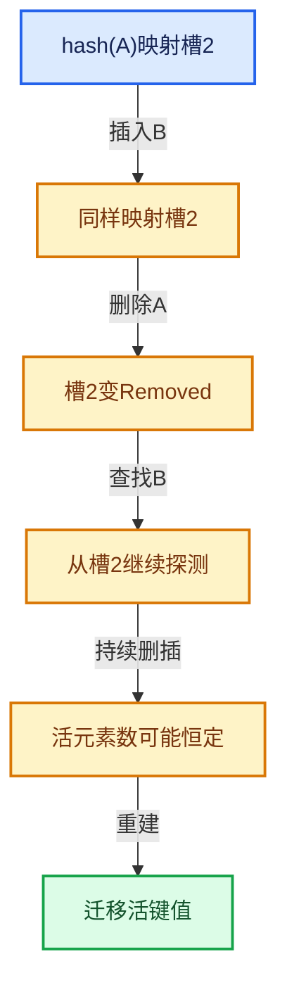

# 02-哈希表与关联数据结构

[总目录](../README.md)

相等与哈希是基础契约；探测、删除和增长共同决定复杂度。

## 前置知识与阅读层次

- [01-基础容器与现代CPP](../01-%E5%9F%BA%E7%A1%80%E5%AE%B9%E5%99%A8%E4%B8%8E%E7%8E%B0%E4%BB%A3CPP/README.md)

初读抓住数据模型，复读逐行检查，再完成反例和独立实现。方向间允许按实际问题回查，不要求机械线性阅读。

## 正文与源码范围

| 顺序 | 文档 | 主讲文件与范围 |
|---|---|---|
| 02-01 | [哈希与相等契约](01-%E5%93%88%E5%B8%8C%E4%B8%8E%E7%9B%B8%E7%AD%89%E5%A5%91%E7%BA%A6.md) | BLI_hash.hh:L1—L295 |
| 02-02 | [Map总体布局](02-Map%E6%80%BB%E4%BD%93%E5%B8%83%E5%B1%80.md) | BLI_map.hh:L1—L276 |
| 02-03 | [槽位状态与探测](03-%E6%A7%BD%E4%BD%8D%E7%8A%B6%E6%80%81%E4%B8%8E%E6%8E%A2%E6%B5%8B.md) | BLI_map_slots.hh:L1—L362；BLI_hash_tables.hh:L1—L322 |
| 02-04 | [Map查找与键访问](04-Map%E6%9F%A5%E6%89%BE%E4%B8%8E%E9%94%AE%E8%AE%BF%E9%97%AE.md) | BLI_map.hh:L277—L552 |
| 02-05 | [Map插入与回调](05-Map%E6%8F%92%E5%85%A5%E4%B8%8E%E5%9B%9E%E8%B0%83.md) | BLI_map.hh:L553—L832 |
| 02-06 | [删除墓碑与值销毁](06-%E5%88%A0%E9%99%A4%E5%A2%93%E7%A2%91%E4%B8%8E%E5%80%BC%E9%94%80%E6%AF%81.md) | BLI_map.hh:L833—L1098 |
| 02-07 | [重建与摊还复杂度](07-%E9%87%8D%E5%BB%BA%E4%B8%8E%E6%91%8A%E8%BF%98%E5%A4%8D%E6%9D%82%E5%BA%A6.md) | BLI_map.hh:L1099—L1383 |
| 02-08 | [Set与集合语义](08-Set%E4%B8%8E%E9%9B%86%E5%90%88%E8%AF%AD%E4%B9%89.md) | BLI_set.hh:L1—L996 |
| 02-09 | [MultiValueMap一键多值](09-MultiValueMap%E4%B8%80%E9%94%AE%E5%A4%9A%E5%80%BC.md) | BLI_multi_value_map.hh:L1—L189 |
| 02-10 | [浮点修复与基础库对比](10-%E6%B5%AE%E7%82%B9%E4%BF%AE%E5%A4%8D%E4%B8%8E%E5%9F%BA%E7%A1%80%E5%BA%93%E5%AF%B9%E6%AF%94.md) | BLI_set_slots.hh:L1—L378 |

## 本方向的数据模型

## 状态推演

## 历史入口

- [Fix: BLI: ensure that +0.0 and -0.0 hash to the same value](https://projects.blender.org/blender/blender/commit/79ef927ea93304a1e270bedbee4c38afc5945f9f) · Jacques Lucke · 2026-06-04
- [Fix: BLI: bad performance edge case in hash table implementations](https://projects.blender.org/blender/blender/commit/b242c618450e3c0011914112c3ffe31ae2e96028) · Jacques Lucke · 2025-12-12
- [BLI: assert on hash table keys not comparing equal to themselves](https://projects.blender.org/blender/blender/commit/44a1dc7055466e153b4ab66628034d8561f540bf) · Jacques Lucke · 2026-06-11

## 跨库比较与验收

对比std::unordered_map、Abseil flat_hash_map与node_hash_map时，优先比较地址稳定性、键值搬移要求和删除行为；不同实现的平均常数及负载策略需要测量。

每个活键从其探测起点可达；不存在的键可终止；析构仅命中占用状态的真实对象。

正文和源码区间已建立；自动检查结果见根目录验收报告。阅读者的掌握程度以独立练习与反例推理为准。
