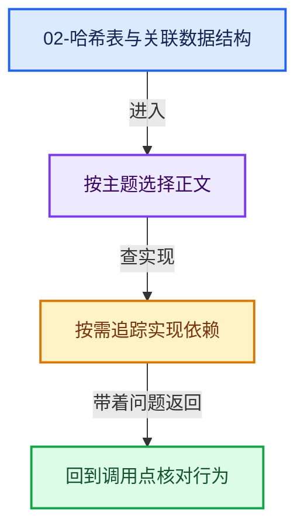
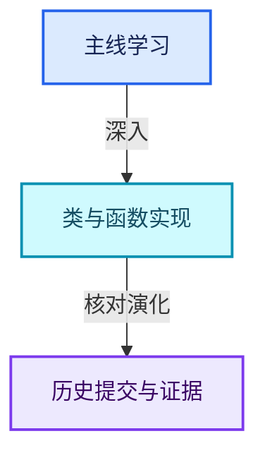

# 02-哈希表与关联数据结构

[总入口](../README.md) · [几何节点专题](../13-几何节点专题/README.md) · [实现依赖](../90-实现依赖专题/README.md)

## 阅读顺序

- [02-01 哈希与相等契约](01-哈希与相等契约.md)
- [02-02 Map总体布局](02-Map总体布局.md)
- [02-03 槽位状态与探测](03-槽位状态与探测.md)
- [02-04 Map查找与键访问](04-Map查找与键访问.md)
- [02-05 Map插入与回调](05-Map插入与回调.md)
- [02-06 删除墓碑与值销毁](06-删除墓碑与值销毁.md)
- [02-07 重建与摊还复杂度](07-重建与摊还复杂度.md)
- [02-08 Set与集合语义](08-Set与集合语义.md)
- [02-09 MultiValueMap一键多值](09-MultiValueMap一键多值.md)
- [02-10 浮点修复与基础库对比](10-浮点修复与基础库对比.md)

