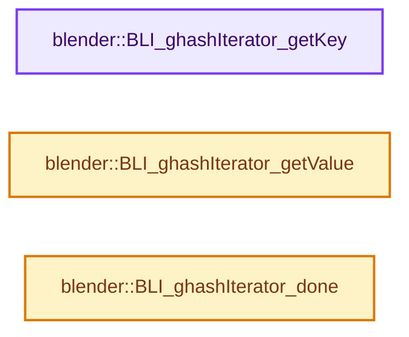
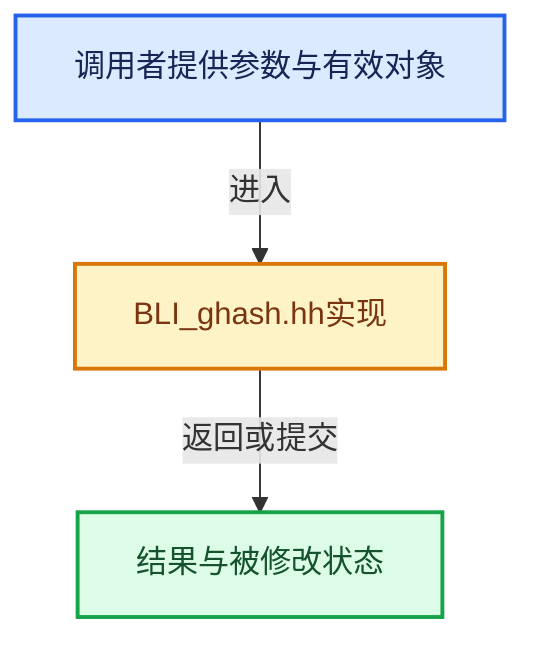

# 实现依赖专题：source/blender/blenlib/BLI_ghash.hh

[方向导航](README.md) · [符号索引](../%E7%AC%A6%E5%8F%B7%E4%BE%9D%E8%B5%96%E4%B8%8E%E5%AE%9E%E7%8E%B0%E7%B4%A2%E5%BC%95.md)

本专题从正文实际调用进入，集中保存共享实现。函数有稳定锚点，可从调用处直接跳到对应完整函数；递归与互相调用通过回链组织。

## 本文件的实现关系






<a id="m-1636873020f2"></a>

## 宏 `GHASH_ITER`

<!-- annotated:38c8e42fabcbdf -->

```cpp
#define GHASH_ITER(gh_iter_, ghash_) \
  for (BLI_ghashIterator_init(&gh_iter_, ghash_); BLI_ghashIterator_done(&gh_iter_) == false; \
       BLI_ghashIterator_step(&gh_iter_))

```

<details>
<summary>核对原始源码：source/blender/blenlib/BLI_ghash.hh · L320—L323</summary>

<!-- original:38c8e42fabcbdf:source/blender/blenlib/BLI_ghash.hh:320:323 -->

```cpp
#define GHASH_ITER(gh_iter_, ghash_) \
  for (BLI_ghashIterator_init(&gh_iter_, ghash_); BLI_ghashIterator_done(&gh_iter_) == false; \
       BLI_ghashIterator_step(&gh_iter_))

```

</details>

宏在预处理阶段展开，参数替换、重复求值和条件编译应直接从该定义检查。与普通函数不同，宏不会自动提供参数类型检查；构建配置选择哪个定义需结合外围条件。

<a id="m-4d269e82dba8"></a>

## 宏 `BLI_ghashutil_strhash`

<!-- annotated:a29b6beb9f2da9 -->

```cpp
#define BLI_ghashutil_strhash(key) \
  (CHECK_TYPE_ANY(key, char *, const char *), BLI_ghashutil_strhash_p(key))
unsigned int BLI_ghashutil_strhash_p(const void *ptr);
```

<details>
<summary>核对原始源码：source/blender/blenlib/BLI_ghash.hh · L573—L575</summary>

<!-- original:a29b6beb9f2da9:source/blender/blenlib/BLI_ghash.hh:573:575 -->

```cpp
#define BLI_ghashutil_strhash(key) \
  (CHECK_TYPE_ANY(key, char *, const char *), BLI_ghashutil_strhash_p(key))
unsigned int BLI_ghashutil_strhash_p(const void *ptr);
```

</details>

宏在预处理阶段展开，参数替换、重复求值和条件编译应直接从该定义检查。与普通函数不同，宏不会自动提供参数类型检查；构建配置选择哪个定义需结合外围条件。

## 完整成员与函数实现

<a id="f-83e8a92cfae5b1bd"></a>

### `blender::BLI_ghashIterator_getKey`

实现位置：[source/blender/blenlib/BLI_ghash.hh](../../../../../source/blender/blenlib/BLI_ghash.hh) · L297—L300。

接口参数：

- `GHashIterator *ghi`

**教学注释版**

<!-- annotated:f538f7cb530f1d -->

```cpp
BLI_INLINE void *BLI_ghashIterator_getKey(GHashIterator *ghi)
{
  return (reinterpret_cast<struct _gh_Entry *>(ghi->curEntry))->key;
}
```

<details>
<summary>核对原始源码：source/blender/blenlib/BLI_ghash.hh · L297—L300</summary>

<!-- original:f538f7cb530f1d:source/blender/blenlib/BLI_ghash.hh:297:300 -->

```cpp
BLI_INLINE void *BLI_ghashIterator_getKey(GHashIterator *ghi)
{
  return (reinterpret_cast<struct _gh_Entry *>(ghi->curEntry))->key;
}
```

</details>

**结果出口**

- `return (reinterpret_cast<struct _gh_Entry *>(ghi->curEntry))->key;`

**继续追踪实现**

本实现没有需要继续展开的显式调用；检查返回表达式、对象转换和调用者前置条件。

<a id="f-cf2b3d00d2f5258a"></a>

### `blender::BLI_ghashIterator_getValue`

实现位置：[source/blender/blenlib/BLI_ghash.hh](../../../../../source/blender/blenlib/BLI_ghash.hh) · L301—L304。

接口参数：

- `GHashIterator *ghi`

**教学注释版**

<!-- annotated:6efcb4c38e237d -->

```cpp
BLI_INLINE void *BLI_ghashIterator_getValue(GHashIterator *ghi)
{
  return (reinterpret_cast<struct _gh_Entry *>(ghi->curEntry))->val;
}
```

<details>
<summary>核对原始源码：source/blender/blenlib/BLI_ghash.hh · L301—L304</summary>

<!-- original:6efcb4c38e237d:source/blender/blenlib/BLI_ghash.hh:301:304 -->

```cpp
BLI_INLINE void *BLI_ghashIterator_getValue(GHashIterator *ghi)
{
  return (reinterpret_cast<struct _gh_Entry *>(ghi->curEntry))->val;
}
```

</details>

**结果出口**

- `return (reinterpret_cast<struct _gh_Entry *>(ghi->curEntry))->val;`

**继续追踪实现**

本实现没有需要继续展开的显式调用；检查返回表达式、对象转换和调用者前置条件。

<a id="f-5b202d49c701166b"></a>

### `blender::BLI_ghashIterator_done`

实现位置：[source/blender/blenlib/BLI_ghash.hh](../../../../../source/blender/blenlib/BLI_ghash.hh) · L309—L312。

接口参数：

- `const GHashIterator *ghi`

**教学注释版**

<!-- annotated:55e763a6ceeac5 -->

```cpp
BLI_INLINE bool BLI_ghashIterator_done(const GHashIterator *ghi)
{
  return !ghi->curEntry;
}
```

<details>
<summary>核对原始源码：source/blender/blenlib/BLI_ghash.hh · L309—L312</summary>

<!-- original:55e763a6ceeac5:source/blender/blenlib/BLI_ghash.hh:309:312 -->

```cpp
BLI_INLINE bool BLI_ghashIterator_done(const GHashIterator *ghi)
{
  return !ghi->curEntry;
}
```

</details>

**结果出口**

- `return !ghi->curEntry;`

**继续追踪实现**

本实现没有需要继续展开的显式调用；检查返回表达式、对象转换和调用者前置条件。
