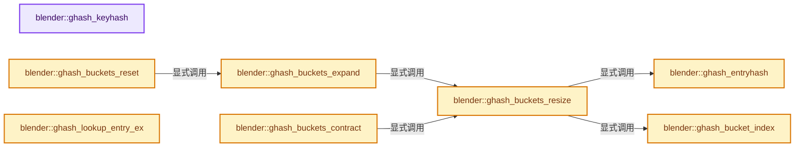
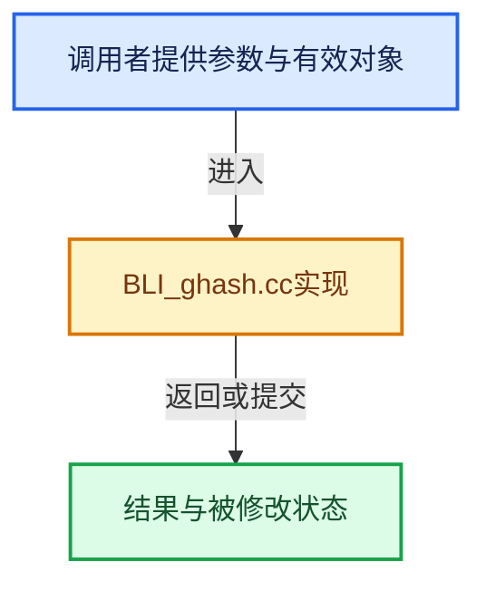

# 实现依赖专题：source/blender/blenlib/intern/BLI_ghash.cc

[方向导航](README.md) · [符号索引](../%E7%AC%A6%E5%8F%B7%E4%BE%9D%E8%B5%96%E4%B8%8E%E5%AE%9E%E7%8E%B0%E7%B4%A2%E5%BC%95.md)

本专题从正文实际调用进入，集中保存共享实现。函数有稳定锚点，可从调用处直接跳到对应完整函数；递归与互相调用通过回链组织。

## 本文件的实现关系






<a id="m-26e68ef68a64"></a>

## 宏 `GHASH_LIMIT_GROW`

<!-- annotated:1ad9739678ca59 -->

```cpp
#define GHASH_LIMIT_GROW(_nbkt) (((_nbkt) * 3) / 4)
#define GHASH_LIMIT_SHRINK(_nbkt) (((_nbkt) * 3) / 16)
```

<details>
<summary>核对原始源码：source/blender/blenlib/intern/BLI_ghash.cc · L62—L63</summary>

<!-- original:1ad9739678ca59:source/blender/blenlib/intern/BLI_ghash.cc:62:63 -->

```cpp
#define GHASH_LIMIT_GROW(_nbkt) (((_nbkt) * 3) / 4)
#define GHASH_LIMIT_SHRINK(_nbkt) (((_nbkt) * 3) / 16)
```

</details>

宏在预处理阶段展开，参数替换、重复求值和条件编译应直接从该定义检查。与普通函数不同，宏不会自动提供参数类型检查；构建配置选择哪个定义需结合外围条件。

<a id="m-2a73e7fcc41b"></a>

## 宏 `GHASH_LIMIT_SHRINK`

<!-- annotated:59019e480885fe -->

```cpp
#define GHASH_LIMIT_SHRINK(_nbkt) (((_nbkt) * 3) / 16)

```

<details>
<summary>核对原始源码：source/blender/blenlib/intern/BLI_ghash.cc · L63—L64</summary>

<!-- original:59019e480885fe:source/blender/blenlib/intern/BLI_ghash.cc:63:64 -->

```cpp
#define GHASH_LIMIT_SHRINK(_nbkt) (((_nbkt) * 3) / 16)

```

</details>

宏在预处理阶段展开，参数替换、重复求值和条件编译应直接从该定义检查。与普通函数不同，宏不会自动提供参数类型检查；构建配置选择哪个定义需结合外围条件。

<a id="m-8d3f123f08ef"></a>

## 宏 `GHASH_ENTRY_SIZE`

<!-- annotated:ed57ed4268a6ef -->

```cpp
#define GHASH_ENTRY_SIZE(_is_gset) ((_is_gset) ? sizeof(GSetEntry) : sizeof(GHashEntry))

```

<details>
<summary>核对原始源码：source/blender/blenlib/intern/BLI_ghash.cc · L80—L81</summary>

<!-- original:ed57ed4268a6ef:source/blender/blenlib/intern/BLI_ghash.cc:80:81 -->

```cpp
#define GHASH_ENTRY_SIZE(_is_gset) ((_is_gset) ? sizeof(GSetEntry) : sizeof(GHashEntry))

```

</details>

宏在预处理阶段展开，参数替换、重复求值和条件编译应直接从该定义检查。与普通函数不同，宏不会自动提供参数类型检查；构建配置选择哪个定义需结合外围条件。

## 完整成员与函数实现

<a id="f-b7bc6faf9ab4738a"></a>

### `blender::ghash_keyhash`

实现位置：[source/blender/blenlib/intern/BLI_ghash.cc](../../../../../source/blender/blenlib/intern/BLI_ghash.cc) · L131—L134。

接口参数：

- `const GHash *gh`
- `const void *key`

**教学注释版**

<!-- annotated:ee1b73f72a861d -->

```cpp
BLI_INLINE uint ghash_keyhash(const GHash *gh, const void *key)
{
  return gh->hashfp(key);
}
```

<details>
<summary>核对原始源码：source/blender/blenlib/intern/BLI_ghash.cc · L131—L134</summary>

<!-- original:ee1b73f72a861d:source/blender/blenlib/intern/BLI_ghash.cc:131:134 -->

```cpp
BLI_INLINE uint ghash_keyhash(const GHash *gh, const void *key)
{
  return gh->hashfp(key);
}
```

</details>

**结果出口**

- `return gh->hashfp(key);`

**继续追踪实现**

- `gh->hashfp` → [调用协议](../%E6%A8%A1%E6%9D%BF%E5%AE%8F%E4%B8%8E%E5%8A%A8%E6%80%81%E5%88%86%E6%B4%BE%E5%8D%8F%E8%AE%AE.md)：由接收对象具体类型或运行时策略提供实现。调用位置L133。

<a id="f-eb516780b6a66048"></a>

### `blender::ghash_entryhash`

实现位置：[source/blender/blenlib/intern/BLI_ghash.cc](../../../../../source/blender/blenlib/intern/BLI_ghash.cc) · L139—L142。

接口参数：

- `const GHash *gh`
- `const Entry *e`

**教学注释版**

<!-- annotated:393a3d55e6e940 -->

```cpp
BLI_INLINE uint ghash_entryhash(const GHash *gh, const Entry *e)
{
  return gh->hashfp(e->key);
}
```

<details>
<summary>核对原始源码：source/blender/blenlib/intern/BLI_ghash.cc · L139—L142</summary>

<!-- original:393a3d55e6e940:source/blender/blenlib/intern/BLI_ghash.cc:139:142 -->

```cpp
BLI_INLINE uint ghash_entryhash(const GHash *gh, const Entry *e)
{
  return gh->hashfp(e->key);
}
```

</details>

**结果出口**

- `return gh->hashfp(e->key);`

**继续追踪实现**

- `gh->hashfp` → [调用协议](../%E6%A8%A1%E6%9D%BF%E5%AE%8F%E4%B8%8E%E5%8A%A8%E6%80%81%E5%88%86%E6%B4%BE%E5%8D%8F%E8%AE%AE.md)：由接收对象具体类型或运行时策略提供实现。调用位置L141。

<a id="f-0da1042bfeb22062"></a>

### `blender::ghash_bucket_index`

实现位置：[source/blender/blenlib/intern/BLI_ghash.cc](../../../../../source/blender/blenlib/intern/BLI_ghash.cc) · L147—L154。

接口参数：

- `const GHash *gh`
- `const uint hash`

**教学注释版**

<!-- annotated:3526b02ebe5f9d -->

```cpp
BLI_INLINE uint ghash_bucket_index(const GHash *gh, const uint hash)
{
#ifdef GHASH_USE_MODULO_BUCKETS
  return hash % gh->nbuckets;
#else
  return hash & gh->bucket_mask;
#endif
}
```

<details>
<summary>核对原始源码：source/blender/blenlib/intern/BLI_ghash.cc · L147—L154</summary>

<!-- original:3526b02ebe5f9d:source/blender/blenlib/intern/BLI_ghash.cc:147:154 -->

```cpp
BLI_INLINE uint ghash_bucket_index(const GHash *gh, const uint hash)
{
#ifdef GHASH_USE_MODULO_BUCKETS
  return hash % gh->nbuckets;
#else
  return hash & gh->bucket_mask;
#endif
}
```

</details>

**结果出口**

- `return hash % gh->nbuckets;`
- `return hash & gh->bucket_mask;`

**继续追踪实现**

本实现没有需要继续展开的显式调用；检查返回表达式、对象转换和调用者前置条件。

<a id="f-99f7eb89d1ce0dfc"></a>

### `blender::ghash_buckets_resize`

实现位置：[source/blender/blenlib/intern/BLI_ghash.cc](../../../../../source/blender/blenlib/intern/BLI_ghash.cc) · L184—L247。

接口参数：

- `GHash *gh`
- `const uint nbuckets`

**教学注释版**

<!-- annotated:e4ebefbc808b26 -->

```cpp
static void ghash_buckets_resize(GHash *gh, const uint nbuckets)
{
  Entry **buckets_old = gh->buckets;
  Entry **buckets_new;
  const uint nbuckets_old = gh->nbuckets;
  uint i;

  BLI_assert((gh->nbuckets != nbuckets) || !gh->buckets);
  //  printf("%s: %d -> %d\n", __func__, nbuckets_old, nbuckets);

  gh->nbuckets = nbuckets;
#ifdef GHASH_USE_MODULO_BUCKETS
#else
  gh->bucket_mask = nbuckets - 1;
#endif

  buckets_new = MEM_new_array_zeroed<Entry *>(gh->nbuckets, __func__);

  if (buckets_old) {
    if (nbuckets > nbuckets_old) {
      for (i = 0; i < nbuckets_old; i++) {
        for (Entry *e = buckets_old[i], *e_next; e; e = e_next) {
          const uint hash = ghash_entryhash(gh, e);
          const uint bucket_index = ghash_bucket_index(gh, hash);
          e_next = e->next;
          e->next = buckets_new[bucket_index];
          buckets_new[bucket_index] = e;
        }
      }
    }
    else {
      for (i = 0; i < nbuckets_old; i++) {
#ifdef GHASH_USE_MODULO_BUCKETS
        for (Entry *e = buckets_old[i], *e_next; e; e = e_next) {
          const uint hash = ghash_entryhash(gh, e);
          const uint bucket_index = ghash_bucket_index(gh, hash);
          e_next = e->next;
          e->next = buckets_new[bucket_index];
          buckets_new[bucket_index] = e;
        }
#else
        /* No need to recompute hashes in this case, since our mask is just smaller,
         * all items in old bucket 'i' will go in same new bucket (i & new_mask)! */
        const uint bucket_index = ghash_bucket_index(gh, i);
        BLI_assert(!buckets_old[i] ||
                   (bucket_index == ghash_bucket_index(gh, ghash_entryhash(gh, buckets_old[i]))));
        Entry *e;
        for (e = buckets_old[i]; e && e->next; e = e->next) {
          /* pass */
        }
        if (e) {
          e->next = buckets_new[bucket_index];
          buckets_new[bucket_index] = buckets_old[i];
        }
#endif
      }
    }
  }

  gh->buckets = buckets_new;
  if (buckets_old) {
    MEM_delete(buckets_old);
  }
}
```

<details>
<summary>核对原始源码：source/blender/blenlib/intern/BLI_ghash.cc · L184—L247</summary>

<!-- original:e4ebefbc808b26:source/blender/blenlib/intern/BLI_ghash.cc:184:247 -->

```cpp
static void ghash_buckets_resize(GHash *gh, const uint nbuckets)
{
  Entry **buckets_old = gh->buckets;
  Entry **buckets_new;
  const uint nbuckets_old = gh->nbuckets;
  uint i;

  BLI_assert((gh->nbuckets != nbuckets) || !gh->buckets);
  //  printf("%s: %d -> %d\n", __func__, nbuckets_old, nbuckets);

  gh->nbuckets = nbuckets;
#ifdef GHASH_USE_MODULO_BUCKETS
#else
  gh->bucket_mask = nbuckets - 1;
#endif

  buckets_new = MEM_new_array_zeroed<Entry *>(gh->nbuckets, __func__);

  if (buckets_old) {
    if (nbuckets > nbuckets_old) {
      for (i = 0; i < nbuckets_old; i++) {
        for (Entry *e = buckets_old[i], *e_next; e; e = e_next) {
          const uint hash = ghash_entryhash(gh, e);
          const uint bucket_index = ghash_bucket_index(gh, hash);
          e_next = e->next;
          e->next = buckets_new[bucket_index];
          buckets_new[bucket_index] = e;
        }
      }
    }
    else {
      for (i = 0; i < nbuckets_old; i++) {
#ifdef GHASH_USE_MODULO_BUCKETS
        for (Entry *e = buckets_old[i], *e_next; e; e = e_next) {
          const uint hash = ghash_entryhash(gh, e);
          const uint bucket_index = ghash_bucket_index(gh, hash);
          e_next = e->next;
          e->next = buckets_new[bucket_index];
          buckets_new[bucket_index] = e;
        }
#else
        /* No need to recompute hashes in this case, since our mask is just smaller,
         * all items in old bucket 'i' will go in same new bucket (i & new_mask)! */
        const uint bucket_index = ghash_bucket_index(gh, i);
        BLI_assert(!buckets_old[i] ||
                   (bucket_index == ghash_bucket_index(gh, ghash_entryhash(gh, buckets_old[i]))));
        Entry *e;
        for (e = buckets_old[i]; e && e->next; e = e->next) {
          /* pass */
        }
        if (e) {
          e->next = buckets_new[bucket_index];
          buckets_new[bucket_index] = buckets_old[i];
        }
#endif
      }
    }
  }

  gh->buckets = buckets_new;
  if (buckets_old) {
    MEM_delete(buckets_old);
  }
}
```

</details>

**沿实际写入检查状态**

- `gh->nbuckets = nbuckets;`
- `gh->bucket_mask = nbuckets - 1;`
- `buckets_new = MEM_new_array_zeroed<Entry *>(gh->nbuckets, __func__);`
- `e_next = e->next;`
- `e->next = buckets_new[bucket_index];`
- `buckets_new[bucket_index] = e;`
- `buckets_new[bucket_index] = buckets_old[i];`
- `gh->buckets = buckets_new;`

**继续追踪实现**

- `BLI_assert` → [BLI_assert · L48](../01-%E5%9F%BA%E7%A1%80%E5%AE%B9%E5%99%A8%E4%B8%8E%E7%8E%B0%E4%BB%A3CPP/%E4%BE%9D%E8%B5%96-BLI_assert-cc98e8.md#m-57a88495704d)；[BLI_assert · L63](../01-%E5%9F%BA%E7%A1%80%E5%AE%B9%E5%99%A8%E4%B8%8E%E7%8E%B0%E4%BB%A3CPP/%E4%BE%9D%E8%B5%96-BLI_assert-cc98e8.md#m-d07050020cb5)。宏定义由构建条件选择。
- `MEM_new_array_zeroed<Entry *>` → [MEM_new_array_zeroed · L566](../03-%E5%86%85%E5%AD%98%E5%88%86%E9%85%8D%E4%B8%8E%E8%BF%90%E8%A1%8C%E6%97%B6%E7%B1%BB%E5%9E%8B/%E4%BE%9D%E8%B5%96-MEM_guardedalloc-b54eca.md#f-3a0cf63fb5216500)；[MEM_new_array_zeroed · L119](../03-%E5%86%85%E5%AD%98%E5%88%86%E9%85%8D%E4%B8%8E%E8%BF%90%E8%A1%8C%E6%97%B6%E7%B1%BB%E5%9E%8B/%E4%BE%9D%E8%B5%96-mallocn-afdcd4.md#f-6825557da566fdbe)。同名重载需按实参类型选择。
- `ghash_entryhash` → [blender::ghash_entryhash · L139](%E4%BE%9D%E8%B5%96-BLI_ghash-ceaea0.md#f-eb516780b6a66048)。
- `ghash_bucket_index` → [blender::ghash_bucket_index · L147](%E4%BE%9D%E8%B5%96-BLI_ghash-ceaea0.md#f-0da1042bfeb22062)。
- `MEM_delete` → [MEM_delete · L400](../03-%E5%86%85%E5%AD%98%E5%88%86%E9%85%8D%E4%B8%8E%E8%BF%90%E8%A1%8C%E6%97%B6%E7%B1%BB%E5%9E%8B/%E4%BE%9D%E8%B5%96-MEM_guardedalloc-b54eca.md#f-9049ffdd1682887c)。

<a id="f-e0ce07da8a2aa03b"></a>

### `blender::ghash_buckets_expand`

实现位置：[source/blender/blenlib/intern/BLI_ghash.cc](../../../../../source/blender/blenlib/intern/BLI_ghash.cc) · L253—L290。

接口参数：

- `GHash *gh`
- `const uint nentries`
- `const bool user_defined`

**教学注释版**

<!-- annotated:92c5150ac8918b -->

```cpp
static void ghash_buckets_expand(GHash *gh, const uint nentries, const bool user_defined)
{
  uint new_nbuckets;

  if (gh->buckets && (nentries < gh->limit_grow)) [[likely]] {
    return;
  }

  new_nbuckets = gh->nbuckets;

#ifdef GHASH_USE_MODULO_BUCKETS
  while ((nentries > gh->limit_grow) && (gh->cursize < GHASH_MAX_SIZE - 1)) {
    new_nbuckets = hashsizes[++gh->cursize];
    gh->limit_grow = GHASH_LIMIT_GROW(new_nbuckets);
  }
#else
  while ((nentries > gh->limit_grow) && (gh->bucket_bit < GHASH_BUCKET_BIT_MAX)) {
    new_nbuckets = 1u << ++gh->bucket_bit;
    gh->limit_grow = GHASH_LIMIT_GROW(new_nbuckets);
  }
#endif

  if (user_defined) {
#ifdef GHASH_USE_MODULO_BUCKETS
    gh->size_min = gh->cursize;
#else
    gh->bucket_bit_min = gh->bucket_bit;
#endif
  }

  if ((new_nbuckets == gh->nbuckets) && gh->buckets) {
    return;
  }

  gh->limit_grow = GHASH_LIMIT_GROW(new_nbuckets);
  gh->limit_shrink = GHASH_LIMIT_SHRINK(new_nbuckets);
  ghash_buckets_resize(gh, new_nbuckets);
}
```

<details>
<summary>核对原始源码：source/blender/blenlib/intern/BLI_ghash.cc · L253—L290</summary>

<!-- original:92c5150ac8918b:source/blender/blenlib/intern/BLI_ghash.cc:253:290 -->

```cpp
static void ghash_buckets_expand(GHash *gh, const uint nentries, const bool user_defined)
{
  uint new_nbuckets;

  if (gh->buckets && (nentries < gh->limit_grow)) [[likely]] {
    return;
  }

  new_nbuckets = gh->nbuckets;

#ifdef GHASH_USE_MODULO_BUCKETS
  while ((nentries > gh->limit_grow) && (gh->cursize < GHASH_MAX_SIZE - 1)) {
    new_nbuckets = hashsizes[++gh->cursize];
    gh->limit_grow = GHASH_LIMIT_GROW(new_nbuckets);
  }
#else
  while ((nentries > gh->limit_grow) && (gh->bucket_bit < GHASH_BUCKET_BIT_MAX)) {
    new_nbuckets = 1u << ++gh->bucket_bit;
    gh->limit_grow = GHASH_LIMIT_GROW(new_nbuckets);
  }
#endif

  if (user_defined) {
#ifdef GHASH_USE_MODULO_BUCKETS
    gh->size_min = gh->cursize;
#else
    gh->bucket_bit_min = gh->bucket_bit;
#endif
  }

  if ((new_nbuckets == gh->nbuckets) && gh->buckets) {
    return;
  }

  gh->limit_grow = GHASH_LIMIT_GROW(new_nbuckets);
  gh->limit_shrink = GHASH_LIMIT_SHRINK(new_nbuckets);
  ghash_buckets_resize(gh, new_nbuckets);
}
```

</details>

**沿实际写入检查状态**

- `new_nbuckets = gh->nbuckets;`
- `new_nbuckets = hashsizes[++gh->cursize];`
- `gh->limit_grow = GHASH_LIMIT_GROW(new_nbuckets);`
- `new_nbuckets = 1u << ++gh->bucket_bit;`
- `gh->size_min = gh->cursize;`
- `gh->bucket_bit_min = gh->bucket_bit;`
- `gh->limit_shrink = GHASH_LIMIT_SHRINK(new_nbuckets);`

**继续追踪实现**

- `GHASH_LIMIT_GROW` → [GHASH_LIMIT_GROW · L62](%E4%BE%9D%E8%B5%96-BLI_ghash-ceaea0.md#m-26e68ef68a64)。宏定义由构建条件选择。
- `GHASH_LIMIT_SHRINK` → [GHASH_LIMIT_SHRINK · L63](%E4%BE%9D%E8%B5%96-BLI_ghash-ceaea0.md#m-2a73e7fcc41b)。宏定义由构建条件选择。
- `ghash_buckets_resize` → [blender::ghash_buckets_resize · L184](%E4%BE%9D%E8%B5%96-BLI_ghash-ceaea0.md#f-99f7eb89d1ce0dfc)。

<a id="f-5ad5e0b028f96a6d"></a>

### `blender::ghash_buckets_contract`

实现位置：[source/blender/blenlib/intern/BLI_ghash.cc](../../../../../source/blender/blenlib/intern/BLI_ghash.cc) · L292—L336。

接口参数：

- `GHash *gh`
- `const uint nentries`
- `const bool user_defined`
- `const bool force_shrink`

**教学注释版**

<!-- annotated:8c6f09127df3c2 -->

```cpp
static void ghash_buckets_contract(GHash *gh,
                                   const uint nentries,
                                   const bool user_defined,
                                   const bool force_shrink)
{
  uint new_nbuckets;

  if (!(force_shrink || (gh->flag & GHASH_FLAG_ALLOW_SHRINK))) {
    return;
  }

  if (gh->buckets && (nentries > gh->limit_shrink)) [[likely]] {
    return;
  }

  new_nbuckets = gh->nbuckets;

#ifdef GHASH_USE_MODULO_BUCKETS
  while ((nentries < gh->limit_shrink) && (gh->cursize > gh->size_min)) {
    new_nbuckets = hashsizes[--gh->cursize];
    gh->limit_shrink = GHASH_LIMIT_SHRINK(new_nbuckets);
  }
#else
  while ((nentries < gh->limit_shrink) && (gh->bucket_bit > gh->bucket_bit_min)) {
    new_nbuckets = 1u << --gh->bucket_bit;
    gh->limit_shrink = GHASH_LIMIT_SHRINK(new_nbuckets);
  }
#endif

  if (user_defined) {
#ifdef GHASH_USE_MODULO_BUCKETS
    gh->size_min = gh->cursize;
#else
    gh->bucket_bit_min = gh->bucket_bit;
#endif
  }

  if ((new_nbuckets == gh->nbuckets) && gh->buckets) {
    return;
  }

  gh->limit_grow = GHASH_LIMIT_GROW(new_nbuckets);
  gh->limit_shrink = GHASH_LIMIT_SHRINK(new_nbuckets);
  ghash_buckets_resize(gh, new_nbuckets);
}
```

<details>
<summary>核对原始源码：source/blender/blenlib/intern/BLI_ghash.cc · L292—L336</summary>

<!-- original:8c6f09127df3c2:source/blender/blenlib/intern/BLI_ghash.cc:292:336 -->

```cpp
static void ghash_buckets_contract(GHash *gh,
                                   const uint nentries,
                                   const bool user_defined,
                                   const bool force_shrink)
{
  uint new_nbuckets;

  if (!(force_shrink || (gh->flag & GHASH_FLAG_ALLOW_SHRINK))) {
    return;
  }

  if (gh->buckets && (nentries > gh->limit_shrink)) [[likely]] {
    return;
  }

  new_nbuckets = gh->nbuckets;

#ifdef GHASH_USE_MODULO_BUCKETS
  while ((nentries < gh->limit_shrink) && (gh->cursize > gh->size_min)) {
    new_nbuckets = hashsizes[--gh->cursize];
    gh->limit_shrink = GHASH_LIMIT_SHRINK(new_nbuckets);
  }
#else
  while ((nentries < gh->limit_shrink) && (gh->bucket_bit > gh->bucket_bit_min)) {
    new_nbuckets = 1u << --gh->bucket_bit;
    gh->limit_shrink = GHASH_LIMIT_SHRINK(new_nbuckets);
  }
#endif

  if (user_defined) {
#ifdef GHASH_USE_MODULO_BUCKETS
    gh->size_min = gh->cursize;
#else
    gh->bucket_bit_min = gh->bucket_bit;
#endif
  }

  if ((new_nbuckets == gh->nbuckets) && gh->buckets) {
    return;
  }

  gh->limit_grow = GHASH_LIMIT_GROW(new_nbuckets);
  gh->limit_shrink = GHASH_LIMIT_SHRINK(new_nbuckets);
  ghash_buckets_resize(gh, new_nbuckets);
}
```

</details>

**沿实际写入检查状态**

- `new_nbuckets = gh->nbuckets;`
- `new_nbuckets = hashsizes[--gh->cursize];`
- `gh->limit_shrink = GHASH_LIMIT_SHRINK(new_nbuckets);`
- `new_nbuckets = 1u << --gh->bucket_bit;`
- `gh->size_min = gh->cursize;`
- `gh->bucket_bit_min = gh->bucket_bit;`
- `gh->limit_grow = GHASH_LIMIT_GROW(new_nbuckets);`

**继续追踪实现**

- `GHASH_LIMIT_SHRINK` → [GHASH_LIMIT_SHRINK · L63](%E4%BE%9D%E8%B5%96-BLI_ghash-ceaea0.md#m-2a73e7fcc41b)。宏定义由构建条件选择。
- `GHASH_LIMIT_GROW` → [GHASH_LIMIT_GROW · L62](%E4%BE%9D%E8%B5%96-BLI_ghash-ceaea0.md#m-26e68ef68a64)。宏定义由构建条件选择。
- `ghash_buckets_resize` → [blender::ghash_buckets_resize · L184](%E4%BE%9D%E8%B5%96-BLI_ghash-ceaea0.md#f-99f7eb89d1ce0dfc)。

<a id="f-f075a02673f4cd01"></a>

### `blender::ghash_buckets_reset`

实现位置：[source/blender/blenlib/intern/BLI_ghash.cc](../../../../../source/blender/blenlib/intern/BLI_ghash.cc) · L341—L362。

接口参数：

- `GHash *gh`
- `const uint nentries`

**教学注释版**

<!-- annotated:ecc3fb074cd013 -->

```cpp
BLI_INLINE void ghash_buckets_reset(GHash *gh, const uint nentries)
{
  MEM_SAFE_DELETE(gh->buckets);

#ifdef GHASH_USE_MODULO_BUCKETS
  gh->cursize = 0;
  gh->size_min = 0;
  gh->nbuckets = hashsizes[gh->cursize];
#else
  gh->bucket_bit = GHASH_BUCKET_BIT_MIN;
  gh->bucket_bit_min = GHASH_BUCKET_BIT_MIN;
  gh->nbuckets = 1u << gh->bucket_bit;
  gh->bucket_mask = gh->nbuckets - 1;
#endif

  gh->limit_grow = GHASH_LIMIT_GROW(gh->nbuckets);
  gh->limit_shrink = GHASH_LIMIT_SHRINK(gh->nbuckets);

  gh->nentries = 0;

  ghash_buckets_expand(gh, nentries, (nentries != 0));
}
```

<details>
<summary>核对原始源码：source/blender/blenlib/intern/BLI_ghash.cc · L341—L362</summary>

<!-- original:ecc3fb074cd013:source/blender/blenlib/intern/BLI_ghash.cc:341:362 -->

```cpp
BLI_INLINE void ghash_buckets_reset(GHash *gh, const uint nentries)
{
  MEM_SAFE_DELETE(gh->buckets);

#ifdef GHASH_USE_MODULO_BUCKETS
  gh->cursize = 0;
  gh->size_min = 0;
  gh->nbuckets = hashsizes[gh->cursize];
#else
  gh->bucket_bit = GHASH_BUCKET_BIT_MIN;
  gh->bucket_bit_min = GHASH_BUCKET_BIT_MIN;
  gh->nbuckets = 1u << gh->bucket_bit;
  gh->bucket_mask = gh->nbuckets - 1;
#endif

  gh->limit_grow = GHASH_LIMIT_GROW(gh->nbuckets);
  gh->limit_shrink = GHASH_LIMIT_SHRINK(gh->nbuckets);

  gh->nentries = 0;

  ghash_buckets_expand(gh, nentries, (nentries != 0));
}
```

</details>

**沿实际写入检查状态**

- `gh->cursize = 0;`
- `gh->size_min = 0;`
- `gh->nbuckets = hashsizes[gh->cursize];`
- `gh->bucket_bit = GHASH_BUCKET_BIT_MIN;`
- `gh->bucket_bit_min = GHASH_BUCKET_BIT_MIN;`
- `gh->nbuckets = 1u << gh->bucket_bit;`
- `gh->bucket_mask = gh->nbuckets - 1;`
- `gh->limit_grow = GHASH_LIMIT_GROW(gh->nbuckets);`
- `gh->limit_shrink = GHASH_LIMIT_SHRINK(gh->nbuckets);`
- `gh->nentries = 0;`

**继续追踪实现**

- `MEM_SAFE_DELETE` → [MEM_SAFE_DELETE · L436](../03-%E5%86%85%E5%AD%98%E5%88%86%E9%85%8D%E4%B8%8E%E8%BF%90%E8%A1%8C%E6%97%B6%E7%B1%BB%E5%9E%8B/%E4%BE%9D%E8%B5%96-MEM_guardedalloc-b54eca.md#m-eadb3bc5b902)。宏定义由构建条件选择。
- `GHASH_LIMIT_GROW` → [GHASH_LIMIT_GROW · L62](%E4%BE%9D%E8%B5%96-BLI_ghash-ceaea0.md#m-26e68ef68a64)。宏定义由构建条件选择。
- `GHASH_LIMIT_SHRINK` → [GHASH_LIMIT_SHRINK · L63](%E4%BE%9D%E8%B5%96-BLI_ghash-ceaea0.md#m-2a73e7fcc41b)。宏定义由构建条件选择。
- `ghash_buckets_expand` → [blender::ghash_buckets_expand · L253](%E4%BE%9D%E8%B5%96-BLI_ghash-ceaea0.md#f-e0ce07da8a2aa03b)。

<a id="f-31dee611df73a106"></a>

### `blender::ghash_lookup_entry_ex`

实现位置：[source/blender/blenlib/intern/BLI_ghash.cc](../../../../../source/blender/blenlib/intern/BLI_ghash.cc) · L369—L381。

接口参数：

- `const GHash *gh`
- `const void *key`
- `const uint bucket_index`

**教学注释版**

<!-- annotated:a3ce14998b1162 -->

```cpp
BLI_INLINE Entry *ghash_lookup_entry_ex(const GHash *gh, const void *key, const uint bucket_index)
{
  Entry *e;
  /* If we do not store GHash, not worth computing it for each entry here!
   * Typically, comparison function will be quicker, and since it's needed in the end anyway... */
  for (e = gh->buckets[bucket_index]; e; e = e->next) {
    if (gh->cmpfp(key, e->key) == false) [[unlikely]] {
      return e;
    }
  }

  return nullptr;
}
```

<details>
<summary>核对原始源码：source/blender/blenlib/intern/BLI_ghash.cc · L369—L381</summary>

<!-- original:a3ce14998b1162:source/blender/blenlib/intern/BLI_ghash.cc:369:381 -->

```cpp
BLI_INLINE Entry *ghash_lookup_entry_ex(const GHash *gh, const void *key, const uint bucket_index)
{
  Entry *e;
  /* If we do not store GHash, not worth computing it for each entry here!
   * Typically, comparison function will be quicker, and since it's needed in the end anyway... */
  for (e = gh->buckets[bucket_index]; e; e = e->next) {
    if (gh->cmpfp(key, e->key) == false) [[unlikely]] {
      return e;
    }
  }

  return nullptr;
}
```

</details>

**结果出口**

- `return e;`
- `return nullptr;`

**继续追踪实现**

- `gh->cmpfp` → [调用协议](../%E6%A8%A1%E6%9D%BF%E5%AE%8F%E4%B8%8E%E5%8A%A8%E6%80%81%E5%88%86%E6%B4%BE%E5%8D%8F%E8%AE%AE.md)：由接收对象具体类型或运行时策略提供实现。调用位置L375。

<a id="f-fa3d87c0dc35cce9"></a>

### `blender::ghash_lookup_entry_prev_ex`

实现位置：[source/blender/blenlib/intern/BLI_ghash.cc](../../../../../source/blender/blenlib/intern/BLI_ghash.cc) · L389—L405。

接口参数：

- `GHash *gh`
- `const void *key`
- `Entry **r_e_prev`
- `const uint bucket_index`

**教学注释版**

<!-- annotated:8bfa1809beb0dd -->

```cpp
BLI_INLINE Entry *ghash_lookup_entry_prev_ex(GHash *gh,
                                             const void *key,
                                             Entry **r_e_prev,
                                             const uint bucket_index)
{
  /* If we do not store GHash, not worth computing it for each entry here!
   * Typically, comparison function will be quicker, and since it's needed in the end anyway... */
  for (Entry *e_prev = nullptr, *e = gh->buckets[bucket_index]; e; e_prev = e, e = e->next) {
    if (gh->cmpfp(key, e->key) == false) [[unlikely]] {
      *r_e_prev = e_prev;
      return e;
    }
  }

  *r_e_prev = nullptr;
  return nullptr;
}
```

<details>
<summary>核对原始源码：source/blender/blenlib/intern/BLI_ghash.cc · L389—L405</summary>

<!-- original:8bfa1809beb0dd:source/blender/blenlib/intern/BLI_ghash.cc:389:405 -->

```cpp
BLI_INLINE Entry *ghash_lookup_entry_prev_ex(GHash *gh,
                                             const void *key,
                                             Entry **r_e_prev,
                                             const uint bucket_index)
{
  /* If we do not store GHash, not worth computing it for each entry here!
   * Typically, comparison function will be quicker, and since it's needed in the end anyway... */
  for (Entry *e_prev = nullptr, *e = gh->buckets[bucket_index]; e; e_prev = e, e = e->next) {
    if (gh->cmpfp(key, e->key) == false) [[unlikely]] {
      *r_e_prev = e_prev;
      return e;
    }
  }

  *r_e_prev = nullptr;
  return nullptr;
}
```

</details>

**结果出口**

- `return e;`
- `return nullptr;`

**继续追踪实现**

- `gh->cmpfp` → [调用协议](../%E6%A8%A1%E6%9D%BF%E5%AE%8F%E4%B8%8E%E5%8A%A8%E6%80%81%E5%88%86%E6%B4%BE%E5%8D%8F%E8%AE%AE.md)：由接收对象具体类型或运行时策略提供实现。调用位置L397。

<a id="f-a247559d6e93b01d"></a>

### `blender::ghash_lookup_entry`

实现位置：[source/blender/blenlib/intern/BLI_ghash.cc](../../../../../source/blender/blenlib/intern/BLI_ghash.cc) · L410—L415。

接口参数：

- `const GHash *gh`
- `const void *key`

**教学注释版**

<!-- annotated:7a531266a4009f -->

```cpp
BLI_INLINE Entry *ghash_lookup_entry(const GHash *gh, const void *key)
{
  const uint hash = ghash_keyhash(gh, key);
  const uint bucket_index = ghash_bucket_index(gh, hash);
  return ghash_lookup_entry_ex(gh, key, bucket_index);
}
```

<details>
<summary>核对原始源码：source/blender/blenlib/intern/BLI_ghash.cc · L410—L415</summary>

<!-- original:7a531266a4009f:source/blender/blenlib/intern/BLI_ghash.cc:410:415 -->

```cpp
BLI_INLINE Entry *ghash_lookup_entry(const GHash *gh, const void *key)
{
  const uint hash = ghash_keyhash(gh, key);
  const uint bucket_index = ghash_bucket_index(gh, hash);
  return ghash_lookup_entry_ex(gh, key, bucket_index);
}
```

</details>

**结果出口**

- `return ghash_lookup_entry_ex(gh, key, bucket_index);`

**继续追踪实现**

- `ghash_keyhash` → [blender::ghash_keyhash · L131](%E4%BE%9D%E8%B5%96-BLI_ghash-ceaea0.md#f-b7bc6faf9ab4738a)。
- `ghash_bucket_index` → [blender::ghash_bucket_index · L147](%E4%BE%9D%E8%B5%96-BLI_ghash-ceaea0.md#f-0da1042bfeb22062)。
- `ghash_lookup_entry_ex` → [blender::ghash_lookup_entry_ex · L369](%E4%BE%9D%E8%B5%96-BLI_ghash-ceaea0.md#f-31dee611df73a106)。

<a id="f-cb57c9a85114689c"></a>

### `blender::ghash_new`

实现位置：[source/blender/blenlib/intern/BLI_ghash.cc](../../../../../source/blender/blenlib/intern/BLI_ghash.cc) · L417—L436。

接口参数：

- `GHashHashFP hashfp`
- `GHashCmpFP cmpfp`
- `const char *info`
- `const uint nentries_reserve`
- `const uint flag`

**教学注释版**

<!-- annotated:234995a75ac675 -->

```cpp
static GHash *ghash_new(GHashHashFP hashfp,
                        GHashCmpFP cmpfp,
                        const char *info,
                        const uint nentries_reserve,
                        const uint flag)
{
  GHash *gh = MEM_new_zeroed<GHash>(info);

  gh->hashfp = hashfp;
  gh->cmpfp = cmpfp;

  gh->buckets = nullptr;
  gh->flag = flag;

  ghash_buckets_reset(gh, nentries_reserve);
  gh->entrypool = BLI_mempool_create(
      GHASH_ENTRY_SIZE(flag & GHASH_FLAG_IS_GSET), 64, 64, BLI_MEMPOOL_NOP);

  return gh;
}
```

<details>
<summary>核对原始源码：source/blender/blenlib/intern/BLI_ghash.cc · L417—L436</summary>

<!-- original:234995a75ac675:source/blender/blenlib/intern/BLI_ghash.cc:417:436 -->

```cpp
static GHash *ghash_new(GHashHashFP hashfp,
                        GHashCmpFP cmpfp,
                        const char *info,
                        const uint nentries_reserve,
                        const uint flag)
{
  GHash *gh = MEM_new_zeroed<GHash>(info);

  gh->hashfp = hashfp;
  gh->cmpfp = cmpfp;

  gh->buckets = nullptr;
  gh->flag = flag;

  ghash_buckets_reset(gh, nentries_reserve);
  gh->entrypool = BLI_mempool_create(
      GHASH_ENTRY_SIZE(flag & GHASH_FLAG_IS_GSET), 64, 64, BLI_MEMPOOL_NOP);

  return gh;
}
```

</details>

**沿实际写入检查状态**

- `gh->hashfp = hashfp;`
- `gh->cmpfp = cmpfp;`
- `gh->buckets = nullptr;`
- `gh->flag = flag;`
- `gh->entrypool = BLI_mempool_create(`

**结果出口**

- `return gh;`

**继续追踪实现**

- `MEM_new_zeroed<GHash>` → [MEM_new_zeroed · L550](../03-%E5%86%85%E5%AD%98%E5%88%86%E9%85%8D%E4%B8%8E%E8%BF%90%E8%A1%8C%E6%97%B6%E7%B1%BB%E5%9E%8B/%E4%BE%9D%E8%B5%96-MEM_guardedalloc-b54eca.md#f-eeb1e2a7f57dd231)；[MEM_new_zeroed · L114](../03-%E5%86%85%E5%AD%98%E5%88%86%E9%85%8D%E4%B8%8E%E8%BF%90%E8%A1%8C%E6%97%B6%E7%B1%BB%E5%9E%8B/%E4%BE%9D%E8%B5%96-mallocn-afdcd4.md#f-e04cf01c64c8b180)。同名重载需按实参类型选择。
- `ghash_buckets_reset` → [blender::ghash_buckets_reset · L341](%E4%BE%9D%E8%B5%96-BLI_ghash-ceaea0.md#f-f075a02673f4cd01)。
- `BLI_mempool_create` → [blender::BLI_mempool_create · L320](../01-%E5%9F%BA%E7%A1%80%E5%AE%B9%E5%99%A8%E4%B8%8E%E7%8E%B0%E4%BB%A3CPP/%E4%BE%9D%E8%B5%96-BLI_mempool-991442.md#f-90a2c14d1b30f9cf)。
- `GHASH_ENTRY_SIZE` → [GHASH_ENTRY_SIZE · L80](%E4%BE%9D%E8%B5%96-BLI_ghash-ceaea0.md#m-8d3f123f08ef)。宏定义由构建条件选择。

<a id="f-d0ab53fe33ac1486"></a>

### `blender::ghash_insert_ex`

实现位置：[source/blender/blenlib/intern/BLI_ghash.cc](../../../../../source/blender/blenlib/intern/BLI_ghash.cc) · L443—L456。

接口参数：

- `GHash *gh`
- `void *key`
- `void *val`
- `const uint bucket_index`

**教学注释版**

<!-- annotated:c3676441950ec1 -->

```cpp
BLI_INLINE void ghash_insert_ex(GHash *gh, void *key, void *val, const uint bucket_index)
{
  GHashEntry *e = BLI_mempool_alloc<GHashEntry>(gh->entrypool);

  BLI_assert((gh->flag & GHASH_FLAG_ALLOW_DUPES) || (BLI_ghash_haskey(gh, key) == 0));
  BLI_assert(!(gh->flag & GHASH_FLAG_IS_GSET));

  e->e.next = gh->buckets[bucket_index];
  e->e.key = key;
  e->val = val;
  gh->buckets[bucket_index] = reinterpret_cast<Entry *>(e);

  ghash_buckets_expand(gh, ++gh->nentries, false);
}
```

<details>
<summary>核对原始源码：source/blender/blenlib/intern/BLI_ghash.cc · L443—L456</summary>

<!-- original:c3676441950ec1:source/blender/blenlib/intern/BLI_ghash.cc:443:456 -->

```cpp
BLI_INLINE void ghash_insert_ex(GHash *gh, void *key, void *val, const uint bucket_index)
{
  GHashEntry *e = BLI_mempool_alloc<GHashEntry>(gh->entrypool);

  BLI_assert((gh->flag & GHASH_FLAG_ALLOW_DUPES) || (BLI_ghash_haskey(gh, key) == 0));
  BLI_assert(!(gh->flag & GHASH_FLAG_IS_GSET));

  e->e.next = gh->buckets[bucket_index];
  e->e.key = key;
  e->val = val;
  gh->buckets[bucket_index] = reinterpret_cast<Entry *>(e);

  ghash_buckets_expand(gh, ++gh->nentries, false);
}
```

</details>

**沿实际写入检查状态**

- `e->e.next = gh->buckets[bucket_index];`
- `e->e.key = key;`
- `e->val = val;`
- `gh->buckets[bucket_index] = reinterpret_cast<Entry *>(e);`

**继续追踪实现**

- `BLI_mempool_alloc<GHashEntry>` → [blender::BLI_mempool_alloc · L387](../01-%E5%9F%BA%E7%A1%80%E5%AE%B9%E5%99%A8%E4%B8%8E%E7%8E%B0%E4%BB%A3CPP/%E4%BE%9D%E8%B5%96-BLI_mempool-991442.md#f-2e4ccb76db23671b)。
- `BLI_assert` → [BLI_assert · L48](../01-%E5%9F%BA%E7%A1%80%E5%AE%B9%E5%99%A8%E4%B8%8E%E7%8E%B0%E4%BB%A3CPP/%E4%BE%9D%E8%B5%96-BLI_assert-cc98e8.md#m-57a88495704d)；[BLI_assert · L63](../01-%E5%9F%BA%E7%A1%80%E5%AE%B9%E5%99%A8%E4%B8%8E%E7%8E%B0%E4%BB%A3CPP/%E4%BE%9D%E8%B5%96-BLI_assert-cc98e8.md#m-d07050020cb5)。宏定义由构建条件选择。
- `BLI_ghash_haskey` → [blender::BLI_ghash_haskey · L825](%E4%BE%9D%E8%B5%96-BLI_ghash-ceaea0.md#f-01427f09481a6d98)。
- `ghash_buckets_expand` → [blender::ghash_buckets_expand · L253](%E4%BE%9D%E8%B5%96-BLI_ghash-ceaea0.md#f-e0ce07da8a2aa03b)。

<a id="f-47c4f0395884b9f6"></a>

### `blender::ghash_insert_ex_keyonly_entry`

实现位置：[source/blender/blenlib/intern/BLI_ghash.cc](../../../../../source/blender/blenlib/intern/BLI_ghash.cc) · L461—L473。

接口参数：

- `GHash *gh`
- `void *key`
- `const uint bucket_index`
- `Entry *e`

**教学注释版**

<!-- annotated:e1065fc72fe3a6 -->

```cpp
BLI_INLINE void ghash_insert_ex_keyonly_entry(GHash *gh,
                                              void *key,
                                              const uint bucket_index,
                                              Entry *e)
{
  BLI_assert((gh->flag & GHASH_FLAG_ALLOW_DUPES) || (BLI_ghash_haskey(gh, key) == 0));

  e->next = gh->buckets[bucket_index];
  e->key = key;
  gh->buckets[bucket_index] = e;

  ghash_buckets_expand(gh, ++gh->nentries, false);
}
```

<details>
<summary>核对原始源码：source/blender/blenlib/intern/BLI_ghash.cc · L461—L473</summary>

<!-- original:e1065fc72fe3a6:source/blender/blenlib/intern/BLI_ghash.cc:461:473 -->

```cpp
BLI_INLINE void ghash_insert_ex_keyonly_entry(GHash *gh,
                                              void *key,
                                              const uint bucket_index,
                                              Entry *e)
{
  BLI_assert((gh->flag & GHASH_FLAG_ALLOW_DUPES) || (BLI_ghash_haskey(gh, key) == 0));

  e->next = gh->buckets[bucket_index];
  e->key = key;
  gh->buckets[bucket_index] = e;

  ghash_buckets_expand(gh, ++gh->nentries, false);
}
```

</details>

**沿实际写入检查状态**

- `e->next = gh->buckets[bucket_index];`
- `e->key = key;`
- `gh->buckets[bucket_index] = e;`

**继续追踪实现**

- `BLI_assert` → [BLI_assert · L48](../01-%E5%9F%BA%E7%A1%80%E5%AE%B9%E5%99%A8%E4%B8%8E%E7%8E%B0%E4%BB%A3CPP/%E4%BE%9D%E8%B5%96-BLI_assert-cc98e8.md#m-57a88495704d)；[BLI_assert · L63](../01-%E5%9F%BA%E7%A1%80%E5%AE%B9%E5%99%A8%E4%B8%8E%E7%8E%B0%E4%BB%A3CPP/%E4%BE%9D%E8%B5%96-BLI_assert-cc98e8.md#m-d07050020cb5)。宏定义由构建条件选择。
- `BLI_ghash_haskey` → [blender::BLI_ghash_haskey · L825](%E4%BE%9D%E8%B5%96-BLI_ghash-ceaea0.md#f-01427f09481a6d98)。
- `ghash_buckets_expand` → [blender::ghash_buckets_expand · L253](%E4%BE%9D%E8%B5%96-BLI_ghash-ceaea0.md#f-e0ce07da8a2aa03b)。

<a id="f-77c7353cd13ab405"></a>

### `blender::ghash_insert`

实现位置：[source/blender/blenlib/intern/BLI_ghash.cc](../../../../../source/blender/blenlib/intern/BLI_ghash.cc) · L492—L498。

接口参数：

- `GHash *gh`
- `void *key`
- `void *val`

**教学注释版**

<!-- annotated:4f6237427c7e10 -->

```cpp
BLI_INLINE void ghash_insert(GHash *gh, void *key, void *val)
{
  const uint hash = ghash_keyhash(gh, key);
  const uint bucket_index = ghash_bucket_index(gh, hash);

  ghash_insert_ex(gh, key, val, bucket_index);
}
```

<details>
<summary>核对原始源码：source/blender/blenlib/intern/BLI_ghash.cc · L492—L498</summary>

<!-- original:4f6237427c7e10:source/blender/blenlib/intern/BLI_ghash.cc:492:498 -->

```cpp
BLI_INLINE void ghash_insert(GHash *gh, void *key, void *val)
{
  const uint hash = ghash_keyhash(gh, key);
  const uint bucket_index = ghash_bucket_index(gh, hash);

  ghash_insert_ex(gh, key, val, bucket_index);
}
```

</details>

**继续追踪实现**

- `ghash_keyhash` → [blender::ghash_keyhash · L131](%E4%BE%9D%E8%B5%96-BLI_ghash-ceaea0.md#f-b7bc6faf9ab4738a)。
- `ghash_bucket_index` → [blender::ghash_bucket_index · L147](%E4%BE%9D%E8%B5%96-BLI_ghash-ceaea0.md#f-0da1042bfeb22062)。
- `ghash_insert_ex` → [blender::ghash_insert_ex · L443](%E4%BE%9D%E8%B5%96-BLI_ghash-ceaea0.md#f-d0ab53fe33ac1486)。

<a id="f-2d256faed2bc0398"></a>

### `blender::ghash_insert_safe`

实现位置：[source/blender/blenlib/intern/BLI_ghash.cc](../../../../../source/blender/blenlib/intern/BLI_ghash.cc) · L500—L528。

接口参数：

- `GHash *gh`
- `void *key`
- `void *val`
- `const bool override`
- `GHashKeyFreeFP keyfreefp`
- `GHashValFreeFP valfreefp`

**教学注释版**

<!-- annotated:3031f30011acf7 -->

```cpp
BLI_INLINE bool ghash_insert_safe(GHash *gh,
                                  void *key,
                                  void *val,
                                  const bool override,
                                  GHashKeyFreeFP keyfreefp,
                                  GHashValFreeFP valfreefp)
{
  const uint hash = ghash_keyhash(gh, key);
  const uint bucket_index = ghash_bucket_index(gh, hash);
  GHashEntry *e = reinterpret_cast<GHashEntry *>(ghash_lookup_entry_ex(gh, key, bucket_index));

  BLI_assert(!(gh->flag & GHASH_FLAG_IS_GSET));

  if (e) {
    if (override) {
      if (keyfreefp) {
        keyfreefp(e->e.key);
      }
      if (valfreefp) {
        valfreefp(e->val);
      }
      e->e.key = key;
      e->val = val;
    }
    return false;
  }
  ghash_insert_ex(gh, key, val, bucket_index);
  return true;
}
```

<details>
<summary>核对原始源码：source/blender/blenlib/intern/BLI_ghash.cc · L500—L528</summary>

<!-- original:3031f30011acf7:source/blender/blenlib/intern/BLI_ghash.cc:500:528 -->

```cpp
BLI_INLINE bool ghash_insert_safe(GHash *gh,
                                  void *key,
                                  void *val,
                                  const bool override,
                                  GHashKeyFreeFP keyfreefp,
                                  GHashValFreeFP valfreefp)
{
  const uint hash = ghash_keyhash(gh, key);
  const uint bucket_index = ghash_bucket_index(gh, hash);
  GHashEntry *e = reinterpret_cast<GHashEntry *>(ghash_lookup_entry_ex(gh, key, bucket_index));

  BLI_assert(!(gh->flag & GHASH_FLAG_IS_GSET));

  if (e) {
    if (override) {
      if (keyfreefp) {
        keyfreefp(e->e.key);
      }
      if (valfreefp) {
        valfreefp(e->val);
      }
      e->e.key = key;
      e->val = val;
    }
    return false;
  }
  ghash_insert_ex(gh, key, val, bucket_index);
  return true;
}
```

</details>

**沿实际写入检查状态**

- `e->e.key = key;`
- `e->val = val;`

**结果出口**

- `return false;`
- `return true;`

**继续追踪实现**

- `ghash_keyhash` → [blender::ghash_keyhash · L131](%E4%BE%9D%E8%B5%96-BLI_ghash-ceaea0.md#f-b7bc6faf9ab4738a)。
- `ghash_bucket_index` → [blender::ghash_bucket_index · L147](%E4%BE%9D%E8%B5%96-BLI_ghash-ceaea0.md#f-0da1042bfeb22062)。
- `ghash_lookup_entry_ex` → [blender::ghash_lookup_entry_ex · L369](%E4%BE%9D%E8%B5%96-BLI_ghash-ceaea0.md#f-31dee611df73a106)。
- `BLI_assert` → [BLI_assert · L48](../01-%E5%9F%BA%E7%A1%80%E5%AE%B9%E5%99%A8%E4%B8%8E%E7%8E%B0%E4%BB%A3CPP/%E4%BE%9D%E8%B5%96-BLI_assert-cc98e8.md#m-57a88495704d)；[BLI_assert · L63](../01-%E5%9F%BA%E7%A1%80%E5%AE%B9%E5%99%A8%E4%B8%8E%E7%8E%B0%E4%BB%A3CPP/%E4%BE%9D%E8%B5%96-BLI_assert-cc98e8.md#m-d07050020cb5)。宏定义由构建条件选择。
- `keyfreefp` → [调用协议](../%E6%A8%A1%E6%9D%BF%E5%AE%8F%E4%B8%8E%E5%8A%A8%E6%80%81%E5%88%86%E6%B4%BE%E5%8D%8F%E8%AE%AE.md)：局部可调用对象，须结合其初始化与捕获环境。调用位置L516。
- `valfreefp` → [调用协议](../%E6%A8%A1%E6%9D%BF%E5%AE%8F%E4%B8%8E%E5%8A%A8%E6%80%81%E5%88%86%E6%B4%BE%E5%8D%8F%E8%AE%AE.md)：局部可调用对象，须结合其初始化与捕获环境。调用位置L519。
- `ghash_insert_ex` → [blender::ghash_insert_ex · L443](%E4%BE%9D%E8%B5%96-BLI_ghash-ceaea0.md#f-d0ab53fe33ac1486)。

<a id="f-5369405b8dcb9da2"></a>

### `blender::ghash_remove_ex`

实现位置：[source/blender/blenlib/intern/BLI_ghash.cc](../../../../../source/blender/blenlib/intern/BLI_ghash.cc) · L557—L587。

接口参数：

- `GHash *gh`
- `const void *key`
- `GHashKeyFreeFP keyfreefp`
- `GHashValFreeFP valfreefp`
- `const uint bucket_index`

**教学注释版**

<!-- annotated:c5f1be2e0d8fcf -->

```cpp
static Entry *ghash_remove_ex(GHash *gh,
                              const void *key,
                              GHashKeyFreeFP keyfreefp,
                              GHashValFreeFP valfreefp,
                              const uint bucket_index)
{
  Entry *e_prev;
  Entry *e = ghash_lookup_entry_prev_ex(gh, key, &e_prev, bucket_index);

  BLI_assert(!valfreefp || !(gh->flag & GHASH_FLAG_IS_GSET));

  if (e) {
    if (keyfreefp) {
      keyfreefp(e->key);
    }
    if (valfreefp) {
      valfreefp((reinterpret_cast<GHashEntry *>(e))->val);
    }

    if (e_prev) {
      e_prev->next = e->next;
    }
    else {
      gh->buckets[bucket_index] = e->next;
    }

    ghash_buckets_contract(gh, --gh->nentries, false, false);
  }

  return e;
}
```

<details>
<summary>核对原始源码：source/blender/blenlib/intern/BLI_ghash.cc · L557—L587</summary>

<!-- original:c5f1be2e0d8fcf:source/blender/blenlib/intern/BLI_ghash.cc:557:587 -->

```cpp
static Entry *ghash_remove_ex(GHash *gh,
                              const void *key,
                              GHashKeyFreeFP keyfreefp,
                              GHashValFreeFP valfreefp,
                              const uint bucket_index)
{
  Entry *e_prev;
  Entry *e = ghash_lookup_entry_prev_ex(gh, key, &e_prev, bucket_index);

  BLI_assert(!valfreefp || !(gh->flag & GHASH_FLAG_IS_GSET));

  if (e) {
    if (keyfreefp) {
      keyfreefp(e->key);
    }
    if (valfreefp) {
      valfreefp((reinterpret_cast<GHashEntry *>(e))->val);
    }

    if (e_prev) {
      e_prev->next = e->next;
    }
    else {
      gh->buckets[bucket_index] = e->next;
    }

    ghash_buckets_contract(gh, --gh->nentries, false, false);
  }

  return e;
}
```

</details>

**沿实际写入检查状态**

- `e_prev->next = e->next;`
- `gh->buckets[bucket_index] = e->next;`

**结果出口**

- `return e;`

**继续追踪实现**

- `ghash_lookup_entry_prev_ex` → [blender::ghash_lookup_entry_prev_ex · L389](%E4%BE%9D%E8%B5%96-BLI_ghash-ceaea0.md#f-fa3d87c0dc35cce9)。
- `BLI_assert` → [BLI_assert · L48](../01-%E5%9F%BA%E7%A1%80%E5%AE%B9%E5%99%A8%E4%B8%8E%E7%8E%B0%E4%BB%A3CPP/%E4%BE%9D%E8%B5%96-BLI_assert-cc98e8.md#m-57a88495704d)；[BLI_assert · L63](../01-%E5%9F%BA%E7%A1%80%E5%AE%B9%E5%99%A8%E4%B8%8E%E7%8E%B0%E4%BB%A3CPP/%E4%BE%9D%E8%B5%96-BLI_assert-cc98e8.md#m-d07050020cb5)。宏定义由构建条件选择。
- `keyfreefp` → [调用协议](../%E6%A8%A1%E6%9D%BF%E5%AE%8F%E4%B8%8E%E5%8A%A8%E6%80%81%E5%88%86%E6%B4%BE%E5%8D%8F%E8%AE%AE.md)：局部可调用对象，须结合其初始化与捕获环境。调用位置L570。
- `valfreefp` → [调用协议](../%E6%A8%A1%E6%9D%BF%E5%AE%8F%E4%B8%8E%E5%8A%A8%E6%80%81%E5%88%86%E6%B4%BE%E5%8D%8F%E8%AE%AE.md)：局部可调用对象，须结合其初始化与捕获环境。调用位置L573。
- `ghash_buckets_contract` → [blender::ghash_buckets_contract · L292](%E4%BE%9D%E8%B5%96-BLI_ghash-ceaea0.md#f-5ad5e0b028f96a6d)。

<a id="f-5a51a7d62b5f0a1b"></a>

### `blender::ghash_free_cb`

实现位置：[source/blender/blenlib/intern/BLI_ghash.cc](../../../../../source/blender/blenlib/intern/BLI_ghash.cc) · L616—L635。

接口参数：

- `GHash *gh`
- `GHashKeyFreeFP keyfreefp`
- `GHashValFreeFP valfreefp`

**教学注释版**

<!-- annotated:e5e5b04391d972 -->

```cpp
static void ghash_free_cb(GHash *gh, GHashKeyFreeFP keyfreefp, GHashValFreeFP valfreefp)
{
  uint i;

  BLI_assert(keyfreefp || valfreefp);
  BLI_assert(!valfreefp || !(gh->flag & GHASH_FLAG_IS_GSET));

  for (i = 0; i < gh->nbuckets; i++) {
    Entry *e;

    for (e = gh->buckets[i]; e; e = e->next) {
      if (keyfreefp) {
        keyfreefp(e->key);
      }
      if (valfreefp) {
        valfreefp((reinterpret_cast<GHashEntry *>(e))->val);
      }
    }
  }
}
```

<details>
<summary>核对原始源码：source/blender/blenlib/intern/BLI_ghash.cc · L616—L635</summary>

<!-- original:e5e5b04391d972:source/blender/blenlib/intern/BLI_ghash.cc:616:635 -->

```cpp
static void ghash_free_cb(GHash *gh, GHashKeyFreeFP keyfreefp, GHashValFreeFP valfreefp)
{
  uint i;

  BLI_assert(keyfreefp || valfreefp);
  BLI_assert(!valfreefp || !(gh->flag & GHASH_FLAG_IS_GSET));

  for (i = 0; i < gh->nbuckets; i++) {
    Entry *e;

    for (e = gh->buckets[i]; e; e = e->next) {
      if (keyfreefp) {
        keyfreefp(e->key);
      }
      if (valfreefp) {
        valfreefp((reinterpret_cast<GHashEntry *>(e))->val);
      }
    }
  }
}
```

</details>

**继续追踪实现**

- `BLI_assert` → [BLI_assert · L48](../01-%E5%9F%BA%E7%A1%80%E5%AE%B9%E5%99%A8%E4%B8%8E%E7%8E%B0%E4%BB%A3CPP/%E4%BE%9D%E8%B5%96-BLI_assert-cc98e8.md#m-57a88495704d)；[BLI_assert · L63](../01-%E5%9F%BA%E7%A1%80%E5%AE%B9%E5%99%A8%E4%B8%8E%E7%8E%B0%E4%BB%A3CPP/%E4%BE%9D%E8%B5%96-BLI_assert-cc98e8.md#m-d07050020cb5)。宏定义由构建条件选择。
- `keyfreefp` → [调用协议](../%E6%A8%A1%E6%9D%BF%E5%AE%8F%E4%B8%8E%E5%8A%A8%E6%80%81%E5%88%86%E6%B4%BE%E5%8D%8F%E8%AE%AE.md)：局部可调用对象，须结合其初始化与捕获环境。调用位置L628。
- `valfreefp` → [调用协议](../%E6%A8%A1%E6%9D%BF%E5%AE%8F%E4%B8%8E%E5%8A%A8%E6%80%81%E5%88%86%E6%B4%BE%E5%8D%8F%E8%AE%AE.md)：局部可调用对象，须结合其初始化与捕获环境。调用位置L631。

<a id="f-3278e4b2e73103f7"></a>

### `blender::BLI_ghash_new_ex`

实现位置：[source/blender/blenlib/intern/BLI_ghash.cc](../../../../../source/blender/blenlib/intern/BLI_ghash.cc) · L682—L688。

接口参数：

- `GHashHashFP hashfp`
- `GHashCmpFP cmpfp`
- `const char *info`
- `const uint nentries_reserve`

**教学注释版**

<!-- annotated:51c266d246bf2e -->

```cpp
GHash *BLI_ghash_new_ex(GHashHashFP hashfp,
                        GHashCmpFP cmpfp,
                        const char *info,
                        const uint nentries_reserve)
{
  return ghash_new(hashfp, cmpfp, info, nentries_reserve, 0);
}
```

<details>
<summary>核对原始源码：source/blender/blenlib/intern/BLI_ghash.cc · L682—L688</summary>

<!-- original:51c266d246bf2e:source/blender/blenlib/intern/BLI_ghash.cc:682:688 -->

```cpp
GHash *BLI_ghash_new_ex(GHashHashFP hashfp,
                        GHashCmpFP cmpfp,
                        const char *info,
                        const uint nentries_reserve)
{
  return ghash_new(hashfp, cmpfp, info, nentries_reserve, 0);
}
```

</details>

**结果出口**

- `return ghash_new(hashfp, cmpfp, info, nentries_reserve, 0);`

**继续追踪实现**

- `ghash_new` → [blender::ghash_new · L417](%E4%BE%9D%E8%B5%96-BLI_ghash-ceaea0.md#f-cb57c9a85114689c)。

<a id="f-0c5878692f40fa70"></a>

### `blender::BLI_ghash_new`

实现位置：[source/blender/blenlib/intern/BLI_ghash.cc](../../../../../source/blender/blenlib/intern/BLI_ghash.cc) · L690—L693。

接口参数：

- `GHashHashFP hashfp`
- `GHashCmpFP cmpfp`
- `const char *info`

**教学注释版**

<!-- annotated:72483535a6c1eb -->

```cpp
GHash *BLI_ghash_new(GHashHashFP hashfp, GHashCmpFP cmpfp, const char *info)
{
  return BLI_ghash_new_ex(hashfp, cmpfp, info, 0);
}
```

<details>
<summary>核对原始源码：source/blender/blenlib/intern/BLI_ghash.cc · L690—L693</summary>

<!-- original:72483535a6c1eb:source/blender/blenlib/intern/BLI_ghash.cc:690:693 -->

```cpp
GHash *BLI_ghash_new(GHashHashFP hashfp, GHashCmpFP cmpfp, const char *info)
{
  return BLI_ghash_new_ex(hashfp, cmpfp, info, 0);
}
```

</details>

**结果出口**

- `return BLI_ghash_new_ex(hashfp, cmpfp, info, 0);`

**继续追踪实现**

- `BLI_ghash_new_ex` → [blender::BLI_ghash_new_ex · L682](%E4%BE%9D%E8%B5%96-BLI_ghash-ceaea0.md#f-3278e4b2e73103f7)。

<a id="f-39953bb4c11ba1a1"></a>

### `blender::BLI_ghash_len`

实现位置：[source/blender/blenlib/intern/BLI_ghash.cc](../../../../../source/blender/blenlib/intern/BLI_ghash.cc) · L706—L709。

接口参数：

- `const GHash *gh`

**教学注释版**

<!-- annotated:05c09ae2762a40 -->

```cpp
uint BLI_ghash_len(const GHash *gh)
{
  return gh->nentries;
}
```

<details>
<summary>核对原始源码：source/blender/blenlib/intern/BLI_ghash.cc · L706—L709</summary>

<!-- original:05c09ae2762a40:source/blender/blenlib/intern/BLI_ghash.cc:706:709 -->

```cpp
uint BLI_ghash_len(const GHash *gh)
{
  return gh->nentries;
}
```

</details>

**结果出口**

- `return gh->nentries;`

**继续追踪实现**

本实现没有需要继续展开的显式调用；检查返回表达式、对象转换和调用者前置条件。

<a id="f-b42d4e109f8d76f5"></a>

### `blender::BLI_ghash_insert`

实现位置：[source/blender/blenlib/intern/BLI_ghash.cc](../../../../../source/blender/blenlib/intern/BLI_ghash.cc) · L711—L714。

接口参数：

- `GHash *gh`
- `void *key`
- `void *val`

**教学注释版**

<!-- annotated:41efaa5d1849c3 -->

```cpp
void BLI_ghash_insert(GHash *gh, void *key, void *val)
{
  ghash_insert(gh, key, val);
}
```

<details>
<summary>核对原始源码：source/blender/blenlib/intern/BLI_ghash.cc · L711—L714</summary>

<!-- original:41efaa5d1849c3:source/blender/blenlib/intern/BLI_ghash.cc:711:714 -->

```cpp
void BLI_ghash_insert(GHash *gh, void *key, void *val)
{
  ghash_insert(gh, key, val);
}
```

</details>

**继续追踪实现**

- `ghash_insert` → [blender::ghash_insert · L492](%E4%BE%9D%E8%B5%96-BLI_ghash-ceaea0.md#f-77c7353cd13ab405)。

<a id="f-7a1f504f3baf5923"></a>

### `blender::BLI_ghash_reinsert`

实现位置：[source/blender/blenlib/intern/BLI_ghash.cc](../../../../../source/blender/blenlib/intern/BLI_ghash.cc) · L716—L720。

接口参数：

- `GHash *gh`
- `void *key`
- `void *val`
- `GHashKeyFreeFP keyfreefp`
- `GHashValFreeFP valfreefp`

**教学注释版**

<!-- annotated:c5950c5126d192 -->

```cpp
bool BLI_ghash_reinsert(
    GHash *gh, void *key, void *val, GHashKeyFreeFP keyfreefp, GHashValFreeFP valfreefp)
{
  return ghash_insert_safe(gh, key, val, true, keyfreefp, valfreefp);
}
```

<details>
<summary>核对原始源码：source/blender/blenlib/intern/BLI_ghash.cc · L716—L720</summary>

<!-- original:c5950c5126d192:source/blender/blenlib/intern/BLI_ghash.cc:716:720 -->

```cpp
bool BLI_ghash_reinsert(
    GHash *gh, void *key, void *val, GHashKeyFreeFP keyfreefp, GHashValFreeFP valfreefp)
{
  return ghash_insert_safe(gh, key, val, true, keyfreefp, valfreefp);
}
```

</details>

**结果出口**

- `return ghash_insert_safe(gh, key, val, true, keyfreefp, valfreefp);`

**继续追踪实现**

- `ghash_insert_safe` → [blender::ghash_insert_safe · L500](%E4%BE%9D%E8%B5%96-BLI_ghash-ceaea0.md#f-2d256faed2bc0398)。

<a id="f-8937b91445541501"></a>

### `blender::BLI_ghash_lookup`

实现位置：[source/blender/blenlib/intern/BLI_ghash.cc](../../../../../source/blender/blenlib/intern/BLI_ghash.cc) · L735—L740。

接口参数：

- `const GHash *gh`
- `const void *key`

**教学注释版**

<!-- annotated:5786e814228376 -->

```cpp
void *BLI_ghash_lookup(const GHash *gh, const void *key)
{
  GHashEntry *e = reinterpret_cast<GHashEntry *>(ghash_lookup_entry(gh, key));
  BLI_assert(!(gh->flag & GHASH_FLAG_IS_GSET));
  return e ? e->val : nullptr;
}
```

<details>
<summary>核对原始源码：source/blender/blenlib/intern/BLI_ghash.cc · L735—L740</summary>

<!-- original:5786e814228376:source/blender/blenlib/intern/BLI_ghash.cc:735:740 -->

```cpp
void *BLI_ghash_lookup(const GHash *gh, const void *key)
{
  GHashEntry *e = reinterpret_cast<GHashEntry *>(ghash_lookup_entry(gh, key));
  BLI_assert(!(gh->flag & GHASH_FLAG_IS_GSET));
  return e ? e->val : nullptr;
}
```

</details>

**结果出口**

- `return e ? e->val : nullptr;`

**继续追踪实现**

- `ghash_lookup_entry` → [blender::ghash_lookup_entry · L410](%E4%BE%9D%E8%B5%96-BLI_ghash-ceaea0.md#f-a247559d6e93b01d)。
- `BLI_assert` → [BLI_assert · L48](../01-%E5%9F%BA%E7%A1%80%E5%AE%B9%E5%99%A8%E4%B8%8E%E7%8E%B0%E4%BB%A3CPP/%E4%BE%9D%E8%B5%96-BLI_assert-cc98e8.md#m-57a88495704d)；[BLI_assert · L63](../01-%E5%9F%BA%E7%A1%80%E5%AE%B9%E5%99%A8%E4%B8%8E%E7%8E%B0%E4%BB%A3CPP/%E4%BE%9D%E8%B5%96-BLI_assert-cc98e8.md#m-d07050020cb5)。宏定义由构建条件选择。

<a id="f-244dae12ba65c503"></a>

### `blender::BLI_ghash_lookup_p`

实现位置：[source/blender/blenlib/intern/BLI_ghash.cc](../../../../../source/blender/blenlib/intern/BLI_ghash.cc) · L749—L754。

接口参数：

- `GHash *gh`
- `const void *key`

**教学注释版**

<!-- annotated:6047e18ea016f3 -->

```cpp
void **BLI_ghash_lookup_p(GHash *gh, const void *key)
{
  GHashEntry *e = reinterpret_cast<GHashEntry *>(ghash_lookup_entry(gh, key));
  BLI_assert(!(gh->flag & GHASH_FLAG_IS_GSET));
  return e ? &e->val : nullptr;
}
```

<details>
<summary>核对原始源码：source/blender/blenlib/intern/BLI_ghash.cc · L749—L754</summary>

<!-- original:6047e18ea016f3:source/blender/blenlib/intern/BLI_ghash.cc:749:754 -->

```cpp
void **BLI_ghash_lookup_p(GHash *gh, const void *key)
{
  GHashEntry *e = reinterpret_cast<GHashEntry *>(ghash_lookup_entry(gh, key));
  BLI_assert(!(gh->flag & GHASH_FLAG_IS_GSET));
  return e ? &e->val : nullptr;
}
```

</details>

**结果出口**

- `return e ? &e->val : nullptr;`

**继续追踪实现**

- `ghash_lookup_entry` → [blender::ghash_lookup_entry · L410](%E4%BE%9D%E8%B5%96-BLI_ghash-ceaea0.md#f-a247559d6e93b01d)。
- `BLI_assert` → [BLI_assert · L48](../01-%E5%9F%BA%E7%A1%80%E5%AE%B9%E5%99%A8%E4%B8%8E%E7%8E%B0%E4%BB%A3CPP/%E4%BE%9D%E8%B5%96-BLI_assert-cc98e8.md#m-57a88495704d)；[BLI_assert · L63](../01-%E5%9F%BA%E7%A1%80%E5%AE%B9%E5%99%A8%E4%B8%8E%E7%8E%B0%E4%BB%A3CPP/%E4%BE%9D%E8%B5%96-BLI_assert-cc98e8.md#m-d07050020cb5)。宏定义由构建条件选择。

<a id="f-5a495dbb4db7a86c"></a>

### `blender::BLI_ghash_ensure_p`

实现位置：[source/blender/blenlib/intern/BLI_ghash.cc](../../../../../source/blender/blenlib/intern/BLI_ghash.cc) · L756—L770。

接口参数：

- `GHash *gh`
- `void *key`
- `void ***r_val`

**教学注释版**

<!-- annotated:da63bdc63be7db -->

```cpp
bool BLI_ghash_ensure_p(GHash *gh, void *key, void ***r_val)
{
  const uint hash = ghash_keyhash(gh, key);
  const uint bucket_index = ghash_bucket_index(gh, hash);
  GHashEntry *e = reinterpret_cast<GHashEntry *>(ghash_lookup_entry_ex(gh, key, bucket_index));
  const bool haskey = (e != nullptr);

  if (!haskey) {
    e = BLI_mempool_alloc<GHashEntry>(gh->entrypool);
    ghash_insert_ex_keyonly_entry(gh, key, bucket_index, reinterpret_cast<Entry *>(e));
  }

  *r_val = &e->val;
  return haskey;
}
```

<details>
<summary>核对原始源码：source/blender/blenlib/intern/BLI_ghash.cc · L756—L770</summary>

<!-- original:da63bdc63be7db:source/blender/blenlib/intern/BLI_ghash.cc:756:770 -->

```cpp
bool BLI_ghash_ensure_p(GHash *gh, void *key, void ***r_val)
{
  const uint hash = ghash_keyhash(gh, key);
  const uint bucket_index = ghash_bucket_index(gh, hash);
  GHashEntry *e = reinterpret_cast<GHashEntry *>(ghash_lookup_entry_ex(gh, key, bucket_index));
  const bool haskey = (e != nullptr);

  if (!haskey) {
    e = BLI_mempool_alloc<GHashEntry>(gh->entrypool);
    ghash_insert_ex_keyonly_entry(gh, key, bucket_index, reinterpret_cast<Entry *>(e));
  }

  *r_val = &e->val;
  return haskey;
}
```

</details>

**沿实际写入检查状态**

- `e = BLI_mempool_alloc<GHashEntry>(gh->entrypool);`

**结果出口**

- `return haskey;`

**继续追踪实现**

- `ghash_keyhash` → [blender::ghash_keyhash · L131](%E4%BE%9D%E8%B5%96-BLI_ghash-ceaea0.md#f-b7bc6faf9ab4738a)。
- `ghash_bucket_index` → [blender::ghash_bucket_index · L147](%E4%BE%9D%E8%B5%96-BLI_ghash-ceaea0.md#f-0da1042bfeb22062)。
- `ghash_lookup_entry_ex` → [blender::ghash_lookup_entry_ex · L369](%E4%BE%9D%E8%B5%96-BLI_ghash-ceaea0.md#f-31dee611df73a106)。
- `BLI_mempool_alloc<GHashEntry>` → [blender::BLI_mempool_alloc · L387](../01-%E5%9F%BA%E7%A1%80%E5%AE%B9%E5%99%A8%E4%B8%8E%E7%8E%B0%E4%BB%A3CPP/%E4%BE%9D%E8%B5%96-BLI_mempool-991442.md#f-2e4ccb76db23671b)。
- `ghash_insert_ex_keyonly_entry` → [blender::ghash_insert_ex_keyonly_entry · L461](%E4%BE%9D%E8%B5%96-BLI_ghash-ceaea0.md#f-47c4f0395884b9f6)。

<a id="f-055d583b61662552"></a>

### `blender::BLI_ghash_remove`

实现位置：[source/blender/blenlib/intern/BLI_ghash.cc](../../../../../source/blender/blenlib/intern/BLI_ghash.cc) · L792—L805。

接口参数：

- `GHash *gh`
- `const void *key`
- `GHashKeyFreeFP keyfreefp`
- `GHashValFreeFP valfreefp`

**教学注释版**

<!-- annotated:1ccc9b0cf4a0b0 -->

```cpp
bool BLI_ghash_remove(GHash *gh,
                      const void *key,
                      GHashKeyFreeFP keyfreefp,
                      GHashValFreeFP valfreefp)
{
  const uint hash = ghash_keyhash(gh, key);
  const uint bucket_index = ghash_bucket_index(gh, hash);
  Entry *e = ghash_remove_ex(gh, key, keyfreefp, valfreefp, bucket_index);
  if (e) {
    BLI_mempool_free(gh->entrypool, e);
    return true;
  }
  return false;
}
```

<details>
<summary>核对原始源码：source/blender/blenlib/intern/BLI_ghash.cc · L792—L805</summary>

<!-- original:1ccc9b0cf4a0b0:source/blender/blenlib/intern/BLI_ghash.cc:792:805 -->

```cpp
bool BLI_ghash_remove(GHash *gh,
                      const void *key,
                      GHashKeyFreeFP keyfreefp,
                      GHashValFreeFP valfreefp)
{
  const uint hash = ghash_keyhash(gh, key);
  const uint bucket_index = ghash_bucket_index(gh, hash);
  Entry *e = ghash_remove_ex(gh, key, keyfreefp, valfreefp, bucket_index);
  if (e) {
    BLI_mempool_free(gh->entrypool, e);
    return true;
  }
  return false;
}
```

</details>

**结果出口**

- `return true;`
- `return false;`

**继续追踪实现**

- `ghash_keyhash` → [blender::ghash_keyhash · L131](%E4%BE%9D%E8%B5%96-BLI_ghash-ceaea0.md#f-b7bc6faf9ab4738a)。
- `ghash_bucket_index` → [blender::ghash_bucket_index · L147](%E4%BE%9D%E8%B5%96-BLI_ghash-ceaea0.md#f-0da1042bfeb22062)。
- `ghash_remove_ex` → [blender::ghash_remove_ex · L557](%E4%BE%9D%E8%B5%96-BLI_ghash-ceaea0.md#f-5369405b8dcb9da2)。
- `BLI_mempool_free` → [blender::BLI_mempool_free · L437](../01-%E5%9F%BA%E7%A1%80%E5%AE%B9%E5%99%A8%E4%B8%8E%E7%8E%B0%E4%BB%A3CPP/%E4%BE%9D%E8%B5%96-BLI_mempool-991442.md#f-b7800fad621bf306)。

<a id="f-01427f09481a6d98"></a>

### `blender::BLI_ghash_haskey`

实现位置：[source/blender/blenlib/intern/BLI_ghash.cc](../../../../../source/blender/blenlib/intern/BLI_ghash.cc) · L825—L828。

接口参数：

- `const GHash *gh`
- `const void *key`

**教学注释版**

<!-- annotated:87651048aaddb1 -->

```cpp
bool BLI_ghash_haskey(const GHash *gh, const void *key)
{
  return (ghash_lookup_entry(gh, key) != nullptr);
}
```

<details>
<summary>核对原始源码：source/blender/blenlib/intern/BLI_ghash.cc · L825—L828</summary>

<!-- original:87651048aaddb1:source/blender/blenlib/intern/BLI_ghash.cc:825:828 -->

```cpp
bool BLI_ghash_haskey(const GHash *gh, const void *key)
{
  return (ghash_lookup_entry(gh, key) != nullptr);
}
```

</details>

**结果出口**

- `return (ghash_lookup_entry(gh, key) != nullptr);`

**继续追踪实现**

- `ghash_lookup_entry` → [blender::ghash_lookup_entry · L410](%E4%BE%9D%E8%B5%96-BLI_ghash-ceaea0.md#f-a247559d6e93b01d)。

<a id="f-ab6fda2cc049587d"></a>

### `blender::BLI_ghash_free`

实现位置：[source/blender/blenlib/intern/BLI_ghash.cc](../../../../../source/blender/blenlib/intern/BLI_ghash.cc) · L866—L876。

接口参数：

- `GHash *gh`
- `GHashKeyFreeFP keyfreefp`
- `GHashValFreeFP valfreefp`

**教学注释版**

<!-- annotated:f890a0947cf147 -->

```cpp
void BLI_ghash_free(GHash *gh, GHashKeyFreeFP keyfreefp, GHashValFreeFP valfreefp)
{
  BLI_assert(int(gh->nentries) == BLI_mempool_len(gh->entrypool));
  if (keyfreefp || valfreefp) {
    ghash_free_cb(gh, keyfreefp, valfreefp);
  }

  MEM_delete(gh->buckets);
  BLI_mempool_destroy(gh->entrypool);
  MEM_delete(gh);
}
```

<details>
<summary>核对原始源码：source/blender/blenlib/intern/BLI_ghash.cc · L866—L876</summary>

<!-- original:f890a0947cf147:source/blender/blenlib/intern/BLI_ghash.cc:866:876 -->

```cpp
void BLI_ghash_free(GHash *gh, GHashKeyFreeFP keyfreefp, GHashValFreeFP valfreefp)
{
  BLI_assert(int(gh->nentries) == BLI_mempool_len(gh->entrypool));
  if (keyfreefp || valfreefp) {
    ghash_free_cb(gh, keyfreefp, valfreefp);
  }

  MEM_delete(gh->buckets);
  BLI_mempool_destroy(gh->entrypool);
  MEM_delete(gh);
}
```

</details>

**继续追踪实现**

- `BLI_assert` → [BLI_assert · L48](../01-%E5%9F%BA%E7%A1%80%E5%AE%B9%E5%99%A8%E4%B8%8E%E7%8E%B0%E4%BB%A3CPP/%E4%BE%9D%E8%B5%96-BLI_assert-cc98e8.md#m-57a88495704d)；[BLI_assert · L63](../01-%E5%9F%BA%E7%A1%80%E5%AE%B9%E5%99%A8%E4%B8%8E%E7%8E%B0%E4%BB%A3CPP/%E4%BE%9D%E8%B5%96-BLI_assert-cc98e8.md#m-d07050020cb5)。宏定义由构建条件选择。
- `BLI_mempool_len` → [blender::BLI_mempool_len · L525](../01-%E5%9F%BA%E7%A1%80%E5%AE%B9%E5%99%A8%E4%B8%8E%E7%8E%B0%E4%BB%A3CPP/%E4%BE%9D%E8%B5%96-BLI_mempool-991442.md#f-ec36933b6ebad206)。
- `ghash_free_cb` → [blender::ghash_free_cb · L616](%E4%BE%9D%E8%B5%96-BLI_ghash-ceaea0.md#f-5a51a7d62b5f0a1b)。
- `MEM_delete` → [MEM_delete · L400](../03-%E5%86%85%E5%AD%98%E5%88%86%E9%85%8D%E4%B8%8E%E8%BF%90%E8%A1%8C%E6%97%B6%E7%B1%BB%E5%9E%8B/%E4%BE%9D%E8%B5%96-MEM_guardedalloc-b54eca.md#f-9049ffdd1682887c)。
- `BLI_mempool_destroy` → [blender::BLI_mempool_destroy · L844](../01-%E5%9F%BA%E7%A1%80%E5%AE%B9%E5%99%A8%E4%B8%8E%E7%8E%B0%E4%BB%A3CPP/%E4%BE%9D%E8%B5%96-BLI_mempool-991442.md#f-6f09741326791f2d)。

<a id="f-abfdf8d9ba700915"></a>

### `blender::BLI_ghashIterator_new`

实现位置：[source/blender/blenlib/intern/BLI_ghash.cc](../../../../../source/blender/blenlib/intern/BLI_ghash.cc) · L894—L899。

接口参数：

- `GHash *gh`

**教学注释版**

<!-- annotated:b950fea13eee00 -->

```cpp
GHashIterator *BLI_ghashIterator_new(GHash *gh)
{
  GHashIterator *ghi = MEM_new_zeroed<GHashIterator>("ghash iterator");
  BLI_ghashIterator_init(ghi, gh);
  return ghi;
}
```

<details>
<summary>核对原始源码：source/blender/blenlib/intern/BLI_ghash.cc · L894—L899</summary>

<!-- original:b950fea13eee00:source/blender/blenlib/intern/BLI_ghash.cc:894:899 -->

```cpp
GHashIterator *BLI_ghashIterator_new(GHash *gh)
{
  GHashIterator *ghi = MEM_new_zeroed<GHashIterator>("ghash iterator");
  BLI_ghashIterator_init(ghi, gh);
  return ghi;
}
```

</details>

**结果出口**

- `return ghi;`

**继续追踪实现**

- `MEM_new_zeroed<GHashIterator>` → [MEM_new_zeroed · L550](../03-%E5%86%85%E5%AD%98%E5%88%86%E9%85%8D%E4%B8%8E%E8%BF%90%E8%A1%8C%E6%97%B6%E7%B1%BB%E5%9E%8B/%E4%BE%9D%E8%B5%96-MEM_guardedalloc-b54eca.md#f-eeb1e2a7f57dd231)；[MEM_new_zeroed · L114](../03-%E5%86%85%E5%AD%98%E5%88%86%E9%85%8D%E4%B8%8E%E8%BF%90%E8%A1%8C%E6%97%B6%E7%B1%BB%E5%9E%8B/%E4%BE%9D%E8%B5%96-mallocn-afdcd4.md#f-e04cf01c64c8b180)。同名重载需按实参类型选择。
- `BLI_ghashIterator_init` → [blender::BLI_ghashIterator_init · L901](%E4%BE%9D%E8%B5%96-BLI_ghash-ceaea0.md#f-3b5ee4c6e4b99a5b)。

<a id="f-3b5ee4c6e4b99a5b"></a>

### `blender::BLI_ghashIterator_init`

实现位置：[source/blender/blenlib/intern/BLI_ghash.cc](../../../../../source/blender/blenlib/intern/BLI_ghash.cc) · L901—L915。

接口参数：

- `GHashIterator *ghi`
- `GHash *gh`

**教学注释版**

<!-- annotated:badd1248da9f23 -->

```cpp
void BLI_ghashIterator_init(GHashIterator *ghi, GHash *gh)
{
  ghi->gh = gh;
  ghi->curEntry = nullptr;
  ghi->curBucket = UINT_MAX; /* wraps to zero */
  if (gh->nentries) {
    do {
      ghi->curBucket++;
      if (ghi->curBucket == ghi->gh->nbuckets) [[unlikely]] {
        break;
      }
      ghi->curEntry = ghi->gh->buckets[ghi->curBucket];
    } while (!ghi->curEntry);
  }
}
```

<details>
<summary>核对原始源码：source/blender/blenlib/intern/BLI_ghash.cc · L901—L915</summary>

<!-- original:badd1248da9f23:source/blender/blenlib/intern/BLI_ghash.cc:901:915 -->

```cpp
void BLI_ghashIterator_init(GHashIterator *ghi, GHash *gh)
{
  ghi->gh = gh;
  ghi->curEntry = nullptr;
  ghi->curBucket = UINT_MAX; /* wraps to zero */
  if (gh->nentries) {
    do {
      ghi->curBucket++;
      if (ghi->curBucket == ghi->gh->nbuckets) [[unlikely]] {
        break;
      }
      ghi->curEntry = ghi->gh->buckets[ghi->curBucket];
    } while (!ghi->curEntry);
  }
}
```

</details>

**沿实际写入检查状态**

- `ghi->gh = gh;`
- `ghi->curEntry = nullptr;`
- `ghi->curBucket = UINT_MAX; /* wraps to zero */`
- `ghi->curEntry = ghi->gh->buckets[ghi->curBucket];`

**继续追踪实现**

本实现没有需要继续展开的显式调用；检查返回表达式、对象转换和调用者前置条件。

<a id="f-aabffa4cfcbcb140"></a>

### `blender::BLI_ghashIterator_step`

实现位置：[source/blender/blenlib/intern/BLI_ghash.cc](../../../../../source/blender/blenlib/intern/BLI_ghash.cc) · L917—L929。

接口参数：

- `GHashIterator *ghi`

**教学注释版**

<!-- annotated:ffca8cfef18acc -->

```cpp
void BLI_ghashIterator_step(GHashIterator *ghi)
{
  if (ghi->curEntry) {
    ghi->curEntry = ghi->curEntry->next;
    while (!ghi->curEntry) {
      ghi->curBucket++;
      if (ghi->curBucket == ghi->gh->nbuckets) {
        break;
      }
      ghi->curEntry = ghi->gh->buckets[ghi->curBucket];
    }
  }
}
```

<details>
<summary>核对原始源码：source/blender/blenlib/intern/BLI_ghash.cc · L917—L929</summary>

<!-- original:ffca8cfef18acc:source/blender/blenlib/intern/BLI_ghash.cc:917:929 -->

```cpp
void BLI_ghashIterator_step(GHashIterator *ghi)
{
  if (ghi->curEntry) {
    ghi->curEntry = ghi->curEntry->next;
    while (!ghi->curEntry) {
      ghi->curBucket++;
      if (ghi->curBucket == ghi->gh->nbuckets) {
        break;
      }
      ghi->curEntry = ghi->gh->buckets[ghi->curBucket];
    }
  }
}
```

</details>

**沿实际写入检查状态**

- `ghi->curEntry = ghi->curEntry->next;`
- `ghi->curEntry = ghi->gh->buckets[ghi->curBucket];`

**继续追踪实现**

本实现没有需要继续展开的显式调用；检查返回表达式、对象转换和调用者前置条件。

<a id="f-5549974f308d08bb"></a>

### `blender::BLI_ghashIterator_free`

实现位置：[source/blender/blenlib/intern/BLI_ghash.cc](../../../../../source/blender/blenlib/intern/BLI_ghash.cc) · L931—L934。

接口参数：

- `GHashIterator *ghi`

**教学注释版**

<!-- annotated:f476c1a1940217 -->

```cpp
void BLI_ghashIterator_free(GHashIterator *ghi)
{
  MEM_delete(ghi);
}
```

<details>
<summary>核对原始源码：source/blender/blenlib/intern/BLI_ghash.cc · L931—L934</summary>

<!-- original:f476c1a1940217:source/blender/blenlib/intern/BLI_ghash.cc:931:934 -->

```cpp
void BLI_ghashIterator_free(GHashIterator *ghi)
{
  MEM_delete(ghi);
}
```

</details>

**继续追踪实现**

- `MEM_delete` → [MEM_delete · L400](../03-%E5%86%85%E5%AD%98%E5%88%86%E9%85%8D%E4%B8%8E%E8%BF%90%E8%A1%8C%E6%97%B6%E7%B1%BB%E5%9E%8B/%E4%BE%9D%E8%B5%96-MEM_guardedalloc-b54eca.md#f-9049ffdd1682887c)。

<a id="f-c444320ca316fa78"></a>

### `blender::BLI_gset_remove`

实现位置：[source/blender/blenlib/intern/BLI_ghash.cc](../../../../../source/blender/blenlib/intern/BLI_ghash.cc) · L1011—L1014。

接口参数：

- `GSet *gs`
- `const void *key`
- `GSetKeyFreeFP keyfreefp`

**教学注释版**

<!-- annotated:fa0adf04f3a172 -->

```cpp
bool BLI_gset_remove(GSet *gs, const void *key, GSetKeyFreeFP keyfreefp)
{
  return BLI_ghash_remove(reinterpret_cast<GHash *>(gs), key, keyfreefp, nullptr);
}
```

<details>
<summary>核对原始源码：source/blender/blenlib/intern/BLI_ghash.cc · L1011—L1014</summary>

<!-- original:fa0adf04f3a172:source/blender/blenlib/intern/BLI_ghash.cc:1011:1014 -->

```cpp
bool BLI_gset_remove(GSet *gs, const void *key, GSetKeyFreeFP keyfreefp)
{
  return BLI_ghash_remove(reinterpret_cast<GHash *>(gs), key, keyfreefp, nullptr);
}
```

</details>

**结果出口**

- `return BLI_ghash_remove(reinterpret_cast<GHash *>(gs), key, keyfreefp, nullptr);`

**继续追踪实现**

- `BLI_ghash_remove` → [blender::BLI_ghash_remove · L792](%E4%BE%9D%E8%B5%96-BLI_ghash-ceaea0.md#f-055d583b61662552)。

<a id="f-11d88e4b4daea6dd"></a>

### `blender::BLI_gset_lookup`

实现位置：[source/blender/blenlib/intern/BLI_ghash.cc](../../../../../source/blender/blenlib/intern/BLI_ghash.cc) · L1071—L1075。

接口参数：

- `const GSet *gs`
- `const void *key`

**教学注释版**

<!-- annotated:bbb6f2cc687961 -->

```cpp
void *BLI_gset_lookup(const GSet *gs, const void *key)
{
  Entry *e = ghash_lookup_entry(reinterpret_cast<const GHash *>(gs), key);
  return e ? e->key : nullptr;
}
```

<details>
<summary>核对原始源码：source/blender/blenlib/intern/BLI_ghash.cc · L1071—L1075</summary>

<!-- original:bbb6f2cc687961:source/blender/blenlib/intern/BLI_ghash.cc:1071:1075 -->

```cpp
void *BLI_gset_lookup(const GSet *gs, const void *key)
{
  Entry *e = ghash_lookup_entry(reinterpret_cast<const GHash *>(gs), key);
  return e ? e->key : nullptr;
}
```

</details>

**结果出口**

- `return e ? e->key : nullptr;`

**继续追踪实现**

- `ghash_lookup_entry` → [blender::ghash_lookup_entry · L410](%E4%BE%9D%E8%B5%96-BLI_ghash-ceaea0.md#f-a247559d6e93b01d)。
