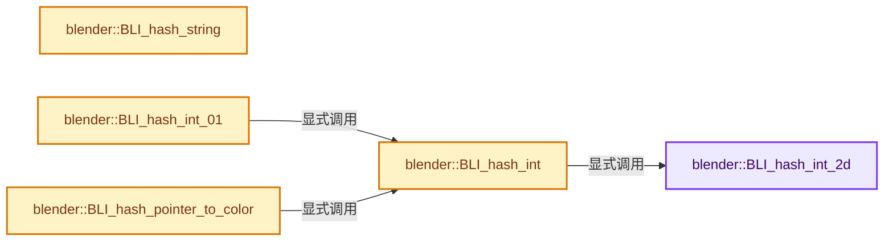
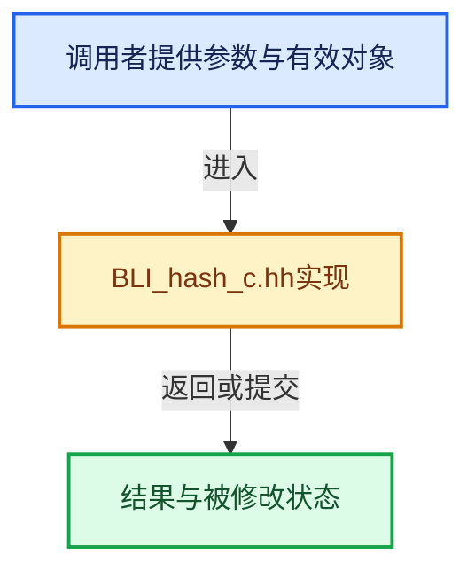

# 实现依赖专题：source/blender/blenlib/BLI_hash_c.hh

[方向导航](README.md) · [符号索引](../%E7%AC%A6%E5%8F%B7%E4%BE%9D%E8%B5%96%E4%B8%8E%E5%AE%9E%E7%8E%B0%E7%B4%A2%E5%BC%95.md)

本专题从正文实际调用进入，集中保存共享实现。函数有稳定锚点，可从调用处直接跳到对应完整函数；递归与互相调用通过回链组织。

## 本文件的实现关系






<a id="m-ac4ffcc373cf"></a>

## 宏 `final`

<!-- annotated:8b694b6a037f10 -->

```cpp
#define final(a, b, c) \
  { \
    c ^= b; \
    c -= rot(b, 14); \
    a ^= c; \
    a -= rot(c, 11); \
    b ^= a; \
    b -= rot(a, 25); \
    c ^= b; \
    c -= rot(b, 16); \
    a ^= c; \
    a -= rot(c, 4); \
    b ^= a; \
    b -= rot(a, 14); \
    c ^= b; \
    c -= rot(b, 24); \
  } \
  ((void)0)

```

<details>
<summary>核对原始源码：source/blender/blenlib/BLI_hash_c.hh · L21—L39</summary>

<!-- original:8b694b6a037f10:source/blender/blenlib/BLI_hash_c.hh:21:39 -->

```cpp
#define final(a, b, c) \
  { \
    c ^= b; \
    c -= rot(b, 14); \
    a ^= c; \
    a -= rot(c, 11); \
    b ^= a; \
    b -= rot(a, 25); \
    c ^= b; \
    c -= rot(b, 16); \
    a ^= c; \
    a -= rot(c, 4); \
    b ^= a; \
    b -= rot(a, 14); \
    c ^= b; \
    c -= rot(b, 24); \
  } \
  ((void)0)

```

</details>

宏在预处理阶段展开，参数替换、重复求值和条件编译应直接从该定义检查。与普通函数不同，宏不会自动提供参数类型检查；构建配置选择哪个定义需结合外围条件。

## 完整成员与函数实现

<a id="f-3257c3494717d4c4"></a>

### `blender::BLI_hash_int_2d`

实现位置：[source/blender/blenlib/BLI_hash_c.hh](../../../../../source/blender/blenlib/BLI_hash_c.hh) · L53—L64。

接口参数：

- `unsigned int kx`
- `unsigned int ky`

**教学注释版**

<!-- annotated:bd91c81b659c5d -->

```cpp
BLI_INLINE unsigned int BLI_hash_int_2d(unsigned int kx, unsigned int ky)
{
  unsigned int a, b, c;

  a = b = c = 0xdeadbeef + (2 << 2) + 13;
  a += kx;
  b += ky;

  final(a, b, c);

  return c;
}
```

<details>
<summary>核对原始源码：source/blender/blenlib/BLI_hash_c.hh · L53—L64</summary>

<!-- original:bd91c81b659c5d:source/blender/blenlib/BLI_hash_c.hh:53:64 -->

```cpp
BLI_INLINE unsigned int BLI_hash_int_2d(unsigned int kx, unsigned int ky)
{
  unsigned int a, b, c;

  a = b = c = 0xdeadbeef + (2 << 2) + 13;
  a += kx;
  b += ky;

  final(a, b, c);

  return c;
}
```

</details>

**沿实际写入检查状态**

- `a = b = c = 0xdeadbeef + (2 << 2) + 13;`
- `a += kx;`
- `b += ky;`

**结果出口**

- `return c;`

**继续追踪实现**

- `final` → [final · L21](%E4%BE%9D%E8%B5%96-BLI_hash_c-2ab8ea.md#m-ac4ffcc373cf)。宏定义由构建条件选择。

<a id="f-0f3487d576368d89"></a>

### `blender::BLI_hash_string`

实现位置：[source/blender/blenlib/BLI_hash_c.hh](../../../../../source/blender/blenlib/BLI_hash_c.hh) · L69—L77。

接口参数：

- `const char *str`

**教学注释版**

<!-- annotated:d1a0a0d1ae501a -->

```cpp
BLI_INLINE unsigned int BLI_hash_string(const char *str)
{
  unsigned int i = 0, c;

  while ((c = *str++)) {
    i = i * 37 + c;
  }
  return i;
}
```

<details>
<summary>核对原始源码：source/blender/blenlib/BLI_hash_c.hh · L69—L77</summary>

<!-- original:d1a0a0d1ae501a:source/blender/blenlib/BLI_hash_c.hh:69:77 -->

```cpp
BLI_INLINE unsigned int BLI_hash_string(const char *str)
{
  unsigned int i = 0, c;

  while ((c = *str++)) {
    i = i * 37 + c;
  }
  return i;
}
```

</details>

**沿实际写入检查状态**

- `i = i * 37 + c;`

**结果出口**

- `return i;`

**继续追踪实现**

本实现没有需要继续展开的显式调用；检查返回表达式、对象转换和调用者前置条件。

<a id="f-32ff2a82e559cc1e"></a>

### `blender::BLI_hash_int`

实现位置：[source/blender/blenlib/BLI_hash_c.hh](../../../../../source/blender/blenlib/BLI_hash_c.hh) · L89—L92。

接口参数：

- `unsigned int k`

**教学注释版**

<!-- annotated:dbbfac60c308d7 -->

```cpp
BLI_INLINE unsigned int BLI_hash_int(unsigned int k)
{
  return BLI_hash_int_2d(k, 0);
}
```

<details>
<summary>核对原始源码：source/blender/blenlib/BLI_hash_c.hh · L89—L92</summary>

<!-- original:dbbfac60c308d7:source/blender/blenlib/BLI_hash_c.hh:89:92 -->

```cpp
BLI_INLINE unsigned int BLI_hash_int(unsigned int k)
{
  return BLI_hash_int_2d(k, 0);
}
```

</details>

**结果出口**

- `return BLI_hash_int_2d(k, 0);`

**继续追踪实现**

- `BLI_hash_int_2d` → [blender::BLI_hash_int_2d · L53](%E4%BE%9D%E8%B5%96-BLI_hash_c-2ab8ea.md#f-3257c3494717d4c4)。

<a id="f-5f15d616cd371045"></a>

### `blender::BLI_hash_int_01`

实现位置：[source/blender/blenlib/BLI_hash_c.hh](../../../../../source/blender/blenlib/BLI_hash_c.hh) · L94—L97。

接口参数：

- `unsigned int k`

**教学注释版**

<!-- annotated:069a45989fa4a9 -->

```cpp
BLI_INLINE float BLI_hash_int_01(unsigned int k)
{
  return float(BLI_hash_int(k)) * (1.0f / float(0xFFFFFFFF));
}
```

<details>
<summary>核对原始源码：source/blender/blenlib/BLI_hash_c.hh · L94—L97</summary>

<!-- original:069a45989fa4a9:source/blender/blenlib/BLI_hash_c.hh:94:97 -->

```cpp
BLI_INLINE float BLI_hash_int_01(unsigned int k)
{
  return float(BLI_hash_int(k)) * (1.0f / float(0xFFFFFFFF));
}
```

</details>

**结果出口**

- `return float(BLI_hash_int(k)) * (1.0f / float(0xFFFFFFFF));`

**继续追踪实现**

- `BLI_hash_int` → [blender::BLI_hash_int · L89](%E4%BE%9D%E8%B5%96-BLI_hash_c-2ab8ea.md#f-32ff2a82e559cc1e)。

<a id="f-80aedf0b284dbe6b"></a>

### `blender::BLI_hash_pointer_to_color`

实现位置：[source/blender/blenlib/BLI_hash_c.hh](../../../../../source/blender/blenlib/BLI_hash_c.hh) · L99—L108。

接口参数：

- `const void *ptr`
- `int *r`
- `int *g`
- `int *b`

**教学注释版**

<!-- annotated:bb8aaca924e55a -->

```cpp
BLI_INLINE void BLI_hash_pointer_to_color(const void *ptr, int *r, int *g, int *b)
{
  size_t val = reinterpret_cast<size_t>(ptr);
  const size_t hash_a = BLI_hash_int(val & 0x0000ffff);
  const size_t hash_b = BLI_hash_int(uint((val & 0xffff0000) >> 16));
  const size_t hash = hash_a ^ (hash_b + 0x9e3779b9 + (hash_a << 6) + (hash_a >> 2));
  *r = (hash & 0xff0000) >> 16;
  *g = (hash & 0x00ff00) >> 8;
  *b = hash & 0x0000ff;
}
```

<details>
<summary>核对原始源码：source/blender/blenlib/BLI_hash_c.hh · L99—L108</summary>

<!-- original:bb8aaca924e55a:source/blender/blenlib/BLI_hash_c.hh:99:108 -->

```cpp
BLI_INLINE void BLI_hash_pointer_to_color(const void *ptr, int *r, int *g, int *b)
{
  size_t val = reinterpret_cast<size_t>(ptr);
  const size_t hash_a = BLI_hash_int(val & 0x0000ffff);
  const size_t hash_b = BLI_hash_int(uint((val & 0xffff0000) >> 16));
  const size_t hash = hash_a ^ (hash_b + 0x9e3779b9 + (hash_a << 6) + (hash_a >> 2));
  *r = (hash & 0xff0000) >> 16;
  *g = (hash & 0x00ff00) >> 8;
  *b = hash & 0x0000ff;
}
```

</details>

**继续追踪实现**

- `BLI_hash_int` → [blender::BLI_hash_int · L89](%E4%BE%9D%E8%B5%96-BLI_hash_c-2ab8ea.md#f-32ff2a82e559cc1e)。
