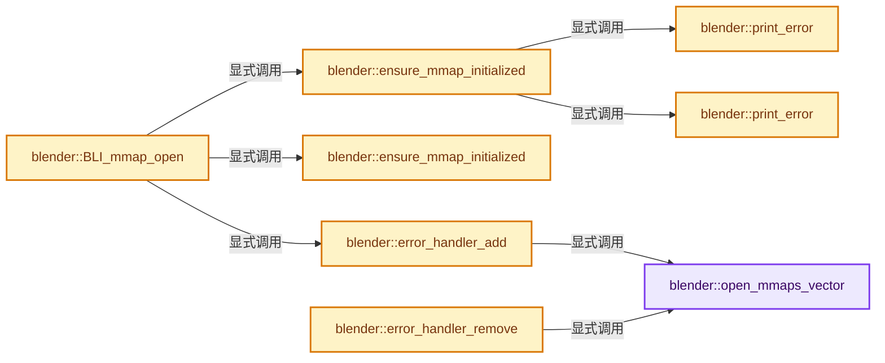
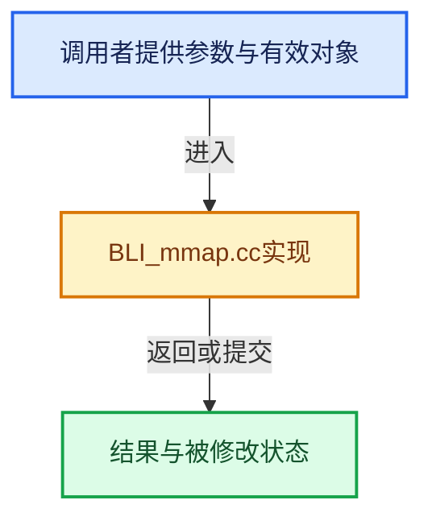

# 实现依赖专题：source/blender/blenlib/intern/BLI_mmap.cc

[方向导航](README.md) · [符号索引](../%E7%AC%A6%E5%8F%B7%E4%BE%9D%E8%B5%96%E4%B8%8E%E5%AE%9E%E7%8E%B0%E7%B4%A2%E5%BC%95.md)

本专题从正文实际调用进入，集中保存共享实现。函数有稳定锚点，可从调用处直接跳到对应完整函数；递归与互相调用通过回链组织。

## 本文件的实现关系






## 相关类型布局与成员入口

<a id="t-b5ed272e7260"></a>

### `blender::sigaction`

原始声明：[source/blender/blenlib/intern/BLI_mmap.cc](../../../../../source/blender/blenlib/intern/BLI_mmap.cc) · L297—L297。

以下保留类的数据声明与编译条件，成员函数实现通过后面的精确链接阅读。

<!-- annotated:9c1ee7a941ca70 -->

```cpp
static struct sigaction next_handler = {};
```

<details>
<summary>核对原始源码：source/blender/blenlib/intern/BLI_mmap.cc · L297—L297</summary>

<!-- original:9c1ee7a941ca70:source/blender/blenlib/intern/BLI_mmap.cc:297:297 -->

```cpp
static struct sigaction next_handler = {};
```

</details>


## 完整成员与函数实现

<a id="f-a9ac65f34b769b35"></a>

### `blender::open_mmaps_vector`

实现位置：[source/blender/blenlib/intern/BLI_mmap.cc](../../../../../source/blender/blenlib/intern/BLI_mmap.cc) · L66—L70。

**教学注释版**

<!-- annotated:8ec0fc15406bfc -->

```cpp
static Vector<BLI_mmap_file *> &open_mmaps_vector()
{
  static Vector<BLI_mmap_file *> open_mmaps;
  return open_mmaps;
}
```

<details>
<summary>核对原始源码：source/blender/blenlib/intern/BLI_mmap.cc · L66—L70</summary>

<!-- original:8ec0fc15406bfc:source/blender/blenlib/intern/BLI_mmap.cc:66:70 -->

```cpp
static Vector<BLI_mmap_file *> &open_mmaps_vector()
{
  static Vector<BLI_mmap_file *> open_mmaps;
  return open_mmaps;
}
```

</details>

**结果出口**

- `return open_mmaps;`

**继续追踪实现**

本实现没有需要继续展开的显式调用；检查返回表达式、对象转换和调用者前置条件。

<a id="f-6d90ded70992ddc3"></a>

### `blender::print_error`

实现位置：[source/blender/blenlib/intern/BLI_mmap.cc](../../../../../source/blender/blenlib/intern/BLI_mmap.cc) · L173—L179。

接口参数：

- `const char *message`

**教学注释版**

<!-- annotated:11afdfc1079843 -->

```cpp
static void print_error(const char *message)
{
  char buffer[256];
  size_t length = BLI_string_join(buffer, sizeof(buffer), "BLI_mmap: ", message, "\r\n");
  HANDLE stderr_handle = GetStdHandle(STD_ERROR_HANDLE);
  WriteFile(stderr_handle, buffer, length, nullptr, nullptr);
}
```

<details>
<summary>核对原始源码：source/blender/blenlib/intern/BLI_mmap.cc · L173—L179</summary>

<!-- original:11afdfc1079843:source/blender/blenlib/intern/BLI_mmap.cc:173:179 -->

```cpp
static void print_error(const char *message)
{
  char buffer[256];
  size_t length = BLI_string_join(buffer, sizeof(buffer), "BLI_mmap: ", message, "\r\n");
  HANDLE stderr_handle = GetStdHandle(STD_ERROR_HANDLE);
  WriteFile(stderr_handle, buffer, length, nullptr, nullptr);
}
```

</details>

**继续追踪实现**

- `BLI_string_join` → [BLI_string_join · L239](../01-%E5%9F%BA%E7%A1%80%E5%AE%B9%E5%99%A8%E4%B8%8E%E7%8E%B0%E4%BB%A3CPP/%E4%BE%9D%E8%B5%96-BLI_string_utils-a32cc1.md#m-65f445bb442b)。宏定义由构建条件选择。
- `GetStdHandle` → [调用协议](../%E6%A8%A1%E6%9D%BF%E5%AE%8F%E4%B8%8E%E5%8A%A8%E6%80%81%E5%88%86%E6%B4%BE%E5%8D%8F%E8%AE%AE.md)：函数指针、局部可调用对象或未展开的宏；必须结合调用者环境。调用位置L177。
- `WriteFile` → [调用协议](../%E6%A8%A1%E6%9D%BF%E5%AE%8F%E4%B8%8E%E5%8A%A8%E6%80%81%E5%88%86%E6%B4%BE%E5%8D%8F%E8%AE%AE.md)：函数指针、局部可调用对象或未展开的宏；必须结合调用者环境。调用位置L178。

<a id="f-9c7d21a7f340be4e"></a>

### `blender::ensure_mmap_initialized`

实现位置：[source/blender/blenlib/intern/BLI_mmap.cc](../../../../../source/blender/blenlib/intern/BLI_mmap.cc) · L247—L274。

**教学注释版**

<!-- annotated:f83a6c1cd6fab1 -->

```cpp
static bool ensure_mmap_initialized()
{
  static std::atomic_bool initialized = false;
  if (initialized) {
    return true;
  }

  std::unique_lock lock(mmap_mutex);

  if (!initialized) {
    HMODULE kernelbase = ::LoadLibraryA("kernelbase.dll");
    if (kernelbase) {
      mmap_MapViewOfFile3 = reinterpret_cast<MapViewOfFile3Fn>(
          ::GetProcAddress(kernelbase, "MapViewOfFile3"));
      mmap_VirtualAlloc2 = reinterpret_cast<VirtualAlloc2Fn>(
          ::GetProcAddress(kernelbase, "VirtualAlloc2"));
    }
    if (mmap_MapViewOfFile3 && mmap_VirtualAlloc2) {
      /* First has to be FALSE to avoid our handler being called before ASAN's handler. */
      AddVectoredExceptionHandler(FALSE, page_exception_handler);
    }
    else {
      print_error("Could not load necessary functions for MMAP error handling.");
    }
    initialized = true;
  }
  return true;
}
```

<details>
<summary>核对原始源码：source/blender/blenlib/intern/BLI_mmap.cc · L247—L274</summary>

<!-- original:f83a6c1cd6fab1:source/blender/blenlib/intern/BLI_mmap.cc:247:274 -->

```cpp
static bool ensure_mmap_initialized()
{
  static std::atomic_bool initialized = false;
  if (initialized) {
    return true;
  }

  std::unique_lock lock(mmap_mutex);

  if (!initialized) {
    HMODULE kernelbase = ::LoadLibraryA("kernelbase.dll");
    if (kernelbase) {
      mmap_MapViewOfFile3 = reinterpret_cast<MapViewOfFile3Fn>(
          ::GetProcAddress(kernelbase, "MapViewOfFile3"));
      mmap_VirtualAlloc2 = reinterpret_cast<VirtualAlloc2Fn>(
          ::GetProcAddress(kernelbase, "VirtualAlloc2"));
    }
    if (mmap_MapViewOfFile3 && mmap_VirtualAlloc2) {
      /* First has to be FALSE to avoid our handler being called before ASAN's handler. */
      AddVectoredExceptionHandler(FALSE, page_exception_handler);
    }
    else {
      print_error("Could not load necessary functions for MMAP error handling.");
    }
    initialized = true;
  }
  return true;
}
```

</details>

**沿实际写入检查状态**

- `mmap_MapViewOfFile3 = reinterpret_cast<MapViewOfFile3Fn>(`
- `mmap_VirtualAlloc2 = reinterpret_cast<VirtualAlloc2Fn>(`
- `initialized = true;`

**结果出口**

- `return true;`

**继续追踪实现**

- `::LoadLibraryA` → [调用协议](../%E6%A8%A1%E6%9D%BF%E5%AE%8F%E4%B8%8E%E5%8A%A8%E6%80%81%E5%88%86%E6%B4%BE%E5%8D%8F%E8%AE%AE.md)：函数指针、局部可调用对象或未展开的宏；必须结合调用者环境。调用位置L257。
- `::GetProcAddress` → [调用协议](../%E6%A8%A1%E6%9D%BF%E5%AE%8F%E4%B8%8E%E5%8A%A8%E6%80%81%E5%88%86%E6%B4%BE%E5%8D%8F%E8%AE%AE.md)：函数指针、局部可调用对象或未展开的宏；必须结合调用者环境。调用位置L260。
- `AddVectoredExceptionHandler` → [调用协议](../%E6%A8%A1%E6%9D%BF%E5%AE%8F%E4%B8%8E%E5%8A%A8%E6%80%81%E5%88%86%E6%B4%BE%E5%8D%8F%E8%AE%AE.md)：函数指针、局部可调用对象或未展开的宏；必须结合调用者环境。调用位置L266。
- `print_error` → [blender::print_error · L173](%E4%BE%9D%E8%B5%96-BLI_mmap-6be541.md#f-6d90ded70992ddc3)；[blender::print_error · L276](%E4%BE%9D%E8%B5%96-BLI_mmap-6be541.md#f-80478f432e3049d9)。同名重载需按实参类型选择。

<a id="f-80478f432e3049d9"></a>

### `blender::print_error`

实现位置：[source/blender/blenlib/intern/BLI_mmap.cc](../../../../../source/blender/blenlib/intern/BLI_mmap.cc) · L276—L283。

接口参数：

- `const char *message`

**教学注释版**

<!-- annotated:4d9710e5c3aa37 -->

```cpp
static void print_error(const char *message)
{
  char buffer[256];
  size_t length = BLI_string_join(buffer, sizeof(buffer), "BLI_mmap: ", message, "\n");
  if (write(STDERR_FILENO, buffer, length) < 0) {
    /* If writing to stderr fails, there is nowhere to write an error about that. */
  }
}
```

<details>
<summary>核对原始源码：source/blender/blenlib/intern/BLI_mmap.cc · L276—L283</summary>

<!-- original:4d9710e5c3aa37:source/blender/blenlib/intern/BLI_mmap.cc:276:283 -->

```cpp
static void print_error(const char *message)
{
  char buffer[256];
  size_t length = BLI_string_join(buffer, sizeof(buffer), "BLI_mmap: ", message, "\n");
  if (write(STDERR_FILENO, buffer, length) < 0) {
    /* If writing to stderr fails, there is nowhere to write an error about that. */
  }
}
```

</details>

**继续追踪实现**

- `BLI_string_join` → [BLI_string_join · L239](../01-%E5%9F%BA%E7%A1%80%E5%AE%B9%E5%99%A8%E4%B8%8E%E7%8E%B0%E4%BB%A3CPP/%E4%BE%9D%E8%B5%96-BLI_string_utils-a32cc1.md#m-65f445bb442b)。宏定义由构建条件选择。
- `write` → [blender::RawWriteWrap::write · L218](../05-%E5%87%A0%E4%BD%95%E5%AD%98%E5%82%A8%E4%B8%8E%E6%8B%93%E6%89%91%E6%98%A0%E5%B0%84/%E4%BE%9D%E8%B5%96-writefile-3eb36f.md#f-b8864eef93e647d7)；[blender::ZstdWriteWrap::write · L419](../05-%E5%87%A0%E4%BD%95%E5%AD%98%E5%82%A8%E4%B8%8E%E6%8B%93%E6%89%91%E6%98%A0%E5%B0%84/%E4%BE%9D%E8%B5%96-writefile-3eb36f.md#f-5607b0c448a53c31)；[blender::bNodeTreeInterface::write · L1750](../05-%E5%87%A0%E4%BD%95%E5%AD%98%E5%82%A8%E4%B8%8E%E6%8B%93%E6%89%91%E6%98%A0%E5%B0%84/%E4%BE%9D%E8%B5%96-node_tree_interface-893d31.md#f-f452b38f3e8d1b9c)。同名重载需按实参类型选择。

<a id="f-6b72995f62850e5e"></a>

### `blender::ensure_mmap_initialized`

实现位置：[source/blender/blenlib/intern/BLI_mmap.cc](../../../../../source/blender/blenlib/intern/BLI_mmap.cc) · L327—L352。

**教学注释版**

<!-- annotated:7fd4a21878b2c3 -->

```cpp
static bool ensure_mmap_initialized()
{
  static std::atomic_bool initialized = false;
  if (initialized) {
    return true;
  }

  std::unique_lock lock(mmap_mutex);
  if (!initialized) {
    struct sigaction newact = {{nullptr}}, oldact = {{nullptr}};

    newact.sa_sigaction = sigbus_handler;
    newact.sa_flags = SA_SIGINFO;

    if (sigaction(SIGBUS, &newact, &oldact)) {
      return false;
    }

    /* Remember the previous handler to fall back to it if the error
     * does not belong to any of the mapped files. */
    next_handler = oldact;
    initialized = true;
  }

  return true;
}
```

<details>
<summary>核对原始源码：source/blender/blenlib/intern/BLI_mmap.cc · L327—L352</summary>

<!-- original:7fd4a21878b2c3:source/blender/blenlib/intern/BLI_mmap.cc:327:352 -->

```cpp
static bool ensure_mmap_initialized()
{
  static std::atomic_bool initialized = false;
  if (initialized) {
    return true;
  }

  std::unique_lock lock(mmap_mutex);
  if (!initialized) {
    struct sigaction newact = {{nullptr}}, oldact = {{nullptr}};

    newact.sa_sigaction = sigbus_handler;
    newact.sa_flags = SA_SIGINFO;

    if (sigaction(SIGBUS, &newact, &oldact)) {
      return false;
    }

    /* Remember the previous handler to fall back to it if the error
     * does not belong to any of the mapped files. */
    next_handler = oldact;
    initialized = true;
  }

  return true;
}
```

</details>

**沿实际写入检查状态**

- `newact.sa_sigaction = sigbus_handler;`
- `newact.sa_flags = SA_SIGINFO;`
- `next_handler = oldact;`
- `initialized = true;`

**结果出口**

- `return true;`
- `return false;`

**继续追踪实现**

- `sigaction` → [blender::sigaction](%E4%BE%9D%E8%B5%96-BLI_mmap-6be541.md#t-b5ed272e7260)。

<a id="f-8f964299703bff2c"></a>

### `blender::error_handler_add`

实现位置：[source/blender/blenlib/intern/BLI_mmap.cc](../../../../../source/blender/blenlib/intern/BLI_mmap.cc) · L356—L360。

接口参数：

- `BLI_mmap_file *file`

**教学注释版**

<!-- annotated:827c7c3edf9e36 -->

```cpp
static void error_handler_add(BLI_mmap_file *file)
{
  std::unique_lock lock(mmap_mutex);
  open_mmaps_vector().append(file);
}
```

<details>
<summary>核对原始源码：source/blender/blenlib/intern/BLI_mmap.cc · L356—L360</summary>

<!-- original:827c7c3edf9e36:source/blender/blenlib/intern/BLI_mmap.cc:356:360 -->

```cpp
static void error_handler_add(BLI_mmap_file *file)
{
  std::unique_lock lock(mmap_mutex);
  open_mmaps_vector().append(file);
}
```

</details>

**继续追踪实现**

- `open_mmaps_vector().append` → [调用协议](../%E6%A8%A1%E6%9D%BF%E5%AE%8F%E4%B8%8E%E5%8A%A8%E6%80%81%E5%88%86%E6%B4%BE%E5%8D%8F%E8%AE%AE.md)：接收对象类型依赖auto、返回值或模板实例；不按同名猜测目标。调用位置L359。
- `open_mmaps_vector` → [blender::open_mmaps_vector · L66](%E4%BE%9D%E8%B5%96-BLI_mmap-6be541.md#f-a9ac65f34b769b35)。

<a id="f-51c1a6e7a37eb225"></a>

### `blender::error_handler_remove`

实现位置：[source/blender/blenlib/intern/BLI_mmap.cc](../../../../../source/blender/blenlib/intern/BLI_mmap.cc) · L363—L367。

接口参数：

- `BLI_mmap_file *file`

**教学注释版**

<!-- annotated:50e9a93e1f2f70 -->

```cpp
static void error_handler_remove(BLI_mmap_file *file)
{
  std::unique_lock lock(mmap_mutex);
  open_mmaps_vector().remove_first_occurrence_and_reorder(file);
}
```

<details>
<summary>核对原始源码：source/blender/blenlib/intern/BLI_mmap.cc · L363—L367</summary>

<!-- original:50e9a93e1f2f70:source/blender/blenlib/intern/BLI_mmap.cc:363:367 -->

```cpp
static void error_handler_remove(BLI_mmap_file *file)
{
  std::unique_lock lock(mmap_mutex);
  open_mmaps_vector().remove_first_occurrence_and_reorder(file);
}
```

</details>

**继续追踪实现**

- `open_mmaps_vector().remove_first_occurrence_and_reorder` → [调用协议](../%E6%A8%A1%E6%9D%BF%E5%AE%8F%E4%B8%8E%E5%8A%A8%E6%80%81%E5%88%86%E6%B4%BE%E5%8D%8F%E8%AE%AE.md)：接收对象类型依赖auto、返回值或模板实例；不按同名猜测目标。调用位置L366。
- `open_mmaps_vector` → [blender::open_mmaps_vector · L66](%E4%BE%9D%E8%B5%96-BLI_mmap-6be541.md#f-a9ac65f34b769b35)。

<a id="f-a87ee2ea19b3fd5a"></a>

### `blender::BLI_mmap_open`

实现位置：[source/blender/blenlib/intern/BLI_mmap.cc](../../../../../source/blender/blenlib/intern/BLI_mmap.cc) · L369—L464。

接口参数：

- `int fd`

**教学注释版**

<!-- annotated:89ce6544e6ae7c -->

```cpp
BLI_mmap_file *BLI_mmap_open(int fd)
{
  static std::atomic_size_t id_counter = 0;

  void *memory, *handle = nullptr;
  /* It's important not to use `BLI_lseek` here because in case we fail to use MMAP and returning
   * nullptr, the calling function is not closing the file using the file descriptor means next
   * time the file is read the file-pointer is still pointing to the end. This is not an issue for
   * blender but it throws off the virtual file-system when blender is running on the
   * render-network. See PR !155823 for details. */
  const size_t length = BLI_file_descriptor_size(fd);
  if (length == size_t(-1)) [[unlikely]] {
    return nullptr;
  }

  /* Ensures that the error handler is set up and ready. */
  if (!ensure_mmap_initialized()) {
    return nullptr;
  }

#ifndef WIN32
  /* Map the given file to memory. */
  memory = mmap(nullptr, length, PROT_READ, MAP_PRIVATE, fd, 0);
  if (memory == MAP_FAILED) {
    return nullptr;
  }
#else  /* WIN32 */
  /* Convert the POSIX-style file descriptor to a Windows handle. */
  void *file_handle = (void *)_get_osfhandle(fd);

  /* Memory mapping on Windows is a multi-step process - first we create a placeholder
   * allocation. Then we create a mapping, and after that we create a view into that mapping
   * on top of the placeholder. In our case, one view that spans the entire file is enough.
   * NOTE: Changes to protection flags should also be reflected in #try_map_zeros. If write
   * support is added, the write check in #page_exception_handler should be updated. */
  if (mmap_MapViewOfFile3 && mmap_VirtualAlloc2) {
    memory = mmap_VirtualAlloc2(nullptr,
                                nullptr,
                                length,
                                MEM_RESERVE | MEM_RESERVE_PLACEHOLDER,
                                PAGE_NOACCESS,
                                nullptr,
                                0);
    if (memory == nullptr) {
      return nullptr;
    }

    handle = CreateFileMapping(file_handle, nullptr, PAGE_READONLY, 0, 0, nullptr);
    if (handle == nullptr) {
      VirtualFree(memory, 0, MEM_RELEASE);
      return nullptr;
    }

    if (mmap_MapViewOfFile3(handle,
                            nullptr,
                            memory,
                            0,
                            length,
                            MEM_REPLACE_PLACEHOLDER,
                            PAGE_READONLY,
                            nullptr,
                            0) == nullptr)
    {
      VirtualFree(memory, 0, MEM_RELEASE);
      CloseHandle(handle);
      return nullptr;
    }
  }
  else {
    /* Fallback without error handling in case `MapViewOfFile3` or `VirtualAlloc2` is not
     * available. */
    handle = CreateFileMapping(file_handle, nullptr, PAGE_READONLY, 0, 0, nullptr);
    if (handle == nullptr) {
      return nullptr;
    }

    memory = MapViewOfFile(handle, FILE_MAP_READ, 0, 0, 0);
    if (memory == nullptr) {
      CloseHandle(handle);
      return nullptr;
    }
  }
#endif /* WIN32 */

  /* Now that the mapping was successful, allocate memory and set up the #BLI_mmap_file. */
  BLI_mmap_file *file = MEM_new_zeroed<BLI_mmap_file>(__func__);
  file->memory = static_cast<char *>(memory);
  file->handle = handle;
  file->length = length;
  file->id = id_counter++;

  /* Register the file with the error handler. */
  error_handler_add(file);

  return file;
}
```

<details>
<summary>核对原始源码：source/blender/blenlib/intern/BLI_mmap.cc · L369—L464</summary>

<!-- original:89ce6544e6ae7c:source/blender/blenlib/intern/BLI_mmap.cc:369:464 -->

```cpp
BLI_mmap_file *BLI_mmap_open(int fd)
{
  static std::atomic_size_t id_counter = 0;

  void *memory, *handle = nullptr;
  /* It's important not to use `BLI_lseek` here because in case we fail to use MMAP and returning
   * nullptr, the calling function is not closing the file using the file descriptor means next
   * time the file is read the file-pointer is still pointing to the end. This is not an issue for
   * blender but it throws off the virtual file-system when blender is running on the
   * render-network. See PR !155823 for details. */
  const size_t length = BLI_file_descriptor_size(fd);
  if (length == size_t(-1)) [[unlikely]] {
    return nullptr;
  }

  /* Ensures that the error handler is set up and ready. */
  if (!ensure_mmap_initialized()) {
    return nullptr;
  }

#ifndef WIN32
  /* Map the given file to memory. */
  memory = mmap(nullptr, length, PROT_READ, MAP_PRIVATE, fd, 0);
  if (memory == MAP_FAILED) {
    return nullptr;
  }
#else  /* WIN32 */
  /* Convert the POSIX-style file descriptor to a Windows handle. */
  void *file_handle = (void *)_get_osfhandle(fd);

  /* Memory mapping on Windows is a multi-step process - first we create a placeholder
   * allocation. Then we create a mapping, and after that we create a view into that mapping
   * on top of the placeholder. In our case, one view that spans the entire file is enough.
   * NOTE: Changes to protection flags should also be reflected in #try_map_zeros. If write
   * support is added, the write check in #page_exception_handler should be updated. */
  if (mmap_MapViewOfFile3 && mmap_VirtualAlloc2) {
    memory = mmap_VirtualAlloc2(nullptr,
                                nullptr,
                                length,
                                MEM_RESERVE | MEM_RESERVE_PLACEHOLDER,
                                PAGE_NOACCESS,
                                nullptr,
                                0);
    if (memory == nullptr) {
      return nullptr;
    }

    handle = CreateFileMapping(file_handle, nullptr, PAGE_READONLY, 0, 0, nullptr);
    if (handle == nullptr) {
      VirtualFree(memory, 0, MEM_RELEASE);
      return nullptr;
    }

    if (mmap_MapViewOfFile3(handle,
                            nullptr,
                            memory,
                            0,
                            length,
                            MEM_REPLACE_PLACEHOLDER,
                            PAGE_READONLY,
                            nullptr,
                            0) == nullptr)
    {
      VirtualFree(memory, 0, MEM_RELEASE);
      CloseHandle(handle);
      return nullptr;
    }
  }
  else {
    /* Fallback without error handling in case `MapViewOfFile3` or `VirtualAlloc2` is not
     * available. */
    handle = CreateFileMapping(file_handle, nullptr, PAGE_READONLY, 0, 0, nullptr);
    if (handle == nullptr) {
      return nullptr;
    }

    memory = MapViewOfFile(handle, FILE_MAP_READ, 0, 0, 0);
    if (memory == nullptr) {
      CloseHandle(handle);
      return nullptr;
    }
  }
#endif /* WIN32 */

  /* Now that the mapping was successful, allocate memory and set up the #BLI_mmap_file. */
  BLI_mmap_file *file = MEM_new_zeroed<BLI_mmap_file>(__func__);
  file->memory = static_cast<char *>(memory);
  file->handle = handle;
  file->length = length;
  file->id = id_counter++;

  /* Register the file with the error handler. */
  error_handler_add(file);

  return file;
}
```

</details>

**沿实际写入检查状态**

- `memory = mmap(nullptr, length, PROT_READ, MAP_PRIVATE, fd, 0);`
- `memory = mmap_VirtualAlloc2(nullptr,`
- `handle = CreateFileMapping(file_handle, nullptr, PAGE_READONLY, 0, 0, nullptr);`
- `memory = MapViewOfFile(handle, FILE_MAP_READ, 0, 0, 0);`
- `file->memory = static_cast<char *>(memory);`
- `file->handle = handle;`
- `file->length = length;`
- `file->id = id_counter++;`

**结果出口**

- `return nullptr;`
- `return file;`

**继续追踪实现**

- `BLI_file_descriptor_size` → [blender::BLI_file_descriptor_size · L219](../01-%E5%9F%BA%E7%A1%80%E5%AE%B9%E5%99%A8%E4%B8%8E%E7%8E%B0%E4%BB%A3CPP/%E4%BE%9D%E8%B5%96-storage-bda15e.md#f-d5e4fd24e28790db)。
- `ensure_mmap_initialized` → [blender::ensure_mmap_initialized · L247](%E4%BE%9D%E8%B5%96-BLI_mmap-6be541.md#f-9c7d21a7f340be4e)；[blender::ensure_mmap_initialized · L327](%E4%BE%9D%E8%B5%96-BLI_mmap-6be541.md#f-6b72995f62850e5e)。同名重载需按实参类型选择。
- `mmap` → [调用协议](../%E6%A8%A1%E6%9D%BF%E5%AE%8F%E4%B8%8E%E5%8A%A8%E6%80%81%E5%88%86%E6%B4%BE%E5%8D%8F%E8%AE%AE.md)：函数指针、局部可调用对象或未展开的宏；必须结合调用者环境。调用位置L391。
- `_get_osfhandle` → [调用协议](../%E6%A8%A1%E6%9D%BF%E5%AE%8F%E4%B8%8E%E5%8A%A8%E6%80%81%E5%88%86%E6%B4%BE%E5%8D%8F%E8%AE%AE.md)：函数指针、局部可调用对象或未展开的宏；必须结合调用者环境。调用位置L397。
- `mmap_VirtualAlloc2` → [调用协议](../%E6%A8%A1%E6%9D%BF%E5%AE%8F%E4%B8%8E%E5%8A%A8%E6%80%81%E5%88%86%E6%B4%BE%E5%8D%8F%E8%AE%AE.md)：函数指针、局部可调用对象或未展开的宏；必须结合调用者环境。调用位置L405。
- `CreateFileMapping` → [调用协议](../%E6%A8%A1%E6%9D%BF%E5%AE%8F%E4%B8%8E%E5%8A%A8%E6%80%81%E5%88%86%E6%B4%BE%E5%8D%8F%E8%AE%AE.md)：函数指针、局部可调用对象或未展开的宏；必须结合调用者环境。调用位置L416。
- `VirtualFree` → [调用协议](../%E6%A8%A1%E6%9D%BF%E5%AE%8F%E4%B8%8E%E5%8A%A8%E6%80%81%E5%88%86%E6%B4%BE%E5%8D%8F%E8%AE%AE.md)：函数指针、局部可调用对象或未展开的宏；必须结合调用者环境。调用位置L418。
- `mmap_MapViewOfFile3` → [调用协议](../%E6%A8%A1%E6%9D%BF%E5%AE%8F%E4%B8%8E%E5%8A%A8%E6%80%81%E5%88%86%E6%B4%BE%E5%8D%8F%E8%AE%AE.md)：函数指针、局部可调用对象或未展开的宏；必须结合调用者环境。调用位置L422。
- `CloseHandle` → [调用协议](../%E6%A8%A1%E6%9D%BF%E5%AE%8F%E4%B8%8E%E5%8A%A8%E6%80%81%E5%88%86%E6%B4%BE%E5%8D%8F%E8%AE%AE.md)：函数指针、局部可调用对象或未展开的宏；必须结合调用者环境。调用位置L433。
- `MapViewOfFile` → [调用协议](../%E6%A8%A1%E6%9D%BF%E5%AE%8F%E4%B8%8E%E5%8A%A8%E6%80%81%E5%88%86%E6%B4%BE%E5%8D%8F%E8%AE%AE.md)：函数指针、局部可调用对象或未展开的宏；必须结合调用者环境。调用位置L445。
- `MEM_new_zeroed<BLI_mmap_file>` → [MEM_new_zeroed · L550](../03-%E5%86%85%E5%AD%98%E5%88%86%E9%85%8D%E4%B8%8E%E8%BF%90%E8%A1%8C%E6%97%B6%E7%B1%BB%E5%9E%8B/%E4%BE%9D%E8%B5%96-MEM_guardedalloc-b54eca.md#f-eeb1e2a7f57dd231)；[MEM_new_zeroed · L114](../03-%E5%86%85%E5%AD%98%E5%88%86%E9%85%8D%E4%B8%8E%E8%BF%90%E8%A1%8C%E6%97%B6%E7%B1%BB%E5%9E%8B/%E4%BE%9D%E8%B5%96-mallocn-afdcd4.md#f-e04cf01c64c8b180)。同名重载需按实参类型选择。
- `error_handler_add` → [blender::error_handler_add · L356](%E4%BE%9D%E8%B5%96-BLI_mmap-6be541.md#f-8f964299703bff2c)。

<a id="f-0660ed870ae43bb2"></a>

### `blender::BLI_mmap_get_pointer`

实现位置：[source/blender/blenlib/intern/BLI_mmap.cc](../../../../../source/blender/blenlib/intern/BLI_mmap.cc) · L479—L482。

接口参数：

- `BLI_mmap_file *file`

**教学注释版**

<!-- annotated:efdb4ffef085c0 -->

```cpp
void *BLI_mmap_get_pointer(BLI_mmap_file *file)
{
  return file->memory;
}
```

<details>
<summary>核对原始源码：source/blender/blenlib/intern/BLI_mmap.cc · L479—L482</summary>

<!-- original:efdb4ffef085c0:source/blender/blenlib/intern/BLI_mmap.cc:479:482 -->

```cpp
void *BLI_mmap_get_pointer(BLI_mmap_file *file)
{
  return file->memory;
}
```

</details>

**结果出口**

- `return file->memory;`

**继续追踪实现**

本实现没有需要继续展开的显式调用；检查返回表达式、对象转换和调用者前置条件。

<a id="f-8c3e5c335f2b2102"></a>

### `blender::BLI_mmap_get_length`

实现位置：[source/blender/blenlib/intern/BLI_mmap.cc](../../../../../source/blender/blenlib/intern/BLI_mmap.cc) · L484—L487。

接口参数：

- `const BLI_mmap_file *file`

**教学注释版**

<!-- annotated:88518c096366ff -->

```cpp
size_t BLI_mmap_get_length(const BLI_mmap_file *file)
{
  return file->length;
}
```

<details>
<summary>核对原始源码：source/blender/blenlib/intern/BLI_mmap.cc · L484—L487</summary>

<!-- original:88518c096366ff:source/blender/blenlib/intern/BLI_mmap.cc:484:487 -->

```cpp
size_t BLI_mmap_get_length(const BLI_mmap_file *file)
{
  return file->length;
}
```

</details>

**结果出口**

- `return file->length;`

**继续追踪实现**

本实现没有需要继续展开的显式调用；检查返回表达式、对象转换和调用者前置条件。

<a id="f-2d30c37c2350fd61"></a>

### `blender::BLI_mmap_any_io_error`

实现位置：[source/blender/blenlib/intern/BLI_mmap.cc](../../../../../source/blender/blenlib/intern/BLI_mmap.cc) · L489—L492。

接口参数：

- `const BLI_mmap_file *file`

**教学注释版**

<!-- annotated:c806753f0865f7 -->

```cpp
bool BLI_mmap_any_io_error(const BLI_mmap_file *file)
{
  return file->io_error;
}
```

<details>
<summary>核对原始源码：source/blender/blenlib/intern/BLI_mmap.cc · L489—L492</summary>

<!-- original:c806753f0865f7:source/blender/blenlib/intern/BLI_mmap.cc:489:492 -->

```cpp
bool BLI_mmap_any_io_error(const BLI_mmap_file *file)
{
  return file->io_error;
}
```

</details>

**结果出口**

- `return file->io_error;`

**继续追踪实现**

本实现没有需要继续展开的显式调用；检查返回表达式、对象转换和调用者前置条件。

<a id="f-a394ff7f3e78ea68"></a>

### `blender::BLI_mmap_free`

实现位置：[source/blender/blenlib/intern/BLI_mmap.cc](../../../../../source/blender/blenlib/intern/BLI_mmap.cc) · L494—L505。

接口参数：

- `BLI_mmap_file *file`

**教学注释版**

<!-- annotated:9c689cde2d8dea -->

```cpp
void BLI_mmap_free(BLI_mmap_file *file)
{
  error_handler_remove(file);
#ifndef WIN32
  munmap(static_cast<void *>(file->memory), file->length);
#else
  UnmapViewOfFile(file->memory);
  CloseHandle(file->handle);
#endif

  MEM_delete(file);
}
```

<details>
<summary>核对原始源码：source/blender/blenlib/intern/BLI_mmap.cc · L494—L505</summary>

<!-- original:9c689cde2d8dea:source/blender/blenlib/intern/BLI_mmap.cc:494:505 -->

```cpp
void BLI_mmap_free(BLI_mmap_file *file)
{
  error_handler_remove(file);
#ifndef WIN32
  munmap(static_cast<void *>(file->memory), file->length);
#else
  UnmapViewOfFile(file->memory);
  CloseHandle(file->handle);
#endif

  MEM_delete(file);
}
```

</details>

**继续追踪实现**

- `error_handler_remove` → [blender::error_handler_remove · L363](%E4%BE%9D%E8%B5%96-BLI_mmap-6be541.md#f-51c1a6e7a37eb225)。
- `munmap` → [调用协议](../%E6%A8%A1%E6%9D%BF%E5%AE%8F%E4%B8%8E%E5%8A%A8%E6%80%81%E5%88%86%E6%B4%BE%E5%8D%8F%E8%AE%AE.md)：函数指针、局部可调用对象或未展开的宏；必须结合调用者环境。调用位置L498。
- `UnmapViewOfFile` → [调用协议](../%E6%A8%A1%E6%9D%BF%E5%AE%8F%E4%B8%8E%E5%8A%A8%E6%80%81%E5%88%86%E6%B4%BE%E5%8D%8F%E8%AE%AE.md)：函数指针、局部可调用对象或未展开的宏；必须结合调用者环境。调用位置L500。
- `CloseHandle` → [调用协议](../%E6%A8%A1%E6%9D%BF%E5%AE%8F%E4%B8%8E%E5%8A%A8%E6%80%81%E5%88%86%E6%B4%BE%E5%8D%8F%E8%AE%AE.md)：函数指针、局部可调用对象或未展开的宏；必须结合调用者环境。调用位置L501。
- `MEM_delete` → [MEM_delete · L400](../03-%E5%86%85%E5%AD%98%E5%88%86%E9%85%8D%E4%B8%8E%E8%BF%90%E8%A1%8C%E6%97%B6%E7%B1%BB%E5%9E%8B/%E4%BE%9D%E8%B5%96-MEM_guardedalloc-b54eca.md#f-9049ffdd1682887c)。
