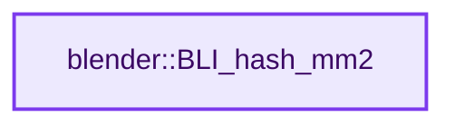
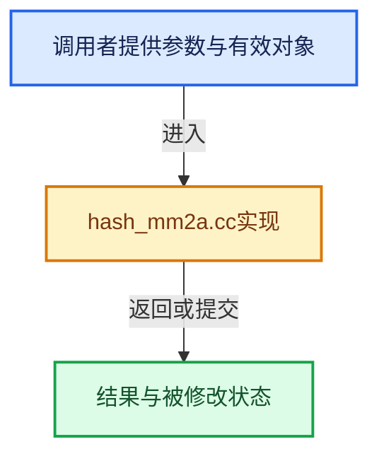

# 实现依赖专题：source/blender/blenlib/intern/hash_mm2a.cc

[方向导航](README.md) · [符号索引](../%E7%AC%A6%E5%8F%B7%E4%BE%9D%E8%B5%96%E4%B8%8E%E5%AE%9E%E7%8E%B0%E7%B4%A2%E5%BC%95.md)

本专题从正文实际调用进入，集中保存共享实现。函数有稳定锚点，可从调用处直接跳到对应完整函数；递归与互相调用通过回链组织。

## 本文件的实现关系






<a id="m-089e4d0bc616"></a>

## 宏 `MM2A_MIX`

<!-- annotated:e49d811bff8c20 -->

```cpp
#define MM2A_MIX(h, k) \
  { \
    (k) *= MM2A_M; \
    (k) ^= (k) >> 24; \
    (k) *= MM2A_M; \
    (h) = ((h) * MM2A_M) ^ (k); \
  } \
  (void)0

```

<details>
<summary>核对原始源码：source/blender/blenlib/intern/hash_mm2a.cc · L30—L38</summary>

<!-- original:e49d811bff8c20:source/blender/blenlib/intern/hash_mm2a.cc:30:38 -->

```cpp
#define MM2A_MIX(h, k) \
  { \
    (k) *= MM2A_M; \
    (k) ^= (k) >> 24; \
    (k) *= MM2A_M; \
    (h) = ((h) * MM2A_M) ^ (k); \
  } \
  (void)0

```

</details>

宏在预处理阶段展开，参数替换、重复求值和条件编译应直接从该定义检查。与普通函数不同，宏不会自动提供参数类型检查；构建配置选择哪个定义需结合外围条件。

<a id="m-72985ed0b58f"></a>

## 宏 `MM2A_MIX_FINALIZE`

<!-- annotated:b7bdf124e2c1d3 -->

```cpp
#define MM2A_MIX_FINALIZE(h) \
  { \
    (h) ^= (h) >> 13; \
    (h) *= MM2A_M; \
    (h) ^= (h) >> 15; \
  } \
  (void)0

```

<details>
<summary>核对原始源码：source/blender/blenlib/intern/hash_mm2a.cc · L39—L46</summary>

<!-- original:b7bdf124e2c1d3:source/blender/blenlib/intern/hash_mm2a.cc:39:46 -->

```cpp
#define MM2A_MIX_FINALIZE(h) \
  { \
    (h) ^= (h) >> 13; \
    (h) *= MM2A_M; \
    (h) ^= (h) >> 15; \
  } \
  (void)0

```

</details>

宏在预处理阶段展开，参数替换、重复求值和条件编译应直接从该定义检查。与普通函数不同，宏不会自动提供参数类型检查；构建配置选择哪个定义需结合外围条件。

## 完整成员与函数实现

<a id="f-5be8e1cec230b6b9"></a>

### `blender::BLI_hash_mm2`

实现位置：[source/blender/blenlib/intern/hash_mm2a.cc](../../../../../source/blender/blenlib/intern/hash_mm2a.cc) · L102—L131。

接口参数：

- `const uchar *data`
- `size_t len`
- `uint32_t seed`

**教学注释版**

<!-- annotated:e48c3a673f940c -->

```cpp
uint32_t BLI_hash_mm2(const uchar *data, size_t len, uint32_t seed)
{
  /* Initialize the hash to a 'random' value */
  uint32_t h = seed ^ len;

  /* Mix 4 bytes at a time into the hash */
  for (; len >= 4; data += 4, len -= 4) {
    uint32_t k = *reinterpret_cast<uint32_t *>(const_cast<uchar *>(data));

    MM2A_MIX(h, k);
  }

  /* Handle the last few bytes of the input array */
  switch (len) {
    case 3:
      h ^= data[2] << 16;
      ATTR_FALLTHROUGH;
    case 2:
      h ^= data[1] << 8;
      ATTR_FALLTHROUGH;
    case 1:
      h ^= data[0];
      h *= MM2A_M;
  }

  /* Do a few final mixes of the hash to ensure the last few bytes are well-incorporated. */
  MM2A_MIX_FINALIZE(h);

  return h;
}
```

<details>
<summary>核对原始源码：source/blender/blenlib/intern/hash_mm2a.cc · L102—L131</summary>

<!-- original:e48c3a673f940c:source/blender/blenlib/intern/hash_mm2a.cc:102:131 -->

```cpp
uint32_t BLI_hash_mm2(const uchar *data, size_t len, uint32_t seed)
{
  /* Initialize the hash to a 'random' value */
  uint32_t h = seed ^ len;

  /* Mix 4 bytes at a time into the hash */
  for (; len >= 4; data += 4, len -= 4) {
    uint32_t k = *reinterpret_cast<uint32_t *>(const_cast<uchar *>(data));

    MM2A_MIX(h, k);
  }

  /* Handle the last few bytes of the input array */
  switch (len) {
    case 3:
      h ^= data[2] << 16;
      ATTR_FALLTHROUGH;
    case 2:
      h ^= data[1] << 8;
      ATTR_FALLTHROUGH;
    case 1:
      h ^= data[0];
      h *= MM2A_M;
  }

  /* Do a few final mixes of the hash to ensure the last few bytes are well-incorporated. */
  MM2A_MIX_FINALIZE(h);

  return h;
}
```

</details>

**沿实际写入检查状态**

- `h *= MM2A_M;`

**结果出口**

- `return h;`

**继续追踪实现**

- `MM2A_MIX` → [MM2A_MIX · L30](%E4%BE%9D%E8%B5%96-hash_mm2a-fe59c3.md#m-089e4d0bc616)。宏定义由构建条件选择。
- `MM2A_MIX_FINALIZE` → [MM2A_MIX_FINALIZE · L39](%E4%BE%9D%E8%B5%96-hash_mm2a-fe59c3.md#m-72985ed0b58f)。宏定义由构建条件选择。
