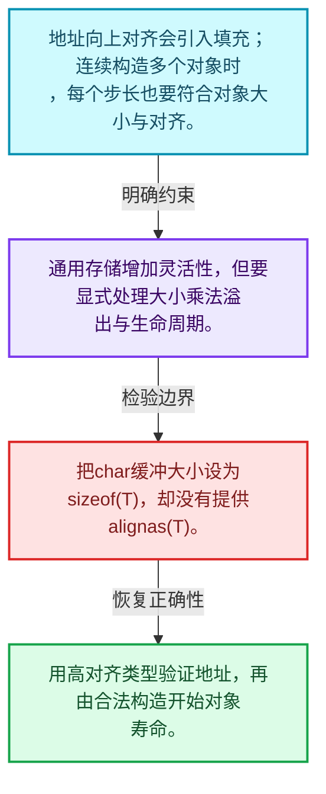
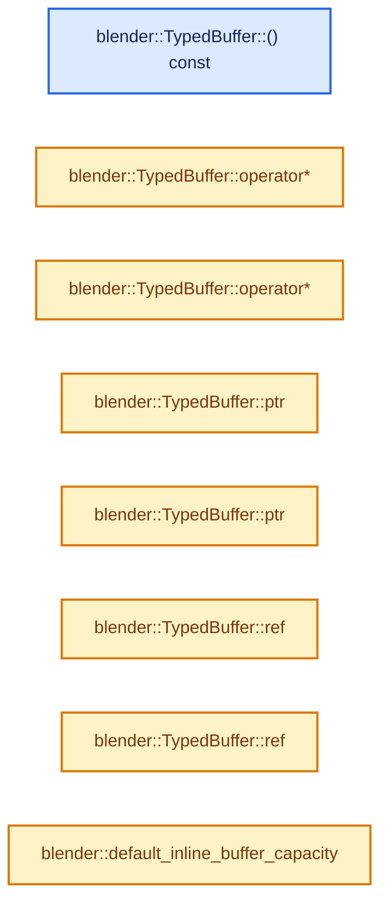
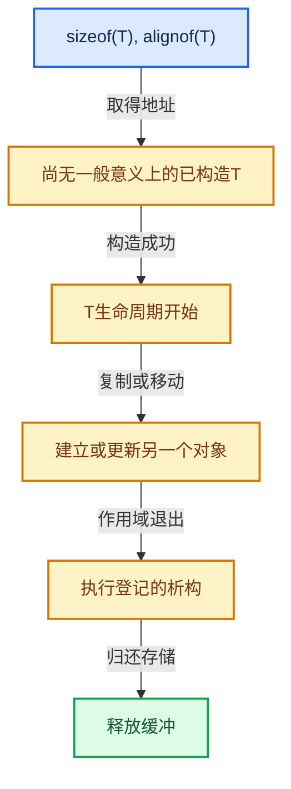

# 03-01 对齐与未初始化存储

[方向导航](README.md) · [总目录](../README.md) · [实现索引](../00-课程指南/02-源码与提交索引/符号依赖与实现索引.md)

## 从问题到实现

为什么大小足够的字节缓冲仍可能不能放某个类型？

对象地址必须满足对齐，且对象生命周期必须合法开始；字节复制不能替代所有非平凡类型的构造。

**数据模型**

地址向上对齐会引入填充；连续构造多个对象时，每个步长也要符合对象大小与对齐。

**设计取舍**

通用存储增加灵活性，但要显式处理大小乘法溢出与生命周期。

**最小反例**

把char缓冲大小设为sizeof(T)，却没有提供alignas(T)。

**推导**

用高对齐类型验证地址，再由合法构造开始对象寿命。

## 阅读地图与执行推演








图中的数值推演是本方向的教学模型；实际函数之间的调用边与概念分析边分别标注，不能把概念关系当作运行时调度顺序。

## 完整源码单元与就地讲解

中文讲解直接放在相关代码旁，复杂机制在代码下展开。原文折叠区保留基准行号；不需要在行号表和函数之间来回查找。类布局可分段展示，函数实现不按固定行数切开。

<!-- annotated:bed74d172e9463 -->

```cpp

```

<details>
<summary>核对原始源码：source/blender/blenlib/BLI_memory_utils.hh · L185—L185</summary>

<!-- original:bed74d172e9463:source/blender/blenlib/BLI_memory_utils.hh:185:185 -->

```cpp

```

</details>

<a id="f-d3e73f96dfe929a1"></a>

### `blender::TypedBuffer::() const`

实现位置：[source/blender/blenlib/BLI_memory_utils.hh](../../../../../source/blender/blenlib/BLI_memory_utils.hh) · L186—L189。

**教学注释版**

<!-- annotated:3a0b6353218611 -->

```cpp
  operator const T *() const
  {
    return static_cast<const T *>(buffer_.ptr());
  }
```

<details>
<summary>核对原始源码：source/blender/blenlib/BLI_memory_utils.hh · L186—L189</summary>

<!-- original:3a0b6353218611:source/blender/blenlib/BLI_memory_utils.hh:186:189 -->

```cpp
  operator const T *() const
  {
    return static_cast<const T *>(buffer_.ptr());
  }
```

</details>

**结果出口**

- `return static_cast<const T *>(buffer_.ptr());`

**继续追踪实现**

- `buffer_.ptr` → [调用协议](../00-课程指南/01-路线与规范/模板宏与动态分派协议.md)：接收对象类型依赖auto、返回值或模板实例；不按同名猜测目标。调用位置L188。

<!-- annotated:ba9422ce5422c5 -->

```cpp

```

<details>
<summary>核对原始源码：source/blender/blenlib/BLI_memory_utils.hh · L190—L190</summary>

<!-- original:ba9422ce5422c5:source/blender/blenlib/BLI_memory_utils.hh:190:190 -->

```cpp

```

</details>

<a id="f-d07a89e9073ebe61"></a>

### `blender::TypedBuffer::operator*`

实现位置：[source/blender/blenlib/BLI_memory_utils.hh](../../../../../source/blender/blenlib/BLI_memory_utils.hh) · L191—L194。

**教学注释版**

<!-- annotated:a79144959661eb -->

```cpp
  T &operator*()
  {
    return *static_cast<T *>(buffer_.ptr());
  }
```

<details>
<summary>核对原始源码：source/blender/blenlib/BLI_memory_utils.hh · L191—L194</summary>

<!-- original:a79144959661eb:source/blender/blenlib/BLI_memory_utils.hh:191:194 -->

```cpp
  T &operator*()
  {
    return *static_cast<T *>(buffer_.ptr());
  }
```

</details>

**结果出口**

- `return *static_cast<T *>(buffer_.ptr());`

**继续追踪实现**

- `buffer_.ptr` → [调用协议](../00-课程指南/01-路线与规范/模板宏与动态分派协议.md)：接收对象类型依赖auto、返回值或模板实例；不按同名猜测目标。调用位置L193。

<!-- annotated:6817415a635b8e -->

```cpp

```

<details>
<summary>核对原始源码：source/blender/blenlib/BLI_memory_utils.hh · L195—L195</summary>

<!-- original:6817415a635b8e:source/blender/blenlib/BLI_memory_utils.hh:195:195 -->

```cpp

```

</details>

<a id="f-7e92d190f8458cae"></a>

### `blender::TypedBuffer::operator*`

实现位置：[source/blender/blenlib/BLI_memory_utils.hh](../../../../../source/blender/blenlib/BLI_memory_utils.hh) · L196—L199。

**教学注释版**

<!-- annotated:d692cd2ad85c59 -->

```cpp
  const T &operator*() const
  {
    return *static_cast<const T *>(buffer_.ptr());
  }
```

<details>
<summary>核对原始源码：source/blender/blenlib/BLI_memory_utils.hh · L196—L199</summary>

<!-- original:d692cd2ad85c59:source/blender/blenlib/BLI_memory_utils.hh:196:199 -->

```cpp
  const T &operator*() const
  {
    return *static_cast<const T *>(buffer_.ptr());
  }
```

</details>

**结果出口**

- `return *static_cast<const T *>(buffer_.ptr());`

**继续追踪实现**

- `buffer_.ptr` → [调用协议](../00-课程指南/01-路线与规范/模板宏与动态分派协议.md)：接收对象类型依赖auto、返回值或模板实例；不按同名猜测目标。调用位置L198。

<!-- annotated:9e4eaff6880737 -->

```cpp

```

<details>
<summary>核对原始源码：source/blender/blenlib/BLI_memory_utils.hh · L200—L200</summary>

<!-- original:9e4eaff6880737:source/blender/blenlib/BLI_memory_utils.hh:200:200 -->

```cpp

```

</details>

<a id="f-d0aaaaf3ad8ab525"></a>

### `blender::TypedBuffer::ptr`

实现位置：[source/blender/blenlib/BLI_memory_utils.hh](../../../../../source/blender/blenlib/BLI_memory_utils.hh) · L201—L204。

**教学注释版**

<!-- annotated:ebd8881542dac5 -->

```cpp
  T *ptr()
  {
    return static_cast<T *>(buffer_.ptr());
  }
```

<details>
<summary>核对原始源码：source/blender/blenlib/BLI_memory_utils.hh · L201—L204</summary>

<!-- original:ebd8881542dac5:source/blender/blenlib/BLI_memory_utils.hh:201:204 -->

```cpp
  T *ptr()
  {
    return static_cast<T *>(buffer_.ptr());
  }
```

</details>

**结果出口**

- `return static_cast<T *>(buffer_.ptr());`

**继续追踪实现**

- `buffer_.ptr` → [调用协议](../00-课程指南/01-路线与规范/模板宏与动态分派协议.md)：接收对象类型依赖auto、返回值或模板实例；不按同名猜测目标。调用位置L203。

<!-- annotated:eee43522c2a746 -->

```cpp

```

<details>
<summary>核对原始源码：source/blender/blenlib/BLI_memory_utils.hh · L205—L205</summary>

<!-- original:eee43522c2a746:source/blender/blenlib/BLI_memory_utils.hh:205:205 -->

```cpp

```

</details>

<a id="f-a084c429c8af03d6"></a>

### `blender::TypedBuffer::ptr`

实现位置：[source/blender/blenlib/BLI_memory_utils.hh](../../../../../source/blender/blenlib/BLI_memory_utils.hh) · L206—L209。

**教学注释版**

<!-- annotated:846d5e9be549ec -->

```cpp
  const T *ptr() const
  {
    return static_cast<const T *>(buffer_.ptr());
  }
```

<details>
<summary>核对原始源码：source/blender/blenlib/BLI_memory_utils.hh · L206—L209</summary>

<!-- original:846d5e9be549ec:source/blender/blenlib/BLI_memory_utils.hh:206:209 -->

```cpp
  const T *ptr() const
  {
    return static_cast<const T *>(buffer_.ptr());
  }
```

</details>

**结果出口**

- `return static_cast<const T *>(buffer_.ptr());`

**继续追踪实现**

- `buffer_.ptr` → [调用协议](../00-课程指南/01-路线与规范/模板宏与动态分派协议.md)：接收对象类型依赖auto、返回值或模板实例；不按同名猜测目标。调用位置L208。

<!-- annotated:8985abaa605b2f -->

```cpp

```

<details>
<summary>核对原始源码：source/blender/blenlib/BLI_memory_utils.hh · L210—L210</summary>

<!-- original:8985abaa605b2f:source/blender/blenlib/BLI_memory_utils.hh:210:210 -->

```cpp

```

</details>

<a id="f-0bc330ab3d8ae4fb"></a>

### `blender::TypedBuffer::ref`

实现位置：[source/blender/blenlib/BLI_memory_utils.hh](../../../../../source/blender/blenlib/BLI_memory_utils.hh) · L211—L214。

**教学注释版**

<!-- annotated:fd0d3b3ea9527f -->

```cpp
  T &ref()
  {
    return *static_cast<T *>(buffer_.ptr());
  }
```

<details>
<summary>核对原始源码：source/blender/blenlib/BLI_memory_utils.hh · L211—L214</summary>

<!-- original:fd0d3b3ea9527f:source/blender/blenlib/BLI_memory_utils.hh:211:214 -->

```cpp
  T &ref()
  {
    return *static_cast<T *>(buffer_.ptr());
  }
```

</details>

**结果出口**

- `return *static_cast<T *>(buffer_.ptr());`

**继续追踪实现**

- `buffer_.ptr` → [调用协议](../00-课程指南/01-路线与规范/模板宏与动态分派协议.md)：接收对象类型依赖auto、返回值或模板实例；不按同名猜测目标。调用位置L213。

<!-- annotated:415cc1ae9ccef0 -->

```cpp

```

<details>
<summary>核对原始源码：source/blender/blenlib/BLI_memory_utils.hh · L215—L215</summary>

<!-- original:415cc1ae9ccef0:source/blender/blenlib/BLI_memory_utils.hh:215:215 -->

```cpp

```

</details>

<a id="f-373a7ba220c358f0"></a>

### `blender::TypedBuffer::ref`

实现位置：[source/blender/blenlib/BLI_memory_utils.hh](../../../../../source/blender/blenlib/BLI_memory_utils.hh) · L216—L219。

**教学注释版**

<!-- annotated:d9d86add9ba6e7 -->

```cpp
  const T &ref() const
  {
    return *static_cast<const T *>(buffer_.ptr());
  }
```

<details>
<summary>核对原始源码：source/blender/blenlib/BLI_memory_utils.hh · L216—L219</summary>

<!-- original:d9d86add9ba6e7:source/blender/blenlib/BLI_memory_utils.hh:216:219 -->

```cpp
  const T &ref() const
  {
    return *static_cast<const T *>(buffer_.ptr());
  }
```

</details>

**结果出口**

- `return *static_cast<const T *>(buffer_.ptr());`

**继续追踪实现**

- `buffer_.ptr` → [调用协议](../00-课程指南/01-路线与规范/模板宏与动态分派协议.md)：接收对象类型依赖auto、返回值或模板实例；不按同名猜测目标。调用位置L218。

### 类型布局、声明与编译条件 · BLI_memory_utils.hh L220—L273

<a id="t-3502e11e3a54"></a>

<a id="t-4970c3d9f442"></a>

<!-- annotated:b0286104307ca1 -->

```cpp
};

/**
 * This can be used by container constructors. A parameter of this type should be used to indicate
 * that the constructor does not construct the elements.
 */
class NoInitialization {};

/**
 * This can be used to mark a constructor of an object that does not throw exceptions. Other
 * constructors can delegate to this constructor to make sure that the object lifetime starts.
 * With this, the destructor of the object will be called, even when the remaining constructor
 * throws.
 */
class NoExceptConstructor {};

/**
 * Helper variable that checks if a pointer type can be converted into another pointer type without
 * issues. Possible issues are casting away const and casting a pointer to a child class.
 * Adding const or casting to a parent class is fine.
 */
template<typename From, typename To>
inline constexpr bool is_convertible_pointer_v = std::is_convertible_v<From, To> &&
                                                 std::is_pointer_v<From> && std::is_pointer_v<To>;

/**
 * Helper variable that checks if a Span<From> can be converted to Span<To> safely, whereby From
 * and To are pointers. Adding const and casting to a void pointer is allowed.
 * Casting up and down a class hierarchy generally is not allowed, because this might change the
 * pointer under some circumstances.
 */
template<typename From, typename To>
inline constexpr bool is_span_convertible_pointer_v =
    /* Make sure we are working with pointers. */
    std::is_pointer_v<From> && std::is_pointer_v<To> &&
    (/* No casting is necessary when both types are the same. */
     std::is_same_v<From, To> ||
     /* Allow adding const to the underlying type. */
     std::is_same_v<std::remove_pointer_t<From>, std::remove_const_t<std::remove_pointer_t<To>>> ||
     /* Allow casting non-const pointers to void pointers. */
     (!std::is_const_v<std::remove_pointer_t<From>> && std::is_same_v<To, void *>) ||
     /* Allow casting any pointer to const void pointers. */
     std::is_same_v<To, const void *>);

/**
 * Same as #std::is_same_v but allows for checking multiple types at the same time.
 */
template<typename T, typename... Args>
inline constexpr bool is_same_any_v = (std::is_same_v<T, Args> || ...);

/**
 * Inline buffers for small-object-optimization should be disabled by default for large objects.
 * Otherwise we might get large unexpected allocations on the stack.
 */
```

<details>
<summary>核对原始源码：source/blender/blenlib/BLI_memory_utils.hh · L220—L273</summary>

<!-- original:b0286104307ca1:source/blender/blenlib/BLI_memory_utils.hh:220:273 -->

```cpp
};

/**
 * This can be used by container constructors. A parameter of this type should be used to indicate
 * that the constructor does not construct the elements.
 */
class NoInitialization {};

/**
 * This can be used to mark a constructor of an object that does not throw exceptions. Other
 * constructors can delegate to this constructor to make sure that the object lifetime starts.
 * With this, the destructor of the object will be called, even when the remaining constructor
 * throws.
 */
class NoExceptConstructor {};

/**
 * Helper variable that checks if a pointer type can be converted into another pointer type without
 * issues. Possible issues are casting away const and casting a pointer to a child class.
 * Adding const or casting to a parent class is fine.
 */
template<typename From, typename To>
inline constexpr bool is_convertible_pointer_v = std::is_convertible_v<From, To> &&
                                                 std::is_pointer_v<From> && std::is_pointer_v<To>;

/**
 * Helper variable that checks if a Span<From> can be converted to Span<To> safely, whereby From
 * and To are pointers. Adding const and casting to a void pointer is allowed.
 * Casting up and down a class hierarchy generally is not allowed, because this might change the
 * pointer under some circumstances.
 */
template<typename From, typename To>
inline constexpr bool is_span_convertible_pointer_v =
    /* Make sure we are working with pointers. */
    std::is_pointer_v<From> && std::is_pointer_v<To> &&
    (/* No casting is necessary when both types are the same. */
     std::is_same_v<From, To> ||
     /* Allow adding const to the underlying type. */
     std::is_same_v<std::remove_pointer_t<From>, std::remove_const_t<std::remove_pointer_t<To>>> ||
     /* Allow casting non-const pointers to void pointers. */
     (!std::is_const_v<std::remove_pointer_t<From>> && std::is_same_v<To, void *>) ||
     /* Allow casting any pointer to const void pointers. */
     std::is_same_v<To, const void *>);

/**
 * Same as #std::is_same_v but allows for checking multiple types at the same time.
 */
template<typename T, typename... Args>
inline constexpr bool is_same_any_v = (std::is_same_v<T, Args> || ...);

/**
 * Inline buffers for small-object-optimization should be disabled by default for large objects.
 * Otherwise we might get large unexpected allocations on the stack.
 */
```

</details>

<a id="f-42d3124fcf2f8764"></a>

### `blender::default_inline_buffer_capacity`

实现位置：[source/blender/blenlib/BLI_memory_utils.hh](../../../../../source/blender/blenlib/BLI_memory_utils.hh) · L274—L277。

接口参数：

- `size_t element_size`

**教学注释版**

<!-- annotated:f57e15fffeddc9 -->

```cpp
constexpr int64_t default_inline_buffer_capacity(size_t element_size)
{
  return (int64_t(element_size) < 100) ? 4 : 0;
}
```

<details>
<summary>核对原始源码：source/blender/blenlib/BLI_memory_utils.hh · L274—L277</summary>

<!-- original:f57e15fffeddc9:source/blender/blenlib/BLI_memory_utils.hh:274:277 -->

```cpp
constexpr int64_t default_inline_buffer_capacity(size_t element_size)
{
  return (int64_t(element_size) < 100) ? 4 : 0;
}
```

</details>

**结果出口**

- `return (int64_t(element_size) < 100) ? 4 : 0;`

**继续追踪实现**

本实现没有需要继续展开的显式调用；检查返回表达式、对象转换和调用者前置条件。

### 类型布局、声明与编译条件 · BLI_memory_utils.hh L278—L283

<!-- annotated:2d108c64215de0 -->

```cpp

/**
 * This can be used by containers to implement an exception-safe copy-assignment-operator.
 * It assumes that the container has an exception safe copy constructor and an exception-safe
 * move-assignment-operator.
 */
```

<details>
<summary>核对原始源码：source/blender/blenlib/BLI_memory_utils.hh · L278—L283</summary>

<!-- original:2d108c64215de0:source/blender/blenlib/BLI_memory_utils.hh:278:283 -->

```cpp

/**
 * This can be used by containers to implement an exception-safe copy-assignment-operator.
 * It assumes that the container has an exception safe copy constructor and an exception-safe
 * move-assignment-operator.
 */
```

</details>

<a id="f-546a45b4d8b5ab44"></a>

### `blender::copy_assign_container`

实现位置：[source/blender/blenlib/BLI_memory_utils.hh](../../../../../source/blender/blenlib/BLI_memory_utils.hh) · L284—L293。

接口参数：

- `Container &dst`
- `const Container &src`

**教学注释版**

<!-- annotated:fe990a3831640f -->

```cpp
template<typename Container> Container &copy_assign_container(Container &dst, const Container &src)
{
  if (&src == &dst) {
    return dst;
  }

  Container container_copy{src};
  // [讲解] std::move：把表达式转换成可供移动重载选择的值类别；不保证真的移动，不结束源对象寿命，对const值可能选择复制。
  dst = std::move(container_copy);
  return dst;
}
```

<details>
<summary>核对原始源码：source/blender/blenlib/BLI_memory_utils.hh · L284—L293</summary>

<!-- original:fe990a3831640f:source/blender/blenlib/BLI_memory_utils.hh:284:293 -->

```cpp
template<typename Container> Container &copy_assign_container(Container &dst, const Container &src)
{
  if (&src == &dst) {
    return dst;
  }

  Container container_copy{src};
  dst = std::move(container_copy);
  return dst;
}
```

</details>

**沿实际写入检查状态**

- `dst = std::move(container_copy);`

**结果出口**

- `return dst;`

**继续追踪实现**

- `std::move` → [外部契约](https://eel.is/c++draft/utility.forward)：把表达式转换成可供移动重载选择的值类别；不保证真的移动，不结束源对象寿命，对const值可能选择复制。

### 类型布局、声明与编译条件 · BLI_memory_utils.hh L294—L299

<!-- annotated:fb37f6f4a7711f -->

```cpp

/**
 * This can be used by containers to implement an exception-safe move-assignment-operator.
 * It assumes that the container has an exception-safe move-constructor and a noexcept constructor
 * tagged with the NoExceptConstructor tag.
 */
```

<details>
<summary>核对原始源码：source/blender/blenlib/BLI_memory_utils.hh · L294—L299</summary>

<!-- original:fb37f6f4a7711f:source/blender/blenlib/BLI_memory_utils.hh:294:299 -->

```cpp

/**
 * This can be used by containers to implement an exception-safe move-assignment-operator.
 * It assumes that the container has an exception-safe move-constructor and a noexcept constructor
 * tagged with the NoExceptConstructor tag.
 */
```

</details>

<a id="f-5144b56be86e6f42"></a>

### `blender::move_assign_container`

实现位置：[source/blender/blenlib/BLI_memory_utils.hh](../../../../../source/blender/blenlib/BLI_memory_utils.hh) · L300—L322。

接口参数：

- `Container &dst`
- `Container &&src`

**教学注释版**

<!-- annotated:88dd371a37586c -->

```cpp
template<typename Container>
Container &move_assign_container(Container &dst, Container &&src) noexcept(
    std::is_nothrow_move_constructible_v<Container>)
{
  if (&dst == &src) {
    return dst;
  }

  dst.~Container();
  if constexpr (std::is_nothrow_move_constructible_v<Container>) {
    // [讲解] std::move：把表达式转换成可供移动重载选择的值类别；不保证真的移动，不结束源对象寿命，对const值可能选择复制。
    new (&dst) Container(std::move(src));
  }
  else {
    try {
      new (&dst) Container(std::move(src));
    }
    catch (...) {
      new (&dst) Container(NoExceptConstructor());
      throw;
    }
  }
  return dst;
}
```

<details>
<summary>核对原始源码：source/blender/blenlib/BLI_memory_utils.hh · L300—L322</summary>

<!-- original:88dd371a37586c:source/blender/blenlib/BLI_memory_utils.hh:300:322 -->

```cpp
template<typename Container>
Container &move_assign_container(Container &dst, Container &&src) noexcept(
    std::is_nothrow_move_constructible_v<Container>)
{
  if (&dst == &src) {
    return dst;
  }

  dst.~Container();
  if constexpr (std::is_nothrow_move_constructible_v<Container>) {
    new (&dst) Container(std::move(src));
  }
  else {
    try {
      new (&dst) Container(std::move(src));
    }
    catch (...) {
      new (&dst) Container(NoExceptConstructor());
      throw;
    }
  }
  return dst;
}
```

</details>

**结果出口**

- `return dst;`

**继续追踪实现**

- `dst.~Container` → [调用协议](../00-课程指南/01-路线与规范/模板宏与动态分派协议.md)：由接收对象具体类型或运行时策略提供实现。调用位置L308。
- `std::move` → [外部契约](https://eel.is/c++draft/utility.forward)：把表达式转换成可供移动重载选择的值类别；不保证真的移动，不结束源对象寿命，对const值可能选择复制。
- `NoExceptConstructor` → [blender::NoExceptConstructor](../90-实现依赖专题/01-BLI基础库/BLI_memory_utils.hh.md#t-4970c3d9f442)。

### 类型布局、声明与编译条件 · BLI_memory_utils.hh L323—L326

<!-- annotated:c5cbde617371bf -->

```cpp

/**
 * Returns true if the value is different and was assigned.
 */
```

<details>
<summary>核对原始源码：source/blender/blenlib/BLI_memory_utils.hh · L323—L326</summary>

<!-- original:c5cbde617371bf:source/blender/blenlib/BLI_memory_utils.hh:323:326 -->

```cpp

/**
 * Returns true if the value is different and was assigned.
 */
```

</details>

<a id="f-019a80a30da7ea92"></a>

### `blender::assign_if_different`

实现位置：[source/blender/blenlib/BLI_memory_utils.hh](../../../../../source/blender/blenlib/BLI_memory_utils.hh) · L327—L334。

接口参数：

- `T &old_value`
- `T &&new_value`

**教学注释版**

<!-- annotated:8fd7252227f3bf -->

```cpp
template<typename T> inline bool assign_if_different(T &old_value, T &&new_value)
{
  if (old_value != new_value) {
    // [讲解] std::move：把表达式转换成可供移动重载选择的值类别；不保证真的移动，不结束源对象寿命，对const值可能选择复制。
    old_value = std::move(new_value);
    return true;
  }
  return false;
}
```

<details>
<summary>核对原始源码：source/blender/blenlib/BLI_memory_utils.hh · L327—L334</summary>

<!-- original:8fd7252227f3bf:source/blender/blenlib/BLI_memory_utils.hh:327:334 -->

```cpp
template<typename T> inline bool assign_if_different(T &old_value, T &&new_value)
{
  if (old_value != new_value) {
    old_value = std::move(new_value);
    return true;
  }
  return false;
}
```

</details>

**沿实际写入检查状态**

- `old_value = std::move(new_value);`

**结果出口**

- `return true;`
- `return false;`

**继续追踪实现**

- `std::move` → [外部契约](https://eel.is/c++draft/utility.forward)：把表达式转换成可供移动重载选择的值类别；不保证真的移动，不结束源对象寿命，对const值可能选择复制。

<a id="f-061957c365052182"></a>

### `blender::assign_if_different`

实现位置：[source/blender/blenlib/BLI_memory_utils.hh](../../../../../source/blender/blenlib/BLI_memory_utils.hh) · L335—L342。

接口参数：

- `T &old_value`
- `const T &new_value`

**教学注释版**

<!-- annotated:c0ca8dd4d8b131 -->

```cpp
template<typename T> inline bool assign_if_different(T &old_value, const T &new_value)
{
  if (old_value != new_value) {
    old_value = new_value;
    return true;
  }
  return false;
}
```

<details>
<summary>核对原始源码：source/blender/blenlib/BLI_memory_utils.hh · L335—L342</summary>

<!-- original:c0ca8dd4d8b131:source/blender/blenlib/BLI_memory_utils.hh:335:342 -->

```cpp
template<typename T> inline bool assign_if_different(T &old_value, const T &new_value)
{
  if (old_value != new_value) {
    old_value = new_value;
    return true;
  }
  return false;
}
```

</details>

**沿实际写入检查状态**

- `old_value = new_value;`

**结果出口**

- `return true;`
- `return false;`

**继续追踪实现**

本实现没有需要继续展开的显式调用；检查返回表达式、对象转换和调用者前置条件。

### 类型布局、声明与编译条件 · BLI_memory_utils.hh L343—L348

<a id="t-f9a8de76096e"></a>

`ScopedDeferHelper`在这里声明的数据成员：

- `Func func`

<!-- annotated:21cb167eb76128 -->

```cpp

namespace blenlib_detail {

template<typename Func> struct ScopedDeferHelper {
  Func func;

```

<details>
<summary>核对原始源码：source/blender/blenlib/BLI_memory_utils.hh · L343—L348</summary>

<!-- original:21cb167eb76128:source/blender/blenlib/BLI_memory_utils.hh:343:348 -->

```cpp

namespace blenlib_detail {

template<typename Func> struct ScopedDeferHelper {
  Func func;

```

</details>

<a id="f-1754a1e52743016b"></a>

### `blender::blenlib_detail::ScopedDeferHelper::~ScopedDeferHelper`

实现位置：[source/blender/blenlib/BLI_memory_utils.hh](../../../../../source/blender/blenlib/BLI_memory_utils.hh) · L349—L352。

**教学注释版**

<!-- annotated:f932e058dfd323 -->

```cpp
  ~ScopedDeferHelper()
  {
    func();
  }
```

<details>
<summary>核对原始源码：source/blender/blenlib/BLI_memory_utils.hh · L349—L352</summary>

<!-- original:f932e058dfd323:source/blender/blenlib/BLI_memory_utils.hh:349:352 -->

```cpp
  ~ScopedDeferHelper()
  {
    func();
  }
```

</details>

**继续追踪实现**

- `func` → [调用协议](../00-课程指南/01-路线与规范/模板宏与动态分派协议.md)：函数指针、局部可调用对象或未展开的宏；必须结合调用者环境。调用位置L351。

### 类型布局、声明与编译条件 · BLI_memory_utils.hh L353—L372

<!-- annotated:41e9e5a04e8d1a -->

```cpp
};

}  // namespace blenlib_detail

#define BLI_SCOPED_DEFER_NAME1(a, b) a##b
#define BLI_SCOPED_DEFER_NAME2(a, b) BLI_SCOPED_DEFER_NAME1(a, b)
#define BLI_SCOPED_DEFER_NAME(a) BLI_SCOPED_DEFER_NAME2(_scoped_defer_##a##_, __LINE__)

/**
 * Execute the given function when the current scope ends. This can be used to cheaply implement
 * some RAII-like behavior for C types that don't support it. Long term, the types we want to use
 * this with should either be converted to C++ or get a proper C++ API. Until then, this function
 * can help avoid common resource leakages.
 */
#define BLI_SCOPED_DEFER(function_to_defer) \
  auto BLI_SCOPED_DEFER_NAME(func) = (function_to_defer); \
  blenlib_detail::ScopedDeferHelper<decltype(BLI_SCOPED_DEFER_NAME(func))> BLI_SCOPED_DEFER_NAME( \
      helper){std::move(BLI_SCOPED_DEFER_NAME(func))};

}  // namespace blender
```

<details>
<summary>核对原始源码：source/blender/blenlib/BLI_memory_utils.hh · L353—L372</summary>

<!-- original:41e9e5a04e8d1a:source/blender/blenlib/BLI_memory_utils.hh:353:372 -->

```cpp
};

}  // namespace blenlib_detail

#define BLI_SCOPED_DEFER_NAME1(a, b) a##b
#define BLI_SCOPED_DEFER_NAME2(a, b) BLI_SCOPED_DEFER_NAME1(a, b)
#define BLI_SCOPED_DEFER_NAME(a) BLI_SCOPED_DEFER_NAME2(_scoped_defer_##a##_, __LINE__)

/**
 * Execute the given function when the current scope ends. This can be used to cheaply implement
 * some RAII-like behavior for C types that don't support it. Long term, the types we want to use
 * this with should either be converted to C++ or get a proper C++ API. Until then, this function
 * can help avoid common resource leakages.
 */
#define BLI_SCOPED_DEFER(function_to_defer) \
  auto BLI_SCOPED_DEFER_NAME(func) = (function_to_defer); \
  blenlib_detail::ScopedDeferHelper<decltype(BLI_SCOPED_DEFER_NAME(func))> BLI_SCOPED_DEFER_NAME( \
      helper){std::move(BLI_SCOPED_DEFER_NAME(func))};

}  // namespace blender
```

</details>

## 语法与相关类型

### 模板 template

模板把类型或常量作为生成实现的参数。读声明时先列出类型参数、非类型参数和默认值，再看使用者实际实例化了什么。模板声明本身不意味着每种T都支持其全部成员。

把T替换为int、string、只能移动的类型，分别检查每个被调用操作是否成立。

### 依赖名称 typename

typename既可引入类型模板参数，也可告诉编译器某个依赖名称是类型。它不创建运行时对象；解析期确认语法类别与实例化期检查具体类型是不同阶段。

区分typename T::value_type和T::size()，前者标记类型，后者是表达式。

### 常量求值 constexpr

constexpr声明允许相应实体参与常量求值，但constexpr函数仍可以在运行时执行。是否常量求值由调用场景和表达式合法性共同决定。

比较constexpr变量初始化和从运行时输入调用同一函数。

### 只读限定 const

const约束当前访问路径可做的修改。const指针、指向const的指针、const视图对象、const元素是不同位置的限定；其他别名可能仍可修改原对象。

分别写T* const、const T*与const T* const，并画出不可修改的层次。

### 移动转换 std::move

std::move把表达式转换为可供移动重载选择的值类别，实际资源转移发生在被选中的构造或赋值中。对const对象move可能仍调用复制，对视图move也不会获得底层数据所有权。

记录移动构造调用次数，不用变量名或std::move的出现次数替代测量。

### 异常约定 noexcept

noexcept表达式可以依赖类型特征。违反不抛异常约定会终止程序；它不是自动捕获异常，也不是资源回滚代码。

找出声明的条件与实际可能抛出的分配、构造操作是否一致。

### 异常边界 try与catch

try定义异常传播的局部边界。失败路径需要销毁已经成功构造的部分并释放相应存储；未构造的对象不能被析构。

在第k次构造失败，列出已经存在的对象集合与待释放缓冲。

### 显式静态转换 static_cast

static_cast表达编译期允许的转换，不会自动验证运行时真实类型、指针寿命或索引边界。由void指针恢复T指针时，调用者仍须保证实际存储中确有合法T对象。

标出转换前后的类型以及正确性依据来自哪里。

### 构造与new表达式

普通new可能分配并构造；placement new在给定地址构造，存储由其他机制提供。失败回滚应区分两类责任。

追踪地址来自哪里、构造何时成功、由谁析构、由谁释放。

### 编译期分支 if constexpr

条件在实例化时决定被保留的分支，这常用于不同类型的合法操作选择。它与运行时if有不同的实例化检查规则。

找出每个分支依赖哪些类型特征，再使用满足与不满足条件的类型。

## 实现练习与验证

计算不同地址的对齐填充，结合高对齐类型检查分配结果。

参考推理：用高对齐类型验证地址，再由合法构造开始对象寿命。

所有存活对象地址满足对齐；构造失败不会被当作成功对象登记；所有资源均有唯一或明确共享的清理责任。

## 历史、跨库比较与证据

与std::pmr::monotonic_buffer_resource比较批量存储回收，与std::any比较拥有型类型擦除；CPPType描述类型操作，本身不保存每个值。

[历史提交索引](../00-课程指南/02-源码与提交索引/历史提交与设计演化索引.md) · [源码基准](../00-课程指南/02-源码与提交索引/源码版本与覆盖索引.md) · [验收报告](../00-课程指南/03-验收报告/验收报告.md)
