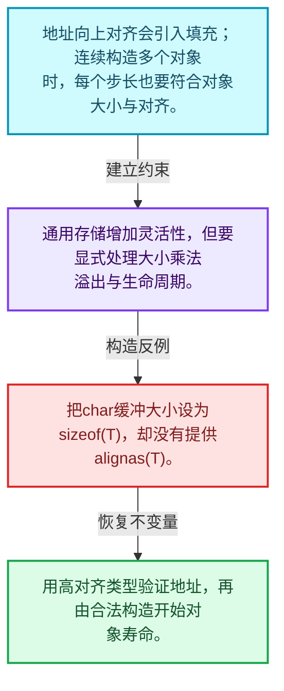
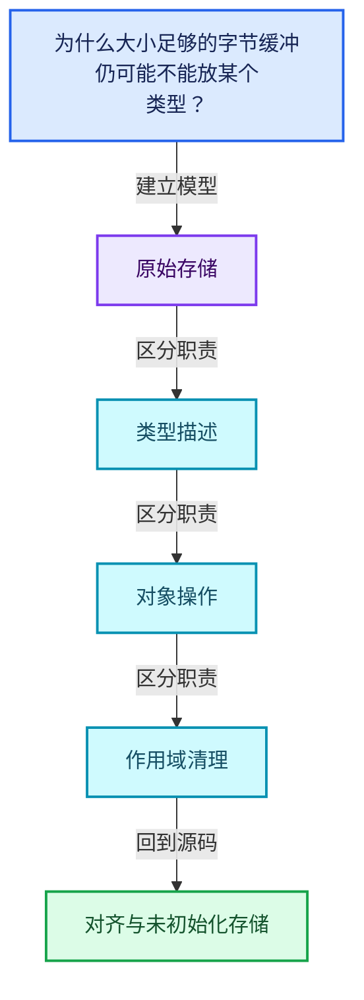
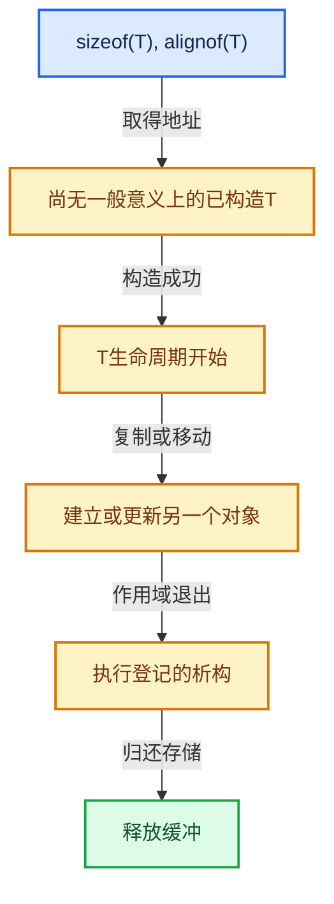

# 03-01 对齐与未初始化存储

[方向导航](README.md) · [总目录](../README.md) · [覆盖索引](../%E6%BA%90%E7%A0%81%E7%89%88%E6%9C%AC%E4%B8%8E%E8%A6%86%E7%9B%96%E7%B4%A2%E5%BC%95.md)

> 阅读顺序：问题与数据模型 → 语法与类型 → 源码逐行 → 调用线索 → 历史与取舍 → 推演和练习。

- 基准 HEAD：`cbda6b96c26c0dee3c3b5cbb93960c4ac06a6b30`。
- 记录日期：2026-10-14。
- 教学示例状态：正文中的推演不是本机性能实测；已运行练习见验收报告。

## 一、从问题到设计

为什么大小足够的字节缓冲仍可能不能放某个类型？

对象地址必须满足对齐，且对象生命周期必须合法开始；字节复制不能替代所有非平凡类型的构造。

本篇把语法、数据语义和系统取舍连接起来。把存储分配、对象构造、类型操作和最终清理拆开建模。

### 本篇独立模型与设计推理

地址向上对齐会引入填充；连续构造多个对象时，每个步长也要符合对象大小与对齐。

设计取舍：通用存储增加灵活性，但要显式处理大小乘法溢出与生命周期。

最小反例：把char缓冲大小设为sizeof(T)，却没有提供alignas(T)。

推导与处理：用高对齐类型验证地址，再由合法构造开始对象寿命。



### 源码范围与相邻篇章

| 文件 | 本篇逐行范围 | 基准SHA-256 |
|---|---|---|
| [source/blender/blenlib/BLI_memory_utils.hh](../../../../../source/blender/blenlib/BLI_memory_utils.hh) | L185—L372 | `042c4aefc749efe05b7e82142a29aff4443ee10cab696ced315e8f0ae124cb23` |

同一主讲文件可能分多篇覆盖；超出本篇范围的符号通过覆盖索引定位。空行与纯注释保留在源码摘录中，逐行表解释有效语句与语法边界；许可证头统一保留。

后篇：[LinearAllocator布局](02-LinearAllocator%E5%B8%83%E5%B1%80.md).

## 二、类型、数据与阅读地图



这是概念依赖图，边表示阅读关系，不声称是运行时调用顺序。

### 直接编译依赖


箭头只表示头文件包含关系；完整调用线索见后面的符号定位表。

## 三、关键词、语法与类型角色

### 模板 template

模板把类型或常量作为生成实现的参数。读声明时先列出类型参数、非类型参数和默认值，再看使用者实际实例化了什么。模板声明本身不意味着每种T都支持其全部成员。

具体检查：把T替换为int、string、只能移动的类型，分别检查每个被调用操作是否成立。

### 依赖名称 typename

typename既可引入类型模板参数，也可告诉编译器某个依赖名称是类型。它不创建运行时对象；解析期确认语法类别与实例化期检查具体类型是不同阶段。

具体检查：区分typename T::value_type和T::size()，前者标记类型，后者是表达式。

### 常量求值 constexpr

constexpr声明允许相应实体参与常量求值，但constexpr函数仍可以在运行时执行。是否常量求值由调用场景和表达式合法性共同决定。

具体检查：比较constexpr变量初始化和从运行时输入调用同一函数。

### 只读限定 const

const约束当前访问路径可做的修改。const指针、指向const的指针、const视图对象、const元素是不同位置的限定；其他别名可能仍可修改原对象。

具体检查：分别写T* const、const T*与const T* const，并画出不可修改的层次。

### 移动转换 std::move

std::move把表达式转换为可供移动重载选择的值类别，实际资源转移发生在被选中的构造或赋值中。对const对象move可能仍调用复制，对视图move也不会获得底层数据所有权。

具体检查：记录移动构造调用次数，不用变量名或std::move的出现次数替代测量。

### 异常约定 noexcept

noexcept表达式可以依赖类型特征。违反不抛异常约定会终止程序；它不是自动捕获异常，也不是资源回滚代码。

具体检查：找出声明的条件与实际可能抛出的分配、构造操作是否一致。

### 异常边界 try与catch

try定义异常传播的局部边界。失败路径需要销毁已经成功构造的部分并释放相应存储；未构造的对象不能被析构。

具体检查：在第k次构造失败，列出已经存在的对象集合与待释放缓冲。

### 显式静态转换 static_cast

static_cast表达编译期允许的转换，不会自动验证运行时真实类型、指针寿命或索引边界。由void指针恢复T指针时，调用者仍须保证实际存储中确有合法T对象。

具体检查：标出转换前后的类型以及正确性依据来自哪里。

### 构造与new表达式

普通new可能分配并构造；placement new在给定地址构造，存储由其他机制提供。失败回滚应区分两类责任。

具体检查：追踪地址来自哪里、构造何时成功、由谁析构、由谁释放。

### 编译期分支 if constexpr

条件在实例化时决定被保留的分支，这常用于不同类型的合法操作选择。它与运行时if有不同的实例化检查规则。

具体检查：找出每个分支依赖哪些类型特征，再使用满足与不满足条件的类型。

## 四、真实源码与逐行讲解

源码块保持原行内容，原始行号由小节标题及逐行表给出。表中的调用定位是静态阅读辅助；重载、模板实例化、宏展开和虚调用需结合完整声明，不能仅凭词法出现证明动态调用。

### BLI_memory_utils.hh：L185—L234

<!-- source:source/blender/blenlib/BLI_memory_utils.hh:185:234 -->

```cpp

  operator const T *() const
  {
    return static_cast<const T *>(buffer_.ptr());
  }

  T &operator*()
  {
    return *static_cast<T *>(buffer_.ptr());
  }

  const T &operator*() const
  {
    return *static_cast<const T *>(buffer_.ptr());
  }

  T *ptr()
  {
    return static_cast<T *>(buffer_.ptr());
  }

  const T *ptr() const
  {
    return static_cast<const T *>(buffer_.ptr());
  }

  T &ref()
  {
    return *static_cast<T *>(buffer_.ptr());
  }

  const T &ref() const
  {
    return *static_cast<const T *>(buffer_.ptr());
  }
};

/**
 * This can be used by container constructors. A parameter of this type should be used to indicate
 * that the constructor does not construct the elements.
 */
class NoInitialization {};

/**
 * This can be used to mark a constructor of an object that does not throw exceptions. Other
 * constructors can delegate to this constructor to make sure that the object lifetime starts.
 * With this, the destructor of the object will be called, even when the remaining constructor
 * throws.
 */
class NoExceptConstructor {};
```

| 原始行 | 语义、约束与检查 |
|---|---|
| L186 | 运算符重载声明、定义或显式调用：`operator const T *() const`。结合参数和返回类型判断是赋值、索引、比较还是转换；operator=声明中的等号不是在给名为operator的变量赋值。 |
| L187 | 连接上一行的声明或控制结构与其语句块；后续行在这个作用域中执行或声明。 |
| L188 | 返回表达式 `static_cast<const T *>(buffer_.ptr())`。 |
| L189 | 结束当前语法单元。局部自动对象在离开其作用域时按规则销毁；这不等于所有被引用的外部数据也被释放。 |
| L191 | 运算符重载声明、定义或显式调用：`T &operator*()`。结合参数和返回类型判断是赋值、索引、比较还是转换；operator=声明中的等号不是在给名为operator的变量赋值。 |
| L192 | 连接上一行的声明或控制结构与其语句块；后续行在这个作用域中执行或声明。 |
| L193 | 返回表达式 `*static_cast<T *>(buffer_.ptr())`。 |
| L194 | 结束当前语法单元。局部自动对象在离开其作用域时按规则销毁；这不等于所有被引用的外部数据也被释放。 |
| L196 | 运算符重载声明、定义或显式调用：`const T &operator*() const`。结合参数和返回类型判断是赋值、索引、比较还是转换；operator=声明中的等号不是在给名为operator的变量赋值。 |
| L197 | 连接上一行的声明或控制结构与其语句块；后续行在这个作用域中执行或声明。 |
| L198 | 返回表达式 `*static_cast<const T *>(buffer_.ptr())`。 |
| L199 | 结束当前语法单元。局部自动对象在离开其作用域时按规则销毁；这不等于所有被引用的外部数据也被释放。 |
| L201 | 出现调用或函数声明 `ptr`，对应表达式为 `T *ptr()`。参数求值、返回类型与重载需结合前后完整语句；静态文本引用不能证明动态目标。 |
| L202 | 连接上一行的声明或控制结构与其语句块；后续行在这个作用域中执行或声明。 |
| L203 | 返回表达式 `static_cast<T *>(buffer_.ptr())`。 |
| L204 | 结束当前语法单元。局部自动对象在离开其作用域时按规则销毁；这不等于所有被引用的外部数据也被释放。 |
| L206 | 出现调用或函数声明 `ptr`，对应表达式为 `const T *ptr() const`。参数求值、返回类型与重载需结合前后完整语句；静态文本引用不能证明动态目标。 |
| L207 | 连接上一行的声明或控制结构与其语句块；后续行在这个作用域中执行或声明。 |
| L208 | 返回表达式 `static_cast<const T *>(buffer_.ptr())`。 |
| L209 | 结束当前语法单元。局部自动对象在离开其作用域时按规则销毁；这不等于所有被引用的外部数据也被释放。 |
| L211 | 出现调用或函数声明 `ref`，对应表达式为 `T &ref()`。参数求值、返回类型与重载需结合前后完整语句；静态文本引用不能证明动态目标。 |
| L212 | 连接上一行的声明或控制结构与其语句块；后续行在这个作用域中执行或声明。 |
| L213 | 返回表达式 `*static_cast<T *>(buffer_.ptr())`。 |
| L214 | 结束当前语法单元。局部自动对象在离开其作用域时按规则销毁；这不等于所有被引用的外部数据也被释放。 |
| L216 | 出现调用或函数声明 `ref`，对应表达式为 `const T &ref() const`。参数求值、返回类型与重载需结合前后完整语句；静态文本引用不能证明动态目标。 |
| L217 | 连接上一行的声明或控制结构与其语句块；后续行在这个作用域中执行或声明。 |
| L218 | 返回表达式 `*static_cast<const T *>(buffer_.ptr())`。 |
| L219 | 结束当前语法单元。局部自动对象在离开其作用域时按规则销毁；这不等于所有被引用的外部数据也被释放。 |
| L220 | 结束当前语法单元。局部自动对象在离开其作用域时按规则销毁；这不等于所有被引用的外部数据也被释放。 |
| L226 | 声明或定义类型 `class NoInitialization {}`。结合继承、访问权限和成员布局确认接口与拥有关系；前向声明本身没有完整对象布局。 |
| L234 | 声明或定义类型 `class NoExceptConstructor {}`。结合继承、访问权限和成员布局确认接口与拥有关系；前向声明本身没有完整对象布局。 |

### BLI_memory_utils.hh：L235—L277

<!-- source:source/blender/blenlib/BLI_memory_utils.hh:235:277 -->

```cpp

/**
 * Helper variable that checks if a pointer type can be converted into another pointer type without
 * issues. Possible issues are casting away const and casting a pointer to a child class.
 * Adding const or casting to a parent class is fine.
 */
template<typename From, typename To>
inline constexpr bool is_convertible_pointer_v = std::is_convertible_v<From, To> &&
                                                 std::is_pointer_v<From> && std::is_pointer_v<To>;

/**
 * Helper variable that checks if a Span<From> can be converted to Span<To> safely, whereby From
 * and To are pointers. Adding const and casting to a void pointer is allowed.
 * Casting up and down a class hierarchy generally is not allowed, because this might change the
 * pointer under some circumstances.
 */
template<typename From, typename To>
inline constexpr bool is_span_convertible_pointer_v =
    /* Make sure we are working with pointers. */
    std::is_pointer_v<From> && std::is_pointer_v<To> &&
    (/* No casting is necessary when both types are the same. */
     std::is_same_v<From, To> ||
     /* Allow adding const to the underlying type. */
     std::is_same_v<std::remove_pointer_t<From>, std::remove_const_t<std::remove_pointer_t<To>>> ||
     /* Allow casting non-const pointers to void pointers. */
     (!std::is_const_v<std::remove_pointer_t<From>> && std::is_same_v<To, void *>) ||
     /* Allow casting any pointer to const void pointers. */
     std::is_same_v<To, const void *>);

/**
 * Same as #std::is_same_v but allows for checking multiple types at the same time.
 */
template<typename T, typename... Args>
inline constexpr bool is_same_any_v = (std::is_same_v<T, Args> || ...);

/**
 * Inline buffers for small-object-optimization should be disabled by default for large objects.
 * Otherwise we might get large unexpected allocations on the stack.
 */
constexpr int64_t default_inline_buffer_capacity(size_t element_size)
{
  return (int64_t(element_size) < 100) ? 4 : 0;
}
```

| 原始行 | 语义、约束与检查 |
|---|---|
| L241 | 声明模板参数 `template<typename From, typename To>`。类型参数决定生成操作的类型，非类型参数可决定内嵌容量或编译期分支。 |
| L242 | 把右侧 `std::is_convertible_v<From, To> &&` 用于初始化或更新左侧 `inline constexpr bool is_convertible_pointer_v`。声明初始化与已有对象赋值应按上下文区分；有资源的类型会调用相应特殊成员。 |
| L243 | 声明成员、局部对象或完成语句 `std::is_pointer_v<From> && std::is_pointer_v<To>`。若为指针或引用，它本身不说明拥有；若为值对象，其构造析构由所在作用域或外层对象管理。 |
| L251 | 声明模板参数 `template<typename From, typename To>`。类型参数决定生成操作的类型，非类型参数可决定内嵌容量或编译期分支。 |
| L252 | 把右侧 `` 用于初始化或更新左侧 `inline constexpr bool is_span_convertible_pointer_v`。声明初始化与已有对象赋值应按上下文区分；有资源的类型会调用相应特殊成员。 |
| L254 | 本行是连续声明或表达式的一部分：`std::is_pointer_v<From> && std::is_pointer_v<To> &&`。与本段前后行合读；逗号、括号和限定符决定它属于参数、初始化列表还是实际计算。 |
| L255 | 本行是连续声明或表达式的一部分：`(`。与本段前后行合读；逗号、括号和限定符决定它属于参数、初始化列表还是实际计算。 |
| L256 | 本行是连续声明或表达式的一部分：`std::is_same_v<From, To> &#124;&#124;`。与本段前后行合读；逗号、括号和限定符决定它属于参数、初始化列表还是实际计算。 |
| L258 | 本行是连续声明或表达式的一部分：`std::is_same_v<std::remove_pointer_t<From>, std::remove_const_t<std::remove_pointer_t<To>>> &#124;&#124;`。与本段前后行合读；逗号、括号和限定符决定它属于参数、初始化列表还是实际计算。 |
| L260 | 本行是连续声明或表达式的一部分：`(!std::is_const_v<std::remove_pointer_t<From>> && std::is_same_v<To, void *>) &#124;&#124;`。与本段前后行合读；逗号、括号和限定符决定它属于参数、初始化列表还是实际计算。 |
| L262 | 声明成员、局部对象或完成语句 `std::is_same_v<To, const void *>)`。若为指针或引用，它本身不说明拥有；若为值对象，其构造析构由所在作用域或外层对象管理。 |
| L267 | 声明模板参数 `template<typename T, typename... Args>`。类型参数决定生成操作的类型，非类型参数可决定内嵌容量或编译期分支。 |
| L268 | 把右侧 `(std::is_same_v<T, Args> &#124;&#124; ...)` 用于初始化或更新左侧 `inline constexpr bool is_same_any_v`。声明初始化与已有对象赋值应按上下文区分；有资源的类型会调用相应特殊成员。 |
| L274 | 出现调用或函数声明 `default_inline_buffer_capacity`，对应表达式为 `constexpr int64_t default_inline_buffer_capacity(size_t element_size)`。参数求值、返回类型与重载需结合前后完整语句；静态文本引用不能证明动态目标。 |
| L275 | 连接上一行的声明或控制结构与其语句块；后续行在这个作用域中执行或声明。 |
| L276 | 返回表达式 `(int64_t(element_size) < 100) ? 4 : 0`。 |
| L277 | 结束当前语法单元。局部自动对象在离开其作用域时按规则销毁；这不等于所有被引用的外部数据也被释放。 |

### BLI_memory_utils.hh：L278—L322

<!-- source:source/blender/blenlib/BLI_memory_utils.hh:278:322 -->

```cpp

/**
 * This can be used by containers to implement an exception-safe copy-assignment-operator.
 * It assumes that the container has an exception safe copy constructor and an exception-safe
 * move-assignment-operator.
 */
template<typename Container> Container &copy_assign_container(Container &dst, const Container &src)
{
  if (&src == &dst) {
    return dst;
  }

  Container container_copy{src};
  dst = std::move(container_copy);
  return dst;
}

/**
 * This can be used by containers to implement an exception-safe move-assignment-operator.
 * It assumes that the container has an exception-safe move-constructor and a noexcept constructor
 * tagged with the NoExceptConstructor tag.
 */
template<typename Container>
Container &move_assign_container(Container &dst, Container &&src) noexcept(
    std::is_nothrow_move_constructible_v<Container>)
{
  if (&dst == &src) {
    return dst;
  }

  dst.~Container();
  if constexpr (std::is_nothrow_move_constructible_v<Container>) {
    new (&dst) Container(std::move(src));
  }
  else {
    try {
      new (&dst) Container(std::move(src));
    }
    catch (...) {
      new (&dst) Container(NoExceptConstructor());
      throw;
    }
  }
  return dst;
}
```

本段语义重点：

- 分支证据 `&src == &dst)`：分别推演条件成立与不成立，核对相同出口处的状态。
- 分支证据 `&dst == &src)`：分别推演条件成立与不成立，核对相同出口处的状态。

| 原始行 | 语义、约束与检查 |
|---|---|
| L284 | 声明模板参数 `template<typename Container> Container &copy_assign_container(Container &dst, const Container &src)`。类型参数决定生成操作的类型，非类型参数可决定内嵌容量或编译期分支。 |
| L285 | 连接上一行的声明或控制结构与其语句块；后续行在这个作用域中执行或声明。 |
| L286 | 判断 `&src == &dst`，成立时进入本分支，否则继续后续路径。 |
| L287 | 返回表达式 `dst`。结合函数声明检查返回值是否借用原存储，借用值不会自动延长其寿命。 |
| L288 | 结束当前语法单元。局部自动对象在离开其作用域时按规则销毁；这不等于所有被引用的外部数据也被释放。 |
| L290 | 声明成员、局部对象或完成语句 `Container container_copy{src}`。若为指针或引用，它本身不说明拥有；若为值对象，其构造析构由所在作用域或外层对象管理。 |
| L291 | 把右侧 `std::move(container_copy)` 用于初始化或更新左侧 `dst`。声明初始化与已有对象赋值应按上下文区分；有资源的类型会调用相应特殊成员。 |
| L292 | 返回表达式 `dst`。 |
| L293 | 结束当前语法单元。局部自动对象在离开其作用域时按规则销毁；这不等于所有被引用的外部数据也被释放。 |
| L300 | 声明模板参数 `template<typename Container>`。类型参数决定生成操作的类型，非类型参数可决定内嵌容量或编译期分支。 |
| L301 | 出现调用或函数声明 `move_assign_container`，对应表达式为 `Container &move_assign_container(Container &dst, Container &&src) noexcept(`。参数求值、返回类型与重载需结合前后完整语句；静态文本引用不能证明动态目标。 |
| L302 | 本行是连续声明或表达式的一部分：`std::is_nothrow_move_constructible_v<Container>)`。与本段前后行合读；逗号、括号和限定符决定它属于参数、初始化列表还是实际计算。 |
| L303 | 连接上一行的声明或控制结构与其语句块；后续行在这个作用域中执行或声明。 |
| L304 | 判断 `&dst == &src`，成立时进入本分支，否则继续后续路径。 |
| L305 | 返回表达式 `dst`。结合函数声明检查返回值是否借用原存储，借用值不会自动延长其寿命。 |
| L306 | 结束当前语法单元。局部自动对象在离开其作用域时按规则销毁；这不等于所有被引用的外部数据也被释放。 |
| L308 | 涉及析构接口或显式析构：`dst.~Container();`。检查目标对象已成功构造，且资源不会在另一条清理路径再次销毁。 |
| L309 | 编译期条件分支 `if constexpr (std::is_nothrow_move_constructible_v<Container>)`。按实例化类型选择相应实现；被舍弃分支和运行期if具有不同检查规则，不能当作运行时输入验证。 |
| L310 | 出现调用或函数声明 `new`，对应表达式为 `new (&dst) Container(std::move(src));`。参数求值、返回类型与重载需结合前后完整语句；静态文本引用不能证明动态目标。 |
| L311 | 结束当前语法单元。局部自动对象在离开其作用域时按规则销毁；这不等于所有被引用的外部数据也被释放。 |
| L312 | 处理前一条件不成立的互补路径。比较两条路径最后是否恢复同一不变量，以及是否产生不同的资源责任。 |
| L313 | 开始可能抛异常的操作区间；下面catch负责局部回滚，需精确区分已经构造和尚未构造对象。 |
| L314 | 出现调用或函数声明 `new`，对应表达式为 `new (&dst) Container(std::move(src));`。参数求值、返回类型与重载需结合前后完整语句；静态文本引用不能证明动态目标。 |
| L315 | 结束当前语法单元。局部自动对象在离开其作用域时按规则销毁；这不等于所有被引用的外部数据也被释放。 |
| L316 | 进入异常清理路径；随后应释放本路径新取得的资源，同时遵守源对象已经发生的状态变化。 |
| L317 | 出现调用或函数声明 `new`，对应表达式为 `new (&dst) Container(NoExceptConstructor());`。参数求值、返回类型与重载需结合前后完整语句；静态文本引用不能证明动态目标。 |
| L318 | 继续传播异常或抛出新异常；在执行前必须完成本层负责的资源清理。 |
| L319 | 结束当前语法单元。局部自动对象在离开其作用域时按规则销毁；这不等于所有被引用的外部数据也被释放。 |
| L320 | 结束当前语法单元。局部自动对象在离开其作用域时按规则销毁；这不等于所有被引用的外部数据也被释放。 |
| L321 | 返回表达式 `dst`。 |
| L322 | 结束当前语法单元。局部自动对象在离开其作用域时按规则销毁；这不等于所有被引用的外部数据也被释放。 |

### BLI_memory_utils.hh：L323—L372

<!-- source:source/blender/blenlib/BLI_memory_utils.hh:323:372 -->

```cpp

/**
 * Returns true if the value is different and was assigned.
 */
template<typename T> inline bool assign_if_different(T &old_value, T &&new_value)
{
  if (old_value != new_value) {
    old_value = std::move(new_value);
    return true;
  }
  return false;
}
template<typename T> inline bool assign_if_different(T &old_value, const T &new_value)
{
  if (old_value != new_value) {
    old_value = new_value;
    return true;
  }
  return false;
}

namespace blenlib_detail {

template<typename Func> struct ScopedDeferHelper {
  Func func;

  ~ScopedDeferHelper()
  {
    func();
  }
};

}  // namespace blenlib_detail

#define BLI_SCOPED_DEFER_NAME1(a, b) a##b
#define BLI_SCOPED_DEFER_NAME2(a, b) BLI_SCOPED_DEFER_NAME1(a, b)
#define BLI_SCOPED_DEFER_NAME(a) BLI_SCOPED_DEFER_NAME2(_scoped_defer_##a##_, __LINE__)

/**
 * Execute the given function when the current scope ends. This can be used to cheaply implement
 * some RAII-like behavior for C types that don't support it. Long term, the types we want to use
 * this with should either be converted to C++ or get a proper C++ API. Until then, this function
 * can help avoid common resource leakages.
 */
#define BLI_SCOPED_DEFER(function_to_defer) \
  auto BLI_SCOPED_DEFER_NAME(func) = (function_to_defer); \
  blenlib_detail::ScopedDeferHelper<decltype(BLI_SCOPED_DEFER_NAME(func))> BLI_SCOPED_DEFER_NAME( \
      helper){std::move(BLI_SCOPED_DEFER_NAME(func))};

}  // namespace blender
```

本段语义重点：

- 分支证据 `old_value != new_value)`：分别推演条件成立与不成立，核对相同出口处的状态。
- 分支证据 `old_value != new_value)`：分别推演条件成立与不成立，核对相同出口处的状态。

| 原始行 | 语义、约束与检查 |
|---|---|
| L327 | 声明模板参数 `template<typename T> inline bool assign_if_different(T &old_value, T &&new_value)`。类型参数决定生成操作的类型，非类型参数可决定内嵌容量或编译期分支。 |
| L328 | 连接上一行的声明或控制结构与其语句块；后续行在这个作用域中执行或声明。 |
| L329 | 判断 `old_value != new_value`，成立时进入本分支，否则继续后续路径。 |
| L330 | 把右侧 `std::move(new_value)` 用于初始化或更新左侧 `old_value`。声明初始化与已有对象赋值应按上下文区分；有资源的类型会调用相应特殊成员。 |
| L331 | 返回表达式 `true`。这是本路径的布尔结果，具体成功、存在或状态含义由函数接口规定。 |
| L332 | 结束当前语法单元。局部自动对象在离开其作用域时按规则销毁；这不等于所有被引用的外部数据也被释放。 |
| L333 | 返回表达式 `false`。这是本路径的布尔结果，具体成功、存在或状态含义由函数接口规定。 |
| L334 | 结束当前语法单元。局部自动对象在离开其作用域时按规则销毁；这不等于所有被引用的外部数据也被释放。 |
| L335 | 声明模板参数 `template<typename T> inline bool assign_if_different(T &old_value, const T &new_value)`。类型参数决定生成操作的类型，非类型参数可决定内嵌容量或编译期分支。 |
| L336 | 连接上一行的声明或控制结构与其语句块；后续行在这个作用域中执行或声明。 |
| L337 | 判断 `old_value != new_value`，成立时进入本分支，否则继续后续路径。 |
| L338 | 把右侧 `new_value` 用于初始化或更新左侧 `old_value`。声明初始化与已有对象赋值应按上下文区分；有资源的类型会调用相应特殊成员。 |
| L339 | 返回表达式 `true`。这是本路径的布尔结果，具体成功、存在或状态含义由函数接口规定。 |
| L340 | 结束当前语法单元。局部自动对象在离开其作用域时按规则销毁；这不等于所有被引用的外部数据也被释放。 |
| L341 | 返回表达式 `false`。这是本路径的布尔结果，具体成功、存在或状态含义由函数接口规定。 |
| L342 | 结束当前语法单元。局部自动对象在离开其作用域时按规则销毁；这不等于所有被引用的外部数据也被释放。 |
| L344 | 把后续声明放入 blenlib_detail 命名空间，影响名称查找和符号归属，不创建运行时对象。 |
| L346 | 声明模板参数 `template<typename Func> struct ScopedDeferHelper {`。类型参数决定生成操作的类型，非类型参数可决定内嵌容量或编译期分支。 |
| L347 | 声明成员、局部对象或完成语句 `Func func`。若为指针或引用，它本身不说明拥有；若为值对象，其构造析构由所在作用域或外层对象管理。 |
| L349 | 涉及析构接口或显式析构：`~ScopedDeferHelper()`。检查目标对象已成功构造，且资源不会在另一条清理路径再次销毁。 |
| L350 | 连接上一行的声明或控制结构与其语句块；后续行在这个作用域中执行或声明。 |
| L351 | 出现调用或函数声明 `func`，对应表达式为 `func();`。参数求值、返回类型与重载需结合前后完整语句；静态文本引用不能证明动态目标。 |
| L352 | 结束当前语法单元。局部自动对象在离开其作用域时按规则销毁；这不等于所有被引用的外部数据也被释放。 |
| L353 | 结束当前语法单元。局部自动对象在离开其作用域时按规则销毁；这不等于所有被引用的外部数据也被释放。 |
| L355 | 结束当前语法单元。局部自动对象在离开其作用域时按规则销毁；这不等于所有被引用的外部数据也被释放。 |
| L357 | 预处理阶段处理 #define BLI_SCOPED_DEFER_NAME1(a, b) a##b。它决定哪些代码进入编译，不是运行时分支；阅读行为时必须结合实际构建宏。 |
| L358 | 预处理阶段处理 #define BLI_SCOPED_DEFER_NAME2(a, b) BLI_SCOPED_DEFER_NAME1(a, b)。它决定哪些代码进入编译，不是运行时分支；阅读行为时必须结合实际构建宏。 |
| L359 | 预处理阶段处理 #define BLI_SCOPED_DEFER_NAME(a) BLI_SCOPED_DEFER_NAME2(_scoped_defer_##a##_, __LINE__)。它决定哪些代码进入编译，不是运行时分支；阅读行为时必须结合实际构建宏。 |
| L367 | 预处理阶段处理 #define BLI_SCOPED_DEFER(function_to_defer) \。它决定哪些代码进入编译，不是运行时分支；阅读行为时必须结合实际构建宏。 |
| L368 | 把右侧 `(function_to_defer); \` 用于初始化或更新左侧 `auto BLI_SCOPED_DEFER_NAME(func)`。声明初始化与已有对象赋值应按上下文区分；有资源的类型会调用相应特殊成员。 |
| L369 | 出现调用或函数声明 `decltype`，对应表达式为 `blenlib_detail::ScopedDeferHelper<decltype(BLI_SCOPED_DEFER_NAME(func))> BLI_SCOPED_DEFER_NAME( \`。参数求值、返回类型与重载需结合前后完整语句；静态文本引用不能证明动态目标。 |
| L370 | 出现调用或函数声明 `std::move`，对应表达式为 `helper){std::move(BLI_SCOPED_DEFER_NAME(func))};`。参数求值、返回类型与重载需结合前后完整语句；静态文本引用不能证明动态目标。 |
| L372 | 结束当前语法单元。局部自动对象在离开其作用域时按规则销毁；这不等于所有被引用的外部数据也被释放。 |

## 五、接口定位、调用线索与生命周期

### 本篇声明与实现入口

| 源码位置 | 实际声明片段 |
|---|---|
| [BLI_memory_utils.hh:L201](../../../../../source/blender/blenlib/BLI_memory_utils.hh#L201) | `T *ptr()` |
| [BLI_memory_utils.hh:L206](../../../../../source/blender/blenlib/BLI_memory_utils.hh#L206) | `const T *ptr() const` |
| [BLI_memory_utils.hh:L211](../../../../../source/blender/blenlib/BLI_memory_utils.hh#L211) | `T &ref()` |
| [BLI_memory_utils.hh:L216](../../../../../source/blender/blenlib/BLI_memory_utils.hh#L216) | `const T &ref() const` |
| [BLI_memory_utils.hh:L226](../../../../../source/blender/blenlib/BLI_memory_utils.hh#L226) | `class NoInitialization {};` |
| [BLI_memory_utils.hh:L234](../../../../../source/blender/blenlib/BLI_memory_utils.hh#L234) | `class NoExceptConstructor {};` |
| [BLI_memory_utils.hh:L274](../../../../../source/blender/blenlib/BLI_memory_utils.hh#L274) | `constexpr int64_t default_inline_buffer_capacity(size_t element_size)` |
| [BLI_memory_utils.hh:L284](../../../../../source/blender/blenlib/BLI_memory_utils.hh#L284) | `template<typename Container> Container &copy_assign_container(Container &dst, const Container &src)` |
| [BLI_memory_utils.hh:L301](../../../../../source/blender/blenlib/BLI_memory_utils.hh#L301) | `Container &move_assign_container(Container &dst, Container &&src) noexcept(` |
| [BLI_memory_utils.hh:L327](../../../../../source/blender/blenlib/BLI_memory_utils.hh#L327) | `template<typename T> inline bool assign_if_different(T &old_value, T &&new_value)` |
| [BLI_memory_utils.hh:L335](../../../../../source/blender/blenlib/BLI_memory_utils.hh#L335) | `template<typename T> inline bool assign_if_different(T &old_value, const T &new_value)` |
| [BLI_memory_utils.hh:L346](../../../../../source/blender/blenlib/BLI_memory_utils.hh#L346) | `template<typename Func> struct ScopedDeferHelper` |
| [BLI_memory_utils.hh:L368](../../../../../source/blender/blenlib/BLI_memory_utils.hh#L368) | `auto BLI_SCOPED_DEFER_NAME(func) = (function_to_defer); \` |

### 同名符号出现位置

以下表提供跨文件阅读入口，包含声明、调用或测试使用；没有经过完整C++名称解析，不把它命名为已证明的运行时调用图。

| 符号 | 位置 | 文本证据 |
|---|---|---|
| `ptr` | [BLI_any.hh:L174](../../../../../source/blender/blenlib/BLI_any.hh#L174) | `std::copy_n(static_cast<const std::byte *>(other.buffer_.ptr()),` |
| `ptr` | [BLI_any.hh:L176](../../../../../source/blender/blenlib/BLI_any.hh#L176) | `static_cast<std::byte *>(buffer_.ptr()));` |
| `ptr` | [BLI_any.hh:L192](../../../../../source/blender/blenlib/BLI_any.hh#L192) | `std::copy_n(static_cast<const std::byte *>(other.buffer_.ptr()),` |
| `ref` | [BLI_cpp_type.hh:L488](../../../../../source/blender/blenlib/BLI_cpp_type.hh#L488) | `const CPPType &type = detail::cpp_type_impl<DecayT>.ref();` |
| `ref` | [BLI_map_slots.hh:L75](../../../../../source/blender/blenlib/BLI_map_slots.hh#L75) | `key_buffer_.ref().~Key();` |
| `ref` | [BLI_map_slots.hh:L76](../../../../../source/blender/blenlib/BLI_map_slots.hh#L76) | `value_buffer_.ref().~Value();` |
| `default_inline_buffer_capacity` | [BLI_array.hh:L44](../../../../../source/blender/blenlib/BLI_array.hh#L44) | `int64_t InlineBufferCapacity = default_inline_buffer_capacity(sizeof(T)),` |
| `default_inline_buffer_capacity` | [BLI_map.hh:L102](../../../../../source/blender/blenlib/BLI_map.hh#L102) | `int64_t InlineBufferCapacity = default_inline_buffer_capacity(sizeof(Key) + sizeof(Value)),` |
| `default_inline_buffer_capacity` | [BLI_map.hh:L1374](../../../../../source/blender/blenlib/BLI_map.hh#L1374) | `int64_t InlineBufferCapacity = default_inline_buffer_capacity(sizeof(Key) +` |
| `copy_assign_container` | [BLI_array.hh:L208](../../../../../source/blender/blenlib/BLI_array.hh#L208) | `return copy_assign_container(*this, other);` |
| `copy_assign_container` | [BLI_bit_vector.hh:L177](../../../../../source/blender/blenlib/BLI_bit_vector.hh#L177) | `return copy_assign_container(*this, other);` |
| `copy_assign_container` | [BLI_generic_array.hh:L130](../../../../../source/blender/blenlib/BLI_generic_array.hh#L130) | `return copy_assign_container(*this, other);` |
| `move_assign_container` | [BLI_array.hh:L213](../../../../../source/blender/blenlib/BLI_array.hh#L213) | `return move_assign_container(*this, std::move(other));` |
| `move_assign_container` | [BLI_bit_vector.hh:L182](../../../../../source/blender/blenlib/BLI_bit_vector.hh#L182) | `return move_assign_container(*this, std::move(other));` |
| `move_assign_container` | [BLI_generic_array.hh:L135](../../../../../source/blender/blenlib/BLI_generic_array.hh#L135) | `return move_assign_container(*this, std::move(other));` |

### 生命周期推理图


这是审查生命周期的通用模型。具体类是否拥有数据由本篇成员、构造、析构和调用者一起证明；任何箭头都不自动代表shared_ptr。

## 六、把代码放进具体数据中推演

本方向的共同数值模型如下。本篇的专门检查是：计算不同地址的对齐填充，结合高对齐类型检查分配结果。

| 步骤 | 数据或状态 | 为什么需要这一步 |
|---|---|---|
| 请求存储 | sizeof(T), alignof(T) | 空间和地址都满足类型要求 |
| 取得地址 | 尚无一般意义上的已构造T | 不能先调用T成员 |
| 构造成功 | T生命周期开始 | 登记相应清理责任 |
| 复制或移动 | 建立或更新另一个对象 | 区分初始化和赋值 |
| 作用域退出 | 执行登记的析构 | 只销毁已构造部分 |
| 归还存储 | 释放缓冲 | 与分配器来源匹配 |



图是教学推演模型；精确分支与状态更新以本篇摘录及调用契约为准。

### 本篇独立练习与参考思路

计算不同地址的对齐填充，结合高对齐类型检查分配结果。

参考思路：对象地址必须满足对齐，且对象生命周期必须合法开始；字节复制不能替代所有非平凡类型的构造。

将输入、预期结果和资源责任分成三张清单。先用最直接的实现给出可核对的答案，再替换成对应源码使用的表示；比较结果不变的条件，而不是只比较接口名字。

验收依据：所有存活对象地址满足对齐；构造失败不会被当作成功对象登记；所有资源均有唯一或明确共享的清理责任。

## 七、复杂度、设计取舍与其他基础库

与std::pmr::monotonic_buffer_resource比较批量存储回收，与std::any比较拥有型类型擦除；CPPType描述类型操作，本身不保存每个值。

本篇的具体取舍：对象地址必须满足对齐，且对象生命周期必须合法开始；字节复制不能替代所有非平凡类型的构造。

| 观察维度 | 从源码取得证据的方法 | 本篇要避免的误判 |
|---|---|---|
| 时间 | 对循环次数、分派次数和重建频率分别计数 | 看到单次常数操作就断定整个操作序列是常数成本 |
| 内存 | 区分对象本体、容量存储、间接资源和共享控制块 | 用sizeof代替总内存 |
| 安全 | 沿构造、失败回滚、销毁与失效逐路径检查 | 把断言或非空指针当作完整安全证明 |
| 并发 | 逐字段确认锁、发布顺序和借用寿命 | 把引用计数线程安全等同数据读写线程安全 |

相关一手资料：

- [C++公开工作草案](https://eel.is/c++draft/)：持续更新的工作草案；语言与标准库语义以相应章节为准。
- [LLVM Programmer’s Manual](https://llvm.org/docs/ProgrammersManual.html)：在线版，2026-10-14查阅；仅比较设计思路，不保证与本地LLVM版本一致。

资料用于核对契约和进一步阅读；这里没有声称外部库与Blender实现相同，也没有把上游性能数字当作本机实测。

## 八、历史提交与设计演化

本篇主要讲当前接口或辅助实现，方向导航给出相关架构演化提交；没有把不涉及本篇文件的提交硬写成该实现的引入证据。

## 九、反例、测试入口与掌握标准

仓库测试入口：

- [BLI_memory_utils_test.cc](../../../../../source/blender/blenlib/tests/BLI_memory_utils_test.cc)：阅读输入、断言与覆盖边界；本篇不把“存在测试”写成“本轮已运行”。

需要实际构造的反例：

- 空输入或没有结果需求：确认接口允许的空状态与不允许访问的操作。
- 边界位置和退化结构：把长度为1、末尾位置、重复值或深链代入真实分支。
- 生命周期结束或修改之后：检查保存的指针、引用、结果视图是否仍有效。
- 与本篇核心不变量相冲突的输入：计算不同地址的对齐填充，结合高对齐类型检查分配结果。

### 可运行的教学参考程序

[reference_exercises.cc](../_tools/reference_exercises.cc)包含独立于Blender的C++20参考检查：视图、简化SmallVector、异常回滚、哈希碰撞与删除、偏移数组、拓扑映射、共享缓存、表达式、惰性分支、闭包和暴力最近邻。

参考程序有意省略生产实现的完整能力。例如SmallVector禁止复制移动容器，不支持只能移动的元素，并禁止append参数别名到自身元素；TinyMap固定8槽，不提供增长。程序通过不能替代Blender实现测试。实际运行结果、编译器与命令见验收报告。

掌握标准：离开源码解释“为什么大小足够的字节缓冲仍可能不能放某个类型？”；独立完成上述练习；能指出一个会破坏原始存储相关约束的最小反例，并用具体代码行说明检查或修复应放在哪里。
