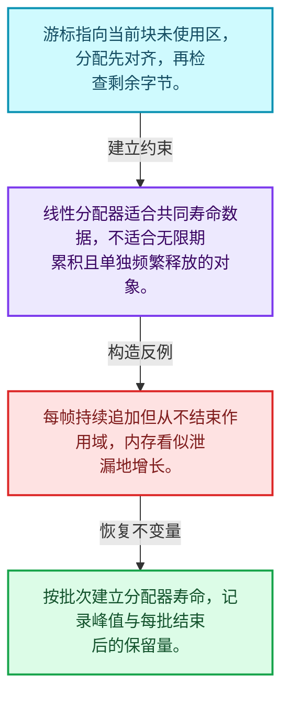
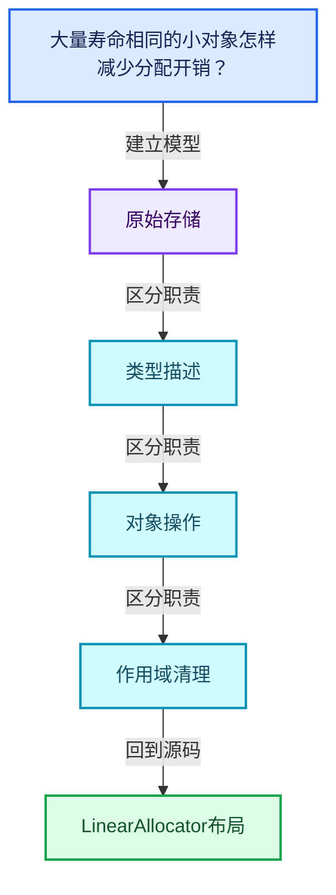
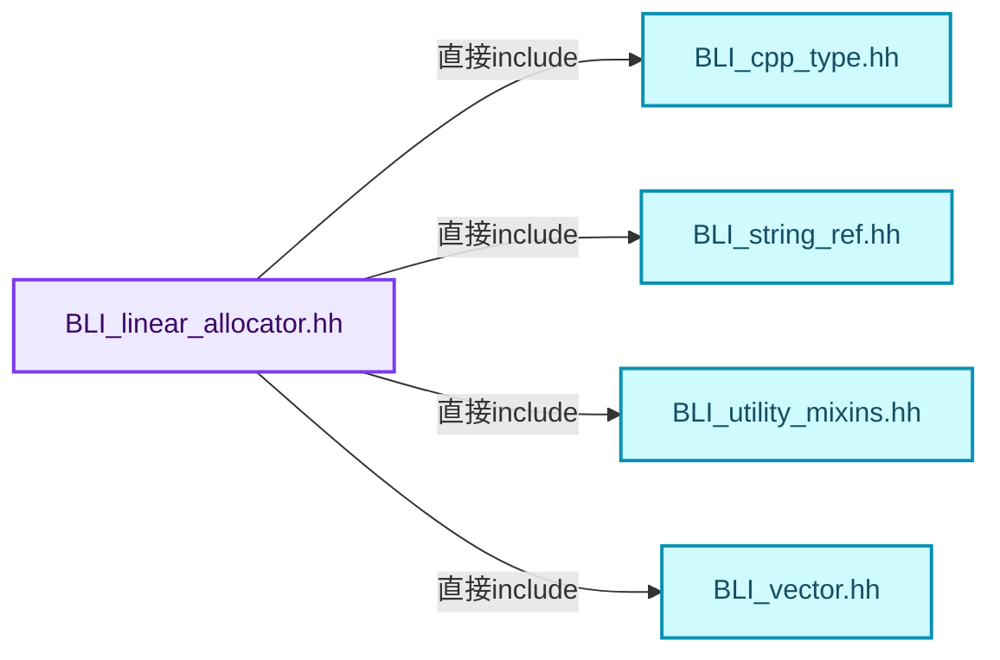
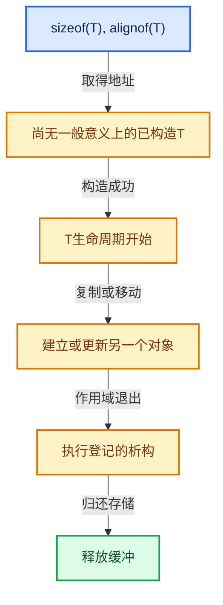

# 03-02 LinearAllocator布局

[方向导航](README.md) · [总目录](../README.md) · [覆盖索引](../%E6%BA%90%E7%A0%81%E7%89%88%E6%9C%AC%E4%B8%8E%E8%A6%86%E7%9B%96%E7%B4%A2%E5%BC%95.md)

> 阅读顺序：问题与数据模型 → 语法与类型 → 源码逐行 → 调用线索 → 历史与取舍 → 推演和练习。

- 基准 HEAD：`cbda6b96c26c0dee3c3b5cbb93960c4ac06a6b30`。
- 记录日期：2026-10-14。
- 教学示例状态：正文中的推演不是本机性能实测；已运行练习见验收报告。

## 一、从问题到设计

大量寿命相同的小对象怎样减少分配开销？

线性分配器从缓冲中推进游标，把单对象释放合并为作用域释放；内存回收与析构责任仍需分开。

本篇把语法、数据语义和系统取舍连接起来。把存储分配、对象构造、类型操作和最终清理拆开建模。

### 本篇独立模型与设计推理

游标指向当前块未使用区，分配先对齐，再检查剩余字节。

设计取舍：线性分配器适合共同寿命数据，不适合无限期累积且单独频繁释放的对象。

最小反例：每帧持续追加但从不结束作用域，内存看似泄漏地增长。

推导与处理：按批次建立分配器寿命，记录峰值与每批结束后的保留量。



### 源码范围与相邻篇章

| 文件 | 本篇逐行范围 | 基准SHA-256 |
|---|---|---|
| [source/blender/blenlib/BLI_linear_allocator.hh](../../../../../source/blender/blenlib/BLI_linear_allocator.hh) | L1—L155 | `95fe936dfa9e937a15dcd1a39d5467118afb35e1de62f96ca6812008eab0264e` |

同一主讲文件可能分多篇覆盖；超出本篇范围的符号通过覆盖索引定位。空行与纯注释保留在源码摘录中，逐行表解释有效语句与语法边界；许可证头统一保留。

前篇：[对齐与未初始化存储](01-%E5%AF%B9%E9%BD%90%E4%B8%8E%E6%9C%AA%E5%88%9D%E5%A7%8B%E5%8C%96%E5%AD%98%E5%82%A8.md).

后篇：[LinearAllocator分配与扩展](03-LinearAllocator%E5%88%86%E9%85%8D%E4%B8%8E%E6%89%A9%E5%B1%95.md).

## 二、类型、数据与阅读地图



这是概念依赖图，边表示阅读关系，不声称是运行时调用顺序。

### 直接编译依赖



箭头只表示头文件包含关系；完整调用线索见后面的符号定位表。

## 三、关键词、语法与类型角色

### 模板 template

模板把类型或常量作为生成实现的参数。读声明时先列出类型参数、非类型参数和默认值，再看使用者实际实例化了什么。模板声明本身不意味着每种T都支持其全部成员。

具体检查：把T替换为int、string、只能移动的类型，分别检查每个被调用操作是否成立。

### 依赖名称 typename

typename既可引入类型模板参数，也可告诉编译器某个依赖名称是类型。它不创建运行时对象；解析期确认语法类别与实例化期检查具体类型是不同阶段。

具体检查：区分typename T::value_type和T::size()，前者标记类型，后者是表达式。

### 常量求值 constexpr

constexpr声明允许相应实体参与常量求值，但constexpr函数仍可以在运行时执行。是否常量求值由调用场景和表达式合法性共同决定。

具体检查：比较constexpr变量初始化和从运行时输入调用同一函数。

### 只读限定 const

const约束当前访问路径可做的修改。const指针、指向const的指针、const视图对象、const元素是不同位置的限定；其他别名可能仍可修改原对象。

具体检查：分别写T* const、const T*与const T* const，并画出不可修改的层次。

### 完美转发 std::forward

std::forward在转发引用模板中恢复调用者原来的值类别。它依赖推导出的模板实参；无条件move会改变左值调用者的语义。

具体检查：对同一接口分别传入左值、临时对象和const左值，记录实际重载。

### 显式静态转换 static_cast

static_cast表达编译期允许的转换，不会自动验证运行时真实类型、指针寿命或索引边界。由void指针恢复T指针时，调用者仍须保证实际存储中确有合法T对象。

具体检查：标出转换前后的类型以及正确性依据来自哪里。

### 表示层转换 reinterpret_cast

reinterpret_cast不能自动开始任意对象的生命周期，也不能豁免对齐和别名规则。读这类代码需要追溯原始分配与实际构造操作。

具体检查：分别检查大小、对齐、生命周期和可访问类型，四项不能互相替代。

### 对齐 alignof

alignof得到类型要求的地址对齐。分配足够字节后仍需把地址对齐到相应边界，内嵌缓冲也一样。

具体检查：对齐a为2的幂时可推导向上取整，但仍要考虑溢出与边界。

### 对象表示 sizeof

sizeof给出对象表示大小，不是其引用的所有堆内存总量。sizeof视图很小并不说明底层数组很小。

具体检查：分别统计容器对象、容量字节和元素拥有的间接资源。

### 构造与new表达式

普通new可能分配并构造；placement new在给定地址构造，存储由其他机制提供。失败回滚应区分两类责任。

具体检查：追踪地址来自哪里、构造何时成功、由谁析构、由谁释放。

### 内部断言 assert

断言表达开发者预期成立的内部契约，发布构建可能关闭。它不能替代对不可信输入的完整错误处理，也不保证后续操作被运行时保护。

具体检查：对每条断言构造违反条件的输入，区分调用者错误与应向用户报告的错误。

## 四、真实源码与逐行讲解

源码块保持原行内容，原始行号由小节标题及逐行表给出。表中的调用定位是静态阅读辅助；重载、模板实例化、宏展开和虚调用需结合完整声明，不能仅凭词法出现证明动态调用。

### BLI_linear_allocator.hh：L1—L45

<!-- source:source/blender/blenlib/BLI_linear_allocator.hh:1:45 -->

```cpp
/* SPDX-FileCopyrightText: 2023 Blender Authors
 *
 * SPDX-License-Identifier: GPL-2.0-or-later */

/** \file
 * \ingroup bli
 */

#pragma once

#include "BLI_cpp_type.hh"
#include "BLI_string_ref.hh"
#include "BLI_utility_mixins.hh"
#include "BLI_vector.hh"

namespace blender {

/**
 * If enabled, #LinearAllocator keeps track of how much memory it owns and how much it has
 * allocated.
 */
// #define BLI_DEBUG_LINEAR_ALLOCATOR_SIZE

/**
 * A linear allocator is the simplest form of an allocator. It never reuses any memory, and
 * therefore does not need a deallocation method. It simply hands out consecutive buffers of
 * memory. When the current buffer is full, it allocates a new larger buffer and continues.
 */
template<typename Allocator = GuardedAllocator> class LinearAllocator : NonCopyable, NonMovable {
 private:
  BLI_NO_UNIQUE_ADDRESS Allocator allocator_;
  Vector<void *, 2> owned_buffers_;

  uintptr_t current_begin_;
  uintptr_t current_end_;

  /* Buffers larger than that are not packed together with smaller allocations to avoid wasting
   * memory. */
  constexpr static int64_t large_buffer_threshold = 4096;

 public:
#ifdef BLI_DEBUG_LINEAR_ALLOCATOR_SIZE
  int64_t user_requested_size_ = 0;
  int64_t owned_allocation_size_ = 0;
#endif
```

本段语义重点：

- `allocator_`：提供存储的分配策略对象，释放必须与分配策略匹配。

| 原始行 | 语义、约束与检查 |
|---|---|
| L9 | 防止同一头文件在一个翻译单元中重复展开；不控制多个源文件之间的链接或对象寿命。 |
| L11 | 引入编译依赖 "BLI_cpp_type.hh"；这是声明可见性关系，不表示运行时一定调用该文件的所有接口。 |
| L12 | 引入编译依赖 "BLI_string_ref.hh"；这是声明可见性关系，不表示运行时一定调用该文件的所有接口。 |
| L13 | 引入编译依赖 "BLI_utility_mixins.hh"；这是声明可见性关系，不表示运行时一定调用该文件的所有接口。 |
| L14 | 引入编译依赖 "BLI_vector.hh"；这是声明可见性关系，不表示运行时一定调用该文件的所有接口。 |
| L16 | 把后续声明放入 blender 命名空间，影响名称查找和符号归属，不创建运行时对象。 |
| L29 | 声明模板参数 `template<typename Allocator = GuardedAllocator> class LinearAllocator : NonCopyable, NonMovable {`。类型参数决定生成操作的类型，非类型参数可决定内嵌容量或编译期分支。 |
| L30 | 切换成员访问权限为 private；它是编译期接口边界，不是线程同步或内存保护。 |
| L31 | 本行涉及 `allocator_`：提供存储的分配策略对象，释放必须与分配策略匹配。按此语义解读 `BLI_NO_UNIQUE_ADDRESS Allocator allocator_`，不要把地址、数量或状态混用。 |
| L32 | 声明成员、局部对象或完成语句 `Vector<void *, 2> owned_buffers_`。若为指针或引用，它本身不说明拥有；若为值对象，其构造析构由所在作用域或外层对象管理。 |
| L34 | 声明成员、局部对象或完成语句 `uintptr_t current_begin_`。若为指针或引用，它本身不说明拥有；若为值对象，其构造析构由所在作用域或外层对象管理。 |
| L35 | 声明成员、局部对象或完成语句 `uintptr_t current_end_`。若为指针或引用，它本身不说明拥有；若为值对象，其构造析构由所在作用域或外层对象管理。 |
| L39 | 把右侧 `4096` 用于初始化或更新左侧 `constexpr static int64_t large_buffer_threshold`。声明初始化与已有对象赋值应按上下文区分；有资源的类型会调用相应特殊成员。 |
| L41 | 切换成员访问权限为 public；它是编译期接口边界，不是线程同步或内存保护。 |
| L42 | 预处理阶段处理 #ifdef BLI_DEBUG_LINEAR_ALLOCATOR_SIZE。它决定哪些代码进入编译，不是运行时分支；阅读行为时必须结合实际构建宏。 |
| L43 | 把右侧 `0` 用于初始化或更新左侧 `int64_t user_requested_size_`。声明初始化与已有对象赋值应按上下文区分；有资源的类型会调用相应特殊成员。 |
| L44 | 把右侧 `0` 用于初始化或更新左侧 `int64_t owned_allocation_size_`。声明初始化与已有对象赋值应按上下文区分；有资源的类型会调用相应特殊成员。 |
| L45 | 预处理阶段处理 #endif。它决定哪些代码进入编译，不是运行时分支；阅读行为时必须结合实际构建宏。 |

### BLI_linear_allocator.hh：L46—L92

<!-- source:source/blender/blenlib/BLI_linear_allocator.hh:46:92 -->

```cpp

  LinearAllocator()
  {
    current_begin_ = 0;
    current_end_ = 0;
  }

  ~LinearAllocator()
  {
    for (void *ptr : owned_buffers_) {
      allocator_.deallocate(ptr);
    }
  }

  /**
   * Get a pointer to a memory buffer with the given size an alignment. The memory buffer will be
   * freed when this LinearAllocator is destructed.
   *
   * The alignment has to be a power of 2.
   */
  void *allocate(const int64_t size, const int64_t alignment)
  {
    BLI_assert(size >= 0);
    BLI_assert(alignment >= 1);
    BLI_assert(is_power_of_2(alignment));

    const uintptr_t alignment_mask = alignment - 1;
    const uintptr_t potential_allocation_begin = (current_begin_ + alignment_mask) &
                                                 ~alignment_mask;
    const uintptr_t potential_allocation_end = potential_allocation_begin + size;

    if (potential_allocation_end <= current_end_) {
#ifdef BLI_DEBUG_LINEAR_ALLOCATOR_SIZE
      user_requested_size_ += size;
#endif
      current_begin_ = potential_allocation_end;
      return reinterpret_cast<void *>(potential_allocation_begin);
    }
    if (size <= large_buffer_threshold) {
      this->allocate_new_buffer(size + alignment, alignment);
      return this->allocate(size, alignment);
    }
#ifdef BLI_DEBUG_LINEAR_ALLOCATOR_SIZE
    user_requested_size_ += size;
#endif
    return this->allocator_large_buffer(size, alignment);
  };
```

本段语义重点：

- `allocator_`：提供存储的分配策略对象，释放必须与分配策略匹配。

| 原始行 | 语义、约束与检查 |
|---|---|
| L47 | 出现调用或函数声明 `LinearAllocator`，对应表达式为 `LinearAllocator()`。参数求值、返回类型与重载需结合前后完整语句；静态文本引用不能证明动态目标。 |
| L48 | 连接上一行的声明或控制结构与其语句块；后续行在这个作用域中执行或声明。 |
| L49 | 把右侧 `0` 用于初始化或更新左侧 `current_begin_`。声明初始化与已有对象赋值应按上下文区分；有资源的类型会调用相应特殊成员。 |
| L50 | 把右侧 `0` 用于初始化或更新左侧 `current_end_`。声明初始化与已有对象赋值应按上下文区分；有资源的类型会调用相应特殊成员。 |
| L51 | 结束当前语法单元。局部自动对象在离开其作用域时按规则销毁；这不等于所有被引用的外部数据也被释放。 |
| L53 | 涉及析构接口或显式析构：`~LinearAllocator()`。检查目标对象已成功构造，且资源不会在另一条清理路径再次销毁。 |
| L54 | 连接上一行的声明或控制结构与其语句块；后续行在这个作用域中执行或声明。 |
| L55 | 按 `for (void *ptr : owned_buffers_)` 指定的范围或条件重复执行。对照循环变量与真实元素编号；循环内调用成本乘以实际迭代次数。 |
| L56 | 本行涉及 `allocator_`：提供存储的分配策略对象，释放必须与分配策略匹配。按此语义解读 `allocator_.deallocate(ptr)`，不要把地址、数量或状态混用。 |
| L57 | 结束当前语法单元。局部自动对象在离开其作用域时按规则销毁；这不等于所有被引用的外部数据也被释放。 |
| L58 | 结束当前语法单元。局部自动对象在离开其作用域时按规则销毁；这不等于所有被引用的外部数据也被释放。 |
| L66 | 出现调用或函数声明 `allocate`，对应表达式为 `void *allocate(const int64_t size, const int64_t alignment)`。参数求值、返回类型与重载需结合前后完整语句；静态文本引用不能证明动态目标。 |
| L67 | 连接上一行的声明或控制结构与其语句块；后续行在这个作用域中执行或声明。 |
| L68 | 断言约束 `BLI_assert(size >= 0);`。条件是后续访问的内部前置条件；发布构建可能不执行，不能把断言当作输入修复。 |
| L69 | 断言约束 `BLI_assert(alignment >= 1);`。条件是后续访问的内部前置条件；发布构建可能不执行，不能把断言当作输入修复。 |
| L70 | 断言约束 `BLI_assert(is_power_of_2(alignment));`。条件是后续访问的内部前置条件；发布构建可能不执行，不能把断言当作输入修复。 |
| L72 | 把右侧 `alignment - 1` 用于初始化或更新左侧 `const uintptr_t alignment_mask`。声明初始化与已有对象赋值应按上下文区分；有资源的类型会调用相应特殊成员。 |
| L73 | 把右侧 `(current_begin_ + alignment_mask) &` 用于初始化或更新左侧 `const uintptr_t potential_allocation_begin`。声明初始化与已有对象赋值应按上下文区分；有资源的类型会调用相应特殊成员。 |
| L74 | 声明成员、局部对象或完成语句 `~alignment_mask`。若为指针或引用，它本身不说明拥有；若为值对象，其构造析构由所在作用域或外层对象管理。 |
| L75 | 把右侧 `potential_allocation_begin + size` 用于初始化或更新左侧 `const uintptr_t potential_allocation_end`。声明初始化与已有对象赋值应按上下文区分；有资源的类型会调用相应特殊成员。 |
| L77 | 判断 `potential_allocation_end <= current_end_`，成立时进入本分支，否则继续后续路径。 |
| L78 | 预处理阶段处理 #ifdef BLI_DEBUG_LINEAR_ALLOCATOR_SIZE。它决定哪些代码进入编译，不是运行时分支；阅读行为时必须结合实际构建宏。 |
| L79 | 复合更新 `user_requested_size_ += size`：读取左侧现有值，与右侧按`+=`对应操作组合后写回。检查数值边界、位掩码或共享状态保护；它不是新对象的构造。 |
| L80 | 预处理阶段处理 #endif。它决定哪些代码进入编译，不是运行时分支；阅读行为时必须结合实际构建宏。 |
| L81 | 把右侧 `potential_allocation_end` 用于初始化或更新左侧 `current_begin_`。声明初始化与已有对象赋值应按上下文区分；有资源的类型会调用相应特殊成员。 |
| L82 | 返回表达式 `reinterpret_cast<void *>(potential_allocation_begin)`。 |
| L83 | 结束当前语法单元。局部自动对象在离开其作用域时按规则销毁；这不等于所有被引用的外部数据也被释放。 |
| L84 | 判断 `size <= large_buffer_threshold`，成立时进入本分支，否则继续后续路径。该边界影响可访问元素或可用容量，两者要按各变量的定义区分。 |
| L85 | 出现调用或函数声明 `allocate_new_buffer`，对应表达式为 `this->allocate_new_buffer(size + alignment, alignment);`。参数求值、返回类型与重载需结合前后完整语句；静态文本引用不能证明动态目标。 |
| L86 | 返回表达式 `this->allocate(size, alignment)`。 |
| L87 | 结束当前语法单元。局部自动对象在离开其作用域时按规则销毁；这不等于所有被引用的外部数据也被释放。 |
| L88 | 预处理阶段处理 #ifdef BLI_DEBUG_LINEAR_ALLOCATOR_SIZE。它决定哪些代码进入编译，不是运行时分支；阅读行为时必须结合实际构建宏。 |
| L89 | 复合更新 `user_requested_size_ += size`：读取左侧现有值，与右侧按`+=`对应操作组合后写回。检查数值边界、位掩码或共享状态保护；它不是新对象的构造。 |
| L90 | 预处理阶段处理 #endif。它决定哪些代码进入编译，不是运行时分支；阅读行为时必须结合实际构建宏。 |
| L91 | 返回表达式 `this->allocator_large_buffer(size, alignment)`。 |
| L92 | 结束当前语法单元。局部自动对象在离开其作用域时按规则销毁；这不等于所有被引用的外部数据也被释放。 |

### BLI_linear_allocator.hh：L93—L155

<!-- source:source/blender/blenlib/BLI_linear_allocator.hh:93:155 -->

```cpp

  /**
   * Allocate a memory buffer that can hold an instance of T.
   *
   * This method only allocates memory and does not construct the instance.
   */
  template<typename T> T *allocate()
  {
    return static_cast<T *>(this->allocate(sizeof(T), alignof(T)));
  }

  /** Same as above but uses a runtime #CPPType. */
  void *allocate(const CPPType &type)
  {
    return this->allocate(type.size, type.alignment);
  }

  /**
   * Allocate a memory buffer that can hold T array with the given size.
   *
   * This method only allocates memory and does not construct the instance.
   */
  template<typename T> MutableSpan<T> allocate_array(int64_t size)
  {
    T *array = static_cast<T *>(this->allocate(sizeof(T) * size, alignof(T)));
    return MutableSpan<T>(array, size);
  }

  /** Same as above but uses a runtime #CPPType. */
  void *allocate_array(const CPPType &type, const int64_t size)
  {
    return this->allocate(type.size * size, type.alignment);
  }

  /**
   * Construct an instance of T in memory provided by this allocator.
   *
   * Arguments passed to this method will be forwarded to the constructor of T.
   *
   * You must not call `delete` on the returned value.
   * Instead, only the destructor has to be called.
   */
  template<typename T, typename... Args> destruct_ptr<T> construct(Args &&...args)
  {
    void *buffer = this->allocate(sizeof(T), alignof(T));
    T *value = new (buffer) T(std::forward<Args>(args)...);
    return destruct_ptr<T>(value);
  }

  /**
   * Construct multiple instances of a type in an array. The constructor of is called with the
   * given arguments. The caller is responsible for calling the destructor (and not `delete`) on
   * the constructed elements.
   */
  template<typename T, typename... Args>
  MutableSpan<T> construct_array(int64_t size, Args &&...args)
  {
    MutableSpan<T> array = this->allocate_array<T>(size);
    for (const int64_t i : IndexRange(size)) {
      new (&array[i]) T(std::forward<Args>(args)...);
    }
    return array;
  }
```

| 原始行 | 语义、约束与检查 |
|---|---|
| L99 | 声明模板参数 `template<typename T> T *allocate()`。类型参数决定生成操作的类型，非类型参数可决定内嵌容量或编译期分支。 |
| L100 | 连接上一行的声明或控制结构与其语句块；后续行在这个作用域中执行或声明。 |
| L101 | 返回表达式 `static_cast<T *>(this->allocate(sizeof(T), alignof(T)))`。 |
| L102 | 结束当前语法单元。局部自动对象在离开其作用域时按规则销毁；这不等于所有被引用的外部数据也被释放。 |
| L105 | 出现调用或函数声明 `allocate`，对应表达式为 `void *allocate(const CPPType &type)`。参数求值、返回类型与重载需结合前后完整语句；静态文本引用不能证明动态目标。 |
| L106 | 连接上一行的声明或控制结构与其语句块；后续行在这个作用域中执行或声明。 |
| L107 | 返回表达式 `this->allocate(type.size, type.alignment)`。 |
| L108 | 结束当前语法单元。局部自动对象在离开其作用域时按规则销毁；这不等于所有被引用的外部数据也被释放。 |
| L115 | 声明模板参数 `template<typename T> MutableSpan<T> allocate_array(int64_t size)`。类型参数决定生成操作的类型，非类型参数可决定内嵌容量或编译期分支。 |
| L116 | 连接上一行的声明或控制结构与其语句块；后续行在这个作用域中执行或声明。 |
| L117 | 把右侧 `static_cast<T *>(this->allocate(sizeof(T) * size, alignof(T)))` 用于初始化或更新左侧 `T *array`。声明初始化与已有对象赋值应按上下文区分；有资源的类型会调用相应特殊成员。 |
| L118 | 返回表达式 `MutableSpan<T>(array, size)`。结合函数声明检查返回值是否借用原存储，借用值不会自动延长其寿命。 |
| L119 | 结束当前语法单元。局部自动对象在离开其作用域时按规则销毁；这不等于所有被引用的外部数据也被释放。 |
| L122 | 出现调用或函数声明 `allocate_array`，对应表达式为 `void *allocate_array(const CPPType &type, const int64_t size)`。参数求值、返回类型与重载需结合前后完整语句；静态文本引用不能证明动态目标。 |
| L123 | 连接上一行的声明或控制结构与其语句块；后续行在这个作用域中执行或声明。 |
| L124 | 返回表达式 `this->allocate(type.size * size, type.alignment)`。 |
| L125 | 结束当前语法单元。局部自动对象在离开其作用域时按规则销毁；这不等于所有被引用的外部数据也被释放。 |
| L135 | 声明模板参数 `template<typename T, typename... Args> destruct_ptr<T> construct(Args &&...args)`。类型参数决定生成操作的类型，非类型参数可决定内嵌容量或编译期分支。 |
| L136 | 连接上一行的声明或控制结构与其语句块；后续行在这个作用域中执行或声明。 |
| L137 | 把右侧 `this->allocate(sizeof(T), alignof(T))` 用于初始化或更新左侧 `void *buffer`。声明初始化与已有对象赋值应按上下文区分；有资源的类型会调用相应特殊成员。 |
| L138 | 把右侧 `new (buffer) T(std::forward<Args>(args)...)` 用于初始化或更新左侧 `T *value`。声明初始化与已有对象赋值应按上下文区分；有资源的类型会调用相应特殊成员。 |
| L139 | 返回表达式 `destruct_ptr<T>(value)`。结合函数声明检查返回值是否借用原存储，借用值不会自动延长其寿命。 |
| L140 | 结束当前语法单元。局部自动对象在离开其作用域时按规则销毁；这不等于所有被引用的外部数据也被释放。 |
| L147 | 声明模板参数 `template<typename T, typename... Args>`。类型参数决定生成操作的类型，非类型参数可决定内嵌容量或编译期分支。 |
| L148 | 出现调用或函数声明 `construct_array`，对应表达式为 `MutableSpan<T> construct_array(int64_t size, Args &&...args)`。参数求值、返回类型与重载需结合前后完整语句；静态文本引用不能证明动态目标。 |
| L149 | 连接上一行的声明或控制结构与其语句块；后续行在这个作用域中执行或声明。 |
| L150 | 把右侧 `this->allocate_array<T>(size)` 用于初始化或更新左侧 `MutableSpan<T> array`。声明初始化与已有对象赋值应按上下文区分；有资源的类型会调用相应特殊成员。 |
| L151 | 按 `for (const int64_t i : IndexRange(size))` 指定的范围或条件重复执行。对照循环变量与真实元素编号；循环内调用成本乘以实际迭代次数。 |
| L152 | 出现调用或函数声明 `new`，对应表达式为 `new (&array[i]) T(std::forward<Args>(args)...);`。参数求值、返回类型与重载需结合前后完整语句；静态文本引用不能证明动态目标。 |
| L153 | 结束当前语法单元。局部自动对象在离开其作用域时按规则销毁；这不等于所有被引用的外部数据也被释放。 |
| L154 | 返回表达式 `array`。 |
| L155 | 结束当前语法单元。局部自动对象在离开其作用域时按规则销毁；这不等于所有被引用的外部数据也被释放。 |

## 五、接口定位、调用线索与生命周期

### 本篇声明与实现入口

| 源码位置 | 实际声明片段 |
|---|---|
| [BLI_linear_allocator.hh:L29](../../../../../source/blender/blenlib/BLI_linear_allocator.hh#L29) | `template<typename Allocator = GuardedAllocator> class LinearAllocator : NonCopyable, NonMovable` |
| [BLI_linear_allocator.hh:L47](../../../../../source/blender/blenlib/BLI_linear_allocator.hh#L47) | `LinearAllocator()` |
| [BLI_linear_allocator.hh:L66](../../../../../source/blender/blenlib/BLI_linear_allocator.hh#L66) | `void *allocate(const int64_t size, const int64_t alignment)` |
| [BLI_linear_allocator.hh:L99](../../../../../source/blender/blenlib/BLI_linear_allocator.hh#L99) | `template<typename T> T *allocate()` |
| [BLI_linear_allocator.hh:L105](../../../../../source/blender/blenlib/BLI_linear_allocator.hh#L105) | `void *allocate(const CPPType &type)` |
| [BLI_linear_allocator.hh:L115](../../../../../source/blender/blenlib/BLI_linear_allocator.hh#L115) | `template<typename T> MutableSpan<T> allocate_array(int64_t size)` |
| [BLI_linear_allocator.hh:L122](../../../../../source/blender/blenlib/BLI_linear_allocator.hh#L122) | `void *allocate_array(const CPPType &type, const int64_t size)` |
| [BLI_linear_allocator.hh:L148](../../../../../source/blender/blenlib/BLI_linear_allocator.hh#L148) | `MutableSpan<T> construct_array(int64_t size, Args &&...args)` |

### 同名符号出现位置

以下表提供跨文件阅读入口，包含声明、调用或测试使用；没有经过完整C++名称解析，不把它命名为已证明的运行时调用图。

| 符号 | 位置 | 文本证据 |
|---|---|---|
| `allocate` | [BLI_allocator.hh:L43](../../../../../source/blender/blenlib/BLI_allocator.hh#L43) | `void *allocate(size_t size, size_t alignment, const char *name)` |
| `allocate` | [BLI_allocator.hh:L53](../../../../../source/blender/blenlib/BLI_allocator.hh#L53) | `void *ptr = this->allocate(size, alignment, name);` |
| `allocate` | [BLI_allocator.hh:L75](../../../../../source/blender/blenlib/BLI_allocator.hh#L75) | `void *allocate(size_t size, size_t alignment, const char *name)` |
| `allocate_array` | [field_evaluation.cc:L406](../../../../../source/blender/functions/intern/field_evaluation.cc#L406) | `buffer = scope.allocator().allocate_array(type, array_size);` |
| `allocate_array` | [multi_function_params.cc:L16](../../../../../source/blender/functions/intern/multi_function_params.cc#L16) | `void *buffer = scope.allocator().allocate_array(type, min_array_size_);` |

### 生命周期推理图


这是审查生命周期的通用模型。具体类是否拥有数据由本篇成员、构造、析构和调用者一起证明；任何箭头都不自动代表shared_ptr。

## 六、把代码放进具体数据中推演

本方向的共同数值模型如下。本篇的专门检查是：分配不同大小与对齐的对象，画出游标和浪费空间。

| 步骤 | 数据或状态 | 为什么需要这一步 |
|---|---|---|
| 请求存储 | sizeof(T), alignof(T) | 空间和地址都满足类型要求 |
| 取得地址 | 尚无一般意义上的已构造T | 不能先调用T成员 |
| 构造成功 | T生命周期开始 | 登记相应清理责任 |
| 复制或移动 | 建立或更新另一个对象 | 区分初始化和赋值 |
| 作用域退出 | 执行登记的析构 | 只销毁已构造部分 |
| 归还存储 | 释放缓冲 | 与分配器来源匹配 |



图是教学推演模型；精确分支与状态更新以本篇摘录及调用契约为准。

### 本篇独立练习与参考思路

分配不同大小与对齐的对象，画出游标和浪费空间。

参考思路：线性分配器从缓冲中推进游标，把单对象释放合并为作用域释放；内存回收与析构责任仍需分开。

将输入、预期结果和资源责任分成三张清单。先用最直接的实现给出可核对的答案，再替换成对应源码使用的表示；比较结果不变的条件，而不是只比较接口名字。

验收依据：所有存活对象地址满足对齐；构造失败不会被当作成功对象登记；所有资源均有唯一或明确共享的清理责任。

## 七、复杂度、设计取舍与其他基础库

与std::pmr::monotonic_buffer_resource比较批量存储回收，与std::any比较拥有型类型擦除；CPPType描述类型操作，本身不保存每个值。

本篇的具体取舍：线性分配器从缓冲中推进游标，把单对象释放合并为作用域释放；内存回收与析构责任仍需分开。

| 观察维度 | 从源码取得证据的方法 | 本篇要避免的误判 |
|---|---|---|
| 时间 | 对循环次数、分派次数和重建频率分别计数 | 看到单次常数操作就断定整个操作序列是常数成本 |
| 内存 | 区分对象本体、容量存储、间接资源和共享控制块 | 用sizeof代替总内存 |
| 安全 | 沿构造、失败回滚、销毁与失效逐路径检查 | 把断言或非空指针当作完整安全证明 |
| 并发 | 逐字段确认锁、发布顺序和借用寿命 | 把引用计数线程安全等同数据读写线程安全 |

相关一手资料：

- [C++公开工作草案](https://eel.is/c++draft/)：持续更新的工作草案；语言与标准库语义以相应章节为准。
- [LLVM Programmer’s Manual](https://llvm.org/docs/ProgrammersManual.html)：在线版，2026-10-14查阅；仅比较设计思路，不保证与本地LLVM版本一致。

资料用于核对契约和进一步阅读；这里没有声称外部库与Blender实现相同，也没有把上游性能数字当作本机实测。

## 八、历史提交与设计演化

### 2020-04-24 · Jacques Lucke

[BLI: add LinearAllocator](https://projects.blender.org/blender/blender/commit/c5f4d5e448e4508586087e7ec8edfb0a2b6c38ec)

完整哈希：`c5f4d5e448e4508586087e7ec8edfb0a2b6c38ec`。提交标题与作者日期来自本地Git对象。

提交说明原文（历史证据，不能直接作为当前API说明）：

```text
BLI: add LinearAllocator

This allocator is useful when it is necessary to allocate many small elements.
```

阅读任务：先根据说明复述旧问题，提出一个自己的修复方案，再对照diff。结合本篇重点“大量寿命相同的小对象怎样减少分配开销？”判断方案改变的是表示、接口、生命周期还是调度。

## 九、反例、测试入口与掌握标准

仓库测试入口：

- [BLI_linear_allocator_test.cc](../../../../../source/blender/blenlib/tests/BLI_linear_allocator_test.cc)：阅读输入、断言与覆盖边界；本篇不把“存在测试”写成“本轮已运行”。

需要实际构造的反例：

- 空输入或没有结果需求：确认接口允许的空状态与不允许访问的操作。
- 边界位置和退化结构：把长度为1、末尾位置、重复值或深链代入真实分支。
- 生命周期结束或修改之后：检查保存的指针、引用、结果视图是否仍有效。
- 与本篇核心不变量相冲突的输入：分配不同大小与对齐的对象，画出游标和浪费空间。

### 可运行的教学参考程序

[reference_exercises.cc](../_tools/reference_exercises.cc)包含独立于Blender的C++20参考检查：视图、简化SmallVector、异常回滚、哈希碰撞与删除、偏移数组、拓扑映射、共享缓存、表达式、惰性分支、闭包和暴力最近邻。

参考程序有意省略生产实现的完整能力。例如SmallVector禁止复制移动容器，不支持只能移动的元素，并禁止append参数别名到自身元素；TinyMap固定8槽，不提供增长。程序通过不能替代Blender实现测试。实际运行结果、编译器与命令见验收报告。

掌握标准：离开源码解释“大量寿命相同的小对象怎样减少分配开销？”；独立完成上述练习；能指出一个会破坏原始存储相关约束的最小反例，并用具体代码行说明检查或修复应放在哪里。
