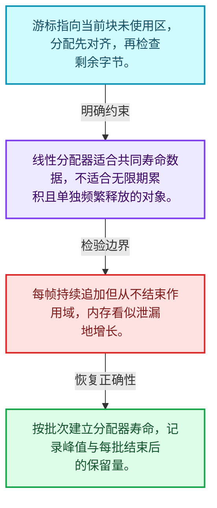
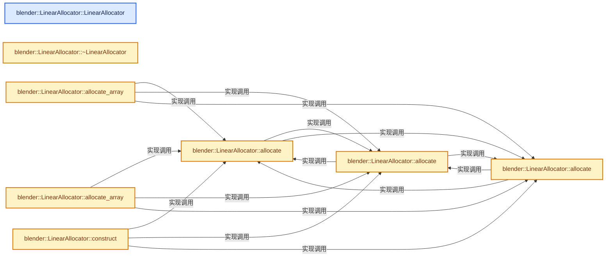
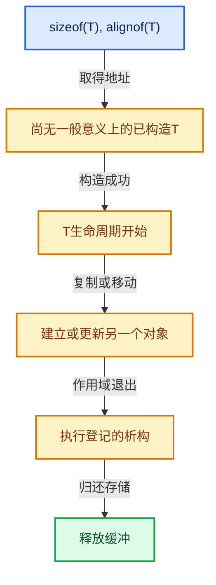

# 03-02 LinearAllocator布局

[方向导航](README.md) · [总目录](../README.md) · [实现索引](../00-课程指南/02-源码与提交索引/符号依赖与实现索引.md)

## 从问题到实现

大量寿命相同的小对象怎样减少分配开销？

线性分配器从缓冲中推进游标，把单对象释放合并为作用域释放；内存回收与析构责任仍需分开。

**数据模型**

游标指向当前块未使用区，分配先对齐，再检查剩余字节。

**设计取舍**

线性分配器适合共同寿命数据，不适合无限期累积且单独频繁释放的对象。

**最小反例**

每帧持续追加但从不结束作用域，内存看似泄漏地增长。

**推导**

按批次建立分配器寿命，记录峰值与每批结束后的保留量。

## 阅读地图与执行推演








图中的数值推演是本方向的教学模型；实际函数之间的调用边与概念分析边分别标注，不能把概念关系当作运行时调度顺序。

## 完整源码单元与就地讲解

中文讲解直接放在相关代码旁，复杂机制在代码下展开。原文折叠区保留基准行号；不需要在行号表和函数之间来回查找。类布局可分段展示，函数实现不按固定行数切开。

### 类型布局、声明与编译条件 · BLI_linear_allocator.hh L1—L46

<a id="t-db074ba54c61"></a>

`LinearAllocator`在这里声明的数据成员：

- `BLI_NO_UNIQUE_ADDRESS allocator_`
- `Vector<void *, 2> owned_buffers_`
- `uintptr_t current_begin_`
- `uintptr_t current_end_`
- `int64_t large_buffer_threshold`
- `int64_t user_requested_size_`
- `int64_t owned_allocation_size_`

<!-- annotated:eab8b4b0fe6773 -->

```cpp
/* SPDX-FileCopyrightText: 2023 Blender Authors
 *
 * SPDX-License-Identifier: GPL-2.0-or-later */

/** \file
 * \ingroup bli
 */

#pragma once

#include "BLI_cpp_type.hh"
#include "BLI_string_ref.hh"
#include "BLI_utility_mixins.hh"
#include "BLI_vector.hh"

namespace blender {

/**
 * If enabled, #LinearAllocator keeps track of how much memory it owns and how much it has
 * allocated.
 */
// #define BLI_DEBUG_LINEAR_ALLOCATOR_SIZE

/**
 * A linear allocator is the simplest form of an allocator. It never reuses any memory, and
 * therefore does not need a deallocation method. It simply hands out consecutive buffers of
 * memory. When the current buffer is full, it allocates a new larger buffer and continues.
 */
template<typename Allocator = GuardedAllocator> class LinearAllocator : NonCopyable, NonMovable {
 private:
  BLI_NO_UNIQUE_ADDRESS Allocator allocator_;
  Vector<void *, 2> owned_buffers_;

  uintptr_t current_begin_;
  uintptr_t current_end_;

  /* Buffers larger than that are not packed together with smaller allocations to avoid wasting
   * memory. */
  constexpr static int64_t large_buffer_threshold = 4096;

 public:
#ifdef BLI_DEBUG_LINEAR_ALLOCATOR_SIZE
  int64_t user_requested_size_ = 0;
  int64_t owned_allocation_size_ = 0;
#endif

```

<details>
<summary>核对原始源码：source/blender/blenlib/BLI_linear_allocator.hh · L1—L46</summary>

<!-- original:eab8b4b0fe6773:source/blender/blenlib/BLI_linear_allocator.hh:1:46 -->

```cpp
/* SPDX-FileCopyrightText: 2023 Blender Authors
 *
 * SPDX-License-Identifier: GPL-2.0-or-later */

/** \file
 * \ingroup bli
 */

#pragma once

#include "BLI_cpp_type.hh"
#include "BLI_string_ref.hh"
#include "BLI_utility_mixins.hh"
#include "BLI_vector.hh"

namespace blender {

/**
 * If enabled, #LinearAllocator keeps track of how much memory it owns and how much it has
 * allocated.
 */
// #define BLI_DEBUG_LINEAR_ALLOCATOR_SIZE

/**
 * A linear allocator is the simplest form of an allocator. It never reuses any memory, and
 * therefore does not need a deallocation method. It simply hands out consecutive buffers of
 * memory. When the current buffer is full, it allocates a new larger buffer and continues.
 */
template<typename Allocator = GuardedAllocator> class LinearAllocator : NonCopyable, NonMovable {
 private:
  BLI_NO_UNIQUE_ADDRESS Allocator allocator_;
  Vector<void *, 2> owned_buffers_;

  uintptr_t current_begin_;
  uintptr_t current_end_;

  /* Buffers larger than that are not packed together with smaller allocations to avoid wasting
   * memory. */
  constexpr static int64_t large_buffer_threshold = 4096;

 public:
#ifdef BLI_DEBUG_LINEAR_ALLOCATOR_SIZE
  int64_t user_requested_size_ = 0;
  int64_t owned_allocation_size_ = 0;
#endif

```

</details>

<a id="f-6a8a423544b94e9d"></a>

### `blender::LinearAllocator::LinearAllocator`

实现位置：[source/blender/blenlib/BLI_linear_allocator.hh](../../../../../source/blender/blenlib/BLI_linear_allocator.hh) · L47—L51。

**教学注释版**

<!-- annotated:79f490a82b22e1 -->

```cpp
  LinearAllocator()
  {
    current_begin_ = 0;
    current_end_ = 0;
  }
```

<details>
<summary>核对原始源码：source/blender/blenlib/BLI_linear_allocator.hh · L47—L51</summary>

<!-- original:79f490a82b22e1:source/blender/blenlib/BLI_linear_allocator.hh:47:51 -->

```cpp
  LinearAllocator()
  {
    current_begin_ = 0;
    current_end_ = 0;
  }
```

</details>

**沿实际写入检查状态**

- `current_begin_ = 0;`
- `current_end_ = 0;`

**继续追踪实现**

本实现没有需要继续展开的显式调用；检查返回表达式、对象转换和调用者前置条件。

<!-- annotated:da78a586e7b5d9 -->

```cpp

```

<details>
<summary>核对原始源码：source/blender/blenlib/BLI_linear_allocator.hh · L52—L52</summary>

<!-- original:da78a586e7b5d9:source/blender/blenlib/BLI_linear_allocator.hh:52:52 -->

```cpp

```

</details>

<a id="f-bdfe31d5f1c06ea4"></a>

### `blender::LinearAllocator::~LinearAllocator`

实现位置：[source/blender/blenlib/BLI_linear_allocator.hh](../../../../../source/blender/blenlib/BLI_linear_allocator.hh) · L53—L58。

**教学注释版**

<!-- annotated:82d2e79a711279 -->

```cpp
  ~LinearAllocator()
  {
    for (void *ptr : owned_buffers_) {
      allocator_.deallocate(ptr);
    }
  }
```

<details>
<summary>核对原始源码：source/blender/blenlib/BLI_linear_allocator.hh · L53—L58</summary>

<!-- original:82d2e79a711279:source/blender/blenlib/BLI_linear_allocator.hh:53:58 -->

```cpp
  ~LinearAllocator()
  {
    for (void *ptr : owned_buffers_) {
      allocator_.deallocate(ptr);
    }
  }
```

</details>

**继续追踪实现**

- `allocator_.deallocate` → [调用协议](../00-课程指南/01-路线与规范/模板宏与动态分派协议.md)：由接收对象具体类型或运行时策略提供实现。调用位置L56。

### 类型布局、声明与编译条件 · BLI_linear_allocator.hh L59—L65

<!-- annotated:8e96f2a6cd8b64 -->

```cpp

  /**
   * Get a pointer to a memory buffer with the given size an alignment. The memory buffer will be
   * freed when this LinearAllocator is destructed.
   *
   * The alignment has to be a power of 2.
   */
```

<details>
<summary>核对原始源码：source/blender/blenlib/BLI_linear_allocator.hh · L59—L65</summary>

<!-- original:8e96f2a6cd8b64:source/blender/blenlib/BLI_linear_allocator.hh:59:65 -->

```cpp

  /**
   * Get a pointer to a memory buffer with the given size an alignment. The memory buffer will be
   * freed when this LinearAllocator is destructed.
   *
   * The alignment has to be a power of 2.
   */
```

</details>

<a id="f-26209c6a21e04bc0"></a>

### `blender::LinearAllocator::allocate`

实现位置：[source/blender/blenlib/BLI_linear_allocator.hh](../../../../../source/blender/blenlib/BLI_linear_allocator.hh) · L66—L92。

接口参数：

- `const int64_t size`
- `const int64_t alignment`

**教学注释版**

<!-- annotated:20f39a0f94a20f -->

```cpp
  void *allocate(const int64_t size, const int64_t alignment)
  {
    BLI_assert(size >= 0);
    BLI_assert(alignment >= 1);
    BLI_assert(is_power_of_2(alignment));

    const uintptr_t alignment_mask = alignment - 1;
    const uintptr_t potential_allocation_begin = (current_begin_ + alignment_mask) &
                                                 ~alignment_mask;
    const uintptr_t potential_allocation_end = potential_allocation_begin + size;

    if (potential_allocation_end <= current_end_) {
#ifdef BLI_DEBUG_LINEAR_ALLOCATOR_SIZE
      user_requested_size_ += size;
#endif
      current_begin_ = potential_allocation_end;
      return reinterpret_cast<void *>(potential_allocation_begin);
    }
    if (size <= large_buffer_threshold) {
      this->allocate_new_buffer(size + alignment, alignment);
      return this->allocate(size, alignment);
    }
#ifdef BLI_DEBUG_LINEAR_ALLOCATOR_SIZE
    user_requested_size_ += size;
#endif
    return this->allocator_large_buffer(size, alignment);
  };
```

<details>
<summary>核对原始源码：source/blender/blenlib/BLI_linear_allocator.hh · L66—L92</summary>

<!-- original:20f39a0f94a20f:source/blender/blenlib/BLI_linear_allocator.hh:66:92 -->

```cpp
  void *allocate(const int64_t size, const int64_t alignment)
  {
    BLI_assert(size >= 0);
    BLI_assert(alignment >= 1);
    BLI_assert(is_power_of_2(alignment));

    const uintptr_t alignment_mask = alignment - 1;
    const uintptr_t potential_allocation_begin = (current_begin_ + alignment_mask) &
                                                 ~alignment_mask;
    const uintptr_t potential_allocation_end = potential_allocation_begin + size;

    if (potential_allocation_end <= current_end_) {
#ifdef BLI_DEBUG_LINEAR_ALLOCATOR_SIZE
      user_requested_size_ += size;
#endif
      current_begin_ = potential_allocation_end;
      return reinterpret_cast<void *>(potential_allocation_begin);
    }
    if (size <= large_buffer_threshold) {
      this->allocate_new_buffer(size + alignment, alignment);
      return this->allocate(size, alignment);
    }
#ifdef BLI_DEBUG_LINEAR_ALLOCATOR_SIZE
    user_requested_size_ += size;
#endif
    return this->allocator_large_buffer(size, alignment);
  };
```

</details>

**沿实际写入检查状态**

- `user_requested_size_ += size;`
- `current_begin_ = potential_allocation_end;`

**结果出口**

- `return reinterpret_cast<void *>(potential_allocation_begin);`
- `return this->allocate(size, alignment);`
- `return this->allocator_large_buffer(size, alignment);`

**继续追踪实现**

- `BLI_assert` → [BLI_assert · L48](../90-实现依赖专题/01-BLI基础库/BLI_assert.hh.md#m-57a88495704d)；[BLI_assert · L63](../90-实现依赖专题/01-BLI基础库/BLI_assert.hh.md#m-d07050020cb5)。宏定义由构建条件选择。
- `is_power_of_2` → [blender::is_power_of_2 · L170](../90-实现依赖专题/01-BLI基础库/BLI_utildefines.hh.md#f-276f4f171955e1e9)。
- `this->allocate_new_buffer` → [blender::LinearAllocator::allocate_new_buffer · L282](03-LinearAllocator分配与扩展.md#f-322a6ab25072a895)。
- `this->allocate` → [blender::LinearAllocator::allocate · L66](02-LinearAllocator布局.md#f-26209c6a21e04bc0)；[blender::LinearAllocator::allocate · L99](02-LinearAllocator布局.md#f-b34ac68f2e3d66f1)；[blender::LinearAllocator::allocate · L105](02-LinearAllocator布局.md#f-96480f78749ba1c7)。同名重载需按实参类型选择。
- `this->allocator_large_buffer` → [blender::LinearAllocator::allocator_large_buffer · L300](03-LinearAllocator分配与扩展.md#f-669bf2dc9b5416a6)。

### 类型布局、声明与编译条件 · BLI_linear_allocator.hh L93—L98

<!-- annotated:18010d8c6c175e -->

```cpp

  /**
   * Allocate a memory buffer that can hold an instance of T.
   *
   * This method only allocates memory and does not construct the instance.
   */
```

<details>
<summary>核对原始源码：source/blender/blenlib/BLI_linear_allocator.hh · L93—L98</summary>

<!-- original:18010d8c6c175e:source/blender/blenlib/BLI_linear_allocator.hh:93:98 -->

```cpp

  /**
   * Allocate a memory buffer that can hold an instance of T.
   *
   * This method only allocates memory and does not construct the instance.
   */
```

</details>

<a id="f-b34ac68f2e3d66f1"></a>

### `blender::LinearAllocator::allocate`

实现位置：[source/blender/blenlib/BLI_linear_allocator.hh](../../../../../source/blender/blenlib/BLI_linear_allocator.hh) · L99—L102。

**教学注释版**

<!-- annotated:95f4a811d22d1d -->

```cpp
  template<typename T> T *allocate()
  {
    return static_cast<T *>(this->allocate(sizeof(T), alignof(T)));
  }
```

<details>
<summary>核对原始源码：source/blender/blenlib/BLI_linear_allocator.hh · L99—L102</summary>

<!-- original:95f4a811d22d1d:source/blender/blenlib/BLI_linear_allocator.hh:99:102 -->

```cpp
  template<typename T> T *allocate()
  {
    return static_cast<T *>(this->allocate(sizeof(T), alignof(T)));
  }
```

</details>

**结果出口**

- `return static_cast<T *>(this->allocate(sizeof(T), alignof(T)));`

**继续追踪实现**

- `this->allocate` → [blender::LinearAllocator::allocate · L66](02-LinearAllocator布局.md#f-26209c6a21e04bc0)；[blender::LinearAllocator::allocate · L99](02-LinearAllocator布局.md#f-b34ac68f2e3d66f1)；[blender::LinearAllocator::allocate · L105](02-LinearAllocator布局.md#f-96480f78749ba1c7)。同名重载需按实参类型选择。

### 类型布局、声明与编译条件 · BLI_linear_allocator.hh L103—L104

<!-- annotated:2a0d0d964b24c2 -->

```cpp

  /** Same as above but uses a runtime #CPPType. */
```

<details>
<summary>核对原始源码：source/blender/blenlib/BLI_linear_allocator.hh · L103—L104</summary>

<!-- original:2a0d0d964b24c2:source/blender/blenlib/BLI_linear_allocator.hh:103:104 -->

```cpp

  /** Same as above but uses a runtime #CPPType. */
```

</details>

<a id="f-96480f78749ba1c7"></a>

### `blender::LinearAllocator::allocate`

实现位置：[source/blender/blenlib/BLI_linear_allocator.hh](../../../../../source/blender/blenlib/BLI_linear_allocator.hh) · L105—L108。

接口参数：

- `const CPPType &type`

**教学注释版**

<!-- annotated:f16556447c31b0 -->

```cpp
  void *allocate(const CPPType &type)
  {
    return this->allocate(type.size, type.alignment);
  }
```

<details>
<summary>核对原始源码：source/blender/blenlib/BLI_linear_allocator.hh · L105—L108</summary>

<!-- original:f16556447c31b0:source/blender/blenlib/BLI_linear_allocator.hh:105:108 -->

```cpp
  void *allocate(const CPPType &type)
  {
    return this->allocate(type.size, type.alignment);
  }
```

</details>

**结果出口**

- `return this->allocate(type.size, type.alignment);`

**继续追踪实现**

- `this->allocate` → [blender::LinearAllocator::allocate · L66](02-LinearAllocator布局.md#f-26209c6a21e04bc0)；[blender::LinearAllocator::allocate · L99](02-LinearAllocator布局.md#f-b34ac68f2e3d66f1)；[blender::LinearAllocator::allocate · L105](02-LinearAllocator布局.md#f-96480f78749ba1c7)。同名重载需按实参类型选择。

### 类型布局、声明与编译条件 · BLI_linear_allocator.hh L109—L114

<!-- annotated:bcf30d77dad02b -->

```cpp

  /**
   * Allocate a memory buffer that can hold T array with the given size.
   *
   * This method only allocates memory and does not construct the instance.
   */
```

<details>
<summary>核对原始源码：source/blender/blenlib/BLI_linear_allocator.hh · L109—L114</summary>

<!-- original:bcf30d77dad02b:source/blender/blenlib/BLI_linear_allocator.hh:109:114 -->

```cpp

  /**
   * Allocate a memory buffer that can hold T array with the given size.
   *
   * This method only allocates memory and does not construct the instance.
   */
```

</details>

<a id="f-a4f71808bf7434ab"></a>

### `blender::LinearAllocator::allocate_array`

实现位置：[source/blender/blenlib/BLI_linear_allocator.hh](../../../../../source/blender/blenlib/BLI_linear_allocator.hh) · L115—L119。

接口参数：

- `int64_t size`

**教学注释版**

<!-- annotated:255d7d39d62cb7 -->

```cpp
  template<typename T> MutableSpan<T> allocate_array(int64_t size)
  {
    T *array = static_cast<T *>(this->allocate(sizeof(T) * size, alignof(T)));
    return MutableSpan<T>(array, size);
  }
```

<details>
<summary>核对原始源码：source/blender/blenlib/BLI_linear_allocator.hh · L115—L119</summary>

<!-- original:255d7d39d62cb7:source/blender/blenlib/BLI_linear_allocator.hh:115:119 -->

```cpp
  template<typename T> MutableSpan<T> allocate_array(int64_t size)
  {
    T *array = static_cast<T *>(this->allocate(sizeof(T) * size, alignof(T)));
    return MutableSpan<T>(array, size);
  }
```

</details>

**结果出口**

- `return MutableSpan<T>(array, size);`

**继续追踪实现**

- `this->allocate` → [blender::LinearAllocator::allocate · L66](02-LinearAllocator布局.md#f-26209c6a21e04bc0)；[blender::LinearAllocator::allocate · L99](02-LinearAllocator布局.md#f-b34ac68f2e3d66f1)；[blender::LinearAllocator::allocate · L105](02-LinearAllocator布局.md#f-96480f78749ba1c7)。同名重载需按实参类型选择。
- `MutableSpan<T>` → [blender::MutableSpan::MutableSpan · L462](../01-基础容器与现代CPP/06-MutableSpan可写视图.md#f-0f07034aaffc3384)；[blender::MutableSpan::MutableSpan · L464](../01-基础容器与现代CPP/06-MutableSpan可写视图.md#f-39977234ad0ce192)；[blender::MutableSpan::MutableSpan · L466](../01-基础容器与现代CPP/06-MutableSpan可写视图.md#f-ee249b5042dd38aa)；[blender::MutableSpan::MutableSpan · L468](../01-基础容器与现代CPP/06-MutableSpan可写视图.md#f-479c5f85921e531f)；[blender::MutableSpan::MutableSpan · L477](../01-基础容器与现代CPP/06-MutableSpan可写视图.md#f-afcce5325e6f19e0)。同名重载需按实参类型选择。

### 类型布局、声明与编译条件 · BLI_linear_allocator.hh L120—L121

<!-- annotated:70a864ff60e603 -->

```cpp

  /** Same as above but uses a runtime #CPPType. */
```

<details>
<summary>核对原始源码：source/blender/blenlib/BLI_linear_allocator.hh · L120—L121</summary>

<!-- original:70a864ff60e603:source/blender/blenlib/BLI_linear_allocator.hh:120:121 -->

```cpp

  /** Same as above but uses a runtime #CPPType. */
```

</details>

<a id="f-3957475aeffc5dc7"></a>

### `blender::LinearAllocator::allocate_array`

实现位置：[source/blender/blenlib/BLI_linear_allocator.hh](../../../../../source/blender/blenlib/BLI_linear_allocator.hh) · L122—L125。

接口参数：

- `const CPPType &type`
- `const int64_t size`

**教学注释版**

<!-- annotated:ee120dd6cdef9b -->

```cpp
  void *allocate_array(const CPPType &type, const int64_t size)
  {
    return this->allocate(type.size * size, type.alignment);
  }
```

<details>
<summary>核对原始源码：source/blender/blenlib/BLI_linear_allocator.hh · L122—L125</summary>

<!-- original:ee120dd6cdef9b:source/blender/blenlib/BLI_linear_allocator.hh:122:125 -->

```cpp
  void *allocate_array(const CPPType &type, const int64_t size)
  {
    return this->allocate(type.size * size, type.alignment);
  }
```

</details>

**结果出口**

- `return this->allocate(type.size * size, type.alignment);`

**继续追踪实现**

- `this->allocate` → [blender::LinearAllocator::allocate · L66](02-LinearAllocator布局.md#f-26209c6a21e04bc0)；[blender::LinearAllocator::allocate · L99](02-LinearAllocator布局.md#f-b34ac68f2e3d66f1)；[blender::LinearAllocator::allocate · L105](02-LinearAllocator布局.md#f-96480f78749ba1c7)。同名重载需按实参类型选择。

### 类型布局、声明与编译条件 · BLI_linear_allocator.hh L126—L134

<!-- annotated:008d81a0b752fc -->

```cpp

  /**
   * Construct an instance of T in memory provided by this allocator.
   *
   * Arguments passed to this method will be forwarded to the constructor of T.
   *
   * You must not call `delete` on the returned value.
   * Instead, only the destructor has to be called.
   */
```

<details>
<summary>核对原始源码：source/blender/blenlib/BLI_linear_allocator.hh · L126—L134</summary>

<!-- original:008d81a0b752fc:source/blender/blenlib/BLI_linear_allocator.hh:126:134 -->

```cpp

  /**
   * Construct an instance of T in memory provided by this allocator.
   *
   * Arguments passed to this method will be forwarded to the constructor of T.
   *
   * You must not call `delete` on the returned value.
   * Instead, only the destructor has to be called.
   */
```

</details>

<a id="f-437c16eedf07fa2a"></a>

### `blender::LinearAllocator::construct`

实现位置：[source/blender/blenlib/BLI_linear_allocator.hh](../../../../../source/blender/blenlib/BLI_linear_allocator.hh) · L135—L140。

**教学注释版**

<!-- annotated:75d7834833ff9e -->

```cpp
  template<typename T, typename... Args> destruct_ptr<T> construct(Args &&...args)
  {
    void *buffer = this->allocate(sizeof(T), alignof(T));
    // [讲解] std::forward<Args>：在转发引用中恢复调用者传入的值类别；依赖推导类型，不能与无条件move互换。
    T *value = new (buffer) T(std::forward<Args>(args)...);
    return destruct_ptr<T>(value);
  }
```

<details>
<summary>核对原始源码：source/blender/blenlib/BLI_linear_allocator.hh · L135—L140</summary>

<!-- original:75d7834833ff9e:source/blender/blenlib/BLI_linear_allocator.hh:135:140 -->

```cpp
  template<typename T, typename... Args> destruct_ptr<T> construct(Args &&...args)
  {
    void *buffer = this->allocate(sizeof(T), alignof(T));
    T *value = new (buffer) T(std::forward<Args>(args)...);
    return destruct_ptr<T>(value);
  }
```

</details>

**结果出口**

- `return destruct_ptr<T>(value);`

**继续追踪实现**

- `this->allocate` → [blender::LinearAllocator::allocate · L66](02-LinearAllocator布局.md#f-26209c6a21e04bc0)；[blender::LinearAllocator::allocate · L99](02-LinearAllocator布局.md#f-b34ac68f2e3d66f1)；[blender::LinearAllocator::allocate · L105](02-LinearAllocator布局.md#f-96480f78749ba1c7)。同名重载需按实参类型选择。
- `std::forward<Args>` → [外部契约](https://eel.is/c++draft/utility.forward)：在转发引用中恢复调用者传入的值类别；依赖推导类型，不能与无条件move互换。
- `destruct_ptr<T>` → [调用协议](../00-课程指南/01-路线与规范/模板宏与动态分派协议.md)：函数指针、局部可调用对象或未展开的宏；必须结合调用者环境。调用位置L139。

### 类型布局、声明与编译条件 · BLI_linear_allocator.hh L141—L146

<!-- annotated:462b044ef5bcda -->

```cpp

  /**
   * Construct multiple instances of a type in an array. The constructor of is called with the
   * given arguments. The caller is responsible for calling the destructor (and not `delete`) on
   * the constructed elements.
   */
```

<details>
<summary>核对原始源码：source/blender/blenlib/BLI_linear_allocator.hh · L141—L146</summary>

<!-- original:462b044ef5bcda:source/blender/blenlib/BLI_linear_allocator.hh:141:146 -->

```cpp

  /**
   * Construct multiple instances of a type in an array. The constructor of is called with the
   * given arguments. The caller is responsible for calling the destructor (and not `delete`) on
   * the constructed elements.
   */
```

</details>

<a id="f-feacfdeb9403355c"></a>

### `blender::LinearAllocator::construct_array`

实现位置：[source/blender/blenlib/BLI_linear_allocator.hh](../../../../../source/blender/blenlib/BLI_linear_allocator.hh) · L147—L155。

接口参数：

- `int64_t size`

**教学注释版**

<!-- annotated:e6167d14a313f8 -->

```cpp
  template<typename T, typename... Args>
  MutableSpan<T> construct_array(int64_t size, Args &&...args)
  {
    MutableSpan<T> array = this->allocate_array<T>(size);
    for (const int64_t i : IndexRange(size)) {
      // [讲解] std::forward<Args>：在转发引用中恢复调用者传入的值类别；依赖推导类型，不能与无条件move互换。
      new (&array[i]) T(std::forward<Args>(args)...);
    }
    return array;
  }
```

<details>
<summary>核对原始源码：source/blender/blenlib/BLI_linear_allocator.hh · L147—L155</summary>

<!-- original:e6167d14a313f8:source/blender/blenlib/BLI_linear_allocator.hh:147:155 -->

```cpp
  template<typename T, typename... Args>
  MutableSpan<T> construct_array(int64_t size, Args &&...args)
  {
    MutableSpan<T> array = this->allocate_array<T>(size);
    for (const int64_t i : IndexRange(size)) {
      new (&array[i]) T(std::forward<Args>(args)...);
    }
    return array;
  }
```

</details>

**结果出口**

- `return array;`

**继续追踪实现**

- `this->allocate_array<T>` → [blender::LinearAllocator::allocate_array · L115](02-LinearAllocator布局.md#f-a4f71808bf7434ab)；[blender::LinearAllocator::allocate_array · L122](02-LinearAllocator布局.md#f-3957475aeffc5dc7)。同名重载需按实参类型选择。
- `IndexRange` → [blender::IndexRange](../90-实现依赖专题/01-BLI基础库/BLI_index_range.hh.md#t-caa3466d6776)；[blender::gpu::shader::parser::IndexRange](../90-实现依赖专题/08-其他Blender模块/gpu/shader_tool/utils.hh.md#t-82d2bd4ea71c)；[blender::IndexRange](../90-实现依赖专题/08-其他Blender模块/makesdna/DNA_node_types.h.md#t-0448cc889d39)。
- `std::forward<Args>` → [外部契约](https://eel.is/c++draft/utility.forward)：在转发引用中恢复调用者传入的值类别；依赖推导类型，不能与无条件move互换。

## 语法与相关类型

### 模板 template

模板把类型或常量作为生成实现的参数。读声明时先列出类型参数、非类型参数和默认值，再看使用者实际实例化了什么。模板声明本身不意味着每种T都支持其全部成员。

把T替换为int、string、只能移动的类型，分别检查每个被调用操作是否成立。

### 依赖名称 typename

typename既可引入类型模板参数，也可告诉编译器某个依赖名称是类型。它不创建运行时对象；解析期确认语法类别与实例化期检查具体类型是不同阶段。

区分typename T::value_type和T::size()，前者标记类型，后者是表达式。

### 常量求值 constexpr

constexpr声明允许相应实体参与常量求值，但constexpr函数仍可以在运行时执行。是否常量求值由调用场景和表达式合法性共同决定。

比较constexpr变量初始化和从运行时输入调用同一函数。

### 只读限定 const

const约束当前访问路径可做的修改。const指针、指向const的指针、const视图对象、const元素是不同位置的限定；其他别名可能仍可修改原对象。

分别写T* const、const T*与const T* const，并画出不可修改的层次。

### 完美转发 std::forward

std::forward在转发引用模板中恢复调用者原来的值类别。它依赖推导出的模板实参；无条件move会改变左值调用者的语义。

对同一接口分别传入左值、临时对象和const左值，记录实际重载。

### 显式静态转换 static_cast

static_cast表达编译期允许的转换，不会自动验证运行时真实类型、指针寿命或索引边界。由void指针恢复T指针时，调用者仍须保证实际存储中确有合法T对象。

标出转换前后的类型以及正确性依据来自哪里。

### 表示层转换 reinterpret_cast

reinterpret_cast不能自动开始任意对象的生命周期，也不能豁免对齐和别名规则。读这类代码需要追溯原始分配与实际构造操作。

分别检查大小、对齐、生命周期和可访问类型，四项不能互相替代。

### 对齐 alignof

alignof得到类型要求的地址对齐。分配足够字节后仍需把地址对齐到相应边界，内嵌缓冲也一样。

对齐a为2的幂时可推导向上取整，但仍要考虑溢出与边界。

### 对象表示 sizeof

sizeof给出对象表示大小，不是其引用的所有堆内存总量。sizeof视图很小并不说明底层数组很小。

分别统计容器对象、容量字节和元素拥有的间接资源。

### 构造与new表达式

普通new可能分配并构造；placement new在给定地址构造，存储由其他机制提供。失败回滚应区分两类责任。

追踪地址来自哪里、构造何时成功、由谁析构、由谁释放。

### 内部断言 assert

断言表达开发者预期成立的内部契约，发布构建可能关闭。它不能替代对不可信输入的完整错误处理，也不保证后续操作被运行时保护。

对每条断言构造违反条件的输入，区分调用者错误与应向用户报告的错误。

## 实现练习与验证

分配不同大小与对齐的对象，画出游标和浪费空间。

参考推理：按批次建立分配器寿命，记录峰值与每批结束后的保留量。

所有存活对象地址满足对齐；构造失败不会被当作成功对象登记；所有资源均有唯一或明确共享的清理责任。

## 历史、跨库比较与证据

与std::pmr::monotonic_buffer_resource比较批量存储回收，与std::any比较拥有型类型擦除；CPPType描述类型操作，本身不保存每个值。

[历史提交索引](../00-课程指南/02-源码与提交索引/历史提交与设计演化索引.md) · [源码基准](../00-课程指南/02-源码与提交索引/源码版本与覆盖索引.md) · [验收报告](../00-课程指南/03-验收报告/验收报告.md)
