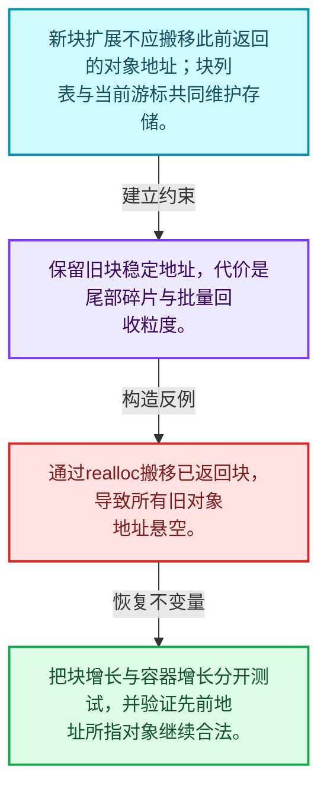
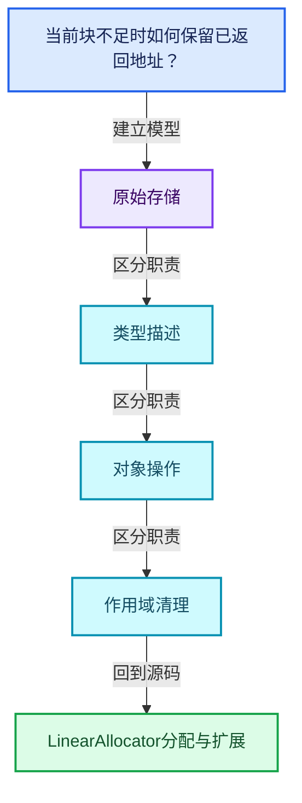
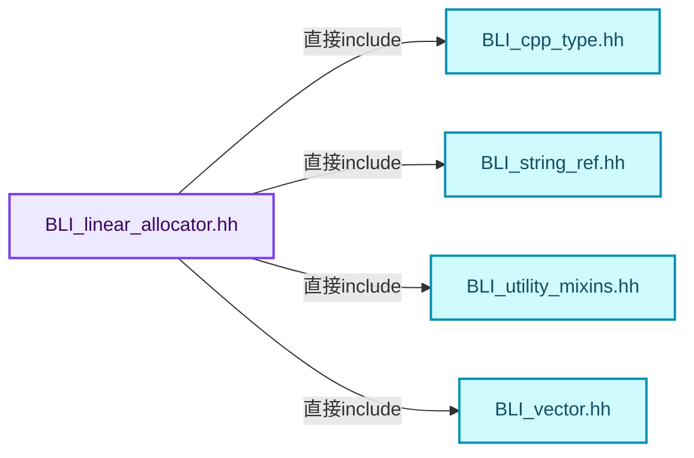
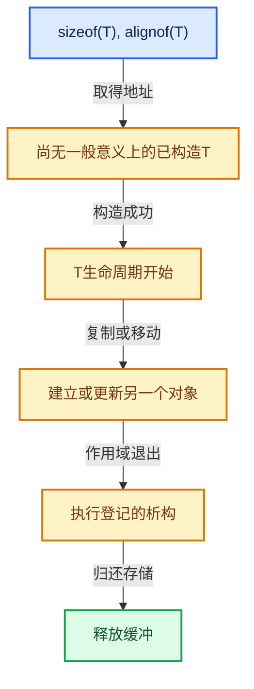

# 03-03 LinearAllocator分配与扩展

[方向导航](README.md) · [总目录](../README.md) · [覆盖索引](../%E6%BA%90%E7%A0%81%E7%89%88%E6%9C%AC%E4%B8%8E%E8%A6%86%E7%9B%96%E7%B4%A2%E5%BC%95.md)

> 阅读顺序：问题与数据模型 → 语法与类型 → 源码逐行 → 调用线索 → 历史与取舍 → 推演和练习。

- 基准 HEAD：`cbda6b96c26c0dee3c3b5cbb93960c4ac06a6b30`。
- 记录日期：2026-10-14。
- 教学示例状态：正文中的推演不是本机性能实测；已运行练习见验收报告。

## 一、从问题到设计

当前块不足时如何保留已返回地址？

增加缓冲块可避免搬移已有对象；分配器自身增长和容器元素增长是不同的问题。

本篇把语法、数据语义和系统取舍连接起来。把存储分配、对象构造、类型操作和最终清理拆开建模。

### 本篇独立模型与设计推理

新块扩展不应搬移此前返回的对象地址；块列表与当前游标共同维护存储。

设计取舍：保留旧块稳定地址，代价是尾部碎片与批量回收粒度。

最小反例：通过realloc搬移已返回块，导致所有旧对象地址悬空。

推导与处理：把块增长与容器增长分开测试，并验证先前地址所指对象继续合法。



### 源码范围与相邻篇章

| 文件 | 本篇逐行范围 | 基准SHA-256 |
|---|---|---|
| [source/blender/blenlib/BLI_linear_allocator.hh](../../../../../source/blender/blenlib/BLI_linear_allocator.hh) | L156—L316 | `95fe936dfa9e937a15dcd1a39d5467118afb35e1de62f96ca6812008eab0264e` |

同一主讲文件可能分多篇覆盖；超出本篇范围的符号通过覆盖索引定位。空行与纯注释保留在源码摘录中，逐行表解释有效语句与语法边界；许可证头统一保留。

前篇：[LinearAllocator布局](02-LinearAllocator%E5%B8%83%E5%B1%80.md).

后篇：[ChunkedList分块容器](04-ChunkedList%E5%88%86%E5%9D%97%E5%AE%B9%E5%99%A8.md).

## 二、类型、数据与阅读地图



这是概念依赖图，边表示阅读关系，不声称是运行时调用顺序。

### 直接编译依赖



箭头只表示头文件包含关系；完整调用线索见后面的符号定位表。

## 三、关键词、语法与类型角色

### 模板 template

模板把类型或常量作为生成实现的参数。读声明时先列出类型参数、非类型参数和默认值，再看使用者实际实例化了什么。模板声明本身不意味着每种T都支持其全部成员。

具体检查：把T替换为int、string、只能移动的类型，分别检查每个被调用操作是否成立。

### 依赖名称 typename

typename既可引入类型模板参数，也可告诉编译器某个依赖名称是类型。它不创建运行时对象；解析期确认语法类别与实例化期检查具体类型是不同阶段。

具体检查：区分typename T::value_type和T::size()，前者标记类型，后者是表达式。

### 只读限定 const

const约束当前访问路径可做的修改。const指针、指向const的指针、const视图对象、const元素是不同位置的限定；其他别名可能仍可修改原对象。

具体检查：分别写T* const、const T*与const T* const，并画出不可修改的层次。

### 完美转发 std::forward

std::forward在转发引用模板中恢复调用者原来的值类别。它依赖推导出的模板实参；无条件move会改变左值调用者的语义。

具体检查：对同一接口分别传入左值、临时对象和const左值，记录实际重载。

### 显式静态转换 static_cast

static_cast表达编译期允许的转换，不会自动验证运行时真实类型、指针寿命或索引边界。由void指针恢复T指针时，调用者仍须保证实际存储中确有合法T对象。

具体检查：标出转换前后的类型以及正确性依据来自哪里。

### 对齐 alignof

alignof得到类型要求的地址对齐。分配足够字节后仍需把地址对齐到相应边界，内嵌缓冲也一样。

具体检查：对齐a为2的幂时可推导向上取整，但仍要考虑溢出与边界。

### 对象表示 sizeof

sizeof给出对象表示大小，不是其引用的所有堆内存总量。sizeof视图很小并不说明底层数组很小。

具体检查：分别统计容器对象、容量字节和元素拥有的间接资源。

### 构造与new表达式

普通new可能分配并构造；placement new在给定地址构造，存储由其他机制提供。失败回滚应区分两类责任。

具体检查：追踪地址来自哪里、构造何时成功、由谁析构、由谁释放。

### 内部断言 assert

断言表达开发者预期成立的内部契约，发布构建可能关闭。它不能替代对不可信输入的完整错误处理，也不保证后续操作被运行时保护。

具体检查：对每条断言构造违反条件的输入，区分调用者错误与应向用户报告的错误。

### 类型别名 using

类型别名为已有类型建立名字，不创建运行期对象。它常把模板内部使用的类型统一暴露给泛型调用者。

具体检查：展开别名直到基础类型，区分类型别名和变量声明。

## 四、真实源码与逐行讲解

源码块保持原行内容，原始行号由小节标题及逐行表给出。表中的调用定位是静态阅读辅助；重载、模板实例化、宏展开和虚调用需结合完整声明，不能仅凭词法出现证明动态调用。

### BLI_linear_allocator.hh：L156—L197

<!-- source:source/blender/blenlib/BLI_linear_allocator.hh:156:197 -->

```cpp

  /**
   * Copy the given array into a memory buffer provided by this allocator.
   */
  template<typename T> MutableSpan<T> construct_array_copy(Span<T> src)
  {
    if (src.is_empty()) {
      return {};
    }
    MutableSpan<T> dst = this->allocate_array<T>(src.size());
    uninitialized_copy_n(src.data(), src.size(), dst.data());
    return dst;
  }

  /**
   * Copy the given string into a memory buffer provided by this allocator. The returned string is
   * always null terminated.
   */
  StringRefNull copy_string(StringRef str)
  {
    const int64_t alloc_size = str.size() + 1;
    char *buffer = static_cast<char *>(this->allocate(alloc_size, 1));
    str.copy_unsafe(buffer);
    return StringRefNull(static_cast<const char *>(buffer));
  }

  MutableSpan<void *> allocate_elements_and_pointer_array(int64_t element_amount,
                                                          int64_t element_size,
                                                          int64_t element_alignment)
  {
    void *pointer_buffer = this->allocate(element_amount * sizeof(void *), alignof(void *));
    void *elements_buffer = this->allocate(element_amount * element_size, element_alignment);

    MutableSpan<void *> pointers(static_cast<void **>(pointer_buffer), element_amount);
    void *next_element_buffer = elements_buffer;
    for (int64_t i : IndexRange(element_amount)) {
      pointers[i] = next_element_buffer;
      next_element_buffer = POINTER_OFFSET(next_element_buffer, element_size);
    }

    return pointers;
  }
```

本段语义重点：

- `uninitialized_copy_n`：把源值复制构造到未初始化的目标区间；目标已有对象时不能直接用此操作替代赋值。

| 原始行 | 语义、约束与检查 |
|---|---|
| L160 | 声明模板参数 `template<typename T> MutableSpan<T> construct_array_copy(Span<T> src)`。类型参数决定生成操作的类型，非类型参数可决定内嵌容量或编译期分支。 |
| L161 | 连接上一行的声明或控制结构与其语句块；后续行在这个作用域中执行或声明。 |
| L162 | 判断 `src.is_empty()`，成立时进入本分支，否则继续后续路径。 |
| L163 | 返回表达式 `{}`。 |
| L164 | 结束当前语法单元。局部自动对象在离开其作用域时按规则销毁；这不等于所有被引用的外部数据也被释放。 |
| L165 | 把右侧 `this->allocate_array<T>(src.size())` 用于初始化或更新左侧 `MutableSpan<T> dst`。声明初始化与已有对象赋值应按上下文区分；有资源的类型会调用相应特殊成员。 |
| L166 | 本行使用 `uninitialized_copy_n`：把源值复制构造到未初始化的目标区间；目标已有对象时不能直接用此操作替代赋值。 |
| L167 | 返回表达式 `dst`。 |
| L168 | 结束当前语法单元。局部自动对象在离开其作用域时按规则销毁；这不等于所有被引用的外部数据也被释放。 |
| L174 | 出现调用或函数声明 `copy_string`，对应表达式为 `StringRefNull copy_string(StringRef str)`。参数求值、返回类型与重载需结合前后完整语句；静态文本引用不能证明动态目标。 |
| L175 | 连接上一行的声明或控制结构与其语句块；后续行在这个作用域中执行或声明。 |
| L176 | 把右侧 `str.size() + 1` 用于初始化或更新左侧 `const int64_t alloc_size`。声明初始化与已有对象赋值应按上下文区分；有资源的类型会调用相应特殊成员。 |
| L177 | 把右侧 `static_cast<char *>(this->allocate(alloc_size, 1))` 用于初始化或更新左侧 `char *buffer`。声明初始化与已有对象赋值应按上下文区分；有资源的类型会调用相应特殊成员。 |
| L178 | 出现调用或函数声明 `copy_unsafe`，对应表达式为 `str.copy_unsafe(buffer);`。参数求值、返回类型与重载需结合前后完整语句；静态文本引用不能证明动态目标。 |
| L179 | 返回表达式 `StringRefNull(static_cast<const char *>(buffer))`。 |
| L180 | 结束当前语法单元。局部自动对象在离开其作用域时按规则销毁；这不等于所有被引用的外部数据也被释放。 |
| L182 | 出现调用或函数声明 `allocate_elements_and_pointer_array`，对应表达式为 `MutableSpan<void *> allocate_elements_and_pointer_array(int64_t element_amount,`。参数求值、返回类型与重载需结合前后完整语句；静态文本引用不能证明动态目标。 |
| L183 | 本行是连续声明或表达式的一部分：`int64_t element_size,`。与本段前后行合读；逗号、括号和限定符决定它属于参数、初始化列表还是实际计算。 |
| L184 | 本行是连续声明或表达式的一部分：`int64_t element_alignment)`。与本段前后行合读；逗号、括号和限定符决定它属于参数、初始化列表还是实际计算。 |
| L185 | 连接上一行的声明或控制结构与其语句块；后续行在这个作用域中执行或声明。 |
| L186 | 把右侧 `this->allocate(element_amount * sizeof(void *), alignof(void *))` 用于初始化或更新左侧 `void *pointer_buffer`。声明初始化与已有对象赋值应按上下文区分；有资源的类型会调用相应特殊成员。 |
| L187 | 把右侧 `this->allocate(element_amount * element_size, element_alignment)` 用于初始化或更新左侧 `void *elements_buffer`。声明初始化与已有对象赋值应按上下文区分；有资源的类型会调用相应特殊成员。 |
| L189 | 出现调用或函数声明 `MutableSpan`，对应表达式为 `MutableSpan<void *> pointers(static_cast<void **>(pointer_buffer), element_amount);`。参数求值、返回类型与重载需结合前后完整语句；静态文本引用不能证明动态目标。 |
| L190 | 把右侧 `elements_buffer` 用于初始化或更新左侧 `void *next_element_buffer`。声明初始化与已有对象赋值应按上下文区分；有资源的类型会调用相应特殊成员。 |
| L191 | 按 `for (int64_t i : IndexRange(element_amount))` 指定的范围或条件重复执行。对照循环变量与真实元素编号；循环内调用成本乘以实际迭代次数。 |
| L192 | 把右侧 `next_element_buffer` 用于初始化或更新左侧 `pointers[i]`。声明初始化与已有对象赋值应按上下文区分；有资源的类型会调用相应特殊成员。 |
| L193 | 把右侧 `POINTER_OFFSET(next_element_buffer, element_size)` 用于初始化或更新左侧 `next_element_buffer`。声明初始化与已有对象赋值应按上下文区分；有资源的类型会调用相应特殊成员。 |
| L194 | 结束当前语法单元。局部自动对象在离开其作用域时按规则销毁；这不等于所有被引用的外部数据也被释放。 |
| L196 | 返回表达式 `pointers`。 |
| L197 | 结束当前语法单元。局部自动对象在离开其作用域时按规则销毁；这不等于所有被引用的外部数据也被释放。 |

### BLI_linear_allocator.hh：L198—L260

<!-- source:source/blender/blenlib/BLI_linear_allocator.hh:198:260 -->

```cpp

  template<typename T, typename... Args>
  Span<T *> construct_elements_and_pointer_array(int64_t n, Args &&...args)
  {
    MutableSpan<void *> void_pointers = this->allocate_elements_and_pointer_array(
        n, sizeof(T), alignof(T));
    MutableSpan<T *> pointers = void_pointers.cast<T *>();

    for (int64_t i : IndexRange(n)) {
      new (static_cast<void *>(pointers[i])) T(std::forward<Args>(args)...);
    }

    return pointers;
  }

  /**
   * Tell the allocator to use up the given memory buffer, before allocating new memory from the
   * system.
   */
  void provide_buffer(void *buffer, const int64_t size)
  {
    BLI_assert(owned_buffers_.is_empty());
    current_begin_ = uintptr_t(buffer);
    current_end_ = current_begin_ + size;
  }

  template<size_t Size, size_t Alignment>
  void provide_buffer(AlignedBuffer<Size, Alignment> &aligned_buffer)
  {
    this->provide_buffer(aligned_buffer.ptr(), Size);
  }

  /**
   * Some algorithms can be implemented more efficiently by over-allocating the destination memory
   * a bit. This allows the algorithm not to worry about having enough memory. Generally, this can
   * be a useful strategy if the actual required memory is not known in advance, but an upper bound
   * can be found. Ideally, one can free the over-allocated memory in the end again to reduce
   * memory consumption.
   *
   * A linear allocator generally does allow freeing any memory. However, there is one exception.
   * One can free the end of the last allocation (but not any previous allocation). While uses of
   * this approach are quite limited, it's still the best option in some situations.
   */
  void free_end_of_previous_allocation(const int64_t original_allocation_size,
                                       const void *free_after)
  {
    /* If the original allocation size was large, it might have been separately allocated. In this
     * case, we can't free the end of it anymore. */
    if (original_allocation_size <= large_buffer_threshold) {
      const int64_t new_begin = int64_t(uintptr_t(free_after));
      BLI_assert(new_begin <= current_begin_);
#ifndef NDEBUG
      /* This condition is not really necessary but it helps finding the cases where memory was
       * freed. */
      const int64_t freed_bytes_num = current_begin_ - new_begin;
      if (freed_bytes_num > 0) {
        current_begin_ = new_begin;
      }
#else
      current_begin_ = new_begin;
#endif
    }
  }
```

本段语义重点：

- 分支证据 `original_allocation_size <= large_buffer_threshold)`：分别推演条件成立与不成立，核对相同出口处的状态。
- 分支证据 `freed_bytes_num > 0)`：分别推演条件成立与不成立，核对相同出口处的状态。

| 原始行 | 语义、约束与检查 |
|---|---|
| L199 | 声明模板参数 `template<typename T, typename... Args>`。类型参数决定生成操作的类型，非类型参数可决定内嵌容量或编译期分支。 |
| L200 | 出现调用或函数声明 `construct_elements_and_pointer_array`，对应表达式为 `Span<T *> construct_elements_and_pointer_array(int64_t n, Args &&...args)`。参数求值、返回类型与重载需结合前后完整语句；静态文本引用不能证明动态目标。 |
| L201 | 连接上一行的声明或控制结构与其语句块；后续行在这个作用域中执行或声明。 |
| L202 | 把右侧 `this->allocate_elements_and_pointer_array(` 用于初始化或更新左侧 `MutableSpan<void *> void_pointers`。声明初始化与已有对象赋值应按上下文区分；有资源的类型会调用相应特殊成员。 |
| L203 | 出现调用或函数声明 `sizeof`，对应表达式为 `n, sizeof(T), alignof(T));`。参数求值、返回类型与重载需结合前后完整语句；静态文本引用不能证明动态目标。 |
| L204 | 把右侧 `void_pointers.cast<T *>()` 用于初始化或更新左侧 `MutableSpan<T *> pointers`。声明初始化与已有对象赋值应按上下文区分；有资源的类型会调用相应特殊成员。 |
| L206 | 按 `for (int64_t i : IndexRange(n))` 指定的范围或条件重复执行。对照循环变量与真实元素编号；循环内调用成本乘以实际迭代次数。 |
| L207 | 出现调用或函数声明 `new`，对应表达式为 `new (static_cast<void *>(pointers[i])) T(std::forward<Args>(args)...);`。参数求值、返回类型与重载需结合前后完整语句；静态文本引用不能证明动态目标。 |
| L208 | 结束当前语法单元。局部自动对象在离开其作用域时按规则销毁；这不等于所有被引用的外部数据也被释放。 |
| L210 | 返回表达式 `pointers`。 |
| L211 | 结束当前语法单元。局部自动对象在离开其作用域时按规则销毁；这不等于所有被引用的外部数据也被释放。 |
| L217 | 出现调用或函数声明 `provide_buffer`，对应表达式为 `void provide_buffer(void *buffer, const int64_t size)`。参数求值、返回类型与重载需结合前后完整语句；静态文本引用不能证明动态目标。 |
| L218 | 连接上一行的声明或控制结构与其语句块；后续行在这个作用域中执行或声明。 |
| L219 | 断言约束 `BLI_assert(owned_buffers_.is_empty());`。条件是后续访问的内部前置条件；发布构建可能不执行，不能把断言当作输入修复。 |
| L220 | 把右侧 `uintptr_t(buffer)` 用于初始化或更新左侧 `current_begin_`。声明初始化与已有对象赋值应按上下文区分；有资源的类型会调用相应特殊成员。 |
| L221 | 把右侧 `current_begin_ + size` 用于初始化或更新左侧 `current_end_`。声明初始化与已有对象赋值应按上下文区分；有资源的类型会调用相应特殊成员。 |
| L222 | 结束当前语法单元。局部自动对象在离开其作用域时按规则销毁；这不等于所有被引用的外部数据也被释放。 |
| L224 | 声明模板参数 `template<size_t Size, size_t Alignment>`。类型参数决定生成操作的类型，非类型参数可决定内嵌容量或编译期分支。 |
| L225 | 出现调用或函数声明 `provide_buffer`，对应表达式为 `void provide_buffer(AlignedBuffer<Size, Alignment> &aligned_buffer)`。参数求值、返回类型与重载需结合前后完整语句；静态文本引用不能证明动态目标。 |
| L226 | 连接上一行的声明或控制结构与其语句块；后续行在这个作用域中执行或声明。 |
| L227 | 出现调用或函数声明 `provide_buffer`，对应表达式为 `this->provide_buffer(aligned_buffer.ptr(), Size);`。参数求值、返回类型与重载需结合前后完整语句；静态文本引用不能证明动态目标。 |
| L228 | 结束当前语法单元。局部自动对象在离开其作用域时按规则销毁；这不等于所有被引用的外部数据也被释放。 |
| L241 | 出现调用或函数声明 `free_end_of_previous_allocation`，对应表达式为 `void free_end_of_previous_allocation(const int64_t original_allocation_size,`。参数求值、返回类型与重载需结合前后完整语句；静态文本引用不能证明动态目标。 |
| L242 | 本行是连续声明或表达式的一部分：`const void *free_after)`。与本段前后行合读；逗号、括号和限定符决定它属于参数、初始化列表还是实际计算。 |
| L243 | 连接上一行的声明或控制结构与其语句块；后续行在这个作用域中执行或声明。 |
| L246 | 判断 `original_allocation_size <= large_buffer_threshold`，成立时进入本分支，否则继续后续路径。该边界影响可访问元素或可用容量，两者要按各变量的定义区分。 |
| L247 | 把右侧 `int64_t(uintptr_t(free_after))` 用于初始化或更新左侧 `const int64_t new_begin`。声明初始化与已有对象赋值应按上下文区分；有资源的类型会调用相应特殊成员。 |
| L248 | 断言约束 `BLI_assert(new_begin <= current_begin_);`。条件是后续访问的内部前置条件；发布构建可能不执行，不能把断言当作输入修复。 |
| L249 | 预处理阶段处理 #ifndef NDEBUG。它决定哪些代码进入编译，不是运行时分支；阅读行为时必须结合实际构建宏。 |
| L252 | 把右侧 `current_begin_ - new_begin` 用于初始化或更新左侧 `const int64_t freed_bytes_num`。声明初始化与已有对象赋值应按上下文区分；有资源的类型会调用相应特殊成员。 |
| L253 | 判断 `freed_bytes_num > 0`，成立时进入本分支，否则继续后续路径。 |
| L254 | 把右侧 `new_begin` 用于初始化或更新左侧 `current_begin_`。声明初始化与已有对象赋值应按上下文区分；有资源的类型会调用相应特殊成员。 |
| L255 | 结束当前语法单元。局部自动对象在离开其作用域时按规则销毁；这不等于所有被引用的外部数据也被释放。 |
| L256 | 预处理阶段处理 #else。它决定哪些代码进入编译，不是运行时分支；阅读行为时必须结合实际构建宏。 |
| L257 | 把右侧 `new_begin` 用于初始化或更新左侧 `current_begin_`。声明初始化与已有对象赋值应按上下文区分；有资源的类型会调用相应特殊成员。 |
| L258 | 预处理阶段处理 #endif。它决定哪些代码进入编译，不是运行时分支；阅读行为时必须结合实际构建宏。 |
| L259 | 结束当前语法单元。局部自动对象在离开其作用域时按规则销毁；这不等于所有被引用的外部数据也被释放。 |
| L260 | 结束当前语法单元。局部自动对象在离开其作用域时按规则销毁；这不等于所有被引用的外部数据也被释放。 |

### BLI_linear_allocator.hh：L261—L316

<!-- source:source/blender/blenlib/BLI_linear_allocator.hh:261:316 -->

```cpp

  /**
   * This allocator takes ownership of the buffers owned by `other`. Therefor, when `other` is
   * destructed, memory allocated using it is not freed.
   *
   * Note that the caller is responsible for making sure that buffers passed into #provide_buffer
   * of `other` live at least as long as this allocator.
   */
  void transfer_ownership_from(LinearAllocator<> &other)
  {
    owned_buffers_.extend(other.owned_buffers_);
#ifdef BLI_DEBUG_LINEAR_ALLOCATOR_SIZE
    user_requested_size_ += other.user_requested_size_;
    owned_allocation_size_ += other.owned_allocation_size_;
#endif
    other.owned_buffers_.clear();
    std::destroy_at(&other);
    new (&other) LinearAllocator<>();
  }

 private:
  void allocate_new_buffer(int64_t min_allocation_size, int64_t min_alignment)
  {
    /* Possibly allocate more bytes than necessary for the current allocation. This way more small
     * allocations can be packed together. Large buffers are allocated exactly to avoid wasting too
     * much memory. */
    int64_t size_in_bytes = min_allocation_size;
    if (size_in_bytes <= large_buffer_threshold) {
      /* Gradually grow buffer size with each allocation, up to a maximum. */
      const int grow_size = 1 << std::min<int>(owned_buffers_.size() + 6, 20);
      size_in_bytes = std::min(large_buffer_threshold,
                               std::max<int64_t>(size_in_bytes, grow_size));
    }

    void *buffer = this->allocated_owned(size_in_bytes, min_alignment);
    current_begin_ = uintptr_t(buffer);
    current_end_ = current_begin_ + size_in_bytes;
  }

  void *allocator_large_buffer(const int64_t size, const int64_t alignment)
  {
    return this->allocated_owned(size, alignment);
  }

  void *allocated_owned(const int64_t size, const int64_t alignment)
  {
    void *buffer = allocator_.allocate(size, alignment, __func__);
    owned_buffers_.append(buffer);
#ifdef BLI_DEBUG_LINEAR_ALLOCATOR_SIZE
    owned_allocation_size_ += size;
#endif
    return buffer;
  }
};

}  // namespace blender
```

本段语义重点：

- `std::max`：取较大值，在容量计算中常用于同时满足请求量和增长策略。
- `std::min`：取较小值，常用于截断范围；还要检查负值、溢出和空范围。
- `allocator_`：提供存储的分配策略对象，释放必须与分配策略匹配。

| 原始行 | 语义、约束与检查 |
|---|---|
| L269 | 出现调用或函数声明 `transfer_ownership_from`，对应表达式为 `void transfer_ownership_from(LinearAllocator<> &other)`。参数求值、返回类型与重载需结合前后完整语句；静态文本引用不能证明动态目标。 |
| L270 | 连接上一行的声明或控制结构与其语句块；后续行在这个作用域中执行或声明。 |
| L271 | 出现调用或函数声明 `extend`，对应表达式为 `owned_buffers_.extend(other.owned_buffers_);`。参数求值、返回类型与重载需结合前后完整语句；静态文本引用不能证明动态目标。 |
| L272 | 预处理阶段处理 #ifdef BLI_DEBUG_LINEAR_ALLOCATOR_SIZE。它决定哪些代码进入编译，不是运行时分支；阅读行为时必须结合实际构建宏。 |
| L273 | 复合更新 `user_requested_size_ += other.user_requested_size_`：读取左侧现有值，与右侧按`+=`对应操作组合后写回。检查数值边界、位掩码或共享状态保护；它不是新对象的构造。 |
| L274 | 复合更新 `owned_allocation_size_ += other.owned_allocation_size_`：读取左侧现有值，与右侧按`+=`对应操作组合后写回。检查数值边界、位掩码或共享状态保护；它不是新对象的构造。 |
| L275 | 预处理阶段处理 #endif。它决定哪些代码进入编译，不是运行时分支；阅读行为时必须结合实际构建宏。 |
| L276 | 出现调用或函数声明 `clear`，对应表达式为 `other.owned_buffers_.clear();`。参数求值、返回类型与重载需结合前后完整语句；静态文本引用不能证明动态目标。 |
| L277 | 出现调用或函数声明 `std::destroy_at`，对应表达式为 `std::destroy_at(&other);`。参数求值、返回类型与重载需结合前后完整语句；静态文本引用不能证明动态目标。 |
| L278 | 出现调用或函数声明 `new`，对应表达式为 `new (&other) LinearAllocator<>();`。参数求值、返回类型与重载需结合前后完整语句；静态文本引用不能证明动态目标。 |
| L279 | 结束当前语法单元。局部自动对象在离开其作用域时按规则销毁；这不等于所有被引用的外部数据也被释放。 |
| L281 | 切换成员访问权限为 private；它是编译期接口边界，不是线程同步或内存保护。 |
| L282 | 出现调用或函数声明 `allocate_new_buffer`，对应表达式为 `void allocate_new_buffer(int64_t min_allocation_size, int64_t min_alignment)`。参数求值、返回类型与重载需结合前后完整语句；静态文本引用不能证明动态目标。 |
| L283 | 连接上一行的声明或控制结构与其语句块；后续行在这个作用域中执行或声明。 |
| L287 | 把右侧 `min_allocation_size` 用于初始化或更新左侧 `int64_t size_in_bytes`。声明初始化与已有对象赋值应按上下文区分；有资源的类型会调用相应特殊成员。 |
| L288 | 判断 `size_in_bytes <= large_buffer_threshold`，成立时进入本分支，否则继续后续路径。该边界影响可访问元素或可用容量，两者要按各变量的定义区分。 |
| L290 | 本行使用 `std::min`：取较小值，常用于截断范围；还要检查负值、溢出和空范围。 |
| L291 | 本行使用 `std::min`：取较小值，常用于截断范围；还要检查负值、溢出和空范围。 |
| L292 | 本行使用 `std::max`：取较大值，在容量计算中常用于同时满足请求量和增长策略。 |
| L293 | 结束当前语法单元。局部自动对象在离开其作用域时按规则销毁；这不等于所有被引用的外部数据也被释放。 |
| L295 | 把右侧 `this->allocated_owned(size_in_bytes, min_alignment)` 用于初始化或更新左侧 `void *buffer`。声明初始化与已有对象赋值应按上下文区分；有资源的类型会调用相应特殊成员。 |
| L296 | 把右侧 `uintptr_t(buffer)` 用于初始化或更新左侧 `current_begin_`。声明初始化与已有对象赋值应按上下文区分；有资源的类型会调用相应特殊成员。 |
| L297 | 把右侧 `current_begin_ + size_in_bytes` 用于初始化或更新左侧 `current_end_`。声明初始化与已有对象赋值应按上下文区分；有资源的类型会调用相应特殊成员。 |
| L298 | 结束当前语法单元。局部自动对象在离开其作用域时按规则销毁；这不等于所有被引用的外部数据也被释放。 |
| L300 | 出现调用或函数声明 `allocator_large_buffer`，对应表达式为 `void *allocator_large_buffer(const int64_t size, const int64_t alignment)`。参数求值、返回类型与重载需结合前后完整语句；静态文本引用不能证明动态目标。 |
| L301 | 连接上一行的声明或控制结构与其语句块；后续行在这个作用域中执行或声明。 |
| L302 | 返回表达式 `this->allocated_owned(size, alignment)`。 |
| L303 | 结束当前语法单元。局部自动对象在离开其作用域时按规则销毁；这不等于所有被引用的外部数据也被释放。 |
| L305 | 出现调用或函数声明 `allocated_owned`，对应表达式为 `void *allocated_owned(const int64_t size, const int64_t alignment)`。参数求值、返回类型与重载需结合前后完整语句；静态文本引用不能证明动态目标。 |
| L306 | 连接上一行的声明或控制结构与其语句块；后续行在这个作用域中执行或声明。 |
| L307 | 建立或更新 `allocator_`：提供存储的分配策略对象，释放必须与分配策略匹配。本行的具体值关系为 `void *buffer = allocator_.allocate(size, alignment, __func__)`；对照更新前后相应范围或状态是否一致。 |
| L308 | 出现调用或函数声明 `append`，对应表达式为 `owned_buffers_.append(buffer);`。参数求值、返回类型与重载需结合前后完整语句；静态文本引用不能证明动态目标。 |
| L309 | 预处理阶段处理 #ifdef BLI_DEBUG_LINEAR_ALLOCATOR_SIZE。它决定哪些代码进入编译，不是运行时分支；阅读行为时必须结合实际构建宏。 |
| L310 | 复合更新 `owned_allocation_size_ += size`：读取左侧现有值，与右侧按`+=`对应操作组合后写回。检查数值边界、位掩码或共享状态保护；它不是新对象的构造。 |
| L311 | 预处理阶段处理 #endif。它决定哪些代码进入编译，不是运行时分支；阅读行为时必须结合实际构建宏。 |
| L312 | 返回表达式 `buffer`。 |
| L313 | 结束当前语法单元。局部自动对象在离开其作用域时按规则销毁；这不等于所有被引用的外部数据也被释放。 |
| L314 | 结束当前语法单元。局部自动对象在离开其作用域时按规则销毁；这不等于所有被引用的外部数据也被释放。 |
| L316 | 结束当前语法单元。局部自动对象在离开其作用域时按规则销毁；这不等于所有被引用的外部数据也被释放。 |

## 五、接口定位、调用线索与生命周期

### 本篇声明与实现入口

| 源码位置 | 实际声明片段 |
|---|---|
| [BLI_linear_allocator.hh:L160](../../../../../source/blender/blenlib/BLI_linear_allocator.hh#L160) | `template<typename T> MutableSpan<T> construct_array_copy(Span<T> src)` |
| [BLI_linear_allocator.hh:L174](../../../../../source/blender/blenlib/BLI_linear_allocator.hh#L174) | `StringRefNull copy_string(StringRef str)` |
| [BLI_linear_allocator.hh:L182](../../../../../source/blender/blenlib/BLI_linear_allocator.hh#L182) | `MutableSpan<void *> allocate_elements_and_pointer_array(int64_t element_amount,` |
| [BLI_linear_allocator.hh:L189](../../../../../source/blender/blenlib/BLI_linear_allocator.hh#L189) | `MutableSpan<void *> pointers(static_cast<void **>(pointer_buffer), element_amount);` |
| [BLI_linear_allocator.hh:L200](../../../../../source/blender/blenlib/BLI_linear_allocator.hh#L200) | `Span<T *> construct_elements_and_pointer_array(int64_t n, Args &&...args)` |
| [BLI_linear_allocator.hh:L217](../../../../../source/blender/blenlib/BLI_linear_allocator.hh#L217) | `void provide_buffer(void *buffer, const int64_t size)` |
| [BLI_linear_allocator.hh:L225](../../../../../source/blender/blenlib/BLI_linear_allocator.hh#L225) | `void provide_buffer(AlignedBuffer<Size, Alignment> &aligned_buffer)` |
| [BLI_linear_allocator.hh:L241](../../../../../source/blender/blenlib/BLI_linear_allocator.hh#L241) | `void free_end_of_previous_allocation(const int64_t original_allocation_size,` |
| [BLI_linear_allocator.hh:L269](../../../../../source/blender/blenlib/BLI_linear_allocator.hh#L269) | `void transfer_ownership_from(LinearAllocator<> &other)` |
| [BLI_linear_allocator.hh:L282](../../../../../source/blender/blenlib/BLI_linear_allocator.hh#L282) | `void allocate_new_buffer(int64_t min_allocation_size, int64_t min_alignment)` |
| [BLI_linear_allocator.hh:L300](../../../../../source/blender/blenlib/BLI_linear_allocator.hh#L300) | `void *allocator_large_buffer(const int64_t size, const int64_t alignment)` |
| [BLI_linear_allocator.hh:L305](../../../../../source/blender/blenlib/BLI_linear_allocator.hh#L305) | `void *allocated_owned(const int64_t size, const int64_t alignment)` |

### 同名符号出现位置

以下表提供跨文件阅读入口，包含声明、调用或测试使用；没有经过完整C++名称解析，不把它命名为已证明的运行时调用图。

| 符号 | 位置 | 文本证据 |
|---|---|---|
| `construct_array_copy` | [index_mask.cc:L853](../../../../../source/blender/blenlib/intern/index_mask.cc#L853) | `allocator.construct_array_copy(segment_indices));` |
| `copy_string` | [lazy_function_graph.cc:L19](../../../../../source/blender/functions/intern/lazy_function_graph.cc#L19) | `name_ = allocator_.copy_string(name);` |
| `provide_buffer` | [BLI_index_mask.hh:L122](../../../../../source/blender/blenlib/BLI_index_mask.hh#L122) | `this->provide_buffer(inline_buffer_);` |
| `provide_buffer` | [kdtree.cc:L743](../../../../../source/blender/blenlib/intern/kdtree.cc#L743) | `allocator->provide_buffer(static_cast<char *>(buffer) + sizeof(LinearAllocator<>), rest);` |
| `provide_buffer` | [resource_scope.cc:L42](../../../../../source/blender/blenlib/intern/resource_scope.cc#L42) | `allocator->provide_buffer(initial_data, extra_size);` |
| `free_end_of_previous_allocation` | [index_mask_expression.cc:L895](../../../../../source/blender/blenlib/intern/index_mask_expression.cc#L895) | `allocator.free_end_of_previous_allocation(dst.size_in_bytes(),` |
| `free_end_of_previous_allocation` | [index_mask_expression.cc:L923](../../../../../source/blender/blenlib/intern/index_mask_expression.cc#L923) | `allocator.free_end_of_previous_allocation(dst.size_in_bytes(),` |
| `free_end_of_previous_allocation` | [index_mask_expression.cc:L960](../../../../../source/blender/blenlib/intern/index_mask_expression.cc#L960) | `allocator.free_end_of_previous_allocation(dst.size_in_bytes(),` |
| `transfer_ownership_from` | [index_mask.cc:L398](../../../../../source/blender/blenlib/intern/index_mask.cc#L398) | `main_allocator.transfer_ownership_from(data.allocator);` |
| `transfer_ownership_from` | [index_mask.cc:L1247](../../../../../source/blender/blenlib/intern/index_mask.cc#L1247) | `memory.transfer_ownership_from(allocator);` |
| `transfer_ownership_from` | [index_mask_expression.cc:L1217](../../../../../source/blender/blenlib/intern/index_mask_expression.cc#L1217) | `memory.transfer_ownership_from(data.allocator);` |

### 生命周期推理图


这是审查生命周期的通用模型。具体类是否拥有数据由本篇成员、构造、析构和调用者一起证明；任何箭头都不自动代表shared_ptr。

## 六、把代码放进具体数据中推演

本方向的共同数值模型如下。本篇的专门检查是：让请求跨越缓冲边界，检查旧地址是否仍在有效块中。

| 步骤 | 数据或状态 | 为什么需要这一步 |
|---|---|---|
| 请求存储 | sizeof(T), alignof(T) | 空间和地址都满足类型要求 |
| 取得地址 | 尚无一般意义上的已构造T | 不能先调用T成员 |
| 构造成功 | T生命周期开始 | 登记相应清理责任 |
| 复制或移动 | 建立或更新另一个对象 | 区分初始化和赋值 |
| 作用域退出 | 执行登记的析构 | 只销毁已构造部分 |
| 归还存储 | 释放缓冲 | 与分配器来源匹配 |



图是教学推演模型；精确分支与状态更新以本篇摘录及调用契约为准。

### 本篇独立练习与参考思路

让请求跨越缓冲边界，检查旧地址是否仍在有效块中。

参考思路：增加缓冲块可避免搬移已有对象；分配器自身增长和容器元素增长是不同的问题。

将输入、预期结果和资源责任分成三张清单。先用最直接的实现给出可核对的答案，再替换成对应源码使用的表示；比较结果不变的条件，而不是只比较接口名字。

验收依据：所有存活对象地址满足对齐；构造失败不会被当作成功对象登记；所有资源均有唯一或明确共享的清理责任。

## 七、复杂度、设计取舍与其他基础库

与std::pmr::monotonic_buffer_resource比较批量存储回收，与std::any比较拥有型类型擦除；CPPType描述类型操作，本身不保存每个值。

本篇的具体取舍：增加缓冲块可避免搬移已有对象；分配器自身增长和容器元素增长是不同的问题。

| 观察维度 | 从源码取得证据的方法 | 本篇要避免的误判 |
|---|---|---|
| 时间 | 对循环次数、分派次数和重建频率分别计数 | 看到单次常数操作就断定整个操作序列是常数成本 |
| 内存 | 区分对象本体、容量存储、间接资源和共享控制块 | 用sizeof代替总内存 |
| 安全 | 沿构造、失败回滚、销毁与失效逐路径检查 | 把断言或非空指针当作完整安全证明 |
| 并发 | 逐字段确认锁、发布顺序和借用寿命 | 把引用计数线程安全等同数据读写线程安全 |

相关一手资料：

- [C++公开工作草案](https://eel.is/c++draft/)：持续更新的工作草案；语言与标准库语义以相应章节为准。
- [LLVM Programmer’s Manual](https://llvm.org/docs/ProgrammersManual.html)：在线版，2026-10-14查阅；仅比较设计思路，不保证与本地LLVM版本一致。

资料用于核对契约和进一步阅读；这里没有声称外部库与Blender实现相同，也没有把上游性能数字当作本机实测。

## 八、历史提交与设计演化

### 2020-04-24 · Jacques Lucke

[BLI: add LinearAllocator](https://projects.blender.org/blender/blender/commit/c5f4d5e448e4508586087e7ec8edfb0a2b6c38ec)

完整哈希：`c5f4d5e448e4508586087e7ec8edfb0a2b6c38ec`。提交标题与作者日期来自本地Git对象。

提交说明原文（历史证据，不能直接作为当前API说明）：

```text
BLI: add LinearAllocator

This allocator is useful when it is necessary to allocate many small elements.
```

阅读任务：先根据说明复述旧问题，提出一个自己的修复方案，再对照diff。结合本篇重点“当前块不足时如何保留已返回地址？”判断方案改变的是表示、接口、生命周期还是调度。

## 九、反例、测试入口与掌握标准

仓库测试入口：

- [BLI_linear_allocator_test.cc](../../../../../source/blender/blenlib/tests/BLI_linear_allocator_test.cc)：阅读输入、断言与覆盖边界；本篇不把“存在测试”写成“本轮已运行”。

需要实际构造的反例：

- 空输入或没有结果需求：确认接口允许的空状态与不允许访问的操作。
- 边界位置和退化结构：把长度为1、末尾位置、重复值或深链代入真实分支。
- 生命周期结束或修改之后：检查保存的指针、引用、结果视图是否仍有效。
- 与本篇核心不变量相冲突的输入：让请求跨越缓冲边界，检查旧地址是否仍在有效块中。

### 可运行的教学参考程序

[reference_exercises.cc](../_tools/reference_exercises.cc)包含独立于Blender的C++20参考检查：视图、简化SmallVector、异常回滚、哈希碰撞与删除、偏移数组、拓扑映射、共享缓存、表达式、惰性分支、闭包和暴力最近邻。

参考程序有意省略生产实现的完整能力。例如SmallVector禁止复制移动容器，不支持只能移动的元素，并禁止append参数别名到自身元素；TinyMap固定8槽，不提供增长。程序通过不能替代Blender实现测试。实际运行结果、编译器与命令见验收报告。

掌握标准：离开源码解释“当前块不足时如何保留已返回地址？”；独立完成上述练习；能指出一个会破坏原始存储相关约束的最小反例，并用具体代码行说明检查或修复应放在哪里。
