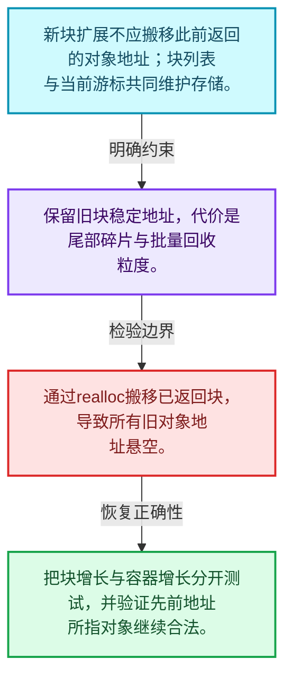
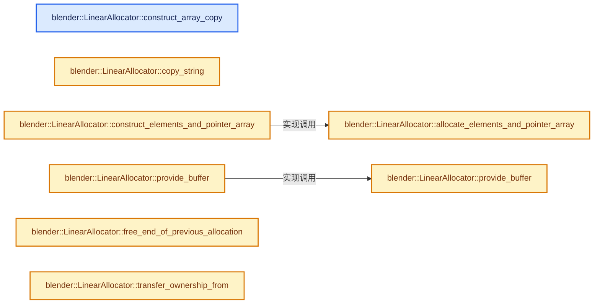
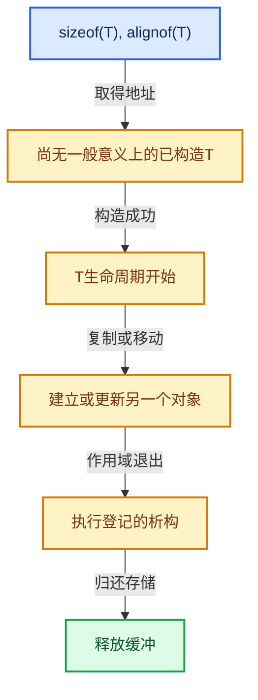

# 03-03 LinearAllocator分配与扩展

[方向导航](README.md) · [总目录](../README.md) · [实现索引](../%E7%AC%A6%E5%8F%B7%E4%BE%9D%E8%B5%96%E4%B8%8E%E5%AE%9E%E7%8E%B0%E7%B4%A2%E5%BC%95.md)

## 从问题到实现

当前块不足时如何保留已返回地址？

增加缓冲块可避免搬移已有对象；分配器自身增长和容器元素增长是不同的问题。

**数据模型**

新块扩展不应搬移此前返回的对象地址；块列表与当前游标共同维护存储。

**设计取舍**

保留旧块稳定地址，代价是尾部碎片与批量回收粒度。

**最小反例**

通过realloc搬移已返回块，导致所有旧对象地址悬空。

**推导**

把块增长与容器增长分开测试，并验证先前地址所指对象继续合法。

## 阅读地图与执行推演








图中的数值推演是本方向的教学模型；实际函数之间的调用边与概念分析边分别标注，不能把概念关系当作运行时调度顺序。

## 完整源码单元与就地讲解

中文讲解直接放在相关代码旁，复杂机制在代码下展开。原文折叠区保留基准行号；不需要在行号表和函数之间来回查找。类布局可分段展示，函数实现不按固定行数切开。

### 类型布局、声明与编译条件 · BLI_linear_allocator.hh L156—L159

<!-- annotated:dcb80aefdbc31b -->

```cpp

  /**
   * Copy the given array into a memory buffer provided by this allocator.
   */
```

<details>
<summary>核对原始源码：source/blender/blenlib/BLI_linear_allocator.hh · L156—L159</summary>

<!-- original:dcb80aefdbc31b:source/blender/blenlib/BLI_linear_allocator.hh:156:159 -->

```cpp

  /**
   * Copy the given array into a memory buffer provided by this allocator.
   */
```

</details>

<a id="f-624dae6e50cb3ee4"></a>

### `blender::LinearAllocator::construct_array_copy`

实现位置：[source/blender/blenlib/BLI_linear_allocator.hh](../../../../../source/blender/blenlib/BLI_linear_allocator.hh) · L160—L168。

接口参数：

- `Span<T> src`

**教学注释版**

<!-- annotated:5eeb6dc50829ee -->

```cpp
  template<typename T> MutableSpan<T> construct_array_copy(Span<T> src)
  {
    // [讲解] src.is_empty：查询视图长度或生成对应有效索引区间。
    if (src.is_empty()) {
      return {};
    }
    // [讲解] src.size：查询视图长度或生成对应有效索引区间。
    MutableSpan<T> dst = this->allocate_array<T>(src.size());
    // [讲解] src.data：返回借用范围的地址。
    uninitialized_copy_n(src.data(), src.size(), dst.data());
    return dst;
  }
```

<details>
<summary>核对原始源码：source/blender/blenlib/BLI_linear_allocator.hh · L160—L168</summary>

<!-- original:5eeb6dc50829ee:source/blender/blenlib/BLI_linear_allocator.hh:160:168 -->

```cpp
  template<typename T> MutableSpan<T> construct_array_copy(Span<T> src)
  {
    if (src.is_empty()) {
      return {};
    }
    MutableSpan<T> dst = this->allocate_array<T>(src.size());
    uninitialized_copy_n(src.data(), src.size(), dst.data());
    return dst;
  }
```

</details>

**结果出口**

- `return {};`
- `return dst;`

**继续追踪实现**

- `src.is_empty` → [blender::Span::is_empty · L264](../01-%E5%9F%BA%E7%A1%80%E5%AE%B9%E5%99%A8%E4%B8%8E%E7%8E%B0%E4%BB%A3CPP/05-Span%E5%8F%AA%E8%AF%BB%E8%BF%9E%E7%BB%AD%E8%A7%86%E5%9B%BE.md#f-8cc1d7ba8feb50e6)。
- `this->allocate_array<T>` → [blender::LinearAllocator::allocate_array · L115](02-LinearAllocator%E5%B8%83%E5%B1%80.md#f-a4f71808bf7434ab)；[blender::LinearAllocator::allocate_array · L122](02-LinearAllocator%E5%B8%83%E5%B1%80.md#f-3957475aeffc5dc7)。同名重载需按实参类型选择。
- `src.size` → [blender::Span::size · L256](../01-%E5%9F%BA%E7%A1%80%E5%AE%B9%E5%99%A8%E4%B8%8E%E7%8E%B0%E4%BB%A3CPP/05-Span%E5%8F%AA%E8%AF%BB%E8%BF%9E%E7%BB%AD%E8%A7%86%E5%9B%BE.md#f-5f80fa006089c998)。
- `uninitialized_copy_n` → [blender::uninitialized_copy_n · L53](../01-%E5%9F%BA%E7%A1%80%E5%AE%B9%E5%99%A8%E4%B8%8E%E7%8E%B0%E4%BB%A3CPP/01-%E5%AF%B9%E8%B1%A1%E7%94%9F%E5%91%BD%E5%91%A8%E6%9C%9F%E4%B8%8E%E5%80%BC%E7%B1%BB%E5%88%AB.md#f-6cd63ebede164cd2)。
- `src.data` → [blender::Span::data · L219](../01-%E5%9F%BA%E7%A1%80%E5%AE%B9%E5%99%A8%E4%B8%8E%E7%8E%B0%E4%BB%A3CPP/05-Span%E5%8F%AA%E8%AF%BB%E8%BF%9E%E7%BB%AD%E8%A7%86%E5%9B%BE.md#f-10c5889198935800)。
- `dst.data` → [blender::MutableSpan::data · L545](../01-%E5%9F%BA%E7%A1%80%E5%AE%B9%E5%99%A8%E4%B8%8E%E7%8E%B0%E4%BB%A3CPP/06-MutableSpan%E5%8F%AF%E5%86%99%E8%A7%86%E5%9B%BE.md#f-eb45a6e4d8211efd)。

### 类型布局、声明与编译条件 · BLI_linear_allocator.hh L169—L173

<!-- annotated:298960f6dde732 -->

```cpp

  /**
   * Copy the given string into a memory buffer provided by this allocator. The returned string is
   * always null terminated.
   */
```

<details>
<summary>核对原始源码：source/blender/blenlib/BLI_linear_allocator.hh · L169—L173</summary>

<!-- original:298960f6dde732:source/blender/blenlib/BLI_linear_allocator.hh:169:173 -->

```cpp

  /**
   * Copy the given string into a memory buffer provided by this allocator. The returned string is
   * always null terminated.
   */
```

</details>

<a id="f-78f19108ed967ade"></a>

### `blender::LinearAllocator::copy_string`

实现位置：[source/blender/blenlib/BLI_linear_allocator.hh](../../../../../source/blender/blenlib/BLI_linear_allocator.hh) · L174—L180。

接口参数：

- `StringRef str`

**教学注释版**

<!-- annotated:478e9fbd3fc27e -->

```cpp
  StringRefNull copy_string(StringRef str)
  {
    const int64_t alloc_size = str.size() + 1;
    char *buffer = static_cast<char *>(this->allocate(alloc_size, 1));
    str.copy_unsafe(buffer);
    return StringRefNull(static_cast<const char *>(buffer));
  }
```

<details>
<summary>核对原始源码：source/blender/blenlib/BLI_linear_allocator.hh · L174—L180</summary>

<!-- original:478e9fbd3fc27e:source/blender/blenlib/BLI_linear_allocator.hh:174:180 -->

```cpp
  StringRefNull copy_string(StringRef str)
  {
    const int64_t alloc_size = str.size() + 1;
    char *buffer = static_cast<char *>(this->allocate(alloc_size, 1));
    str.copy_unsafe(buffer);
    return StringRefNull(static_cast<const char *>(buffer));
  }
```

</details>

**结果出口**

- `return StringRefNull(static_cast<const char *>(buffer));`

**继续追踪实现**

- `str.size` → [调用协议](../%E6%A8%A1%E6%9D%BF%E5%AE%8F%E4%B8%8E%E5%8A%A8%E6%80%81%E5%88%86%E6%B4%BE%E5%8D%8F%E8%AE%AE.md)：由接收对象具体类型或运行时策略提供实现。调用位置L176。
- `this->allocate` → [blender::LinearAllocator::allocate · L66](02-LinearAllocator%E5%B8%83%E5%B1%80.md#f-26209c6a21e04bc0)；[blender::LinearAllocator::allocate · L99](02-LinearAllocator%E5%B8%83%E5%B1%80.md#f-b34ac68f2e3d66f1)；[blender::LinearAllocator::allocate · L105](02-LinearAllocator%E5%B8%83%E5%B1%80.md#f-96480f78749ba1c7)。同名重载需按实参类型选择。
- `str.copy_unsafe` → [blender::StringRefBase::copy_unsafe · L248](../01-%E5%9F%BA%E7%A1%80%E5%AE%B9%E5%99%A8%E4%B8%8E%E7%8E%B0%E4%BB%A3CPP/15-StringRef%E5%AD%97%E7%AC%A6%E4%B8%B2%E8%A7%86%E5%9B%BE.md#f-0616684a44814e0a)。
- `StringRefNull` → [blender::StringRefNull::StringRefNull · L149](../01-%E5%9F%BA%E7%A1%80%E5%AE%B9%E5%99%A8%E4%B8%8E%E7%8E%B0%E4%BB%A3CPP/15-StringRef%E5%AD%97%E7%AC%A6%E4%B8%B2%E8%A7%86%E5%9B%BE.md#f-ebc6ee5f8fc16390)；[blender::StringRefNull::StringRefNull · L496](../01-%E5%9F%BA%E7%A1%80%E5%AE%B9%E5%99%A8%E4%B8%8E%E7%8E%B0%E4%BB%A3CPP/15-StringRef%E5%AD%97%E7%AC%A6%E4%B8%B2%E8%A7%86%E5%9B%BE.md#f-936c98fc0d9ae39e)；[blender::StringRefNull::StringRefNull · L502](../01-%E5%9F%BA%E7%A1%80%E5%AE%B9%E5%99%A8%E4%B8%8E%E7%8E%B0%E4%BB%A3CPP/15-StringRef%E5%AD%97%E7%AC%A6%E4%B8%B2%E8%A7%86%E5%9B%BE.md#f-cf03ac0c28007ee0)；[blender::StringRefNull::StringRefNull · L512](../01-%E5%9F%BA%E7%A1%80%E5%AE%B9%E5%99%A8%E4%B8%8E%E7%8E%B0%E4%BB%A3CPP/15-StringRef%E5%AD%97%E7%AC%A6%E4%B8%B2%E8%A7%86%E5%9B%BE.md#f-8a14273318bc57e1)；[blender::StringRefNull::StringRefNull · L523](../01-%E5%9F%BA%E7%A1%80%E5%AE%B9%E5%99%A8%E4%B8%8E%E7%8E%B0%E4%BB%A3CPP/15-StringRef%E5%AD%97%E7%AC%A6%E4%B8%B2%E8%A7%86%E5%9B%BE.md#f-e1cc63a4ff92775b)。同名重载需按实参类型选择。

<!-- annotated:988d2866dbb668 -->

```cpp

```

<details>
<summary>核对原始源码：source/blender/blenlib/BLI_linear_allocator.hh · L181—L181</summary>

<!-- original:988d2866dbb668:source/blender/blenlib/BLI_linear_allocator.hh:181:181 -->

```cpp

```

</details>

<a id="f-d9310cb93a619dd7"></a>

### `blender::LinearAllocator::allocate_elements_and_pointer_array`

实现位置：[source/blender/blenlib/BLI_linear_allocator.hh](../../../../../source/blender/blenlib/BLI_linear_allocator.hh) · L182—L197。

接口参数：

- `int64_t element_amount`
- `int64_t element_size`
- `int64_t element_alignment`

**教学注释版**

<!-- annotated:e706dd4356616d -->

```cpp
  MutableSpan<void *> allocate_elements_and_pointer_array(int64_t element_amount,
                                                          int64_t element_size,
                                                          int64_t element_alignment)
  {
    void *pointer_buffer = this->allocate(element_amount * sizeof(void *), alignof(void *));
    void *elements_buffer = this->allocate(element_amount * element_size, element_alignment);

    MutableSpan<void *> pointers(static_cast<void **>(pointer_buffer), element_amount);
    void *next_element_buffer = elements_buffer;
    for (int64_t i : IndexRange(element_amount)) {
      pointers[i] = next_element_buffer;
      next_element_buffer = POINTER_OFFSET(next_element_buffer, element_size);
    }

    return pointers;
  }
```

<details>
<summary>核对原始源码：source/blender/blenlib/BLI_linear_allocator.hh · L182—L197</summary>

<!-- original:e706dd4356616d:source/blender/blenlib/BLI_linear_allocator.hh:182:197 -->

```cpp
  MutableSpan<void *> allocate_elements_and_pointer_array(int64_t element_amount,
                                                          int64_t element_size,
                                                          int64_t element_alignment)
  {
    void *pointer_buffer = this->allocate(element_amount * sizeof(void *), alignof(void *));
    void *elements_buffer = this->allocate(element_amount * element_size, element_alignment);

    MutableSpan<void *> pointers(static_cast<void **>(pointer_buffer), element_amount);
    void *next_element_buffer = elements_buffer;
    for (int64_t i : IndexRange(element_amount)) {
      pointers[i] = next_element_buffer;
      next_element_buffer = POINTER_OFFSET(next_element_buffer, element_size);
    }

    return pointers;
  }
```

</details>

**沿实际写入检查状态**

- `pointers[i] = next_element_buffer;`
- `next_element_buffer = POINTER_OFFSET(next_element_buffer, element_size);`

**结果出口**

- `return pointers;`

**继续追踪实现**

- `this->allocate` → [blender::LinearAllocator::allocate · L66](02-LinearAllocator%E5%B8%83%E5%B1%80.md#f-26209c6a21e04bc0)；[blender::LinearAllocator::allocate · L99](02-LinearAllocator%E5%B8%83%E5%B1%80.md#f-b34ac68f2e3d66f1)；[blender::LinearAllocator::allocate · L105](02-LinearAllocator%E5%B8%83%E5%B1%80.md#f-96480f78749ba1c7)。同名重载需按实参类型选择。
- `IndexRange` → [blender::IndexRange](../01-%E5%9F%BA%E7%A1%80%E5%AE%B9%E5%99%A8%E4%B8%8E%E7%8E%B0%E4%BB%A3CPP/%E4%BE%9D%E8%B5%96-BLI_index_range-7d7cc5.md#t-caa3466d6776)；[blender::gpu::shader::parser::IndexRange](../05-%E5%87%A0%E4%BD%95%E5%AD%98%E5%82%A8%E4%B8%8E%E6%8B%93%E6%89%91%E6%98%A0%E5%B0%84/%E4%BE%9D%E8%B5%96-utils-06433d.md#t-82d2bd4ea71c)；[blender::IndexRange](../05-%E5%87%A0%E4%BD%95%E5%AD%98%E5%82%A8%E4%B8%8E%E6%8B%93%E6%89%91%E6%98%A0%E5%B0%84/%E4%BE%9D%E8%B5%96-DNA_node_types-6708b9.md#t-0448cc889d39)。
- `POINTER_OFFSET` → [POINTER_OFFSET · L316](../01-%E5%9F%BA%E7%A1%80%E5%AE%B9%E5%99%A8%E4%B8%8E%E7%8E%B0%E4%BB%A3CPP/%E4%BE%9D%E8%B5%96-BLI_utildefines-293a0a.md#m-c812e199f26c)。宏定义由构建条件选择。

<!-- annotated:ed56a239b02a07 -->

```cpp

```

<details>
<summary>核对原始源码：source/blender/blenlib/BLI_linear_allocator.hh · L198—L198</summary>

<!-- original:ed56a239b02a07:source/blender/blenlib/BLI_linear_allocator.hh:198:198 -->

```cpp

```

</details>

<a id="f-d029a9d5abd4ee87"></a>

### `blender::LinearAllocator::construct_elements_and_pointer_array`

实现位置：[source/blender/blenlib/BLI_linear_allocator.hh](../../../../../source/blender/blenlib/BLI_linear_allocator.hh) · L199—L211。

接口参数：

- `int64_t n`

**教学注释版**

<!-- annotated:000b2bcff78a7b -->

```cpp
  template<typename T, typename... Args>
  Span<T *> construct_elements_and_pointer_array(int64_t n, Args &&...args)
  {
    MutableSpan<void *> void_pointers = this->allocate_elements_and_pointer_array(
        n, sizeof(T), alignof(T));
    // [讲解] void_pointers.cast<T *>：按类型与布局约束重新解释视图。
    MutableSpan<T *> pointers = void_pointers.cast<T *>();

    for (int64_t i : IndexRange(n)) {
      // [讲解] std::forward<Args>：在转发引用中恢复调用者传入的值类别；依赖推导类型，不能与无条件move互换。
      new (static_cast<void *>(pointers[i])) T(std::forward<Args>(args)...);
    }

    return pointers;
  }
```

<details>
<summary>核对原始源码：source/blender/blenlib/BLI_linear_allocator.hh · L199—L211</summary>

<!-- original:000b2bcff78a7b:source/blender/blenlib/BLI_linear_allocator.hh:199:211 -->

```cpp
  template<typename T, typename... Args>
  Span<T *> construct_elements_and_pointer_array(int64_t n, Args &&...args)
  {
    MutableSpan<void *> void_pointers = this->allocate_elements_and_pointer_array(
        n, sizeof(T), alignof(T));
    MutableSpan<T *> pointers = void_pointers.cast<T *>();

    for (int64_t i : IndexRange(n)) {
      new (static_cast<void *>(pointers[i])) T(std::forward<Args>(args)...);
    }

    return pointers;
  }
```

</details>

**结果出口**

- `return pointers;`

**继续追踪实现**

- `this->allocate_elements_and_pointer_array` → [blender::LinearAllocator::allocate_elements_and_pointer_array · L182](03-LinearAllocator%E5%88%86%E9%85%8D%E4%B8%8E%E6%89%A9%E5%B1%95.md#f-d9310cb93a619dd7)。
- `void_pointers.cast<T *>` → [blender::MutableSpan::cast · L755](../01-%E5%9F%BA%E7%A1%80%E5%AE%B9%E5%99%A8%E4%B8%8E%E7%8E%B0%E4%BB%A3CPP/06-MutableSpan%E5%8F%AF%E5%86%99%E8%A7%86%E5%9B%BE.md#f-360354e608371779)。
- `IndexRange` → [blender::IndexRange](../01-%E5%9F%BA%E7%A1%80%E5%AE%B9%E5%99%A8%E4%B8%8E%E7%8E%B0%E4%BB%A3CPP/%E4%BE%9D%E8%B5%96-BLI_index_range-7d7cc5.md#t-caa3466d6776)；[blender::gpu::shader::parser::IndexRange](../05-%E5%87%A0%E4%BD%95%E5%AD%98%E5%82%A8%E4%B8%8E%E6%8B%93%E6%89%91%E6%98%A0%E5%B0%84/%E4%BE%9D%E8%B5%96-utils-06433d.md#t-82d2bd4ea71c)；[blender::IndexRange](../05-%E5%87%A0%E4%BD%95%E5%AD%98%E5%82%A8%E4%B8%8E%E6%8B%93%E6%89%91%E6%98%A0%E5%B0%84/%E4%BE%9D%E8%B5%96-DNA_node_types-6708b9.md#t-0448cc889d39)。
- `std::forward<Args>` → [外部契约](https://eel.is/c++draft/utility.forward)：在转发引用中恢复调用者传入的值类别；依赖推导类型，不能与无条件move互换。

### 类型布局、声明与编译条件 · BLI_linear_allocator.hh L212—L216

<!-- annotated:4e6b0332ef489c -->

```cpp

  /**
   * Tell the allocator to use up the given memory buffer, before allocating new memory from the
   * system.
   */
```

<details>
<summary>核对原始源码：source/blender/blenlib/BLI_linear_allocator.hh · L212—L216</summary>

<!-- original:4e6b0332ef489c:source/blender/blenlib/BLI_linear_allocator.hh:212:216 -->

```cpp

  /**
   * Tell the allocator to use up the given memory buffer, before allocating new memory from the
   * system.
   */
```

</details>

<a id="f-7fb26e552e8c2077"></a>

### `blender::LinearAllocator::provide_buffer`

实现位置：[source/blender/blenlib/BLI_linear_allocator.hh](../../../../../source/blender/blenlib/BLI_linear_allocator.hh) · L217—L222。

接口参数：

- `void *buffer`
- `const int64_t size`

**教学注释版**

<!-- annotated:eea2f8f4a3efcc -->

```cpp
  void provide_buffer(void *buffer, const int64_t size)
  {
    BLI_assert(owned_buffers_.is_empty());
    current_begin_ = uintptr_t(buffer);
    current_end_ = current_begin_ + size;
  }
```

<details>
<summary>核对原始源码：source/blender/blenlib/BLI_linear_allocator.hh · L217—L222</summary>

<!-- original:eea2f8f4a3efcc:source/blender/blenlib/BLI_linear_allocator.hh:217:222 -->

```cpp
  void provide_buffer(void *buffer, const int64_t size)
  {
    BLI_assert(owned_buffers_.is_empty());
    current_begin_ = uintptr_t(buffer);
    current_end_ = current_begin_ + size;
  }
```

</details>

**沿实际写入检查状态**

- `current_begin_ = uintptr_t(buffer);`
- `current_end_ = current_begin_ + size;`

**继续追踪实现**

- `BLI_assert` → [BLI_assert · L48](../01-%E5%9F%BA%E7%A1%80%E5%AE%B9%E5%99%A8%E4%B8%8E%E7%8E%B0%E4%BB%A3CPP/%E4%BE%9D%E8%B5%96-BLI_assert-cc98e8.md#m-57a88495704d)；[BLI_assert · L63](../01-%E5%9F%BA%E7%A1%80%E5%AE%B9%E5%99%A8%E4%B8%8E%E7%8E%B0%E4%BB%A3CPP/%E4%BE%9D%E8%B5%96-BLI_assert-cc98e8.md#m-d07050020cb5)。宏定义由构建条件选择。
- `owned_buffers_.is_empty` → [blender::Vector::is_empty · L792](../01-%E5%9F%BA%E7%A1%80%E5%AE%B9%E5%99%A8%E4%B8%8E%E7%8E%B0%E4%BB%A3CPP/11-Vector%E6%8F%92%E5%85%A5%E5%88%A0%E9%99%A4%E4%B8%8E%E9%87%8D%E6%8E%92.md#f-937bbd9cb80bdcc8)。

<!-- annotated:9eb15aa8842872 -->

```cpp

```

<details>
<summary>核对原始源码：source/blender/blenlib/BLI_linear_allocator.hh · L223—L223</summary>

<!-- original:9eb15aa8842872:source/blender/blenlib/BLI_linear_allocator.hh:223:223 -->

```cpp

```

</details>

<a id="f-f477894fce14f489"></a>

### `blender::LinearAllocator::provide_buffer`

实现位置：[source/blender/blenlib/BLI_linear_allocator.hh](../../../../../source/blender/blenlib/BLI_linear_allocator.hh) · L224—L228。

接口参数：

- `AlignedBuffer<Size, Alignment> &aligned_buffer`

**教学注释版**

<!-- annotated:5663f5f2dcdb51 -->

```cpp
  template<size_t Size, size_t Alignment>
  void provide_buffer(AlignedBuffer<Size, Alignment> &aligned_buffer)
  {
    this->provide_buffer(aligned_buffer.ptr(), Size);
  }
```

<details>
<summary>核对原始源码：source/blender/blenlib/BLI_linear_allocator.hh · L224—L228</summary>

<!-- original:5663f5f2dcdb51:source/blender/blenlib/BLI_linear_allocator.hh:224:228 -->

```cpp
  template<size_t Size, size_t Alignment>
  void provide_buffer(AlignedBuffer<Size, Alignment> &aligned_buffer)
  {
    this->provide_buffer(aligned_buffer.ptr(), Size);
  }
```

</details>

**继续追踪实现**

- `this->provide_buffer` → [blender::LinearAllocator::provide_buffer · L217](03-LinearAllocator%E5%88%86%E9%85%8D%E4%B8%8E%E6%89%A9%E5%B1%95.md#f-7fb26e552e8c2077)；[blender::LinearAllocator::provide_buffer · L224](03-LinearAllocator%E5%88%86%E9%85%8D%E4%B8%8E%E6%89%A9%E5%B1%95.md#f-f477894fce14f489)。同名重载需按实参类型选择。
- `aligned_buffer.ptr` → [blender::AlignedBuffer::ptr · L138](../01-%E5%9F%BA%E7%A1%80%E5%AE%B9%E5%99%A8%E4%B8%8E%E7%8E%B0%E4%BB%A3CPP/01-%E5%AF%B9%E8%B1%A1%E7%94%9F%E5%91%BD%E5%91%A8%E6%9C%9F%E4%B8%8E%E5%80%BC%E7%B1%BB%E5%88%AB.md#f-bfe745bcb7c7811c)；[blender::AlignedBuffer::ptr · L143](../01-%E5%9F%BA%E7%A1%80%E5%AE%B9%E5%99%A8%E4%B8%8E%E7%8E%B0%E4%BB%A3CPP/01-%E5%AF%B9%E8%B1%A1%E7%94%9F%E5%91%BD%E5%91%A8%E6%9C%9F%E4%B8%8E%E5%80%BC%E7%B1%BB%E5%88%AB.md#f-f24632360e6cd028)。同名重载需按实参类型选择。

### 类型布局、声明与编译条件 · BLI_linear_allocator.hh L229—L240

<!-- annotated:45914ca7292521 -->

```cpp

  /**
   * Some algorithms can be implemented more efficiently by over-allocating the destination memory
   * a bit. This allows the algorithm not to worry about having enough memory. Generally, this can
   * be a useful strategy if the actual required memory is not known in advance, but an upper bound
   * can be found. Ideally, one can free the over-allocated memory in the end again to reduce
   * memory consumption.
   *
   * A linear allocator generally does allow freeing any memory. However, there is one exception.
   * One can free the end of the last allocation (but not any previous allocation). While uses of
   * this approach are quite limited, it's still the best option in some situations.
   */
```

<details>
<summary>核对原始源码：source/blender/blenlib/BLI_linear_allocator.hh · L229—L240</summary>

<!-- original:45914ca7292521:source/blender/blenlib/BLI_linear_allocator.hh:229:240 -->

```cpp

  /**
   * Some algorithms can be implemented more efficiently by over-allocating the destination memory
   * a bit. This allows the algorithm not to worry about having enough memory. Generally, this can
   * be a useful strategy if the actual required memory is not known in advance, but an upper bound
   * can be found. Ideally, one can free the over-allocated memory in the end again to reduce
   * memory consumption.
   *
   * A linear allocator generally does allow freeing any memory. However, there is one exception.
   * One can free the end of the last allocation (but not any previous allocation). While uses of
   * this approach are quite limited, it's still the best option in some situations.
   */
```

</details>

<a id="f-1f42aa4765087f6b"></a>

### `blender::LinearAllocator::free_end_of_previous_allocation`

实现位置：[source/blender/blenlib/BLI_linear_allocator.hh](../../../../../source/blender/blenlib/BLI_linear_allocator.hh) · L241—L260。

接口参数：

- `const int64_t original_allocation_size`
- `const void *free_after`

**教学注释版**

<!-- annotated:f691b706206ebc -->

```cpp
  void free_end_of_previous_allocation(const int64_t original_allocation_size,
                                       const void *free_after)
  {
    /* If the original allocation size was large, it might have been separately allocated. In this
     * case, we can't free the end of it anymore. */
    if (original_allocation_size <= large_buffer_threshold) {
      const int64_t new_begin = int64_t(uintptr_t(free_after));
      BLI_assert(new_begin <= current_begin_);
#ifndef NDEBUG
      /* This condition is not really necessary but it helps finding the cases where memory was
       * freed. */
      const int64_t freed_bytes_num = current_begin_ - new_begin;
      if (freed_bytes_num > 0) {
        current_begin_ = new_begin;
      }
#else
      current_begin_ = new_begin;
#endif
    }
  }
```

<details>
<summary>核对原始源码：source/blender/blenlib/BLI_linear_allocator.hh · L241—L260</summary>

<!-- original:f691b706206ebc:source/blender/blenlib/BLI_linear_allocator.hh:241:260 -->

```cpp
  void free_end_of_previous_allocation(const int64_t original_allocation_size,
                                       const void *free_after)
  {
    /* If the original allocation size was large, it might have been separately allocated. In this
     * case, we can't free the end of it anymore. */
    if (original_allocation_size <= large_buffer_threshold) {
      const int64_t new_begin = int64_t(uintptr_t(free_after));
      BLI_assert(new_begin <= current_begin_);
#ifndef NDEBUG
      /* This condition is not really necessary but it helps finding the cases where memory was
       * freed. */
      const int64_t freed_bytes_num = current_begin_ - new_begin;
      if (freed_bytes_num > 0) {
        current_begin_ = new_begin;
      }
#else
      current_begin_ = new_begin;
#endif
    }
  }
```

</details>

**沿实际写入检查状态**

- `current_begin_ = new_begin;`

**继续追踪实现**

- `BLI_assert` → [BLI_assert · L48](../01-%E5%9F%BA%E7%A1%80%E5%AE%B9%E5%99%A8%E4%B8%8E%E7%8E%B0%E4%BB%A3CPP/%E4%BE%9D%E8%B5%96-BLI_assert-cc98e8.md#m-57a88495704d)；[BLI_assert · L63](../01-%E5%9F%BA%E7%A1%80%E5%AE%B9%E5%99%A8%E4%B8%8E%E7%8E%B0%E4%BB%A3CPP/%E4%BE%9D%E8%B5%96-BLI_assert-cc98e8.md#m-d07050020cb5)。宏定义由构建条件选择。

### 类型布局、声明与编译条件 · BLI_linear_allocator.hh L261—L268

<!-- annotated:7e040b7793db37 -->

```cpp

  /**
   * This allocator takes ownership of the buffers owned by `other`. Therefor, when `other` is
   * destructed, memory allocated using it is not freed.
   *
   * Note that the caller is responsible for making sure that buffers passed into #provide_buffer
   * of `other` live at least as long as this allocator.
   */
```

<details>
<summary>核对原始源码：source/blender/blenlib/BLI_linear_allocator.hh · L261—L268</summary>

<!-- original:7e040b7793db37:source/blender/blenlib/BLI_linear_allocator.hh:261:268 -->

```cpp

  /**
   * This allocator takes ownership of the buffers owned by `other`. Therefor, when `other` is
   * destructed, memory allocated using it is not freed.
   *
   * Note that the caller is responsible for making sure that buffers passed into #provide_buffer
   * of `other` live at least as long as this allocator.
   */
```

</details>

<a id="f-a434086fde13dfa2"></a>

### `blender::LinearAllocator::transfer_ownership_from`

实现位置：[source/blender/blenlib/BLI_linear_allocator.hh](../../../../../source/blender/blenlib/BLI_linear_allocator.hh) · L269—L279。

接口参数：

- `LinearAllocator<> &other`

**教学注释版**

<!-- annotated:6dc5da034f1583 -->

```cpp
  void transfer_ownership_from(LinearAllocator<> &other)
  {
    // [讲解] owned_buffers_.extend：将一段来源元素加入尾部。
    owned_buffers_.extend(other.owned_buffers_);
#ifdef BLI_DEBUG_LINEAR_ALLOCATOR_SIZE
    user_requested_size_ += other.user_requested_size_;
    owned_allocation_size_ += other.owned_allocation_size_;
#endif
    other.owned_buffers_.clear();
    std::destroy_at(&other);
    new (&other) LinearAllocator<>();
  }
```

<details>
<summary>核对原始源码：source/blender/blenlib/BLI_linear_allocator.hh · L269—L279</summary>

<!-- original:6dc5da034f1583:source/blender/blenlib/BLI_linear_allocator.hh:269:279 -->

```cpp
  void transfer_ownership_from(LinearAllocator<> &other)
  {
    owned_buffers_.extend(other.owned_buffers_);
#ifdef BLI_DEBUG_LINEAR_ALLOCATOR_SIZE
    user_requested_size_ += other.user_requested_size_;
    owned_allocation_size_ += other.owned_allocation_size_;
#endif
    other.owned_buffers_.clear();
    std::destroy_at(&other);
    new (&other) LinearAllocator<>();
  }
```

</details>

**沿实际写入检查状态**

- `user_requested_size_ += other.user_requested_size_;`
- `owned_allocation_size_ += other.owned_allocation_size_;`

**继续追踪实现**

- `owned_buffers_.extend` → [blender::Vector::extend · L595](../01-%E5%9F%BA%E7%A1%80%E5%AE%B9%E5%99%A8%E4%B8%8E%E7%8E%B0%E4%BB%A3CPP/11-Vector%E6%8F%92%E5%85%A5%E5%88%A0%E9%99%A4%E4%B8%8E%E9%87%8D%E6%8E%92.md#f-fe6fcb7d09beded9)；[blender::Vector::extend · L599](../01-%E5%9F%BA%E7%A1%80%E5%AE%B9%E5%99%A8%E4%B8%8E%E7%8E%B0%E4%BB%A3CPP/11-Vector%E6%8F%92%E5%85%A5%E5%88%A0%E9%99%A4%E4%B8%8E%E9%87%8D%E6%8E%92.md#f-40095c219019e2f9)；[blender::Vector::extend · L613](../01-%E5%9F%BA%E7%A1%80%E5%AE%B9%E5%99%A8%E4%B8%8E%E7%8E%B0%E4%BB%A3CPP/11-Vector%E6%8F%92%E5%85%A5%E5%88%A0%E9%99%A4%E4%B8%8E%E9%87%8D%E6%8E%92.md#f-4d2e556cd7412fe4)；[blender::Vector::extend · L650](../01-%E5%9F%BA%E7%A1%80%E5%AE%B9%E5%99%A8%E4%B8%8E%E7%8E%B0%E4%BB%A3CPP/11-Vector%E6%8F%92%E5%85%A5%E5%88%A0%E9%99%A4%E4%B8%8E%E9%87%8D%E6%8E%92.md#f-ae44ad8b3f05b082)。同名重载需按实参类型选择。
- `other.owned_buffers_.clear` → [调用协议](../%E6%A8%A1%E6%9D%BF%E5%AE%8F%E4%B8%8E%E5%8A%A8%E6%80%81%E5%88%86%E6%B4%BE%E5%8D%8F%E8%AE%AE.md)：接收对象类型依赖auto、返回值或模板实例；不按同名猜测目标。调用位置L276。
- `std::destroy_at` → [外部契约](https://eel.is/c++draft/)：这个边界按实际表达式及所属类型核对参数、返回值、寿命与失败行为。这里提供接口入口，不声称已解释该第三方版本的内部实现。

### 类型布局、声明与编译条件 · BLI_linear_allocator.hh L280—L281

<!-- annotated:78cf924a718a27 -->

```cpp

 private:
```

<details>
<summary>核对原始源码：source/blender/blenlib/BLI_linear_allocator.hh · L280—L281</summary>

<!-- original:78cf924a718a27:source/blender/blenlib/BLI_linear_allocator.hh:280:281 -->

```cpp

 private:
```

</details>

<a id="f-322a6ab25072a895"></a>

### `blender::LinearAllocator::allocate_new_buffer`

实现位置：[source/blender/blenlib/BLI_linear_allocator.hh](../../../../../source/blender/blenlib/BLI_linear_allocator.hh) · L282—L298。

接口参数：

- `int64_t min_allocation_size`
- `int64_t min_alignment`

**教学注释版**

<!-- annotated:99d2c7c0e71cc7 -->

```cpp
  void allocate_new_buffer(int64_t min_allocation_size, int64_t min_alignment)
  {
    /* Possibly allocate more bytes than necessary for the current allocation. This way more small
     * allocations can be packed together. Large buffers are allocated exactly to avoid wasting too
     * much memory. */
    int64_t size_in_bytes = min_allocation_size;
    if (size_in_bytes <= large_buffer_threshold) {
      /* Gradually grow buffer size with each allocation, up to a maximum. */
      // [讲解] std::min<int>：按比较关系选取较小值；截断范围时还需先满足非负和可表示范围，min本身不会证明边界安全。
      const int grow_size = 1 << std::min<int>(owned_buffers_.size() + 6, 20);
      size_in_bytes = std::min(large_buffer_threshold,
                               // [讲解] std::max<int64_t>：按比较关系选取较大值。本讲解中的增长公式同时满足最低请求和几何增长；若保存返回引用，还需注意实参寿命。
                               std::max<int64_t>(size_in_bytes, grow_size));
    }

    void *buffer = this->allocated_owned(size_in_bytes, min_alignment);
    current_begin_ = uintptr_t(buffer);
    current_end_ = current_begin_ + size_in_bytes;
  }
```

<details>
<summary>核对原始源码：source/blender/blenlib/BLI_linear_allocator.hh · L282—L298</summary>

<!-- original:99d2c7c0e71cc7:source/blender/blenlib/BLI_linear_allocator.hh:282:298 -->

```cpp
  void allocate_new_buffer(int64_t min_allocation_size, int64_t min_alignment)
  {
    /* Possibly allocate more bytes than necessary for the current allocation. This way more small
     * allocations can be packed together. Large buffers are allocated exactly to avoid wasting too
     * much memory. */
    int64_t size_in_bytes = min_allocation_size;
    if (size_in_bytes <= large_buffer_threshold) {
      /* Gradually grow buffer size with each allocation, up to a maximum. */
      const int grow_size = 1 << std::min<int>(owned_buffers_.size() + 6, 20);
      size_in_bytes = std::min(large_buffer_threshold,
                               std::max<int64_t>(size_in_bytes, grow_size));
    }

    void *buffer = this->allocated_owned(size_in_bytes, min_alignment);
    current_begin_ = uintptr_t(buffer);
    current_end_ = current_begin_ + size_in_bytes;
  }
```

</details>

**沿实际写入检查状态**

- `size_in_bytes = std::min(large_buffer_threshold,`
- `current_begin_ = uintptr_t(buffer);`
- `current_end_ = current_begin_ + size_in_bytes;`

**继续追踪实现**

- `std::min<int>` → [外部契约](https://eel.is/c++draft/alg.min.max)：按比较关系选取较小值；截断范围时还需先满足非负和可表示范围，min本身不会证明边界安全。
- `owned_buffers_.size` → [blender::Vector::size · L780](../01-%E5%9F%BA%E7%A1%80%E5%AE%B9%E5%99%A8%E4%B8%8E%E7%8E%B0%E4%BB%A3CPP/11-Vector%E6%8F%92%E5%85%A5%E5%88%A0%E9%99%A4%E4%B8%8E%E9%87%8D%E6%8E%92.md#f-714773731767349c)。
- `std::min` → [外部契约](https://eel.is/c++draft/alg.min.max)：按比较关系选取较小值；截断范围时还需先满足非负和可表示范围，min本身不会证明边界安全。
- `std::max<int64_t>` → [外部契约](https://eel.is/c++draft/alg.min.max)：按比较关系选取较大值。本讲解中的增长公式同时满足最低请求和几何增长；若保存返回引用，还需注意实参寿命。
- `this->allocated_owned` → [blender::LinearAllocator::allocated_owned · L305](03-LinearAllocator%E5%88%86%E9%85%8D%E4%B8%8E%E6%89%A9%E5%B1%95.md#f-124e3cce12f1f5cf)。

<!-- annotated:4a67795435f32c -->

```cpp

```

<details>
<summary>核对原始源码：source/blender/blenlib/BLI_linear_allocator.hh · L299—L299</summary>

<!-- original:4a67795435f32c:source/blender/blenlib/BLI_linear_allocator.hh:299:299 -->

```cpp

```

</details>

<a id="f-669bf2dc9b5416a6"></a>

### `blender::LinearAllocator::allocator_large_buffer`

实现位置：[source/blender/blenlib/BLI_linear_allocator.hh](../../../../../source/blender/blenlib/BLI_linear_allocator.hh) · L300—L303。

接口参数：

- `const int64_t size`
- `const int64_t alignment`

**教学注释版**

<!-- annotated:abe0b54fac6d33 -->

```cpp
  void *allocator_large_buffer(const int64_t size, const int64_t alignment)
  {
    return this->allocated_owned(size, alignment);
  }
```

<details>
<summary>核对原始源码：source/blender/blenlib/BLI_linear_allocator.hh · L300—L303</summary>

<!-- original:abe0b54fac6d33:source/blender/blenlib/BLI_linear_allocator.hh:300:303 -->

```cpp
  void *allocator_large_buffer(const int64_t size, const int64_t alignment)
  {
    return this->allocated_owned(size, alignment);
  }
```

</details>

**结果出口**

- `return this->allocated_owned(size, alignment);`

**继续追踪实现**

- `this->allocated_owned` → [blender::LinearAllocator::allocated_owned · L305](03-LinearAllocator%E5%88%86%E9%85%8D%E4%B8%8E%E6%89%A9%E5%B1%95.md#f-124e3cce12f1f5cf)。

<!-- annotated:e522218615b798 -->

```cpp

```

<details>
<summary>核对原始源码：source/blender/blenlib/BLI_linear_allocator.hh · L304—L304</summary>

<!-- original:e522218615b798:source/blender/blenlib/BLI_linear_allocator.hh:304:304 -->

```cpp

```

</details>

<a id="f-124e3cce12f1f5cf"></a>

### `blender::LinearAllocator::allocated_owned`

实现位置：[source/blender/blenlib/BLI_linear_allocator.hh](../../../../../source/blender/blenlib/BLI_linear_allocator.hh) · L305—L313。

接口参数：

- `const int64_t size`
- `const int64_t alignment`

**教学注释版**

<!-- annotated:72e82bafbefa2f -->

```cpp
  void *allocated_owned(const int64_t size, const int64_t alignment)
  {
    void *buffer = allocator_.allocate(size, alignment, __func__);
    // [讲解] owned_buffers_.append：在尾部建立新元素，必要时先扩大存储。
    owned_buffers_.append(buffer);
#ifdef BLI_DEBUG_LINEAR_ALLOCATOR_SIZE
    owned_allocation_size_ += size;
#endif
    return buffer;
  }
```

<details>
<summary>核对原始源码：source/blender/blenlib/BLI_linear_allocator.hh · L305—L313</summary>

<!-- original:72e82bafbefa2f:source/blender/blenlib/BLI_linear_allocator.hh:305:313 -->

```cpp
  void *allocated_owned(const int64_t size, const int64_t alignment)
  {
    void *buffer = allocator_.allocate(size, alignment, __func__);
    owned_buffers_.append(buffer);
#ifdef BLI_DEBUG_LINEAR_ALLOCATOR_SIZE
    owned_allocation_size_ += size;
#endif
    return buffer;
  }
```

</details>

**沿实际写入检查状态**

- `owned_allocation_size_ += size;`

**结果出口**

- `return buffer;`

**继续追踪实现**

- `allocator_.allocate` → [blender::LinearAllocator::allocate · L66](02-LinearAllocator%E5%B8%83%E5%B1%80.md#f-26209c6a21e04bc0)；[blender::LinearAllocator::allocate · L99](02-LinearAllocator%E5%B8%83%E5%B1%80.md#f-b34ac68f2e3d66f1)；[blender::LinearAllocator::allocate · L105](02-LinearAllocator%E5%B8%83%E5%B1%80.md#f-96480f78749ba1c7)。同名重载需按实参类型选择。
- `owned_buffers_.append` → [blender::Vector::append · L498](../01-%E5%9F%BA%E7%A1%80%E5%AE%B9%E5%99%A8%E4%B8%8E%E7%8E%B0%E4%BB%A3CPP/11-Vector%E6%8F%92%E5%85%A5%E5%88%A0%E9%99%A4%E4%B8%8E%E9%87%8D%E6%8E%92.md#f-5bde268a69e443ec)；[blender::Vector::append · L502](../01-%E5%9F%BA%E7%A1%80%E5%AE%B9%E5%99%A8%E4%B8%8E%E7%8E%B0%E4%BB%A3CPP/11-Vector%E6%8F%92%E5%85%A5%E5%88%A0%E9%99%A4%E4%B8%8E%E9%87%8D%E6%8E%92.md#f-591e0b15e6308532)。同名重载需按实参类型选择。

### 类型布局、声明与编译条件 · BLI_linear_allocator.hh L314—L316

<!-- annotated:b3bb23874ed619 -->

```cpp
};

}  // namespace blender
```

<details>
<summary>核对原始源码：source/blender/blenlib/BLI_linear_allocator.hh · L314—L316</summary>

<!-- original:b3bb23874ed619:source/blender/blenlib/BLI_linear_allocator.hh:314:316 -->

```cpp
};

}  // namespace blender
```

</details>

## 语法与相关类型

### 模板 template

模板把类型或常量作为生成实现的参数。读声明时先列出类型参数、非类型参数和默认值，再看使用者实际实例化了什么。模板声明本身不意味着每种T都支持其全部成员。

把T替换为int、string、只能移动的类型，分别检查每个被调用操作是否成立。

### 依赖名称 typename

typename既可引入类型模板参数，也可告诉编译器某个依赖名称是类型。它不创建运行时对象；解析期确认语法类别与实例化期检查具体类型是不同阶段。

区分typename T::value_type和T::size()，前者标记类型，后者是表达式。

### 只读限定 const

const约束当前访问路径可做的修改。const指针、指向const的指针、const视图对象、const元素是不同位置的限定；其他别名可能仍可修改原对象。

分别写T* const、const T*与const T* const，并画出不可修改的层次。

### 完美转发 std::forward

std::forward在转发引用模板中恢复调用者原来的值类别。它依赖推导出的模板实参；无条件move会改变左值调用者的语义。

对同一接口分别传入左值、临时对象和const左值，记录实际重载。

### 显式静态转换 static_cast

static_cast表达编译期允许的转换，不会自动验证运行时真实类型、指针寿命或索引边界。由void指针恢复T指针时，调用者仍须保证实际存储中确有合法T对象。

标出转换前后的类型以及正确性依据来自哪里。

### 对齐 alignof

alignof得到类型要求的地址对齐。分配足够字节后仍需把地址对齐到相应边界，内嵌缓冲也一样。

对齐a为2的幂时可推导向上取整，但仍要考虑溢出与边界。

### 对象表示 sizeof

sizeof给出对象表示大小，不是其引用的所有堆内存总量。sizeof视图很小并不说明底层数组很小。

分别统计容器对象、容量字节和元素拥有的间接资源。

### 构造与new表达式

普通new可能分配并构造；placement new在给定地址构造，存储由其他机制提供。失败回滚应区分两类责任。

追踪地址来自哪里、构造何时成功、由谁析构、由谁释放。

### 内部断言 assert

断言表达开发者预期成立的内部契约，发布构建可能关闭。它不能替代对不可信输入的完整错误处理，也不保证后续操作被运行时保护。

对每条断言构造违反条件的输入，区分调用者错误与应向用户报告的错误。

### 类型别名 using

类型别名为已有类型建立名字，不创建运行期对象。它常把模板内部使用的类型统一暴露给泛型调用者。

展开别名直到基础类型，区分类型别名和变量声明。

## 实现练习与验证

让请求跨越缓冲边界，检查旧地址是否仍在有效块中。

参考推理：把块增长与容器增长分开测试，并验证先前地址所指对象继续合法。

所有存活对象地址满足对齐；构造失败不会被当作成功对象登记；所有资源均有唯一或明确共享的清理责任。

## 历史、跨库比较与证据

与std::pmr::monotonic_buffer_resource比较批量存储回收，与std::any比较拥有型类型擦除；CPPType描述类型操作，本身不保存每个值。

[历史提交索引](../%E5%8E%86%E5%8F%B2%E6%8F%90%E4%BA%A4%E4%B8%8E%E8%AE%BE%E8%AE%A1%E6%BC%94%E5%8C%96%E7%B4%A2%E5%BC%95.md) · [源码基准](../%E6%BA%90%E7%A0%81%E7%89%88%E6%9C%AC%E4%B8%8E%E8%A6%86%E7%9B%96%E7%B4%A2%E5%BC%95.md) · [验收报告](../%E9%AA%8C%E6%94%B6%E6%8A%A5%E5%91%8A.md)
