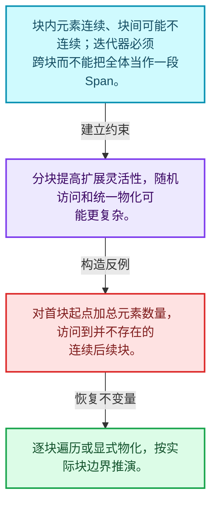
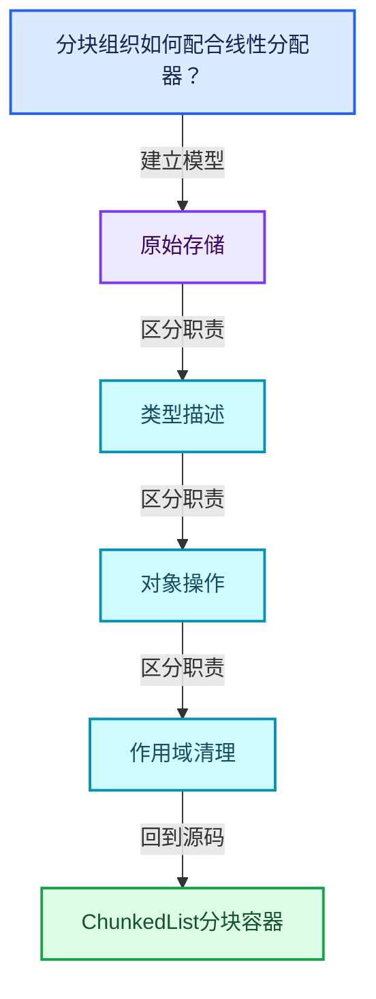
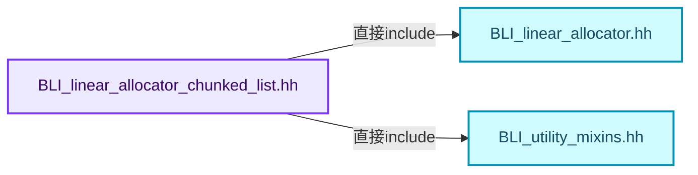
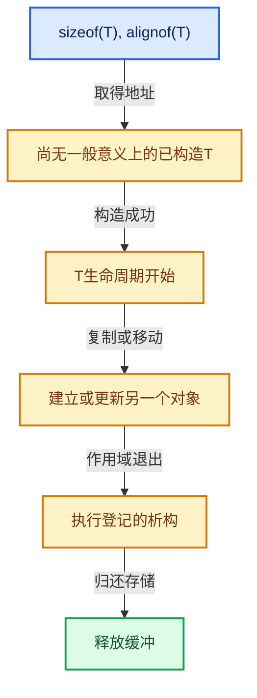

# 03-04 ChunkedList分块容器

[方向导航](README.md) · [总目录](../README.md) · [覆盖索引](../%E6%BA%90%E7%A0%81%E7%89%88%E6%9C%AC%E4%B8%8E%E8%A6%86%E7%9B%96%E7%B4%A2%E5%BC%95.md)

> 阅读顺序：问题与数据模型 → 语法与类型 → 源码逐行 → 调用线索 → 历史与取舍 → 推演和练习。

- 基准 HEAD：`cbda6b96c26c0dee3c3b5cbb93960c4ac06a6b30`。
- 记录日期：2026-10-14。
- 教学示例状态：正文中的推演不是本机性能实测；已运行练习见验收报告。

## 一、从问题到设计

分块组织如何配合线性分配器？

块内连续和块间链接在局部性与扩展之间取舍；遍历顺序与指针稳定性要分别检查。

本篇把语法、数据语义和系统取舍连接起来。把存储分配、对象构造、类型操作和最终清理拆开建模。

### 本篇独立模型与设计推理

块内元素连续、块间可能不连续；迭代器必须跨块而不能把全体当作一段Span。

设计取舍：分块提高扩展灵活性，随机访问和统一物化可能更复杂。

最小反例：对首块起点加总元素数量，访问到并不存在的连续后续块。

推导与处理：逐块遍历或显式物化，按实际块边界推演。



### 源码范围与相邻篇章

| 文件 | 本篇逐行范围 | 基准SHA-256 |
|---|---|---|
| [source/blender/blenlib/BLI_linear_allocator_chunked_list.hh](../../../../../source/blender/blenlib/BLI_linear_allocator_chunked_list.hh) | L1—L209 | `339f52fec2da2544bcd6b8129f0e9a8174745f107f904c1d07217e531de80351` |

同一主讲文件可能分多篇覆盖；超出本篇范围的符号通过覆盖索引定位。空行与纯注释保留在源码摘录中，逐行表解释有效语句与语法边界；许可证头统一保留。

前篇：[LinearAllocator分配与扩展](03-LinearAllocator%E5%88%86%E9%85%8D%E4%B8%8E%E6%89%A9%E5%B1%95.md).

后篇：[ResourceScope销毁责任](05-ResourceScope%E9%94%80%E6%AF%81%E8%B4%A3%E4%BB%BB.md).

## 二、类型、数据与阅读地图



这是概念依赖图，边表示阅读关系，不声称是运行时调用顺序。

### 直接编译依赖



箭头只表示头文件包含关系；完整调用线索见后面的符号定位表。

## 三、关键词、语法与类型角色

### 模板 template

模板把类型或常量作为生成实现的参数。读声明时先列出类型参数、非类型参数和默认值，再看使用者实际实例化了什么。模板声明本身不意味着每种T都支持其全部成员。

具体检查：把T替换为int、string、只能移动的类型，分别检查每个被调用操作是否成立。

### 依赖名称 typename

typename既可引入类型模板参数，也可告诉编译器某个依赖名称是类型。它不创建运行时对象；解析期确认语法类别与实例化期检查具体类型是不同阶段。

具体检查：区分typename T::value_type和T::size()，前者标记类型，后者是表达式。

### 约束 requires

requires表达式或requires子句限制模板参与重载的条件。它提供编译期可用性检查，不是运行时if，不能指望输入到达程序后再被这一机制验证。

具体检查：构造满足和不满足约束的两个类型，观察候选被排除而不是在函数内返回错误。

### 只读限定 const

const约束当前访问路径可做的修改。const指针、指向const的指针、const视图对象、const元素是不同位置的限定；其他别名可能仍可修改原对象。

具体检查：分别写T* const、const T*与const T* const，并画出不可修改的层次。

### 移动转换 std::move

std::move把表达式转换为可供移动重载选择的值类别，实际资源转移发生在被选中的构造或赋值中。对const对象move可能仍调用复制，对视图move也不会获得底层数据所有权。

具体检查：记录移动构造调用次数，不用变量名或std::move的出现次数替代测量。

### 完美转发 std::forward

std::forward在转发引用模板中恢复调用者原来的值类别。它依赖推导出的模板实参；无条件move会改变左值调用者的语义。

具体检查：对同一接口分别传入左值、临时对象和const左值，记录实际重载。

### 构造与new表达式

普通new可能分配并构造；placement new在给定地址构造，存储由其他机制提供。失败回滚应区分两类责任。

具体检查：追踪地址来自哪里、构造何时成功、由谁析构、由谁释放。

### 受控访问 friend

friend授予指定函数或类访问非公开成员的权限，并不意味着继承，也不自动扩展到友元的派生类。

具体检查：解释执行器为何需要访问包装器的内部映射，同时检查边界是否仍清楚。

### 类型别名 using

类型别名为已有类型建立名字，不创建运行期对象。它常把模板内部使用的类型统一暴露给泛型调用者。

具体检查：展开别名直到基础类型，区分类型别名和变量声明。

## 四、真实源码与逐行讲解

源码块保持原行内容，原始行号由小节标题及逐行表给出。表中的调用定位是静态阅读辅助；重载、模板实例化、宏展开和虚调用需结合完整声明，不能仅凭词法出现证明动态调用。

### BLI_linear_allocator_chunked_list.hh：L1—L56

<!-- source:source/blender/blenlib/BLI_linear_allocator_chunked_list.hh:1:56 -->

```cpp
/* SPDX-FileCopyrightText: 2024 Blender Authors
 *
 * SPDX-License-Identifier: GPL-2.0-or-later */

/** \file
 * \ingroup bli
 */

#pragma once

#include <array>

#include "BLI_linear_allocator.hh"
#include "BLI_utility_mixins.hh"

namespace blender::linear_allocator {

/**
 * The list is a linked list of segments containing multiple elements. The capacity of each segment
 * is a template parameter because that removes the need to store it for every segment.
 */
template<typename T, int64_t Capacity> struct ChunkedListSegment {
  /** Pointer to the next segment in the list. */
  ChunkedListSegment *next = nullptr;
  /**
   * Number of constructed elements in this segment. The constructed elements are always at the
   * beginning of the array below.
   */
  int64_t size = 0;
  /**
   * The memory that actually contains the values in the end. The values are constructed and
   * destructed by higher level code.
   */
  std::array<TypedBuffer<T>, Capacity> values;
};

/**
 * This is a special purpose container data structure that can be used to efficiently gather many
 * elements into many (small) lists for later retrieval. The values are iterated in inverse order
 * of insertion.
 *
 * To use this data structure, one has to have a separate #LinearAllocator which is passed to the
 * `append` function. This allows the same allocator to be used by many lists. Passing it into the
 * append function also removes the need to store the allocator pointer in every list.
 *
 * It is an improvement over #Vector because it does not require any reallocations. #VectorList
 * could also be used to overcome the reallocation issue.
 *
 * This data structure is also an improvement over #VectorList because:
 * - It has a much lower memory footprint when empty.
 * - Allows using a #LinearAllocator for all allocations, without storing the pointer to it in
 *   every vector.
 * - It wastes less memory due to over-allocations.
 */
template<typename T, int64_t SegmentCapacity = 4> class ChunkedList : NonCopyable {
 public:
```

| 原始行 | 语义、约束与检查 |
|---|---|
| L9 | 防止同一头文件在一个翻译单元中重复展开；不控制多个源文件之间的链接或对象寿命。 |
| L11 | 引入编译依赖 <array>；这是声明可见性关系，不表示运行时一定调用该文件的所有接口。 |
| L13 | 引入编译依赖 "BLI_linear_allocator.hh"；这是声明可见性关系，不表示运行时一定调用该文件的所有接口。 |
| L14 | 引入编译依赖 "BLI_utility_mixins.hh"；这是声明可见性关系，不表示运行时一定调用该文件的所有接口。 |
| L16 | 把后续声明放入 blender::linear_allocator 命名空间，影响名称查找和符号归属，不创建运行时对象。 |
| L22 | 声明模板参数 `template<typename T, int64_t Capacity> struct ChunkedListSegment {`。类型参数决定生成操作的类型，非类型参数可决定内嵌容量或编译期分支。 |
| L24 | 把右侧 `nullptr` 用于初始化或更新左侧 `ChunkedListSegment *next`。声明初始化与已有对象赋值应按上下文区分；有资源的类型会调用相应特殊成员。 |
| L29 | 把右侧 `0` 用于初始化或更新左侧 `int64_t size`。声明初始化与已有对象赋值应按上下文区分；有资源的类型会调用相应特殊成员。 |
| L34 | 声明成员、局部对象或完成语句 `std::array<TypedBuffer<T>, Capacity> values`。若为指针或引用，它本身不说明拥有；若为值对象，其构造析构由所在作用域或外层对象管理。 |
| L35 | 结束当前语法单元。局部自动对象在离开其作用域时按规则销毁；这不等于所有被引用的外部数据也被释放。 |
| L55 | 声明模板参数 `template<typename T, int64_t SegmentCapacity = 4> class ChunkedList : NonCopyable {`。类型参数决定生成操作的类型，非类型参数可决定内嵌容量或编译期分支。 |
| L56 | 切换成员访问权限为 public；它是编译期接口边界，不是线程同步或内存保护。 |

### BLI_linear_allocator_chunked_list.hh：L57—L100

<!-- source:source/blender/blenlib/BLI_linear_allocator_chunked_list.hh:57:100 -->

```cpp
  using Segment = ChunkedListSegment<T, SegmentCapacity>;

 private:
  Segment *current_segment_ = nullptr;

 public:
  ChunkedList() = default;

  ChunkedList(ChunkedList &&other)
  {
    current_segment_ = other.current_segment_;
    other.current_segment_ = nullptr;
  }

  /* The destructors assume that the #ChunkedListSegment does not have to be destructed if the
   * contained type is trivially destructible. */
  static_assert(std::is_trivially_destructible_v<ChunkedListSegment<int, 4>>);

  /** If the contained type is trivially destructible, the entire ChunkedList is too. */
  ~ChunkedList()
    requires std::is_trivially_destructible_v<T>
  = default;

  /** If the contained type is not trivially destructible, all the elements are destructed. */
  ~ChunkedList()
    requires(!std::is_trivially_destructible_v<T>)
  {
    for (Segment *segment = current_segment_; segment; segment = segment->next) {
      for (const int64_t i : IndexRange(segment->size)) {
        T &value = *segment->values[i];
        std::destroy_at(&value);
      }
    }
  }

  ChunkedList &operator=(ChunkedList &&other)
  {
    if (this == &other) {
      return *this;
    }
    std::destroy_at(this);
    new (this) ChunkedList(std::move(other));
    return *this;
  }
```

本段语义重点：

- 分支证据 `this == &other)`：分别推演条件成立与不成立，核对相同出口处的状态。

| 原始行 | 语义、约束与检查 |
|---|---|
| L57 | 定义类型别名 `using Segment = ChunkedListSegment<T, SegmentCapacity>`，为模板接口或内部实现统一命名；本行不分配该类型对象。 |
| L59 | 切换成员访问权限为 private；它是编译期接口边界，不是线程同步或内存保护。 |
| L60 | 把右侧 `nullptr` 用于初始化或更新左侧 `Segment *current_segment_`。声明初始化与已有对象赋值应按上下文区分；有资源的类型会调用相应特殊成员。 |
| L62 | 切换成员访问权限为 public；它是编译期接口边界，不是线程同步或内存保护。 |
| L63 | 显式采用编译器生成的特殊成员行为：`ChunkedList() = default;`。成员和基类的性质决定该操作是否可用、是否被删除及异常约定，不表示运行时给对象赋值为default。 |
| L65 | 出现调用或函数声明 `ChunkedList`，对应表达式为 `ChunkedList(ChunkedList &&other)`。参数求值、返回类型与重载需结合前后完整语句；静态文本引用不能证明动态目标。 |
| L66 | 连接上一行的声明或控制结构与其语句块；后续行在这个作用域中执行或声明。 |
| L67 | 把右侧 `other.current_segment_` 用于初始化或更新左侧 `current_segment_`。声明初始化与已有对象赋值应按上下文区分；有资源的类型会调用相应特殊成员。 |
| L68 | 把右侧 `nullptr` 用于初始化或更新左侧 `other.current_segment_`。声明初始化与已有对象赋值应按上下文区分；有资源的类型会调用相应特殊成员。 |
| L69 | 结束当前语法单元。局部自动对象在离开其作用域时按规则销毁；这不等于所有被引用的外部数据也被释放。 |
| L73 | 在编译期检查 `static_assert(std::is_trivially_destructible_v<ChunkedListSegment<int, 4>>);`；条件失败导致编译错误，不存在运行时错误恢复路径。 |
| L76 | 涉及析构接口或显式析构：`~ChunkedList()`。检查目标对象已成功构造，且资源不会在另一条清理路径再次销毁。 |
| L77 | 约束模板可用性：`requires std::is_trivially_destructible_v<T>`。条件在编译期检查，不替代运行期的地址、长度和类型一致性验证。 |
| L78 | 显式采用编译器生成的特殊成员行为：`= default;`。成员和基类的性质决定该操作是否可用、是否被删除及异常约定，不表示运行时给对象赋值为default。 |
| L81 | 涉及析构接口或显式析构：`~ChunkedList()`。检查目标对象已成功构造，且资源不会在另一条清理路径再次销毁。 |
| L82 | 约束模板可用性：`requires(!std::is_trivially_destructible_v<T>)`。条件在编译期检查，不替代运行期的地址、长度和类型一致性验证。 |
| L83 | 连接上一行的声明或控制结构与其语句块；后续行在这个作用域中执行或声明。 |
| L84 | 按 `for (Segment *segment = current_segment_; segment; segment = segment->next)` 指定的范围或条件重复执行。对照循环变量与真实元素编号；循环内调用成本乘以实际迭代次数。 |
| L85 | 按 `for (const int64_t i : IndexRange(segment->size))` 指定的范围或条件重复执行。对照循环变量与真实元素编号；循环内调用成本乘以实际迭代次数。 |
| L86 | 把右侧 `*segment->values[i]` 用于初始化或更新左侧 `T &value`。声明初始化与已有对象赋值应按上下文区分；有资源的类型会调用相应特殊成员。 |
| L87 | 出现调用或函数声明 `std::destroy_at`，对应表达式为 `std::destroy_at(&value);`。参数求值、返回类型与重载需结合前后完整语句；静态文本引用不能证明动态目标。 |
| L88 | 结束当前语法单元。局部自动对象在离开其作用域时按规则销毁；这不等于所有被引用的外部数据也被释放。 |
| L89 | 结束当前语法单元。局部自动对象在离开其作用域时按规则销毁；这不等于所有被引用的外部数据也被释放。 |
| L90 | 结束当前语法单元。局部自动对象在离开其作用域时按规则销毁；这不等于所有被引用的外部数据也被释放。 |
| L92 | 运算符重载声明、定义或显式调用：`ChunkedList &operator=(ChunkedList &&other)`。结合参数和返回类型判断是赋值、索引、比较还是转换；operator=声明中的等号不是在给名为operator的变量赋值。 |
| L93 | 连接上一行的声明或控制结构与其语句块；后续行在这个作用域中执行或声明。 |
| L94 | 判断 `this == &other`，成立时进入本分支，否则继续后续路径。 |
| L95 | 返回表达式 `*this`。返回当前对象；返回类型决定它是引用还是值，不能仅凭表达式假定复制。 |
| L96 | 结束当前语法单元。局部自动对象在离开其作用域时按规则销毁；这不等于所有被引用的外部数据也被释放。 |
| L97 | 出现调用或函数声明 `std::destroy_at`，对应表达式为 `std::destroy_at(this);`。参数求值、返回类型与重载需结合前后完整语句；静态文本引用不能证明动态目标。 |
| L98 | 出现调用或函数声明 `new`，对应表达式为 `new (this) ChunkedList(std::move(other));`。参数求值、返回类型与重载需结合前后完整语句；静态文本引用不能证明动态目标。 |
| L99 | 返回表达式 `*this`。返回当前对象；返回类型决定它是引用还是值，不能仅凭表达式假定复制。 |
| L100 | 结束当前语法单元。局部自动对象在离开其作用域时按规则销毁；这不等于所有被引用的外部数据也被释放。 |

### BLI_linear_allocator_chunked_list.hh：L101—L146

<!-- source:source/blender/blenlib/BLI_linear_allocator_chunked_list.hh:101:146 -->

```cpp

  /**
   * Add an element to the list. The given allocator is used to allocate any extra memory that may
   * be needed.
   */
  void append(LinearAllocator<> &allocator, const T &value)
  {
    this->append_as(allocator, value);
  }

  void append(LinearAllocator<> &allocator, T &&value)
  {
    this->append_as(allocator, std::move(value));
  }

  template<typename... Args> void append_as(LinearAllocator<> &allocator, Args &&...args)
  {
    if (current_segment_ == nullptr || current_segment_->size == SegmentCapacity) {
      /* Allocate a new segment if necessary. */
      static_assert(std::is_trivially_destructible_v<Segment>);
      Segment *new_segment = allocator.construct<Segment>().release();
      new_segment->next = current_segment_;
      current_segment_ = new_segment;
    }
    T *value = &*current_segment_->values[current_segment_->size++];
    new (value) T(std::forward<Args>(args)...);
  }

  class ConstIterator {
   private:
    const Segment *segment_;
    int64_t index_;

   public:
    ConstIterator() = delete;
    ConstIterator(const Segment *segment, int64_t index) : segment_(segment), index_(index) {}

    ConstIterator &operator++()
    {
      index_--;
      if (index_ == -1) {
        segment_ = segment_->next;
        index_ = segment_ ? segment_->size - 1 : -1;
      }
      return *this;
    }
```

本段语义重点：

- 分支证据 `current_segment_ == nullptr &#124;&#124; current_segment_->size == SegmentCapacity)`：分别推演条件成立与不成立，核对相同出口处的状态。
- 分支证据 `index_ == -1)`：分别推演条件成立与不成立，核对相同出口处的状态。

| 原始行 | 语义、约束与检查 |
|---|---|
| L106 | 出现调用或函数声明 `append`，对应表达式为 `void append(LinearAllocator<> &allocator, const T &value)`。参数求值、返回类型与重载需结合前后完整语句；静态文本引用不能证明动态目标。 |
| L107 | 连接上一行的声明或控制结构与其语句块；后续行在这个作用域中执行或声明。 |
| L108 | 出现调用或函数声明 `append_as`，对应表达式为 `this->append_as(allocator, value);`。参数求值、返回类型与重载需结合前后完整语句；静态文本引用不能证明动态目标。 |
| L109 | 结束当前语法单元。局部自动对象在离开其作用域时按规则销毁；这不等于所有被引用的外部数据也被释放。 |
| L111 | 出现调用或函数声明 `append`，对应表达式为 `void append(LinearAllocator<> &allocator, T &&value)`。参数求值、返回类型与重载需结合前后完整语句；静态文本引用不能证明动态目标。 |
| L112 | 连接上一行的声明或控制结构与其语句块；后续行在这个作用域中执行或声明。 |
| L113 | 出现调用或函数声明 `append_as`，对应表达式为 `this->append_as(allocator, std::move(value));`。参数求值、返回类型与重载需结合前后完整语句；静态文本引用不能证明动态目标。 |
| L114 | 结束当前语法单元。局部自动对象在离开其作用域时按规则销毁；这不等于所有被引用的外部数据也被释放。 |
| L116 | 声明模板参数 `template<typename... Args> void append_as(LinearAllocator<> &allocator, Args &&...args)`。类型参数决定生成操作的类型，非类型参数可决定内嵌容量或编译期分支。 |
| L117 | 连接上一行的声明或控制结构与其语句块；后续行在这个作用域中执行或声明。 |
| L118 | 判断 `current_segment_ == nullptr &#124;&#124; current_segment_->size == SegmentCapacity`，成立时进入本分支，否则继续后续路径。这里区分空地址与可用地址，但非空本身仍不能证明对象存活。 |
| L120 | 在编译期检查 `static_assert(std::is_trivially_destructible_v<Segment>);`；条件失败导致编译错误，不存在运行时错误恢复路径。 |
| L121 | 把右侧 `allocator.construct<Segment>().release()` 用于初始化或更新左侧 `Segment *new_segment`。声明初始化与已有对象赋值应按上下文区分；有资源的类型会调用相应特殊成员。 |
| L122 | 把右侧 `current_segment_` 用于初始化或更新左侧 `new_segment->next`。声明初始化与已有对象赋值应按上下文区分；有资源的类型会调用相应特殊成员。 |
| L123 | 把右侧 `new_segment` 用于初始化或更新左侧 `current_segment_`。声明初始化与已有对象赋值应按上下文区分；有资源的类型会调用相应特殊成员。 |
| L124 | 结束当前语法单元。局部自动对象在离开其作用域时按规则销毁；这不等于所有被引用的外部数据也被释放。 |
| L125 | 把右侧 `&*current_segment_->values[current_segment_->size++]` 用于初始化或更新左侧 `T *value`。声明初始化与已有对象赋值应按上下文区分；有资源的类型会调用相应特殊成员。 |
| L126 | 出现调用或函数声明 `new`，对应表达式为 `new (value) T(std::forward<Args>(args)...);`。参数求值、返回类型与重载需结合前后完整语句；静态文本引用不能证明动态目标。 |
| L127 | 结束当前语法单元。局部自动对象在离开其作用域时按规则销毁；这不等于所有被引用的外部数据也被释放。 |
| L129 | 声明或定义类型 `class ConstIterator`。结合继承、访问权限和成员布局确认接口与拥有关系；前向声明本身没有完整对象布局。 |
| L130 | 切换成员访问权限为 private；它是编译期接口边界，不是线程同步或内存保护。 |
| L131 | 声明成员、局部对象或完成语句 `const Segment *segment_`。若为指针或引用，它本身不说明拥有；若为值对象，其构造析构由所在作用域或外层对象管理。 |
| L132 | 声明成员、局部对象或完成语句 `int64_t index_`。若为指针或引用，它本身不说明拥有；若为值对象，其构造析构由所在作用域或外层对象管理。 |
| L134 | 切换成员访问权限为 public；它是编译期接口边界，不是线程同步或内存保护。 |
| L135 | 显式禁止接口：`ConstIterator() = delete;`。调用会在编译期被拒绝，常用于禁止复制或移动；这里没有释放对象或删除文件的运行时动作。 |
| L136 | 出现调用或函数声明 `ConstIterator`，对应表达式为 `ConstIterator(const Segment *segment, int64_t index) : segment_(segment), index_(index) {}`。参数求值、返回类型与重载需结合前后完整语句；静态文本引用不能证明动态目标。 |
| L138 | 运算符重载声明、定义或显式调用：`ConstIterator &operator++()`。结合参数和返回类型判断是赋值、索引、比较还是转换；operator=声明中的等号不是在给名为operator的变量赋值。 |
| L139 | 连接上一行的声明或控制结构与其语句块；后续行在这个作用域中执行或声明。 |
| L140 | 递增或递减现有状态：`index_--;`。这改变计数或游标；检查边界、计数单位，以及并发访问是否有相应保护。 |
| L141 | 判断 `index_ == -1`，成立时进入本分支，否则继续后续路径。 |
| L142 | 把右侧 `segment_->next` 用于初始化或更新左侧 `segment_`。声明初始化与已有对象赋值应按上下文区分；有资源的类型会调用相应特殊成员。 |
| L143 | 把右侧 `segment_ ? segment_->size - 1 : -1` 用于初始化或更新左侧 `index_`。声明初始化与已有对象赋值应按上下文区分；有资源的类型会调用相应特殊成员。 |
| L144 | 结束当前语法单元。局部自动对象在离开其作用域时按规则销毁；这不等于所有被引用的外部数据也被释放。 |
| L145 | 返回表达式 `*this`。返回当前对象；返回类型决定它是引用还是值，不能仅凭表达式假定复制。 |
| L146 | 结束当前语法单元。局部自动对象在离开其作用域时按规则销毁；这不等于所有被引用的外部数据也被释放。 |

### BLI_linear_allocator_chunked_list.hh：L147—L209

<!-- source:source/blender/blenlib/BLI_linear_allocator_chunked_list.hh:147:209 -->

```cpp

    const T &operator*() const
    {
      return *segment_->values[index_];
    }

    friend bool operator==(const ConstIterator &a, const ConstIterator &b) = default;
  };

  class MutableIterator {
   private:
    Segment *segment_;
    int64_t index_;

   public:
    MutableIterator() = delete;
    MutableIterator(Segment *segment, int64_t index) : segment_(segment), index_(index) {}

    MutableIterator &operator++()
    {
      index_--;
      if (index_ == -1) {
        segment_ = segment_->next;
        index_ = segment_ ? segment_->size - 1 : -1;
      }
      return *this;
    }

    T &operator*()
    {
      return *segment_->values[index_];
    }

    friend bool operator==(const MutableIterator &a, const MutableIterator &b) = default;
  };

  /**
   * Iterators over the elements in the list.
   *
   * Note: The values are always iterated over in the inverse order of insertion!
   */
  ConstIterator begin() const
  {
    return ConstIterator(current_segment_, current_segment_ ? current_segment_->size - 1 : -1);
  }

  ConstIterator end() const
  {
    return ConstIterator(nullptr, -1);
  }

  MutableIterator begin()
  {
    return MutableIterator(current_segment_, current_segment_ ? current_segment_->size - 1 : -1);
  }

  MutableIterator end()
  {
    return MutableIterator(nullptr, -1);
  }
};

}  // namespace blender::linear_allocator
```

本段语义重点：

- 分支证据 `index_ == -1)`：分别推演条件成立与不成立，核对相同出口处的状态。

| 原始行 | 语义、约束与检查 |
|---|---|
| L148 | 运算符重载声明、定义或显式调用：`const T &operator*() const`。结合参数和返回类型判断是赋值、索引、比较还是转换；operator=声明中的等号不是在给名为operator的变量赋值。 |
| L149 | 连接上一行的声明或控制结构与其语句块；后续行在这个作用域中执行或声明。 |
| L150 | 返回表达式 `*segment_->values[index_]`。 |
| L151 | 结束当前语法单元。局部自动对象在离开其作用域时按规则销毁；这不等于所有被引用的外部数据也被释放。 |
| L153 | 显式采用编译器生成的特殊成员行为：`friend bool operator==(const ConstIterator &a, const ConstIterator &b) = default;`。成员和基类的性质决定该操作是否可用、是否被删除及异常约定，不表示运行时给对象赋值为default。 |
| L154 | 结束当前语法单元。局部自动对象在离开其作用域时按规则销毁；这不等于所有被引用的外部数据也被释放。 |
| L156 | 声明或定义类型 `class MutableIterator`。结合继承、访问权限和成员布局确认接口与拥有关系；前向声明本身没有完整对象布局。 |
| L157 | 切换成员访问权限为 private；它是编译期接口边界，不是线程同步或内存保护。 |
| L158 | 声明成员、局部对象或完成语句 `Segment *segment_`。若为指针或引用，它本身不说明拥有；若为值对象，其构造析构由所在作用域或外层对象管理。 |
| L159 | 声明成员、局部对象或完成语句 `int64_t index_`。若为指针或引用，它本身不说明拥有；若为值对象，其构造析构由所在作用域或外层对象管理。 |
| L161 | 切换成员访问权限为 public；它是编译期接口边界，不是线程同步或内存保护。 |
| L162 | 显式禁止接口：`MutableIterator() = delete;`。调用会在编译期被拒绝，常用于禁止复制或移动；这里没有释放对象或删除文件的运行时动作。 |
| L163 | 出现调用或函数声明 `MutableIterator`，对应表达式为 `MutableIterator(Segment *segment, int64_t index) : segment_(segment), index_(index) {}`。参数求值、返回类型与重载需结合前后完整语句；静态文本引用不能证明动态目标。 |
| L165 | 运算符重载声明、定义或显式调用：`MutableIterator &operator++()`。结合参数和返回类型判断是赋值、索引、比较还是转换；operator=声明中的等号不是在给名为operator的变量赋值。 |
| L166 | 连接上一行的声明或控制结构与其语句块；后续行在这个作用域中执行或声明。 |
| L167 | 递增或递减现有状态：`index_--;`。这改变计数或游标；检查边界、计数单位，以及并发访问是否有相应保护。 |
| L168 | 判断 `index_ == -1`，成立时进入本分支，否则继续后续路径。 |
| L169 | 把右侧 `segment_->next` 用于初始化或更新左侧 `segment_`。声明初始化与已有对象赋值应按上下文区分；有资源的类型会调用相应特殊成员。 |
| L170 | 把右侧 `segment_ ? segment_->size - 1 : -1` 用于初始化或更新左侧 `index_`。声明初始化与已有对象赋值应按上下文区分；有资源的类型会调用相应特殊成员。 |
| L171 | 结束当前语法单元。局部自动对象在离开其作用域时按规则销毁；这不等于所有被引用的外部数据也被释放。 |
| L172 | 返回表达式 `*this`。返回当前对象；返回类型决定它是引用还是值，不能仅凭表达式假定复制。 |
| L173 | 结束当前语法单元。局部自动对象在离开其作用域时按规则销毁；这不等于所有被引用的外部数据也被释放。 |
| L175 | 运算符重载声明、定义或显式调用：`T &operator*()`。结合参数和返回类型判断是赋值、索引、比较还是转换；operator=声明中的等号不是在给名为operator的变量赋值。 |
| L176 | 连接上一行的声明或控制结构与其语句块；后续行在这个作用域中执行或声明。 |
| L177 | 返回表达式 `*segment_->values[index_]`。 |
| L178 | 结束当前语法单元。局部自动对象在离开其作用域时按规则销毁；这不等于所有被引用的外部数据也被释放。 |
| L180 | 显式采用编译器生成的特殊成员行为：`friend bool operator==(const MutableIterator &a, const MutableIterator &b) = default;`。成员和基类的性质决定该操作是否可用、是否被删除及异常约定，不表示运行时给对象赋值为default。 |
| L181 | 结束当前语法单元。局部自动对象在离开其作用域时按规则销毁；这不等于所有被引用的外部数据也被释放。 |
| L188 | 出现调用或函数声明 `begin`，对应表达式为 `ConstIterator begin() const`。参数求值、返回类型与重载需结合前后完整语句；静态文本引用不能证明动态目标。 |
| L189 | 连接上一行的声明或控制结构与其语句块；后续行在这个作用域中执行或声明。 |
| L190 | 返回表达式 `ConstIterator(current_segment_, current_segment_ ? current_segment_->size - 1 : -1)`。 |
| L191 | 结束当前语法单元。局部自动对象在离开其作用域时按规则销毁；这不等于所有被引用的外部数据也被释放。 |
| L193 | 出现调用或函数声明 `end`，对应表达式为 `ConstIterator end() const`。参数求值、返回类型与重载需结合前后完整语句；静态文本引用不能证明动态目标。 |
| L194 | 连接上一行的声明或控制结构与其语句块；后续行在这个作用域中执行或声明。 |
| L195 | 返回表达式 `ConstIterator(nullptr, -1)`。 |
| L196 | 结束当前语法单元。局部自动对象在离开其作用域时按规则销毁；这不等于所有被引用的外部数据也被释放。 |
| L198 | 出现调用或函数声明 `begin`，对应表达式为 `MutableIterator begin()`。参数求值、返回类型与重载需结合前后完整语句；静态文本引用不能证明动态目标。 |
| L199 | 连接上一行的声明或控制结构与其语句块；后续行在这个作用域中执行或声明。 |
| L200 | 返回表达式 `MutableIterator(current_segment_, current_segment_ ? current_segment_->size - 1 : -1)`。 |
| L201 | 结束当前语法单元。局部自动对象在离开其作用域时按规则销毁；这不等于所有被引用的外部数据也被释放。 |
| L203 | 出现调用或函数声明 `end`，对应表达式为 `MutableIterator end()`。参数求值、返回类型与重载需结合前后完整语句；静态文本引用不能证明动态目标。 |
| L204 | 连接上一行的声明或控制结构与其语句块；后续行在这个作用域中执行或声明。 |
| L205 | 返回表达式 `MutableIterator(nullptr, -1)`。 |
| L206 | 结束当前语法单元。局部自动对象在离开其作用域时按规则销毁；这不等于所有被引用的外部数据也被释放。 |
| L207 | 结束当前语法单元。局部自动对象在离开其作用域时按规则销毁；这不等于所有被引用的外部数据也被释放。 |
| L209 | 结束当前语法单元。局部自动对象在离开其作用域时按规则销毁；这不等于所有被引用的外部数据也被释放。 |

## 五、接口定位、调用线索与生命周期

### 本篇声明与实现入口

| 源码位置 | 实际声明片段 |
|---|---|
| [BLI_linear_allocator_chunked_list.hh:L22](../../../../../source/blender/blenlib/BLI_linear_allocator_chunked_list.hh#L22) | `template<typename T, int64_t Capacity> struct ChunkedListSegment` |
| [BLI_linear_allocator_chunked_list.hh:L55](../../../../../source/blender/blenlib/BLI_linear_allocator_chunked_list.hh#L55) | `template<typename T, int64_t SegmentCapacity = 4> class ChunkedList : NonCopyable` |
| [BLI_linear_allocator_chunked_list.hh:L63](../../../../../source/blender/blenlib/BLI_linear_allocator_chunked_list.hh#L63) | `ChunkedList() = default;` |
| [BLI_linear_allocator_chunked_list.hh:L65](../../../../../source/blender/blenlib/BLI_linear_allocator_chunked_list.hh#L65) | `ChunkedList(ChunkedList &&other)` |
| [BLI_linear_allocator_chunked_list.hh:L106](../../../../../source/blender/blenlib/BLI_linear_allocator_chunked_list.hh#L106) | `void append(LinearAllocator<> &allocator, const T &value)` |
| [BLI_linear_allocator_chunked_list.hh:L111](../../../../../source/blender/blenlib/BLI_linear_allocator_chunked_list.hh#L111) | `void append(LinearAllocator<> &allocator, T &&value)` |
| [BLI_linear_allocator_chunked_list.hh:L129](../../../../../source/blender/blenlib/BLI_linear_allocator_chunked_list.hh#L129) | `class ConstIterator` |
| [BLI_linear_allocator_chunked_list.hh:L135](../../../../../source/blender/blenlib/BLI_linear_allocator_chunked_list.hh#L135) | `ConstIterator() = delete;` |
| [BLI_linear_allocator_chunked_list.hh:L136](../../../../../source/blender/blenlib/BLI_linear_allocator_chunked_list.hh#L136) | `ConstIterator(const Segment *segment, int64_t index) : segment_(segment), index_(index) {}` |
| [BLI_linear_allocator_chunked_list.hh:L156](../../../../../source/blender/blenlib/BLI_linear_allocator_chunked_list.hh#L156) | `class MutableIterator` |
| [BLI_linear_allocator_chunked_list.hh:L162](../../../../../source/blender/blenlib/BLI_linear_allocator_chunked_list.hh#L162) | `MutableIterator() = delete;` |
| [BLI_linear_allocator_chunked_list.hh:L163](../../../../../source/blender/blenlib/BLI_linear_allocator_chunked_list.hh#L163) | `MutableIterator(Segment *segment, int64_t index) : segment_(segment), index_(index) {}` |
| [BLI_linear_allocator_chunked_list.hh:L188](../../../../../source/blender/blenlib/BLI_linear_allocator_chunked_list.hh#L188) | `ConstIterator begin() const` |
| [BLI_linear_allocator_chunked_list.hh:L193](../../../../../source/blender/blenlib/BLI_linear_allocator_chunked_list.hh#L193) | `ConstIterator end() const` |
| [BLI_linear_allocator_chunked_list.hh:L198](../../../../../source/blender/blenlib/BLI_linear_allocator_chunked_list.hh#L198) | `MutableIterator begin()` |
| [BLI_linear_allocator_chunked_list.hh:L203](../../../../../source/blender/blenlib/BLI_linear_allocator_chunked_list.hh#L203) | `MutableIterator end()` |

### 同名符号出现位置

以下表提供跨文件阅读入口，包含声明、调用或测试使用；没有经过完整C++名称解析，不把它命名为已证明的运行时调用图。

| 符号 | 位置 | 文本证据 |
|---|---|---|
| `append` | [geometry_fields.cc:L1072](../../../../../source/blender/blenkernel/intern/geometry_fields.cc#L1072) | `results_to_store.append({input_index, evaluator_index});` |
| `append` | [geometry_fields.cc:L1088](../../../../../source/blender/blenkernel/intern/geometry_fields.cc#L1088) | `results_to_add.append({input_index, AddResult::Array{ImplicitSharingPtr(data)}});` |
| `append` | [geometry_fields.cc:L1093](../../../../../source/blender/blenkernel/intern/geometry_fields.cc#L1093) | `results_to_add.append({input_index, AddResult::Single{value}});` |
| `MutableIterator` | [BKE_attribute_storage.hh:L258](../../../../../source/blender/blenkernel/BKE_attribute_storage.hh#L258) | `explicit MutableIterator(It it) : it_(it) {}` |
| `MutableIterator` | [BKE_attribute_storage.hh:L331](../../../../../source/blender/blenkernel/BKE_attribute_storage.hh#L331) | `return MutableIterator(` |
| `MutableIterator` | [BKE_attribute_storage.hh:L337](../../../../../source/blender/blenkernel/BKE_attribute_storage.hh#L337) | `return MutableIterator(` |
| `begin` | [BKE_attribute_storage.hh:L271](../../../../../source/blender/blenkernel/BKE_attribute_storage.hh#L271) | `Iterator begin() const;` |
| `begin` | [BKE_attribute_storage.hh:L274](../../../../../source/blender/blenkernel/BKE_attribute_storage.hh#L274) | `MutableIterator begin();` |
| `begin` | [BKE_attribute_storage.hh:L317](../../../../../source/blender/blenkernel/BKE_attribute_storage.hh#L317) | `inline AttributeStorage::Iterator AttributeStorage::begin() const` |
| `end` | [BKE_attribute_storage.hh:L272](../../../../../source/blender/blenkernel/BKE_attribute_storage.hh#L272) | `Iterator end() const;` |
| `end` | [BKE_attribute_storage.hh:L275](../../../../../source/blender/blenkernel/BKE_attribute_storage.hh#L275) | `MutableIterator end();` |
| `end` | [BKE_attribute_storage.hh:L322](../../../../../source/blender/blenkernel/BKE_attribute_storage.hh#L322) | `inline AttributeStorage::Iterator AttributeStorage::end() const` |

### 生命周期推理图


这是审查生命周期的通用模型。具体类是否拥有数据由本篇成员、构造、析构和调用者一起证明；任何箭头都不自动代表shared_ptr。

## 六、把代码放进具体数据中推演

本方向的共同数值模型如下。本篇的专门检查是：小块大小下连续追加，输出块编号、块内索引和遍历次序。

| 步骤 | 数据或状态 | 为什么需要这一步 |
|---|---|---|
| 请求存储 | sizeof(T), alignof(T) | 空间和地址都满足类型要求 |
| 取得地址 | 尚无一般意义上的已构造T | 不能先调用T成员 |
| 构造成功 | T生命周期开始 | 登记相应清理责任 |
| 复制或移动 | 建立或更新另一个对象 | 区分初始化和赋值 |
| 作用域退出 | 执行登记的析构 | 只销毁已构造部分 |
| 归还存储 | 释放缓冲 | 与分配器来源匹配 |



图是教学推演模型；精确分支与状态更新以本篇摘录及调用契约为准。

### 本篇独立练习与参考思路

小块大小下连续追加，输出块编号、块内索引和遍历次序。

参考思路：块内连续和块间链接在局部性与扩展之间取舍；遍历顺序与指针稳定性要分别检查。

将输入、预期结果和资源责任分成三张清单。先用最直接的实现给出可核对的答案，再替换成对应源码使用的表示；比较结果不变的条件，而不是只比较接口名字。

验收依据：所有存活对象地址满足对齐；构造失败不会被当作成功对象登记；所有资源均有唯一或明确共享的清理责任。

## 七、复杂度、设计取舍与其他基础库

与std::pmr::monotonic_buffer_resource比较批量存储回收，与std::any比较拥有型类型擦除；CPPType描述类型操作，本身不保存每个值。

本篇的具体取舍：块内连续和块间链接在局部性与扩展之间取舍；遍历顺序与指针稳定性要分别检查。

| 观察维度 | 从源码取得证据的方法 | 本篇要避免的误判 |
|---|---|---|
| 时间 | 对循环次数、分派次数和重建频率分别计数 | 看到单次常数操作就断定整个操作序列是常数成本 |
| 内存 | 区分对象本体、容量存储、间接资源和共享控制块 | 用sizeof代替总内存 |
| 安全 | 沿构造、失败回滚、销毁与失效逐路径检查 | 把断言或非空指针当作完整安全证明 |
| 并发 | 逐字段确认锁、发布顺序和借用寿命 | 把引用计数线程安全等同数据读写线程安全 |

相关一手资料：

- [C++公开工作草案](https://eel.is/c++draft/)：持续更新的工作草案；语言与标准库语义以相应章节为准。
- [LLVM Programmer’s Manual](https://llvm.org/docs/ProgrammersManual.html)：在线版，2026-10-14查阅；仅比较设计思路，不保证与本地LLVM版本一致。

资料用于核对契约和进一步阅读；这里没有声称外部库与Blender实现相同，也没有把上游性能数字当作本机实测。

## 八、历史提交与设计演化

### 2026-03-09 · Jacques Lucke

[BLI: optimize memory usage in ResourceScope](https://projects.blender.org/blender/blender/commit/fe24e8e7109e5b37ad3a7c845922f1f601a96eb7)

完整哈希：`fe24e8e7109e5b37ad3a7c845922f1f601a96eb7`。提交标题与作者日期来自本地Git对象。

提交说明原文（历史证据，不能直接作为当前API说明）：

```text
BLI: optimize memory usage in ResourceScope

This implements multiple improvements for the `ResourceScope` utility:
* Instead of a `Vector` it uses a `ChunkedList` to keep track of resources. This
  is has less memory overhead and does not require reallocations when growing.
* One can pass an already existing `LinearAllocator` to a constructor instead of
  always creating a new one.
* New constructors that allow providing initial memory for the resource scope
  (e.g. a large buffer on the stack).
* If it creates a new allocator, it increases the initial allocation size and
  uses the extra bytes as buffer in the allocator. This is instead of allocating
  twice.
* The size of `ResourceScope` shrinks from 176 bytes to just 16 bytes (although
  it does use more when it has to create a new allocator).

Pull Request: https://projects.blender.org/blender/blender/pulls/155290
```

阅读任务：先根据说明复述旧问题，提出一个自己的修复方案，再对照diff。结合本篇重点“分块组织如何配合线性分配器？”判断方案改变的是表示、接口、生命周期还是调度。

## 九、反例、测试入口与掌握标准

仓库测试入口：

- [BLI_linear_allocator_chunked_list_test.cc](../../../../../source/blender/blenlib/tests/BLI_linear_allocator_chunked_list_test.cc)：阅读输入、断言与覆盖边界；本篇不把“存在测试”写成“本轮已运行”。

需要实际构造的反例：

- 空输入或没有结果需求：确认接口允许的空状态与不允许访问的操作。
- 边界位置和退化结构：把长度为1、末尾位置、重复值或深链代入真实分支。
- 生命周期结束或修改之后：检查保存的指针、引用、结果视图是否仍有效。
- 与本篇核心不变量相冲突的输入：小块大小下连续追加，输出块编号、块内索引和遍历次序。

### 可运行的教学参考程序

[reference_exercises.cc](../_tools/reference_exercises.cc)包含独立于Blender的C++20参考检查：视图、简化SmallVector、异常回滚、哈希碰撞与删除、偏移数组、拓扑映射、共享缓存、表达式、惰性分支、闭包和暴力最近邻。

参考程序有意省略生产实现的完整能力。例如SmallVector禁止复制移动容器，不支持只能移动的元素，并禁止append参数别名到自身元素；TinyMap固定8槽，不提供增长。程序通过不能替代Blender实现测试。实际运行结果、编译器与命令见验收报告。

掌握标准：离开源码解释“分块组织如何配合线性分配器？”；独立完成上述练习；能指出一个会破坏原始存储相关约束的最小反例，并用具体代码行说明检查或修复应放在哪里。
