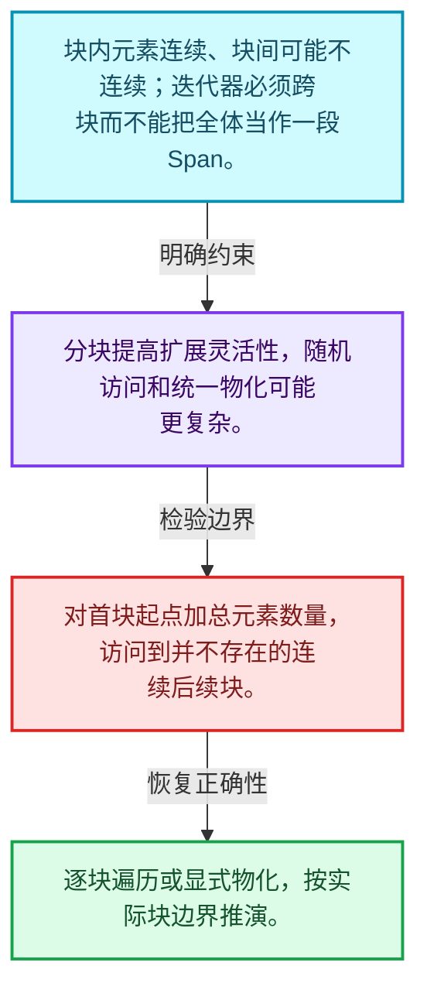
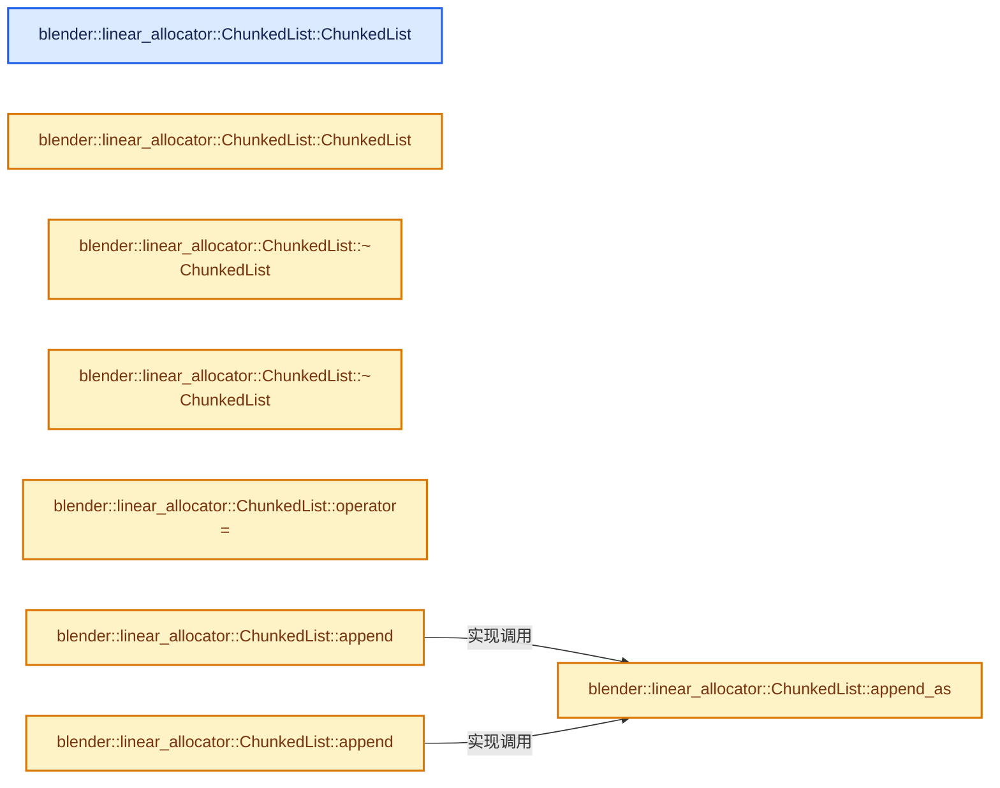
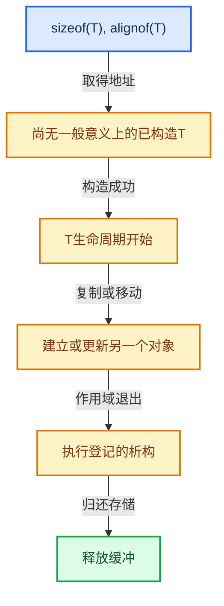

# 03-04 ChunkedList分块容器

[方向导航](README.md) · [总目录](../README.md) · [实现索引](../%E7%AC%A6%E5%8F%B7%E4%BE%9D%E8%B5%96%E4%B8%8E%E5%AE%9E%E7%8E%B0%E7%B4%A2%E5%BC%95.md)

## 从问题到实现

分块组织如何配合线性分配器？

块内连续和块间链接在局部性与扩展之间取舍；遍历顺序与指针稳定性要分别检查。

**数据模型**

块内元素连续、块间可能不连续；迭代器必须跨块而不能把全体当作一段Span。

**设计取舍**

分块提高扩展灵活性，随机访问和统一物化可能更复杂。

**最小反例**

对首块起点加总元素数量，访问到并不存在的连续后续块。

**推导**

逐块遍历或显式物化，按实际块边界推演。

## 阅读地图与执行推演








图中的数值推演是本方向的教学模型；实际函数之间的调用边与概念分析边分别标注，不能把概念关系当作运行时调度顺序。

## 完整源码单元与就地讲解

中文讲解直接放在相关代码旁，复杂机制在代码下展开。原文折叠区保留基准行号；不需要在行号表和函数之间来回查找。类布局可分段展示，函数实现不按固定行数切开。

### 类型布局、声明与编译条件 · BLI_linear_allocator_chunked_list.hh L1—L62

<a id="t-676d37012acd"></a>

`ChunkedListSegment`在这里声明的数据成员：

- `ChunkedListSegment next`
- `int64_t size`
- `std::array<TypedBuffer<T>, Capacity> values`

<a id="t-38d6ab667de7"></a>

`ChunkedList`在这里声明的数据成员：

- `Segment current_segment_`

<!-- annotated:b277a89c1c8aea -->

```cpp
/* SPDX-FileCopyrightText: 2024 Blender Authors
 *
 * SPDX-License-Identifier: GPL-2.0-or-later */

/** \file
 * \ingroup bli
 */

#pragma once

#include <array>

#include "BLI_linear_allocator.hh"
#include "BLI_utility_mixins.hh"

namespace blender::linear_allocator {

/**
 * The list is a linked list of segments containing multiple elements. The capacity of each segment
 * is a template parameter because that removes the need to store it for every segment.
 */
template<typename T, int64_t Capacity> struct ChunkedListSegment {
  /** Pointer to the next segment in the list. */
  ChunkedListSegment *next = nullptr;
  /**
   * Number of constructed elements in this segment. The constructed elements are always at the
   * beginning of the array below.
   */
  int64_t size = 0;
  /**
   * The memory that actually contains the values in the end. The values are constructed and
   * destructed by higher level code.
   */
  std::array<TypedBuffer<T>, Capacity> values;
};

/**
 * This is a special purpose container data structure that can be used to efficiently gather many
 * elements into many (small) lists for later retrieval. The values are iterated in inverse order
 * of insertion.
 *
 * To use this data structure, one has to have a separate #LinearAllocator which is passed to the
 * `append` function. This allows the same allocator to be used by many lists. Passing it into the
 * append function also removes the need to store the allocator pointer in every list.
 *
 * It is an improvement over #Vector because it does not require any reallocations. #VectorList
 * could also be used to overcome the reallocation issue.
 *
 * This data structure is also an improvement over #VectorList because:
 * - It has a much lower memory footprint when empty.
 * - Allows using a #LinearAllocator for all allocations, without storing the pointer to it in
 *   every vector.
 * - It wastes less memory due to over-allocations.
 */
template<typename T, int64_t SegmentCapacity = 4> class ChunkedList : NonCopyable {
 public:
  using Segment = ChunkedListSegment<T, SegmentCapacity>;

 private:
  Segment *current_segment_ = nullptr;

 public:
```

<details>
<summary>核对原始源码：source/blender/blenlib/BLI_linear_allocator_chunked_list.hh · L1—L62</summary>

<!-- original:b277a89c1c8aea:source/blender/blenlib/BLI_linear_allocator_chunked_list.hh:1:62 -->

```cpp
/* SPDX-FileCopyrightText: 2024 Blender Authors
 *
 * SPDX-License-Identifier: GPL-2.0-or-later */

/** \file
 * \ingroup bli
 */

#pragma once

#include <array>

#include "BLI_linear_allocator.hh"
#include "BLI_utility_mixins.hh"

namespace blender::linear_allocator {

/**
 * The list is a linked list of segments containing multiple elements. The capacity of each segment
 * is a template parameter because that removes the need to store it for every segment.
 */
template<typename T, int64_t Capacity> struct ChunkedListSegment {
  /** Pointer to the next segment in the list. */
  ChunkedListSegment *next = nullptr;
  /**
   * Number of constructed elements in this segment. The constructed elements are always at the
   * beginning of the array below.
   */
  int64_t size = 0;
  /**
   * The memory that actually contains the values in the end. The values are constructed and
   * destructed by higher level code.
   */
  std::array<TypedBuffer<T>, Capacity> values;
};

/**
 * This is a special purpose container data structure that can be used to efficiently gather many
 * elements into many (small) lists for later retrieval. The values are iterated in inverse order
 * of insertion.
 *
 * To use this data structure, one has to have a separate #LinearAllocator which is passed to the
 * `append` function. This allows the same allocator to be used by many lists. Passing it into the
 * append function also removes the need to store the allocator pointer in every list.
 *
 * It is an improvement over #Vector because it does not require any reallocations. #VectorList
 * could also be used to overcome the reallocation issue.
 *
 * This data structure is also an improvement over #VectorList because:
 * - It has a much lower memory footprint when empty.
 * - Allows using a #LinearAllocator for all allocations, without storing the pointer to it in
 *   every vector.
 * - It wastes less memory due to over-allocations.
 */
template<typename T, int64_t SegmentCapacity = 4> class ChunkedList : NonCopyable {
 public:
  using Segment = ChunkedListSegment<T, SegmentCapacity>;

 private:
  Segment *current_segment_ = nullptr;

 public:
```

</details>

<a id="f-83f7d77aa506bfd5"></a>

### `blender::linear_allocator::ChunkedList::ChunkedList`

实现位置：[source/blender/blenlib/BLI_linear_allocator_chunked_list.hh](../../../../../source/blender/blenlib/BLI_linear_allocator_chunked_list.hh) · L63—L63。

**教学注释版**

<!-- annotated:e2dff584dd2cd1 -->

```cpp
  ChunkedList() = default;
```

<details>
<summary>核对原始源码：source/blender/blenlib/BLI_linear_allocator_chunked_list.hh · L63—L63</summary>

<!-- original:e2dff584dd2cd1:source/blender/blenlib/BLI_linear_allocator_chunked_list.hh:63:63 -->

```cpp
  ChunkedList() = default;
```

</details>

**继续追踪实现**

本实现没有需要继续展开的显式调用；检查返回表达式、对象转换和调用者前置条件。

<!-- annotated:5eda2a18c03732 -->

```cpp

```

<details>
<summary>核对原始源码：source/blender/blenlib/BLI_linear_allocator_chunked_list.hh · L64—L64</summary>

<!-- original:5eda2a18c03732:source/blender/blenlib/BLI_linear_allocator_chunked_list.hh:64:64 -->

```cpp

```

</details>

<a id="f-86d1f0372accb7c3"></a>

### `blender::linear_allocator::ChunkedList::ChunkedList`

实现位置：[source/blender/blenlib/BLI_linear_allocator_chunked_list.hh](../../../../../source/blender/blenlib/BLI_linear_allocator_chunked_list.hh) · L65—L69。

接口参数：

- `ChunkedList &&other`

**教学注释版**

<!-- annotated:f1c9ec5616ba23 -->

```cpp
  ChunkedList(ChunkedList &&other)
  {
    current_segment_ = other.current_segment_;
    other.current_segment_ = nullptr;
  }
```

<details>
<summary>核对原始源码：source/blender/blenlib/BLI_linear_allocator_chunked_list.hh · L65—L69</summary>

<!-- original:f1c9ec5616ba23:source/blender/blenlib/BLI_linear_allocator_chunked_list.hh:65:69 -->

```cpp
  ChunkedList(ChunkedList &&other)
  {
    current_segment_ = other.current_segment_;
    other.current_segment_ = nullptr;
  }
```

</details>

**沿实际写入检查状态**

- `current_segment_ = other.current_segment_;`
- `other.current_segment_ = nullptr;`

**继续追踪实现**

本实现没有需要继续展开的显式调用；检查返回表达式、对象转换和调用者前置条件。

### 类型布局、声明与编译条件 · BLI_linear_allocator_chunked_list.hh L70—L75

<!-- annotated:f55bd83a21ebcb -->

```cpp

  /* The destructors assume that the #ChunkedListSegment does not have to be destructed if the
   * contained type is trivially destructible. */
  static_assert(std::is_trivially_destructible_v<ChunkedListSegment<int, 4>>);

  /** If the contained type is trivially destructible, the entire ChunkedList is too. */
```

<details>
<summary>核对原始源码：source/blender/blenlib/BLI_linear_allocator_chunked_list.hh · L70—L75</summary>

<!-- original:f55bd83a21ebcb:source/blender/blenlib/BLI_linear_allocator_chunked_list.hh:70:75 -->

```cpp

  /* The destructors assume that the #ChunkedListSegment does not have to be destructed if the
   * contained type is trivially destructible. */
  static_assert(std::is_trivially_destructible_v<ChunkedListSegment<int, 4>>);

  /** If the contained type is trivially destructible, the entire ChunkedList is too. */
```

</details>

<a id="f-1dfeb15c84727051"></a>

### `blender::linear_allocator::ChunkedList::~ChunkedList`

实现位置：[source/blender/blenlib/BLI_linear_allocator_chunked_list.hh](../../../../../source/blender/blenlib/BLI_linear_allocator_chunked_list.hh) · L76—L78。

**教学注释版**

<!-- annotated:84baa8d2c9cae1 -->

```cpp
  ~ChunkedList()
    requires std::is_trivially_destructible_v<T>
  = default;
```

<details>
<summary>核对原始源码：source/blender/blenlib/BLI_linear_allocator_chunked_list.hh · L76—L78</summary>

<!-- original:84baa8d2c9cae1:source/blender/blenlib/BLI_linear_allocator_chunked_list.hh:76:78 -->

```cpp
  ~ChunkedList()
    requires std::is_trivially_destructible_v<T>
  = default;
```

</details>

**继续追踪实现**

本实现没有需要继续展开的显式调用；检查返回表达式、对象转换和调用者前置条件。

### 类型布局、声明与编译条件 · BLI_linear_allocator_chunked_list.hh L79—L80

<!-- annotated:0643f578164301 -->

```cpp

  /** If the contained type is not trivially destructible, all the elements are destructed. */
```

<details>
<summary>核对原始源码：source/blender/blenlib/BLI_linear_allocator_chunked_list.hh · L79—L80</summary>

<!-- original:0643f578164301:source/blender/blenlib/BLI_linear_allocator_chunked_list.hh:79:80 -->

```cpp

  /** If the contained type is not trivially destructible, all the elements are destructed. */
```

</details>

<a id="f-3f2c0aeb4a761de9"></a>

### `blender::linear_allocator::ChunkedList::~ChunkedList`

实现位置：[source/blender/blenlib/BLI_linear_allocator_chunked_list.hh](../../../../../source/blender/blenlib/BLI_linear_allocator_chunked_list.hh) · L81—L90。

**教学注释版**

<!-- annotated:be6cd21745b652 -->

```cpp
  ~ChunkedList()
    requires(!std::is_trivially_destructible_v<T>)
  {
    for (Segment *segment = current_segment_; segment; segment = segment->next) {
      for (const int64_t i : IndexRange(segment->size)) {
        T &value = *segment->values[i];
        std::destroy_at(&value);
      }
    }
  }
```

<details>
<summary>核对原始源码：source/blender/blenlib/BLI_linear_allocator_chunked_list.hh · L81—L90</summary>

<!-- original:be6cd21745b652:source/blender/blenlib/BLI_linear_allocator_chunked_list.hh:81:90 -->

```cpp
  ~ChunkedList()
    requires(!std::is_trivially_destructible_v<T>)
  {
    for (Segment *segment = current_segment_; segment; segment = segment->next) {
      for (const int64_t i : IndexRange(segment->size)) {
        T &value = *segment->values[i];
        std::destroy_at(&value);
      }
    }
  }
```

</details>

**继续追踪实现**

- `IndexRange` → [blender::IndexRange](../01-%E5%9F%BA%E7%A1%80%E5%AE%B9%E5%99%A8%E4%B8%8E%E7%8E%B0%E4%BB%A3CPP/%E4%BE%9D%E8%B5%96-BLI_index_range-7d7cc5.md#t-caa3466d6776)；[blender::gpu::shader::parser::IndexRange](../05-%E5%87%A0%E4%BD%95%E5%AD%98%E5%82%A8%E4%B8%8E%E6%8B%93%E6%89%91%E6%98%A0%E5%B0%84/%E4%BE%9D%E8%B5%96-utils-06433d.md#t-82d2bd4ea71c)；[blender::IndexRange](../05-%E5%87%A0%E4%BD%95%E5%AD%98%E5%82%A8%E4%B8%8E%E6%8B%93%E6%89%91%E6%98%A0%E5%B0%84/%E4%BE%9D%E8%B5%96-DNA_node_types-6708b9.md#t-0448cc889d39)。
- `std::destroy_at` → [外部契约](https://eel.is/c++draft/)：这个边界按实际表达式及所属类型核对参数、返回值、寿命与失败行为。这里提供接口入口，不声称已解释该第三方版本的内部实现。

<!-- annotated:08195d356f216d -->

```cpp

```

<details>
<summary>核对原始源码：source/blender/blenlib/BLI_linear_allocator_chunked_list.hh · L91—L91</summary>

<!-- original:08195d356f216d:source/blender/blenlib/BLI_linear_allocator_chunked_list.hh:91:91 -->

```cpp

```

</details>

<a id="f-0630ac76ad8dd19e"></a>

### `blender::linear_allocator::ChunkedList::operator=`

实现位置：[source/blender/blenlib/BLI_linear_allocator_chunked_list.hh](../../../../../source/blender/blenlib/BLI_linear_allocator_chunked_list.hh) · L92—L100。

接口参数：

- `ChunkedList &&other`

**教学注释版**

<!-- annotated:5a5a71a2a7f64e -->

```cpp
  ChunkedList &operator=(ChunkedList &&other)
  {
    if (this == &other) {
      return *this;
    }
    std::destroy_at(this);
    // [讲解] std::move：把表达式转换成可供移动重载选择的值类别；不保证真的移动，不结束源对象寿命，对const值可能选择复制。
    new (this) ChunkedList(std::move(other));
    return *this;
  }
```

<details>
<summary>核对原始源码：source/blender/blenlib/BLI_linear_allocator_chunked_list.hh · L92—L100</summary>

<!-- original:5a5a71a2a7f64e:source/blender/blenlib/BLI_linear_allocator_chunked_list.hh:92:100 -->

```cpp
  ChunkedList &operator=(ChunkedList &&other)
  {
    if (this == &other) {
      return *this;
    }
    std::destroy_at(this);
    new (this) ChunkedList(std::move(other));
    return *this;
  }
```

</details>

**结果出口**

- `return *this;`

**继续追踪实现**

- `std::destroy_at` → [外部契约](https://eel.is/c++draft/)：这个边界按实际表达式及所属类型核对参数、返回值、寿命与失败行为。这里提供接口入口，不声称已解释该第三方版本的内部实现。
- `std::move` → [外部契约](https://eel.is/c++draft/utility.forward)：把表达式转换成可供移动重载选择的值类别；不保证真的移动，不结束源对象寿命，对const值可能选择复制。

### 类型布局、声明与编译条件 · BLI_linear_allocator_chunked_list.hh L101—L105

<!-- annotated:803f0164c8a6dd -->

```cpp

  /**
   * Add an element to the list. The given allocator is used to allocate any extra memory that may
   * be needed.
   */
```

<details>
<summary>核对原始源码：source/blender/blenlib/BLI_linear_allocator_chunked_list.hh · L101—L105</summary>

<!-- original:803f0164c8a6dd:source/blender/blenlib/BLI_linear_allocator_chunked_list.hh:101:105 -->

```cpp

  /**
   * Add an element to the list. The given allocator is used to allocate any extra memory that may
   * be needed.
   */
```

</details>

<a id="f-020993fe6a934544"></a>

### `blender::linear_allocator::ChunkedList::append`

实现位置：[source/blender/blenlib/BLI_linear_allocator_chunked_list.hh](../../../../../source/blender/blenlib/BLI_linear_allocator_chunked_list.hh) · L106—L109。

接口参数：

- `LinearAllocator<> &allocator`
- `const T &value`

**教学注释版**

<!-- annotated:442d740852b05f -->

```cpp
  void append(LinearAllocator<> &allocator, const T &value)
  {
    this->append_as(allocator, value);
  }
```

<details>
<summary>核对原始源码：source/blender/blenlib/BLI_linear_allocator_chunked_list.hh · L106—L109</summary>

<!-- original:442d740852b05f:source/blender/blenlib/BLI_linear_allocator_chunked_list.hh:106:109 -->

```cpp
  void append(LinearAllocator<> &allocator, const T &value)
  {
    this->append_as(allocator, value);
  }
```

</details>

**继续追踪实现**

- `this->append_as` → [blender::linear_allocator::ChunkedList::append_as · L116](04-ChunkedList%E5%88%86%E5%9D%97%E5%AE%B9%E5%99%A8.md#f-317889722ec9d79d)。

<!-- annotated:e6ec093068d830 -->

```cpp

```

<details>
<summary>核对原始源码：source/blender/blenlib/BLI_linear_allocator_chunked_list.hh · L110—L110</summary>

<!-- original:e6ec093068d830:source/blender/blenlib/BLI_linear_allocator_chunked_list.hh:110:110 -->

```cpp

```

</details>

<a id="f-d2eadbc4c01dc126"></a>

### `blender::linear_allocator::ChunkedList::append`

实现位置：[source/blender/blenlib/BLI_linear_allocator_chunked_list.hh](../../../../../source/blender/blenlib/BLI_linear_allocator_chunked_list.hh) · L111—L114。

接口参数：

- `LinearAllocator<> &allocator`
- `T &&value`

**教学注释版**

<!-- annotated:c2b07d6a91527d -->

```cpp
  void append(LinearAllocator<> &allocator, T &&value)
  {
    // [讲解] std::move：把表达式转换成可供移动重载选择的值类别；不保证真的移动，不结束源对象寿命，对const值可能选择复制。
    this->append_as(allocator, std::move(value));
  }
```

<details>
<summary>核对原始源码：source/blender/blenlib/BLI_linear_allocator_chunked_list.hh · L111—L114</summary>

<!-- original:c2b07d6a91527d:source/blender/blenlib/BLI_linear_allocator_chunked_list.hh:111:114 -->

```cpp
  void append(LinearAllocator<> &allocator, T &&value)
  {
    this->append_as(allocator, std::move(value));
  }
```

</details>

**继续追踪实现**

- `this->append_as` → [blender::linear_allocator::ChunkedList::append_as · L116](04-ChunkedList%E5%88%86%E5%9D%97%E5%AE%B9%E5%99%A8.md#f-317889722ec9d79d)。
- `std::move` → [外部契约](https://eel.is/c++draft/utility.forward)：把表达式转换成可供移动重载选择的值类别；不保证真的移动，不结束源对象寿命，对const值可能选择复制。

<!-- annotated:9a9e3613d413bd -->

```cpp

```

<details>
<summary>核对原始源码：source/blender/blenlib/BLI_linear_allocator_chunked_list.hh · L115—L115</summary>

<!-- original:9a9e3613d413bd:source/blender/blenlib/BLI_linear_allocator_chunked_list.hh:115:115 -->

```cpp

```

</details>

<a id="f-317889722ec9d79d"></a>

### `blender::linear_allocator::ChunkedList::append_as`

实现位置：[source/blender/blenlib/BLI_linear_allocator_chunked_list.hh](../../../../../source/blender/blenlib/BLI_linear_allocator_chunked_list.hh) · L116—L127。

接口参数：

- `LinearAllocator<> &allocator`

**教学注释版**

<!-- annotated:13e33abd13fb32 -->

```cpp
  template<typename... Args> void append_as(LinearAllocator<> &allocator, Args &&...args)
  {
    if (current_segment_ == nullptr || current_segment_->size == SegmentCapacity) {
      /* Allocate a new segment if necessary. */
      static_assert(std::is_trivially_destructible_v<Segment>);
      Segment *new_segment = allocator.construct<Segment>().release();
      new_segment->next = current_segment_;
      current_segment_ = new_segment;
    }
    T *value = &*current_segment_->values[current_segment_->size++];
    // [讲解] std::forward<Args>：在转发引用中恢复调用者传入的值类别；依赖推导类型，不能与无条件move互换。
    new (value) T(std::forward<Args>(args)...);
  }
```

<details>
<summary>核对原始源码：source/blender/blenlib/BLI_linear_allocator_chunked_list.hh · L116—L127</summary>

<!-- original:13e33abd13fb32:source/blender/blenlib/BLI_linear_allocator_chunked_list.hh:116:127 -->

```cpp
  template<typename... Args> void append_as(LinearAllocator<> &allocator, Args &&...args)
  {
    if (current_segment_ == nullptr || current_segment_->size == SegmentCapacity) {
      /* Allocate a new segment if necessary. */
      static_assert(std::is_trivially_destructible_v<Segment>);
      Segment *new_segment = allocator.construct<Segment>().release();
      new_segment->next = current_segment_;
      current_segment_ = new_segment;
    }
    T *value = &*current_segment_->values[current_segment_->size++];
    new (value) T(std::forward<Args>(args)...);
  }
```

</details>

**沿实际写入检查状态**

- `new_segment->next = current_segment_;`
- `current_segment_ = new_segment;`

**继续追踪实现**

- `allocator.construct<Segment>().release` → [调用协议](../%E6%A8%A1%E6%9D%BF%E5%AE%8F%E4%B8%8E%E5%8A%A8%E6%80%81%E5%88%86%E6%B4%BE%E5%8D%8F%E8%AE%AE.md)：接收对象类型依赖auto、返回值或模板实例；不按同名猜测目标。调用位置L121。
- `allocator.construct<Segment>` → [blender::LinearAllocator::construct · L135](02-LinearAllocator%E5%B8%83%E5%B1%80.md#f-437c16eedf07fa2a)。
- `std::forward<Args>` → [外部契约](https://eel.is/c++draft/utility.forward)：在转发引用中恢复调用者传入的值类别；依赖推导类型，不能与无条件move互换。

### 类型布局、声明与编译条件 · BLI_linear_allocator_chunked_list.hh L128—L134

<a id="t-579e76d1a34c"></a>

`ConstIterator`在这里声明的数据成员：

- `Segment segment_`
- `int64_t index_`

<!-- annotated:a5dac744037e35 -->

```cpp

  class ConstIterator {
   private:
    const Segment *segment_;
    int64_t index_;

   public:
```

<details>
<summary>核对原始源码：source/blender/blenlib/BLI_linear_allocator_chunked_list.hh · L128—L134</summary>

<!-- original:a5dac744037e35:source/blender/blenlib/BLI_linear_allocator_chunked_list.hh:128:134 -->

```cpp

  class ConstIterator {
   private:
    const Segment *segment_;
    int64_t index_;

   public:
```

</details>

<a id="f-e4eb78e35108224c"></a>

### `blender::linear_allocator::ChunkedList::ConstIterator::ConstIterator`

实现位置：[source/blender/blenlib/BLI_linear_allocator_chunked_list.hh](../../../../../source/blender/blenlib/BLI_linear_allocator_chunked_list.hh) · L135—L135。

**教学注释版**

<!-- annotated:63429ce026796f -->

```cpp
    ConstIterator() = delete;
```

<details>
<summary>核对原始源码：source/blender/blenlib/BLI_linear_allocator_chunked_list.hh · L135—L135</summary>

<!-- original:63429ce026796f:source/blender/blenlib/BLI_linear_allocator_chunked_list.hh:135:135 -->

```cpp
    ConstIterator() = delete;
```

</details>

**继续追踪实现**

本实现没有需要继续展开的显式调用；检查返回表达式、对象转换和调用者前置条件。

<a id="f-90c0bea7d2c67399"></a>

### `blender::linear_allocator::ChunkedList::ConstIterator::ConstIterator`

实现位置：[source/blender/blenlib/BLI_linear_allocator_chunked_list.hh](../../../../../source/blender/blenlib/BLI_linear_allocator_chunked_list.hh) · L136—L136。

接口参数：

- `const Segment *segment`
- `int64_t index`

**教学注释版**

<!-- annotated:6008fc225e46b8 -->

```cpp
    ConstIterator(const Segment *segment, int64_t index) : segment_(segment), index_(index) {}
```

<details>
<summary>核对原始源码：source/blender/blenlib/BLI_linear_allocator_chunked_list.hh · L136—L136</summary>

<!-- original:6008fc225e46b8:source/blender/blenlib/BLI_linear_allocator_chunked_list.hh:136:136 -->

```cpp
    ConstIterator(const Segment *segment, int64_t index) : segment_(segment), index_(index) {}
```

</details>

**继续追踪实现**

本实现没有需要继续展开的显式调用；检查返回表达式、对象转换和调用者前置条件。

<!-- annotated:59576d58e04fe8 -->

```cpp

```

<details>
<summary>核对原始源码：source/blender/blenlib/BLI_linear_allocator_chunked_list.hh · L137—L137</summary>

<!-- original:59576d58e04fe8:source/blender/blenlib/BLI_linear_allocator_chunked_list.hh:137:137 -->

```cpp

```

</details>

<a id="f-f478ccb6fae161dd"></a>

### `blender::linear_allocator::ChunkedList::ConstIterator::operator++`

实现位置：[source/blender/blenlib/BLI_linear_allocator_chunked_list.hh](../../../../../source/blender/blenlib/BLI_linear_allocator_chunked_list.hh) · L138—L146。

**教学注释版**

<!-- annotated:ce688e9c97712d -->

```cpp
    ConstIterator &operator++()
    {
      index_--;
      if (index_ == -1) {
        segment_ = segment_->next;
        index_ = segment_ ? segment_->size - 1 : -1;
      }
      return *this;
    }
```

<details>
<summary>核对原始源码：source/blender/blenlib/BLI_linear_allocator_chunked_list.hh · L138—L146</summary>

<!-- original:ce688e9c97712d:source/blender/blenlib/BLI_linear_allocator_chunked_list.hh:138:146 -->

```cpp
    ConstIterator &operator++()
    {
      index_--;
      if (index_ == -1) {
        segment_ = segment_->next;
        index_ = segment_ ? segment_->size - 1 : -1;
      }
      return *this;
    }
```

</details>

**沿实际写入检查状态**

- `segment_ = segment_->next;`
- `index_ = segment_ ? segment_->size - 1 : -1;`

**结果出口**

- `return *this;`

**继续追踪实现**

本实现没有需要继续展开的显式调用；检查返回表达式、对象转换和调用者前置条件。

<!-- annotated:c2e55bd7da02d0 -->

```cpp

```

<details>
<summary>核对原始源码：source/blender/blenlib/BLI_linear_allocator_chunked_list.hh · L147—L147</summary>

<!-- original:c2e55bd7da02d0:source/blender/blenlib/BLI_linear_allocator_chunked_list.hh:147:147 -->

```cpp

```

</details>

<a id="f-49cd86ccbc427e54"></a>

### `blender::linear_allocator::ChunkedList::ConstIterator::operator*`

实现位置：[source/blender/blenlib/BLI_linear_allocator_chunked_list.hh](../../../../../source/blender/blenlib/BLI_linear_allocator_chunked_list.hh) · L148—L151。

**教学注释版**

<!-- annotated:3813cd5dd38e9e -->

```cpp
    const T &operator*() const
    {
      return *segment_->values[index_];
    }
```

<details>
<summary>核对原始源码：source/blender/blenlib/BLI_linear_allocator_chunked_list.hh · L148—L151</summary>

<!-- original:3813cd5dd38e9e:source/blender/blenlib/BLI_linear_allocator_chunked_list.hh:148:151 -->

```cpp
    const T &operator*() const
    {
      return *segment_->values[index_];
    }
```

</details>

**结果出口**

- `return *segment_->values[index_];`

**继续追踪实现**

本实现没有需要继续展开的显式调用；检查返回表达式、对象转换和调用者前置条件。

### 类型布局、声明与编译条件 · BLI_linear_allocator_chunked_list.hh L152—L161

<a id="t-26212cdec17b"></a>

`MutableIterator`在这里声明的数据成员：

- `Segment segment_`
- `int64_t index_`

<!-- annotated:917137aa0a881e -->

```cpp

    friend bool operator==(const ConstIterator &a, const ConstIterator &b) = default;
  };

  class MutableIterator {
   private:
    Segment *segment_;
    int64_t index_;

   public:
```

<details>
<summary>核对原始源码：source/blender/blenlib/BLI_linear_allocator_chunked_list.hh · L152—L161</summary>

<!-- original:917137aa0a881e:source/blender/blenlib/BLI_linear_allocator_chunked_list.hh:152:161 -->

```cpp

    friend bool operator==(const ConstIterator &a, const ConstIterator &b) = default;
  };

  class MutableIterator {
   private:
    Segment *segment_;
    int64_t index_;

   public:
```

</details>

<a id="f-cf33778d178da43b"></a>

### `blender::linear_allocator::ChunkedList::MutableIterator::MutableIterator`

实现位置：[source/blender/blenlib/BLI_linear_allocator_chunked_list.hh](../../../../../source/blender/blenlib/BLI_linear_allocator_chunked_list.hh) · L162—L162。

**教学注释版**

<!-- annotated:9371c52f0b6e43 -->

```cpp
    MutableIterator() = delete;
```

<details>
<summary>核对原始源码：source/blender/blenlib/BLI_linear_allocator_chunked_list.hh · L162—L162</summary>

<!-- original:9371c52f0b6e43:source/blender/blenlib/BLI_linear_allocator_chunked_list.hh:162:162 -->

```cpp
    MutableIterator() = delete;
```

</details>

**继续追踪实现**

本实现没有需要继续展开的显式调用；检查返回表达式、对象转换和调用者前置条件。

<a id="f-2a12b1ed71ab22d3"></a>

### `blender::linear_allocator::ChunkedList::MutableIterator::MutableIterator`

实现位置：[source/blender/blenlib/BLI_linear_allocator_chunked_list.hh](../../../../../source/blender/blenlib/BLI_linear_allocator_chunked_list.hh) · L163—L163。

接口参数：

- `Segment *segment`
- `int64_t index`

**教学注释版**

<!-- annotated:3b9296281462a9 -->

```cpp
    MutableIterator(Segment *segment, int64_t index) : segment_(segment), index_(index) {}
```

<details>
<summary>核对原始源码：source/blender/blenlib/BLI_linear_allocator_chunked_list.hh · L163—L163</summary>

<!-- original:3b9296281462a9:source/blender/blenlib/BLI_linear_allocator_chunked_list.hh:163:163 -->

```cpp
    MutableIterator(Segment *segment, int64_t index) : segment_(segment), index_(index) {}
```

</details>

**继续追踪实现**

本实现没有需要继续展开的显式调用；检查返回表达式、对象转换和调用者前置条件。

<!-- annotated:cca58208b113b5 -->

```cpp

```

<details>
<summary>核对原始源码：source/blender/blenlib/BLI_linear_allocator_chunked_list.hh · L164—L164</summary>

<!-- original:cca58208b113b5:source/blender/blenlib/BLI_linear_allocator_chunked_list.hh:164:164 -->

```cpp

```

</details>

<a id="f-3e701989bdaa3912"></a>

### `blender::linear_allocator::ChunkedList::MutableIterator::operator++`

实现位置：[source/blender/blenlib/BLI_linear_allocator_chunked_list.hh](../../../../../source/blender/blenlib/BLI_linear_allocator_chunked_list.hh) · L165—L173。

**教学注释版**

<!-- annotated:bd4a0fccc2aecd -->

```cpp
    MutableIterator &operator++()
    {
      index_--;
      if (index_ == -1) {
        segment_ = segment_->next;
        index_ = segment_ ? segment_->size - 1 : -1;
      }
      return *this;
    }
```

<details>
<summary>核对原始源码：source/blender/blenlib/BLI_linear_allocator_chunked_list.hh · L165—L173</summary>

<!-- original:bd4a0fccc2aecd:source/blender/blenlib/BLI_linear_allocator_chunked_list.hh:165:173 -->

```cpp
    MutableIterator &operator++()
    {
      index_--;
      if (index_ == -1) {
        segment_ = segment_->next;
        index_ = segment_ ? segment_->size - 1 : -1;
      }
      return *this;
    }
```

</details>

**沿实际写入检查状态**

- `segment_ = segment_->next;`
- `index_ = segment_ ? segment_->size - 1 : -1;`

**结果出口**

- `return *this;`

**继续追踪实现**

本实现没有需要继续展开的显式调用；检查返回表达式、对象转换和调用者前置条件。

<!-- annotated:4f367fa7f4c292 -->

```cpp

```

<details>
<summary>核对原始源码：source/blender/blenlib/BLI_linear_allocator_chunked_list.hh · L174—L174</summary>

<!-- original:4f367fa7f4c292:source/blender/blenlib/BLI_linear_allocator_chunked_list.hh:174:174 -->

```cpp

```

</details>

<a id="f-ae4961ce9e1c711a"></a>

### `blender::linear_allocator::ChunkedList::MutableIterator::operator*`

实现位置：[source/blender/blenlib/BLI_linear_allocator_chunked_list.hh](../../../../../source/blender/blenlib/BLI_linear_allocator_chunked_list.hh) · L175—L178。

**教学注释版**

<!-- annotated:ca0c61045176ae -->

```cpp
    T &operator*()
    {
      return *segment_->values[index_];
    }
```

<details>
<summary>核对原始源码：source/blender/blenlib/BLI_linear_allocator_chunked_list.hh · L175—L178</summary>

<!-- original:ca0c61045176ae:source/blender/blenlib/BLI_linear_allocator_chunked_list.hh:175:178 -->

```cpp
    T &operator*()
    {
      return *segment_->values[index_];
    }
```

</details>

**结果出口**

- `return *segment_->values[index_];`

**继续追踪实现**

本实现没有需要继续展开的显式调用；检查返回表达式、对象转换和调用者前置条件。

### 类型布局、声明与编译条件 · BLI_linear_allocator_chunked_list.hh L179—L187

<!-- annotated:51f4675669bf96 -->

```cpp

    friend bool operator==(const MutableIterator &a, const MutableIterator &b) = default;
  };

  /**
   * Iterators over the elements in the list.
   *
   * Note: The values are always iterated over in the inverse order of insertion!
   */
```

<details>
<summary>核对原始源码：source/blender/blenlib/BLI_linear_allocator_chunked_list.hh · L179—L187</summary>

<!-- original:51f4675669bf96:source/blender/blenlib/BLI_linear_allocator_chunked_list.hh:179:187 -->

```cpp

    friend bool operator==(const MutableIterator &a, const MutableIterator &b) = default;
  };

  /**
   * Iterators over the elements in the list.
   *
   * Note: The values are always iterated over in the inverse order of insertion!
   */
```

</details>

<a id="f-76c76e3cc3f8bef8"></a>

### `blender::linear_allocator::ChunkedList::begin`

实现位置：[source/blender/blenlib/BLI_linear_allocator_chunked_list.hh](../../../../../source/blender/blenlib/BLI_linear_allocator_chunked_list.hh) · L188—L191。

**教学注释版**

<!-- annotated:be4d0089008aea -->

```cpp
  ConstIterator begin() const
  {
    return ConstIterator(current_segment_, current_segment_ ? current_segment_->size - 1 : -1);
  }
```

<details>
<summary>核对原始源码：source/blender/blenlib/BLI_linear_allocator_chunked_list.hh · L188—L191</summary>

<!-- original:be4d0089008aea:source/blender/blenlib/BLI_linear_allocator_chunked_list.hh:188:191 -->

```cpp
  ConstIterator begin() const
  {
    return ConstIterator(current_segment_, current_segment_ ? current_segment_->size - 1 : -1);
  }
```

</details>

**结果出口**

- `return ConstIterator(current_segment_, current_segment_ ? current_segment_->size - 1 : -1);`

**继续追踪实现**

- `ConstIterator` → [blender::linear_allocator::ChunkedList::ConstIterator::ConstIterator · L135](04-ChunkedList%E5%88%86%E5%9D%97%E5%AE%B9%E5%99%A8.md#f-e4eb78e35108224c)；[blender::linear_allocator::ChunkedList::ConstIterator::ConstIterator · L136](04-ChunkedList%E5%88%86%E5%9D%97%E5%AE%B9%E5%99%A8.md#f-90c0bea7d2c67399)。同名重载需按实参类型选择。

<!-- annotated:cd962aab73f4fd -->

```cpp

```

<details>
<summary>核对原始源码：source/blender/blenlib/BLI_linear_allocator_chunked_list.hh · L192—L192</summary>

<!-- original:cd962aab73f4fd:source/blender/blenlib/BLI_linear_allocator_chunked_list.hh:192:192 -->

```cpp

```

</details>

<a id="f-397012c9774eef0c"></a>

### `blender::linear_allocator::ChunkedList::end`

实现位置：[source/blender/blenlib/BLI_linear_allocator_chunked_list.hh](../../../../../source/blender/blenlib/BLI_linear_allocator_chunked_list.hh) · L193—L196。

**教学注释版**

<!-- annotated:7fbfb9a34f2f84 -->

```cpp
  ConstIterator end() const
  {
    return ConstIterator(nullptr, -1);
  }
```

<details>
<summary>核对原始源码：source/blender/blenlib/BLI_linear_allocator_chunked_list.hh · L193—L196</summary>

<!-- original:7fbfb9a34f2f84:source/blender/blenlib/BLI_linear_allocator_chunked_list.hh:193:196 -->

```cpp
  ConstIterator end() const
  {
    return ConstIterator(nullptr, -1);
  }
```

</details>

**结果出口**

- `return ConstIterator(nullptr, -1);`

**继续追踪实现**

- `ConstIterator` → [blender::linear_allocator::ChunkedList::ConstIterator::ConstIterator · L135](04-ChunkedList%E5%88%86%E5%9D%97%E5%AE%B9%E5%99%A8.md#f-e4eb78e35108224c)；[blender::linear_allocator::ChunkedList::ConstIterator::ConstIterator · L136](04-ChunkedList%E5%88%86%E5%9D%97%E5%AE%B9%E5%99%A8.md#f-90c0bea7d2c67399)。同名重载需按实参类型选择。

<!-- annotated:45f090d85ef8a0 -->

```cpp

```

<details>
<summary>核对原始源码：source/blender/blenlib/BLI_linear_allocator_chunked_list.hh · L197—L197</summary>

<!-- original:45f090d85ef8a0:source/blender/blenlib/BLI_linear_allocator_chunked_list.hh:197:197 -->

```cpp

```

</details>

<a id="f-665c8e17c8f931ea"></a>

### `blender::linear_allocator::ChunkedList::begin`

实现位置：[source/blender/blenlib/BLI_linear_allocator_chunked_list.hh](../../../../../source/blender/blenlib/BLI_linear_allocator_chunked_list.hh) · L198—L201。

**教学注释版**

<!-- annotated:2f11eaa36e2629 -->

```cpp
  MutableIterator begin()
  {
    return MutableIterator(current_segment_, current_segment_ ? current_segment_->size - 1 : -1);
  }
```

<details>
<summary>核对原始源码：source/blender/blenlib/BLI_linear_allocator_chunked_list.hh · L198—L201</summary>

<!-- original:2f11eaa36e2629:source/blender/blenlib/BLI_linear_allocator_chunked_list.hh:198:201 -->

```cpp
  MutableIterator begin()
  {
    return MutableIterator(current_segment_, current_segment_ ? current_segment_->size - 1 : -1);
  }
```

</details>

**结果出口**

- `return MutableIterator(current_segment_, current_segment_ ? current_segment_->size - 1 : -1);`

**继续追踪实现**

- `MutableIterator` → [blender::linear_allocator::ChunkedList::MutableIterator::MutableIterator · L162](04-ChunkedList%E5%88%86%E5%9D%97%E5%AE%B9%E5%99%A8.md#f-cf33778d178da43b)；[blender::linear_allocator::ChunkedList::MutableIterator::MutableIterator · L163](04-ChunkedList%E5%88%86%E5%9D%97%E5%AE%B9%E5%99%A8.md#f-2a12b1ed71ab22d3)。同名重载需按实参类型选择。

<!-- annotated:5f8d99b018bf9b -->

```cpp

```

<details>
<summary>核对原始源码：source/blender/blenlib/BLI_linear_allocator_chunked_list.hh · L202—L202</summary>

<!-- original:5f8d99b018bf9b:source/blender/blenlib/BLI_linear_allocator_chunked_list.hh:202:202 -->

```cpp

```

</details>

<a id="f-650d98c5792faa29"></a>

### `blender::linear_allocator::ChunkedList::end`

实现位置：[source/blender/blenlib/BLI_linear_allocator_chunked_list.hh](../../../../../source/blender/blenlib/BLI_linear_allocator_chunked_list.hh) · L203—L206。

**教学注释版**

<!-- annotated:93d0992afe4c7f -->

```cpp
  MutableIterator end()
  {
    return MutableIterator(nullptr, -1);
  }
```

<details>
<summary>核对原始源码：source/blender/blenlib/BLI_linear_allocator_chunked_list.hh · L203—L206</summary>

<!-- original:93d0992afe4c7f:source/blender/blenlib/BLI_linear_allocator_chunked_list.hh:203:206 -->

```cpp
  MutableIterator end()
  {
    return MutableIterator(nullptr, -1);
  }
```

</details>

**结果出口**

- `return MutableIterator(nullptr, -1);`

**继续追踪实现**

- `MutableIterator` → [blender::linear_allocator::ChunkedList::MutableIterator::MutableIterator · L162](04-ChunkedList%E5%88%86%E5%9D%97%E5%AE%B9%E5%99%A8.md#f-cf33778d178da43b)；[blender::linear_allocator::ChunkedList::MutableIterator::MutableIterator · L163](04-ChunkedList%E5%88%86%E5%9D%97%E5%AE%B9%E5%99%A8.md#f-2a12b1ed71ab22d3)。同名重载需按实参类型选择。

### 类型布局、声明与编译条件 · BLI_linear_allocator_chunked_list.hh L207—L209

<!-- annotated:5f85047826741f -->

```cpp
};

}  // namespace blender::linear_allocator
```

<details>
<summary>核对原始源码：source/blender/blenlib/BLI_linear_allocator_chunked_list.hh · L207—L209</summary>

<!-- original:5f85047826741f:source/blender/blenlib/BLI_linear_allocator_chunked_list.hh:207:209 -->

```cpp
};

}  // namespace blender::linear_allocator
```

</details>

## 语法与相关类型

### 模板 template

模板把类型或常量作为生成实现的参数。读声明时先列出类型参数、非类型参数和默认值，再看使用者实际实例化了什么。模板声明本身不意味着每种T都支持其全部成员。

把T替换为int、string、只能移动的类型，分别检查每个被调用操作是否成立。

### 依赖名称 typename

typename既可引入类型模板参数，也可告诉编译器某个依赖名称是类型。它不创建运行时对象；解析期确认语法类别与实例化期检查具体类型是不同阶段。

区分typename T::value_type和T::size()，前者标记类型，后者是表达式。

### 约束 requires

requires表达式或requires子句限制模板参与重载的条件。它提供编译期可用性检查，不是运行时if，不能指望输入到达程序后再被这一机制验证。

构造满足和不满足约束的两个类型，观察候选被排除而不是在函数内返回错误。

### 只读限定 const

const约束当前访问路径可做的修改。const指针、指向const的指针、const视图对象、const元素是不同位置的限定；其他别名可能仍可修改原对象。

分别写T* const、const T*与const T* const，并画出不可修改的层次。

### 移动转换 std::move

std::move把表达式转换为可供移动重载选择的值类别，实际资源转移发生在被选中的构造或赋值中。对const对象move可能仍调用复制，对视图move也不会获得底层数据所有权。

记录移动构造调用次数，不用变量名或std::move的出现次数替代测量。

### 完美转发 std::forward

std::forward在转发引用模板中恢复调用者原来的值类别。它依赖推导出的模板实参；无条件move会改变左值调用者的语义。

对同一接口分别传入左值、临时对象和const左值，记录实际重载。

### 构造与new表达式

普通new可能分配并构造；placement new在给定地址构造，存储由其他机制提供。失败回滚应区分两类责任。

追踪地址来自哪里、构造何时成功、由谁析构、由谁释放。

### 受控访问 friend

friend授予指定函数或类访问非公开成员的权限，并不意味着继承，也不自动扩展到友元的派生类。

解释执行器为何需要访问包装器的内部映射，同时检查边界是否仍清楚。

### 类型别名 using

类型别名为已有类型建立名字，不创建运行期对象。它常把模板内部使用的类型统一暴露给泛型调用者。

展开别名直到基础类型，区分类型别名和变量声明。

## 实现练习与验证

小块大小下连续追加，输出块编号、块内索引和遍历次序。

参考推理：逐块遍历或显式物化，按实际块边界推演。

所有存活对象地址满足对齐；构造失败不会被当作成功对象登记；所有资源均有唯一或明确共享的清理责任。

## 历史、跨库比较与证据

与std::pmr::monotonic_buffer_resource比较批量存储回收，与std::any比较拥有型类型擦除；CPPType描述类型操作，本身不保存每个值。

[历史提交索引](../%E5%8E%86%E5%8F%B2%E6%8F%90%E4%BA%A4%E4%B8%8E%E8%AE%BE%E8%AE%A1%E6%BC%94%E5%8C%96%E7%B4%A2%E5%BC%95.md) · [源码基准](../%E6%BA%90%E7%A0%81%E7%89%88%E6%9C%AC%E4%B8%8E%E8%A6%86%E7%9B%96%E7%B4%A2%E5%BC%95.md) · [验收报告](../%E9%AA%8C%E6%94%B6%E6%8A%A5%E5%91%8A.md)
