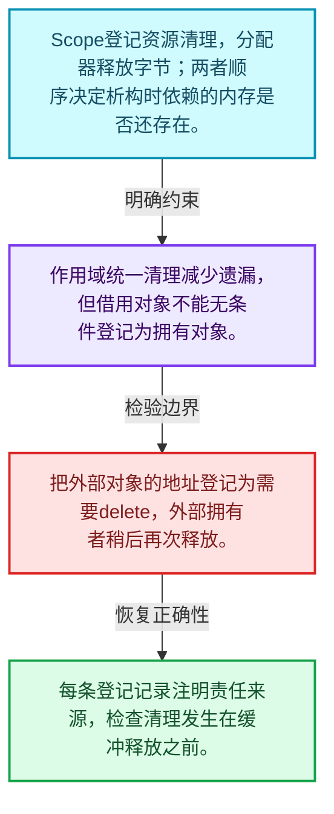
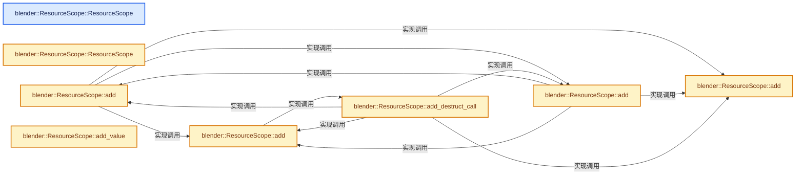
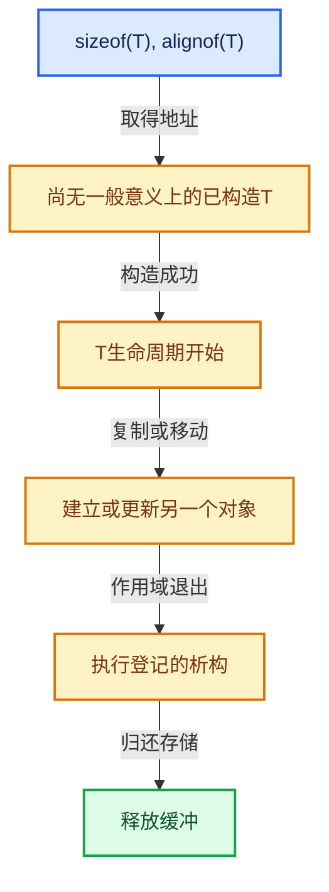

# 03-05 ResourceScope销毁责任

[方向导航](README.md) · [总目录](../README.md) · [实现索引](../00-课程指南/02-源码与提交索引/符号依赖与实现索引.md)

## 从问题到实现

批量释放原始内存时谁执行对象析构？

资源作用域登记清理操作，通常与临时对象共同存活；借用对象和新建对象的清理责任不同。

**数据模型**

Scope登记资源清理，分配器释放字节；两者顺序决定析构时依赖的内存是否还存在。

**设计取舍**

作用域统一清理减少遗漏，但借用对象不能无条件登记为拥有对象。

**最小反例**

把外部对象的地址登记为需要delete，外部拥有者稍后再次释放。

**推导**

每条登记记录注明责任来源，检查清理发生在缓冲释放之前。

## 阅读地图与执行推演








图中的数值推演是本方向的教学模型；实际函数之间的调用边与概念分析边分别标注，不能把概念关系当作运行时调度顺序。

## 完整源码单元与就地讲解

中文讲解直接放在相关代码旁，复杂机制在代码下展开。原文折叠区保留基准行号；不需要在行号表和函数之间来回查找。类布局可分段展示，函数实现不按固定行数切开。

### 类型布局、声明与编译条件 · BLI_resource_scope.hh L1—L149

<a id="t-72d8a512fabb"></a>

`ResourceScope`在这里声明的数据成员：

- `ResourceDataList resources_`
- `LinearAllocator<> allocator_`
- `void add`
- `void allocate_owned`
- `LinearAllocator<> allocator`
- `LinearAllocator<> create_own_allocator`
- `LinearAllocator<> create_own_allocator_in_buffer`

<a id="t-77baf887ca0a"></a>

`ResourceData`在这里声明的数据成员：

- `void data`
- `void free`

<!-- annotated:6117cc8224c0a2 -->

```cpp
/* SPDX-FileCopyrightText: 2023 Blender Authors
 *
 * SPDX-License-Identifier: GPL-2.0-or-later */

#pragma once

/** \file
 * \ingroup bli
 */

#include "BLI_linear_allocator.hh"
#include "BLI_linear_allocator_chunked_list.hh"
#include "BLI_utility_mixins.hh"

namespace blender {

/**
 * A `ResourceScope` takes ownership of arbitrary data/resources. Those resources will be
 * destructed and/or freed when the `ResourceScope` is destructed. Destruction happens in reverse
 * order. That allows resources do depend on other resources that have been added before.
 *
 * A `ResourceScope` can also be thought of as a dynamic/runtime version of normal scopes in C++
 * that are surrounded by braces.
 *
 * The main purpose of a `ResourceScope` is to allow functions to inject data into the scope of the
 * caller. Traditionally, that can only be done by returning a value that owns everything it needs.
 * This is fine until one has to deal with optional ownership. There are many ways to have a type
 * optionally own something else, all of which are fairly annoying. A `ResourceScope` can be used
 * to avoid having to deal with optional ownership. If some value would be owned, it can just be
 * added to the resource scope, otherwise not.
 *
 * When a function takes a `ResourceScope` as parameter, it usually means that its return value
 * will live at least as long as the passed in resources scope. However, it might also live longer.
 * That can happen when the function returns a reference to statically allocated data or
 * dynamically allocated data depending on some condition.
 */
class ResourceScope : NonMovable {
 private:
  struct ResourceData {
    void *data;
    void (*free)(void *data);
  };
  using ResourceDataList = linear_allocator::ChunkedList<ResourceData, 4>;

  /** This stores all resources. They are later freed in the reverse order of construction. */
  ResourceDataList resources_;
  /**
   * Used allocator. This is either provided by the caller when creating the #ResourceScope, or is
   * owned by the scope itself In the latter case, the ownership of the allocator is also tracked
   * by #resources_ above.
   */
  LinearAllocator<> &allocator_;

 public:
  /**
   * Construct a #ResourceScope with an initial buffer of the given size.
   */
  explicit ResourceScope(int64_t initial_size = 32);

  /**
   * Construct a #ResourceScope in the provided buffer. It may allocate additional memory as
   * necessary though.
   */
  template<size_t Size, size_t Alignment>
  explicit ResourceScope(AlignedBuffer<Size, Alignment> &buffer);

  /**
   * Construct a #ResourceScope in the provided buffer. It may allocate additional memory as
   * necessary though.
   */
  ResourceScope(void *buffer, int64_t size);

  /**
   * Construct a #ResourceScope that uses the given allocator instead of creating a new one.
   */
  explicit ResourceScope(LinearAllocator<> &allocator);

  ~ResourceScope();

  /**
   * Pass ownership of the resource to the #ResourceScope. It will be destructed and freed when
   * the #ResourceScope is destructed.
   */
  template<typename T> T *add(std::unique_ptr<T> resource);

  /**
   * Pass ownership of the resource to the #ResourceScope. The reference count will be decremented
   * when the #ResourceScope is destructed.
   */
  template<typename T> T *add(std::shared_ptr<T> resource);

  /**
   * Pass ownership of the resource to the #ResourceScope. It will be destructed when the
   * #ResourceScope is destructed.
   */
  template<typename T> T *add(destruct_ptr<T> resource);

  /**
   * Pass ownership of some resource to the #ResourceScope. The given free function will be
   * called when the #ResourceScope is destructed.
   */
  void add(void *userdata, void (*free)(void *));

  /**
   * Construct an object with the same value in the #ResourceScope and return a reference to the
   * new value.
   */
  template<typename T> T &add_value(T &&value);

  /**
   * The passed in function will be called when the scope is destructed.
   */
  template<typename Func> void add_destruct_call(Func func);

  /**
   * Utility method to construct an instance of type T that will be owned by the #ResourceScope.
   */
  template<typename T, typename... Args> T &construct(Args &&...args);

  /**
   * Allocate a buffer for the given type. The caller is responsible for initializing it before the
   * #ResourceScope is destructed. The value in the returned buffer is destructed automatically.
   */
  void *allocate_owned(const CPPType &type);

  /**
   * Returns a reference to a linear allocator that is used by the #ResourceScope.
   */
  LinearAllocator<> &allocator();

 private:
  static LinearAllocator<> &create_own_allocator(ResourceDataList &r_resources,
                                                 int64_t initial_size);
  static LinearAllocator<> &create_own_allocator_in_buffer(ResourceDataList &r_resources,
                                                           void *data,
                                                           int64_t size,
                                                           bool free_on_destruct);
};

/* This tests the expected size of #ResourceScope. It's currently easy to break by e.g. inheriting
 * from #NonCopyable. That happens because then there would be two #NonCopyable types at the same
 * address which is not allowed. The proper solution is probably to change how NonCopyable and
 * NonMovable are used overall. */
static_assert(sizeof(ResourceScope) == 16);

/* -------------------------------------------------------------------- */
/** \name #ResourceScope Inline Methods
 * \{ */

```

<details>
<summary>核对原始源码：source/blender/blenlib/BLI_resource_scope.hh · L1—L149</summary>

<!-- original:6117cc8224c0a2:source/blender/blenlib/BLI_resource_scope.hh:1:149 -->

```cpp
/* SPDX-FileCopyrightText: 2023 Blender Authors
 *
 * SPDX-License-Identifier: GPL-2.0-or-later */

#pragma once

/** \file
 * \ingroup bli
 */

#include "BLI_linear_allocator.hh"
#include "BLI_linear_allocator_chunked_list.hh"
#include "BLI_utility_mixins.hh"

namespace blender {

/**
 * A `ResourceScope` takes ownership of arbitrary data/resources. Those resources will be
 * destructed and/or freed when the `ResourceScope` is destructed. Destruction happens in reverse
 * order. That allows resources do depend on other resources that have been added before.
 *
 * A `ResourceScope` can also be thought of as a dynamic/runtime version of normal scopes in C++
 * that are surrounded by braces.
 *
 * The main purpose of a `ResourceScope` is to allow functions to inject data into the scope of the
 * caller. Traditionally, that can only be done by returning a value that owns everything it needs.
 * This is fine until one has to deal with optional ownership. There are many ways to have a type
 * optionally own something else, all of which are fairly annoying. A `ResourceScope` can be used
 * to avoid having to deal with optional ownership. If some value would be owned, it can just be
 * added to the resource scope, otherwise not.
 *
 * When a function takes a `ResourceScope` as parameter, it usually means that its return value
 * will live at least as long as the passed in resources scope. However, it might also live longer.
 * That can happen when the function returns a reference to statically allocated data or
 * dynamically allocated data depending on some condition.
 */
class ResourceScope : NonMovable {
 private:
  struct ResourceData {
    void *data;
    void (*free)(void *data);
  };
  using ResourceDataList = linear_allocator::ChunkedList<ResourceData, 4>;

  /** This stores all resources. They are later freed in the reverse order of construction. */
  ResourceDataList resources_;
  /**
   * Used allocator. This is either provided by the caller when creating the #ResourceScope, or is
   * owned by the scope itself In the latter case, the ownership of the allocator is also tracked
   * by #resources_ above.
   */
  LinearAllocator<> &allocator_;

 public:
  /**
   * Construct a #ResourceScope with an initial buffer of the given size.
   */
  explicit ResourceScope(int64_t initial_size = 32);

  /**
   * Construct a #ResourceScope in the provided buffer. It may allocate additional memory as
   * necessary though.
   */
  template<size_t Size, size_t Alignment>
  explicit ResourceScope(AlignedBuffer<Size, Alignment> &buffer);

  /**
   * Construct a #ResourceScope in the provided buffer. It may allocate additional memory as
   * necessary though.
   */
  ResourceScope(void *buffer, int64_t size);

  /**
   * Construct a #ResourceScope that uses the given allocator instead of creating a new one.
   */
  explicit ResourceScope(LinearAllocator<> &allocator);

  ~ResourceScope();

  /**
   * Pass ownership of the resource to the #ResourceScope. It will be destructed and freed when
   * the #ResourceScope is destructed.
   */
  template<typename T> T *add(std::unique_ptr<T> resource);

  /**
   * Pass ownership of the resource to the #ResourceScope. The reference count will be decremented
   * when the #ResourceScope is destructed.
   */
  template<typename T> T *add(std::shared_ptr<T> resource);

  /**
   * Pass ownership of the resource to the #ResourceScope. It will be destructed when the
   * #ResourceScope is destructed.
   */
  template<typename T> T *add(destruct_ptr<T> resource);

  /**
   * Pass ownership of some resource to the #ResourceScope. The given free function will be
   * called when the #ResourceScope is destructed.
   */
  void add(void *userdata, void (*free)(void *));

  /**
   * Construct an object with the same value in the #ResourceScope and return a reference to the
   * new value.
   */
  template<typename T> T &add_value(T &&value);

  /**
   * The passed in function will be called when the scope is destructed.
   */
  template<typename Func> void add_destruct_call(Func func);

  /**
   * Utility method to construct an instance of type T that will be owned by the #ResourceScope.
   */
  template<typename T, typename... Args> T &construct(Args &&...args);

  /**
   * Allocate a buffer for the given type. The caller is responsible for initializing it before the
   * #ResourceScope is destructed. The value in the returned buffer is destructed automatically.
   */
  void *allocate_owned(const CPPType &type);

  /**
   * Returns a reference to a linear allocator that is used by the #ResourceScope.
   */
  LinearAllocator<> &allocator();

 private:
  static LinearAllocator<> &create_own_allocator(ResourceDataList &r_resources,
                                                 int64_t initial_size);
  static LinearAllocator<> &create_own_allocator_in_buffer(ResourceDataList &r_resources,
                                                           void *data,
                                                           int64_t size,
                                                           bool free_on_destruct);
};

/* This tests the expected size of #ResourceScope. It's currently easy to break by e.g. inheriting
 * from #NonCopyable. That happens because then there would be two #NonCopyable types at the same
 * address which is not allowed. The proper solution is probably to change how NonCopyable and
 * NonMovable are used overall. */
static_assert(sizeof(ResourceScope) == 16);

/* -------------------------------------------------------------------- */
/** \name #ResourceScope Inline Methods
 * \{ */

```

</details>

<a id="f-7786c6191cc3607e"></a>

### `blender::ResourceScope::ResourceScope`

实现位置：[source/blender/blenlib/BLI_resource_scope.hh](../../../../../source/blender/blenlib/BLI_resource_scope.hh) · L150—L150。

接口参数：

- `LinearAllocator<> &allocator`

**教学注释版**

<!-- annotated:9664125ebc8cca -->

```cpp
inline ResourceScope::ResourceScope(LinearAllocator<> &allocator) : allocator_(allocator) {}
```

<details>
<summary>核对原始源码：source/blender/blenlib/BLI_resource_scope.hh · L150—L150</summary>

<!-- original:9664125ebc8cca:source/blender/blenlib/BLI_resource_scope.hh:150:150 -->

```cpp
inline ResourceScope::ResourceScope(LinearAllocator<> &allocator) : allocator_(allocator) {}
```

</details>

**继续追踪实现**

本实现没有需要继续展开的显式调用；检查返回表达式、对象转换和调用者前置条件。

<!-- annotated:09a697425b907b -->

```cpp

```

<details>
<summary>核对原始源码：source/blender/blenlib/BLI_resource_scope.hh · L151—L151</summary>

<!-- original:09a697425b907b:source/blender/blenlib/BLI_resource_scope.hh:151:151 -->

```cpp

```

</details>

<a id="f-5649bbdfcb887f2b"></a>

### `blender::ResourceScope::ResourceScope`

实现位置：[source/blender/blenlib/BLI_resource_scope.hh](../../../../../source/blender/blenlib/BLI_resource_scope.hh) · L152—L156。

接口参数：

- `AlignedBuffer<Size, Alignment> &buffer`

**教学注释版**

<!-- annotated:748ea7a2e94eb2 -->

```cpp
template<size_t Size, size_t Alignment>
inline ResourceScope::ResourceScope(AlignedBuffer<Size, Alignment> &buffer)
    : ResourceScope(buffer.ptr(), Size)
{
}
```

<details>
<summary>核对原始源码：source/blender/blenlib/BLI_resource_scope.hh · L152—L156</summary>

<!-- original:748ea7a2e94eb2:source/blender/blenlib/BLI_resource_scope.hh:152:156 -->

```cpp
template<size_t Size, size_t Alignment>
inline ResourceScope::ResourceScope(AlignedBuffer<Size, Alignment> &buffer)
    : ResourceScope(buffer.ptr(), Size)
{
}
```

</details>

**继续追踪实现**

本实现没有需要继续展开的显式调用；检查返回表达式、对象转换和调用者前置条件。

<!-- annotated:9b76a7a08f0922 -->

```cpp

```

<details>
<summary>核对原始源码：source/blender/blenlib/BLI_resource_scope.hh · L157—L157</summary>

<!-- original:9b76a7a08f0922:source/blender/blenlib/BLI_resource_scope.hh:157:157 -->

```cpp

```

</details>

<a id="f-ea50aaeb75a3ae88"></a>

### `blender::ResourceScope::add`

实现位置：[source/blender/blenlib/BLI_resource_scope.hh](../../../../../source/blender/blenlib/BLI_resource_scope.hh) · L158—L169。

接口参数：

- `std::unique_ptr<T> resource`

**教学注释版**

<!-- annotated:a9d10d3b38b93a -->

```cpp
template<typename T> inline T *ResourceScope::add(std::unique_ptr<T> resource)
{
  T *ptr = resource.release();
  if (ptr == nullptr) {
    return nullptr;
  }
  this->add(ptr, [](void *data) {
    T *typed_data = reinterpret_cast<T *>(data);
    delete typed_data;
  });
  return ptr;
}
```

<details>
<summary>核对原始源码：source/blender/blenlib/BLI_resource_scope.hh · L158—L169</summary>

<!-- original:a9d10d3b38b93a:source/blender/blenlib/BLI_resource_scope.hh:158:169 -->

```cpp
template<typename T> inline T *ResourceScope::add(std::unique_ptr<T> resource)
{
  T *ptr = resource.release();
  if (ptr == nullptr) {
    return nullptr;
  }
  this->add(ptr, [](void *data) {
    T *typed_data = reinterpret_cast<T *>(data);
    delete typed_data;
  });
  return ptr;
}
```

</details>

**结果出口**

- `return nullptr;`
- `return ptr;`

**继续追踪实现**

- `resource.release` → [外部契约](https://eel.is/c++draft/)：这个边界按实际表达式及所属类型核对参数、返回值、寿命与失败行为。这里提供接口入口，不声称已解释该第三方版本的内部实现。
- `this->add` → [blender::ResourceScope::add · L158](05-ResourceScope销毁责任.md#f-ea50aaeb75a3ae88)；[blender::ResourceScope::add · L171](05-ResourceScope销毁责任.md#f-69a0755cd9372e60)；[blender::ResourceScope::add · L181](05-ResourceScope销毁责任.md#f-af785bf57d715c47)；[blender::ResourceScope::add · L199](05-ResourceScope销毁责任.md#f-bd09b45cee23317d)。同名重载需按实参类型选择。

<!-- annotated:3a1c1087800aa6 -->

```cpp

```

<details>
<summary>核对原始源码：source/blender/blenlib/BLI_resource_scope.hh · L170—L170</summary>

<!-- original:3a1c1087800aa6:source/blender/blenlib/BLI_resource_scope.hh:170:170 -->

```cpp

```

</details>

<a id="f-69a0755cd9372e60"></a>

### `blender::ResourceScope::add`

实现位置：[source/blender/blenlib/BLI_resource_scope.hh](../../../../../source/blender/blenlib/BLI_resource_scope.hh) · L171—L179。

接口参数：

- `std::shared_ptr<T> resource`

**教学注释版**

<!-- annotated:6dab565fafc47b -->

```cpp
template<typename T> inline T *ResourceScope::add(std::shared_ptr<T> resource)
{
  if (!resource) {
    return nullptr;
  }
  T *ptr = resource.get();
  // [讲解] std::move：把表达式转换成可供移动重载选择的值类别；不保证真的移动，不结束源对象寿命，对const值可能选择复制。
  this->add_destruct_call([resource = std::move(resource)]() mutable { resource.reset(); });
  return ptr;
}
```

<details>
<summary>核对原始源码：source/blender/blenlib/BLI_resource_scope.hh · L171—L179</summary>

<!-- original:6dab565fafc47b:source/blender/blenlib/BLI_resource_scope.hh:171:179 -->

```cpp
template<typename T> inline T *ResourceScope::add(std::shared_ptr<T> resource)
{
  if (!resource) {
    return nullptr;
  }
  T *ptr = resource.get();
  this->add_destruct_call([resource = std::move(resource)]() mutable { resource.reset(); });
  return ptr;
}
```

</details>

**结果出口**

- `return nullptr;`
- `return ptr;`

**继续追踪实现**

- `resource.get` → [外部契约](https://eel.is/c++draft/)：这个边界按实际表达式及所属类型核对参数、返回值、寿命与失败行为。这里提供接口入口，不声称已解释该第三方版本的内部实现。
- `this->add_destruct_call` → [blender::ResourceScope::add_destruct_call · L212](05-ResourceScope销毁责任.md#f-086b76d60c137c86)。
- `std::move` → [外部契约](https://eel.is/c++draft/utility.forward)：把表达式转换成可供移动重载选择的值类别；不保证真的移动，不结束源对象寿命，对const值可能选择复制。
- `resource.reset` → [外部契约](https://eel.is/c++draft/)：这个边界按实际表达式及所属类型核对参数、返回值、寿命与失败行为。这里提供接口入口，不声称已解释该第三方版本的内部实现。

<!-- annotated:e4b932d2067ecb -->

```cpp

```

<details>
<summary>核对原始源码：source/blender/blenlib/BLI_resource_scope.hh · L180—L180</summary>

<!-- original:e4b932d2067ecb:source/blender/blenlib/BLI_resource_scope.hh:180:180 -->

```cpp

```

</details>

<a id="f-af785bf57d715c47"></a>

### `blender::ResourceScope::add`

实现位置：[source/blender/blenlib/BLI_resource_scope.hh](../../../../../source/blender/blenlib/BLI_resource_scope.hh) · L181—L197。

接口参数：

- `destruct_ptr<T> resource`

**教学注释版**

<!-- annotated:2a750e6f6dd6bc -->

```cpp
template<typename T> inline T *ResourceScope::add(destruct_ptr<T> resource)
{
  T *ptr = resource.release();
  if (ptr == nullptr) {
    return nullptr;
  }
  /* There is no need to keep track of such types. */
  if constexpr (std::is_trivially_destructible_v<T>) {
    return ptr;
  }

  this->add(ptr, [](void *data) {
    T *typed_data = reinterpret_cast<T *>(data);
    typed_data->~T();
  });
  return ptr;
}
```

<details>
<summary>核对原始源码：source/blender/blenlib/BLI_resource_scope.hh · L181—L197</summary>

<!-- original:2a750e6f6dd6bc:source/blender/blenlib/BLI_resource_scope.hh:181:197 -->

```cpp
template<typename T> inline T *ResourceScope::add(destruct_ptr<T> resource)
{
  T *ptr = resource.release();
  if (ptr == nullptr) {
    return nullptr;
  }
  /* There is no need to keep track of such types. */
  if constexpr (std::is_trivially_destructible_v<T>) {
    return ptr;
  }

  this->add(ptr, [](void *data) {
    T *typed_data = reinterpret_cast<T *>(data);
    typed_data->~T();
  });
  return ptr;
}
```

</details>

**结果出口**

- `return nullptr;`
- `return ptr;`

**继续追踪实现**

- `resource.release` → [blender::GLCompilerWorker::release · L1820](../90-实现依赖专题/08-其他Blender模块/gpu/opengl/gl_shader.cc.md#f-45abfb9d0fc827f9)。
- `this->add` → [blender::ResourceScope::add · L158](05-ResourceScope销毁责任.md#f-ea50aaeb75a3ae88)；[blender::ResourceScope::add · L171](05-ResourceScope销毁责任.md#f-69a0755cd9372e60)；[blender::ResourceScope::add · L181](05-ResourceScope销毁责任.md#f-af785bf57d715c47)；[blender::ResourceScope::add · L199](05-ResourceScope销毁责任.md#f-bd09b45cee23317d)。同名重载需按实参类型选择。
- `typed_data->~T` → [调用协议](../00-课程指南/01-路线与规范/模板宏与动态分派协议.md)：T模板参数提供的操作协议。调用位置L194。

<!-- annotated:b79f28a210df6f -->

```cpp

```

<details>
<summary>核对原始源码：source/blender/blenlib/BLI_resource_scope.hh · L198—L198</summary>

<!-- original:b79f28a210df6f:source/blender/blenlib/BLI_resource_scope.hh:198:198 -->

```cpp

```

</details>

<a id="f-bd09b45cee23317d"></a>

### `blender::ResourceScope::add`

实现位置：[source/blender/blenlib/BLI_resource_scope.hh](../../../../../source/blender/blenlib/BLI_resource_scope.hh) · L199—L205。

接口参数：

- `void *userdata`
- `void (*free)(void *)`
- `void *`

**教学注释版**

<!-- annotated:5f5f5360727e4f -->

```cpp
inline void ResourceScope::add(void *userdata, void (*free)(void *))
{
  ResourceData data;
  data.data = userdata;
  data.free = free;
  resources_.append(allocator_, data);
}
```

<details>
<summary>核对原始源码：source/blender/blenlib/BLI_resource_scope.hh · L199—L205</summary>

<!-- original:5f5f5360727e4f:source/blender/blenlib/BLI_resource_scope.hh:199:205 -->

```cpp
inline void ResourceScope::add(void *userdata, void (*free)(void *))
{
  ResourceData data;
  data.data = userdata;
  data.free = free;
  resources_.append(allocator_, data);
}
```

</details>

**沿实际写入检查状态**

- `data.data = userdata;`
- `data.free = free;`

**继续追踪实现**

- `resources_.append` → [blender::UV_ClipboardBuffer::append · L151](../90-实现依赖专题/08-其他Blender模块/editors/uvedit/uvedit_clipboard.cc.md#f-de8d3eb273c2b6e2)；[blender::GVectorArray::append · L28](../90-实现依赖专题/01-BLI基础库/intern/generic_vector_array.cc.md#f-0cb0cf008e99799f)；[blender::GLSharedOrphanLists::OrphanList::append · L213](../90-实现依赖专题/08-其他Blender模块/gpu/opengl/gl_context.cc.md#f-38a327ca2ce8ae16)。同名重载需按实参类型选择。

<!-- annotated:0d2cbcb8a14587 -->

```cpp

```

<details>
<summary>核对原始源码：source/blender/blenlib/BLI_resource_scope.hh · L206—L206</summary>

<!-- original:0d2cbcb8a14587:source/blender/blenlib/BLI_resource_scope.hh:206:206 -->

```cpp

```

</details>

<a id="f-7a41deec7f0a9e2f"></a>

### `blender::ResourceScope::add_value`

实现位置：[source/blender/blenlib/BLI_resource_scope.hh](../../../../../source/blender/blenlib/BLI_resource_scope.hh) · L207—L210。

接口参数：

- `T &&value`

**教学注释版**

<!-- annotated:f8473545f0d152 -->

```cpp
template<typename T> inline T &ResourceScope::add_value(T &&value)
{
  // [讲解] std::forward<T>：在转发引用中恢复调用者传入的值类别；依赖推导类型，不能与无条件move互换。
  return this->construct<T>(std::forward<T>(value));
}
```

<details>
<summary>核对原始源码：source/blender/blenlib/BLI_resource_scope.hh · L207—L210</summary>

<!-- original:f8473545f0d152:source/blender/blenlib/BLI_resource_scope.hh:207:210 -->

```cpp
template<typename T> inline T &ResourceScope::add_value(T &&value)
{
  return this->construct<T>(std::forward<T>(value));
}
```

</details>

**结果出口**

- `return this->construct<T>(std::forward<T>(value));`

**继续追踪实现**

- `this->construct<T>` → [blender::ResourceScope::construct · L219](05-ResourceScope销毁责任.md#f-5b24624bb64539d5)。
- `std::forward<T>` → [外部契约](https://eel.is/c++draft/utility.forward)：在转发引用中恢复调用者传入的值类别；依赖推导类型，不能与无条件move互换。

<!-- annotated:0dab7193679622 -->

```cpp

```

<details>
<summary>核对原始源码：source/blender/blenlib/BLI_resource_scope.hh · L211—L211</summary>

<!-- original:0dab7193679622:source/blender/blenlib/BLI_resource_scope.hh:211:211 -->

```cpp

```

</details>

<a id="f-086b76d60c137c86"></a>

### `blender::ResourceScope::add_destruct_call`

实现位置：[source/blender/blenlib/BLI_resource_scope.hh](../../../../../source/blender/blenlib/BLI_resource_scope.hh) · L212—L217。

接口参数：

- `Func func`

**教学注释版**

<!-- annotated:bab284fba4606b -->

```cpp
template<typename Func> inline void ResourceScope::add_destruct_call(Func func)
{
  void *buffer = allocator_.allocate(sizeof(Func), alignof(Func));
  // [讲解] std::move：把表达式转换成可供移动重载选择的值类别；不保证真的移动，不结束源对象寿命，对const值可能选择复制。
  new (buffer) Func(std::move(func));
  this->add(buffer, [](void *data) { (*static_cast<Func *>(data))(); });
}
```

<details>
<summary>核对原始源码：source/blender/blenlib/BLI_resource_scope.hh · L212—L217</summary>

<!-- original:bab284fba4606b:source/blender/blenlib/BLI_resource_scope.hh:212:217 -->

```cpp
template<typename Func> inline void ResourceScope::add_destruct_call(Func func)
{
  void *buffer = allocator_.allocate(sizeof(Func), alignof(Func));
  new (buffer) Func(std::move(func));
  this->add(buffer, [](void *data) { (*static_cast<Func *>(data))(); });
}
```

</details>

**继续追踪实现**

- `allocator_.allocate` → [blender::LinearAllocator::allocate · L66](02-LinearAllocator布局.md#f-26209c6a21e04bc0)；[blender::LinearAllocator::allocate · L99](02-LinearAllocator布局.md#f-b34ac68f2e3d66f1)；[blender::LinearAllocator::allocate · L105](02-LinearAllocator布局.md#f-96480f78749ba1c7)。同名重载需按实参类型选择。
- `std::move` → [外部契约](https://eel.is/c++draft/utility.forward)：把表达式转换成可供移动重载选择的值类别；不保证真的移动，不结束源对象寿命，对const值可能选择复制。
- `this->add` → [blender::ResourceScope::add · L158](05-ResourceScope销毁责任.md#f-ea50aaeb75a3ae88)；[blender::ResourceScope::add · L171](05-ResourceScope销毁责任.md#f-69a0755cd9372e60)；[blender::ResourceScope::add · L181](05-ResourceScope销毁责任.md#f-af785bf57d715c47)；[blender::ResourceScope::add · L199](05-ResourceScope销毁责任.md#f-bd09b45cee23317d)。同名重载需按实参类型选择。

<!-- annotated:50dabf46fa398f -->

```cpp

```

<details>
<summary>核对原始源码：source/blender/blenlib/BLI_resource_scope.hh · L218—L218</summary>

<!-- original:50dabf46fa398f:source/blender/blenlib/BLI_resource_scope.hh:218:218 -->

```cpp

```

</details>

<a id="f-5b24624bb64539d5"></a>

### `blender::ResourceScope::construct`

实现位置：[source/blender/blenlib/BLI_resource_scope.hh](../../../../../source/blender/blenlib/BLI_resource_scope.hh) · L219—L225。

**教学注释版**

<!-- annotated:db91edb5e81f14 -->

```cpp
template<typename T, typename... Args> inline T &ResourceScope::construct(Args &&...args)
{
  // [讲解] std::forward<Args>：在转发引用中恢复调用者传入的值类别；依赖推导类型，不能与无条件move互换。
  destruct_ptr<T> value_ptr = allocator_.construct<T>(std::forward<Args>(args)...);
  T &value_ref = *value_ptr;
  // [讲解] std::move：把表达式转换成可供移动重载选择的值类别；不保证真的移动，不结束源对象寿命，对const值可能选择复制。
  this->add(std::move(value_ptr));
  return value_ref;
}
```

<details>
<summary>核对原始源码：source/blender/blenlib/BLI_resource_scope.hh · L219—L225</summary>

<!-- original:db91edb5e81f14:source/blender/blenlib/BLI_resource_scope.hh:219:225 -->

```cpp
template<typename T, typename... Args> inline T &ResourceScope::construct(Args &&...args)
{
  destruct_ptr<T> value_ptr = allocator_.construct<T>(std::forward<Args>(args)...);
  T &value_ref = *value_ptr;
  this->add(std::move(value_ptr));
  return value_ref;
}
```

</details>

**结果出口**

- `return value_ref;`

**继续追踪实现**

- `allocator_.construct<T>` → [blender::LinearAllocator::construct · L135](02-LinearAllocator布局.md#f-437c16eedf07fa2a)。
- `std::forward<Args>` → [外部契约](https://eel.is/c++draft/utility.forward)：在转发引用中恢复调用者传入的值类别；依赖推导类型，不能与无条件move互换。
- `this->add` → [blender::ResourceScope::add · L158](05-ResourceScope销毁责任.md#f-ea50aaeb75a3ae88)；[blender::ResourceScope::add · L171](05-ResourceScope销毁责任.md#f-69a0755cd9372e60)；[blender::ResourceScope::add · L181](05-ResourceScope销毁责任.md#f-af785bf57d715c47)；[blender::ResourceScope::add · L199](05-ResourceScope销毁责任.md#f-bd09b45cee23317d)。同名重载需按实参类型选择。
- `std::move` → [外部契约](https://eel.is/c++draft/utility.forward)：把表达式转换成可供移动重载选择的值类别；不保证真的移动，不结束源对象寿命，对const值可能选择复制。

<!-- annotated:ae568f1a034354 -->

```cpp

```

<details>
<summary>核对原始源码：source/blender/blenlib/BLI_resource_scope.hh · L226—L226</summary>

<!-- original:ae568f1a034354:source/blender/blenlib/BLI_resource_scope.hh:226:226 -->

```cpp

```

</details>

<a id="f-09d5097dca8b32ae"></a>

### `blender::ResourceScope::allocate_owned`

实现位置：[source/blender/blenlib/BLI_resource_scope.hh](../../../../../source/blender/blenlib/BLI_resource_scope.hh) · L227—L234。

接口参数：

- `const CPPType &type`

**教学注释版**

<!-- annotated:7098938e94899e -->

```cpp
inline void *ResourceScope::allocate_owned(const CPPType &type)
{
  void *buffer = allocator_.allocate(type);
  if (!type.is_trivially_destructible) {
    this->add_destruct_call([&type, buffer]() { type.destruct(buffer); });
  }
  return buffer;
}
```

<details>
<summary>核对原始源码：source/blender/blenlib/BLI_resource_scope.hh · L227—L234</summary>

<!-- original:7098938e94899e:source/blender/blenlib/BLI_resource_scope.hh:227:234 -->

```cpp
inline void *ResourceScope::allocate_owned(const CPPType &type)
{
  void *buffer = allocator_.allocate(type);
  if (!type.is_trivially_destructible) {
    this->add_destruct_call([&type, buffer]() { type.destruct(buffer); });
  }
  return buffer;
}
```

</details>

**结果出口**

- `return buffer;`

**继续追踪实现**

- `allocator_.allocate` → [blender::LinearAllocator::allocate · L66](02-LinearAllocator布局.md#f-26209c6a21e04bc0)；[blender::LinearAllocator::allocate · L99](02-LinearAllocator布局.md#f-b34ac68f2e3d66f1)；[blender::LinearAllocator::allocate · L105](02-LinearAllocator布局.md#f-96480f78749ba1c7)。同名重载需按实参类型选择。
- `this->add_destruct_call` → [blender::ResourceScope::add_destruct_call · L212](05-ResourceScope销毁责任.md#f-086b76d60c137c86)。
- `type.destruct` → [blender::CPPType::destruct · L557](09-CPPType复制移动重定位.md#f-85f4f006e822b3c7)。

<!-- annotated:390c052e6583e3 -->

```cpp

```

<details>
<summary>核对原始源码：source/blender/blenlib/BLI_resource_scope.hh · L235—L235</summary>

<!-- original:390c052e6583e3:source/blender/blenlib/BLI_resource_scope.hh:235:235 -->

```cpp

```

</details>

<a id="f-7ccba69e393aa150"></a>

### `blender::ResourceScope::allocator`

实现位置：[source/blender/blenlib/BLI_resource_scope.hh](../../../../../source/blender/blenlib/BLI_resource_scope.hh) · L236—L239。

**教学注释版**

<!-- annotated:ad39f2b45ce292 -->

```cpp
inline LinearAllocator<> &ResourceScope::allocator()
{
  return allocator_;
}
```

<details>
<summary>核对原始源码：source/blender/blenlib/BLI_resource_scope.hh · L236—L239</summary>

<!-- original:ad39f2b45ce292:source/blender/blenlib/BLI_resource_scope.hh:236:239 -->

```cpp
inline LinearAllocator<> &ResourceScope::allocator()
{
  return allocator_;
}
```

</details>

**结果出口**

- `return allocator_;`

**继续追踪实现**

本实现没有需要继续展开的显式调用；检查返回表达式、对象转换和调用者前置条件。

### 类型布局、声明与编译条件 · BLI_resource_scope.hh L240—L243

<!-- annotated:db7f79fe742f82 -->

```cpp

/** \} */

}  // namespace blender
```

<details>
<summary>核对原始源码：source/blender/blenlib/BLI_resource_scope.hh · L240—L243</summary>

<!-- original:db7f79fe742f82:source/blender/blenlib/BLI_resource_scope.hh:240:243 -->

```cpp

/** \} */

}  // namespace blender
```

</details>

### 类型布局、声明与编译条件 · resource_scope.cc L1—L12

<!-- annotated:05c521a639962a -->

```cpp
/* SPDX-FileCopyrightText: 2023 Blender Authors
 *
 * SPDX-License-Identifier: GPL-2.0-or-later */

/** \file
 * \ingroup bli
 */

#include "BLI_resource_scope.hh"

namespace blender {

```

<details>
<summary>核对原始源码：source/blender/blenlib/intern/resource_scope.cc · L1—L12</summary>

<!-- original:05c521a639962a:source/blender/blenlib/intern/resource_scope.cc:1:12 -->

```cpp
/* SPDX-FileCopyrightText: 2023 Blender Authors
 *
 * SPDX-License-Identifier: GPL-2.0-or-later */

/** \file
 * \ingroup bli
 */

#include "BLI_resource_scope.hh"

namespace blender {

```

</details>

<a id="f-faeeac323f1a6590"></a>

### `blender::ResourceScope::ResourceScope`

实现位置：[source/blender/blenlib/intern/resource_scope.cc](../../../../../source/blender/blenlib/intern/resource_scope.cc) · L13—L16。

接口参数：

- `const int64_t initial_size`

**教学注释版**

<!-- annotated:bde0b6aa5390dc -->

```cpp
ResourceScope::ResourceScope(const int64_t initial_size)
    : allocator_(ResourceScope::create_own_allocator(resources_, initial_size))
{
}
```

<details>
<summary>核对原始源码：source/blender/blenlib/intern/resource_scope.cc · L13—L16</summary>

<!-- original:bde0b6aa5390dc:source/blender/blenlib/intern/resource_scope.cc:13:16 -->

```cpp
ResourceScope::ResourceScope(const int64_t initial_size)
    : allocator_(ResourceScope::create_own_allocator(resources_, initial_size))
{
}
```

</details>

**继续追踪实现**

本实现没有需要继续展开的显式调用；检查返回表达式、对象转换和调用者前置条件。

<!-- annotated:53fcd370e8ed88 -->

```cpp

```

<details>
<summary>核对原始源码：source/blender/blenlib/intern/resource_scope.cc · L17—L17</summary>

<!-- original:53fcd370e8ed88:source/blender/blenlib/intern/resource_scope.cc:17:17 -->

```cpp

```

</details>

<a id="f-6563afbda36dcdee"></a>

### `blender::ResourceScope::ResourceScope`

实现位置：[source/blender/blenlib/intern/resource_scope.cc](../../../../../source/blender/blenlib/intern/resource_scope.cc) · L18—L25。

接口参数：

- `void *buffer`
- `const int64_t size`

**教学注释版**

<!-- annotated:75f95bc3abc390 -->

```cpp
ResourceScope::ResourceScope(void *buffer, const int64_t size)
    : allocator_(
          /* At least the allocator itself has to fit into this buffer, otherwise it's not used. */
          size >= sizeof(LinearAllocator<>) ?
              ResourceScope::create_own_allocator_in_buffer(resources_, buffer, size, false) :
              ResourceScope::create_own_allocator(resources_, 0))
{
}
```

<details>
<summary>核对原始源码：source/blender/blenlib/intern/resource_scope.cc · L18—L25</summary>

<!-- original:75f95bc3abc390:source/blender/blenlib/intern/resource_scope.cc:18:25 -->

```cpp
ResourceScope::ResourceScope(void *buffer, const int64_t size)
    : allocator_(
          /* At least the allocator itself has to fit into this buffer, otherwise it's not used. */
          size >= sizeof(LinearAllocator<>) ?
              ResourceScope::create_own_allocator_in_buffer(resources_, buffer, size, false) :
              ResourceScope::create_own_allocator(resources_, 0))
{
}
```

</details>

**继续追踪实现**

本实现没有需要继续展开的显式调用；检查返回表达式、对象转换和调用者前置条件。

<!-- annotated:bf85767096b8a6 -->

```cpp

```

<details>
<summary>核对原始源码：source/blender/blenlib/intern/resource_scope.cc · L26—L26</summary>

<!-- original:bf85767096b8a6:source/blender/blenlib/intern/resource_scope.cc:26:26 -->

```cpp

```

</details>

<a id="f-15edb8e8e229b95a"></a>

### `blender::ResourceScope::create_own_allocator_in_buffer`

实现位置：[source/blender/blenlib/intern/resource_scope.cc](../../../../../source/blender/blenlib/intern/resource_scope.cc) · L27—L64。

接口参数：

- `ResourceDataList &r_resources`
- `void *data`
- `const int64_t size`
- `const bool free_on_destruct`

**教学注释版**

<!-- annotated:f9c12a7a31dfe3 -->

```cpp
LinearAllocator<> &ResourceScope::create_own_allocator_in_buffer(ResourceDataList &r_resources,
                                                                 void *data,
                                                                 const int64_t size,
                                                                 const bool free_on_destruct)
{
  BLI_assert(data);
  BLI_assert(size >= sizeof(LinearAllocator<>));

  /* Actually construct the allocator. */
  LinearAllocator<> *allocator = new (data) LinearAllocator<>();

  /* Provide the initial buffer to the allocator. */
  const int64_t extra_size = size - sizeof(LinearAllocator<>);
  if (extra_size > 0) {
    void *initial_data = static_cast<char *>(data) + sizeof(LinearAllocator<>);
    allocator->provide_buffer(initial_data, extra_size);
  }

  /* Give ownership of the allocator to r_resources. This seems a bit recursive but works out
   * because `ChunkedList` is trivially destructible by design. */
  static_assert(std::is_trivially_destructible_v<ResourceDataList>);

  /* The allocator has to be destructed. However, the memory only has to be freed if it's actually
   * owned by the #ResourceScope. */
  auto free_fn = free_on_destruct ?
                     [](void *buffer) {
                       LinearAllocator<> *allocator = static_cast<LinearAllocator<> *>(buffer);
                       std::destroy_at(allocator);
                       // [讲解] MEM_delete_void：以原始存储释放约定调用当前后端。
                       MEM_delete_void(buffer);
                     } :
                     [](void *buffer) {
                       LinearAllocator<> *allocator = static_cast<LinearAllocator<> *>(buffer);
                       std::destroy_at(allocator);
                     };
  r_resources.append(*allocator, ResourceData{allocator, free_fn});

  return *allocator;
}
```

<details>
<summary>核对原始源码：source/blender/blenlib/intern/resource_scope.cc · L27—L64</summary>

<!-- original:f9c12a7a31dfe3:source/blender/blenlib/intern/resource_scope.cc:27:64 -->

```cpp
LinearAllocator<> &ResourceScope::create_own_allocator_in_buffer(ResourceDataList &r_resources,
                                                                 void *data,
                                                                 const int64_t size,
                                                                 const bool free_on_destruct)
{
  BLI_assert(data);
  BLI_assert(size >= sizeof(LinearAllocator<>));

  /* Actually construct the allocator. */
  LinearAllocator<> *allocator = new (data) LinearAllocator<>();

  /* Provide the initial buffer to the allocator. */
  const int64_t extra_size = size - sizeof(LinearAllocator<>);
  if (extra_size > 0) {
    void *initial_data = static_cast<char *>(data) + sizeof(LinearAllocator<>);
    allocator->provide_buffer(initial_data, extra_size);
  }

  /* Give ownership of the allocator to r_resources. This seems a bit recursive but works out
   * because `ChunkedList` is trivially destructible by design. */
  static_assert(std::is_trivially_destructible_v<ResourceDataList>);

  /* The allocator has to be destructed. However, the memory only has to be freed if it's actually
   * owned by the #ResourceScope. */
  auto free_fn = free_on_destruct ?
                     [](void *buffer) {
                       LinearAllocator<> *allocator = static_cast<LinearAllocator<> *>(buffer);
                       std::destroy_at(allocator);
                       MEM_delete_void(buffer);
                     } :
                     [](void *buffer) {
                       LinearAllocator<> *allocator = static_cast<LinearAllocator<> *>(buffer);
                       std::destroy_at(allocator);
                     };
  r_resources.append(*allocator, ResourceData{allocator, free_fn});

  return *allocator;
}
```

</details>

**结果出口**

- `return *allocator;`

**继续追踪实现**

- `BLI_assert` → [BLI_assert · L48](../90-实现依赖专题/01-BLI基础库/BLI_assert.hh.md#m-57a88495704d)；[BLI_assert · L63](../90-实现依赖专题/01-BLI基础库/BLI_assert.hh.md#m-d07050020cb5)。宏定义由构建条件选择。
- `allocator->provide_buffer` → [blender::LinearAllocator::provide_buffer · L217](03-LinearAllocator分配与扩展.md#f-7fb26e552e8c2077)；[blender::LinearAllocator::provide_buffer · L224](03-LinearAllocator分配与扩展.md#f-f477894fce14f489)。同名重载需按实参类型选择。
- `std::destroy_at` → [外部契约](https://eel.is/c++draft/)：这个边界按实际表达式及所属类型核对参数、返回值、寿命与失败行为。这里提供接口入口，不声称已解释该第三方版本的内部实现。
- `MEM_delete_void` → [MEM_delete_void · L647](../90-实现依赖专题/07-Intern运行时与平台/guardedalloc/MEM_guardedalloc.h.md#f-642896c7c62ff8b9)；[MEM_delete_void · L109](../90-实现依赖专题/07-Intern运行时与平台/guardedalloc/intern/mallocn.cc.md#f-9a07b26421f2bee6)。同名重载需按实参类型选择。
- `r_resources.append` → [blender::GVectorArray::append · L28](../90-实现依赖专题/01-BLI基础库/intern/generic_vector_array.cc.md#f-0cb0cf008e99799f)。

<!-- annotated:be2d5e94fc1e4a -->

```cpp

```

<details>
<summary>核对原始源码：source/blender/blenlib/intern/resource_scope.cc · L65—L65</summary>

<!-- original:be2d5e94fc1e4a:source/blender/blenlib/intern/resource_scope.cc:65:65 -->

```cpp

```

</details>

<a id="f-7eadcf189ad796c0"></a>

### `blender::ResourceScope::create_own_allocator`

实现位置：[source/blender/blenlib/intern/resource_scope.cc](../../../../../source/blender/blenlib/intern/resource_scope.cc) · L66—L76。

接口参数：

- `ResourceDataList &r_resources`
- `const int64_t initial_size`

**教学注释版**

<!-- annotated:b42c27ee25ae86 -->

```cpp
LinearAllocator<> &ResourceScope::create_own_allocator(ResourceDataList &r_resources,
                                                       const int64_t initial_size)
{
  /* Since we are doing an allocation already, we might as well allocate a slightly larger buffer
   * to initialize memory in the linear allocator. */
  const int64_t alloc_size = sizeof(LinearAllocator<>) + sizeof(ResourceDataList::Segment) +
                             initial_size;
  // [讲解] MEM_new_uninitialized_aligned：把公开MEM分配接口转交给当前选择的对齐分配后端。
  void *buffer = MEM_new_uninitialized_aligned(alloc_size, alignof(LinearAllocator<>), __func__);

  return ResourceScope::create_own_allocator_in_buffer(r_resources, buffer, alloc_size, true);
}
```

<details>
<summary>核对原始源码：source/blender/blenlib/intern/resource_scope.cc · L66—L76</summary>

<!-- original:b42c27ee25ae86:source/blender/blenlib/intern/resource_scope.cc:66:76 -->

```cpp
LinearAllocator<> &ResourceScope::create_own_allocator(ResourceDataList &r_resources,
                                                       const int64_t initial_size)
{
  /* Since we are doing an allocation already, we might as well allocate a slightly larger buffer
   * to initialize memory in the linear allocator. */
  const int64_t alloc_size = sizeof(LinearAllocator<>) + sizeof(ResourceDataList::Segment) +
                             initial_size;
  void *buffer = MEM_new_uninitialized_aligned(alloc_size, alignof(LinearAllocator<>), __func__);

  return ResourceScope::create_own_allocator_in_buffer(r_resources, buffer, alloc_size, true);
}
```

</details>

**结果出口**

- `return ResourceScope::create_own_allocator_in_buffer(r_resources, buffer, alloc_size, true);`

**继续追踪实现**

- `MEM_new_uninitialized_aligned` → [MEM_new_uninitialized_aligned · L134](../90-实现依赖专题/07-Intern运行时与平台/guardedalloc/intern/mallocn.cc.md#f-9f3d21bd7da93c68)。
- `ResourceScope::create_own_allocator_in_buffer` → [blender::ResourceScope::create_own_allocator_in_buffer · L27](05-ResourceScope销毁责任.md#f-15edb8e8e229b95a)。

<!-- annotated:6083f70ee7e168 -->

```cpp

```

<details>
<summary>核对原始源码：source/blender/blenlib/intern/resource_scope.cc · L77—L77</summary>

<!-- original:6083f70ee7e168:source/blender/blenlib/intern/resource_scope.cc:77:77 -->

```cpp

```

</details>

<a id="f-bf27e0637f6edd69"></a>

### `blender::ResourceScope::~ResourceScope`

实现位置：[source/blender/blenlib/intern/resource_scope.cc](../../../../../source/blender/blenlib/intern/resource_scope.cc) · L78—L90。

**教学注释版**

<!-- annotated:61b2878a431b8f -->

```cpp
ResourceScope::~ResourceScope()
{
  /* Frees all resources in reverse order of construction. Note that #ChunkedList always iterates
   * in reverse order. */
  LinearAllocator<> *used_allocator = &allocator_;
  for (ResourceData &resource : resources_) {
    void *data = resource.data;
    // [讲解] resource.free：这个边界按实际表达式及所属类型核对参数、返回值、寿命与失败行为。这里提供接口入口，不声称已解释该第三方版本的内部实现。
    resource.free(data);
    if (data == used_allocator) {
      break;
    }
  }
}
```

<details>
<summary>核对原始源码：source/blender/blenlib/intern/resource_scope.cc · L78—L90</summary>

<!-- original:61b2878a431b8f:source/blender/blenlib/intern/resource_scope.cc:78:90 -->

```cpp
ResourceScope::~ResourceScope()
{
  /* Frees all resources in reverse order of construction. Note that #ChunkedList always iterates
   * in reverse order. */
  LinearAllocator<> *used_allocator = &allocator_;
  for (ResourceData &resource : resources_) {
    void *data = resource.data;
    resource.free(data);
    if (data == used_allocator) {
      break;
    }
  }
}
```

</details>

**继续追踪实现**

- `resource.free` → [外部契约](https://eel.is/c++draft/)：这个边界按实际表达式及所属类型核对参数、返回值、寿命与失败行为。这里提供接口入口，不声称已解释该第三方版本的内部实现。

### 类型布局、声明与编译条件 · resource_scope.cc L91—L92

<!-- annotated:ed888d6cd0d8e9 -->

```cpp

}  // namespace blender
```

<details>
<summary>核对原始源码：source/blender/blenlib/intern/resource_scope.cc · L91—L92</summary>

<!-- original:ed888d6cd0d8e9:source/blender/blenlib/intern/resource_scope.cc:91:92 -->

```cpp

}  // namespace blender
```

</details>

## 语法与相关类型

### 模板 template

模板把类型或常量作为生成实现的参数。读声明时先列出类型参数、非类型参数和默认值，再看使用者实际实例化了什么。模板声明本身不意味着每种T都支持其全部成员。

把T替换为int、string、只能移动的类型，分别检查每个被调用操作是否成立。

### 依赖名称 typename

typename既可引入类型模板参数，也可告诉编译器某个依赖名称是类型。它不创建运行时对象；解析期确认语法类别与实例化期检查具体类型是不同阶段。

区分typename T::value_type和T::size()，前者标记类型，后者是表达式。

### 常量求值 constexpr

constexpr声明允许相应实体参与常量求值，但constexpr函数仍可以在运行时执行。是否常量求值由调用场景和表达式合法性共同决定。

比较constexpr变量初始化和从运行时输入调用同一函数。

### 只读限定 const

const约束当前访问路径可做的修改。const指针、指向const的指针、const视图对象、const元素是不同位置的限定；其他别名可能仍可修改原对象。

分别写T* const、const T*与const T* const，并画出不可修改的层次。

### 移动转换 std::move

std::move把表达式转换为可供移动重载选择的值类别，实际资源转移发生在被选中的构造或赋值中。对const对象move可能仍调用复制，对视图move也不会获得底层数据所有权。

记录移动构造调用次数，不用变量名或std::move的出现次数替代测量。

### 完美转发 std::forward

std::forward在转发引用模板中恢复调用者原来的值类别。它依赖推导出的模板实参；无条件move会改变左值调用者的语义。

对同一接口分别传入左值、临时对象和const左值，记录实际重载。

### 显式静态转换 static_cast

static_cast表达编译期允许的转换，不会自动验证运行时真实类型、指针寿命或索引边界。由void指针恢复T指针时，调用者仍须保证实际存储中确有合法T对象。

标出转换前后的类型以及正确性依据来自哪里。

### 表示层转换 reinterpret_cast

reinterpret_cast不能自动开始任意对象的生命周期，也不能豁免对齐和别名规则。读这类代码需要追溯原始分配与实际构造操作。

分别检查大小、对齐、生命周期和可访问类型，四项不能互相替代。

### 对齐 alignof

alignof得到类型要求的地址对齐。分配足够字节后仍需把地址对齐到相应边界，内嵌缓冲也一样。

对齐a为2的幂时可推导向上取整，但仍要考虑溢出与边界。

### 对象表示 sizeof

sizeof给出对象表示大小，不是其引用的所有堆内存总量。sizeof视图很小并不说明底层数组很小。

分别统计容器对象、容量字节和元素拥有的间接资源。

### 构造与new表达式

普通new可能分配并构造；placement new在给定地址构造，存储由其他机制提供。失败回滚应区分两类责任。

追踪地址来自哪里、构造何时成功、由谁析构、由谁释放。

### 内部断言 assert

断言表达开发者预期成立的内部契约，发布构建可能关闭。它不能替代对不可信输入的完整错误处理，也不保证后续操作被运行时保护。

对每条断言构造违反条件的输入，区分调用者错误与应向用户报告的错误。

### 编译期分支 if constexpr

条件在实例化时决定被保留的分支，这常用于不同类型的合法操作选择。它与运行时if有不同的实例化检查规则。

找出每个分支依赖哪些类型特征，再使用满足与不满足条件的类型。

### 独占拥有 unique_ptr

unique_ptr通过移动转移拥有关系，默认删除策略必须与资源来源匹配。get返回借用指针，release交出责任而不销毁。

区分move、get、release和reset后谁负责销毁。

### 共享拥有 shared_ptr

shared_ptr让控制块跟踪共享寿命，不自动使被指向对象的读写线程安全；循环拥有可能阻止销毁。

画出强引用环并考虑是否应改变所有权方向或引入弱引用。

### 类型别名 using

类型别名为已有类型建立名字，不创建运行期对象。它常把模板内部使用的类型统一暴露给泛型调用者。

展开别名直到基础类型，区分类型别名和变量声明。

## 实现练习与验证

构造string与自定义资源，确认清理注册和实际销毁顺序。

参考推理：每条登记记录注明责任来源，检查清理发生在缓冲释放之前。

所有存活对象地址满足对齐；构造失败不会被当作成功对象登记；所有资源均有唯一或明确共享的清理责任。

## 历史、跨库比较与证据

与std::pmr::monotonic_buffer_resource比较批量存储回收，与std::any比较拥有型类型擦除；CPPType描述类型操作，本身不保存每个值。

[历史提交索引](../00-课程指南/02-源码与提交索引/历史提交与设计演化索引.md) · [源码基准](../00-课程指南/02-源码与提交索引/源码版本与覆盖索引.md) · [验收报告](../00-课程指南/03-验收报告/验收报告.md)
