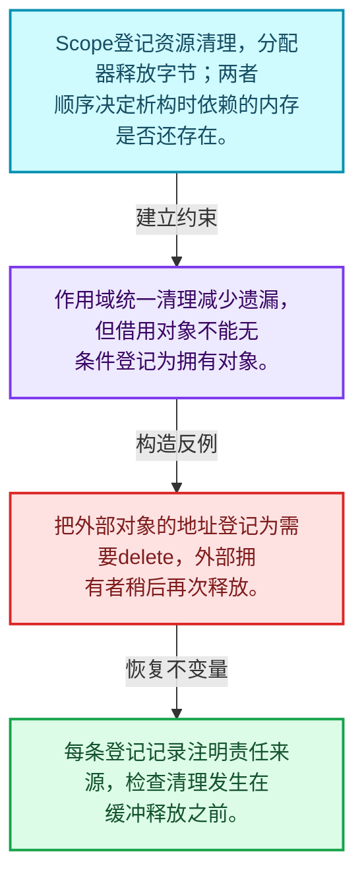
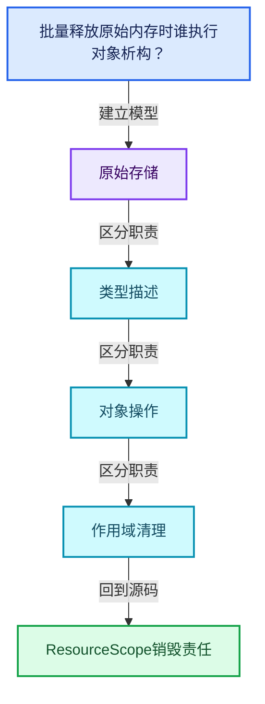
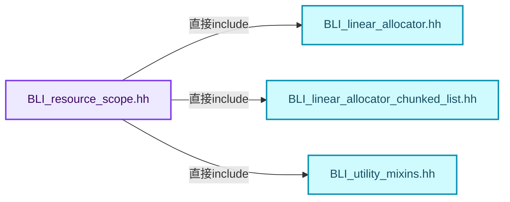
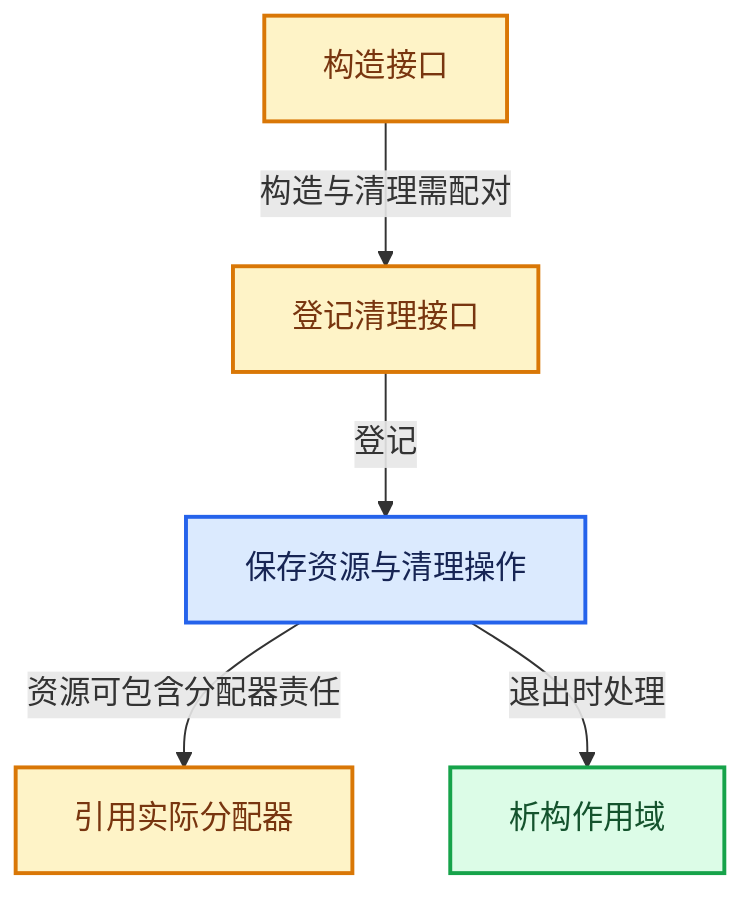
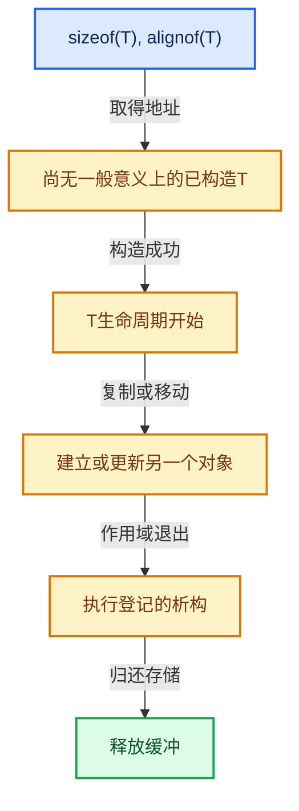

# 03-05 ResourceScope销毁责任

[方向导航](README.md) · [总目录](../README.md) · [覆盖索引](../%E6%BA%90%E7%A0%81%E7%89%88%E6%9C%AC%E4%B8%8E%E8%A6%86%E7%9B%96%E7%B4%A2%E5%BC%95.md)

> 阅读顺序：问题与数据模型 → 语法与类型 → 源码逐行 → 调用线索 → 历史与取舍 → 推演和练习。

- 基准 HEAD：`cbda6b96c26c0dee3c3b5cbb93960c4ac06a6b30`。
- 记录日期：2026-10-14。
- 教学示例状态：正文中的推演不是本机性能实测；已运行练习见验收报告。

## 一、从问题到设计

批量释放原始内存时谁执行对象析构？

资源作用域登记清理操作，通常与临时对象共同存活；借用对象和新建对象的清理责任不同。

本篇把语法、数据语义和系统取舍连接起来。把存储分配、对象构造、类型操作和最终清理拆开建模。

### 本篇独立模型与设计推理

Scope登记资源清理，分配器释放字节；两者顺序决定析构时依赖的内存是否还存在。

设计取舍：作用域统一清理减少遗漏，但借用对象不能无条件登记为拥有对象。

最小反例：把外部对象的地址登记为需要delete，外部拥有者稍后再次释放。

推导与处理：每条登记记录注明责任来源，检查清理发生在缓冲释放之前。



### 源码范围与相邻篇章

| 文件 | 本篇逐行范围 | 基准SHA-256 |
|---|---|---|
| [source/blender/blenlib/BLI_resource_scope.hh](../../../../../source/blender/blenlib/BLI_resource_scope.hh) | L1—L243 | `89ba4492cc38877a07ced9a1d70aebbebee0feb5ecbbaaf3275a9c17c2192d87` |
| [source/blender/blenlib/intern/resource_scope.cc](../../../../../source/blender/blenlib/intern/resource_scope.cc) | L1—L92 | `a2ce280754596a280ecc9ccaddc9a111918687b58a1ef39a08f14e1891bfc86c` |

同一主讲文件可能分多篇覆盖；超出本篇范围的符号通过覆盖索引定位。空行与纯注释保留在源码摘录中，逐行表解释有效语句与语法边界；许可证头统一保留。

前篇：[ChunkedList分块容器](04-ChunkedList%E5%88%86%E5%9D%97%E5%AE%B9%E5%99%A8.md).

后篇：[CPPType总体接口](06-CPPType%E6%80%BB%E4%BD%93%E6%8E%A5%E5%8F%A3.md).

## 二、类型、数据与阅读地图



这是概念依赖图，边表示阅读关系，不声称是运行时调用顺序。

### 直接编译依赖



箭头只表示头文件包含关系；完整调用线索见后面的符号定位表。

## 三、关键词、语法与类型角色

### 模板 template

模板把类型或常量作为生成实现的参数。读声明时先列出类型参数、非类型参数和默认值，再看使用者实际实例化了什么。模板声明本身不意味着每种T都支持其全部成员。

具体检查：把T替换为int、string、只能移动的类型，分别检查每个被调用操作是否成立。

### 依赖名称 typename

typename既可引入类型模板参数，也可告诉编译器某个依赖名称是类型。它不创建运行时对象；解析期确认语法类别与实例化期检查具体类型是不同阶段。

具体检查：区分typename T::value_type和T::size()，前者标记类型，后者是表达式。

### 常量求值 constexpr

constexpr声明允许相应实体参与常量求值，但constexpr函数仍可以在运行时执行。是否常量求值由调用场景和表达式合法性共同决定。

具体检查：比较constexpr变量初始化和从运行时输入调用同一函数。

### 只读限定 const

const约束当前访问路径可做的修改。const指针、指向const的指针、const视图对象、const元素是不同位置的限定；其他别名可能仍可修改原对象。

具体检查：分别写T* const、const T*与const T* const，并画出不可修改的层次。

### 移动转换 std::move

std::move把表达式转换为可供移动重载选择的值类别，实际资源转移发生在被选中的构造或赋值中。对const对象move可能仍调用复制，对视图move也不会获得底层数据所有权。

具体检查：记录移动构造调用次数，不用变量名或std::move的出现次数替代测量。

### 完美转发 std::forward

std::forward在转发引用模板中恢复调用者原来的值类别。它依赖推导出的模板实参；无条件move会改变左值调用者的语义。

具体检查：对同一接口分别传入左值、临时对象和const左值，记录实际重载。

### 显式静态转换 static_cast

static_cast表达编译期允许的转换，不会自动验证运行时真实类型、指针寿命或索引边界。由void指针恢复T指针时，调用者仍须保证实际存储中确有合法T对象。

具体检查：标出转换前后的类型以及正确性依据来自哪里。

### 表示层转换 reinterpret_cast

reinterpret_cast不能自动开始任意对象的生命周期，也不能豁免对齐和别名规则。读这类代码需要追溯原始分配与实际构造操作。

具体检查：分别检查大小、对齐、生命周期和可访问类型，四项不能互相替代。

### 对齐 alignof

alignof得到类型要求的地址对齐。分配足够字节后仍需把地址对齐到相应边界，内嵌缓冲也一样。

具体检查：对齐a为2的幂时可推导向上取整，但仍要考虑溢出与边界。

### 对象表示 sizeof

sizeof给出对象表示大小，不是其引用的所有堆内存总量。sizeof视图很小并不说明底层数组很小。

具体检查：分别统计容器对象、容量字节和元素拥有的间接资源。

### 构造与new表达式

普通new可能分配并构造；placement new在给定地址构造，存储由其他机制提供。失败回滚应区分两类责任。

具体检查：追踪地址来自哪里、构造何时成功、由谁析构、由谁释放。

### 内部断言 assert

断言表达开发者预期成立的内部契约，发布构建可能关闭。它不能替代对不可信输入的完整错误处理，也不保证后续操作被运行时保护。

具体检查：对每条断言构造违反条件的输入，区分调用者错误与应向用户报告的错误。

### 编译期分支 if constexpr

条件在实例化时决定被保留的分支，这常用于不同类型的合法操作选择。它与运行时if有不同的实例化检查规则。

具体检查：找出每个分支依赖哪些类型特征，再使用满足与不满足条件的类型。

### 独占拥有 unique_ptr

unique_ptr通过移动转移拥有关系，默认删除策略必须与资源来源匹配。get返回借用指针，release交出责任而不销毁。

具体检查：区分move、get、release和reset后谁负责销毁。

### 共享拥有 shared_ptr

shared_ptr让控制块跟踪共享寿命，不自动使被指向对象的读写线程安全；循环拥有可能阻止销毁。

具体检查：画出强引用环并考虑是否应改变所有权方向或引入弱引用。

### 类型别名 using

类型别名为已有类型建立名字，不创建运行期对象。它常把模板内部使用的类型统一暴露给泛型调用者。

具体检查：展开别名直到基础类型，区分类型别名和变量声明。

## 四、真实源码与逐行讲解

源码块保持原行内容，原始行号由小节标题及逐行表给出。表中的调用定位是静态阅读辅助；重载、模板实例化、宏展开和虚调用需结合完整声明，不能仅凭词法出现证明动态调用。

### BLI_resource_scope.hh：L1—L46

<!-- source:source/blender/blenlib/BLI_resource_scope.hh:1:46 -->

```cpp
/* SPDX-FileCopyrightText: 2023 Blender Authors
 *
 * SPDX-License-Identifier: GPL-2.0-or-later */

#pragma once

/** \file
 * \ingroup bli
 */

#include "BLI_linear_allocator.hh"
#include "BLI_linear_allocator_chunked_list.hh"
#include "BLI_utility_mixins.hh"

namespace blender {

/**
 * A `ResourceScope` takes ownership of arbitrary data/resources. Those resources will be
 * destructed and/or freed when the `ResourceScope` is destructed. Destruction happens in reverse
 * order. That allows resources do depend on other resources that have been added before.
 *
 * A `ResourceScope` can also be thought of as a dynamic/runtime version of normal scopes in C++
 * that are surrounded by braces.
 *
 * The main purpose of a `ResourceScope` is to allow functions to inject data into the scope of the
 * caller. Traditionally, that can only be done by returning a value that owns everything it needs.
 * This is fine until one has to deal with optional ownership. There are many ways to have a type
 * optionally own something else, all of which are fairly annoying. A `ResourceScope` can be used
 * to avoid having to deal with optional ownership. If some value would be owned, it can just be
 * added to the resource scope, otherwise not.
 *
 * When a function takes a `ResourceScope` as parameter, it usually means that its return value
 * will live at least as long as the passed in resources scope. However, it might also live longer.
 * That can happen when the function returns a reference to statically allocated data or
 * dynamically allocated data depending on some condition.
 */
class ResourceScope : NonMovable {
 private:
  struct ResourceData {
    void *data;
    void (*free)(void *data);
  };
  using ResourceDataList = linear_allocator::ChunkedList<ResourceData, 4>;

  /** This stores all resources. They are later freed in the reverse order of construction. */
  ResourceDataList resources_;
```

| 原始行 | 语义、约束与检查 |
|---|---|
| L5 | 防止同一头文件在一个翻译单元中重复展开；不控制多个源文件之间的链接或对象寿命。 |
| L11 | 引入编译依赖 "BLI_linear_allocator.hh"；这是声明可见性关系，不表示运行时一定调用该文件的所有接口。 |
| L12 | 引入编译依赖 "BLI_linear_allocator_chunked_list.hh"；这是声明可见性关系，不表示运行时一定调用该文件的所有接口。 |
| L13 | 引入编译依赖 "BLI_utility_mixins.hh"；这是声明可见性关系，不表示运行时一定调用该文件的所有接口。 |
| L15 | 把后续声明放入 blender 命名空间，影响名称查找和符号归属，不创建运行时对象。 |
| L37 | 声明或定义类型 `class ResourceScope : NonMovable`。结合继承、访问权限和成员布局确认接口与拥有关系；前向声明本身没有完整对象布局。 |
| L38 | 切换成员访问权限为 private；它是编译期接口边界，不是线程同步或内存保护。 |
| L39 | 声明或定义类型 `struct ResourceData`。结合继承、访问权限和成员布局确认接口与拥有关系；前向声明本身没有完整对象布局。 |
| L40 | 声明成员、局部对象或完成语句 `void *data`。若为指针或引用，它本身不说明拥有；若为值对象，其构造析构由所在作用域或外层对象管理。 |
| L41 | 声明接口 `void (*free)(void *data)`，本行没有对应函数体；返回类型、参数限定和const/noexcept共同组成调用契约，实际行为需继续定位实现。 |
| L42 | 结束当前语法单元。局部自动对象在离开其作用域时按规则销毁；这不等于所有被引用的外部数据也被释放。 |
| L43 | 定义类型别名 `using ResourceDataList = linear_allocator::ChunkedList<ResourceData, 4>`，为模板接口或内部实现统一命名；本行不分配该类型对象。 |
| L46 | 声明成员、局部对象或完成语句 `ResourceDataList resources_`。若为指针或引用，它本身不说明拥有；若为值对象，其构造析构由所在作用域或外层对象管理。 |

### BLI_resource_scope.hh：L47—L96

<!-- source:source/blender/blenlib/BLI_resource_scope.hh:47:96 -->

```cpp
  /**
   * Used allocator. This is either provided by the caller when creating the #ResourceScope, or is
   * owned by the scope itself In the latter case, the ownership of the allocator is also tracked
   * by #resources_ above.
   */
  LinearAllocator<> &allocator_;

 public:
  /**
   * Construct a #ResourceScope with an initial buffer of the given size.
   */
  explicit ResourceScope(int64_t initial_size = 32);

  /**
   * Construct a #ResourceScope in the provided buffer. It may allocate additional memory as
   * necessary though.
   */
  template<size_t Size, size_t Alignment>
  explicit ResourceScope(AlignedBuffer<Size, Alignment> &buffer);

  /**
   * Construct a #ResourceScope in the provided buffer. It may allocate additional memory as
   * necessary though.
   */
  ResourceScope(void *buffer, int64_t size);

  /**
   * Construct a #ResourceScope that uses the given allocator instead of creating a new one.
   */
  explicit ResourceScope(LinearAllocator<> &allocator);

  ~ResourceScope();

  /**
   * Pass ownership of the resource to the #ResourceScope. It will be destructed and freed when
   * the #ResourceScope is destructed.
   */
  template<typename T> T *add(std::unique_ptr<T> resource);

  /**
   * Pass ownership of the resource to the #ResourceScope. The reference count will be decremented
   * when the #ResourceScope is destructed.
   */
  template<typename T> T *add(std::shared_ptr<T> resource);

  /**
   * Pass ownership of the resource to the #ResourceScope. It will be destructed when the
   * #ResourceScope is destructed.
   */
  template<typename T> T *add(destruct_ptr<T> resource);
```

本段语义重点：

- `allocator_`：提供存储的分配策略对象，释放必须与分配策略匹配。

| 原始行 | 语义、约束与检查 |
|---|---|
| L52 | 本行涉及 `allocator_`：提供存储的分配策略对象，释放必须与分配策略匹配。按此语义解读 `LinearAllocator<> &allocator_`，不要把地址、数量或状态混用。 |
| L54 | 切换成员访问权限为 public；它是编译期接口边界，不是线程同步或内存保护。 |
| L58 | 把右侧 `32)` 用于初始化或更新左侧 `explicit ResourceScope(int64_t initial_size`。声明初始化与已有对象赋值应按上下文区分；有资源的类型会调用相应特殊成员。 |
| L64 | 声明模板参数 `template<size_t Size, size_t Alignment>`。类型参数决定生成操作的类型，非类型参数可决定内嵌容量或编译期分支。 |
| L65 | 声明接口 `explicit ResourceScope(AlignedBuffer<Size, Alignment> &buffer)`，本行没有对应函数体；返回类型、参数限定和const/noexcept共同组成调用契约，实际行为需继续定位实现。 |
| L71 | 出现调用或函数声明 `ResourceScope`，对应表达式为 `ResourceScope(void *buffer, int64_t size);`。参数求值、返回类型与重载需结合前后完整语句；静态文本引用不能证明动态目标。 |
| L76 | 声明接口 `explicit ResourceScope(LinearAllocator<> &allocator)`，本行没有对应函数体；返回类型、参数限定和const/noexcept共同组成调用契约，实际行为需继续定位实现。 |
| L78 | 涉及析构接口或显式析构：`~ResourceScope();`。检查目标对象已成功构造，且资源不会在另一条清理路径再次销毁。 |
| L84 | 声明模板参数 `template<typename T> T *add(std::unique_ptr<T> resource);`。类型参数决定生成操作的类型，非类型参数可决定内嵌容量或编译期分支。 |
| L90 | 声明模板参数 `template<typename T> T *add(std::shared_ptr<T> resource);`。类型参数决定生成操作的类型，非类型参数可决定内嵌容量或编译期分支。 |
| L96 | 声明模板参数 `template<typename T> T *add(destruct_ptr<T> resource);`。类型参数决定生成操作的类型，非类型参数可决定内嵌容量或编译期分支。 |

### BLI_resource_scope.hh：L97—L144

<!-- source:source/blender/blenlib/BLI_resource_scope.hh:97:144 -->

```cpp

  /**
   * Pass ownership of some resource to the #ResourceScope. The given free function will be
   * called when the #ResourceScope is destructed.
   */
  void add(void *userdata, void (*free)(void *));

  /**
   * Construct an object with the same value in the #ResourceScope and return a reference to the
   * new value.
   */
  template<typename T> T &add_value(T &&value);

  /**
   * The passed in function will be called when the scope is destructed.
   */
  template<typename Func> void add_destruct_call(Func func);

  /**
   * Utility method to construct an instance of type T that will be owned by the #ResourceScope.
   */
  template<typename T, typename... Args> T &construct(Args &&...args);

  /**
   * Allocate a buffer for the given type. The caller is responsible for initializing it before the
   * #ResourceScope is destructed. The value in the returned buffer is destructed automatically.
   */
  void *allocate_owned(const CPPType &type);

  /**
   * Returns a reference to a linear allocator that is used by the #ResourceScope.
   */
  LinearAllocator<> &allocator();

 private:
  static LinearAllocator<> &create_own_allocator(ResourceDataList &r_resources,
                                                 int64_t initial_size);
  static LinearAllocator<> &create_own_allocator_in_buffer(ResourceDataList &r_resources,
                                                           void *data,
                                                           int64_t size,
                                                           bool free_on_destruct);
};

/* This tests the expected size of #ResourceScope. It's currently easy to break by e.g. inheriting
 * from #NonCopyable. That happens because then there would be two #NonCopyable types at the same
 * address which is not allowed. The proper solution is probably to change how NonCopyable and
 * NonMovable are used overall. */
static_assert(sizeof(ResourceScope) == 16);
```

| 原始行 | 语义、约束与检查 |
|---|---|
| L102 | 声明接口 `void add(void *userdata, void (*free)(void *))`，本行没有对应函数体；返回类型、参数限定和const/noexcept共同组成调用契约，实际行为需继续定位实现。 |
| L108 | 声明模板参数 `template<typename T> T &add_value(T &&value);`。类型参数决定生成操作的类型，非类型参数可决定内嵌容量或编译期分支。 |
| L113 | 声明模板参数 `template<typename Func> void add_destruct_call(Func func);`。类型参数决定生成操作的类型，非类型参数可决定内嵌容量或编译期分支。 |
| L118 | 声明模板参数 `template<typename T, typename... Args> T &construct(Args &&...args);`。类型参数决定生成操作的类型，非类型参数可决定内嵌容量或编译期分支。 |
| L124 | 声明接口 `void *allocate_owned(const CPPType &type)`，本行没有对应函数体；返回类型、参数限定和const/noexcept共同组成调用契约，实际行为需继续定位实现。 |
| L129 | 出现调用或函数声明 `allocator`，对应表达式为 `LinearAllocator<> &allocator();`。参数求值、返回类型与重载需结合前后完整语句；静态文本引用不能证明动态目标。 |
| L131 | 切换成员访问权限为 private；它是编译期接口边界，不是线程同步或内存保护。 |
| L132 | 出现调用或函数声明 `create_own_allocator`，对应表达式为 `static LinearAllocator<> &create_own_allocator(ResourceDataList &r_resources,`。参数求值、返回类型与重载需结合前后完整语句；静态文本引用不能证明动态目标。 |
| L133 | 声明成员、局部对象或完成语句 `int64_t initial_size)`。若为指针或引用，它本身不说明拥有；若为值对象，其构造析构由所在作用域或外层对象管理。 |
| L134 | 出现调用或函数声明 `create_own_allocator_in_buffer`，对应表达式为 `static LinearAllocator<> &create_own_allocator_in_buffer(ResourceDataList &r_resources,`。参数求值、返回类型与重载需结合前后完整语句；静态文本引用不能证明动态目标。 |
| L135 | 本行是连续声明或表达式的一部分：`void *data,`。与本段前后行合读；逗号、括号和限定符决定它属于参数、初始化列表还是实际计算。 |
| L136 | 本行是连续声明或表达式的一部分：`int64_t size,`。与本段前后行合读；逗号、括号和限定符决定它属于参数、初始化列表还是实际计算。 |
| L137 | 声明成员、局部对象或完成语句 `bool free_on_destruct)`。若为指针或引用，它本身不说明拥有；若为值对象，其构造析构由所在作用域或外层对象管理。 |
| L138 | 结束当前语法单元。局部自动对象在离开其作用域时按规则销毁；这不等于所有被引用的外部数据也被释放。 |
| L144 | 在编译期检查 `static_assert(sizeof(ResourceScope) == 16);`；条件失败导致编译错误，不存在运行时错误恢复路径。 |

### BLI_resource_scope.hh：L145—L197

<!-- source:source/blender/blenlib/BLI_resource_scope.hh:145:197 -->

```cpp

/* -------------------------------------------------------------------- */
/** \name #ResourceScope Inline Methods
 * \{ */

inline ResourceScope::ResourceScope(LinearAllocator<> &allocator) : allocator_(allocator) {}

template<size_t Size, size_t Alignment>
inline ResourceScope::ResourceScope(AlignedBuffer<Size, Alignment> &buffer)
    : ResourceScope(buffer.ptr(), Size)
{
}

template<typename T> inline T *ResourceScope::add(std::unique_ptr<T> resource)
{
  T *ptr = resource.release();
  if (ptr == nullptr) {
    return nullptr;
  }
  this->add(ptr, [](void *data) {
    T *typed_data = reinterpret_cast<T *>(data);
    delete typed_data;
  });
  return ptr;
}

template<typename T> inline T *ResourceScope::add(std::shared_ptr<T> resource)
{
  if (!resource) {
    return nullptr;
  }
  T *ptr = resource.get();
  this->add_destruct_call([resource = std::move(resource)]() mutable { resource.reset(); });
  return ptr;
}

template<typename T> inline T *ResourceScope::add(destruct_ptr<T> resource)
{
  T *ptr = resource.release();
  if (ptr == nullptr) {
    return nullptr;
  }
  /* There is no need to keep track of such types. */
  if constexpr (std::is_trivially_destructible_v<T>) {
    return ptr;
  }

  this->add(ptr, [](void *data) {
    T *typed_data = reinterpret_cast<T *>(data);
    typed_data->~T();
  });
  return ptr;
}
```

本段语义重点：

- `allocator_`：提供存储的分配策略对象，释放必须与分配策略匹配。

| 原始行 | 语义、约束与检查 |
|---|---|
| L150 | 本行涉及 `allocator_`：提供存储的分配策略对象，释放必须与分配策略匹配。按此语义解读 `inline ResourceScope::ResourceScope(LinearAllocator<> &allocator) : allocator_(allocator) {}`，不要把地址、数量或状态混用。 |
| L152 | 声明模板参数 `template<size_t Size, size_t Alignment>`。类型参数决定生成操作的类型，非类型参数可决定内嵌容量或编译期分支。 |
| L153 | 出现调用或函数声明 `ResourceScope::ResourceScope`，对应表达式为 `inline ResourceScope::ResourceScope(AlignedBuffer<Size, Alignment> &buffer)`。参数求值、返回类型与重载需结合前后完整语句；静态文本引用不能证明动态目标。 |
| L154 | 出现调用或函数声明 `ResourceScope`，对应表达式为 `: ResourceScope(buffer.ptr(), Size)`。参数求值、返回类型与重载需结合前后完整语句；静态文本引用不能证明动态目标。 |
| L155 | 连接上一行的声明或控制结构与其语句块；后续行在这个作用域中执行或声明。 |
| L156 | 结束当前语法单元。局部自动对象在离开其作用域时按规则销毁；这不等于所有被引用的外部数据也被释放。 |
| L158 | 声明模板参数 `template<typename T> inline T *ResourceScope::add(std::unique_ptr<T> resource)`。类型参数决定生成操作的类型，非类型参数可决定内嵌容量或编译期分支。 |
| L159 | 连接上一行的声明或控制结构与其语句块；后续行在这个作用域中执行或声明。 |
| L160 | 把右侧 `resource.release()` 用于初始化或更新左侧 `T *ptr`。声明初始化与已有对象赋值应按上下文区分；有资源的类型会调用相应特殊成员。 |
| L161 | 判断 `ptr == nullptr`，成立时进入本分支，否则继续后续路径。这里区分空地址与可用地址，但非空本身仍不能证明对象存活。 |
| L162 | 返回表达式 `nullptr`。 |
| L163 | 结束当前语法单元。局部自动对象在离开其作用域时按规则销毁；这不等于所有被引用的外部数据也被释放。 |
| L164 | 出现调用或函数声明 `add`，对应表达式为 `this->add(ptr, [](void *data) {`。参数求值、返回类型与重载需结合前后完整语句；静态文本引用不能证明动态目标。 |
| L165 | 把右侧 `reinterpret_cast<T *>(data)` 用于初始化或更新左侧 `T *typed_data`。声明初始化与已有对象赋值应按上下文区分；有资源的类型会调用相应特殊成员。 |
| L166 | 声明成员、局部对象或完成语句 `delete typed_data`。若为指针或引用，它本身不说明拥有；若为值对象，其构造析构由所在作用域或外层对象管理。 |
| L167 | 结束当前语法单元。局部自动对象在离开其作用域时按规则销毁；这不等于所有被引用的外部数据也被释放。 |
| L168 | 返回表达式 `ptr`。 |
| L169 | 结束当前语法单元。局部自动对象在离开其作用域时按规则销毁；这不等于所有被引用的外部数据也被释放。 |
| L171 | 声明模板参数 `template<typename T> inline T *ResourceScope::add(std::shared_ptr<T> resource)`。类型参数决定生成操作的类型，非类型参数可决定内嵌容量或编译期分支。 |
| L172 | 连接上一行的声明或控制结构与其语句块；后续行在这个作用域中执行或声明。 |
| L173 | 判断 `!resource`，成立时进入本分支，否则继续后续路径。 |
| L174 | 返回表达式 `nullptr`。 |
| L175 | 结束当前语法单元。局部自动对象在离开其作用域时按规则销毁；这不等于所有被引用的外部数据也被释放。 |
| L176 | 把右侧 `resource.get()` 用于初始化或更新左侧 `T *ptr`。声明初始化与已有对象赋值应按上下文区分；有资源的类型会调用相应特殊成员。 |
| L177 | 把右侧 `std::move(resource)]() mutable { resource.reset(); })` 用于初始化或更新左侧 `this->add_destruct_call([resource`。声明初始化与已有对象赋值应按上下文区分；有资源的类型会调用相应特殊成员。 |
| L178 | 返回表达式 `ptr`。 |
| L179 | 结束当前语法单元。局部自动对象在离开其作用域时按规则销毁；这不等于所有被引用的外部数据也被释放。 |
| L181 | 声明模板参数 `template<typename T> inline T *ResourceScope::add(destruct_ptr<T> resource)`。类型参数决定生成操作的类型，非类型参数可决定内嵌容量或编译期分支。 |
| L182 | 连接上一行的声明或控制结构与其语句块；后续行在这个作用域中执行或声明。 |
| L183 | 把右侧 `resource.release()` 用于初始化或更新左侧 `T *ptr`。声明初始化与已有对象赋值应按上下文区分；有资源的类型会调用相应特殊成员。 |
| L184 | 判断 `ptr == nullptr`，成立时进入本分支，否则继续后续路径。这里区分空地址与可用地址，但非空本身仍不能证明对象存活。 |
| L185 | 返回表达式 `nullptr`。 |
| L186 | 结束当前语法单元。局部自动对象在离开其作用域时按规则销毁；这不等于所有被引用的外部数据也被释放。 |
| L188 | 编译期条件分支 `if constexpr (std::is_trivially_destructible_v<T>)`。按实例化类型选择相应实现；被舍弃分支和运行期if具有不同检查规则，不能当作运行时输入验证。 |
| L189 | 返回表达式 `ptr`。 |
| L190 | 结束当前语法单元。局部自动对象在离开其作用域时按规则销毁；这不等于所有被引用的外部数据也被释放。 |
| L192 | 出现调用或函数声明 `add`，对应表达式为 `this->add(ptr, [](void *data) {`。参数求值、返回类型与重载需结合前后完整语句；静态文本引用不能证明动态目标。 |
| L193 | 把右侧 `reinterpret_cast<T *>(data)` 用于初始化或更新左侧 `T *typed_data`。声明初始化与已有对象赋值应按上下文区分；有资源的类型会调用相应特殊成员。 |
| L194 | 涉及析构接口或显式析构：`typed_data->~T();`。检查目标对象已成功构造，且资源不会在另一条清理路径再次销毁。 |
| L195 | 结束当前语法单元。局部自动对象在离开其作用域时按规则销毁；这不等于所有被引用的外部数据也被释放。 |
| L196 | 返回表达式 `ptr`。 |
| L197 | 结束当前语法单元。局部自动对象在离开其作用域时按规则销毁；这不等于所有被引用的外部数据也被释放。 |

### BLI_resource_scope.hh：L198—L243

<!-- source:source/blender/blenlib/BLI_resource_scope.hh:198:243 -->

```cpp

inline void ResourceScope::add(void *userdata, void (*free)(void *))
{
  ResourceData data;
  data.data = userdata;
  data.free = free;
  resources_.append(allocator_, data);
}

template<typename T> inline T &ResourceScope::add_value(T &&value)
{
  return this->construct<T>(std::forward<T>(value));
}

template<typename Func> inline void ResourceScope::add_destruct_call(Func func)
{
  void *buffer = allocator_.allocate(sizeof(Func), alignof(Func));
  new (buffer) Func(std::move(func));
  this->add(buffer, [](void *data) { (*static_cast<Func *>(data))(); });
}

template<typename T, typename... Args> inline T &ResourceScope::construct(Args &&...args)
{
  destruct_ptr<T> value_ptr = allocator_.construct<T>(std::forward<Args>(args)...);
  T &value_ref = *value_ptr;
  this->add(std::move(value_ptr));
  return value_ref;
}

inline void *ResourceScope::allocate_owned(const CPPType &type)
{
  void *buffer = allocator_.allocate(type);
  if (!type.is_trivially_destructible) {
    this->add_destruct_call([&type, buffer]() { type.destruct(buffer); });
  }
  return buffer;
}

inline LinearAllocator<> &ResourceScope::allocator()
{
  return allocator_;
}

/** \} */

}  // namespace blender
```

本段语义重点：

- `allocator_`：提供存储的分配策略对象，释放必须与分配策略匹配。

| 原始行 | 语义、约束与检查 |
|---|---|
| L199 | 出现调用或函数声明 `ResourceScope::add`，对应表达式为 `inline void ResourceScope::add(void *userdata, void (*free)(void *))`。参数求值、返回类型与重载需结合前后完整语句；静态文本引用不能证明动态目标。 |
| L200 | 连接上一行的声明或控制结构与其语句块；后续行在这个作用域中执行或声明。 |
| L201 | 声明成员、局部对象或完成语句 `ResourceData data`。若为指针或引用，它本身不说明拥有；若为值对象，其构造析构由所在作用域或外层对象管理。 |
| L202 | 把右侧 `userdata` 用于初始化或更新左侧 `data.data`。声明初始化与已有对象赋值应按上下文区分；有资源的类型会调用相应特殊成员。 |
| L203 | 把右侧 `free` 用于初始化或更新左侧 `data.free`。声明初始化与已有对象赋值应按上下文区分；有资源的类型会调用相应特殊成员。 |
| L204 | 本行涉及 `allocator_`：提供存储的分配策略对象，释放必须与分配策略匹配。按此语义解读 `resources_.append(allocator_, data)`，不要把地址、数量或状态混用。 |
| L205 | 结束当前语法单元。局部自动对象在离开其作用域时按规则销毁；这不等于所有被引用的外部数据也被释放。 |
| L207 | 声明模板参数 `template<typename T> inline T &ResourceScope::add_value(T &&value)`。类型参数决定生成操作的类型，非类型参数可决定内嵌容量或编译期分支。 |
| L208 | 连接上一行的声明或控制结构与其语句块；后续行在这个作用域中执行或声明。 |
| L209 | 返回表达式 `this->construct<T>(std::forward<T>(value))`。 |
| L210 | 结束当前语法单元。局部自动对象在离开其作用域时按规则销毁；这不等于所有被引用的外部数据也被释放。 |
| L212 | 声明模板参数 `template<typename Func> inline void ResourceScope::add_destruct_call(Func func)`。类型参数决定生成操作的类型，非类型参数可决定内嵌容量或编译期分支。 |
| L213 | 连接上一行的声明或控制结构与其语句块；后续行在这个作用域中执行或声明。 |
| L214 | 建立或更新 `allocator_`：提供存储的分配策略对象，释放必须与分配策略匹配。本行的具体值关系为 `void *buffer = allocator_.allocate(sizeof(Func), alignof(Func))`；对照更新前后相应范围或状态是否一致。 |
| L215 | 出现调用或函数声明 `new`，对应表达式为 `new (buffer) Func(std::move(func));`。参数求值、返回类型与重载需结合前后完整语句；静态文本引用不能证明动态目标。 |
| L216 | 出现调用或函数声明 `add`，对应表达式为 `this->add(buffer, [](void *data) { (*static_cast<Func *>(data))(); });`。参数求值、返回类型与重载需结合前后完整语句；静态文本引用不能证明动态目标。 |
| L217 | 结束当前语法单元。局部自动对象在离开其作用域时按规则销毁；这不等于所有被引用的外部数据也被释放。 |
| L219 | 声明模板参数 `template<typename T, typename... Args> inline T &ResourceScope::construct(Args &&...args)`。类型参数决定生成操作的类型，非类型参数可决定内嵌容量或编译期分支。 |
| L220 | 连接上一行的声明或控制结构与其语句块；后续行在这个作用域中执行或声明。 |
| L221 | 建立或更新 `allocator_`：提供存储的分配策略对象，释放必须与分配策略匹配。本行的具体值关系为 `destruct_ptr<T> value_ptr = allocator_.construct<T>(std::forward<Args>(args)...)`；对照更新前后相应范围或状态是否一致。 |
| L222 | 把右侧 `*value_ptr` 用于初始化或更新左侧 `T &value_ref`。声明初始化与已有对象赋值应按上下文区分；有资源的类型会调用相应特殊成员。 |
| L223 | 出现调用或函数声明 `add`，对应表达式为 `this->add(std::move(value_ptr));`。参数求值、返回类型与重载需结合前后完整语句；静态文本引用不能证明动态目标。 |
| L224 | 返回表达式 `value_ref`。 |
| L225 | 结束当前语法单元。局部自动对象在离开其作用域时按规则销毁；这不等于所有被引用的外部数据也被释放。 |
| L227 | 出现调用或函数声明 `ResourceScope::allocate_owned`，对应表达式为 `inline void *ResourceScope::allocate_owned(const CPPType &type)`。参数求值、返回类型与重载需结合前后完整语句；静态文本引用不能证明动态目标。 |
| L228 | 连接上一行的声明或控制结构与其语句块；后续行在这个作用域中执行或声明。 |
| L229 | 建立或更新 `allocator_`：提供存储的分配策略对象，释放必须与分配策略匹配。本行的具体值关系为 `void *buffer = allocator_.allocate(type)`；对照更新前后相应范围或状态是否一致。 |
| L230 | 判断 `!type.is_trivially_destructible`，成立时进入本分支，否则继续后续路径。 |
| L231 | 出现调用或函数声明 `add_destruct_call`，对应表达式为 `this->add_destruct_call([&type, buffer]() { type.destruct(buffer); });`。参数求值、返回类型与重载需结合前后完整语句；静态文本引用不能证明动态目标。 |
| L232 | 结束当前语法单元。局部自动对象在离开其作用域时按规则销毁；这不等于所有被引用的外部数据也被释放。 |
| L233 | 返回表达式 `buffer`。 |
| L234 | 结束当前语法单元。局部自动对象在离开其作用域时按规则销毁；这不等于所有被引用的外部数据也被释放。 |
| L236 | 出现调用或函数声明 `ResourceScope::allocator`，对应表达式为 `inline LinearAllocator<> &ResourceScope::allocator()`。参数求值、返回类型与重载需结合前后完整语句；静态文本引用不能证明动态目标。 |
| L237 | 连接上一行的声明或控制结构与其语句块；后续行在这个作用域中执行或声明。 |
| L238 | 返回表达式 `allocator_`。 |
| L239 | 结束当前语法单元。局部自动对象在离开其作用域时按规则销毁；这不等于所有被引用的外部数据也被释放。 |
| L243 | 结束当前语法单元。局部自动对象在离开其作用域时按规则销毁；这不等于所有被引用的外部数据也被释放。 |

### resource_scope.cc：L1—L64

<!-- source:source/blender/blenlib/intern/resource_scope.cc:1:64 -->

```cpp
/* SPDX-FileCopyrightText: 2023 Blender Authors
 *
 * SPDX-License-Identifier: GPL-2.0-or-later */

/** \file
 * \ingroup bli
 */

#include "BLI_resource_scope.hh"

namespace blender {

ResourceScope::ResourceScope(const int64_t initial_size)
    : allocator_(ResourceScope::create_own_allocator(resources_, initial_size))
{
}

ResourceScope::ResourceScope(void *buffer, const int64_t size)
    : allocator_(
          /* At least the allocator itself has to fit into this buffer, otherwise it's not used. */
          size >= sizeof(LinearAllocator<>) ?
              ResourceScope::create_own_allocator_in_buffer(resources_, buffer, size, false) :
              ResourceScope::create_own_allocator(resources_, 0))
{
}

LinearAllocator<> &ResourceScope::create_own_allocator_in_buffer(ResourceDataList &r_resources,
                                                                 void *data,
                                                                 const int64_t size,
                                                                 const bool free_on_destruct)
{
  BLI_assert(data);
  BLI_assert(size >= sizeof(LinearAllocator<>));

  /* Actually construct the allocator. */
  LinearAllocator<> *allocator = new (data) LinearAllocator<>();

  /* Provide the initial buffer to the allocator. */
  const int64_t extra_size = size - sizeof(LinearAllocator<>);
  if (extra_size > 0) {
    void *initial_data = static_cast<char *>(data) + sizeof(LinearAllocator<>);
    allocator->provide_buffer(initial_data, extra_size);
  }

  /* Give ownership of the allocator to r_resources. This seems a bit recursive but works out
   * because `ChunkedList` is trivially destructible by design. */
  static_assert(std::is_trivially_destructible_v<ResourceDataList>);

  /* The allocator has to be destructed. However, the memory only has to be freed if it's actually
   * owned by the #ResourceScope. */
  auto free_fn = free_on_destruct ?
                     [](void *buffer) {
                       LinearAllocator<> *allocator = static_cast<LinearAllocator<> *>(buffer);
                       std::destroy_at(allocator);
                       MEM_delete_void(buffer);
                     } :
                     [](void *buffer) {
                       LinearAllocator<> *allocator = static_cast<LinearAllocator<> *>(buffer);
                       std::destroy_at(allocator);
                     };
  r_resources.append(*allocator, ResourceData{allocator, free_fn});

  return *allocator;
}
```

本段语义重点：

- `allocator_`：提供存储的分配策略对象，释放必须与分配策略匹配。

| 原始行 | 语义、约束与检查 |
|---|---|
| L9 | 引入编译依赖 "BLI_resource_scope.hh"；这是声明可见性关系，不表示运行时一定调用该文件的所有接口。 |
| L11 | 把后续声明放入 blender 命名空间，影响名称查找和符号归属，不创建运行时对象。 |
| L13 | 出现调用或函数声明 `ResourceScope::ResourceScope`，对应表达式为 `ResourceScope::ResourceScope(const int64_t initial_size)`。参数求值、返回类型与重载需结合前后完整语句；静态文本引用不能证明动态目标。 |
| L14 | 本行涉及 `allocator_`：提供存储的分配策略对象，释放必须与分配策略匹配。按此语义解读 `: allocator_(ResourceScope::create_own_allocator(resources_, initial_size))`，不要把地址、数量或状态混用。 |
| L15 | 连接上一行的声明或控制结构与其语句块；后续行在这个作用域中执行或声明。 |
| L16 | 结束当前语法单元。局部自动对象在离开其作用域时按规则销毁；这不等于所有被引用的外部数据也被释放。 |
| L18 | 出现调用或函数声明 `ResourceScope::ResourceScope`，对应表达式为 `ResourceScope::ResourceScope(void *buffer, const int64_t size)`。参数求值、返回类型与重载需结合前后完整语句；静态文本引用不能证明动态目标。 |
| L19 | 本行涉及 `allocator_`：提供存储的分配策略对象，释放必须与分配策略匹配。按此语义解读 `: allocator_(`，不要把地址、数量或状态混用。 |
| L21 | 出现调用或函数声明 `sizeof`，对应表达式为 `size >= sizeof(LinearAllocator<>) ?`。参数求值、返回类型与重载需结合前后完整语句；静态文本引用不能证明动态目标。 |
| L22 | 出现调用或函数声明 `ResourceScope::create_own_allocator_in_buffer`，对应表达式为 `ResourceScope::create_own_allocator_in_buffer(resources_, buffer, size, false) :`。参数求值、返回类型与重载需结合前后完整语句；静态文本引用不能证明动态目标。 |
| L23 | 出现调用或函数声明 `ResourceScope::create_own_allocator`，对应表达式为 `ResourceScope::create_own_allocator(resources_, 0))`。参数求值、返回类型与重载需结合前后完整语句；静态文本引用不能证明动态目标。 |
| L24 | 连接上一行的声明或控制结构与其语句块；后续行在这个作用域中执行或声明。 |
| L25 | 结束当前语法单元。局部自动对象在离开其作用域时按规则销毁；这不等于所有被引用的外部数据也被释放。 |
| L27 | 出现调用或函数声明 `ResourceScope::create_own_allocator_in_buffer`，对应表达式为 `LinearAllocator<> &ResourceScope::create_own_allocator_in_buffer(ResourceDataList &r_resources,`。参数求值、返回类型与重载需结合前后完整语句；静态文本引用不能证明动态目标。 |
| L28 | 本行是连续声明或表达式的一部分：`void *data,`。与本段前后行合读；逗号、括号和限定符决定它属于参数、初始化列表还是实际计算。 |
| L29 | 本行是连续声明或表达式的一部分：`const int64_t size,`。与本段前后行合读；逗号、括号和限定符决定它属于参数、初始化列表还是实际计算。 |
| L30 | 本行是连续声明或表达式的一部分：`const bool free_on_destruct)`。与本段前后行合读；逗号、括号和限定符决定它属于参数、初始化列表还是实际计算。 |
| L31 | 连接上一行的声明或控制结构与其语句块；后续行在这个作用域中执行或声明。 |
| L32 | 断言约束 `BLI_assert(data);`。条件是后续访问的内部前置条件；发布构建可能不执行，不能把断言当作输入修复。 |
| L33 | 断言约束 `BLI_assert(size >= sizeof(LinearAllocator<>));`。条件是后续访问的内部前置条件；发布构建可能不执行，不能把断言当作输入修复。 |
| L36 | 把右侧 `new (data) LinearAllocator<>()` 用于初始化或更新左侧 `LinearAllocator<> *allocator`。声明初始化与已有对象赋值应按上下文区分；有资源的类型会调用相应特殊成员。 |
| L39 | 把右侧 `size - sizeof(LinearAllocator<>)` 用于初始化或更新左侧 `const int64_t extra_size`。声明初始化与已有对象赋值应按上下文区分；有资源的类型会调用相应特殊成员。 |
| L40 | 判断 `extra_size > 0`，成立时进入本分支，否则继续后续路径。该边界影响可访问元素或可用容量，两者要按各变量的定义区分。 |
| L41 | 把右侧 `static_cast<char *>(data) + sizeof(LinearAllocator<>)` 用于初始化或更新左侧 `void *initial_data`。声明初始化与已有对象赋值应按上下文区分；有资源的类型会调用相应特殊成员。 |
| L42 | 出现调用或函数声明 `provide_buffer`，对应表达式为 `allocator->provide_buffer(initial_data, extra_size);`。参数求值、返回类型与重载需结合前后完整语句；静态文本引用不能证明动态目标。 |
| L43 | 结束当前语法单元。局部自动对象在离开其作用域时按规则销毁；这不等于所有被引用的外部数据也被释放。 |
| L47 | 在编译期检查 `static_assert(std::is_trivially_destructible_v<ResourceDataList>);`；条件失败导致编译错误，不存在运行时错误恢复路径。 |
| L51 | 把右侧 `free_on_destruct ?` 用于初始化或更新左侧 `auto free_fn`。声明初始化与已有对象赋值应按上下文区分；有资源的类型会调用相应特殊成员。 |
| L52 | 本行是连续声明或表达式的一部分：`[](void *buffer) {`。与本段前后行合读；逗号、括号和限定符决定它属于参数、初始化列表还是实际计算。 |
| L53 | 把右侧 `static_cast<LinearAllocator<> *>(buffer)` 用于初始化或更新左侧 `LinearAllocator<> *allocator`。声明初始化与已有对象赋值应按上下文区分；有资源的类型会调用相应特殊成员。 |
| L54 | 出现调用或函数声明 `std::destroy_at`，对应表达式为 `std::destroy_at(allocator);`。参数求值、返回类型与重载需结合前后完整语句；静态文本引用不能证明动态目标。 |
| L55 | 出现调用或函数声明 `MEM_delete_void`，对应表达式为 `MEM_delete_void(buffer);`。参数求值、返回类型与重载需结合前后完整语句；静态文本引用不能证明动态目标。 |
| L56 | 本行是连续声明或表达式的一部分：`} :`。与本段前后行合读；逗号、括号和限定符决定它属于参数、初始化列表还是实际计算。 |
| L57 | 本行是连续声明或表达式的一部分：`[](void *buffer) {`。与本段前后行合读；逗号、括号和限定符决定它属于参数、初始化列表还是实际计算。 |
| L58 | 把右侧 `static_cast<LinearAllocator<> *>(buffer)` 用于初始化或更新左侧 `LinearAllocator<> *allocator`。声明初始化与已有对象赋值应按上下文区分；有资源的类型会调用相应特殊成员。 |
| L59 | 出现调用或函数声明 `std::destroy_at`，对应表达式为 `std::destroy_at(allocator);`。参数求值、返回类型与重载需结合前后完整语句；静态文本引用不能证明动态目标。 |
| L60 | 结束当前语法单元。局部自动对象在离开其作用域时按规则销毁；这不等于所有被引用的外部数据也被释放。 |
| L61 | 出现调用或函数声明 `append`，对应表达式为 `r_resources.append(*allocator, ResourceData{allocator, free_fn});`。参数求值、返回类型与重载需结合前后完整语句；静态文本引用不能证明动态目标。 |
| L63 | 返回表达式 `*allocator`。 |
| L64 | 结束当前语法单元。局部自动对象在离开其作用域时按规则销毁；这不等于所有被引用的外部数据也被释放。 |

### resource_scope.cc：L65—L92

<!-- source:source/blender/blenlib/intern/resource_scope.cc:65:92 -->

```cpp

LinearAllocator<> &ResourceScope::create_own_allocator(ResourceDataList &r_resources,
                                                       const int64_t initial_size)
{
  /* Since we are doing an allocation already, we might as well allocate a slightly larger buffer
   * to initialize memory in the linear allocator. */
  const int64_t alloc_size = sizeof(LinearAllocator<>) + sizeof(ResourceDataList::Segment) +
                             initial_size;
  void *buffer = MEM_new_uninitialized_aligned(alloc_size, alignof(LinearAllocator<>), __func__);

  return ResourceScope::create_own_allocator_in_buffer(r_resources, buffer, alloc_size, true);
}

ResourceScope::~ResourceScope()
{
  /* Frees all resources in reverse order of construction. Note that #ChunkedList always iterates
   * in reverse order. */
  LinearAllocator<> *used_allocator = &allocator_;
  for (ResourceData &resource : resources_) {
    void *data = resource.data;
    resource.free(data);
    if (data == used_allocator) {
      break;
    }
  }
}

}  // namespace blender
```

本段语义重点：

- `allocator_`：提供存储的分配策略对象，释放必须与分配策略匹配。

| 原始行 | 语义、约束与检查 |
|---|---|
| L66 | 出现调用或函数声明 `ResourceScope::create_own_allocator`，对应表达式为 `LinearAllocator<> &ResourceScope::create_own_allocator(ResourceDataList &r_resources,`。参数求值、返回类型与重载需结合前后完整语句；静态文本引用不能证明动态目标。 |
| L67 | 本行是连续声明或表达式的一部分：`const int64_t initial_size)`。与本段前后行合读；逗号、括号和限定符决定它属于参数、初始化列表还是实际计算。 |
| L68 | 连接上一行的声明或控制结构与其语句块；后续行在这个作用域中执行或声明。 |
| L71 | 把右侧 `sizeof(LinearAllocator<>) + sizeof(ResourceDataList::Segment) +` 用于初始化或更新左侧 `const int64_t alloc_size`。声明初始化与已有对象赋值应按上下文区分；有资源的类型会调用相应特殊成员。 |
| L72 | 声明成员、局部对象或完成语句 `initial_size`。若为指针或引用，它本身不说明拥有；若为值对象，其构造析构由所在作用域或外层对象管理。 |
| L73 | 把右侧 `MEM_new_uninitialized_aligned(alloc_size, alignof(LinearAllocator<>), __func__)` 用于初始化或更新左侧 `void *buffer`。声明初始化与已有对象赋值应按上下文区分；有资源的类型会调用相应特殊成员。 |
| L75 | 返回表达式 `ResourceScope::create_own_allocator_in_buffer(r_resources, buffer, alloc_size, true)`。 |
| L76 | 结束当前语法单元。局部自动对象在离开其作用域时按规则销毁；这不等于所有被引用的外部数据也被释放。 |
| L78 | 涉及析构接口或显式析构：`ResourceScope::~ResourceScope()`。检查目标对象已成功构造，且资源不会在另一条清理路径再次销毁。 |
| L79 | 连接上一行的声明或控制结构与其语句块；后续行在这个作用域中执行或声明。 |
| L82 | 建立或更新 `allocator_`：提供存储的分配策略对象，释放必须与分配策略匹配。本行的具体值关系为 `LinearAllocator<> *used_allocator = &allocator_`；对照更新前后相应范围或状态是否一致。 |
| L83 | 按 `for (ResourceData &resource : resources_)` 指定的范围或条件重复执行。对照循环变量与真实元素编号；循环内调用成本乘以实际迭代次数。 |
| L84 | 把右侧 `resource.data` 用于初始化或更新左侧 `void *data`。声明初始化与已有对象赋值应按上下文区分；有资源的类型会调用相应特殊成员。 |
| L85 | 出现调用或函数声明 `free`，对应表达式为 `resource.free(data);`。参数求值、返回类型与重载需结合前后完整语句；静态文本引用不能证明动态目标。 |
| L86 | 判断 `data == used_allocator`，成立时进入本分支，否则继续后续路径。 |
| L87 | 离开最近的循环或switch；不是离开整个函数，后续清理和提交代码可能仍会执行。 |
| L88 | 结束当前语法单元。局部自动对象在离开其作用域时按规则销毁；这不等于所有被引用的外部数据也被释放。 |
| L89 | 结束当前语法单元。局部自动对象在离开其作用域时按规则销毁；这不等于所有被引用的外部数据也被释放。 |
| L90 | 结束当前语法单元。局部自动对象在离开其作用域时按规则销毁；这不等于所有被引用的外部数据也被释放。 |
| L92 | 结束当前语法单元。局部自动对象在离开其作用域时按规则销毁；这不等于所有被引用的外部数据也被释放。 |

## 五、接口定位、调用线索与生命周期

### ResourceScope的责任链



这里是职责关系图，不把所有add重载当成同一执行路径。资源按逆序清理，使后登记对象可以依赖先登记资源。

| 阶段 | 源码证据位置 | 实际语句定位 |
|---|---|---|
| 保存资源与清理操作 | BLI_resource_scope.hh [L46](../../../../../source/blender/blenlib/BLI_resource_scope.hh#L46) | `ResourceDataList resources_` |
| 引用实际分配器 | BLI_resource_scope.hh [L52](../../../../../source/blender/blenlib/BLI_resource_scope.hh#L52) | `LinearAllocator<> &allocator_` |
| 构造接口 | BLI_resource_scope.hh [L118](../../../../../source/blender/blenlib/BLI_resource_scope.hh#L118) | `T &construct(` |
| 登记清理接口 | BLI_resource_scope.hh [L113](../../../../../source/blender/blenlib/BLI_resource_scope.hh#L113) | `void add_destruct_call(` |
| 析构作用域 | resource_scope.cc [L78](../../../../../source/blender/blenlib/intern/resource_scope.cc#L78) | `ResourceScope::~ResourceScope()` |

图中的条件边必须与对应if、异常路径和提前返回合读；不把未展示分支当作不存在。

### 本篇声明与实现入口

| 源码位置 | 实际声明片段 |
|---|---|
| [BLI_resource_scope.hh:L37](../../../../../source/blender/blenlib/BLI_resource_scope.hh#L37) | `class ResourceScope : NonMovable` |
| [BLI_resource_scope.hh:L39](../../../../../source/blender/blenlib/BLI_resource_scope.hh#L39) | `struct ResourceData` |
| [BLI_resource_scope.hh:L58](../../../../../source/blender/blenlib/BLI_resource_scope.hh#L58) | `explicit ResourceScope(int64_t initial_size = 32);` |
| [BLI_resource_scope.hh:L65](../../../../../source/blender/blenlib/BLI_resource_scope.hh#L65) | `explicit ResourceScope(AlignedBuffer<Size, Alignment> &buffer);` |
| [BLI_resource_scope.hh:L71](../../../../../source/blender/blenlib/BLI_resource_scope.hh#L71) | `ResourceScope(void *buffer, int64_t size);` |
| [BLI_resource_scope.hh:L76](../../../../../source/blender/blenlib/BLI_resource_scope.hh#L76) | `explicit ResourceScope(LinearAllocator<> &allocator);` |
| [BLI_resource_scope.hh:L84](../../../../../source/blender/blenlib/BLI_resource_scope.hh#L84) | `template<typename T> T *add(std::unique_ptr<T> resource);` |
| [BLI_resource_scope.hh:L90](../../../../../source/blender/blenlib/BLI_resource_scope.hh#L90) | `template<typename T> T *add(std::shared_ptr<T> resource);` |
| [BLI_resource_scope.hh:L96](../../../../../source/blender/blenlib/BLI_resource_scope.hh#L96) | `template<typename T> T *add(destruct_ptr<T> resource);` |
| [BLI_resource_scope.hh:L102](../../../../../source/blender/blenlib/BLI_resource_scope.hh#L102) | `void add(void *userdata, void (*free)(void *));` |
| [BLI_resource_scope.hh:L108](../../../../../source/blender/blenlib/BLI_resource_scope.hh#L108) | `template<typename T> T &add_value(T &&value);` |
| [BLI_resource_scope.hh:L113](../../../../../source/blender/blenlib/BLI_resource_scope.hh#L113) | `template<typename Func> void add_destruct_call(Func func);` |
| [BLI_resource_scope.hh:L124](../../../../../source/blender/blenlib/BLI_resource_scope.hh#L124) | `void *allocate_owned(const CPPType &type);` |
| [BLI_resource_scope.hh:L129](../../../../../source/blender/blenlib/BLI_resource_scope.hh#L129) | `LinearAllocator<> &allocator();` |
| [BLI_resource_scope.hh:L132](../../../../../source/blender/blenlib/BLI_resource_scope.hh#L132) | `static LinearAllocator<> &create_own_allocator(ResourceDataList &r_resources,` |
| [BLI_resource_scope.hh:L134](../../../../../source/blender/blenlib/BLI_resource_scope.hh#L134) | `static LinearAllocator<> &create_own_allocator_in_buffer(ResourceDataList &r_resources,` |
| [BLI_resource_scope.hh:L150](../../../../../source/blender/blenlib/BLI_resource_scope.hh#L150) | `inline ResourceScope::ResourceScope(LinearAllocator<> &allocator) : allocator_(allocator) {}` |
| [BLI_resource_scope.hh:L153](../../../../../source/blender/blenlib/BLI_resource_scope.hh#L153) | `inline ResourceScope::ResourceScope(AlignedBuffer<Size, Alignment> &buffer)` |
| [BLI_resource_scope.hh:L154](../../../../../source/blender/blenlib/BLI_resource_scope.hh#L154) | `: ResourceScope(buffer.ptr(), Size)` |
| [BLI_resource_scope.hh:L158](../../../../../source/blender/blenlib/BLI_resource_scope.hh#L158) | `template<typename T> inline T *ResourceScope::add(std::unique_ptr<T> resource)` |
| [BLI_resource_scope.hh:L171](../../../../../source/blender/blenlib/BLI_resource_scope.hh#L171) | `template<typename T> inline T *ResourceScope::add(std::shared_ptr<T> resource)` |
| [BLI_resource_scope.hh:L181](../../../../../source/blender/blenlib/BLI_resource_scope.hh#L181) | `template<typename T> inline T *ResourceScope::add(destruct_ptr<T> resource)` |
| [BLI_resource_scope.hh:L199](../../../../../source/blender/blenlib/BLI_resource_scope.hh#L199) | `inline void ResourceScope::add(void *userdata, void (*free)(void *))` |
| [BLI_resource_scope.hh:L207](../../../../../source/blender/blenlib/BLI_resource_scope.hh#L207) | `template<typename T> inline T &ResourceScope::add_value(T &&value)` |
| [BLI_resource_scope.hh:L212](../../../../../source/blender/blenlib/BLI_resource_scope.hh#L212) | `template<typename Func> inline void ResourceScope::add_destruct_call(Func func)` |
| [BLI_resource_scope.hh:L227](../../../../../source/blender/blenlib/BLI_resource_scope.hh#L227) | `inline void *ResourceScope::allocate_owned(const CPPType &type)` |
| [BLI_resource_scope.hh:L236](../../../../../source/blender/blenlib/BLI_resource_scope.hh#L236) | `inline LinearAllocator<> &ResourceScope::allocator()` |
| [resource_scope.cc:L14](../../../../../source/blender/blenlib/intern/resource_scope.cc#L14) | `: allocator_(ResourceScope::create_own_allocator(resources_, initial_size))` |
| [resource_scope.cc:L19](../../../../../source/blender/blenlib/intern/resource_scope.cc#L19) | `: allocator_(` |
| [resource_scope.cc:L27](../../../../../source/blender/blenlib/intern/resource_scope.cc#L27) | `LinearAllocator<> &ResourceScope::create_own_allocator_in_buffer(ResourceDataList &r_resources,` |
| [resource_scope.cc:L55](../../../../../source/blender/blenlib/intern/resource_scope.cc#L55) | `MEM_delete_void(buffer);` |
| [resource_scope.cc:L66](../../../../../source/blender/blenlib/intern/resource_scope.cc#L66) | `LinearAllocator<> &ResourceScope::create_own_allocator(ResourceDataList &r_resources,` |

### 同名符号出现位置

以下表提供跨文件阅读入口，包含声明、调用或测试使用；没有经过完整C++名称解析，不把它命名为已证明的运行时调用图。

| 符号 | 位置 | 文本证据 |
|---|---|---|
| `ResourceScope` | [resource_scope.cc:L13](../../../../../source/blender/blenlib/intern/resource_scope.cc#L13) | `ResourceScope::ResourceScope(const int64_t initial_size)` |
| `ResourceScope` | [resource_scope.cc:L18](../../../../../source/blender/blenlib/intern/resource_scope.cc#L18) | `ResourceScope::ResourceScope(void *buffer, const int64_t size)` |
| `ResourceScope` | [resource_scope.cc:L78](../../../../../source/blender/blenlib/intern/resource_scope.cc#L78) | `ResourceScope::~ResourceScope()` |
| `add` | [BKE_attribute.hh:L769](../../../../../source/blender/blenkernel/BKE_attribute.hh#L769) | `bool add(const StringRef name,` |
| `add` | [BKE_attribute.hh:L783](../../../../../source/blender/blenkernel/BKE_attribute.hh#L783) | `return fn_->add(owner_, name, domain, data_type, initializer);` |
| `add` | [BKE_attribute.hh:L786](../../../../../source/blender/blenkernel/BKE_attribute.hh#L786) | `bool add(const StringRef name, const AttrDomain domain, const AttributeInit &initializer)` |
| `add_value` | [geometry_nodes_lazy_function.cc:L3959](../../../../../source/blender/nodes/intern/geometry_nodes_lazy_function.cc#L3959) | `input_lf_socket.set_default_value(&scope_.add_value(` |
| `add_destruct_call` | [BLI_virtual_array_range_spans.hh:L50](../../../../../source/blender/blenlib/BLI_virtual_array_range_spans.hh#L50) | `scope.add_destruct_call([full_span]() { destruct_n(full_span.data(), full_span.size()); });` |
| `add_destruct_call` | [field_evaluation.cc:L410](../../../../../source/blender/functions/intern/field_evaluation.cc#L410) | `scope.add_destruct_call(` |
| `add_destruct_call` | [multi_function_params.cc:L20](../../../../../source/blender/functions/intern/multi_function_params.cc#L20) | `scope.add_destruct_call(` |
| `allocate_owned` | [geometry_fields.cc:L1091](../../../../../source/blender/blenkernel/intern/geometry_fields.cc#L1091) | `void *value = scope.allocate_owned(field.cpp_type());` |
| `allocate_owned` | [field_evaluation.cc:L452](../../../../../source/blender/functions/intern/field_evaluation.cc#L452) | `void *buffer = scope.allocate_owned(type);` |
| `allocator` | [BLI_array.hh:L408](../../../../../source/blender/blenlib/BLI_array.hh#L408) | `Allocator &allocator()` |
| `allocator` | [BLI_array.hh:L412](../../../../../source/blender/blenlib/BLI_array.hh#L412) | `const Allocator &allocator() const` |
| `allocator` | [BLI_generic_array.hh:L108](../../../../../source/blender/blenlib/BLI_generic_array.hh#L108) | `GArray(const GArray &other) : GArray(other.as_span(), other.allocator()) {}` |
| `create_own_allocator` | [resource_scope.cc:L14](../../../../../source/blender/blenlib/intern/resource_scope.cc#L14) | `: allocator_(ResourceScope::create_own_allocator(resources_, initial_size))` |
| `create_own_allocator` | [resource_scope.cc:L23](../../../../../source/blender/blenlib/intern/resource_scope.cc#L23) | `ResourceScope::create_own_allocator(resources_, 0))` |
| `create_own_allocator` | [resource_scope.cc:L66](../../../../../source/blender/blenlib/intern/resource_scope.cc#L66) | `LinearAllocator<> &ResourceScope::create_own_allocator(ResourceDataList &r_resources,` |
| `create_own_allocator_in_buffer` | [resource_scope.cc:L22](../../../../../source/blender/blenlib/intern/resource_scope.cc#L22) | `ResourceScope::create_own_allocator_in_buffer(resources_, buffer, size, false) :` |
| `create_own_allocator_in_buffer` | [resource_scope.cc:L27](../../../../../source/blender/blenlib/intern/resource_scope.cc#L27) | `LinearAllocator<> &ResourceScope::create_own_allocator_in_buffer(ResourceDataList &r_resources,` |
| `create_own_allocator_in_buffer` | [resource_scope.cc:L75](../../../../../source/blender/blenlib/intern/resource_scope.cc#L75) | `return ResourceScope::create_own_allocator_in_buffer(r_resources, buffer, alloc_size, true);` |
| `allocator_` | [BLI_array.hh:L78](../../../../../source/blender/blenlib/BLI_array.hh#L78) | `Array(Allocator allocator = {}) noexcept : allocator_(allocator)` |
| `allocator_` | [BLI_bit_vector.hh:L89](../../../../../source/blender/blenlib/BLI_bit_vector.hh#L89) | `BitVector(Allocator allocator = {}) noexcept : allocator_(allocator)` |
| `allocator_` | [BLI_generic_array.hh:L48](../../../../../source/blender/blenlib/BLI_generic_array.hh#L48) | `GArray(Allocator allocator = {}) noexcept : allocator_(allocator) {}` |
| `MEM_delete_void` | [BLI_allocator.hh:L62](../../../../../source/blender/blenlib/BLI_allocator.hh#L62) | `MEM_delete_void(ptr);` |
| `MEM_delete_void` | [BLI_allocator.hh:L92](../../../../../source/blender/blenlib/BLI_allocator.hh#L92) | `MEM_delete_void(ptr);` |
| `MEM_delete_void` | [generic_virtual_array.cc:L250](../../../../../source/blender/blenlib/intern/generic_virtual_array.cc#L250) | `MEM_delete_void(const_cast<void *>(value_));` |

### 生命周期推理图


这是审查生命周期的通用模型。具体类是否拥有数据由本篇成员、构造、析构和调用者一起证明；任何箭头都不自动代表shared_ptr。

## 六、把代码放进具体数据中推演

本方向的共同数值模型如下。本篇的专门检查是：构造string与自定义资源，确认清理注册和实际销毁顺序。

| 步骤 | 数据或状态 | 为什么需要这一步 |
|---|---|---|
| 请求存储 | sizeof(T), alignof(T) | 空间和地址都满足类型要求 |
| 取得地址 | 尚无一般意义上的已构造T | 不能先调用T成员 |
| 构造成功 | T生命周期开始 | 登记相应清理责任 |
| 复制或移动 | 建立或更新另一个对象 | 区分初始化和赋值 |
| 作用域退出 | 执行登记的析构 | 只销毁已构造部分 |
| 归还存储 | 释放缓冲 | 与分配器来源匹配 |



图是教学推演模型；精确分支与状态更新以本篇摘录及调用契约为准。

### 本篇独立练习与参考思路

构造string与自定义资源，确认清理注册和实际销毁顺序。

参考思路：资源作用域登记清理操作，通常与临时对象共同存活；借用对象和新建对象的清理责任不同。

将输入、预期结果和资源责任分成三张清单。先用最直接的实现给出可核对的答案，再替换成对应源码使用的表示；比较结果不变的条件，而不是只比较接口名字。

验收依据：所有存活对象地址满足对齐；构造失败不会被当作成功对象登记；所有资源均有唯一或明确共享的清理责任。

## 七、复杂度、设计取舍与其他基础库

与std::pmr::monotonic_buffer_resource比较批量存储回收，与std::any比较拥有型类型擦除；CPPType描述类型操作，本身不保存每个值。

本篇的具体取舍：资源作用域登记清理操作，通常与临时对象共同存活；借用对象和新建对象的清理责任不同。

| 观察维度 | 从源码取得证据的方法 | 本篇要避免的误判 |
|---|---|---|
| 时间 | 对循环次数、分派次数和重建频率分别计数 | 看到单次常数操作就断定整个操作序列是常数成本 |
| 内存 | 区分对象本体、容量存储、间接资源和共享控制块 | 用sizeof代替总内存 |
| 安全 | 沿构造、失败回滚、销毁与失效逐路径检查 | 把断言或非空指针当作完整安全证明 |
| 并发 | 逐字段确认锁、发布顺序和借用寿命 | 把引用计数线程安全等同数据读写线程安全 |

相关一手资料：

- [C++公开工作草案](https://eel.is/c++draft/)：持续更新的工作草案；语言与标准库语义以相应章节为准。
- [LLVM Programmer’s Manual](https://llvm.org/docs/ProgrammersManual.html)：在线版，2026-10-14查阅；仅比较设计思路，不保证与本地LLVM版本一致。

资料用于核对契约和进一步阅读；这里没有声称外部库与Blender实现相同，也没有把上游性能数字当作本机实测。

## 八、历史提交与设计演化

### 2026-03-09 · Jacques Lucke

[BLI: optimize memory usage in ResourceScope](https://projects.blender.org/blender/blender/commit/fe24e8e7109e5b37ad3a7c845922f1f601a96eb7)

完整哈希：`fe24e8e7109e5b37ad3a7c845922f1f601a96eb7`。提交标题与作者日期来自本地Git对象。

提交说明原文（历史证据，不能直接作为当前API说明）：

```text
BLI: optimize memory usage in ResourceScope

This implements multiple improvements for the `ResourceScope` utility:
* Instead of a `Vector` it uses a `ChunkedList` to keep track of resources. This
  is has less memory overhead and does not require reallocations when growing.
* One can pass an already existing `LinearAllocator` to a constructor instead of
  always creating a new one.
* New constructors that allow providing initial memory for the resource scope
  (e.g. a large buffer on the stack).
* If it creates a new allocator, it increases the initial allocation size and
  uses the extra bytes as buffer in the allocator. This is instead of allocating
  twice.
* The size of `ResourceScope` shrinks from 176 bytes to just 16 bytes (although
  it does use more when it has to create a new allocator).

Pull Request: https://projects.blender.org/blender/blender/pulls/155290
```

阅读任务：先根据说明复述旧问题，提出一个自己的修复方案，再对照diff。结合本篇重点“批量释放原始内存时谁执行对象析构？”判断方案改变的是表示、接口、生命周期还是调度。

## 九、反例、测试入口与掌握标准

需要实际构造的反例：

- 空输入或没有结果需求：确认接口允许的空状态与不允许访问的操作。
- 边界位置和退化结构：把长度为1、末尾位置、重复值或深链代入真实分支。
- 生命周期结束或修改之后：检查保存的指针、引用、结果视图是否仍有效。
- 与本篇核心不变量相冲突的输入：构造string与自定义资源，确认清理注册和实际销毁顺序。

### 可运行的教学参考程序

[reference_exercises.cc](../_tools/reference_exercises.cc)包含独立于Blender的C++20参考检查：视图、简化SmallVector、异常回滚、哈希碰撞与删除、偏移数组、拓扑映射、共享缓存、表达式、惰性分支、闭包和暴力最近邻。

参考程序有意省略生产实现的完整能力。例如SmallVector禁止复制移动容器，不支持只能移动的元素，并禁止append参数别名到自身元素；TinyMap固定8槽，不提供增长。程序通过不能替代Blender实现测试。实际运行结果、编译器与命令见验收报告。

掌握标准：离开源码解释“批量释放原始内存时谁执行对象析构？”；独立完成上述练习；能指出一个会破坏原始存储相关约束的最小反例，并用具体代码行说明检查或修复应放在哪里。
