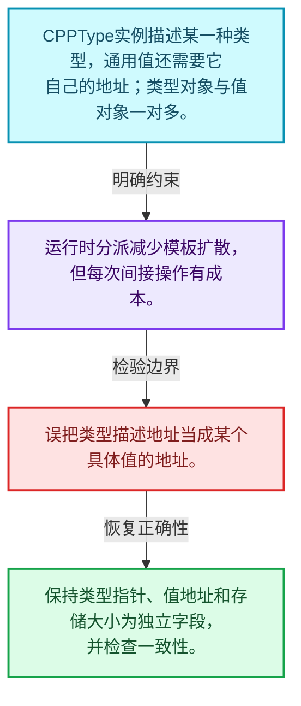
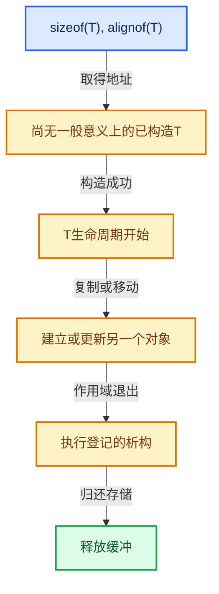

# 03-06 CPPType总体接口

[方向导航](README.md) · [总目录](../README.md) · [实现索引](../%E7%AC%A6%E5%8F%B7%E4%BE%9D%E8%B5%96%E4%B8%8E%E5%AE%9E%E7%8E%B0%E7%B4%A2%E5%BC%95.md)

## 从问题到实现

运行期只知道类型信息时怎样安全操作值？

CPPType记录类型大小、对齐和操作；类型描述对象不是被描述的值，地址相同只用于相应类型身份约定。

**数据模型**

CPPType实例描述某一种类型，通用值还需要它自己的地址；类型对象与值对象一对多。

**设计取舍**

运行时分派减少模板扩散，但每次间接操作有成本。

**最小反例**

误把类型描述地址当成某个具体值的地址。

**推导**

保持类型指针、值地址和存储大小为独立字段，并检查一致性。

## 阅读地图与执行推演






图中的数值推演是本方向的教学模型；实际函数之间的调用边与概念分析边分别标注，不能把概念关系当作运行时调度顺序。

## 完整源码单元与就地讲解

中文讲解直接放在相关代码旁，复杂机制在代码下展开。原文折叠区保留基准行号；不需要在行号表和函数之间来回查找。类布局可分段展示，函数实现不按固定行数切开。

### 类型布局、声明与编译条件 · BLI_cpp_type.hh L1—L228

<a id="t-d207e3c2ceba"></a>

<a id="t-5fd1acfa72b1"></a>

<a id="t-ceea5909af61"></a>

`CPPType`在这里声明的数据成员：

- `int64_t size`
- `int64_t alignment`
- `bool is_trivial`
- `bool is_trivially_destructible`
- `bool has_special_member_functions`
- `bool is_default_constructible`
- `bool is_copy_constructible`
- `bool is_move_constructible`
- `bool is_destructible`
- `bool is_copy_assignable`
- `bool is_move_assignable`
- `CPPType base_type`
- `CPPType generic_type`
- `int type_index`
- `uintptr_t alignment_mask_`
- `void default_construct_`
- `void default_construct_n_`
- `void default_construct_indices_`
- `void value_initialize_`
- `void value_initialize_n_`
- `void value_initialize_indices_`
- `void destruct_`
- `void destruct_n_`
- `void destruct_indices_`
- `void copy_assign_`
- `void copy_assign_n_`
- `void copy_assign_indices_`
- `void copy_assign_compressed_`
- `void copy_construct_`
- `void copy_construct_n_`
- `void copy_construct_indices_`
- `void copy_construct_compressed_`
- `void move_assign_`
- `void move_assign_n_`
- `void move_assign_indices_`
- `void move_construct_`
- `void move_construct_n_`
- `void move_construct_indices_`
- `void relocate_assign_`
- `void relocate_assign_n_`
- `void relocate_assign_indices_`
- `void relocate_construct_`
- `void relocate_construct_n_`
- `void relocate_construct_indices_`
- `void fill_assign_n_`
- `void fill_assign_indices_`
- `void fill_construct_n_`
- `void fill_construct_indices_`
- `void print_`
- `bool is_equal_`
- `uint64_t hash_`
- `void hash_unique_`
- `void default_value_`
- `std::string debug_name_`

<!-- annotated:3f05389ea1fa53 -->

```cpp
/* SPDX-FileCopyrightText: 2023 Blender Authors
 *
 * SPDX-License-Identifier: GPL-2.0-or-later */

#pragma once

/** \file
 * \ingroup bli
 *
 * The `CPPType` class allows working with arbitrary C++ types in a generic way. An instance of
 * #CPPType wraps exactly one type like `int` or `std::string`.
 *
 * With #CPPType one can write generic data structures and algorithms. That is similar to what C++
 * templates allow. The difference is that when using templates, the types have to be known at
 * compile time and the code has to be instantiated multiple times. On the other hand, when using
 * #CPPType, the data type only has to be known at run-time, and the code only has to be compiled
 * once. Whether #CPPType or classic c++ templates should be used depends on the context:
 * - If the data type is not known at run-time, #CPPType should be used.
 * - If the data type is known to be one of a few, it depends on how performance sensitive the code
 *   is.
 *   - If it it's a small hot loop, a template can be used to optimize for every type (at the
 *     cost of longer compile time, a larger binary and the complexity that comes from using
 *     templates).
 *   - If the code is not performance sensitive, it usually makes sense to use #CPPType instead.
 * - Sometimes a combination can make sense. Optimized code can be generated at compile-time for
 *   some types, while there is a fallback code path using #CPPType for all other types.
 *   #CPPType::to_static_type allows dispatching between both versions based on the type.
 *
 * Under some circumstances, #CPPType serves a similar role as #std::type_info. However, #CPPType
 * has much more utility because it contains methods for actually working with instances of the
 * type.
 *
 * Every type has a size and an alignment. Every function dealing with C++ types in a generic way,
 * has to make sure that alignment rules are followed. The methods provided by a #CPPType instance
 * will check for correct alignment as well.
 *
 * Every type has a name that is for debugging purposes only. It should not be used as identifier.
 *
 * To check if two instances of #CPPType represent the same type, only their pointers have to be
 * compared. Any C++ type has at most one corresponding #CPPType instance.
 *
 * A #CPPType instance comes with many methods that allow dealing with types in a generic way. Most
 * methods come in three variants. Using the default-construct methods as an example:
 *  - `default_construct(void *ptr)`:
 *      Constructs a single instance of that type at the given pointer.
 *  - `default_construct_n(void *ptr, int64_t n)`:
 *      Constructs n instances of that type in an array that starts at the given pointer.
 *  - `default_construct_indices(void *ptr, const IndexMask &mask)`:
 *      Constructs multiple instances of that type in an array that starts at the given pointer.
 *      Only the indices referenced by `mask` will by constructed.
 *
 * In some cases default-construction does nothing (e.g. for trivial types like int). The
 * `default_value` method provides some default value anyway that can be copied instead. What the
 * default value is, depends on the type. Usually it is something like 0 or an empty string.
 *
 *
 * Implementation Considerations
 * -----------------------------
 *
 * Concepts like inheritance are currently not captured by this system. This is not because it is
 * not possible, but because it was not necessary to add this complexity yet.
 *
 * One could also implement CPPType itself using virtual methods and a child class for every
 * wrapped type. However, the approach used now with explicit function pointers to works better.
 * Here are some reasons:
 *  - If CPPType would be inherited once for every used C++ type, we would get a lot of classes
 *    that would only be instanced once each.
 *  - Methods like `default_construct` that operate on a single instance have to be fast. Even this
 *    one necessary indirection using function pointers adds a lot of overhead. If all methods were
 *    virtual, there would be a second level of indirection that increases the overhead even more.
 *  - If it becomes necessary, we could pass the function pointers to C functions more easily than
 *    pointers to virtual member functions.
 */

#include <atomic>

#include "BLI_dynamic_stack_buffer.hh"  // IWYU pragma: keep
#include "BLI_enum_flags.hh"
#include "BLI_hash.hh"
#include "BLI_index_mask_fwd.hh"
#include "BLI_map.hh"
#include "BLI_parameter_pack_utils.hh"
#include "BLI_string_ref.hh"
#include "BLI_utility_mixins.hh"

namespace blender {

struct UniqueHashBytes;

/**
 * Different types support different features. Features like copy constructability can be detected
 * automatically easily. For some features this is harder as of C++17. Those have flags in this
 * enum and need to be determined by the programmer.
 */
enum class CPPTypeFlags {
  None = 0,
  Hashable = 1 << 0,
  Printable = 1 << 1,
  EqualityComparable = 1 << 2,
  IdentityDefaultValue = 1 << 3,

  BasicType = Hashable | Printable | EqualityComparable,
};
ENUM_OPERATORS(CPPTypeFlags)

class CPPType : NonCopyable, NonMovable {
 public:
  /**
   * Required memory in bytes for an instance of this type.
   *
   * C++ equivalent:
   *   `sizeof(T);`
   */
  int64_t size = 0;

  /**
   * Required memory alignment for an instance of this type.
   *
   * C++ equivalent:
   *   `alignof(T);`
   */
  int64_t alignment = 0;

  /**
   * When true, the value is like a normal C type, it can be copied around with #memcpy and does
   * not have to be destructed.
   *
   * C++ equivalent:
   *   `std::is_trivial_v<T>;`
   */
  bool is_trivial = false;

  /**
   * When true, the destructor does not have to be called on this type. This can sometimes be used
   * for optimization purposes.
   *
   * C++ equivalent:
   *   `std::is_trivially_destructible_v<T>;`
   */
  bool is_trivially_destructible = false;

  /**
   * Returns true, when the type has the following functions:
   * - Default constructor.
   * - Copy constructor.
   * - Move constructor.
   * - Copy assignment operator.
   * - Move assignment operator.
   * - Destructor.
   */
  bool has_special_member_functions = false;

  bool is_default_constructible = false;
  bool is_copy_constructible = false;
  bool is_move_constructible = false;
  bool is_destructible = false;
  bool is_copy_assignable = false;
  bool is_move_assignable = false;

  /** Comes from `T::base_type`. */
  const CPPType *base_type = nullptr;
  /** Comes from `T::generic_type`. */
  const CPPType *generic_type = nullptr;
  /**
   * An index that is assigned when the type is registered. Each #CPPtype has a unique index.
   * While the pointer of a #CPPType is also unique, sometimes it's easier to work with an index
   * that is a relatively small number (generally <100).
   */
  int type_index = -1;

 private:
  uintptr_t alignment_mask_ = 0;

  void (*default_construct_)(void *ptr) = nullptr;
  void (*default_construct_n_)(void *ptr, int64_t n) = nullptr;
  void (*default_construct_indices_)(void *ptr, const IndexMask &mask) = nullptr;

  void (*value_initialize_)(void *ptr) = nullptr;
  void (*value_initialize_n_)(void *ptr, int64_t n) = nullptr;
  void (*value_initialize_indices_)(void *ptr, const IndexMask &mask) = nullptr;

  void (*destruct_)(void *ptr) = nullptr;
  void (*destruct_n_)(void *ptr, int64_t n) = nullptr;
  void (*destruct_indices_)(void *ptr, const IndexMask &mask) = nullptr;

  void (*copy_assign_)(const void *src, void *dst) = nullptr;
  void (*copy_assign_n_)(const void *src, void *dst, int64_t n) = nullptr;
  void (*copy_assign_indices_)(const void *src, void *dst, const IndexMask &mask) = nullptr;
  void (*copy_assign_compressed_)(const void *src, void *dst, const IndexMask &mask) = nullptr;

  void (*copy_construct_)(const void *src, void *dst) = nullptr;
  void (*copy_construct_n_)(const void *src, void *dst, int64_t n) = nullptr;
  void (*copy_construct_indices_)(const void *src, void *dst, const IndexMask &mask) = nullptr;
  void (*copy_construct_compressed_)(const void *src, void *dst, const IndexMask &mask) = nullptr;

  void (*move_assign_)(void *src, void *dst) = nullptr;
  void (*move_assign_n_)(void *src, void *dst, int64_t n) = nullptr;
  void (*move_assign_indices_)(void *src, void *dst, const IndexMask &mask) = nullptr;

  void (*move_construct_)(void *src, void *dst) = nullptr;
  void (*move_construct_n_)(void *src, void *dst, int64_t n) = nullptr;
  void (*move_construct_indices_)(void *src, void *dst, const IndexMask &mask) = nullptr;

  void (*relocate_assign_)(void *src, void *dst) = nullptr;
  void (*relocate_assign_n_)(void *src, void *dst, int64_t n) = nullptr;
  void (*relocate_assign_indices_)(void *src, void *dst, const IndexMask &mask) = nullptr;

  void (*relocate_construct_)(void *src, void *dst) = nullptr;
  void (*relocate_construct_n_)(void *src, void *dst, int64_t n) = nullptr;
  void (*relocate_construct_indices_)(void *src, void *dst, const IndexMask &mask) = nullptr;

  void (*fill_assign_n_)(const void *value, void *dst, int64_t n) = nullptr;
  void (*fill_assign_indices_)(const void *value, void *dst, const IndexMask &mask) = nullptr;

  void (*fill_construct_n_)(const void *value, void *dst, int64_t n) = nullptr;
  void (*fill_construct_indices_)(const void *value, void *dst, const IndexMask &mask) = nullptr;

  void (*print_)(const void *value, std::stringstream &ss) = nullptr;
  bool (*is_equal_)(const void *a, const void *b) = nullptr;
  uint64_t (*hash_)(const void *value) = nullptr;
  void (*hash_unique_)(const void *value, UniqueHashBytes &hash) = nullptr;

  const void *default_value_ = nullptr;
  std::string debug_name_;

 public:
  template<typename T, CPPTypeFlags Flags>
  CPPType(TypeTag<T> /*type*/, TypeForValue<CPPTypeFlags, Flags> /*flags*/, StringRef debug_name);
```

<details>
<summary>核对原始源码：source/blender/blenlib/BLI_cpp_type.hh · L1—L228</summary>

<!-- original:3f05389ea1fa53:source/blender/blenlib/BLI_cpp_type.hh:1:228 -->

```cpp
/* SPDX-FileCopyrightText: 2023 Blender Authors
 *
 * SPDX-License-Identifier: GPL-2.0-or-later */

#pragma once

/** \file
 * \ingroup bli
 *
 * The `CPPType` class allows working with arbitrary C++ types in a generic way. An instance of
 * #CPPType wraps exactly one type like `int` or `std::string`.
 *
 * With #CPPType one can write generic data structures and algorithms. That is similar to what C++
 * templates allow. The difference is that when using templates, the types have to be known at
 * compile time and the code has to be instantiated multiple times. On the other hand, when using
 * #CPPType, the data type only has to be known at run-time, and the code only has to be compiled
 * once. Whether #CPPType or classic c++ templates should be used depends on the context:
 * - If the data type is not known at run-time, #CPPType should be used.
 * - If the data type is known to be one of a few, it depends on how performance sensitive the code
 *   is.
 *   - If it it's a small hot loop, a template can be used to optimize for every type (at the
 *     cost of longer compile time, a larger binary and the complexity that comes from using
 *     templates).
 *   - If the code is not performance sensitive, it usually makes sense to use #CPPType instead.
 * - Sometimes a combination can make sense. Optimized code can be generated at compile-time for
 *   some types, while there is a fallback code path using #CPPType for all other types.
 *   #CPPType::to_static_type allows dispatching between both versions based on the type.
 *
 * Under some circumstances, #CPPType serves a similar role as #std::type_info. However, #CPPType
 * has much more utility because it contains methods for actually working with instances of the
 * type.
 *
 * Every type has a size and an alignment. Every function dealing with C++ types in a generic way,
 * has to make sure that alignment rules are followed. The methods provided by a #CPPType instance
 * will check for correct alignment as well.
 *
 * Every type has a name that is for debugging purposes only. It should not be used as identifier.
 *
 * To check if two instances of #CPPType represent the same type, only their pointers have to be
 * compared. Any C++ type has at most one corresponding #CPPType instance.
 *
 * A #CPPType instance comes with many methods that allow dealing with types in a generic way. Most
 * methods come in three variants. Using the default-construct methods as an example:
 *  - `default_construct(void *ptr)`:
 *      Constructs a single instance of that type at the given pointer.
 *  - `default_construct_n(void *ptr, int64_t n)`:
 *      Constructs n instances of that type in an array that starts at the given pointer.
 *  - `default_construct_indices(void *ptr, const IndexMask &mask)`:
 *      Constructs multiple instances of that type in an array that starts at the given pointer.
 *      Only the indices referenced by `mask` will by constructed.
 *
 * In some cases default-construction does nothing (e.g. for trivial types like int). The
 * `default_value` method provides some default value anyway that can be copied instead. What the
 * default value is, depends on the type. Usually it is something like 0 or an empty string.
 *
 *
 * Implementation Considerations
 * -----------------------------
 *
 * Concepts like inheritance are currently not captured by this system. This is not because it is
 * not possible, but because it was not necessary to add this complexity yet.
 *
 * One could also implement CPPType itself using virtual methods and a child class for every
 * wrapped type. However, the approach used now with explicit function pointers to works better.
 * Here are some reasons:
 *  - If CPPType would be inherited once for every used C++ type, we would get a lot of classes
 *    that would only be instanced once each.
 *  - Methods like `default_construct` that operate on a single instance have to be fast. Even this
 *    one necessary indirection using function pointers adds a lot of overhead. If all methods were
 *    virtual, there would be a second level of indirection that increases the overhead even more.
 *  - If it becomes necessary, we could pass the function pointers to C functions more easily than
 *    pointers to virtual member functions.
 */

#include <atomic>

#include "BLI_dynamic_stack_buffer.hh"  // IWYU pragma: keep
#include "BLI_enum_flags.hh"
#include "BLI_hash.hh"
#include "BLI_index_mask_fwd.hh"
#include "BLI_map.hh"
#include "BLI_parameter_pack_utils.hh"
#include "BLI_string_ref.hh"
#include "BLI_utility_mixins.hh"

namespace blender {

struct UniqueHashBytes;

/**
 * Different types support different features. Features like copy constructability can be detected
 * automatically easily. For some features this is harder as of C++17. Those have flags in this
 * enum and need to be determined by the programmer.
 */
enum class CPPTypeFlags {
  None = 0,
  Hashable = 1 << 0,
  Printable = 1 << 1,
  EqualityComparable = 1 << 2,
  IdentityDefaultValue = 1 << 3,

  BasicType = Hashable | Printable | EqualityComparable,
};
ENUM_OPERATORS(CPPTypeFlags)

class CPPType : NonCopyable, NonMovable {
 public:
  /**
   * Required memory in bytes for an instance of this type.
   *
   * C++ equivalent:
   *   `sizeof(T);`
   */
  int64_t size = 0;

  /**
   * Required memory alignment for an instance of this type.
   *
   * C++ equivalent:
   *   `alignof(T);`
   */
  int64_t alignment = 0;

  /**
   * When true, the value is like a normal C type, it can be copied around with #memcpy and does
   * not have to be destructed.
   *
   * C++ equivalent:
   *   `std::is_trivial_v<T>;`
   */
  bool is_trivial = false;

  /**
   * When true, the destructor does not have to be called on this type. This can sometimes be used
   * for optimization purposes.
   *
   * C++ equivalent:
   *   `std::is_trivially_destructible_v<T>;`
   */
  bool is_trivially_destructible = false;

  /**
   * Returns true, when the type has the following functions:
   * - Default constructor.
   * - Copy constructor.
   * - Move constructor.
   * - Copy assignment operator.
   * - Move assignment operator.
   * - Destructor.
   */
  bool has_special_member_functions = false;

  bool is_default_constructible = false;
  bool is_copy_constructible = false;
  bool is_move_constructible = false;
  bool is_destructible = false;
  bool is_copy_assignable = false;
  bool is_move_assignable = false;

  /** Comes from `T::base_type`. */
  const CPPType *base_type = nullptr;
  /** Comes from `T::generic_type`. */
  const CPPType *generic_type = nullptr;
  /**
   * An index that is assigned when the type is registered. Each #CPPtype has a unique index.
   * While the pointer of a #CPPType is also unique, sometimes it's easier to work with an index
   * that is a relatively small number (generally <100).
   */
  int type_index = -1;

 private:
  uintptr_t alignment_mask_ = 0;

  void (*default_construct_)(void *ptr) = nullptr;
  void (*default_construct_n_)(void *ptr, int64_t n) = nullptr;
  void (*default_construct_indices_)(void *ptr, const IndexMask &mask) = nullptr;

  void (*value_initialize_)(void *ptr) = nullptr;
  void (*value_initialize_n_)(void *ptr, int64_t n) = nullptr;
  void (*value_initialize_indices_)(void *ptr, const IndexMask &mask) = nullptr;

  void (*destruct_)(void *ptr) = nullptr;
  void (*destruct_n_)(void *ptr, int64_t n) = nullptr;
  void (*destruct_indices_)(void *ptr, const IndexMask &mask) = nullptr;

  void (*copy_assign_)(const void *src, void *dst) = nullptr;
  void (*copy_assign_n_)(const void *src, void *dst, int64_t n) = nullptr;
  void (*copy_assign_indices_)(const void *src, void *dst, const IndexMask &mask) = nullptr;
  void (*copy_assign_compressed_)(const void *src, void *dst, const IndexMask &mask) = nullptr;

  void (*copy_construct_)(const void *src, void *dst) = nullptr;
  void (*copy_construct_n_)(const void *src, void *dst, int64_t n) = nullptr;
  void (*copy_construct_indices_)(const void *src, void *dst, const IndexMask &mask) = nullptr;
  void (*copy_construct_compressed_)(const void *src, void *dst, const IndexMask &mask) = nullptr;

  void (*move_assign_)(void *src, void *dst) = nullptr;
  void (*move_assign_n_)(void *src, void *dst, int64_t n) = nullptr;
  void (*move_assign_indices_)(void *src, void *dst, const IndexMask &mask) = nullptr;

  void (*move_construct_)(void *src, void *dst) = nullptr;
  void (*move_construct_n_)(void *src, void *dst, int64_t n) = nullptr;
  void (*move_construct_indices_)(void *src, void *dst, const IndexMask &mask) = nullptr;

  void (*relocate_assign_)(void *src, void *dst) = nullptr;
  void (*relocate_assign_n_)(void *src, void *dst, int64_t n) = nullptr;
  void (*relocate_assign_indices_)(void *src, void *dst, const IndexMask &mask) = nullptr;

  void (*relocate_construct_)(void *src, void *dst) = nullptr;
  void (*relocate_construct_n_)(void *src, void *dst, int64_t n) = nullptr;
  void (*relocate_construct_indices_)(void *src, void *dst, const IndexMask &mask) = nullptr;

  void (*fill_assign_n_)(const void *value, void *dst, int64_t n) = nullptr;
  void (*fill_assign_indices_)(const void *value, void *dst, const IndexMask &mask) = nullptr;

  void (*fill_construct_n_)(const void *value, void *dst, int64_t n) = nullptr;
  void (*fill_construct_indices_)(const void *value, void *dst, const IndexMask &mask) = nullptr;

  void (*print_)(const void *value, std::stringstream &ss) = nullptr;
  bool (*is_equal_)(const void *a, const void *b) = nullptr;
  uint64_t (*hash_)(const void *value) = nullptr;
  void (*hash_unique_)(const void *value, UniqueHashBytes &hash) = nullptr;

  const void *default_value_ = nullptr;
  std::string debug_name_;

 public:
  template<typename T, CPPTypeFlags Flags>
  CPPType(TypeTag<T> /*type*/, TypeForValue<CPPTypeFlags, Flags> /*flags*/, StringRef debug_name);
```

</details>

<a id="f-2c612a83bb6d63a5"></a>

### `blender::CPPType::~CPPType`

实现位置：[source/blender/blenlib/BLI_cpp_type.hh](../../../../../source/blender/blenlib/BLI_cpp_type.hh) · L229—L229。

**教学注释版**

<!-- annotated:8fa6d17cfcec3c -->

```cpp
  virtual ~CPPType() = default;
```

<details>
<summary>核对原始源码：source/blender/blenlib/BLI_cpp_type.hh · L229—L229</summary>

<!-- original:8fa6d17cfcec3c:source/blender/blenlib/BLI_cpp_type.hh:229:229 -->

```cpp
  virtual ~CPPType() = default;
```

</details>

**继续追踪实现**

本实现没有需要继续展开的显式调用；检查返回表达式、对象转换和调用者前置条件。

### 类型布局、声明与编译条件 · BLI_cpp_type.hh L230—L438

<!-- annotated:e4f48aa42e0579 -->

```cpp

  /**
   * Get the `CPPType` that corresponds to a specific static type.
   * This only works for types that actually implement the template specialization using
   * `BLI_CPP_TYPE_REGISTER`.
   */
  template<typename T> static const CPPType &get();
  /**
   * Version of `CPPType::get` that can be used before type registration code is called.
   * The returned CPPType may not be constructed yet, but the pointer is valid already.
   */
  template<typename T> static const CPPType *get_pre_register();

  /**
   * Returns the name of the type for debugging purposes. This name should not be used as
   * identifier.
   */
  StringRefNull name() const;

  bool is_printable() const;
  bool is_equality_comparable() const;
  bool is_hashable() const;

  /**
   * Returns true, when the given pointer fulfills the alignment requirement of this type.
   */
  bool pointer_has_valid_alignment(const void *ptr) const;
  bool pointer_can_point_to_instance(const void *ptr) const;

  /**
   * Call the default constructor at the given memory location.
   * The memory should be uninitialized before this method is called.
   * For some trivial types (like int), this method does nothing.
   *
   * C++ equivalent:
   *   `new (ptr) T;`
   */
  void default_construct(void *ptr) const;
  void default_construct_n(void *ptr, int64_t n) const;
  void default_construct_indices(void *ptr, const IndexMask &mask) const;

  /**
   * Same as #default_construct, but does zero initialization for trivial types.
   *
   * C++ equivalent:
   *   `new (ptr) T();`
   */
  void value_initialize(void *ptr) const;
  void value_initialize_n(void *ptr, int64_t n) const;
  void value_initialize_indices(void *ptr, const IndexMask &mask) const;

  /**
   * Call the destructor on the given instance of this type. The pointer must not be nullptr.
   *
   * For some trivial types, this does nothing.
   *
   * C++ equivalent:
   *   `ptr->~T();`
   */
  void destruct(void *ptr) const;
  void destruct_n(void *ptr, int64_t n) const;
  void destruct_indices(void *ptr, const IndexMask &mask) const;

  /**
   * Copy an instance of this type from src to dst.
   *
   * C++ equivalent:
   *   `dst = src;`
   */
  void copy_assign(const void *src, void *dst) const;
  void copy_assign_n(const void *src, void *dst, int64_t n) const;
  void copy_assign_indices(const void *src, void *dst, const IndexMask &mask) const;

  /**
   * Similar to #copy_assign_indices, but does not leave gaps in the #dst array.
   */
  void copy_assign_compressed(const void *src, void *dst, const IndexMask &mask) const;

  /**
   * Copy an instance of this type from src to dst.
   *
   * The memory pointed to by dst should be uninitialized.
   *
   * C++ equivalent:
   *   `new (dst) T(src);`
   */
  void copy_construct(const void *src, void *dst) const;
  void copy_construct_n(const void *src, void *dst, int64_t n) const;
  void copy_construct_indices(const void *src, void *dst, const IndexMask &mask) const;

  /**
   * Similar to #copy_construct_indices, but does not leave gaps in the #dst array.
   */
  void copy_construct_compressed(const void *src, void *dst, const IndexMask &mask) const;

  /**
   * Move an instance of this type from src to dst.
   *
   * The memory pointed to by dst should be initialized.
   *
   * C++ equivalent:
   *   `dst = std::move(src);`
   */
  void move_assign(void *src, void *dst) const;
  void move_assign_n(void *src, void *dst, int64_t n) const;
  void move_assign_indices(void *src, void *dst, const IndexMask &mask) const;

  /**
   * Move an instance of this type from src to dst.
   *
   * The memory pointed to by dst should be uninitialized.
   *
   * C++ equivalent:
   *   `new (dst) T(std::move(src));`
   */
  void move_construct(void *src, void *dst) const;
  void move_construct_n(void *src, void *dst, int64_t n) const;
  void move_construct_indices(void *src, void *dst, const IndexMask &mask) const;

  /**
   * Relocates an instance of this type from src to dst. src will point to uninitialized memory
   * afterwards.
   *
   * C++ equivalent:
   *   `dst = std::move(src);`
   *   `src->~T();`
   */
  void relocate_assign(void *src, void *dst) const;
  void relocate_assign_n(void *src, void *dst, int64_t n) const;
  void relocate_assign_indices(void *src, void *dst, const IndexMask &mask) const;

  /**
   * Relocates an instance of this type from src to dst. src will point to uninitialized memory
   * afterwards.
   *
   * C++ equivalent:
   *   `new (dst) T(std::move(src))`
   *   `src->~T();`
   */
  void relocate_construct(void *src, void *dst) const;
  void relocate_construct_n(void *src, void *dst, int64_t n) const;
  void relocate_construct_indices(void *src, void *dst, const IndexMask &mask) const;

  /**
   * Copy the given value to the first n elements in an array starting at dst.
   *
   * Other instances of the same type should live in the array before this method is called.
   */
  void fill_assign_n(const void *value, void *dst, int64_t n) const;
  void fill_assign_indices(const void *value, void *dst, const IndexMask &mask) const;

  /**
   * Copy the given value to the first n elements in an array starting at dst.
   *
   * The array should be uninitialized before this method is called.
   */
  void fill_construct_n(const void *value, void *dst, int64_t n) const;
  void fill_construct_indices(const void *value, void *dst, const IndexMask &mask) const;

  bool can_exist_in_buffer(const int64_t buffer_size, const int64_t buffer_alignment) const;

  void print(const void *value, std::stringstream &ss) const;
  std::string to_string(const void *value) const;
  void print_or_default(const void *value, std::stringstream &ss, StringRef default_value) const;

  bool is_equal(const void *a, const void *b) const;
  bool is_equal_or_false(const void *a, const void *b) const;

  uint64_t hash(const void *value) const;
  uint64_t hash_or_fallback(const void *value, uint64_t fallback_hash) const;
  void hash_unique(const void *value, UniqueHashBytes &hash) const;

  /**
   * Get a pointer to a constant value of this type. The specific value depends on the type.
   * It is usually a zero-initialized or default constructed value.
   */
  const void *default_value() const;

  uint64_t hash() const;

  void (*destruct_fn() const)(void *);

  template<typename T> bool is() const;

  template<typename... T> bool is_any() const;

  /**
   * Convert a #CPPType that is only known at run-time, to a static type that is known at
   * compile-time. This allows the compiler to optimize a function for specific types, while all
   * other types can still use a generic fallback function.
   *
   * \tparam Types: The types that code should be generated for.
   * \param fn: The function object to call. This is expected to have a templated `operator()` and
   * a non-templated `operator()`. The templated version will be called if the current #CPPType
   *   matches any of the given types.
   * \return True if the function was called.
   */
  template<typename... Types, typename Fn> bool to_static_type_try(Fn &&fn) const;

  /** Same as #to_static_type_try, but asserts if the type is valid. */
  template<typename... Types, typename Fn> void to_static_type(Fn &&fn) const;

 private:
  /**
   * Helper used in #to_static_type_try as a typed function pointer for each type in the list.
   * A named static function is used instead of a lambda to avoid a known MSVC bug where a
   * non-capturing lambda inside a comma fold expression that references the pack parameter
   * causes MSVC to generate zero iterations, leaving the map empty.
   */
```

<details>
<summary>核对原始源码：source/blender/blenlib/BLI_cpp_type.hh · L230—L438</summary>

<!-- original:e4f48aa42e0579:source/blender/blenlib/BLI_cpp_type.hh:230:438 -->

```cpp

  /**
   * Get the `CPPType` that corresponds to a specific static type.
   * This only works for types that actually implement the template specialization using
   * `BLI_CPP_TYPE_REGISTER`.
   */
  template<typename T> static const CPPType &get();
  /**
   * Version of `CPPType::get` that can be used before type registration code is called.
   * The returned CPPType may not be constructed yet, but the pointer is valid already.
   */
  template<typename T> static const CPPType *get_pre_register();

  /**
   * Returns the name of the type for debugging purposes. This name should not be used as
   * identifier.
   */
  StringRefNull name() const;

  bool is_printable() const;
  bool is_equality_comparable() const;
  bool is_hashable() const;

  /**
   * Returns true, when the given pointer fulfills the alignment requirement of this type.
   */
  bool pointer_has_valid_alignment(const void *ptr) const;
  bool pointer_can_point_to_instance(const void *ptr) const;

  /**
   * Call the default constructor at the given memory location.
   * The memory should be uninitialized before this method is called.
   * For some trivial types (like int), this method does nothing.
   *
   * C++ equivalent:
   *   `new (ptr) T;`
   */
  void default_construct(void *ptr) const;
  void default_construct_n(void *ptr, int64_t n) const;
  void default_construct_indices(void *ptr, const IndexMask &mask) const;

  /**
   * Same as #default_construct, but does zero initialization for trivial types.
   *
   * C++ equivalent:
   *   `new (ptr) T();`
   */
  void value_initialize(void *ptr) const;
  void value_initialize_n(void *ptr, int64_t n) const;
  void value_initialize_indices(void *ptr, const IndexMask &mask) const;

  /**
   * Call the destructor on the given instance of this type. The pointer must not be nullptr.
   *
   * For some trivial types, this does nothing.
   *
   * C++ equivalent:
   *   `ptr->~T();`
   */
  void destruct(void *ptr) const;
  void destruct_n(void *ptr, int64_t n) const;
  void destruct_indices(void *ptr, const IndexMask &mask) const;

  /**
   * Copy an instance of this type from src to dst.
   *
   * C++ equivalent:
   *   `dst = src;`
   */
  void copy_assign(const void *src, void *dst) const;
  void copy_assign_n(const void *src, void *dst, int64_t n) const;
  void copy_assign_indices(const void *src, void *dst, const IndexMask &mask) const;

  /**
   * Similar to #copy_assign_indices, but does not leave gaps in the #dst array.
   */
  void copy_assign_compressed(const void *src, void *dst, const IndexMask &mask) const;

  /**
   * Copy an instance of this type from src to dst.
   *
   * The memory pointed to by dst should be uninitialized.
   *
   * C++ equivalent:
   *   `new (dst) T(src);`
   */
  void copy_construct(const void *src, void *dst) const;
  void copy_construct_n(const void *src, void *dst, int64_t n) const;
  void copy_construct_indices(const void *src, void *dst, const IndexMask &mask) const;

  /**
   * Similar to #copy_construct_indices, but does not leave gaps in the #dst array.
   */
  void copy_construct_compressed(const void *src, void *dst, const IndexMask &mask) const;

  /**
   * Move an instance of this type from src to dst.
   *
   * The memory pointed to by dst should be initialized.
   *
   * C++ equivalent:
   *   `dst = std::move(src);`
   */
  void move_assign(void *src, void *dst) const;
  void move_assign_n(void *src, void *dst, int64_t n) const;
  void move_assign_indices(void *src, void *dst, const IndexMask &mask) const;

  /**
   * Move an instance of this type from src to dst.
   *
   * The memory pointed to by dst should be uninitialized.
   *
   * C++ equivalent:
   *   `new (dst) T(std::move(src));`
   */
  void move_construct(void *src, void *dst) const;
  void move_construct_n(void *src, void *dst, int64_t n) const;
  void move_construct_indices(void *src, void *dst, const IndexMask &mask) const;

  /**
   * Relocates an instance of this type from src to dst. src will point to uninitialized memory
   * afterwards.
   *
   * C++ equivalent:
   *   `dst = std::move(src);`
   *   `src->~T();`
   */
  void relocate_assign(void *src, void *dst) const;
  void relocate_assign_n(void *src, void *dst, int64_t n) const;
  void relocate_assign_indices(void *src, void *dst, const IndexMask &mask) const;

  /**
   * Relocates an instance of this type from src to dst. src will point to uninitialized memory
   * afterwards.
   *
   * C++ equivalent:
   *   `new (dst) T(std::move(src))`
   *   `src->~T();`
   */
  void relocate_construct(void *src, void *dst) const;
  void relocate_construct_n(void *src, void *dst, int64_t n) const;
  void relocate_construct_indices(void *src, void *dst, const IndexMask &mask) const;

  /**
   * Copy the given value to the first n elements in an array starting at dst.
   *
   * Other instances of the same type should live in the array before this method is called.
   */
  void fill_assign_n(const void *value, void *dst, int64_t n) const;
  void fill_assign_indices(const void *value, void *dst, const IndexMask &mask) const;

  /**
   * Copy the given value to the first n elements in an array starting at dst.
   *
   * The array should be uninitialized before this method is called.
   */
  void fill_construct_n(const void *value, void *dst, int64_t n) const;
  void fill_construct_indices(const void *value, void *dst, const IndexMask &mask) const;

  bool can_exist_in_buffer(const int64_t buffer_size, const int64_t buffer_alignment) const;

  void print(const void *value, std::stringstream &ss) const;
  std::string to_string(const void *value) const;
  void print_or_default(const void *value, std::stringstream &ss, StringRef default_value) const;

  bool is_equal(const void *a, const void *b) const;
  bool is_equal_or_false(const void *a, const void *b) const;

  uint64_t hash(const void *value) const;
  uint64_t hash_or_fallback(const void *value, uint64_t fallback_hash) const;
  void hash_unique(const void *value, UniqueHashBytes &hash) const;

  /**
   * Get a pointer to a constant value of this type. The specific value depends on the type.
   * It is usually a zero-initialized or default constructed value.
   */
  const void *default_value() const;

  uint64_t hash() const;

  void (*destruct_fn() const)(void *);

  template<typename T> bool is() const;

  template<typename... T> bool is_any() const;

  /**
   * Convert a #CPPType that is only known at run-time, to a static type that is known at
   * compile-time. This allows the compiler to optimize a function for specific types, while all
   * other types can still use a generic fallback function.
   *
   * \tparam Types: The types that code should be generated for.
   * \param fn: The function object to call. This is expected to have a templated `operator()` and
   * a non-templated `operator()`. The templated version will be called if the current #CPPType
   *   matches any of the given types.
   * \return True if the function was called.
   */
  template<typename... Types, typename Fn> bool to_static_type_try(Fn &&fn) const;

  /** Same as #to_static_type_try, but asserts if the type is valid. */
  template<typename... Types, typename Fn> void to_static_type(Fn &&fn) const;

 private:
  /**
   * Helper used in #to_static_type_try as a typed function pointer for each type in the list.
   * A named static function is used instead of a lambda to avoid a known MSVC bug where a
   * non-capturing lambda inside a comma fold expression that references the pack parameter
   * causes MSVC to generate zero iterations, leaving the map empty.
   */
```

</details>

## 语法与相关类型

### 模板 template

模板把类型或常量作为生成实现的参数。读声明时先列出类型参数、非类型参数和默认值，再看使用者实际实例化了什么。模板声明本身不意味着每种T都支持其全部成员。

把T替换为int、string、只能移动的类型，分别检查每个被调用操作是否成立。

### 依赖名称 typename

typename既可引入类型模板参数，也可告诉编译器某个依赖名称是类型。它不创建运行时对象；解析期确认语法类别与实例化期检查具体类型是不同阶段。

区分typename T::value_type和T::size()，前者标记类型，后者是表达式。

### 只读限定 const

const约束当前访问路径可做的修改。const指针、指向const的指针、const视图对象、const元素是不同位置的限定；其他别名可能仍可修改原对象。

分别写T* const、const T*与const T* const，并画出不可修改的层次。

### 移动转换 std::move

std::move把表达式转换为可供移动重载选择的值类别，实际资源转移发生在被选中的构造或赋值中。对const对象move可能仍调用复制，对视图move也不会获得底层数据所有权。

记录移动构造调用次数，不用变量名或std::move的出现次数替代测量。

### 异常边界 try与catch

try定义异常传播的局部边界。失败路径需要销毁已经成功构造的部分并释放相应存储；未构造的对象不能被析构。

在第k次构造失败，列出已经存在的对象集合与待释放缓冲。

### 运行时多态 virtual

虚调用根据实际动态类型选择实现；经基类指针销毁对象时通常需要相应虚析构契约。每元素虚调用和循环外一次分派有不同开销。

找出虚接口的实现类和调用频率，再讨论是否值得去虚拟化。

### 对齐 alignof

alignof得到类型要求的地址对齐。分配足够字节后仍需把地址对齐到相应边界，内嵌缓冲也一样。

对齐a为2的幂时可推导向上取整，但仍要考虑溢出与边界。

### 对象表示 sizeof

sizeof给出对象表示大小，不是其引用的所有堆内存总量。sizeof视图很小并不说明底层数组很小。

分别统计容器对象、容量字节和元素拥有的间接资源。

### 构造与new表达式

普通new可能分配并构造；placement new在给定地址构造，存储由其他机制提供。失败回滚应区分两类责任。

追踪地址来自哪里、构造何时成功、由谁析构、由谁释放。

### 类型别名 using

类型别名为已有类型建立名字，不创建运行期对象。它常把模板内部使用的类型统一暴露给泛型调用者。

展开别名直到基础类型，区分类型别名和变量声明。

### 枚举与状态模型 enum

枚举把有限状态命名；enum class避免许多隐式整数转换。状态机正确性还依赖允许的转移，不能只看有哪些枚举项。

列出每个状态的进入条件和离开条件，检查终止状态是否仍可能被调度。

## 实现练习与验证

通过类型描述构造int与string并分别销毁。

参考推理：保持类型指针、值地址和存储大小为独立字段，并检查一致性。

所有存活对象地址满足对齐；构造失败不会被当作成功对象登记；所有资源均有唯一或明确共享的清理责任。

## 历史、跨库比较与证据

与std::pmr::monotonic_buffer_resource比较批量存储回收，与std::any比较拥有型类型擦除；CPPType描述类型操作，本身不保存每个值。

[历史提交索引](../%E5%8E%86%E5%8F%B2%E6%8F%90%E4%BA%A4%E4%B8%8E%E8%AE%BE%E8%AE%A1%E6%BC%94%E5%8C%96%E7%B4%A2%E5%BC%95.md) · [源码基准](../%E6%BA%90%E7%A0%81%E7%89%88%E6%9C%AC%E4%B8%8E%E8%A6%86%E7%9B%96%E7%B4%A2%E5%BC%95.md) · [验收报告](../%E9%AA%8C%E6%94%B6%E6%8A%A5%E5%91%8A.md)
