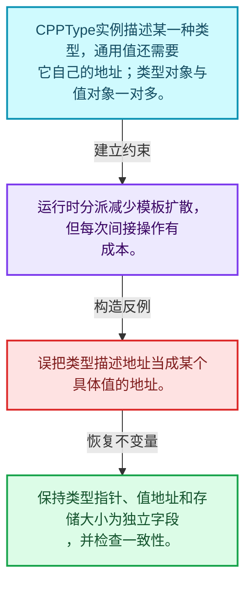
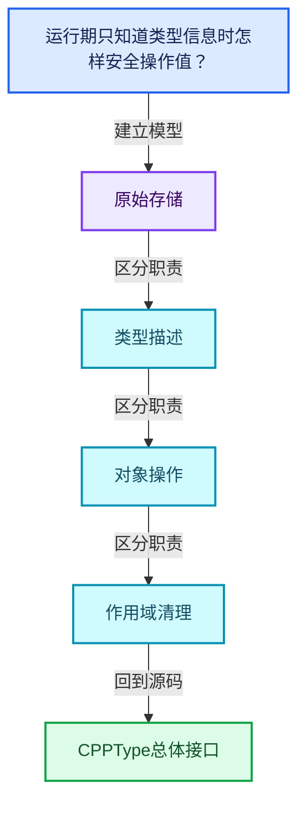
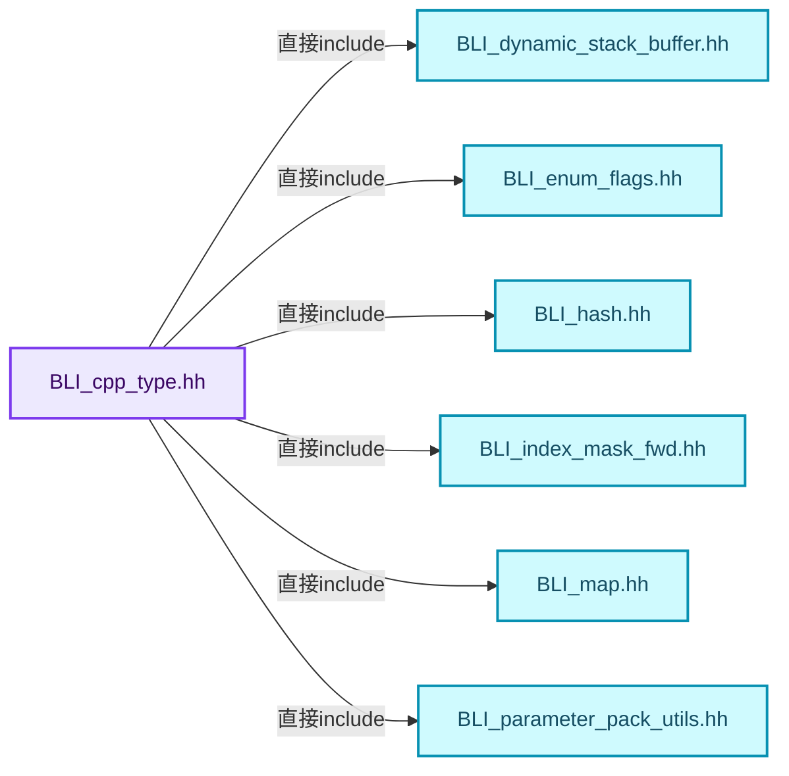
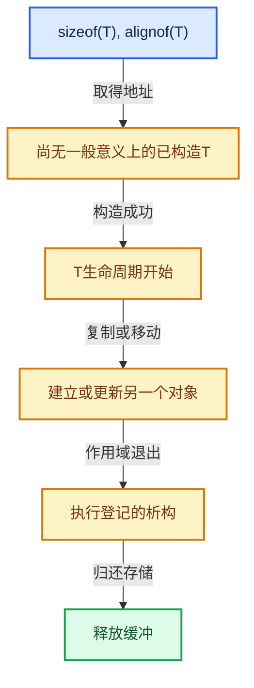

# 03-06 CPPType总体接口

[方向导航](README.md) · [总目录](../README.md) · [覆盖索引](../%E6%BA%90%E7%A0%81%E7%89%88%E6%9C%AC%E4%B8%8E%E8%A6%86%E7%9B%96%E7%B4%A2%E5%BC%95.md)

> 阅读顺序：问题与数据模型 → 语法与类型 → 源码逐行 → 调用线索 → 历史与取舍 → 推演和练习。

- 基准 HEAD：`cbda6b96c26c0dee3c3b5cbb93960c4ac06a6b30`。
- 记录日期：2026-10-14。
- 教学示例状态：正文中的推演不是本机性能实测；已运行练习见验收报告。

## 一、从问题到设计

运行期只知道类型信息时怎样安全操作值？

CPPType记录类型大小、对齐和操作；类型描述对象不是被描述的值，地址相同只用于相应类型身份约定。

本篇把语法、数据语义和系统取舍连接起来。把存储分配、对象构造、类型操作和最终清理拆开建模。

### 本篇独立模型与设计推理

CPPType实例描述某一种类型，通用值还需要它自己的地址；类型对象与值对象一对多。

设计取舍：运行时分派减少模板扩散，但每次间接操作有成本。

最小反例：误把类型描述地址当成某个具体值的地址。

推导与处理：保持类型指针、值地址和存储大小为独立字段，并检查一致性。



### 源码范围与相邻篇章

| 文件 | 本篇逐行范围 | 基准SHA-256 |
|---|---|---|
| [source/blender/blenlib/BLI_cpp_type.hh](../../../../../source/blender/blenlib/BLI_cpp_type.hh) | L1—L269 | `c60368fa9ddd6891cb2063b203dc846355fc17d86f16005763354999d5beb1e2` |

同一主讲文件可能分多篇覆盖；超出本篇范围的符号通过覆盖索引定位。空行与纯注释保留在源码摘录中，逐行表解释有效语句与语法边界；许可证头统一保留。

前篇：[ResourceScope销毁责任](05-ResourceScope%E9%94%80%E6%AF%81%E8%B4%A3%E4%BB%BB.md).

后篇：[CPPType操作生成](07-CPPType%E6%93%8D%E4%BD%9C%E7%94%9F%E6%88%90.md).

## 二、类型、数据与阅读地图



这是概念依赖图，边表示阅读关系，不声称是运行时调用顺序。

### 直接编译依赖



箭头只表示头文件包含关系；完整调用线索见后面的符号定位表。

## 三、关键词、语法与类型角色

### 模板 template

模板把类型或常量作为生成实现的参数。读声明时先列出类型参数、非类型参数和默认值，再看使用者实际实例化了什么。模板声明本身不意味着每种T都支持其全部成员。

具体检查：把T替换为int、string、只能移动的类型，分别检查每个被调用操作是否成立。

### 依赖名称 typename

typename既可引入类型模板参数，也可告诉编译器某个依赖名称是类型。它不创建运行时对象；解析期确认语法类别与实例化期检查具体类型是不同阶段。

具体检查：区分typename T::value_type和T::size()，前者标记类型，后者是表达式。

### 只读限定 const

const约束当前访问路径可做的修改。const指针、指向const的指针、const视图对象、const元素是不同位置的限定；其他别名可能仍可修改原对象。

具体检查：分别写T* const、const T*与const T* const，并画出不可修改的层次。

### 运行时多态 virtual

虚调用根据实际动态类型选择实现；经基类指针销毁对象时通常需要相应虚析构契约。每元素虚调用和循环外一次分派有不同开销。

具体检查：找出虚接口的实现类和调用频率，再讨论是否值得去虚拟化。

### 对齐 alignof

alignof得到类型要求的地址对齐。分配足够字节后仍需把地址对齐到相应边界，内嵌缓冲也一样。

具体检查：对齐a为2的幂时可推导向上取整，但仍要考虑溢出与边界。

### 对象表示 sizeof

sizeof给出对象表示大小，不是其引用的所有堆内存总量。sizeof视图很小并不说明底层数组很小。

具体检查：分别统计容器对象、容量字节和元素拥有的间接资源。

### 构造与new表达式

普通new可能分配并构造；placement new在给定地址构造，存储由其他机制提供。失败回滚应区分两类责任。

具体检查：追踪地址来自哪里、构造何时成功、由谁析构、由谁释放。

### 类型别名 using

类型别名为已有类型建立名字，不创建运行期对象。它常把模板内部使用的类型统一暴露给泛型调用者。

具体检查：展开别名直到基础类型，区分类型别名和变量声明。

### 枚举与状态模型 enum

枚举把有限状态命名；enum class避免许多隐式整数转换。状态机正确性还依赖允许的转移，不能只看有哪些枚举项。

具体检查：列出每个状态的进入条件和离开条件，检查终止状态是否仍可能被调度。

## 四、真实源码与逐行讲解

源码块保持原行内容，原始行号由小节标题及逐行表给出。表中的调用定位是静态阅读辅助；重载、模板实例化、宏展开和虚调用需结合完整声明，不能仅凭词法出现证明动态调用。

### BLI_cpp_type.hh：L1—L75

<!-- source:source/blender/blenlib/BLI_cpp_type.hh:1:75 -->

```cpp
/* SPDX-FileCopyrightText: 2023 Blender Authors
 *
 * SPDX-License-Identifier: GPL-2.0-or-later */

#pragma once

/** \file
 * \ingroup bli
 *
 * The `CPPType` class allows working with arbitrary C++ types in a generic way. An instance of
 * #CPPType wraps exactly one type like `int` or `std::string`.
 *
 * With #CPPType one can write generic data structures and algorithms. That is similar to what C++
 * templates allow. The difference is that when using templates, the types have to be known at
 * compile time and the code has to be instantiated multiple times. On the other hand, when using
 * #CPPType, the data type only has to be known at run-time, and the code only has to be compiled
 * once. Whether #CPPType or classic c++ templates should be used depends on the context:
 * - If the data type is not known at run-time, #CPPType should be used.
 * - If the data type is known to be one of a few, it depends on how performance sensitive the code
 *   is.
 *   - If it it's a small hot loop, a template can be used to optimize for every type (at the
 *     cost of longer compile time, a larger binary and the complexity that comes from using
 *     templates).
 *   - If the code is not performance sensitive, it usually makes sense to use #CPPType instead.
 * - Sometimes a combination can make sense. Optimized code can be generated at compile-time for
 *   some types, while there is a fallback code path using #CPPType for all other types.
 *   #CPPType::to_static_type allows dispatching between both versions based on the type.
 *
 * Under some circumstances, #CPPType serves a similar role as #std::type_info. However, #CPPType
 * has much more utility because it contains methods for actually working with instances of the
 * type.
 *
 * Every type has a size and an alignment. Every function dealing with C++ types in a generic way,
 * has to make sure that alignment rules are followed. The methods provided by a #CPPType instance
 * will check for correct alignment as well.
 *
 * Every type has a name that is for debugging purposes only. It should not be used as identifier.
 *
 * To check if two instances of #CPPType represent the same type, only their pointers have to be
 * compared. Any C++ type has at most one corresponding #CPPType instance.
 *
 * A #CPPType instance comes with many methods that allow dealing with types in a generic way. Most
 * methods come in three variants. Using the default-construct methods as an example:
 *  - `default_construct(void *ptr)`:
 *      Constructs a single instance of that type at the given pointer.
 *  - `default_construct_n(void *ptr, int64_t n)`:
 *      Constructs n instances of that type in an array that starts at the given pointer.
 *  - `default_construct_indices(void *ptr, const IndexMask &mask)`:
 *      Constructs multiple instances of that type in an array that starts at the given pointer.
 *      Only the indices referenced by `mask` will by constructed.
 *
 * In some cases default-construction does nothing (e.g. for trivial types like int). The
 * `default_value` method provides some default value anyway that can be copied instead. What the
 * default value is, depends on the type. Usually it is something like 0 or an empty string.
 *
 *
 * Implementation Considerations
 * -----------------------------
 *
 * Concepts like inheritance are currently not captured by this system. This is not because it is
 * not possible, but because it was not necessary to add this complexity yet.
 *
 * One could also implement CPPType itself using virtual methods and a child class for every
 * wrapped type. However, the approach used now with explicit function pointers to works better.
 * Here are some reasons:
 *  - If CPPType would be inherited once for every used C++ type, we would get a lot of classes
 *    that would only be instanced once each.
 *  - Methods like `default_construct` that operate on a single instance have to be fast. Even this
 *    one necessary indirection using function pointers adds a lot of overhead. If all methods were
 *    virtual, there would be a second level of indirection that increases the overhead even more.
 *  - If it becomes necessary, we could pass the function pointers to C functions more easily than
 *    pointers to virtual member functions.
 */

#include <atomic>
```

| 原始行 | 语义、约束与检查 |
|---|---|
| L5 | 防止同一头文件在一个翻译单元中重复展开；不控制多个源文件之间的链接或对象寿命。 |
| L75 | 引入编译依赖 <atomic>；这是声明可见性关系，不表示运行时一定调用该文件的所有接口。 |

### BLI_cpp_type.hh：L76—L122

<!-- source:source/blender/blenlib/BLI_cpp_type.hh:76:122 -->

```cpp

#include "BLI_dynamic_stack_buffer.hh"  // IWYU pragma: keep
#include "BLI_enum_flags.hh"
#include "BLI_hash.hh"
#include "BLI_index_mask_fwd.hh"
#include "BLI_map.hh"
#include "BLI_parameter_pack_utils.hh"
#include "BLI_string_ref.hh"
#include "BLI_utility_mixins.hh"

namespace blender {

struct UniqueHashBytes;

/**
 * Different types support different features. Features like copy constructability can be detected
 * automatically easily. For some features this is harder as of C++17. Those have flags in this
 * enum and need to be determined by the programmer.
 */
enum class CPPTypeFlags {
  None = 0,
  Hashable = 1 << 0,
  Printable = 1 << 1,
  EqualityComparable = 1 << 2,
  IdentityDefaultValue = 1 << 3,

  BasicType = Hashable | Printable | EqualityComparable,
};
ENUM_OPERATORS(CPPTypeFlags)

class CPPType : NonCopyable, NonMovable {
 public:
  /**
   * Required memory in bytes for an instance of this type.
   *
   * C++ equivalent:
   *   `sizeof(T);`
   */
  int64_t size = 0;

  /**
   * Required memory alignment for an instance of this type.
   *
   * C++ equivalent:
   *   `alignof(T);`
   */
  int64_t alignment = 0;
```

| 原始行 | 语义、约束与检查 |
|---|---|
| L77 | 引入编译依赖 "BLI_dynamic_stack_buffer.hh"；这是声明可见性关系，不表示运行时一定调用该文件的所有接口。 |
| L78 | 引入编译依赖 "BLI_enum_flags.hh"；这是声明可见性关系，不表示运行时一定调用该文件的所有接口。 |
| L79 | 引入编译依赖 "BLI_hash.hh"；这是声明可见性关系，不表示运行时一定调用该文件的所有接口。 |
| L80 | 引入编译依赖 "BLI_index_mask_fwd.hh"；这是声明可见性关系，不表示运行时一定调用该文件的所有接口。 |
| L81 | 引入编译依赖 "BLI_map.hh"；这是声明可见性关系，不表示运行时一定调用该文件的所有接口。 |
| L82 | 引入编译依赖 "BLI_parameter_pack_utils.hh"；这是声明可见性关系，不表示运行时一定调用该文件的所有接口。 |
| L83 | 引入编译依赖 "BLI_string_ref.hh"；这是声明可见性关系，不表示运行时一定调用该文件的所有接口。 |
| L84 | 引入编译依赖 "BLI_utility_mixins.hh"；这是声明可见性关系，不表示运行时一定调用该文件的所有接口。 |
| L86 | 把后续声明放入 blender 命名空间，影响名称查找和符号归属，不创建运行时对象。 |
| L88 | 声明或定义类型 `struct UniqueHashBytes`。结合继承、访问权限和成员布局确认接口与拥有关系；前向声明本身没有完整对象布局。 |
| L95 | 声明或定义类型 `enum class CPPTypeFlags`。结合继承、访问权限和成员布局确认接口与拥有关系；前向声明本身没有完整对象布局。 |
| L96 | 把右侧 `0,` 用于初始化或更新左侧 `None`。声明初始化与已有对象赋值应按上下文区分；有资源的类型会调用相应特殊成员。 |
| L97 | 把右侧 `1 << 0,` 用于初始化或更新左侧 `Hashable`。声明初始化与已有对象赋值应按上下文区分；有资源的类型会调用相应特殊成员。 |
| L98 | 把右侧 `1 << 1,` 用于初始化或更新左侧 `Printable`。声明初始化与已有对象赋值应按上下文区分；有资源的类型会调用相应特殊成员。 |
| L99 | 把右侧 `1 << 2,` 用于初始化或更新左侧 `EqualityComparable`。声明初始化与已有对象赋值应按上下文区分；有资源的类型会调用相应特殊成员。 |
| L100 | 把右侧 `1 << 3,` 用于初始化或更新左侧 `IdentityDefaultValue`。声明初始化与已有对象赋值应按上下文区分；有资源的类型会调用相应特殊成员。 |
| L102 | 把右侧 `Hashable &#124; Printable &#124; EqualityComparable,` 用于初始化或更新左侧 `BasicType`。声明初始化与已有对象赋值应按上下文区分；有资源的类型会调用相应特殊成员。 |
| L103 | 结束当前语法单元。局部自动对象在离开其作用域时按规则销毁；这不等于所有被引用的外部数据也被释放。 |
| L104 | 出现调用或函数声明 `ENUM_OPERATORS`，对应表达式为 `ENUM_OPERATORS(CPPTypeFlags)`。参数求值、返回类型与重载需结合前后完整语句；静态文本引用不能证明动态目标。 |
| L106 | 声明或定义类型 `class CPPType : NonCopyable, NonMovable`。结合继承、访问权限和成员布局确认接口与拥有关系；前向声明本身没有完整对象布局。 |
| L107 | 切换成员访问权限为 public；它是编译期接口边界，不是线程同步或内存保护。 |
| L114 | 把右侧 `0` 用于初始化或更新左侧 `int64_t size`。声明初始化与已有对象赋值应按上下文区分；有资源的类型会调用相应特殊成员。 |
| L122 | 把右侧 `0` 用于初始化或更新左侧 `int64_t alignment`。声明初始化与已有对象赋值应按上下文区分；有资源的类型会调用相应特殊成员。 |

### BLI_cpp_type.hh：L123—L169

<!-- source:source/blender/blenlib/BLI_cpp_type.hh:123:169 -->

```cpp

  /**
   * When true, the value is like a normal C type, it can be copied around with #memcpy and does
   * not have to be destructed.
   *
   * C++ equivalent:
   *   `std::is_trivial_v<T>;`
   */
  bool is_trivial = false;

  /**
   * When true, the destructor does not have to be called on this type. This can sometimes be used
   * for optimization purposes.
   *
   * C++ equivalent:
   *   `std::is_trivially_destructible_v<T>;`
   */
  bool is_trivially_destructible = false;

  /**
   * Returns true, when the type has the following functions:
   * - Default constructor.
   * - Copy constructor.
   * - Move constructor.
   * - Copy assignment operator.
   * - Move assignment operator.
   * - Destructor.
   */
  bool has_special_member_functions = false;

  bool is_default_constructible = false;
  bool is_copy_constructible = false;
  bool is_move_constructible = false;
  bool is_destructible = false;
  bool is_copy_assignable = false;
  bool is_move_assignable = false;

  /** Comes from `T::base_type`. */
  const CPPType *base_type = nullptr;
  /** Comes from `T::generic_type`. */
  const CPPType *generic_type = nullptr;
  /**
   * An index that is assigned when the type is registered. Each #CPPtype has a unique index.
   * While the pointer of a #CPPType is also unique, sometimes it's easier to work with an index
   * that is a relatively small number (generally <100).
   */
  int type_index = -1;
```

| 原始行 | 语义、约束与检查 |
|---|---|
| L131 | 把右侧 `false` 用于初始化或更新左侧 `bool is_trivial`。声明初始化与已有对象赋值应按上下文区分；有资源的类型会调用相应特殊成员。 |
| L140 | 把右侧 `false` 用于初始化或更新左侧 `bool is_trivially_destructible`。声明初始化与已有对象赋值应按上下文区分；有资源的类型会调用相应特殊成员。 |
| L151 | 把右侧 `false` 用于初始化或更新左侧 `bool has_special_member_functions`。声明初始化与已有对象赋值应按上下文区分；有资源的类型会调用相应特殊成员。 |
| L153 | 把右侧 `false` 用于初始化或更新左侧 `bool is_default_constructible`。声明初始化与已有对象赋值应按上下文区分；有资源的类型会调用相应特殊成员。 |
| L154 | 把右侧 `false` 用于初始化或更新左侧 `bool is_copy_constructible`。声明初始化与已有对象赋值应按上下文区分；有资源的类型会调用相应特殊成员。 |
| L155 | 把右侧 `false` 用于初始化或更新左侧 `bool is_move_constructible`。声明初始化与已有对象赋值应按上下文区分；有资源的类型会调用相应特殊成员。 |
| L156 | 把右侧 `false` 用于初始化或更新左侧 `bool is_destructible`。声明初始化与已有对象赋值应按上下文区分；有资源的类型会调用相应特殊成员。 |
| L157 | 把右侧 `false` 用于初始化或更新左侧 `bool is_copy_assignable`。声明初始化与已有对象赋值应按上下文区分；有资源的类型会调用相应特殊成员。 |
| L158 | 把右侧 `false` 用于初始化或更新左侧 `bool is_move_assignable`。声明初始化与已有对象赋值应按上下文区分；有资源的类型会调用相应特殊成员。 |
| L161 | 把右侧 `nullptr` 用于初始化或更新左侧 `const CPPType *base_type`。声明初始化与已有对象赋值应按上下文区分；有资源的类型会调用相应特殊成员。 |
| L163 | 把右侧 `nullptr` 用于初始化或更新左侧 `const CPPType *generic_type`。声明初始化与已有对象赋值应按上下文区分；有资源的类型会调用相应特殊成员。 |
| L169 | 把右侧 `-1` 用于初始化或更新左侧 `int type_index`。声明初始化与已有对象赋值应按上下文区分；有资源的类型会调用相应特殊成员。 |

### BLI_cpp_type.hh：L170—L216

<!-- source:source/blender/blenlib/BLI_cpp_type.hh:170:216 -->

```cpp

 private:
  uintptr_t alignment_mask_ = 0;

  void (*default_construct_)(void *ptr) = nullptr;
  void (*default_construct_n_)(void *ptr, int64_t n) = nullptr;
  void (*default_construct_indices_)(void *ptr, const IndexMask &mask) = nullptr;

  void (*value_initialize_)(void *ptr) = nullptr;
  void (*value_initialize_n_)(void *ptr, int64_t n) = nullptr;
  void (*value_initialize_indices_)(void *ptr, const IndexMask &mask) = nullptr;

  void (*destruct_)(void *ptr) = nullptr;
  void (*destruct_n_)(void *ptr, int64_t n) = nullptr;
  void (*destruct_indices_)(void *ptr, const IndexMask &mask) = nullptr;

  void (*copy_assign_)(const void *src, void *dst) = nullptr;
  void (*copy_assign_n_)(const void *src, void *dst, int64_t n) = nullptr;
  void (*copy_assign_indices_)(const void *src, void *dst, const IndexMask &mask) = nullptr;
  void (*copy_assign_compressed_)(const void *src, void *dst, const IndexMask &mask) = nullptr;

  void (*copy_construct_)(const void *src, void *dst) = nullptr;
  void (*copy_construct_n_)(const void *src, void *dst, int64_t n) = nullptr;
  void (*copy_construct_indices_)(const void *src, void *dst, const IndexMask &mask) = nullptr;
  void (*copy_construct_compressed_)(const void *src, void *dst, const IndexMask &mask) = nullptr;

  void (*move_assign_)(void *src, void *dst) = nullptr;
  void (*move_assign_n_)(void *src, void *dst, int64_t n) = nullptr;
  void (*move_assign_indices_)(void *src, void *dst, const IndexMask &mask) = nullptr;

  void (*move_construct_)(void *src, void *dst) = nullptr;
  void (*move_construct_n_)(void *src, void *dst, int64_t n) = nullptr;
  void (*move_construct_indices_)(void *src, void *dst, const IndexMask &mask) = nullptr;

  void (*relocate_assign_)(void *src, void *dst) = nullptr;
  void (*relocate_assign_n_)(void *src, void *dst, int64_t n) = nullptr;
  void (*relocate_assign_indices_)(void *src, void *dst, const IndexMask &mask) = nullptr;

  void (*relocate_construct_)(void *src, void *dst) = nullptr;
  void (*relocate_construct_n_)(void *src, void *dst, int64_t n) = nullptr;
  void (*relocate_construct_indices_)(void *src, void *dst, const IndexMask &mask) = nullptr;

  void (*fill_assign_n_)(const void *value, void *dst, int64_t n) = nullptr;
  void (*fill_assign_indices_)(const void *value, void *dst, const IndexMask &mask) = nullptr;

  void (*fill_construct_n_)(const void *value, void *dst, int64_t n) = nullptr;
  void (*fill_construct_indices_)(const void *value, void *dst, const IndexMask &mask) = nullptr;
```

本段语义重点：

- `destruct_n`：对已构造的元素区间执行析构；计数必须对应真实存活对象，释放原始内存是另一操作。
- `default_construct_n`：为目标区间建立默认构造对象；基本类型默认初始化未必给出可读取的零。
- `value_initialize_n`：按值初始化对象；对基本类型的初始化行为不同于未初始化分配。

| 原始行 | 语义、约束与检查 |
|---|---|
| L171 | 切换成员访问权限为 private；它是编译期接口边界，不是线程同步或内存保护。 |
| L172 | 把右侧 `0` 用于初始化或更新左侧 `uintptr_t alignment_mask_`。声明初始化与已有对象赋值应按上下文区分；有资源的类型会调用相应特殊成员。 |
| L174 | 把右侧 `nullptr` 用于初始化或更新左侧 `void (*default_construct_)(void *ptr)`。声明初始化与已有对象赋值应按上下文区分；有资源的类型会调用相应特殊成员。 |
| L175 | 把右侧 `nullptr` 用于初始化或更新左侧 `void (*default_construct_n_)(void *ptr, int64_t n)`。声明初始化与已有对象赋值应按上下文区分；有资源的类型会调用相应特殊成员。 |
| L176 | 把右侧 `nullptr` 用于初始化或更新左侧 `void (*default_construct_indices_)(void *ptr, const IndexMask &mask)`。声明初始化与已有对象赋值应按上下文区分；有资源的类型会调用相应特殊成员。 |
| L178 | 把右侧 `nullptr` 用于初始化或更新左侧 `void (*value_initialize_)(void *ptr)`。声明初始化与已有对象赋值应按上下文区分；有资源的类型会调用相应特殊成员。 |
| L179 | 把右侧 `nullptr` 用于初始化或更新左侧 `void (*value_initialize_n_)(void *ptr, int64_t n)`。声明初始化与已有对象赋值应按上下文区分；有资源的类型会调用相应特殊成员。 |
| L180 | 把右侧 `nullptr` 用于初始化或更新左侧 `void (*value_initialize_indices_)(void *ptr, const IndexMask &mask)`。声明初始化与已有对象赋值应按上下文区分；有资源的类型会调用相应特殊成员。 |
| L182 | 把右侧 `nullptr` 用于初始化或更新左侧 `void (*destruct_)(void *ptr)`。声明初始化与已有对象赋值应按上下文区分；有资源的类型会调用相应特殊成员。 |
| L183 | 把右侧 `nullptr` 用于初始化或更新左侧 `void (*destruct_n_)(void *ptr, int64_t n)`。声明初始化与已有对象赋值应按上下文区分；有资源的类型会调用相应特殊成员。 |
| L184 | 把右侧 `nullptr` 用于初始化或更新左侧 `void (*destruct_indices_)(void *ptr, const IndexMask &mask)`。声明初始化与已有对象赋值应按上下文区分；有资源的类型会调用相应特殊成员。 |
| L186 | 把右侧 `nullptr` 用于初始化或更新左侧 `void (*copy_assign_)(const void *src, void *dst)`。声明初始化与已有对象赋值应按上下文区分；有资源的类型会调用相应特殊成员。 |
| L187 | 把右侧 `nullptr` 用于初始化或更新左侧 `void (*copy_assign_n_)(const void *src, void *dst, int64_t n)`。声明初始化与已有对象赋值应按上下文区分；有资源的类型会调用相应特殊成员。 |
| L188 | 把右侧 `nullptr` 用于初始化或更新左侧 `void (*copy_assign_indices_)(const void *src, void *dst, const IndexMask &mask)`。声明初始化与已有对象赋值应按上下文区分；有资源的类型会调用相应特殊成员。 |
| L189 | 把右侧 `nullptr` 用于初始化或更新左侧 `void (*copy_assign_compressed_)(const void *src, void *dst, const IndexMask &mask)`。声明初始化与已有对象赋值应按上下文区分；有资源的类型会调用相应特殊成员。 |
| L191 | 把右侧 `nullptr` 用于初始化或更新左侧 `void (*copy_construct_)(const void *src, void *dst)`。声明初始化与已有对象赋值应按上下文区分；有资源的类型会调用相应特殊成员。 |
| L192 | 把右侧 `nullptr` 用于初始化或更新左侧 `void (*copy_construct_n_)(const void *src, void *dst, int64_t n)`。声明初始化与已有对象赋值应按上下文区分；有资源的类型会调用相应特殊成员。 |
| L193 | 把右侧 `nullptr` 用于初始化或更新左侧 `void (*copy_construct_indices_)(const void *src, void *dst, const IndexMask &mask)`。声明初始化与已有对象赋值应按上下文区分；有资源的类型会调用相应特殊成员。 |
| L194 | 把右侧 `nullptr` 用于初始化或更新左侧 `void (*copy_construct_compressed_)(const void *src, void *dst, const IndexMask &mask)`。声明初始化与已有对象赋值应按上下文区分；有资源的类型会调用相应特殊成员。 |
| L196 | 把右侧 `nullptr` 用于初始化或更新左侧 `void (*move_assign_)(void *src, void *dst)`。声明初始化与已有对象赋值应按上下文区分；有资源的类型会调用相应特殊成员。 |
| L197 | 把右侧 `nullptr` 用于初始化或更新左侧 `void (*move_assign_n_)(void *src, void *dst, int64_t n)`。声明初始化与已有对象赋值应按上下文区分；有资源的类型会调用相应特殊成员。 |
| L198 | 把右侧 `nullptr` 用于初始化或更新左侧 `void (*move_assign_indices_)(void *src, void *dst, const IndexMask &mask)`。声明初始化与已有对象赋值应按上下文区分；有资源的类型会调用相应特殊成员。 |
| L200 | 把右侧 `nullptr` 用于初始化或更新左侧 `void (*move_construct_)(void *src, void *dst)`。声明初始化与已有对象赋值应按上下文区分；有资源的类型会调用相应特殊成员。 |
| L201 | 把右侧 `nullptr` 用于初始化或更新左侧 `void (*move_construct_n_)(void *src, void *dst, int64_t n)`。声明初始化与已有对象赋值应按上下文区分；有资源的类型会调用相应特殊成员。 |
| L202 | 把右侧 `nullptr` 用于初始化或更新左侧 `void (*move_construct_indices_)(void *src, void *dst, const IndexMask &mask)`。声明初始化与已有对象赋值应按上下文区分；有资源的类型会调用相应特殊成员。 |
| L204 | 把右侧 `nullptr` 用于初始化或更新左侧 `void (*relocate_assign_)(void *src, void *dst)`。声明初始化与已有对象赋值应按上下文区分；有资源的类型会调用相应特殊成员。 |
| L205 | 把右侧 `nullptr` 用于初始化或更新左侧 `void (*relocate_assign_n_)(void *src, void *dst, int64_t n)`。声明初始化与已有对象赋值应按上下文区分；有资源的类型会调用相应特殊成员。 |
| L206 | 把右侧 `nullptr` 用于初始化或更新左侧 `void (*relocate_assign_indices_)(void *src, void *dst, const IndexMask &mask)`。声明初始化与已有对象赋值应按上下文区分；有资源的类型会调用相应特殊成员。 |
| L208 | 把右侧 `nullptr` 用于初始化或更新左侧 `void (*relocate_construct_)(void *src, void *dst)`。声明初始化与已有对象赋值应按上下文区分；有资源的类型会调用相应特殊成员。 |
| L209 | 把右侧 `nullptr` 用于初始化或更新左侧 `void (*relocate_construct_n_)(void *src, void *dst, int64_t n)`。声明初始化与已有对象赋值应按上下文区分；有资源的类型会调用相应特殊成员。 |
| L210 | 把右侧 `nullptr` 用于初始化或更新左侧 `void (*relocate_construct_indices_)(void *src, void *dst, const IndexMask &mask)`。声明初始化与已有对象赋值应按上下文区分；有资源的类型会调用相应特殊成员。 |
| L212 | 把右侧 `nullptr` 用于初始化或更新左侧 `void (*fill_assign_n_)(const void *value, void *dst, int64_t n)`。声明初始化与已有对象赋值应按上下文区分；有资源的类型会调用相应特殊成员。 |
| L213 | 把右侧 `nullptr` 用于初始化或更新左侧 `void (*fill_assign_indices_)(const void *value, void *dst, const IndexMask &mask)`。声明初始化与已有对象赋值应按上下文区分；有资源的类型会调用相应特殊成员。 |
| L215 | 把右侧 `nullptr` 用于初始化或更新左侧 `void (*fill_construct_n_)(const void *value, void *dst, int64_t n)`。声明初始化与已有对象赋值应按上下文区分；有资源的类型会调用相应特殊成员。 |
| L216 | 把右侧 `nullptr` 用于初始化或更新左侧 `void (*fill_construct_indices_)(const void *value, void *dst, const IndexMask &mask)`。声明初始化与已有对象赋值应按上下文区分；有资源的类型会调用相应特殊成员。 |

### BLI_cpp_type.hh：L217—L269

<!-- source:source/blender/blenlib/BLI_cpp_type.hh:217:269 -->

```cpp

  void (*print_)(const void *value, std::stringstream &ss) = nullptr;
  bool (*is_equal_)(const void *a, const void *b) = nullptr;
  uint64_t (*hash_)(const void *value) = nullptr;
  void (*hash_unique_)(const void *value, UniqueHashBytes &hash) = nullptr;

  const void *default_value_ = nullptr;
  std::string debug_name_;

 public:
  template<typename T, CPPTypeFlags Flags>
  CPPType(TypeTag<T> /*type*/, TypeForValue<CPPTypeFlags, Flags> /*flags*/, StringRef debug_name);
  virtual ~CPPType() = default;

  /**
   * Get the `CPPType` that corresponds to a specific static type.
   * This only works for types that actually implement the template specialization using
   * `BLI_CPP_TYPE_REGISTER`.
   */
  template<typename T> static const CPPType &get();
  /**
   * Version of `CPPType::get` that can be used before type registration code is called.
   * The returned CPPType may not be constructed yet, but the pointer is valid already.
   */
  template<typename T> static const CPPType *get_pre_register();

  /**
   * Returns the name of the type for debugging purposes. This name should not be used as
   * identifier.
   */
  StringRefNull name() const;

  bool is_printable() const;
  bool is_equality_comparable() const;
  bool is_hashable() const;

  /**
   * Returns true, when the given pointer fulfills the alignment requirement of this type.
   */
  bool pointer_has_valid_alignment(const void *ptr) const;
  bool pointer_can_point_to_instance(const void *ptr) const;

  /**
   * Call the default constructor at the given memory location.
   * The memory should be uninitialized before this method is called.
   * For some trivial types (like int), this method does nothing.
   *
   * C++ equivalent:
   *   `new (ptr) T;`
   */
  void default_construct(void *ptr) const;
  void default_construct_n(void *ptr, int64_t n) const;
  void default_construct_indices(void *ptr, const IndexMask &mask) const;
```

本段语义重点：

- `default_construct_n`：为目标区间建立默认构造对象；基本类型默认初始化未必给出可读取的零。

| 原始行 | 语义、约束与检查 |
|---|---|
| L218 | 把右侧 `nullptr` 用于初始化或更新左侧 `void (*print_)(const void *value, std::stringstream &ss)`。声明初始化与已有对象赋值应按上下文区分；有资源的类型会调用相应特殊成员。 |
| L219 | 把右侧 `nullptr` 用于初始化或更新左侧 `bool (*is_equal_)(const void *a, const void *b)`。声明初始化与已有对象赋值应按上下文区分；有资源的类型会调用相应特殊成员。 |
| L220 | 把右侧 `nullptr` 用于初始化或更新左侧 `uint64_t (*hash_)(const void *value)`。声明初始化与已有对象赋值应按上下文区分；有资源的类型会调用相应特殊成员。 |
| L221 | 把右侧 `nullptr` 用于初始化或更新左侧 `void (*hash_unique_)(const void *value, UniqueHashBytes &hash)`。声明初始化与已有对象赋值应按上下文区分；有资源的类型会调用相应特殊成员。 |
| L223 | 把右侧 `nullptr` 用于初始化或更新左侧 `const void *default_value_`。声明初始化与已有对象赋值应按上下文区分；有资源的类型会调用相应特殊成员。 |
| L224 | 声明成员、局部对象或完成语句 `std::string debug_name_`。若为指针或引用，它本身不说明拥有；若为值对象，其构造析构由所在作用域或外层对象管理。 |
| L226 | 切换成员访问权限为 public；它是编译期接口边界，不是线程同步或内存保护。 |
| L227 | 声明模板参数 `template<typename T, CPPTypeFlags Flags>`。类型参数决定生成操作的类型，非类型参数可决定内嵌容量或编译期分支。 |
| L228 | 出现调用或函数声明 `CPPType`，对应表达式为 `CPPType(TypeTag<T> , TypeForValue<CPPTypeFlags, Flags> , StringRef debug_name);`。参数求值、返回类型与重载需结合前后完整语句；静态文本引用不能证明动态目标。 |
| L229 | 显式采用编译器生成的特殊成员行为：`virtual ~CPPType() = default;`。成员和基类的性质决定该操作是否可用、是否被删除及异常约定，不表示运行时给对象赋值为default。 |
| L236 | 声明模板参数 `template<typename T> static const CPPType &get();`。类型参数决定生成操作的类型，非类型参数可决定内嵌容量或编译期分支。 |
| L241 | 声明模板参数 `template<typename T> static const CPPType *get_pre_register();`。类型参数决定生成操作的类型，非类型参数可决定内嵌容量或编译期分支。 |
| L247 | 声明接口 `StringRefNull name() const`，本行没有对应函数体；返回类型、参数限定和const/noexcept共同组成调用契约，实际行为需继续定位实现。 |
| L249 | 声明接口 `bool is_printable() const`，本行没有对应函数体；返回类型、参数限定和const/noexcept共同组成调用契约，实际行为需继续定位实现。 |
| L250 | 声明接口 `bool is_equality_comparable() const`，本行没有对应函数体；返回类型、参数限定和const/noexcept共同组成调用契约，实际行为需继续定位实现。 |
| L251 | 声明接口 `bool is_hashable() const`，本行没有对应函数体；返回类型、参数限定和const/noexcept共同组成调用契约，实际行为需继续定位实现。 |
| L256 | 声明接口 `bool pointer_has_valid_alignment(const void *ptr) const`，本行没有对应函数体；返回类型、参数限定和const/noexcept共同组成调用契约，实际行为需继续定位实现。 |
| L257 | 声明接口 `bool pointer_can_point_to_instance(const void *ptr) const`，本行没有对应函数体；返回类型、参数限定和const/noexcept共同组成调用契约，实际行为需继续定位实现。 |
| L267 | 声明接口 `void default_construct(void *ptr) const`，本行没有对应函数体；返回类型、参数限定和const/noexcept共同组成调用契约，实际行为需继续定位实现。 |
| L268 | 声明接口 `void default_construct_n(void *ptr, int64_t n) const`，本行没有对应函数体；返回类型、参数限定和const/noexcept共同组成调用契约，实际行为需继续定位实现。 |
| L269 | 声明接口 `void default_construct_indices(void *ptr, const IndexMask &mask) const`，本行没有对应函数体；返回类型、参数限定和const/noexcept共同组成调用契约，实际行为需继续定位实现。 |

## 五、接口定位、调用线索与生命周期

### 本篇声明与实现入口

| 源码位置 | 实际声明片段 |
|---|---|
| [BLI_cpp_type.hh:L88](../../../../../source/blender/blenlib/BLI_cpp_type.hh#L88) | `struct UniqueHashBytes;` |
| [BLI_cpp_type.hh:L95](../../../../../source/blender/blenlib/BLI_cpp_type.hh#L95) | `enum class CPPTypeFlags` |
| [BLI_cpp_type.hh:L104](../../../../../source/blender/blenlib/BLI_cpp_type.hh#L104) | `ENUM_OPERATORS(CPPTypeFlags)` |
| [BLI_cpp_type.hh:L106](../../../../../source/blender/blenlib/BLI_cpp_type.hh#L106) | `class CPPType : NonCopyable, NonMovable` |
| [BLI_cpp_type.hh:L228](../../../../../source/blender/blenlib/BLI_cpp_type.hh#L228) | `CPPType(TypeTag<T> /*type*/, TypeForValue<CPPTypeFlags, Flags> /*flags*/, StringRef debug_name);` |
| [BLI_cpp_type.hh:L229](../../../../../source/blender/blenlib/BLI_cpp_type.hh#L229) | `virtual ~CPPType() = default;` |
| [BLI_cpp_type.hh:L236](../../../../../source/blender/blenlib/BLI_cpp_type.hh#L236) | `template<typename T> static const CPPType &get();` |
| [BLI_cpp_type.hh:L241](../../../../../source/blender/blenlib/BLI_cpp_type.hh#L241) | `template<typename T> static const CPPType *get_pre_register();` |
| [BLI_cpp_type.hh:L247](../../../../../source/blender/blenlib/BLI_cpp_type.hh#L247) | `StringRefNull name() const;` |
| [BLI_cpp_type.hh:L249](../../../../../source/blender/blenlib/BLI_cpp_type.hh#L249) | `bool is_printable() const;` |
| [BLI_cpp_type.hh:L250](../../../../../source/blender/blenlib/BLI_cpp_type.hh#L250) | `bool is_equality_comparable() const;` |
| [BLI_cpp_type.hh:L251](../../../../../source/blender/blenlib/BLI_cpp_type.hh#L251) | `bool is_hashable() const;` |
| [BLI_cpp_type.hh:L256](../../../../../source/blender/blenlib/BLI_cpp_type.hh#L256) | `bool pointer_has_valid_alignment(const void *ptr) const;` |
| [BLI_cpp_type.hh:L257](../../../../../source/blender/blenlib/BLI_cpp_type.hh#L257) | `bool pointer_can_point_to_instance(const void *ptr) const;` |
| [BLI_cpp_type.hh:L267](../../../../../source/blender/blenlib/BLI_cpp_type.hh#L267) | `void default_construct(void *ptr) const;` |
| [BLI_cpp_type.hh:L268](../../../../../source/blender/blenlib/BLI_cpp_type.hh#L268) | `void default_construct_n(void *ptr, int64_t n) const;` |
| [BLI_cpp_type.hh:L269](../../../../../source/blender/blenlib/BLI_cpp_type.hh#L269) | `void default_construct_indices(void *ptr, const IndexMask &mask) const;` |

### 同名符号出现位置

以下表提供跨文件阅读入口，包含声明、调用或测试使用；没有经过完整C++名称解析，不把它命名为已证明的运行时调用图。

| 符号 | 位置 | 文本证据 |
|---|---|---|
| `ENUM_OPERATORS` | [FN_multi_function_signature.hh:L30](../../../../../source/blender/functions/FN_multi_function_signature.hh#L30) | `ENUM_OPERATORS(ParamFlag);` |
| `CPPType` | [BLI_cpp_type_make.hh:L337](../../../../../source/blender/blenlib/BLI_cpp_type_make.hh#L337) | `CPPType::CPPType(TypeTag<T> ,` |
| `CPPType` | [BLI_cpp_type_make.hh:L490](../../../../../source/blender/blenlib/BLI_cpp_type_make.hh#L490) | `CPPType(TypeTag<T>(), TypeForValue<CPPTypeFlags, FLAGS>(), type_name);` |
| `get` | [BKE_attribute.hh:L425](../../../../../source/blender/blenkernel/BKE_attribute.hh#L425) | `GAttributeReader get() const` |
| `get` | [BKE_attribute.hh:L431](../../../../../source/blender/blenkernel/BKE_attribute.hh#L431) | `GAttributeReader get(std::optional<AttrDomain> domain, std::optional<AttrType> data_type) const;` |
| `get` | [BKE_attribute.hh:L433](../../../../../source/blender/blenkernel/BKE_attribute.hh#L433) | `GAttributeReader get(const AttrDomain domain) const` |
| `name` | [BKE_attribute.hh:L409](../../../../../source/blender/blenkernel/BKE_attribute.hh#L409) | `: name(name), domain(domain), data_type(data_type), get_fn_(get_fn)` |
| `name` | [BKE_attribute_storage.hh:L91](../../../../../source/blender/blenkernel/BKE_attribute_storage.hh#L91) | `StringRefNull name() const;` |
| `name` | [BKE_attribute_storage.hh:L129](../../../../../source/blender/blenkernel/BKE_attribute_storage.hh#L129) | `return value->name();` |
| `is_printable` | [cpp_type.cc:L26](../../../../../source/blender/blenlib/intern/cpp_type.cc#L26) | `if (this->is_printable()) {` |
| `is_printable` | [lazy_function_graph.cc:L242](../../../../../source/blender/functions/intern/lazy_function_graph.cc#L242) | `if (type.is_printable()) {` |
| `pointer_has_valid_alignment` | [BLI_cpp_type_make.hh:L22](../../../../../source/blender/blenlib/BLI_cpp_type_make.hh#L22) | `template<typename T> inline bool pointer_has_valid_alignment(const void *ptr)` |
| `pointer_has_valid_alignment` | [BLI_generic_array.hh:L90](../../../../../source/blender/blenlib/BLI_generic_array.hh#L90) | `BLI_assert(type_->pointer_has_valid_alignment(buffer));` |
| `pointer_has_valid_alignment` | [BLI_generic_span.hh:L34](../../../../../source/blender/blenlib/BLI_generic_span.hh#L34) | `BLI_assert(type == nullptr &#124;&#124; type->pointer_has_valid_alignment(buffer));` |
| `pointer_can_point_to_instance` | [BLI_cpp_type_make.hh:L27](../../../../../source/blender/blenlib/BLI_cpp_type_make.hh#L27) | `template<typename T> inline bool pointer_can_point_to_instance(const void *ptr)` |
| `default_construct` | [generic_virtual_array.cc:L611](../../../../../source/blender/blenlib/intern/generic_virtual_array.cc#L611) | `impl_->type().default_construct(r_value);` |
| `default_construct_n` | [BLI_array.hh:L127](../../../../../source/blender/blenlib/BLI_array.hh#L127) | `default_construct_n(data_, size);` |
| `default_construct_n` | [BLI_array.hh:L439](../../../../../source/blender/blenlib/BLI_array.hh#L439) | `default_construct_n(data_, new_size);` |
| `default_construct_n` | [BLI_array.hh:L444](../../../../../source/blender/blenlib/BLI_array.hh#L444) | `default_construct_n(new_data, new_size);` |
| `default_construct_indices` | [field_evaluation.cc:L482](../../../../../source/blender/functions/intern/field_evaluation.cc#L482) | `computed_varray.type().default_construct_indices(dst_varray.get_internal_span().data(),` |

### 生命周期推理图


这是审查生命周期的通用模型。具体类是否拥有数据由本篇成员、构造、析构和调用者一起证明；任何箭头都不自动代表shared_ptr。

## 六、把代码放进具体数据中推演

本方向的共同数值模型如下。本篇的专门检查是：通过类型描述构造int与string并分别销毁。

| 步骤 | 数据或状态 | 为什么需要这一步 |
|---|---|---|
| 请求存储 | sizeof(T), alignof(T) | 空间和地址都满足类型要求 |
| 取得地址 | 尚无一般意义上的已构造T | 不能先调用T成员 |
| 构造成功 | T生命周期开始 | 登记相应清理责任 |
| 复制或移动 | 建立或更新另一个对象 | 区分初始化和赋值 |
| 作用域退出 | 执行登记的析构 | 只销毁已构造部分 |
| 归还存储 | 释放缓冲 | 与分配器来源匹配 |



图是教学推演模型；精确分支与状态更新以本篇摘录及调用契约为准。

### 本篇独立练习与参考思路

通过类型描述构造int与string并分别销毁。

参考思路：CPPType记录类型大小、对齐和操作；类型描述对象不是被描述的值，地址相同只用于相应类型身份约定。

将输入、预期结果和资源责任分成三张清单。先用最直接的实现给出可核对的答案，再替换成对应源码使用的表示；比较结果不变的条件，而不是只比较接口名字。

验收依据：所有存活对象地址满足对齐；构造失败不会被当作成功对象登记；所有资源均有唯一或明确共享的清理责任。

## 七、复杂度、设计取舍与其他基础库

与std::pmr::monotonic_buffer_resource比较批量存储回收，与std::any比较拥有型类型擦除；CPPType描述类型操作，本身不保存每个值。

本篇的具体取舍：CPPType记录类型大小、对齐和操作；类型描述对象不是被描述的值，地址相同只用于相应类型身份约定。

| 观察维度 | 从源码取得证据的方法 | 本篇要避免的误判 |
|---|---|---|
| 时间 | 对循环次数、分派次数和重建频率分别计数 | 看到单次常数操作就断定整个操作序列是常数成本 |
| 内存 | 区分对象本体、容量存储、间接资源和共享控制块 | 用sizeof代替总内存 |
| 安全 | 沿构造、失败回滚、销毁与失效逐路径检查 | 把断言或非空指针当作完整安全证明 |
| 并发 | 逐字段确认锁、发布顺序和借用寿命 | 把引用计数线程安全等同数据读写线程安全 |

相关一手资料：

- [C++公开工作草案](https://eel.is/c++draft/)：持续更新的工作草案；语言与标准库语义以相应章节为准。
- [LLVM Programmer’s Manual](https://llvm.org/docs/ProgrammersManual.html)：在线版，2026-10-14查阅；仅比较设计思路，不保证与本地LLVM版本一致。

资料用于核对契约和进一步阅读；这里没有声称外部库与Blender实现相同，也没有把上游性能数字当作本机实测。

## 八、历史提交与设计演化

### 2026-04-28 · Jacques Lucke

[BLI: optimize CPPType::get and simplify registration](https://projects.blender.org/blender/blender/commit/0dce18612ad43fdce0d00c5be8ec1056905ef2d3)

完整哈希：`0dce18612ad43fdce0d00c5be8ec1056905ef2d3`。提交标题与作者日期来自本地Git对象。

提交说明原文（历史证据，不能直接作为当前API说明）：

```text
BLI: optimize CPPType::get and simplify registration

This uses the fact that we require `BLI_CPP_TYPE_REGISTER` to be called before
the corresponding `CPPType` is used. This allows the `CPPType::get` method to
just return the pointer without having to optionally lazily initialize the type.
This results in significantly less code and can potentially also improve
performance.

Due to the way this is implemented now with a global static variable, it is not
necessary to have `BLI_CPP_TYPE_MAKE` now. So only a single line is necessary to
create a `CPPType` now instead of two.

Since the types are not lazily initialized anymore, it is important to call the
register functions before tests start now. This was kind of a soft requirement
before but often worked without. Now there is an assert that checks when the
register call is missing.

This results in a 472kb smaller stripped binary size.

Pull Request: https://projects.blender.org/blender/blender/pulls/157760
```

阅读任务：先根据说明复述旧问题，提出一个自己的修复方案，再对照diff。结合本篇重点“运行期只知道类型信息时怎样安全操作值？”判断方案改变的是表示、接口、生命周期还是调度。

## 九、反例、测试入口与掌握标准

仓库测试入口：

- [BLI_cpp_type_test.cc](../../../../../source/blender/blenlib/tests/BLI_cpp_type_test.cc)：阅读输入、断言与覆盖边界；本篇不把“存在测试”写成“本轮已运行”。

需要实际构造的反例：

- 空输入或没有结果需求：确认接口允许的空状态与不允许访问的操作。
- 边界位置和退化结构：把长度为1、末尾位置、重复值或深链代入真实分支。
- 生命周期结束或修改之后：检查保存的指针、引用、结果视图是否仍有效。
- 与本篇核心不变量相冲突的输入：通过类型描述构造int与string并分别销毁。

### 可运行的教学参考程序

[reference_exercises.cc](../_tools/reference_exercises.cc)包含独立于Blender的C++20参考检查：视图、简化SmallVector、异常回滚、哈希碰撞与删除、偏移数组、拓扑映射、共享缓存、表达式、惰性分支、闭包和暴力最近邻。

参考程序有意省略生产实现的完整能力。例如SmallVector禁止复制移动容器，不支持只能移动的元素，并禁止append参数别名到自身元素；TinyMap固定8槽，不提供增长。程序通过不能替代Blender实现测试。实际运行结果、编译器与命令见验收报告。

掌握标准：离开源码解释“运行期只知道类型信息时怎样安全操作值？”；独立完成上述练习；能指出一个会破坏原始存储相关约束的最小反例，并用具体代码行说明检查或修复应放在哪里。
