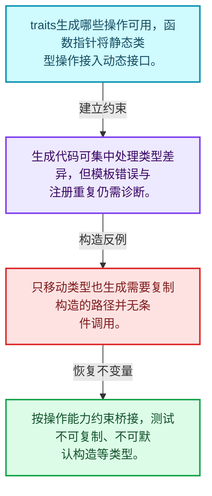
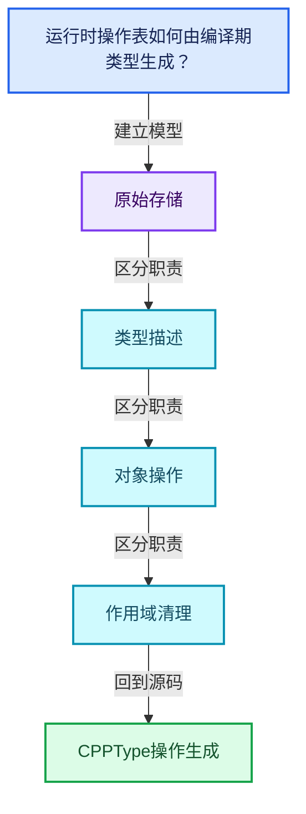
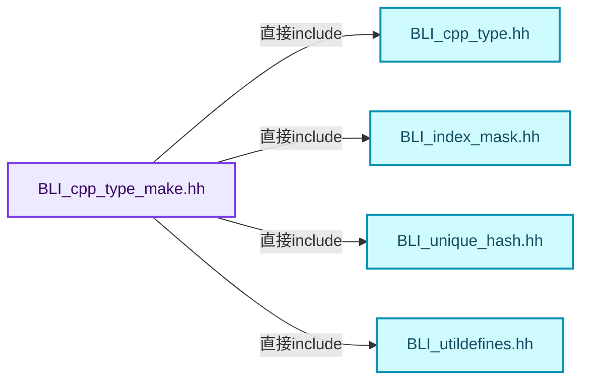
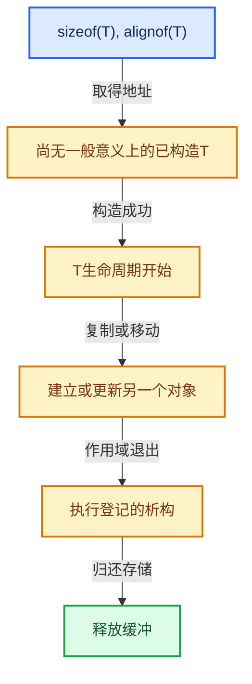

# 03-07 CPPType操作生成

[方向导航](README.md) · [总目录](../README.md) · [覆盖索引](../%E6%BA%90%E7%A0%81%E7%89%88%E6%9C%AC%E4%B8%8E%E8%A6%86%E7%9B%96%E7%B4%A2%E5%BC%95.md)

> 阅读顺序：问题与数据模型 → 语法与类型 → 源码逐行 → 调用线索 → 历史与取舍 → 推演和练习。

- 基准 HEAD：`cbda6b96c26c0dee3c3b5cbb93960c4ac06a6b30`。
- 记录日期：2026-10-14。
- 教学示例状态：正文中的推演不是本机性能实测；已运行练习见验收报告。

## 一、从问题到设计

运行时操作表如何由编译期类型生成？

模板生成函数桥接，把静态类型行为填入运行期表；traits限制不支持的操作。

本篇把语法、数据语义和系统取舍连接起来。把存储分配、对象构造、类型操作和最终清理拆开建模。

### 本篇独立模型与设计推理

traits生成哪些操作可用，函数指针将静态类型操作接入动态接口。

设计取舍：生成代码可集中处理类型差异，但模板错误与注册重复仍需诊断。

最小反例：只移动类型也生成需要复制构造的路径并无条件调用。

推导与处理：按操作能力约束桥接，测试不可复制、不可默认构造等类型。



### 源码范围与相邻篇章

| 文件 | 本篇逐行范围 | 基准SHA-256 |
|---|---|---|
| [source/blender/blenlib/BLI_cpp_type_make.hh](../../../../../source/blender/blenlib/BLI_cpp_type_make.hh) | L1—L507 | `c5cd942939c54785b2209e81e4454cd8d6fdb1920b9f09c4421b97568d125dc4` |

同一主讲文件可能分多篇覆盖；超出本篇范围的符号通过覆盖索引定位。空行与纯注释保留在源码摘录中，逐行表解释有效语句与语法边界；许可证头统一保留。

前篇：[CPPType总体接口](06-CPPType%E6%80%BB%E4%BD%93%E6%8E%A5%E5%8F%A3.md).

后篇：[CPPType构造与析构](08-CPPType%E6%9E%84%E9%80%A0%E4%B8%8E%E6%9E%90%E6%9E%84.md).

## 二、类型、数据与阅读地图



这是概念依赖图，边表示阅读关系，不声称是运行时调用顺序。

### 直接编译依赖



箭头只表示头文件包含关系；完整调用线索见后面的符号定位表。

## 三、关键词、语法与类型角色

### 模板 template

模板把类型或常量作为生成实现的参数。读声明时先列出类型参数、非类型参数和默认值，再看使用者实际实例化了什么。模板声明本身不意味着每种T都支持其全部成员。

具体检查：把T替换为int、string、只能移动的类型，分别检查每个被调用操作是否成立。

### 依赖名称 typename

typename既可引入类型模板参数，也可告诉编译器某个依赖名称是类型。它不创建运行时对象；解析期确认语法类别与实例化期检查具体类型是不同阶段。

具体检查：区分typename T::value_type和T::size()，前者标记类型，后者是表达式。

### 约束 requires

requires表达式或requires子句限制模板参与重载的条件。它提供编译期可用性检查，不是运行时if，不能指望输入到达程序后再被这一机制验证。

具体检查：构造满足和不满足约束的两个类型，观察候选被排除而不是在函数内返回错误。

### 常量求值 constexpr

constexpr声明允许相应实体参与常量求值，但constexpr函数仍可以在运行时执行。是否常量求值由调用场景和表达式合法性共同决定。

具体检查：比较constexpr变量初始化和从运行时输入调用同一函数。

### 只读限定 const

const约束当前访问路径可做的修改。const指针、指向const的指针、const视图对象、const元素是不同位置的限定；其他别名可能仍可修改原对象。

具体检查：分别写T* const、const T*与const T* const，并画出不可修改的层次。

### 移动转换 std::move

std::move把表达式转换为可供移动重载选择的值类别，实际资源转移发生在被选中的构造或赋值中。对const对象move可能仍调用复制，对视图move也不会获得底层数据所有权。

具体检查：记录移动构造调用次数，不用变量名或std::move的出现次数替代测量。

### 显式静态转换 static_cast

static_cast表达编译期允许的转换，不会自动验证运行时真实类型、指针寿命或索引边界。由void指针恢复T指针时，调用者仍须保证实际存储中确有合法T对象。

具体检查：标出转换前后的类型以及正确性依据来自哪里。

### 表示层转换 reinterpret_cast

reinterpret_cast不能自动开始任意对象的生命周期，也不能豁免对齐和别名规则。读这类代码需要追溯原始分配与实际构造操作。

具体检查：分别检查大小、对齐、生命周期和可访问类型，四项不能互相替代。

### 原子操作 atomic

原子性保护相应原子对象的访问；发布其他普通数据还要分析内存序。多个原子字段分别安全不等于复合不变量整体原子。

具体检查：画出写数据、发布ready与读ready、读数据的顺序关系。

### 对齐 alignof

alignof得到类型要求的地址对齐。分配足够字节后仍需把地址对齐到相应边界，内嵌缓冲也一样。

具体检查：对齐a为2的幂时可推导向上取整，但仍要考虑溢出与边界。

### 对象表示 sizeof

sizeof给出对象表示大小，不是其引用的所有堆内存总量。sizeof视图很小并不说明底层数组很小。

具体检查：分别统计容器对象、容量字节和元素拥有的间接资源。

### 构造与new表达式

普通new可能分配并构造；placement new在给定地址构造，存储由其他机制提供。失败回滚应区分两类责任。

具体检查：追踪地址来自哪里、构造何时成功、由谁析构、由谁释放。

### 内部断言 assert

断言表达开发者预期成立的内部契约，发布构建可能关闭。它不能替代对不可信输入的完整错误处理，也不保证后续操作被运行时保护。

具体检查：对每条断言构造违反条件的输入，区分调用者错误与应向用户报告的错误。

### 编译期分支 if constexpr

条件在实例化时决定被保留的分支，这常用于不同类型的合法操作选择。它与运行时if有不同的实例化检查规则。

具体检查：找出每个分支依赖哪些类型特征，再使用满足与不满足条件的类型。

### 类型别名 using

类型别名为已有类型建立名字，不创建运行期对象。它常把模板内部使用的类型统一暴露给泛型调用者。

具体检查：展开别名直到基础类型，区分类型别名和变量声明。

## 四、真实源码与逐行讲解

源码块保持原行内容，原始行号由小节标题及逐行表给出。表中的调用定位是静态阅读辅助；重载、模板实例化、宏展开和虚调用需结合完整声明，不能仅凭词法出现证明动态调用。

### BLI_cpp_type_make.hh：L1—L48

<!-- source:source/blender/blenlib/BLI_cpp_type_make.hh:1:48 -->

```cpp
/* SPDX-FileCopyrightText: 2023 Blender Authors
 *
 * SPDX-License-Identifier: GPL-2.0-or-later */

#pragma once

/** \file
 * \ingroup bli
 */

#include <sstream>

#include "BLI_cpp_type.hh"
#include "BLI_index_mask.hh"
#include "BLI_unique_hash.hh"
#include "BLI_utildefines.hh"

namespace blender {

namespace cpp_type_util {

template<typename T> inline bool pointer_has_valid_alignment(const void *ptr)
{
  return (uintptr_t(ptr) % alignof(T)) == 0;
}

template<typename T> inline bool pointer_can_point_to_instance(const void *ptr)
{
  return ptr != nullptr && pointer_has_valid_alignment<T>(ptr);
}

template<typename T> void default_construct_cb(void *ptr)
{
  BLI_assert(pointer_can_point_to_instance<T>(ptr));
  new (ptr) T;
}
template<typename T> void default_construct_indices_cb(void *ptr, const IndexMask &mask)
{
  BLI_assert(mask.size() == 0 || pointer_can_point_to_instance<T>(ptr));
  if constexpr (std::is_trivially_constructible_v<T>) {
    return;
  }
  mask.foreach_index_optimized<int64_t>([&](int64_t i) { new (static_cast<T *>(ptr) + i) T; });
}
template<typename T> void default_construct_n_cb(void *ptr, const int64_t n)
{
  default_construct_indices_cb<T>(ptr, IndexMask(n));
}
```

本段语义重点：

- `default_construct_n`：为目标区间建立默认构造对象；基本类型默认初始化未必给出可读取的零。

| 原始行 | 语义、约束与检查 |
|---|---|
| L5 | 防止同一头文件在一个翻译单元中重复展开；不控制多个源文件之间的链接或对象寿命。 |
| L11 | 引入编译依赖 <sstream>；这是声明可见性关系，不表示运行时一定调用该文件的所有接口。 |
| L13 | 引入编译依赖 "BLI_cpp_type.hh"；这是声明可见性关系，不表示运行时一定调用该文件的所有接口。 |
| L14 | 引入编译依赖 "BLI_index_mask.hh"；这是声明可见性关系，不表示运行时一定调用该文件的所有接口。 |
| L15 | 引入编译依赖 "BLI_unique_hash.hh"；这是声明可见性关系，不表示运行时一定调用该文件的所有接口。 |
| L16 | 引入编译依赖 "BLI_utildefines.hh"；这是声明可见性关系，不表示运行时一定调用该文件的所有接口。 |
| L18 | 把后续声明放入 blender 命名空间，影响名称查找和符号归属，不创建运行时对象。 |
| L20 | 把后续声明放入 cpp_type_util 命名空间，影响名称查找和符号归属，不创建运行时对象。 |
| L22 | 声明模板参数 `template<typename T> inline bool pointer_has_valid_alignment(const void *ptr)`。类型参数决定生成操作的类型，非类型参数可决定内嵌容量或编译期分支。 |
| L23 | 连接上一行的声明或控制结构与其语句块；后续行在这个作用域中执行或声明。 |
| L24 | 纯虚接口声明：`return (uintptr_t(ptr) % alignof(T)) == 0;`。等号零标记抽象接口，需要按继承约定提供覆写；不表示执行函数并把结果设为零。 |
| L25 | 结束当前语法单元。局部自动对象在离开其作用域时按规则销毁；这不等于所有被引用的外部数据也被释放。 |
| L27 | 声明模板参数 `template<typename T> inline bool pointer_can_point_to_instance(const void *ptr)`。类型参数决定生成操作的类型，非类型参数可决定内嵌容量或编译期分支。 |
| L28 | 连接上一行的声明或控制结构与其语句块；后续行在这个作用域中执行或声明。 |
| L29 | 返回表达式 `ptr != nullptr && pointer_has_valid_alignment<T>(ptr)`。 |
| L30 | 结束当前语法单元。局部自动对象在离开其作用域时按规则销毁；这不等于所有被引用的外部数据也被释放。 |
| L32 | 声明模板参数 `template<typename T> void default_construct_cb(void *ptr)`。类型参数决定生成操作的类型，非类型参数可决定内嵌容量或编译期分支。 |
| L33 | 连接上一行的声明或控制结构与其语句块；后续行在这个作用域中执行或声明。 |
| L34 | 断言约束 `BLI_assert(pointer_can_point_to_instance<T>(ptr));`。条件是后续访问的内部前置条件；发布构建可能不执行，不能把断言当作输入修复。 |
| L35 | 出现调用或函数声明 `new`，对应表达式为 `new (ptr) T;`。参数求值、返回类型与重载需结合前后完整语句；静态文本引用不能证明动态目标。 |
| L36 | 结束当前语法单元。局部自动对象在离开其作用域时按规则销毁；这不等于所有被引用的外部数据也被释放。 |
| L37 | 声明模板参数 `template<typename T> void default_construct_indices_cb(void *ptr, const IndexMask &mask)`。类型参数决定生成操作的类型，非类型参数可决定内嵌容量或编译期分支。 |
| L38 | 连接上一行的声明或控制结构与其语句块；后续行在这个作用域中执行或声明。 |
| L39 | 断言约束 `BLI_assert(mask.size() == 0 &#124;&#124; pointer_can_point_to_instance<T>(ptr));`。条件是后续访问的内部前置条件；发布构建可能不执行，不能把断言当作输入修复。 |
| L40 | 编译期条件分支 `if constexpr (std::is_trivially_constructible_v<T>)`。按实例化类型选择相应实现；被舍弃分支和运行期if具有不同检查规则，不能当作运行时输入验证。 |
| L41 | 结束当前函数，本路径不再执行后续语句；局部对象按作用域规则清理。 |
| L42 | 结束当前语法单元。局部自动对象在离开其作用域时按规则销毁；这不等于所有被引用的外部数据也被释放。 |
| L43 | 出现调用或函数声明 `foreach_index_optimized`，对应表达式为 `mask.foreach_index_optimized<int64_t>([&](int64_t i) { new (static_cast<T *>(ptr) + i) T; });`。参数求值、返回类型与重载需结合前后完整语句；静态文本引用不能证明动态目标。 |
| L44 | 结束当前语法单元。局部自动对象在离开其作用域时按规则销毁；这不等于所有被引用的外部数据也被释放。 |
| L45 | 声明模板参数 `template<typename T> void default_construct_n_cb(void *ptr, const int64_t n)`。类型参数决定生成操作的类型，非类型参数可决定内嵌容量或编译期分支。 |
| L46 | 连接上一行的声明或控制结构与其语句块；后续行在这个作用域中执行或声明。 |
| L47 | 出现调用或函数声明 `default_construct_indices_cb`，对应表达式为 `default_construct_indices_cb<T>(ptr, IndexMask(n));`。参数求值、返回类型与重载需结合前后完整语句；静态文本引用不能证明动态目标。 |
| L48 | 结束当前语法单元。局部自动对象在离开其作用域时按规则销毁；这不等于所有被引用的外部数据也被释放。 |

### BLI_cpp_type_make.hh：L49—L89

<!-- source:source/blender/blenlib/BLI_cpp_type_make.hh:49:89 -->

```cpp

template<typename T> void value_initialize_cb(void *ptr)
{
  BLI_assert(pointer_can_point_to_instance<T>(ptr));
  new (ptr) T();
}
template<typename T> void value_initialize_indices_cb(void *ptr, const IndexMask &mask)
{
  BLI_assert(mask.size() == 0 || pointer_can_point_to_instance<T>(ptr));
  mask.foreach_index_optimized<int64_t>([&](int64_t i) { new (static_cast<T *>(ptr) + i) T(); });
}
template<typename T> void value_initialize_n_cb(void *ptr, const int64_t n)
{
  value_initialize_indices_cb<T>(ptr, IndexMask(n));
}

template<typename T> void destruct_cb(void *ptr)
{
  BLI_assert(pointer_can_point_to_instance<T>(ptr));
  (static_cast<T *>(ptr))->~T();
}
template<typename T> void destruct_indices_cb(void *ptr, const IndexMask &mask)
{
  BLI_assert(mask.size() == 0 || pointer_can_point_to_instance<T>(ptr));
  if (std::is_trivially_destructible_v<T>) {
    return;
  }
  T *ptr_ = static_cast<T *>(ptr);
  mask.foreach_index_optimized<int64_t>([&](int64_t i) { ptr_[i].~T(); });
}
template<typename T> void destruct_n_cb(void *ptr, const int64_t n)
{
  destruct_indices_cb<T>(ptr, IndexMask(n));
}

template<typename T> void copy_assign_cb(const void *src, void *dst)
{
  BLI_assert(pointer_can_point_to_instance<T>(src));
  BLI_assert(pointer_can_point_to_instance<T>(dst));
  *static_cast<T *>(dst) = *static_cast<const T *>(src);
}
```

本段语义重点：

- `destruct_n`：对已构造的元素区间执行析构；计数必须对应真实存活对象，释放原始内存是另一操作。
- `value_initialize_n`：按值初始化对象；对基本类型的初始化行为不同于未初始化分配。

| 原始行 | 语义、约束与检查 |
|---|---|
| L50 | 声明模板参数 `template<typename T> void value_initialize_cb(void *ptr)`。类型参数决定生成操作的类型，非类型参数可决定内嵌容量或编译期分支。 |
| L51 | 连接上一行的声明或控制结构与其语句块；后续行在这个作用域中执行或声明。 |
| L52 | 断言约束 `BLI_assert(pointer_can_point_to_instance<T>(ptr));`。条件是后续访问的内部前置条件；发布构建可能不执行，不能把断言当作输入修复。 |
| L53 | 出现调用或函数声明 `new`，对应表达式为 `new (ptr) T();`。参数求值、返回类型与重载需结合前后完整语句；静态文本引用不能证明动态目标。 |
| L54 | 结束当前语法单元。局部自动对象在离开其作用域时按规则销毁；这不等于所有被引用的外部数据也被释放。 |
| L55 | 声明模板参数 `template<typename T> void value_initialize_indices_cb(void *ptr, const IndexMask &mask)`。类型参数决定生成操作的类型，非类型参数可决定内嵌容量或编译期分支。 |
| L56 | 连接上一行的声明或控制结构与其语句块；后续行在这个作用域中执行或声明。 |
| L57 | 断言约束 `BLI_assert(mask.size() == 0 &#124;&#124; pointer_can_point_to_instance<T>(ptr));`。条件是后续访问的内部前置条件；发布构建可能不执行，不能把断言当作输入修复。 |
| L58 | 出现调用或函数声明 `foreach_index_optimized`，对应表达式为 `mask.foreach_index_optimized<int64_t>([&](int64_t i) { new (static_cast<T *>(ptr) + i) T(); });`。参数求值、返回类型与重载需结合前后完整语句；静态文本引用不能证明动态目标。 |
| L59 | 结束当前语法单元。局部自动对象在离开其作用域时按规则销毁；这不等于所有被引用的外部数据也被释放。 |
| L60 | 声明模板参数 `template<typename T> void value_initialize_n_cb(void *ptr, const int64_t n)`。类型参数决定生成操作的类型，非类型参数可决定内嵌容量或编译期分支。 |
| L61 | 连接上一行的声明或控制结构与其语句块；后续行在这个作用域中执行或声明。 |
| L62 | 出现调用或函数声明 `value_initialize_indices_cb`，对应表达式为 `value_initialize_indices_cb<T>(ptr, IndexMask(n));`。参数求值、返回类型与重载需结合前后完整语句；静态文本引用不能证明动态目标。 |
| L63 | 结束当前语法单元。局部自动对象在离开其作用域时按规则销毁；这不等于所有被引用的外部数据也被释放。 |
| L65 | 声明模板参数 `template<typename T> void destruct_cb(void *ptr)`。类型参数决定生成操作的类型，非类型参数可决定内嵌容量或编译期分支。 |
| L66 | 连接上一行的声明或控制结构与其语句块；后续行在这个作用域中执行或声明。 |
| L67 | 断言约束 `BLI_assert(pointer_can_point_to_instance<T>(ptr));`。条件是后续访问的内部前置条件；发布构建可能不执行，不能把断言当作输入修复。 |
| L68 | 涉及析构接口或显式析构：`(static_cast<T *>(ptr))->~T();`。检查目标对象已成功构造，且资源不会在另一条清理路径再次销毁。 |
| L69 | 结束当前语法单元。局部自动对象在离开其作用域时按规则销毁；这不等于所有被引用的外部数据也被释放。 |
| L70 | 声明模板参数 `template<typename T> void destruct_indices_cb(void *ptr, const IndexMask &mask)`。类型参数决定生成操作的类型，非类型参数可决定内嵌容量或编译期分支。 |
| L71 | 连接上一行的声明或控制结构与其语句块；后续行在这个作用域中执行或声明。 |
| L72 | 断言约束 `BLI_assert(mask.size() == 0 &#124;&#124; pointer_can_point_to_instance<T>(ptr));`。条件是后续访问的内部前置条件；发布构建可能不执行，不能把断言当作输入修复。 |
| L73 | 判断 `std::is_trivially_destructible_v<T>`，成立时进入本分支，否则继续后续路径。 |
| L74 | 结束当前函数，本路径不再执行后续语句；局部对象按作用域规则清理。 |
| L75 | 结束当前语法单元。局部自动对象在离开其作用域时按规则销毁；这不等于所有被引用的外部数据也被释放。 |
| L76 | 把右侧 `static_cast<T *>(ptr)` 用于初始化或更新左侧 `T *ptr_`。声明初始化与已有对象赋值应按上下文区分；有资源的类型会调用相应特殊成员。 |
| L77 | 涉及析构接口或显式析构：`mask.foreach_index_optimized<int64_t>([&](int64_t i) { ptr_[i].~T(); });`。检查目标对象已成功构造，且资源不会在另一条清理路径再次销毁。 |
| L78 | 结束当前语法单元。局部自动对象在离开其作用域时按规则销毁；这不等于所有被引用的外部数据也被释放。 |
| L79 | 声明模板参数 `template<typename T> void destruct_n_cb(void *ptr, const int64_t n)`。类型参数决定生成操作的类型，非类型参数可决定内嵌容量或编译期分支。 |
| L80 | 连接上一行的声明或控制结构与其语句块；后续行在这个作用域中执行或声明。 |
| L81 | 出现调用或函数声明 `destruct_indices_cb`，对应表达式为 `destruct_indices_cb<T>(ptr, IndexMask(n));`。参数求值、返回类型与重载需结合前后完整语句；静态文本引用不能证明动态目标。 |
| L82 | 结束当前语法单元。局部自动对象在离开其作用域时按规则销毁；这不等于所有被引用的外部数据也被释放。 |
| L84 | 声明模板参数 `template<typename T> void copy_assign_cb(const void *src, void *dst)`。类型参数决定生成操作的类型，非类型参数可决定内嵌容量或编译期分支。 |
| L85 | 连接上一行的声明或控制结构与其语句块；后续行在这个作用域中执行或声明。 |
| L86 | 断言约束 `BLI_assert(pointer_can_point_to_instance<T>(src));`。条件是后续访问的内部前置条件；发布构建可能不执行，不能把断言当作输入修复。 |
| L87 | 断言约束 `BLI_assert(pointer_can_point_to_instance<T>(dst));`。条件是后续访问的内部前置条件；发布构建可能不执行，不能把断言当作输入修复。 |
| L88 | 把右侧 `*static_cast<const T *>(src)` 用于初始化或更新左侧 `*static_cast<T *>(dst)`。声明初始化与已有对象赋值应按上下文区分；有资源的类型会调用相应特殊成员。 |
| L89 | 结束当前语法单元。局部自动对象在离开其作用域时按规则销毁；这不等于所有被引用的外部数据也被释放。 |

### BLI_cpp_type_make.hh：L90—L141

<!-- source:source/blender/blenlib/BLI_cpp_type_make.hh:90:141 -->

```cpp
template<typename T> void copy_assign_indices_cb(const void *src, void *dst, const IndexMask &mask)
{
  BLI_assert(mask.size() == 0 || src != dst);
  BLI_assert(mask.size() == 0 || pointer_can_point_to_instance<T>(src));
  BLI_assert(mask.size() == 0 || pointer_can_point_to_instance<T>(dst));
  if constexpr (std::is_trivially_copy_assignable_v<T>) {
    index_mask::detail::copy_assign(static_cast<const T *>(src), mask, static_cast<T *>(dst));
  }
  else {
    const T *src_ = static_cast<const T *>(src);
    T *dst_ = static_cast<T *>(dst);
    mask.foreach_index([&](int64_t i) { dst_[i] = src_[i]; });
  }
}
template<typename T> void copy_assign_n_cb(const void *src, void *dst, const int64_t n)
{
  copy_assign_indices_cb<T>(src, dst, IndexMask(n));
}
template<typename T>
void copy_assign_compressed_cb(const void *src, void *dst, const IndexMask &mask)
{
  BLI_assert(mask.size() == 0 || src != dst);
  BLI_assert(mask.size() == 0 || pointer_can_point_to_instance<T>(src));
  BLI_assert(mask.size() == 0 || pointer_can_point_to_instance<T>(dst));
  if constexpr (std::is_trivially_copy_assignable_v<T>) {
    index_mask::detail::gather_assign(static_cast<const T *>(src), mask, static_cast<T *>(dst));
  }
  else {
    const T *src_ = static_cast<const T *>(src);
    T *dst_ = static_cast<T *>(dst);
    mask.foreach_index([&](const int64_t i, const int64_t pos) { dst_[pos] = src_[i]; });
  }
}

template<typename T> void copy_construct_cb(const void *src, void *dst)
{
  BLI_assert(src != dst || std::is_trivially_copy_constructible_v<T>);
  BLI_assert(pointer_can_point_to_instance<T>(src));
  BLI_assert(pointer_can_point_to_instance<T>(dst));
  uninitialized_copy_n(static_cast<const T *>(src), 1, static_cast<T *>(dst));
}
template<typename T>
void copy_construct_indices_cb(const void *src, void *dst, const IndexMask &mask)
{
  BLI_assert(mask.size() == 0 || src != dst);
  BLI_assert(mask.size() == 0 || pointer_can_point_to_instance<T>(src));
  BLI_assert(mask.size() == 0 || pointer_can_point_to_instance<T>(dst));
  const T *src_ = static_cast<const T *>(src);
  T *dst_ = static_cast<T *>(dst);

  mask.foreach_index_optimized<int64_t>([&](int64_t i) { new (dst_ + i) T(src_[i]); });
}
```

本段语义重点：

- `uninitialized_copy_n`：把源值复制构造到未初始化的目标区间；目标已有对象时不能直接用此操作替代赋值。

| 原始行 | 语义、约束与检查 |
|---|---|
| L90 | 声明模板参数 `template<typename T> void copy_assign_indices_cb(const void *src, void *dst, const IndexMask &mask)`。类型参数决定生成操作的类型，非类型参数可决定内嵌容量或编译期分支。 |
| L91 | 连接上一行的声明或控制结构与其语句块；后续行在这个作用域中执行或声明。 |
| L92 | 断言约束 `BLI_assert(mask.size() == 0 &#124;&#124; src != dst);`。条件是后续访问的内部前置条件；发布构建可能不执行，不能把断言当作输入修复。 |
| L93 | 断言约束 `BLI_assert(mask.size() == 0 &#124;&#124; pointer_can_point_to_instance<T>(src));`。条件是后续访问的内部前置条件；发布构建可能不执行，不能把断言当作输入修复。 |
| L94 | 断言约束 `BLI_assert(mask.size() == 0 &#124;&#124; pointer_can_point_to_instance<T>(dst));`。条件是后续访问的内部前置条件；发布构建可能不执行，不能把断言当作输入修复。 |
| L95 | 编译期条件分支 `if constexpr (std::is_trivially_copy_assignable_v<T>)`。按实例化类型选择相应实现；被舍弃分支和运行期if具有不同检查规则，不能当作运行时输入验证。 |
| L96 | 出现调用或函数声明 `index_mask::detail::copy_assign`，对应表达式为 `index_mask::detail::copy_assign(static_cast<const T *>(src), mask, static_cast<T *>(dst));`。参数求值、返回类型与重载需结合前后完整语句；静态文本引用不能证明动态目标。 |
| L97 | 结束当前语法单元。局部自动对象在离开其作用域时按规则销毁；这不等于所有被引用的外部数据也被释放。 |
| L98 | 处理前一条件不成立的互补路径。比较两条路径最后是否恢复同一不变量，以及是否产生不同的资源责任。 |
| L99 | 把右侧 `static_cast<const T *>(src)` 用于初始化或更新左侧 `const T *src_`。声明初始化与已有对象赋值应按上下文区分；有资源的类型会调用相应特殊成员。 |
| L100 | 把右侧 `static_cast<T *>(dst)` 用于初始化或更新左侧 `T *dst_`。声明初始化与已有对象赋值应按上下文区分；有资源的类型会调用相应特殊成员。 |
| L101 | 把右侧 `src_[i]; })` 用于初始化或更新左侧 `mask.foreach_index([&](int64_t i) { dst_[i]`。声明初始化与已有对象赋值应按上下文区分；有资源的类型会调用相应特殊成员。 |
| L102 | 结束当前语法单元。局部自动对象在离开其作用域时按规则销毁；这不等于所有被引用的外部数据也被释放。 |
| L103 | 结束当前语法单元。局部自动对象在离开其作用域时按规则销毁；这不等于所有被引用的外部数据也被释放。 |
| L104 | 声明模板参数 `template<typename T> void copy_assign_n_cb(const void *src, void *dst, const int64_t n)`。类型参数决定生成操作的类型，非类型参数可决定内嵌容量或编译期分支。 |
| L105 | 连接上一行的声明或控制结构与其语句块；后续行在这个作用域中执行或声明。 |
| L106 | 出现调用或函数声明 `copy_assign_indices_cb`，对应表达式为 `copy_assign_indices_cb<T>(src, dst, IndexMask(n));`。参数求值、返回类型与重载需结合前后完整语句；静态文本引用不能证明动态目标。 |
| L107 | 结束当前语法单元。局部自动对象在离开其作用域时按规则销毁；这不等于所有被引用的外部数据也被释放。 |
| L108 | 声明模板参数 `template<typename T>`。类型参数决定生成操作的类型，非类型参数可决定内嵌容量或编译期分支。 |
| L109 | 出现调用或函数声明 `copy_assign_compressed_cb`，对应表达式为 `void copy_assign_compressed_cb(const void *src, void *dst, const IndexMask &mask)`。参数求值、返回类型与重载需结合前后完整语句；静态文本引用不能证明动态目标。 |
| L110 | 连接上一行的声明或控制结构与其语句块；后续行在这个作用域中执行或声明。 |
| L111 | 断言约束 `BLI_assert(mask.size() == 0 &#124;&#124; src != dst);`。条件是后续访问的内部前置条件；发布构建可能不执行，不能把断言当作输入修复。 |
| L112 | 断言约束 `BLI_assert(mask.size() == 0 &#124;&#124; pointer_can_point_to_instance<T>(src));`。条件是后续访问的内部前置条件；发布构建可能不执行，不能把断言当作输入修复。 |
| L113 | 断言约束 `BLI_assert(mask.size() == 0 &#124;&#124; pointer_can_point_to_instance<T>(dst));`。条件是后续访问的内部前置条件；发布构建可能不执行，不能把断言当作输入修复。 |
| L114 | 编译期条件分支 `if constexpr (std::is_trivially_copy_assignable_v<T>)`。按实例化类型选择相应实现；被舍弃分支和运行期if具有不同检查规则，不能当作运行时输入验证。 |
| L115 | 出现调用或函数声明 `index_mask::detail::gather_assign`，对应表达式为 `index_mask::detail::gather_assign(static_cast<const T *>(src), mask, static_cast<T *>(dst));`。参数求值、返回类型与重载需结合前后完整语句；静态文本引用不能证明动态目标。 |
| L116 | 结束当前语法单元。局部自动对象在离开其作用域时按规则销毁；这不等于所有被引用的外部数据也被释放。 |
| L117 | 处理前一条件不成立的互补路径。比较两条路径最后是否恢复同一不变量，以及是否产生不同的资源责任。 |
| L118 | 把右侧 `static_cast<const T *>(src)` 用于初始化或更新左侧 `const T *src_`。声明初始化与已有对象赋值应按上下文区分；有资源的类型会调用相应特殊成员。 |
| L119 | 把右侧 `static_cast<T *>(dst)` 用于初始化或更新左侧 `T *dst_`。声明初始化与已有对象赋值应按上下文区分；有资源的类型会调用相应特殊成员。 |
| L120 | 把右侧 `src_[i]; })` 用于初始化或更新左侧 `mask.foreach_index([&](const int64_t i, const int64_t pos) { dst_[pos]`。声明初始化与已有对象赋值应按上下文区分；有资源的类型会调用相应特殊成员。 |
| L121 | 结束当前语法单元。局部自动对象在离开其作用域时按规则销毁；这不等于所有被引用的外部数据也被释放。 |
| L122 | 结束当前语法单元。局部自动对象在离开其作用域时按规则销毁；这不等于所有被引用的外部数据也被释放。 |
| L124 | 声明模板参数 `template<typename T> void copy_construct_cb(const void *src, void *dst)`。类型参数决定生成操作的类型，非类型参数可决定内嵌容量或编译期分支。 |
| L125 | 连接上一行的声明或控制结构与其语句块；后续行在这个作用域中执行或声明。 |
| L126 | 断言约束 `BLI_assert(src != dst &#124;&#124; std::is_trivially_copy_constructible_v<T>);`。条件是后续访问的内部前置条件；发布构建可能不执行，不能把断言当作输入修复。 |
| L127 | 断言约束 `BLI_assert(pointer_can_point_to_instance<T>(src));`。条件是后续访问的内部前置条件；发布构建可能不执行，不能把断言当作输入修复。 |
| L128 | 断言约束 `BLI_assert(pointer_can_point_to_instance<T>(dst));`。条件是后续访问的内部前置条件；发布构建可能不执行，不能把断言当作输入修复。 |
| L129 | 本行使用 `uninitialized_copy_n`：把源值复制构造到未初始化的目标区间；目标已有对象时不能直接用此操作替代赋值。 |
| L130 | 结束当前语法单元。局部自动对象在离开其作用域时按规则销毁；这不等于所有被引用的外部数据也被释放。 |
| L131 | 声明模板参数 `template<typename T>`。类型参数决定生成操作的类型，非类型参数可决定内嵌容量或编译期分支。 |
| L132 | 出现调用或函数声明 `copy_construct_indices_cb`，对应表达式为 `void copy_construct_indices_cb(const void *src, void *dst, const IndexMask &mask)`。参数求值、返回类型与重载需结合前后完整语句；静态文本引用不能证明动态目标。 |
| L133 | 连接上一行的声明或控制结构与其语句块；后续行在这个作用域中执行或声明。 |
| L134 | 断言约束 `BLI_assert(mask.size() == 0 &#124;&#124; src != dst);`。条件是后续访问的内部前置条件；发布构建可能不执行，不能把断言当作输入修复。 |
| L135 | 断言约束 `BLI_assert(mask.size() == 0 &#124;&#124; pointer_can_point_to_instance<T>(src));`。条件是后续访问的内部前置条件；发布构建可能不执行，不能把断言当作输入修复。 |
| L136 | 断言约束 `BLI_assert(mask.size() == 0 &#124;&#124; pointer_can_point_to_instance<T>(dst));`。条件是后续访问的内部前置条件；发布构建可能不执行，不能把断言当作输入修复。 |
| L137 | 把右侧 `static_cast<const T *>(src)` 用于初始化或更新左侧 `const T *src_`。声明初始化与已有对象赋值应按上下文区分；有资源的类型会调用相应特殊成员。 |
| L138 | 把右侧 `static_cast<T *>(dst)` 用于初始化或更新左侧 `T *dst_`。声明初始化与已有对象赋值应按上下文区分；有资源的类型会调用相应特殊成员。 |
| L140 | 出现调用或函数声明 `foreach_index_optimized`，对应表达式为 `mask.foreach_index_optimized<int64_t>([&](int64_t i) { new (dst_ + i) T(src_[i]); });`。参数求值、返回类型与重载需结合前后完整语句；静态文本引用不能证明动态目标。 |
| L141 | 结束当前语法单元。局部自动对象在离开其作用域时按规则销毁；这不等于所有被引用的外部数据也被释放。 |

### BLI_cpp_type_make.hh：L142—L187

<!-- source:source/blender/blenlib/BLI_cpp_type_make.hh:142:187 -->

```cpp
template<typename T> void copy_construct_n_cb(const void *src, void *dst, const int64_t n)
{
  copy_construct_indices_cb<T>(src, dst, IndexMask(n));
}
template<typename T>
void copy_construct_compressed_cb(const void *src, void *dst, const IndexMask &mask)
{
  BLI_assert(mask.size() == 0 || src != dst);
  BLI_assert(mask.size() == 0 || pointer_can_point_to_instance<T>(src));
  BLI_assert(mask.size() == 0 || pointer_can_point_to_instance<T>(dst));
  const T *src_ = static_cast<const T *>(src);
  T *dst_ = static_cast<T *>(dst);

  mask.foreach_index_optimized<int64_t>(
      [&](const int64_t i, const int64_t pos) { new (dst_ + pos) T(src_[i]); });
}

template<typename T> void move_assign_cb(void *src, void *dst)
{
  BLI_assert(pointer_can_point_to_instance<T>(src));
  BLI_assert(pointer_can_point_to_instance<T>(dst));
  initialized_move_n(static_cast<T *>(src), 1, static_cast<T *>(dst));
}
template<typename T> void move_assign_indices_cb(void *src, void *dst, const IndexMask &mask)
{
  BLI_assert(mask.size() == 0 || src != dst);
  BLI_assert(mask.size() == 0 || pointer_can_point_to_instance<T>(src));
  BLI_assert(mask.size() == 0 || pointer_can_point_to_instance<T>(dst));
  T *src_ = static_cast<T *>(src);
  T *dst_ = static_cast<T *>(dst);

  mask.foreach_index_optimized<int64_t>([&](int64_t i) { dst_[i] = std::move(src_[i]); });
}
template<typename T> void move_assign_n_cb(void *src, void *dst, const int64_t n)
{
  move_assign_indices_cb<T>(src, dst, IndexMask(n));
}

template<typename T> void move_construct_cb(void *src, void *dst)
{
  BLI_assert(src != dst || std::is_trivially_move_constructible_v<T>);
  BLI_assert(pointer_can_point_to_instance<T>(src));
  BLI_assert(pointer_can_point_to_instance<T>(dst));

  uninitialized_move_n(static_cast<T *>(src), 1, static_cast<T *>(dst));
}
```

本段语义重点：

- `uninitialized_move_n`：在目标存储移动构造元素；源对象是否另行销毁应查调用约定，不能与重定位自动等同。

| 原始行 | 语义、约束与检查 |
|---|---|
| L142 | 声明模板参数 `template<typename T> void copy_construct_n_cb(const void *src, void *dst, const int64_t n)`。类型参数决定生成操作的类型，非类型参数可决定内嵌容量或编译期分支。 |
| L143 | 连接上一行的声明或控制结构与其语句块；后续行在这个作用域中执行或声明。 |
| L144 | 出现调用或函数声明 `copy_construct_indices_cb`，对应表达式为 `copy_construct_indices_cb<T>(src, dst, IndexMask(n));`。参数求值、返回类型与重载需结合前后完整语句；静态文本引用不能证明动态目标。 |
| L145 | 结束当前语法单元。局部自动对象在离开其作用域时按规则销毁；这不等于所有被引用的外部数据也被释放。 |
| L146 | 声明模板参数 `template<typename T>`。类型参数决定生成操作的类型，非类型参数可决定内嵌容量或编译期分支。 |
| L147 | 出现调用或函数声明 `copy_construct_compressed_cb`，对应表达式为 `void copy_construct_compressed_cb(const void *src, void *dst, const IndexMask &mask)`。参数求值、返回类型与重载需结合前后完整语句；静态文本引用不能证明动态目标。 |
| L148 | 连接上一行的声明或控制结构与其语句块；后续行在这个作用域中执行或声明。 |
| L149 | 断言约束 `BLI_assert(mask.size() == 0 &#124;&#124; src != dst);`。条件是后续访问的内部前置条件；发布构建可能不执行，不能把断言当作输入修复。 |
| L150 | 断言约束 `BLI_assert(mask.size() == 0 &#124;&#124; pointer_can_point_to_instance<T>(src));`。条件是后续访问的内部前置条件；发布构建可能不执行，不能把断言当作输入修复。 |
| L151 | 断言约束 `BLI_assert(mask.size() == 0 &#124;&#124; pointer_can_point_to_instance<T>(dst));`。条件是后续访问的内部前置条件；发布构建可能不执行，不能把断言当作输入修复。 |
| L152 | 把右侧 `static_cast<const T *>(src)` 用于初始化或更新左侧 `const T *src_`。声明初始化与已有对象赋值应按上下文区分；有资源的类型会调用相应特殊成员。 |
| L153 | 把右侧 `static_cast<T *>(dst)` 用于初始化或更新左侧 `T *dst_`。声明初始化与已有对象赋值应按上下文区分；有资源的类型会调用相应特殊成员。 |
| L155 | 出现调用或函数声明 `foreach_index_optimized`，对应表达式为 `mask.foreach_index_optimized<int64_t>(`。参数求值、返回类型与重载需结合前后完整语句；静态文本引用不能证明动态目标。 |
| L156 | 出现调用或函数声明 `new`，对应表达式为 `[&](const int64_t i, const int64_t pos) { new (dst_ + pos) T(src_[i]); });`。参数求值、返回类型与重载需结合前后完整语句；静态文本引用不能证明动态目标。 |
| L157 | 结束当前语法单元。局部自动对象在离开其作用域时按规则销毁；这不等于所有被引用的外部数据也被释放。 |
| L159 | 声明模板参数 `template<typename T> void move_assign_cb(void *src, void *dst)`。类型参数决定生成操作的类型，非类型参数可决定内嵌容量或编译期分支。 |
| L160 | 连接上一行的声明或控制结构与其语句块；后续行在这个作用域中执行或声明。 |
| L161 | 断言约束 `BLI_assert(pointer_can_point_to_instance<T>(src));`。条件是后续访问的内部前置条件；发布构建可能不执行，不能把断言当作输入修复。 |
| L162 | 断言约束 `BLI_assert(pointer_can_point_to_instance<T>(dst));`。条件是后续访问的内部前置条件；发布构建可能不执行，不能把断言当作输入修复。 |
| L163 | 出现调用或函数声明 `initialized_move_n`，对应表达式为 `initialized_move_n(static_cast<T *>(src), 1, static_cast<T *>(dst));`。参数求值、返回类型与重载需结合前后完整语句；静态文本引用不能证明动态目标。 |
| L164 | 结束当前语法单元。局部自动对象在离开其作用域时按规则销毁；这不等于所有被引用的外部数据也被释放。 |
| L165 | 声明模板参数 `template<typename T> void move_assign_indices_cb(void *src, void *dst, const IndexMask &mask)`。类型参数决定生成操作的类型，非类型参数可决定内嵌容量或编译期分支。 |
| L166 | 连接上一行的声明或控制结构与其语句块；后续行在这个作用域中执行或声明。 |
| L167 | 断言约束 `BLI_assert(mask.size() == 0 &#124;&#124; src != dst);`。条件是后续访问的内部前置条件；发布构建可能不执行，不能把断言当作输入修复。 |
| L168 | 断言约束 `BLI_assert(mask.size() == 0 &#124;&#124; pointer_can_point_to_instance<T>(src));`。条件是后续访问的内部前置条件；发布构建可能不执行，不能把断言当作输入修复。 |
| L169 | 断言约束 `BLI_assert(mask.size() == 0 &#124;&#124; pointer_can_point_to_instance<T>(dst));`。条件是后续访问的内部前置条件；发布构建可能不执行，不能把断言当作输入修复。 |
| L170 | 把右侧 `static_cast<T *>(src)` 用于初始化或更新左侧 `T *src_`。声明初始化与已有对象赋值应按上下文区分；有资源的类型会调用相应特殊成员。 |
| L171 | 把右侧 `static_cast<T *>(dst)` 用于初始化或更新左侧 `T *dst_`。声明初始化与已有对象赋值应按上下文区分；有资源的类型会调用相应特殊成员。 |
| L173 | 把右侧 `std::move(src_[i]); })` 用于初始化或更新左侧 `mask.foreach_index_optimized<int64_t>([&](int64_t i) { dst_[i]`。声明初始化与已有对象赋值应按上下文区分；有资源的类型会调用相应特殊成员。 |
| L174 | 结束当前语法单元。局部自动对象在离开其作用域时按规则销毁；这不等于所有被引用的外部数据也被释放。 |
| L175 | 声明模板参数 `template<typename T> void move_assign_n_cb(void *src, void *dst, const int64_t n)`。类型参数决定生成操作的类型，非类型参数可决定内嵌容量或编译期分支。 |
| L176 | 连接上一行的声明或控制结构与其语句块；后续行在这个作用域中执行或声明。 |
| L177 | 出现调用或函数声明 `move_assign_indices_cb`，对应表达式为 `move_assign_indices_cb<T>(src, dst, IndexMask(n));`。参数求值、返回类型与重载需结合前后完整语句；静态文本引用不能证明动态目标。 |
| L178 | 结束当前语法单元。局部自动对象在离开其作用域时按规则销毁；这不等于所有被引用的外部数据也被释放。 |
| L180 | 声明模板参数 `template<typename T> void move_construct_cb(void *src, void *dst)`。类型参数决定生成操作的类型，非类型参数可决定内嵌容量或编译期分支。 |
| L181 | 连接上一行的声明或控制结构与其语句块；后续行在这个作用域中执行或声明。 |
| L182 | 断言约束 `BLI_assert(src != dst &#124;&#124; std::is_trivially_move_constructible_v<T>);`。条件是后续访问的内部前置条件；发布构建可能不执行，不能把断言当作输入修复。 |
| L183 | 断言约束 `BLI_assert(pointer_can_point_to_instance<T>(src));`。条件是后续访问的内部前置条件；发布构建可能不执行，不能把断言当作输入修复。 |
| L184 | 断言约束 `BLI_assert(pointer_can_point_to_instance<T>(dst));`。条件是后续访问的内部前置条件；发布构建可能不执行，不能把断言当作输入修复。 |
| L186 | 本行使用 `uninitialized_move_n`：在目标存储移动构造元素；源对象是否另行销毁应查调用约定，不能与重定位自动等同。 |
| L187 | 结束当前语法单元。局部自动对象在离开其作用域时按规则销毁；这不等于所有被引用的外部数据也被释放。 |

### BLI_cpp_type_make.hh：L188—L230

<!-- source:source/blender/blenlib/BLI_cpp_type_make.hh:188:230 -->

```cpp
template<typename T> void move_construct_indices_cb(void *src, void *dst, const IndexMask &mask)
{
  BLI_assert(mask.size() == 0 || src != dst);
  BLI_assert(mask.size() == 0 || pointer_can_point_to_instance<T>(src));
  BLI_assert(mask.size() == 0 || pointer_can_point_to_instance<T>(dst));
  T *src_ = static_cast<T *>(src);
  T *dst_ = static_cast<T *>(dst);

  mask.foreach_index_optimized<int64_t>([&](int64_t i) { new (dst_ + i) T(std::move(src_[i])); });
}
template<typename T> void move_construct_n_cb(void *src, void *dst, const int64_t n)
{
  move_construct_indices_cb<T>(src, dst, IndexMask(n));
}

template<typename T> void relocate_assign_cb(void *src, void *dst)
{
  BLI_assert(src != dst || std::is_trivially_move_constructible_v<T>);
  BLI_assert(pointer_can_point_to_instance<T>(src));
  BLI_assert(pointer_can_point_to_instance<T>(dst));
  T *src_ = static_cast<T *>(src);
  T *dst_ = static_cast<T *>(dst);

  *dst_ = std::move(*src_);
  src_->~T();
}
template<typename T> void relocate_assign_indices_cb(void *src, void *dst, const IndexMask &mask)
{
  BLI_assert(mask.size() == 0 || src != dst);
  BLI_assert(mask.size() == 0 || pointer_can_point_to_instance<T>(src));
  BLI_assert(mask.size() == 0 || pointer_can_point_to_instance<T>(dst));
  T *src_ = static_cast<T *>(src);
  T *dst_ = static_cast<T *>(dst);

  mask.foreach_index_optimized<int64_t>([&](int64_t i) {
    dst_[i] = std::move(src_[i]);
    src_[i].~T();
  });
}
template<typename T> void relocate_assign_n_cb(void *src, void *dst, const int64_t n)
{
  relocate_assign_indices_cb<T>(src, dst, IndexMask(n));
}
```

| 原始行 | 语义、约束与检查 |
|---|---|
| L188 | 声明模板参数 `template<typename T> void move_construct_indices_cb(void *src, void *dst, const IndexMask &mask)`。类型参数决定生成操作的类型，非类型参数可决定内嵌容量或编译期分支。 |
| L189 | 连接上一行的声明或控制结构与其语句块；后续行在这个作用域中执行或声明。 |
| L190 | 断言约束 `BLI_assert(mask.size() == 0 &#124;&#124; src != dst);`。条件是后续访问的内部前置条件；发布构建可能不执行，不能把断言当作输入修复。 |
| L191 | 断言约束 `BLI_assert(mask.size() == 0 &#124;&#124; pointer_can_point_to_instance<T>(src));`。条件是后续访问的内部前置条件；发布构建可能不执行，不能把断言当作输入修复。 |
| L192 | 断言约束 `BLI_assert(mask.size() == 0 &#124;&#124; pointer_can_point_to_instance<T>(dst));`。条件是后续访问的内部前置条件；发布构建可能不执行，不能把断言当作输入修复。 |
| L193 | 把右侧 `static_cast<T *>(src)` 用于初始化或更新左侧 `T *src_`。声明初始化与已有对象赋值应按上下文区分；有资源的类型会调用相应特殊成员。 |
| L194 | 把右侧 `static_cast<T *>(dst)` 用于初始化或更新左侧 `T *dst_`。声明初始化与已有对象赋值应按上下文区分；有资源的类型会调用相应特殊成员。 |
| L196 | 出现调用或函数声明 `foreach_index_optimized`，对应表达式为 `mask.foreach_index_optimized<int64_t>([&](int64_t i) { new (dst_ + i) T(std::move(src_[i])); });`。参数求值、返回类型与重载需结合前后完整语句；静态文本引用不能证明动态目标。 |
| L197 | 结束当前语法单元。局部自动对象在离开其作用域时按规则销毁；这不等于所有被引用的外部数据也被释放。 |
| L198 | 声明模板参数 `template<typename T> void move_construct_n_cb(void *src, void *dst, const int64_t n)`。类型参数决定生成操作的类型，非类型参数可决定内嵌容量或编译期分支。 |
| L199 | 连接上一行的声明或控制结构与其语句块；后续行在这个作用域中执行或声明。 |
| L200 | 出现调用或函数声明 `move_construct_indices_cb`，对应表达式为 `move_construct_indices_cb<T>(src, dst, IndexMask(n));`。参数求值、返回类型与重载需结合前后完整语句；静态文本引用不能证明动态目标。 |
| L201 | 结束当前语法单元。局部自动对象在离开其作用域时按规则销毁；这不等于所有被引用的外部数据也被释放。 |
| L203 | 声明模板参数 `template<typename T> void relocate_assign_cb(void *src, void *dst)`。类型参数决定生成操作的类型，非类型参数可决定内嵌容量或编译期分支。 |
| L204 | 连接上一行的声明或控制结构与其语句块；后续行在这个作用域中执行或声明。 |
| L205 | 断言约束 `BLI_assert(src != dst &#124;&#124; std::is_trivially_move_constructible_v<T>);`。条件是后续访问的内部前置条件；发布构建可能不执行，不能把断言当作输入修复。 |
| L206 | 断言约束 `BLI_assert(pointer_can_point_to_instance<T>(src));`。条件是后续访问的内部前置条件；发布构建可能不执行，不能把断言当作输入修复。 |
| L207 | 断言约束 `BLI_assert(pointer_can_point_to_instance<T>(dst));`。条件是后续访问的内部前置条件；发布构建可能不执行，不能把断言当作输入修复。 |
| L208 | 把右侧 `static_cast<T *>(src)` 用于初始化或更新左侧 `T *src_`。声明初始化与已有对象赋值应按上下文区分；有资源的类型会调用相应特殊成员。 |
| L209 | 把右侧 `static_cast<T *>(dst)` 用于初始化或更新左侧 `T *dst_`。声明初始化与已有对象赋值应按上下文区分；有资源的类型会调用相应特殊成员。 |
| L211 | 把右侧 `std::move(*src_)` 用于初始化或更新左侧 `*dst_`。声明初始化与已有对象赋值应按上下文区分；有资源的类型会调用相应特殊成员。 |
| L212 | 涉及析构接口或显式析构：`src_->~T();`。检查目标对象已成功构造，且资源不会在另一条清理路径再次销毁。 |
| L213 | 结束当前语法单元。局部自动对象在离开其作用域时按规则销毁；这不等于所有被引用的外部数据也被释放。 |
| L214 | 声明模板参数 `template<typename T> void relocate_assign_indices_cb(void *src, void *dst, const IndexMask &mask)`。类型参数决定生成操作的类型，非类型参数可决定内嵌容量或编译期分支。 |
| L215 | 连接上一行的声明或控制结构与其语句块；后续行在这个作用域中执行或声明。 |
| L216 | 断言约束 `BLI_assert(mask.size() == 0 &#124;&#124; src != dst);`。条件是后续访问的内部前置条件；发布构建可能不执行，不能把断言当作输入修复。 |
| L217 | 断言约束 `BLI_assert(mask.size() == 0 &#124;&#124; pointer_can_point_to_instance<T>(src));`。条件是后续访问的内部前置条件；发布构建可能不执行，不能把断言当作输入修复。 |
| L218 | 断言约束 `BLI_assert(mask.size() == 0 &#124;&#124; pointer_can_point_to_instance<T>(dst));`。条件是后续访问的内部前置条件；发布构建可能不执行，不能把断言当作输入修复。 |
| L219 | 把右侧 `static_cast<T *>(src)` 用于初始化或更新左侧 `T *src_`。声明初始化与已有对象赋值应按上下文区分；有资源的类型会调用相应特殊成员。 |
| L220 | 把右侧 `static_cast<T *>(dst)` 用于初始化或更新左侧 `T *dst_`。声明初始化与已有对象赋值应按上下文区分；有资源的类型会调用相应特殊成员。 |
| L222 | 出现调用或函数声明 `foreach_index_optimized`，对应表达式为 `mask.foreach_index_optimized<int64_t>([&](int64_t i) {`。参数求值、返回类型与重载需结合前后完整语句；静态文本引用不能证明动态目标。 |
| L223 | 把右侧 `std::move(src_[i])` 用于初始化或更新左侧 `dst_[i]`。声明初始化与已有对象赋值应按上下文区分；有资源的类型会调用相应特殊成员。 |
| L224 | 涉及析构接口或显式析构：`src_[i].~T();`。检查目标对象已成功构造，且资源不会在另一条清理路径再次销毁。 |
| L225 | 结束当前语法单元。局部自动对象在离开其作用域时按规则销毁；这不等于所有被引用的外部数据也被释放。 |
| L226 | 结束当前语法单元。局部自动对象在离开其作用域时按规则销毁；这不等于所有被引用的外部数据也被释放。 |
| L227 | 声明模板参数 `template<typename T> void relocate_assign_n_cb(void *src, void *dst, const int64_t n)`。类型参数决定生成操作的类型，非类型参数可决定内嵌容量或编译期分支。 |
| L228 | 连接上一行的声明或控制结构与其语句块；后续行在这个作用域中执行或声明。 |
| L229 | 出现调用或函数声明 `relocate_assign_indices_cb`，对应表达式为 `relocate_assign_indices_cb<T>(src, dst, IndexMask(n));`。参数求值、返回类型与重载需结合前后完整语句；静态文本引用不能证明动态目标。 |
| L230 | 结束当前语法单元。局部自动对象在离开其作用域时按规则销毁；这不等于所有被引用的外部数据也被释放。 |

### BLI_cpp_type_make.hh：L231—L279

<!-- source:source/blender/blenlib/BLI_cpp_type_make.hh:231:279 -->

```cpp

template<typename T> void relocate_construct_cb(void *src, void *dst)
{
  BLI_assert(src != dst || std::is_trivially_move_constructible_v<T>);
  BLI_assert(pointer_can_point_to_instance<T>(src));
  BLI_assert(pointer_can_point_to_instance<T>(dst));
  T *src_ = static_cast<T *>(src);
  T *dst_ = static_cast<T *>(dst);

  new (dst_) T(std::move(*src_));
  src_->~T();
}
template<typename T>
void relocate_construct_indices_cb(void *src, void *dst, const IndexMask &mask)
{
  BLI_assert(mask.size() == 0 || src != dst);
  BLI_assert(mask.size() == 0 || pointer_can_point_to_instance<T>(src));
  BLI_assert(mask.size() == 0 || pointer_can_point_to_instance<T>(dst));
  T *src_ = static_cast<T *>(src);
  T *dst_ = static_cast<T *>(dst);

  mask.foreach_index_optimized<int64_t>([&](int64_t i) {
    new (dst_ + i) T(std::move(src_[i]));
    src_[i].~T();
  });
}
template<typename T> void relocate_construct_n_cb(void *src, void *dst, const int64_t n)
{
  relocate_construct_indices_cb<T>(src, dst, IndexMask(n));
}

template<typename T>
void fill_assign_indices_cb(const void *value, void *dst, const IndexMask &mask)
{
  BLI_assert(mask.size() == 0 || pointer_can_point_to_instance<T>(value));
  BLI_assert(mask.size() == 0 || pointer_can_point_to_instance<T>(dst));
  if constexpr (std::is_trivially_copy_assignable_v<T>) {
    index_mask::detail::fill(static_cast<T *>(dst), *static_cast<const T *>(value), mask);
  }
  else {
    const T &value_ = *static_cast<const T *>(value);
    T *dst_ = static_cast<T *>(dst);
    mask.foreach_index([&](int64_t i) { dst_[i] = value_; });
  }
}
template<typename T> void fill_assign_n_cb(const void *value, void *dst, const int64_t n)
{
  fill_assign_indices_cb<T>(value, dst, IndexMask(n));
}
```

| 原始行 | 语义、约束与检查 |
|---|---|
| L232 | 声明模板参数 `template<typename T> void relocate_construct_cb(void *src, void *dst)`。类型参数决定生成操作的类型，非类型参数可决定内嵌容量或编译期分支。 |
| L233 | 连接上一行的声明或控制结构与其语句块；后续行在这个作用域中执行或声明。 |
| L234 | 断言约束 `BLI_assert(src != dst &#124;&#124; std::is_trivially_move_constructible_v<T>);`。条件是后续访问的内部前置条件；发布构建可能不执行，不能把断言当作输入修复。 |
| L235 | 断言约束 `BLI_assert(pointer_can_point_to_instance<T>(src));`。条件是后续访问的内部前置条件；发布构建可能不执行，不能把断言当作输入修复。 |
| L236 | 断言约束 `BLI_assert(pointer_can_point_to_instance<T>(dst));`。条件是后续访问的内部前置条件；发布构建可能不执行，不能把断言当作输入修复。 |
| L237 | 把右侧 `static_cast<T *>(src)` 用于初始化或更新左侧 `T *src_`。声明初始化与已有对象赋值应按上下文区分；有资源的类型会调用相应特殊成员。 |
| L238 | 把右侧 `static_cast<T *>(dst)` 用于初始化或更新左侧 `T *dst_`。声明初始化与已有对象赋值应按上下文区分；有资源的类型会调用相应特殊成员。 |
| L240 | 出现调用或函数声明 `new`，对应表达式为 `new (dst_) T(std::move(*src_));`。参数求值、返回类型与重载需结合前后完整语句；静态文本引用不能证明动态目标。 |
| L241 | 涉及析构接口或显式析构：`src_->~T();`。检查目标对象已成功构造，且资源不会在另一条清理路径再次销毁。 |
| L242 | 结束当前语法单元。局部自动对象在离开其作用域时按规则销毁；这不等于所有被引用的外部数据也被释放。 |
| L243 | 声明模板参数 `template<typename T>`。类型参数决定生成操作的类型，非类型参数可决定内嵌容量或编译期分支。 |
| L244 | 出现调用或函数声明 `relocate_construct_indices_cb`，对应表达式为 `void relocate_construct_indices_cb(void *src, void *dst, const IndexMask &mask)`。参数求值、返回类型与重载需结合前后完整语句；静态文本引用不能证明动态目标。 |
| L245 | 连接上一行的声明或控制结构与其语句块；后续行在这个作用域中执行或声明。 |
| L246 | 断言约束 `BLI_assert(mask.size() == 0 &#124;&#124; src != dst);`。条件是后续访问的内部前置条件；发布构建可能不执行，不能把断言当作输入修复。 |
| L247 | 断言约束 `BLI_assert(mask.size() == 0 &#124;&#124; pointer_can_point_to_instance<T>(src));`。条件是后续访问的内部前置条件；发布构建可能不执行，不能把断言当作输入修复。 |
| L248 | 断言约束 `BLI_assert(mask.size() == 0 &#124;&#124; pointer_can_point_to_instance<T>(dst));`。条件是后续访问的内部前置条件；发布构建可能不执行，不能把断言当作输入修复。 |
| L249 | 把右侧 `static_cast<T *>(src)` 用于初始化或更新左侧 `T *src_`。声明初始化与已有对象赋值应按上下文区分；有资源的类型会调用相应特殊成员。 |
| L250 | 把右侧 `static_cast<T *>(dst)` 用于初始化或更新左侧 `T *dst_`。声明初始化与已有对象赋值应按上下文区分；有资源的类型会调用相应特殊成员。 |
| L252 | 出现调用或函数声明 `foreach_index_optimized`，对应表达式为 `mask.foreach_index_optimized<int64_t>([&](int64_t i) {`。参数求值、返回类型与重载需结合前后完整语句；静态文本引用不能证明动态目标。 |
| L253 | 出现调用或函数声明 `new`，对应表达式为 `new (dst_ + i) T(std::move(src_[i]));`。参数求值、返回类型与重载需结合前后完整语句；静态文本引用不能证明动态目标。 |
| L254 | 涉及析构接口或显式析构：`src_[i].~T();`。检查目标对象已成功构造，且资源不会在另一条清理路径再次销毁。 |
| L255 | 结束当前语法单元。局部自动对象在离开其作用域时按规则销毁；这不等于所有被引用的外部数据也被释放。 |
| L256 | 结束当前语法单元。局部自动对象在离开其作用域时按规则销毁；这不等于所有被引用的外部数据也被释放。 |
| L257 | 声明模板参数 `template<typename T> void relocate_construct_n_cb(void *src, void *dst, const int64_t n)`。类型参数决定生成操作的类型，非类型参数可决定内嵌容量或编译期分支。 |
| L258 | 连接上一行的声明或控制结构与其语句块；后续行在这个作用域中执行或声明。 |
| L259 | 出现调用或函数声明 `relocate_construct_indices_cb`，对应表达式为 `relocate_construct_indices_cb<T>(src, dst, IndexMask(n));`。参数求值、返回类型与重载需结合前后完整语句；静态文本引用不能证明动态目标。 |
| L260 | 结束当前语法单元。局部自动对象在离开其作用域时按规则销毁；这不等于所有被引用的外部数据也被释放。 |
| L262 | 声明模板参数 `template<typename T>`。类型参数决定生成操作的类型，非类型参数可决定内嵌容量或编译期分支。 |
| L263 | 出现调用或函数声明 `fill_assign_indices_cb`，对应表达式为 `void fill_assign_indices_cb(const void *value, void *dst, const IndexMask &mask)`。参数求值、返回类型与重载需结合前后完整语句；静态文本引用不能证明动态目标。 |
| L264 | 连接上一行的声明或控制结构与其语句块；后续行在这个作用域中执行或声明。 |
| L265 | 断言约束 `BLI_assert(mask.size() == 0 &#124;&#124; pointer_can_point_to_instance<T>(value));`。条件是后续访问的内部前置条件；发布构建可能不执行，不能把断言当作输入修复。 |
| L266 | 断言约束 `BLI_assert(mask.size() == 0 &#124;&#124; pointer_can_point_to_instance<T>(dst));`。条件是后续访问的内部前置条件；发布构建可能不执行，不能把断言当作输入修复。 |
| L267 | 编译期条件分支 `if constexpr (std::is_trivially_copy_assignable_v<T>)`。按实例化类型选择相应实现；被舍弃分支和运行期if具有不同检查规则，不能当作运行时输入验证。 |
| L268 | 出现调用或函数声明 `index_mask::detail::fill`，对应表达式为 `index_mask::detail::fill(static_cast<T *>(dst), *static_cast<const T *>(value), mask);`。参数求值、返回类型与重载需结合前后完整语句；静态文本引用不能证明动态目标。 |
| L269 | 结束当前语法单元。局部自动对象在离开其作用域时按规则销毁；这不等于所有被引用的外部数据也被释放。 |
| L270 | 处理前一条件不成立的互补路径。比较两条路径最后是否恢复同一不变量，以及是否产生不同的资源责任。 |
| L271 | 把右侧 `*static_cast<const T *>(value)` 用于初始化或更新左侧 `const T &value_`。声明初始化与已有对象赋值应按上下文区分；有资源的类型会调用相应特殊成员。 |
| L272 | 把右侧 `static_cast<T *>(dst)` 用于初始化或更新左侧 `T *dst_`。声明初始化与已有对象赋值应按上下文区分；有资源的类型会调用相应特殊成员。 |
| L273 | 把右侧 `value_; })` 用于初始化或更新左侧 `mask.foreach_index([&](int64_t i) { dst_[i]`。声明初始化与已有对象赋值应按上下文区分；有资源的类型会调用相应特殊成员。 |
| L274 | 结束当前语法单元。局部自动对象在离开其作用域时按规则销毁；这不等于所有被引用的外部数据也被释放。 |
| L275 | 结束当前语法单元。局部自动对象在离开其作用域时按规则销毁；这不等于所有被引用的外部数据也被释放。 |
| L276 | 声明模板参数 `template<typename T> void fill_assign_n_cb(const void *value, void *dst, const int64_t n)`。类型参数决定生成操作的类型，非类型参数可决定内嵌容量或编译期分支。 |
| L277 | 连接上一行的声明或控制结构与其语句块；后续行在这个作用域中执行或声明。 |
| L278 | 出现调用或函数声明 `fill_assign_indices_cb`，对应表达式为 `fill_assign_indices_cb<T>(value, dst, IndexMask(n));`。参数求值、返回类型与重载需结合前后完整语句；静态文本引用不能证明动态目标。 |
| L279 | 结束当前语法单元。局部自动对象在离开其作用域时按规则销毁；这不等于所有被引用的外部数据也被释放。 |

### BLI_cpp_type_make.hh：L280—L330

<!-- source:source/blender/blenlib/BLI_cpp_type_make.hh:280:330 -->

```cpp

template<typename T> void fill_construct_cb(const void *value, void *dst, int64_t n)
{
  const T &value_ = *static_cast<const T *>(value);
  T *dst_ = static_cast<T *>(dst);

  for (int64_t i = 0; i < n; i++) {
    new (dst_ + i) T(value_);
  }
}
template<typename T>
void fill_construct_indices_cb(const void *value, void *dst, const IndexMask &mask)
{
  const T &value_ = *static_cast<const T *>(value);
  T *dst_ = static_cast<T *>(dst);

  mask.foreach_index_optimized<int64_t>([&](int64_t i) { new (dst_ + i) T(value_); });
}
template<typename T> void fill_construct_n_cb(const void *value, void *dst, const int64_t n)
{
  fill_construct_indices_cb<T>(value, dst, IndexMask(n));
}

template<typename T> void print_cb(const void *value, std::stringstream &ss)
{
  const T &value_ = *static_cast<const T *>(value);
  ss << value_;
}

template<typename T> bool is_equal_cb(const void *a, const void *b)
{
  BLI_assert(pointer_can_point_to_instance<T>(a));
  BLI_assert(pointer_can_point_to_instance<T>(b));
  const T &a_ = *static_cast<const T *>(a);
  const T &b_ = *static_cast<const T *>(b);
  return a_ == b_;
}

template<typename T> uint64_t hash_cb(const void *value)
{
  BLI_assert(pointer_can_point_to_instance<T>(value));
  const T &value_ = *static_cast<const T *>(value);
  return get_default_hash(value_);
}

template<typename T> void hash_unique_cb(const void *value, UniqueHashBytes &hash)
{
  BLI_assert(pointer_can_point_to_instance<T>(value));
  const T &value_ = *static_cast<const T *>(value);
  return hash_unique_default(value_, hash);
}
```

| 原始行 | 语义、约束与检查 |
|---|---|
| L281 | 声明模板参数 `template<typename T> void fill_construct_cb(const void *value, void *dst, int64_t n)`。类型参数决定生成操作的类型，非类型参数可决定内嵌容量或编译期分支。 |
| L282 | 连接上一行的声明或控制结构与其语句块；后续行在这个作用域中执行或声明。 |
| L283 | 把右侧 `*static_cast<const T *>(value)` 用于初始化或更新左侧 `const T &value_`。声明初始化与已有对象赋值应按上下文区分；有资源的类型会调用相应特殊成员。 |
| L284 | 把右侧 `static_cast<T *>(dst)` 用于初始化或更新左侧 `T *dst_`。声明初始化与已有对象赋值应按上下文区分；有资源的类型会调用相应特殊成员。 |
| L286 | 纯虚接口声明：`for (int64_t i = 0; i < n; i++) {`。等号零标记抽象接口，需要按继承约定提供覆写；不表示执行函数并把结果设为零。 |
| L287 | 出现调用或函数声明 `new`，对应表达式为 `new (dst_ + i) T(value_);`。参数求值、返回类型与重载需结合前后完整语句；静态文本引用不能证明动态目标。 |
| L288 | 结束当前语法单元。局部自动对象在离开其作用域时按规则销毁；这不等于所有被引用的外部数据也被释放。 |
| L289 | 结束当前语法单元。局部自动对象在离开其作用域时按规则销毁；这不等于所有被引用的外部数据也被释放。 |
| L290 | 声明模板参数 `template<typename T>`。类型参数决定生成操作的类型，非类型参数可决定内嵌容量或编译期分支。 |
| L291 | 出现调用或函数声明 `fill_construct_indices_cb`，对应表达式为 `void fill_construct_indices_cb(const void *value, void *dst, const IndexMask &mask)`。参数求值、返回类型与重载需结合前后完整语句；静态文本引用不能证明动态目标。 |
| L292 | 连接上一行的声明或控制结构与其语句块；后续行在这个作用域中执行或声明。 |
| L293 | 把右侧 `*static_cast<const T *>(value)` 用于初始化或更新左侧 `const T &value_`。声明初始化与已有对象赋值应按上下文区分；有资源的类型会调用相应特殊成员。 |
| L294 | 把右侧 `static_cast<T *>(dst)` 用于初始化或更新左侧 `T *dst_`。声明初始化与已有对象赋值应按上下文区分；有资源的类型会调用相应特殊成员。 |
| L296 | 出现调用或函数声明 `foreach_index_optimized`，对应表达式为 `mask.foreach_index_optimized<int64_t>([&](int64_t i) { new (dst_ + i) T(value_); });`。参数求值、返回类型与重载需结合前后完整语句；静态文本引用不能证明动态目标。 |
| L297 | 结束当前语法单元。局部自动对象在离开其作用域时按规则销毁；这不等于所有被引用的外部数据也被释放。 |
| L298 | 声明模板参数 `template<typename T> void fill_construct_n_cb(const void *value, void *dst, const int64_t n)`。类型参数决定生成操作的类型，非类型参数可决定内嵌容量或编译期分支。 |
| L299 | 连接上一行的声明或控制结构与其语句块；后续行在这个作用域中执行或声明。 |
| L300 | 出现调用或函数声明 `fill_construct_indices_cb`，对应表达式为 `fill_construct_indices_cb<T>(value, dst, IndexMask(n));`。参数求值、返回类型与重载需结合前后完整语句；静态文本引用不能证明动态目标。 |
| L301 | 结束当前语法单元。局部自动对象在离开其作用域时按规则销毁；这不等于所有被引用的外部数据也被释放。 |
| L303 | 声明模板参数 `template<typename T> void print_cb(const void *value, std::stringstream &ss)`。类型参数决定生成操作的类型，非类型参数可决定内嵌容量或编译期分支。 |
| L304 | 连接上一行的声明或控制结构与其语句块；后续行在这个作用域中执行或声明。 |
| L305 | 把右侧 `*static_cast<const T *>(value)` 用于初始化或更新左侧 `const T &value_`。声明初始化与已有对象赋值应按上下文区分；有资源的类型会调用相应特殊成员。 |
| L306 | 声明成员、局部对象或完成语句 `ss << value_`。若为指针或引用，它本身不说明拥有；若为值对象，其构造析构由所在作用域或外层对象管理。 |
| L307 | 结束当前语法单元。局部自动对象在离开其作用域时按规则销毁；这不等于所有被引用的外部数据也被释放。 |
| L309 | 声明模板参数 `template<typename T> bool is_equal_cb(const void *a, const void *b)`。类型参数决定生成操作的类型，非类型参数可决定内嵌容量或编译期分支。 |
| L310 | 连接上一行的声明或控制结构与其语句块；后续行在这个作用域中执行或声明。 |
| L311 | 断言约束 `BLI_assert(pointer_can_point_to_instance<T>(a));`。条件是后续访问的内部前置条件；发布构建可能不执行，不能把断言当作输入修复。 |
| L312 | 断言约束 `BLI_assert(pointer_can_point_to_instance<T>(b));`。条件是后续访问的内部前置条件；发布构建可能不执行，不能把断言当作输入修复。 |
| L313 | 把右侧 `*static_cast<const T *>(a)` 用于初始化或更新左侧 `const T &a_`。声明初始化与已有对象赋值应按上下文区分；有资源的类型会调用相应特殊成员。 |
| L314 | 把右侧 `*static_cast<const T *>(b)` 用于初始化或更新左侧 `const T &b_`。声明初始化与已有对象赋值应按上下文区分；有资源的类型会调用相应特殊成员。 |
| L315 | 返回表达式 `a_ == b_`。结合函数声明检查返回值是否借用原存储，借用值不会自动延长其寿命。 |
| L316 | 结束当前语法单元。局部自动对象在离开其作用域时按规则销毁；这不等于所有被引用的外部数据也被释放。 |
| L318 | 声明模板参数 `template<typename T> uint64_t hash_cb(const void *value)`。类型参数决定生成操作的类型，非类型参数可决定内嵌容量或编译期分支。 |
| L319 | 连接上一行的声明或控制结构与其语句块；后续行在这个作用域中执行或声明。 |
| L320 | 断言约束 `BLI_assert(pointer_can_point_to_instance<T>(value));`。条件是后续访问的内部前置条件；发布构建可能不执行，不能把断言当作输入修复。 |
| L321 | 把右侧 `*static_cast<const T *>(value)` 用于初始化或更新左侧 `const T &value_`。声明初始化与已有对象赋值应按上下文区分；有资源的类型会调用相应特殊成员。 |
| L322 | 返回表达式 `get_default_hash(value_)`。结合函数声明检查返回值是否借用原存储，借用值不会自动延长其寿命。 |
| L323 | 结束当前语法单元。局部自动对象在离开其作用域时按规则销毁；这不等于所有被引用的外部数据也被释放。 |
| L325 | 声明模板参数 `template<typename T> void hash_unique_cb(const void *value, UniqueHashBytes &hash)`。类型参数决定生成操作的类型，非类型参数可决定内嵌容量或编译期分支。 |
| L326 | 连接上一行的声明或控制结构与其语句块；后续行在这个作用域中执行或声明。 |
| L327 | 断言约束 `BLI_assert(pointer_can_point_to_instance<T>(value));`。条件是后续访问的内部前置条件；发布构建可能不执行，不能把断言当作输入修复。 |
| L328 | 把右侧 `*static_cast<const T *>(value)` 用于初始化或更新左侧 `const T &value_`。声明初始化与已有对象赋值应按上下文区分；有资源的类型会调用相应特殊成员。 |
| L329 | 返回表达式 `hash_unique_default(value_, hash)`。结合函数声明检查返回值是否借用原存储，借用值不会自动延长其寿命。 |
| L330 | 结束当前语法单元。局部自动对象在离开其作用域时按规则销毁；这不等于所有被引用的外部数据也被释放。 |

### BLI_cpp_type_make.hh：L331—L481

<!-- source:source/blender/blenlib/BLI_cpp_type_make.hh:331:481 -->

```cpp

inline std::atomic<int> type_index_counter{0};

}  // namespace cpp_type_util

template<typename T, CPPTypeFlags Flags>
CPPType::CPPType(TypeTag<T> /*type*/,
                 TypeForValue<CPPTypeFlags, Flags> /*flags*/,
                 const StringRef debug_name)
{
  using namespace cpp_type_util;

  debug_name_ = debug_name;
  this->size = int64_t(sizeof(T));
  this->alignment = int64_t(alignof(T));
  this->is_trivial = std::is_trivial_v<T>;
  this->is_trivially_destructible = std::is_trivially_destructible_v<T>;
  if constexpr (std::is_default_constructible_v<T>) {
    default_construct_ = default_construct_cb<T>;
    default_construct_n_ = default_construct_n_cb<T>;
    default_construct_indices_ = default_construct_indices_cb<T>;
    value_initialize_ = value_initialize_cb<T>;
    value_initialize_n_ = value_initialize_n_cb<T>;
    value_initialize_indices_ = value_initialize_indices_cb<T>;
    if constexpr (bool(Flags & CPPTypeFlags::IdentityDefaultValue)) {
      static const T default_value = T::identity();
      default_value_ = &default_value;
    }
    else {
      static const T default_value = T();
      default_value_ = &default_value;
    }
  }
  if constexpr (std::is_destructible_v<T>) {
    destruct_ = destruct_cb<T>;
    destruct_n_ = destruct_n_cb<T>;
    destruct_indices_ = destruct_indices_cb<T>;
  }
  if constexpr (std::is_copy_assignable_v<T>) {
    copy_assign_ = copy_assign_cb<T>;
    copy_assign_n_ = copy_assign_n_cb<T>;
    copy_assign_indices_ = copy_assign_indices_cb<T>;
    copy_assign_compressed_ = copy_assign_compressed_cb<T>;
  }
  if constexpr (std::is_copy_constructible_v<T>) {
    if constexpr (std::is_trivially_copy_constructible_v<T>) {
      copy_construct_ = copy_assign_;
      copy_construct_n_ = copy_assign_n_;
      copy_construct_indices_ = copy_assign_indices_;
      copy_construct_compressed_ = copy_assign_compressed_;
    }
    else {
      copy_construct_ = copy_construct_cb<T>;
      copy_construct_n_ = copy_construct_n_cb<T>;
      copy_construct_indices_ = copy_construct_indices_cb<T>;
      copy_construct_compressed_ = copy_construct_compressed_cb<T>;
    }
  }
  if constexpr (std::is_move_assignable_v<T>) {
    if constexpr (std::is_trivially_move_assignable_v<T>) {
      /* This casts away the const from the src pointer. This is fine for trivial types as moving
       * them does not change the original value. */
      move_assign_ = reinterpret_cast<decltype(move_assign_)>(copy_assign_);
      move_assign_n_ = reinterpret_cast<decltype(move_assign_n_)>(copy_assign_n_);
      move_assign_indices_ = reinterpret_cast<decltype(move_assign_indices_)>(
          copy_assign_indices_);
    }
    else {
      move_assign_ = move_assign_cb<T>;
      move_assign_n_ = move_assign_n_cb<T>;
      move_assign_indices_ = move_assign_indices_cb<T>;
    }
  }
  if constexpr (std::is_move_constructible_v<T>) {
    if constexpr (std::is_trivially_move_constructible_v<T>) {
      move_construct_ = move_assign_;
      move_construct_n_ = move_assign_n_;
      move_construct_indices_ = move_assign_indices_;
    }
    else {
      move_construct_ = move_construct_cb<T>;
      move_construct_n_ = move_construct_n_cb<T>;
      move_construct_indices_ = move_construct_indices_cb<T>;
    }
  }
  if constexpr (std::is_destructible_v<T>) {
    if constexpr (std::is_trivially_move_assignable_v<T> && std::is_trivially_destructible_v<T>) {
      relocate_assign_ = move_assign_;
      relocate_assign_n_ = move_assign_n_;
      relocate_assign_indices_ = move_assign_indices_;

      relocate_construct_ = move_assign_;
      relocate_construct_n_ = move_assign_n_;
      relocate_construct_indices_ = move_assign_indices_;
    }
    else {
      if constexpr (std::is_move_assignable_v<T>) {
        relocate_assign_ = relocate_assign_cb<T>;
        relocate_assign_n_ = relocate_assign_n_cb<T>;
        relocate_assign_indices_ = relocate_assign_indices_cb<T>;
      }
      if constexpr (std::is_move_constructible_v<T>) {
        relocate_construct_ = relocate_construct_cb<T>;
        relocate_construct_n_ = relocate_construct_n_cb<T>;
        relocate_construct_indices_ = relocate_construct_indices_cb<T>;
      }
    }
  }
  if constexpr (std::is_copy_assignable_v<T>) {
    fill_assign_n_ = fill_assign_n_cb<T>;
    fill_assign_indices_ = fill_assign_indices_cb<T>;
  }
  if constexpr (std::is_copy_constructible_v<T>) {
    if constexpr (std::is_trivially_constructible_v<T>) {
      fill_construct_n_ = fill_assign_n_;
      fill_construct_indices_ = fill_assign_indices_;
    }
    else {
      fill_construct_n_ = fill_construct_n_cb<T>;
      fill_construct_indices_ = fill_construct_indices_cb<T>;
    }
  }
  if constexpr (bool(Flags & CPPTypeFlags::Hashable)) {
    hash_ = hash_cb<T>;
    hash_unique_ = hash_unique_cb<T>;
  }
  if constexpr (bool(Flags & CPPTypeFlags::Printable)) {
    print_ = print_cb<T>;
  }
  if constexpr (bool(Flags & CPPTypeFlags::EqualityComparable)) {
    is_equal_ = is_equal_cb<T>;
  }

  alignment_mask_ = uintptr_t(this->alignment) - uintptr_t(1);
  this->has_special_member_functions = (default_construct_ && copy_construct_ && copy_assign_ &&
                                        move_construct_ && move_assign_ && destruct_);
  this->is_default_constructible = default_construct_ != nullptr;
  this->is_copy_constructible = copy_construct_ != nullptr;
  this->is_move_constructible = move_construct_ != nullptr;
  this->is_destructible = destruct_ != nullptr;
  this->is_copy_assignable = copy_assign_ != nullptr;
  this->is_move_assignable = move_assign_ != nullptr;

  if constexpr (requires { typename T::base_type; }) {
    this->base_type = CPPType::get_pre_register<typename T::base_type>();
  }
  if constexpr (requires { typename T::generic_type; }) {
    this->generic_type = CPPType::get_pre_register<typename T::generic_type>();
  }
  this->type_index = type_index_counter++;
}
```

本段语义重点：

- `destruct_n`：对已构造的元素区间执行析构；计数必须对应真实存活对象，释放原始内存是另一操作。
- `default_construct_n`：为目标区间建立默认构造对象；基本类型默认初始化未必给出可读取的零。
- `value_initialize_n`：按值初始化对象；对基本类型的初始化行为不同于未初始化分配。

| 原始行 | 语义、约束与检查 |
|---|---|
| L332 | 声明成员、局部对象或完成语句 `inline std::atomic<int> type_index_counter{0}`。若为指针或引用，它本身不说明拥有；若为值对象，其构造析构由所在作用域或外层对象管理。 |
| L334 | 结束当前语法单元。局部自动对象在离开其作用域时按规则销毁；这不等于所有被引用的外部数据也被释放。 |
| L336 | 声明模板参数 `template<typename T, CPPTypeFlags Flags>`。类型参数决定生成操作的类型，非类型参数可决定内嵌容量或编译期分支。 |
| L337 | 出现调用或函数声明 `CPPType::CPPType`，对应表达式为 `CPPType::CPPType(TypeTag<T> ,`。参数求值、返回类型与重载需结合前后完整语句；静态文本引用不能证明动态目标。 |
| L338 | 本行是连续声明或表达式的一部分：`TypeForValue<CPPTypeFlags, Flags> ,`。与本段前后行合读；逗号、括号和限定符决定它属于参数、初始化列表还是实际计算。 |
| L339 | 本行是连续声明或表达式的一部分：`const StringRef debug_name)`。与本段前后行合读；逗号、括号和限定符决定它属于参数、初始化列表还是实际计算。 |
| L340 | 连接上一行的声明或控制结构与其语句块；后续行在这个作用域中执行或声明。 |
| L341 | 定义类型别名 `using namespace cpp_type_util`，为模板接口或内部实现统一命名；本行不分配该类型对象。 |
| L343 | 把右侧 `debug_name` 用于初始化或更新左侧 `debug_name_`。声明初始化与已有对象赋值应按上下文区分；有资源的类型会调用相应特殊成员。 |
| L344 | 把右侧 `int64_t(sizeof(T))` 用于初始化或更新左侧 `this->size`。声明初始化与已有对象赋值应按上下文区分；有资源的类型会调用相应特殊成员。 |
| L345 | 把右侧 `int64_t(alignof(T))` 用于初始化或更新左侧 `this->alignment`。声明初始化与已有对象赋值应按上下文区分；有资源的类型会调用相应特殊成员。 |
| L346 | 把右侧 `std::is_trivial_v<T>` 用于初始化或更新左侧 `this->is_trivial`。声明初始化与已有对象赋值应按上下文区分；有资源的类型会调用相应特殊成员。 |
| L347 | 把右侧 `std::is_trivially_destructible_v<T>` 用于初始化或更新左侧 `this->is_trivially_destructible`。声明初始化与已有对象赋值应按上下文区分；有资源的类型会调用相应特殊成员。 |
| L348 | 编译期条件分支 `if constexpr (std::is_default_constructible_v<T>)`。按实例化类型选择相应实现；被舍弃分支和运行期if具有不同检查规则，不能当作运行时输入验证。 |
| L349 | 显式采用编译器生成的特殊成员行为：`default_construct_ = default_construct_cb<T>;`。成员和基类的性质决定该操作是否可用、是否被删除及异常约定，不表示运行时给对象赋值为default。 |
| L350 | 显式采用编译器生成的特殊成员行为：`default_construct_n_ = default_construct_n_cb<T>;`。成员和基类的性质决定该操作是否可用、是否被删除及异常约定，不表示运行时给对象赋值为default。 |
| L351 | 显式采用编译器生成的特殊成员行为：`default_construct_indices_ = default_construct_indices_cb<T>;`。成员和基类的性质决定该操作是否可用、是否被删除及异常约定，不表示运行时给对象赋值为default。 |
| L352 | 把右侧 `value_initialize_cb<T>` 用于初始化或更新左侧 `value_initialize_`。声明初始化与已有对象赋值应按上下文区分；有资源的类型会调用相应特殊成员。 |
| L353 | 把右侧 `value_initialize_n_cb<T>` 用于初始化或更新左侧 `value_initialize_n_`。声明初始化与已有对象赋值应按上下文区分；有资源的类型会调用相应特殊成员。 |
| L354 | 把右侧 `value_initialize_indices_cb<T>` 用于初始化或更新左侧 `value_initialize_indices_`。声明初始化与已有对象赋值应按上下文区分；有资源的类型会调用相应特殊成员。 |
| L355 | 编译期条件分支 `if constexpr (bool(Flags & CPPTypeFlags::IdentityDefaultValue))`。按实例化类型选择相应实现；被舍弃分支和运行期if具有不同检查规则，不能当作运行时输入验证。 |
| L356 | 把右侧 `T::identity()` 用于初始化或更新左侧 `static const T default_value`。声明初始化与已有对象赋值应按上下文区分；有资源的类型会调用相应特殊成员。 |
| L357 | 把右侧 `&default_value` 用于初始化或更新左侧 `default_value_`。声明初始化与已有对象赋值应按上下文区分；有资源的类型会调用相应特殊成员。 |
| L358 | 结束当前语法单元。局部自动对象在离开其作用域时按规则销毁；这不等于所有被引用的外部数据也被释放。 |
| L359 | 处理前一条件不成立的互补路径。比较两条路径最后是否恢复同一不变量，以及是否产生不同的资源责任。 |
| L360 | 把右侧 `T()` 用于初始化或更新左侧 `static const T default_value`。声明初始化与已有对象赋值应按上下文区分；有资源的类型会调用相应特殊成员。 |
| L361 | 把右侧 `&default_value` 用于初始化或更新左侧 `default_value_`。声明初始化与已有对象赋值应按上下文区分；有资源的类型会调用相应特殊成员。 |
| L362 | 结束当前语法单元。局部自动对象在离开其作用域时按规则销毁；这不等于所有被引用的外部数据也被释放。 |
| L363 | 结束当前语法单元。局部自动对象在离开其作用域时按规则销毁；这不等于所有被引用的外部数据也被释放。 |
| L364 | 编译期条件分支 `if constexpr (std::is_destructible_v<T>)`。按实例化类型选择相应实现；被舍弃分支和运行期if具有不同检查规则，不能当作运行时输入验证。 |
| L365 | 把右侧 `destruct_cb<T>` 用于初始化或更新左侧 `destruct_`。声明初始化与已有对象赋值应按上下文区分；有资源的类型会调用相应特殊成员。 |
| L366 | 把右侧 `destruct_n_cb<T>` 用于初始化或更新左侧 `destruct_n_`。声明初始化与已有对象赋值应按上下文区分；有资源的类型会调用相应特殊成员。 |
| L367 | 把右侧 `destruct_indices_cb<T>` 用于初始化或更新左侧 `destruct_indices_`。声明初始化与已有对象赋值应按上下文区分；有资源的类型会调用相应特殊成员。 |
| L368 | 结束当前语法单元。局部自动对象在离开其作用域时按规则销毁；这不等于所有被引用的外部数据也被释放。 |
| L369 | 编译期条件分支 `if constexpr (std::is_copy_assignable_v<T>)`。按实例化类型选择相应实现；被舍弃分支和运行期if具有不同检查规则，不能当作运行时输入验证。 |
| L370 | 把右侧 `copy_assign_cb<T>` 用于初始化或更新左侧 `copy_assign_`。声明初始化与已有对象赋值应按上下文区分；有资源的类型会调用相应特殊成员。 |
| L371 | 把右侧 `copy_assign_n_cb<T>` 用于初始化或更新左侧 `copy_assign_n_`。声明初始化与已有对象赋值应按上下文区分；有资源的类型会调用相应特殊成员。 |
| L372 | 把右侧 `copy_assign_indices_cb<T>` 用于初始化或更新左侧 `copy_assign_indices_`。声明初始化与已有对象赋值应按上下文区分；有资源的类型会调用相应特殊成员。 |
| L373 | 把右侧 `copy_assign_compressed_cb<T>` 用于初始化或更新左侧 `copy_assign_compressed_`。声明初始化与已有对象赋值应按上下文区分；有资源的类型会调用相应特殊成员。 |
| L374 | 结束当前语法单元。局部自动对象在离开其作用域时按规则销毁；这不等于所有被引用的外部数据也被释放。 |
| L375 | 编译期条件分支 `if constexpr (std::is_copy_constructible_v<T>)`。按实例化类型选择相应实现；被舍弃分支和运行期if具有不同检查规则，不能当作运行时输入验证。 |
| L376 | 编译期条件分支 `if constexpr (std::is_trivially_copy_constructible_v<T>)`。按实例化类型选择相应实现；被舍弃分支和运行期if具有不同检查规则，不能当作运行时输入验证。 |
| L377 | 把右侧 `copy_assign_` 用于初始化或更新左侧 `copy_construct_`。声明初始化与已有对象赋值应按上下文区分；有资源的类型会调用相应特殊成员。 |
| L378 | 把右侧 `copy_assign_n_` 用于初始化或更新左侧 `copy_construct_n_`。声明初始化与已有对象赋值应按上下文区分；有资源的类型会调用相应特殊成员。 |
| L379 | 把右侧 `copy_assign_indices_` 用于初始化或更新左侧 `copy_construct_indices_`。声明初始化与已有对象赋值应按上下文区分；有资源的类型会调用相应特殊成员。 |
| L380 | 把右侧 `copy_assign_compressed_` 用于初始化或更新左侧 `copy_construct_compressed_`。声明初始化与已有对象赋值应按上下文区分；有资源的类型会调用相应特殊成员。 |
| L381 | 结束当前语法单元。局部自动对象在离开其作用域时按规则销毁；这不等于所有被引用的外部数据也被释放。 |
| L382 | 处理前一条件不成立的互补路径。比较两条路径最后是否恢复同一不变量，以及是否产生不同的资源责任。 |
| L383 | 把右侧 `copy_construct_cb<T>` 用于初始化或更新左侧 `copy_construct_`。声明初始化与已有对象赋值应按上下文区分；有资源的类型会调用相应特殊成员。 |
| L384 | 把右侧 `copy_construct_n_cb<T>` 用于初始化或更新左侧 `copy_construct_n_`。声明初始化与已有对象赋值应按上下文区分；有资源的类型会调用相应特殊成员。 |
| L385 | 把右侧 `copy_construct_indices_cb<T>` 用于初始化或更新左侧 `copy_construct_indices_`。声明初始化与已有对象赋值应按上下文区分；有资源的类型会调用相应特殊成员。 |
| L386 | 把右侧 `copy_construct_compressed_cb<T>` 用于初始化或更新左侧 `copy_construct_compressed_`。声明初始化与已有对象赋值应按上下文区分；有资源的类型会调用相应特殊成员。 |
| L387 | 结束当前语法单元。局部自动对象在离开其作用域时按规则销毁；这不等于所有被引用的外部数据也被释放。 |
| L388 | 结束当前语法单元。局部自动对象在离开其作用域时按规则销毁；这不等于所有被引用的外部数据也被释放。 |
| L389 | 编译期条件分支 `if constexpr (std::is_move_assignable_v<T>)`。按实例化类型选择相应实现；被舍弃分支和运行期if具有不同检查规则，不能当作运行时输入验证。 |
| L390 | 编译期条件分支 `if constexpr (std::is_trivially_move_assignable_v<T>)`。按实例化类型选择相应实现；被舍弃分支和运行期if具有不同检查规则，不能当作运行时输入验证。 |
| L393 | 把右侧 `reinterpret_cast<decltype(move_assign_)>(copy_assign_)` 用于初始化或更新左侧 `move_assign_`。声明初始化与已有对象赋值应按上下文区分；有资源的类型会调用相应特殊成员。 |
| L394 | 把右侧 `reinterpret_cast<decltype(move_assign_n_)>(copy_assign_n_)` 用于初始化或更新左侧 `move_assign_n_`。声明初始化与已有对象赋值应按上下文区分；有资源的类型会调用相应特殊成员。 |
| L395 | 把右侧 `reinterpret_cast<decltype(move_assign_indices_)>(` 用于初始化或更新左侧 `move_assign_indices_`。声明初始化与已有对象赋值应按上下文区分；有资源的类型会调用相应特殊成员。 |
| L396 | 声明成员、局部对象或完成语句 `copy_assign_indices_)`。若为指针或引用，它本身不说明拥有；若为值对象，其构造析构由所在作用域或外层对象管理。 |
| L397 | 结束当前语法单元。局部自动对象在离开其作用域时按规则销毁；这不等于所有被引用的外部数据也被释放。 |
| L398 | 处理前一条件不成立的互补路径。比较两条路径最后是否恢复同一不变量，以及是否产生不同的资源责任。 |
| L399 | 把右侧 `move_assign_cb<T>` 用于初始化或更新左侧 `move_assign_`。声明初始化与已有对象赋值应按上下文区分；有资源的类型会调用相应特殊成员。 |
| L400 | 把右侧 `move_assign_n_cb<T>` 用于初始化或更新左侧 `move_assign_n_`。声明初始化与已有对象赋值应按上下文区分；有资源的类型会调用相应特殊成员。 |
| L401 | 把右侧 `move_assign_indices_cb<T>` 用于初始化或更新左侧 `move_assign_indices_`。声明初始化与已有对象赋值应按上下文区分；有资源的类型会调用相应特殊成员。 |
| L402 | 结束当前语法单元。局部自动对象在离开其作用域时按规则销毁；这不等于所有被引用的外部数据也被释放。 |
| L403 | 结束当前语法单元。局部自动对象在离开其作用域时按规则销毁；这不等于所有被引用的外部数据也被释放。 |
| L404 | 编译期条件分支 `if constexpr (std::is_move_constructible_v<T>)`。按实例化类型选择相应实现；被舍弃分支和运行期if具有不同检查规则，不能当作运行时输入验证。 |
| L405 | 编译期条件分支 `if constexpr (std::is_trivially_move_constructible_v<T>)`。按实例化类型选择相应实现；被舍弃分支和运行期if具有不同检查规则，不能当作运行时输入验证。 |
| L406 | 把右侧 `move_assign_` 用于初始化或更新左侧 `move_construct_`。声明初始化与已有对象赋值应按上下文区分；有资源的类型会调用相应特殊成员。 |
| L407 | 把右侧 `move_assign_n_` 用于初始化或更新左侧 `move_construct_n_`。声明初始化与已有对象赋值应按上下文区分；有资源的类型会调用相应特殊成员。 |
| L408 | 把右侧 `move_assign_indices_` 用于初始化或更新左侧 `move_construct_indices_`。声明初始化与已有对象赋值应按上下文区分；有资源的类型会调用相应特殊成员。 |
| L409 | 结束当前语法单元。局部自动对象在离开其作用域时按规则销毁；这不等于所有被引用的外部数据也被释放。 |
| L410 | 处理前一条件不成立的互补路径。比较两条路径最后是否恢复同一不变量，以及是否产生不同的资源责任。 |
| L411 | 把右侧 `move_construct_cb<T>` 用于初始化或更新左侧 `move_construct_`。声明初始化与已有对象赋值应按上下文区分；有资源的类型会调用相应特殊成员。 |
| L412 | 把右侧 `move_construct_n_cb<T>` 用于初始化或更新左侧 `move_construct_n_`。声明初始化与已有对象赋值应按上下文区分；有资源的类型会调用相应特殊成员。 |
| L413 | 把右侧 `move_construct_indices_cb<T>` 用于初始化或更新左侧 `move_construct_indices_`。声明初始化与已有对象赋值应按上下文区分；有资源的类型会调用相应特殊成员。 |
| L414 | 结束当前语法单元。局部自动对象在离开其作用域时按规则销毁；这不等于所有被引用的外部数据也被释放。 |
| L415 | 结束当前语法单元。局部自动对象在离开其作用域时按规则销毁；这不等于所有被引用的外部数据也被释放。 |
| L416 | 编译期条件分支 `if constexpr (std::is_destructible_v<T>)`。按实例化类型选择相应实现；被舍弃分支和运行期if具有不同检查规则，不能当作运行时输入验证。 |
| L417 | 编译期条件分支 `if constexpr (std::is_trivially_move_assignable_v<T> && std::is_trivially_destructible_v<T>)`。按实例化类型选择相应实现；被舍弃分支和运行期if具有不同检查规则，不能当作运行时输入验证。 |
| L418 | 把右侧 `move_assign_` 用于初始化或更新左侧 `relocate_assign_`。声明初始化与已有对象赋值应按上下文区分；有资源的类型会调用相应特殊成员。 |
| L419 | 把右侧 `move_assign_n_` 用于初始化或更新左侧 `relocate_assign_n_`。声明初始化与已有对象赋值应按上下文区分；有资源的类型会调用相应特殊成员。 |
| L420 | 把右侧 `move_assign_indices_` 用于初始化或更新左侧 `relocate_assign_indices_`。声明初始化与已有对象赋值应按上下文区分；有资源的类型会调用相应特殊成员。 |
| L422 | 把右侧 `move_assign_` 用于初始化或更新左侧 `relocate_construct_`。声明初始化与已有对象赋值应按上下文区分；有资源的类型会调用相应特殊成员。 |
| L423 | 把右侧 `move_assign_n_` 用于初始化或更新左侧 `relocate_construct_n_`。声明初始化与已有对象赋值应按上下文区分；有资源的类型会调用相应特殊成员。 |
| L424 | 把右侧 `move_assign_indices_` 用于初始化或更新左侧 `relocate_construct_indices_`。声明初始化与已有对象赋值应按上下文区分；有资源的类型会调用相应特殊成员。 |
| L425 | 结束当前语法单元。局部自动对象在离开其作用域时按规则销毁；这不等于所有被引用的外部数据也被释放。 |
| L426 | 处理前一条件不成立的互补路径。比较两条路径最后是否恢复同一不变量，以及是否产生不同的资源责任。 |
| L427 | 编译期条件分支 `if constexpr (std::is_move_assignable_v<T>)`。按实例化类型选择相应实现；被舍弃分支和运行期if具有不同检查规则，不能当作运行时输入验证。 |
| L428 | 把右侧 `relocate_assign_cb<T>` 用于初始化或更新左侧 `relocate_assign_`。声明初始化与已有对象赋值应按上下文区分；有资源的类型会调用相应特殊成员。 |
| L429 | 把右侧 `relocate_assign_n_cb<T>` 用于初始化或更新左侧 `relocate_assign_n_`。声明初始化与已有对象赋值应按上下文区分；有资源的类型会调用相应特殊成员。 |
| L430 | 把右侧 `relocate_assign_indices_cb<T>` 用于初始化或更新左侧 `relocate_assign_indices_`。声明初始化与已有对象赋值应按上下文区分；有资源的类型会调用相应特殊成员。 |
| L431 | 结束当前语法单元。局部自动对象在离开其作用域时按规则销毁；这不等于所有被引用的外部数据也被释放。 |
| L432 | 编译期条件分支 `if constexpr (std::is_move_constructible_v<T>)`。按实例化类型选择相应实现；被舍弃分支和运行期if具有不同检查规则，不能当作运行时输入验证。 |
| L433 | 把右侧 `relocate_construct_cb<T>` 用于初始化或更新左侧 `relocate_construct_`。声明初始化与已有对象赋值应按上下文区分；有资源的类型会调用相应特殊成员。 |
| L434 | 把右侧 `relocate_construct_n_cb<T>` 用于初始化或更新左侧 `relocate_construct_n_`。声明初始化与已有对象赋值应按上下文区分；有资源的类型会调用相应特殊成员。 |
| L435 | 把右侧 `relocate_construct_indices_cb<T>` 用于初始化或更新左侧 `relocate_construct_indices_`。声明初始化与已有对象赋值应按上下文区分；有资源的类型会调用相应特殊成员。 |
| L436 | 结束当前语法单元。局部自动对象在离开其作用域时按规则销毁；这不等于所有被引用的外部数据也被释放。 |
| L437 | 结束当前语法单元。局部自动对象在离开其作用域时按规则销毁；这不等于所有被引用的外部数据也被释放。 |
| L438 | 结束当前语法单元。局部自动对象在离开其作用域时按规则销毁；这不等于所有被引用的外部数据也被释放。 |
| L439 | 编译期条件分支 `if constexpr (std::is_copy_assignable_v<T>)`。按实例化类型选择相应实现；被舍弃分支和运行期if具有不同检查规则，不能当作运行时输入验证。 |
| L440 | 把右侧 `fill_assign_n_cb<T>` 用于初始化或更新左侧 `fill_assign_n_`。声明初始化与已有对象赋值应按上下文区分；有资源的类型会调用相应特殊成员。 |
| L441 | 把右侧 `fill_assign_indices_cb<T>` 用于初始化或更新左侧 `fill_assign_indices_`。声明初始化与已有对象赋值应按上下文区分；有资源的类型会调用相应特殊成员。 |
| L442 | 结束当前语法单元。局部自动对象在离开其作用域时按规则销毁；这不等于所有被引用的外部数据也被释放。 |
| L443 | 编译期条件分支 `if constexpr (std::is_copy_constructible_v<T>)`。按实例化类型选择相应实现；被舍弃分支和运行期if具有不同检查规则，不能当作运行时输入验证。 |
| L444 | 编译期条件分支 `if constexpr (std::is_trivially_constructible_v<T>)`。按实例化类型选择相应实现；被舍弃分支和运行期if具有不同检查规则，不能当作运行时输入验证。 |
| L445 | 把右侧 `fill_assign_n_` 用于初始化或更新左侧 `fill_construct_n_`。声明初始化与已有对象赋值应按上下文区分；有资源的类型会调用相应特殊成员。 |
| L446 | 把右侧 `fill_assign_indices_` 用于初始化或更新左侧 `fill_construct_indices_`。声明初始化与已有对象赋值应按上下文区分；有资源的类型会调用相应特殊成员。 |
| L447 | 结束当前语法单元。局部自动对象在离开其作用域时按规则销毁；这不等于所有被引用的外部数据也被释放。 |
| L448 | 处理前一条件不成立的互补路径。比较两条路径最后是否恢复同一不变量，以及是否产生不同的资源责任。 |
| L449 | 把右侧 `fill_construct_n_cb<T>` 用于初始化或更新左侧 `fill_construct_n_`。声明初始化与已有对象赋值应按上下文区分；有资源的类型会调用相应特殊成员。 |
| L450 | 把右侧 `fill_construct_indices_cb<T>` 用于初始化或更新左侧 `fill_construct_indices_`。声明初始化与已有对象赋值应按上下文区分；有资源的类型会调用相应特殊成员。 |
| L451 | 结束当前语法单元。局部自动对象在离开其作用域时按规则销毁；这不等于所有被引用的外部数据也被释放。 |
| L452 | 结束当前语法单元。局部自动对象在离开其作用域时按规则销毁；这不等于所有被引用的外部数据也被释放。 |
| L453 | 编译期条件分支 `if constexpr (bool(Flags & CPPTypeFlags::Hashable))`。按实例化类型选择相应实现；被舍弃分支和运行期if具有不同检查规则，不能当作运行时输入验证。 |
| L454 | 把右侧 `hash_cb<T>` 用于初始化或更新左侧 `hash_`。声明初始化与已有对象赋值应按上下文区分；有资源的类型会调用相应特殊成员。 |
| L455 | 把右侧 `hash_unique_cb<T>` 用于初始化或更新左侧 `hash_unique_`。声明初始化与已有对象赋值应按上下文区分；有资源的类型会调用相应特殊成员。 |
| L456 | 结束当前语法单元。局部自动对象在离开其作用域时按规则销毁；这不等于所有被引用的外部数据也被释放。 |
| L457 | 编译期条件分支 `if constexpr (bool(Flags & CPPTypeFlags::Printable))`。按实例化类型选择相应实现；被舍弃分支和运行期if具有不同检查规则，不能当作运行时输入验证。 |
| L458 | 把右侧 `print_cb<T>` 用于初始化或更新左侧 `print_`。声明初始化与已有对象赋值应按上下文区分；有资源的类型会调用相应特殊成员。 |
| L459 | 结束当前语法单元。局部自动对象在离开其作用域时按规则销毁；这不等于所有被引用的外部数据也被释放。 |
| L460 | 编译期条件分支 `if constexpr (bool(Flags & CPPTypeFlags::EqualityComparable))`。按实例化类型选择相应实现；被舍弃分支和运行期if具有不同检查规则，不能当作运行时输入验证。 |
| L461 | 把右侧 `is_equal_cb<T>` 用于初始化或更新左侧 `is_equal_`。声明初始化与已有对象赋值应按上下文区分；有资源的类型会调用相应特殊成员。 |
| L462 | 结束当前语法单元。局部自动对象在离开其作用域时按规则销毁；这不等于所有被引用的外部数据也被释放。 |
| L464 | 把右侧 `uintptr_t(this->alignment) - uintptr_t(1)` 用于初始化或更新左侧 `alignment_mask_`。声明初始化与已有对象赋值应按上下文区分；有资源的类型会调用相应特殊成员。 |
| L465 | 把右侧 `(default_construct_ && copy_construct_ && copy_assign_ &&` 用于初始化或更新左侧 `this->has_special_member_functions`。声明初始化与已有对象赋值应按上下文区分；有资源的类型会调用相应特殊成员。 |
| L466 | 声明成员、局部对象或完成语句 `move_construct_ && move_assign_ && destruct_)`。若为指针或引用，它本身不说明拥有；若为值对象，其构造析构由所在作用域或外层对象管理。 |
| L467 | 显式采用编译器生成的特殊成员行为：`this->is_default_constructible = default_construct_ != nullptr;`。成员和基类的性质决定该操作是否可用、是否被删除及异常约定，不表示运行时给对象赋值为default。 |
| L468 | 把右侧 `copy_construct_ != nullptr` 用于初始化或更新左侧 `this->is_copy_constructible`。声明初始化与已有对象赋值应按上下文区分；有资源的类型会调用相应特殊成员。 |
| L469 | 把右侧 `move_construct_ != nullptr` 用于初始化或更新左侧 `this->is_move_constructible`。声明初始化与已有对象赋值应按上下文区分；有资源的类型会调用相应特殊成员。 |
| L470 | 把右侧 `destruct_ != nullptr` 用于初始化或更新左侧 `this->is_destructible`。声明初始化与已有对象赋值应按上下文区分；有资源的类型会调用相应特殊成员。 |
| L471 | 把右侧 `copy_assign_ != nullptr` 用于初始化或更新左侧 `this->is_copy_assignable`。声明初始化与已有对象赋值应按上下文区分；有资源的类型会调用相应特殊成员。 |
| L472 | 把右侧 `move_assign_ != nullptr` 用于初始化或更新左侧 `this->is_move_assignable`。声明初始化与已有对象赋值应按上下文区分；有资源的类型会调用相应特殊成员。 |
| L474 | 编译期条件分支 `if constexpr (requires { typename T::base_type; })`。按实例化类型选择相应实现；被舍弃分支和运行期if具有不同检查规则，不能当作运行时输入验证。 |
| L475 | 把右侧 `CPPType::get_pre_register<typename T::base_type>()` 用于初始化或更新左侧 `this->base_type`。声明初始化与已有对象赋值应按上下文区分；有资源的类型会调用相应特殊成员。 |
| L476 | 结束当前语法单元。局部自动对象在离开其作用域时按规则销毁；这不等于所有被引用的外部数据也被释放。 |
| L477 | 编译期条件分支 `if constexpr (requires { typename T::generic_type; })`。按实例化类型选择相应实现；被舍弃分支和运行期if具有不同检查规则，不能当作运行时输入验证。 |
| L478 | 把右侧 `CPPType::get_pre_register<typename T::generic_type>()` 用于初始化或更新左侧 `this->generic_type`。声明初始化与已有对象赋值应按上下文区分；有资源的类型会调用相应特殊成员。 |
| L479 | 结束当前语法单元。局部自动对象在离开其作用域时按规则销毁；这不等于所有被引用的外部数据也被释放。 |
| L480 | 把右侧 `type_index_counter++` 用于初始化或更新左侧 `this->type_index`。声明初始化与已有对象赋值应按上下文区分；有资源的类型会调用相应特殊成员。 |
| L481 | 结束当前语法单元。局部自动对象在离开其作用域时按规则销毁；这不等于所有被引用的外部数据也被释放。 |

### BLI_cpp_type_make.hh：L482—L507

<!-- source:source/blender/blenlib/BLI_cpp_type_make.hh:482:507 -->

```cpp

namespace detail {
template<typename T, CPPTypeFlags FLAGS> inline void register_cpp_type(const StringRef type_name)
{
  /* Check that it was not registered before already. */
  BLI_assert(!is_cpp_type_registered<T>);
  is_cpp_type_registered<T> = true;
  static CPPType *cpp_type = new (detail::cpp_type_impl<T>.ptr())
      CPPType(TypeTag<T>(), TypeForValue<CPPTypeFlags, FLAGS>(), type_name);

  /* Call destructor on exit. */
  struct CPPTypeDestructor {
    ~CPPTypeDestructor()
    {
      std::destroy_at(cpp_type);
    }
  };
  static CPPTypeDestructor cpp_type_destructor;
}
}  // namespace detail

/** Register a #CPPType created with #CPPType::get<T>(). */
#define BLI_CPP_TYPE_REGISTER(TYPE_NAME, FLAGS) \
  blender::detail::register_cpp_type<TYPE_NAME, FLAGS>(STRINGIFY(TYPE_NAME))

}  // namespace blender
```

| 原始行 | 语义、约束与检查 |
|---|---|
| L483 | 把后续声明放入 detail 命名空间，影响名称查找和符号归属，不创建运行时对象。 |
| L484 | 声明模板参数 `template<typename T, CPPTypeFlags FLAGS> inline void register_cpp_type(const StringRef type_name)`。类型参数决定生成操作的类型，非类型参数可决定内嵌容量或编译期分支。 |
| L485 | 连接上一行的声明或控制结构与其语句块；后续行在这个作用域中执行或声明。 |
| L487 | 断言约束 `BLI_assert(!is_cpp_type_registered<T>);`。条件是后续访问的内部前置条件；发布构建可能不执行，不能把断言当作输入修复。 |
| L488 | 把右侧 `true` 用于初始化或更新左侧 `is_cpp_type_registered<T>`。声明初始化与已有对象赋值应按上下文区分；有资源的类型会调用相应特殊成员。 |
| L489 | 把右侧 `new (detail::cpp_type_impl<T>.ptr())` 用于初始化或更新左侧 `static CPPType *cpp_type`。声明初始化与已有对象赋值应按上下文区分；有资源的类型会调用相应特殊成员。 |
| L490 | 出现调用或函数声明 `CPPType`，对应表达式为 `CPPType(TypeTag<T>(), TypeForValue<CPPTypeFlags, FLAGS>(), type_name);`。参数求值、返回类型与重载需结合前后完整语句；静态文本引用不能证明动态目标。 |
| L493 | 声明或定义类型 `struct CPPTypeDestructor`。结合继承、访问权限和成员布局确认接口与拥有关系；前向声明本身没有完整对象布局。 |
| L494 | 涉及析构接口或显式析构：`~CPPTypeDestructor()`。检查目标对象已成功构造，且资源不会在另一条清理路径再次销毁。 |
| L495 | 连接上一行的声明或控制结构与其语句块；后续行在这个作用域中执行或声明。 |
| L496 | 出现调用或函数声明 `std::destroy_at`，对应表达式为 `std::destroy_at(cpp_type);`。参数求值、返回类型与重载需结合前后完整语句；静态文本引用不能证明动态目标。 |
| L497 | 结束当前语法单元。局部自动对象在离开其作用域时按规则销毁；这不等于所有被引用的外部数据也被释放。 |
| L498 | 结束当前语法单元。局部自动对象在离开其作用域时按规则销毁；这不等于所有被引用的外部数据也被释放。 |
| L499 | 声明成员、局部对象或完成语句 `static CPPTypeDestructor cpp_type_destructor`。若为指针或引用，它本身不说明拥有；若为值对象，其构造析构由所在作用域或外层对象管理。 |
| L500 | 结束当前语法单元。局部自动对象在离开其作用域时按规则销毁；这不等于所有被引用的外部数据也被释放。 |
| L501 | 结束当前语法单元。局部自动对象在离开其作用域时按规则销毁；这不等于所有被引用的外部数据也被释放。 |
| L504 | 预处理阶段处理 #define BLI_CPP_TYPE_REGISTER(TYPE_NAME, FLAGS) \。它决定哪些代码进入编译，不是运行时分支；阅读行为时必须结合实际构建宏。 |
| L505 | 出现调用或函数声明 `blender::detail::register_cpp_type`，对应表达式为 `blender::detail::register_cpp_type<TYPE_NAME, FLAGS>(STRINGIFY(TYPE_NAME))`。参数求值、返回类型与重载需结合前后完整语句；静态文本引用不能证明动态目标。 |
| L507 | 结束当前语法单元。局部自动对象在离开其作用域时按规则销毁；这不等于所有被引用的外部数据也被释放。 |

## 五、接口定位、调用线索与生命周期

### 本篇声明与实现入口

| 源码位置 | 实际声明片段 |
|---|---|
| [BLI_cpp_type_make.hh:L22](../../../../../source/blender/blenlib/BLI_cpp_type_make.hh#L22) | `template<typename T> inline bool pointer_has_valid_alignment(const void *ptr)` |
| [BLI_cpp_type_make.hh:L27](../../../../../source/blender/blenlib/BLI_cpp_type_make.hh#L27) | `template<typename T> inline bool pointer_can_point_to_instance(const void *ptr)` |
| [BLI_cpp_type_make.hh:L32](../../../../../source/blender/blenlib/BLI_cpp_type_make.hh#L32) | `template<typename T> void default_construct_cb(void *ptr)` |
| [BLI_cpp_type_make.hh:L37](../../../../../source/blender/blenlib/BLI_cpp_type_make.hh#L37) | `template<typename T> void default_construct_indices_cb(void *ptr, const IndexMask &mask)` |
| [BLI_cpp_type_make.hh:L45](../../../../../source/blender/blenlib/BLI_cpp_type_make.hh#L45) | `template<typename T> void default_construct_n_cb(void *ptr, const int64_t n)` |
| [BLI_cpp_type_make.hh:L50](../../../../../source/blender/blenlib/BLI_cpp_type_make.hh#L50) | `template<typename T> void value_initialize_cb(void *ptr)` |
| [BLI_cpp_type_make.hh:L55](../../../../../source/blender/blenlib/BLI_cpp_type_make.hh#L55) | `template<typename T> void value_initialize_indices_cb(void *ptr, const IndexMask &mask)` |
| [BLI_cpp_type_make.hh:L60](../../../../../source/blender/blenlib/BLI_cpp_type_make.hh#L60) | `template<typename T> void value_initialize_n_cb(void *ptr, const int64_t n)` |
| [BLI_cpp_type_make.hh:L65](../../../../../source/blender/blenlib/BLI_cpp_type_make.hh#L65) | `template<typename T> void destruct_cb(void *ptr)` |
| [BLI_cpp_type_make.hh:L70](../../../../../source/blender/blenlib/BLI_cpp_type_make.hh#L70) | `template<typename T> void destruct_indices_cb(void *ptr, const IndexMask &mask)` |
| [BLI_cpp_type_make.hh:L79](../../../../../source/blender/blenlib/BLI_cpp_type_make.hh#L79) | `template<typename T> void destruct_n_cb(void *ptr, const int64_t n)` |
| [BLI_cpp_type_make.hh:L84](../../../../../source/blender/blenlib/BLI_cpp_type_make.hh#L84) | `template<typename T> void copy_assign_cb(const void *src, void *dst)` |
| [BLI_cpp_type_make.hh:L90](../../../../../source/blender/blenlib/BLI_cpp_type_make.hh#L90) | `template<typename T> void copy_assign_indices_cb(const void *src, void *dst, const IndexMask &mask)` |
| [BLI_cpp_type_make.hh:L104](../../../../../source/blender/blenlib/BLI_cpp_type_make.hh#L104) | `template<typename T> void copy_assign_n_cb(const void *src, void *dst, const int64_t n)` |
| [BLI_cpp_type_make.hh:L109](../../../../../source/blender/blenlib/BLI_cpp_type_make.hh#L109) | `void copy_assign_compressed_cb(const void *src, void *dst, const IndexMask &mask)` |
| [BLI_cpp_type_make.hh:L124](../../../../../source/blender/blenlib/BLI_cpp_type_make.hh#L124) | `template<typename T> void copy_construct_cb(const void *src, void *dst)` |
| [BLI_cpp_type_make.hh:L132](../../../../../source/blender/blenlib/BLI_cpp_type_make.hh#L132) | `void copy_construct_indices_cb(const void *src, void *dst, const IndexMask &mask)` |
| [BLI_cpp_type_make.hh:L142](../../../../../source/blender/blenlib/BLI_cpp_type_make.hh#L142) | `template<typename T> void copy_construct_n_cb(const void *src, void *dst, const int64_t n)` |
| [BLI_cpp_type_make.hh:L147](../../../../../source/blender/blenlib/BLI_cpp_type_make.hh#L147) | `void copy_construct_compressed_cb(const void *src, void *dst, const IndexMask &mask)` |
| [BLI_cpp_type_make.hh:L159](../../../../../source/blender/blenlib/BLI_cpp_type_make.hh#L159) | `template<typename T> void move_assign_cb(void *src, void *dst)` |
| [BLI_cpp_type_make.hh:L165](../../../../../source/blender/blenlib/BLI_cpp_type_make.hh#L165) | `template<typename T> void move_assign_indices_cb(void *src, void *dst, const IndexMask &mask)` |
| [BLI_cpp_type_make.hh:L175](../../../../../source/blender/blenlib/BLI_cpp_type_make.hh#L175) | `template<typename T> void move_assign_n_cb(void *src, void *dst, const int64_t n)` |
| [BLI_cpp_type_make.hh:L180](../../../../../source/blender/blenlib/BLI_cpp_type_make.hh#L180) | `template<typename T> void move_construct_cb(void *src, void *dst)` |
| [BLI_cpp_type_make.hh:L188](../../../../../source/blender/blenlib/BLI_cpp_type_make.hh#L188) | `template<typename T> void move_construct_indices_cb(void *src, void *dst, const IndexMask &mask)` |
| [BLI_cpp_type_make.hh:L198](../../../../../source/blender/blenlib/BLI_cpp_type_make.hh#L198) | `template<typename T> void move_construct_n_cb(void *src, void *dst, const int64_t n)` |
| [BLI_cpp_type_make.hh:L203](../../../../../source/blender/blenlib/BLI_cpp_type_make.hh#L203) | `template<typename T> void relocate_assign_cb(void *src, void *dst)` |
| [BLI_cpp_type_make.hh:L214](../../../../../source/blender/blenlib/BLI_cpp_type_make.hh#L214) | `template<typename T> void relocate_assign_indices_cb(void *src, void *dst, const IndexMask &mask)` |
| [BLI_cpp_type_make.hh:L227](../../../../../source/blender/blenlib/BLI_cpp_type_make.hh#L227) | `template<typename T> void relocate_assign_n_cb(void *src, void *dst, const int64_t n)` |
| [BLI_cpp_type_make.hh:L232](../../../../../source/blender/blenlib/BLI_cpp_type_make.hh#L232) | `template<typename T> void relocate_construct_cb(void *src, void *dst)` |
| [BLI_cpp_type_make.hh:L244](../../../../../source/blender/blenlib/BLI_cpp_type_make.hh#L244) | `void relocate_construct_indices_cb(void *src, void *dst, const IndexMask &mask)` |
| [BLI_cpp_type_make.hh:L257](../../../../../source/blender/blenlib/BLI_cpp_type_make.hh#L257) | `template<typename T> void relocate_construct_n_cb(void *src, void *dst, const int64_t n)` |
| [BLI_cpp_type_make.hh:L263](../../../../../source/blender/blenlib/BLI_cpp_type_make.hh#L263) | `void fill_assign_indices_cb(const void *value, void *dst, const IndexMask &mask)` |
| [BLI_cpp_type_make.hh:L276](../../../../../source/blender/blenlib/BLI_cpp_type_make.hh#L276) | `template<typename T> void fill_assign_n_cb(const void *value, void *dst, const int64_t n)` |
| [BLI_cpp_type_make.hh:L281](../../../../../source/blender/blenlib/BLI_cpp_type_make.hh#L281) | `template<typename T> void fill_construct_cb(const void *value, void *dst, int64_t n)` |
| [BLI_cpp_type_make.hh:L291](../../../../../source/blender/blenlib/BLI_cpp_type_make.hh#L291) | `void fill_construct_indices_cb(const void *value, void *dst, const IndexMask &mask)` |
| [BLI_cpp_type_make.hh:L298](../../../../../source/blender/blenlib/BLI_cpp_type_make.hh#L298) | `template<typename T> void fill_construct_n_cb(const void *value, void *dst, const int64_t n)` |
| [BLI_cpp_type_make.hh:L303](../../../../../source/blender/blenlib/BLI_cpp_type_make.hh#L303) | `template<typename T> void print_cb(const void *value, std::stringstream &ss)` |
| [BLI_cpp_type_make.hh:L309](../../../../../source/blender/blenlib/BLI_cpp_type_make.hh#L309) | `template<typename T> bool is_equal_cb(const void *a, const void *b)` |
| [BLI_cpp_type_make.hh:L318](../../../../../source/blender/blenlib/BLI_cpp_type_make.hh#L318) | `template<typename T> uint64_t hash_cb(const void *value)` |
| [BLI_cpp_type_make.hh:L325](../../../../../source/blender/blenlib/BLI_cpp_type_make.hh#L325) | `template<typename T> void hash_unique_cb(const void *value, UniqueHashBytes &hash)` |
| [BLI_cpp_type_make.hh:L490](../../../../../source/blender/blenlib/BLI_cpp_type_make.hh#L490) | `CPPType(TypeTag<T>(), TypeForValue<CPPTypeFlags, FLAGS>(), type_name);` |
| [BLI_cpp_type_make.hh:L493](../../../../../source/blender/blenlib/BLI_cpp_type_make.hh#L493) | `struct CPPTypeDestructor` |

### 同名符号出现位置

以下表提供跨文件阅读入口，包含声明、调用或测试使用；没有经过完整C++名称解析，不把它命名为已证明的运行时调用图。

| 符号 | 位置 | 文本证据 |
|---|---|---|
| `pointer_has_valid_alignment` | [BLI_cpp_type.hh:L256](../../../../../source/blender/blenlib/BLI_cpp_type.hh#L256) | `bool pointer_has_valid_alignment(const void *ptr) const;` |
| `pointer_has_valid_alignment` | [BLI_cpp_type.hh:L517](../../../../../source/blender/blenlib/BLI_cpp_type.hh#L517) | `inline bool CPPType::pointer_has_valid_alignment(const void *ptr) const` |
| `pointer_has_valid_alignment` | [BLI_cpp_type.hh:L524](../../../../../source/blender/blenlib/BLI_cpp_type.hh#L524) | `return ptr != nullptr && pointer_has_valid_alignment(ptr);` |
| `pointer_can_point_to_instance` | [BLI_cpp_type.hh:L257](../../../../../source/blender/blenlib/BLI_cpp_type.hh#L257) | `bool pointer_can_point_to_instance(const void *ptr) const;` |
| `pointer_can_point_to_instance` | [BLI_cpp_type.hh:L522](../../../../../source/blender/blenlib/BLI_cpp_type.hh#L522) | `inline bool CPPType::pointer_can_point_to_instance(const void *ptr) const` |
| `pointer_can_point_to_instance` | [BLI_cpp_type.hh:L708](../../../../../source/blender/blenlib/BLI_cpp_type.hh#L708) | `BLI_assert(this->pointer_can_point_to_instance(value));` |
| `CPPType` | [BLI_cpp_type.hh:L228](../../../../../source/blender/blenlib/BLI_cpp_type.hh#L228) | `CPPType(TypeTag<T> , TypeForValue<CPPTypeFlags, Flags> , StringRef debug_name);` |
| `CPPType` | [BLI_cpp_type.hh:L229](../../../../../source/blender/blenlib/BLI_cpp_type.hh#L229) | `virtual ~CPPType() = default;` |

### 生命周期推理图


这是审查生命周期的通用模型。具体类是否拥有数据由本篇成员、构造、析构和调用者一起证明；任何箭头都不自动代表shared_ptr。

## 六、把代码放进具体数据中推演

本方向的共同数值模型如下。本篇的专门检查是：给只能移动的类型生成操作集合，检查哪些操作不应存在。

| 步骤 | 数据或状态 | 为什么需要这一步 |
|---|---|---|
| 请求存储 | sizeof(T), alignof(T) | 空间和地址都满足类型要求 |
| 取得地址 | 尚无一般意义上的已构造T | 不能先调用T成员 |
| 构造成功 | T生命周期开始 | 登记相应清理责任 |
| 复制或移动 | 建立或更新另一个对象 | 区分初始化和赋值 |
| 作用域退出 | 执行登记的析构 | 只销毁已构造部分 |
| 归还存储 | 释放缓冲 | 与分配器来源匹配 |



图是教学推演模型；精确分支与状态更新以本篇摘录及调用契约为准。

### 本篇独立练习与参考思路

给只能移动的类型生成操作集合，检查哪些操作不应存在。

参考思路：模板生成函数桥接，把静态类型行为填入运行期表；traits限制不支持的操作。

将输入、预期结果和资源责任分成三张清单。先用最直接的实现给出可核对的答案，再替换成对应源码使用的表示；比较结果不变的条件，而不是只比较接口名字。

验收依据：所有存活对象地址满足对齐；构造失败不会被当作成功对象登记；所有资源均有唯一或明确共享的清理责任。

## 七、复杂度、设计取舍与其他基础库

与std::pmr::monotonic_buffer_resource比较批量存储回收，与std::any比较拥有型类型擦除；CPPType描述类型操作，本身不保存每个值。

本篇的具体取舍：模板生成函数桥接，把静态类型行为填入运行期表；traits限制不支持的操作。

| 观察维度 | 从源码取得证据的方法 | 本篇要避免的误判 |
|---|---|---|
| 时间 | 对循环次数、分派次数和重建频率分别计数 | 看到单次常数操作就断定整个操作序列是常数成本 |
| 内存 | 区分对象本体、容量存储、间接资源和共享控制块 | 用sizeof代替总内存 |
| 安全 | 沿构造、失败回滚、销毁与失效逐路径检查 | 把断言或非空指针当作完整安全证明 |
| 并发 | 逐字段确认锁、发布顺序和借用寿命 | 把引用计数线程安全等同数据读写线程安全 |

相关一手资料：

- [C++公开工作草案](https://eel.is/c++draft/)：持续更新的工作草案；语言与标准库语义以相应章节为准。
- [LLVM Programmer’s Manual](https://llvm.org/docs/ProgrammersManual.html)：在线版，2026-10-14查阅；仅比较设计思路，不保证与本地LLVM版本一致。

资料用于核对契约和进一步阅读；这里没有声称外部库与Blender实现相同，也没有把上游性能数字当作本机实测。

## 八、历史提交与设计演化

### 2026-04-28 · Jacques Lucke

[BLI: optimize CPPType::get and simplify registration](https://projects.blender.org/blender/blender/commit/0dce18612ad43fdce0d00c5be8ec1056905ef2d3)

完整哈希：`0dce18612ad43fdce0d00c5be8ec1056905ef2d3`。提交标题与作者日期来自本地Git对象。

提交说明原文（历史证据，不能直接作为当前API说明）：

```text
BLI: optimize CPPType::get and simplify registration

This uses the fact that we require `BLI_CPP_TYPE_REGISTER` to be called before
the corresponding `CPPType` is used. This allows the `CPPType::get` method to
just return the pointer without having to optionally lazily initialize the type.
This results in significantly less code and can potentially also improve
performance.

Due to the way this is implemented now with a global static variable, it is not
necessary to have `BLI_CPP_TYPE_MAKE` now. So only a single line is necessary to
create a `CPPType` now instead of two.

Since the types are not lazily initialized anymore, it is important to call the
register functions before tests start now. This was kind of a soft requirement
before but often worked without. Now there is an assert that checks when the
register call is missing.

This results in a 472kb smaller stripped binary size.

Pull Request: https://projects.blender.org/blender/blender/pulls/157760
```

阅读任务：先根据说明复述旧问题，提出一个自己的修复方案，再对照diff。结合本篇重点“运行时操作表如何由编译期类型生成？”判断方案改变的是表示、接口、生命周期还是调度。

## 九、反例、测试入口与掌握标准

需要实际构造的反例：

- 空输入或没有结果需求：确认接口允许的空状态与不允许访问的操作。
- 边界位置和退化结构：把长度为1、末尾位置、重复值或深链代入真实分支。
- 生命周期结束或修改之后：检查保存的指针、引用、结果视图是否仍有效。
- 与本篇核心不变量相冲突的输入：给只能移动的类型生成操作集合，检查哪些操作不应存在。

### 可运行的教学参考程序

[reference_exercises.cc](../_tools/reference_exercises.cc)包含独立于Blender的C++20参考检查：视图、简化SmallVector、异常回滚、哈希碰撞与删除、偏移数组、拓扑映射、共享缓存、表达式、惰性分支、闭包和暴力最近邻。

参考程序有意省略生产实现的完整能力。例如SmallVector禁止复制移动容器，不支持只能移动的元素，并禁止append参数别名到自身元素；TinyMap固定8槽，不提供增长。程序通过不能替代Blender实现测试。实际运行结果、编译器与命令见验收报告。

掌握标准：离开源码解释“运行时操作表如何由编译期类型生成？”；独立完成上述练习；能指出一个会破坏原始存储相关约束的最小反例，并用具体代码行说明检查或修复应放在哪里。
