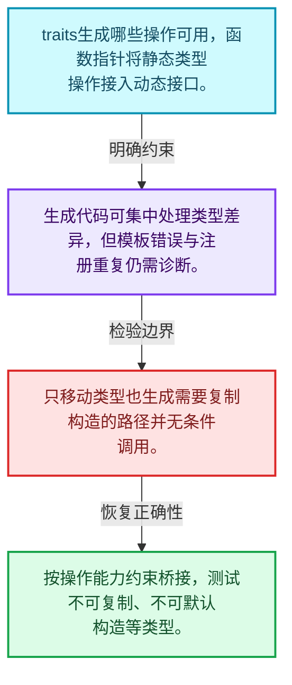
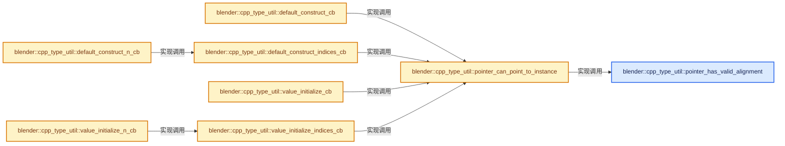
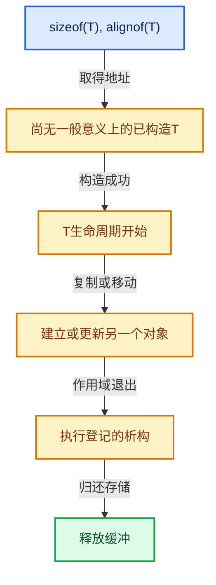

# 03-07 CPPType操作生成

[方向导航](README.md) · [总目录](../README.md) · [实现索引](../00-课程指南/02-源码与提交索引/符号依赖与实现索引.md)

## 从问题到实现

运行时操作表如何由编译期类型生成？

模板生成函数桥接，把静态类型行为填入运行期表；traits限制不支持的操作。

**数据模型**

traits生成哪些操作可用，函数指针将静态类型操作接入动态接口。

**设计取舍**

生成代码可集中处理类型差异，但模板错误与注册重复仍需诊断。

**最小反例**

只移动类型也生成需要复制构造的路径并无条件调用。

**推导**

按操作能力约束桥接，测试不可复制、不可默认构造等类型。

## 阅读地图与执行推演








图中的数值推演是本方向的教学模型；实际函数之间的调用边与概念分析边分别标注，不能把概念关系当作运行时调度顺序。

## 完整源码单元与就地讲解

中文讲解直接放在相关代码旁，复杂机制在代码下展开。原文折叠区保留基准行号；不需要在行号表和函数之间来回查找。类布局可分段展示，函数实现不按固定行数切开。

### 类型布局、声明与编译条件 · BLI_cpp_type_make.hh L1—L21

<!-- annotated:ee3a922e30bea6 -->

```cpp
/* SPDX-FileCopyrightText: 2023 Blender Authors
 *
 * SPDX-License-Identifier: GPL-2.0-or-later */

#pragma once

/** \file
 * \ingroup bli
 */

#include <sstream>

#include "BLI_cpp_type.hh"
#include "BLI_index_mask.hh"
#include "BLI_unique_hash.hh"
#include "BLI_utildefines.hh"

namespace blender {

namespace cpp_type_util {

```

<details>
<summary>核对原始源码：source/blender/blenlib/BLI_cpp_type_make.hh · L1—L21</summary>

<!-- original:ee3a922e30bea6:source/blender/blenlib/BLI_cpp_type_make.hh:1:21 -->

```cpp
/* SPDX-FileCopyrightText: 2023 Blender Authors
 *
 * SPDX-License-Identifier: GPL-2.0-or-later */

#pragma once

/** \file
 * \ingroup bli
 */

#include <sstream>

#include "BLI_cpp_type.hh"
#include "BLI_index_mask.hh"
#include "BLI_unique_hash.hh"
#include "BLI_utildefines.hh"

namespace blender {

namespace cpp_type_util {

```

</details>

<a id="f-4075fb1d2970559c"></a>

### `blender::cpp_type_util::pointer_has_valid_alignment`

实现位置：[source/blender/blenlib/BLI_cpp_type_make.hh](../../../../../source/blender/blenlib/BLI_cpp_type_make.hh) · L22—L25。

接口参数：

- `const void *ptr`

**教学注释版**

<!-- annotated:b7b40252dbd22a -->

```cpp
template<typename T> inline bool pointer_has_valid_alignment(const void *ptr)
{
  return (uintptr_t(ptr) % alignof(T)) == 0;
}
```

<details>
<summary>核对原始源码：source/blender/blenlib/BLI_cpp_type_make.hh · L22—L25</summary>

<!-- original:b7b40252dbd22a:source/blender/blenlib/BLI_cpp_type_make.hh:22:25 -->

```cpp
template<typename T> inline bool pointer_has_valid_alignment(const void *ptr)
{
  return (uintptr_t(ptr) % alignof(T)) == 0;
}
```

</details>

**结果出口**

- `return (uintptr_t(ptr) % alignof(T)) == 0;`

**继续追踪实现**

本实现没有需要继续展开的显式调用；检查返回表达式、对象转换和调用者前置条件。

<!-- annotated:b0031c609a311a -->

```cpp

```

<details>
<summary>核对原始源码：source/blender/blenlib/BLI_cpp_type_make.hh · L26—L26</summary>

<!-- original:b0031c609a311a:source/blender/blenlib/BLI_cpp_type_make.hh:26:26 -->

```cpp

```

</details>

<a id="f-a16082c3bb0a9c03"></a>

### `blender::cpp_type_util::pointer_can_point_to_instance`

实现位置：[source/blender/blenlib/BLI_cpp_type_make.hh](../../../../../source/blender/blenlib/BLI_cpp_type_make.hh) · L27—L30。

接口参数：

- `const void *ptr`

**教学注释版**

<!-- annotated:cf207467ee39f1 -->

```cpp
template<typename T> inline bool pointer_can_point_to_instance(const void *ptr)
{
  return ptr != nullptr && pointer_has_valid_alignment<T>(ptr);
}
```

<details>
<summary>核对原始源码：source/blender/blenlib/BLI_cpp_type_make.hh · L27—L30</summary>

<!-- original:cf207467ee39f1:source/blender/blenlib/BLI_cpp_type_make.hh:27:30 -->

```cpp
template<typename T> inline bool pointer_can_point_to_instance(const void *ptr)
{
  return ptr != nullptr && pointer_has_valid_alignment<T>(ptr);
}
```

</details>

**结果出口**

- `return ptr != nullptr && pointer_has_valid_alignment<T>(ptr);`

**继续追踪实现**

- `pointer_has_valid_alignment<T>` → [blender::cpp_type_util::pointer_has_valid_alignment · L22](07-CPPType操作生成.md#f-4075fb1d2970559c)。

<!-- annotated:85eccb2e5b18cb -->

```cpp

```

<details>
<summary>核对原始源码：source/blender/blenlib/BLI_cpp_type_make.hh · L31—L31</summary>

<!-- original:85eccb2e5b18cb:source/blender/blenlib/BLI_cpp_type_make.hh:31:31 -->

```cpp

```

</details>

<a id="f-5bfc25972c507619"></a>

### `blender::cpp_type_util::default_construct_cb`

实现位置：[source/blender/blenlib/BLI_cpp_type_make.hh](../../../../../source/blender/blenlib/BLI_cpp_type_make.hh) · L32—L36。

接口参数：

- `void *ptr`

**教学注释版**

<!-- annotated:a5c8dbdc379554 -->

```cpp
template<typename T> void default_construct_cb(void *ptr)
{
  BLI_assert(pointer_can_point_to_instance<T>(ptr));
  new (ptr) T;
}
```

<details>
<summary>核对原始源码：source/blender/blenlib/BLI_cpp_type_make.hh · L32—L36</summary>

<!-- original:a5c8dbdc379554:source/blender/blenlib/BLI_cpp_type_make.hh:32:36 -->

```cpp
template<typename T> void default_construct_cb(void *ptr)
{
  BLI_assert(pointer_can_point_to_instance<T>(ptr));
  new (ptr) T;
}
```

</details>

**继续追踪实现**

- `BLI_assert` → [BLI_assert · L48](../90-实现依赖专题/01-BLI基础库/BLI_assert.hh.md#m-57a88495704d)；[BLI_assert · L63](../90-实现依赖专题/01-BLI基础库/BLI_assert.hh.md#m-d07050020cb5)。宏定义由构建条件选择。
- `pointer_can_point_to_instance<T>` → [blender::cpp_type_util::pointer_can_point_to_instance · L27](07-CPPType操作生成.md#f-a16082c3bb0a9c03)。

<a id="f-c823551210e3d7ab"></a>

### `blender::cpp_type_util::default_construct_indices_cb`

实现位置：[source/blender/blenlib/BLI_cpp_type_make.hh](../../../../../source/blender/blenlib/BLI_cpp_type_make.hh) · L37—L44。

接口参数：

- `void *ptr`
- `const IndexMask &mask`

**教学注释版**

<!-- annotated:84e448056b3185 -->

```cpp
template<typename T> void default_construct_indices_cb(void *ptr, const IndexMask &mask)
{
  BLI_assert(mask.size() == 0 || pointer_can_point_to_instance<T>(ptr));
  if constexpr (std::is_trivially_constructible_v<T>) {
    return;
  }
  mask.foreach_index_optimized<int64_t>([&](int64_t i) { new (static_cast<T *>(ptr) + i) T; });
}
```

<details>
<summary>核对原始源码：source/blender/blenlib/BLI_cpp_type_make.hh · L37—L44</summary>

<!-- original:84e448056b3185:source/blender/blenlib/BLI_cpp_type_make.hh:37:44 -->

```cpp
template<typename T> void default_construct_indices_cb(void *ptr, const IndexMask &mask)
{
  BLI_assert(mask.size() == 0 || pointer_can_point_to_instance<T>(ptr));
  if constexpr (std::is_trivially_constructible_v<T>) {
    return;
  }
  mask.foreach_index_optimized<int64_t>([&](int64_t i) { new (static_cast<T *>(ptr) + i) T; });
}
```

</details>

**继续追踪实现**

- `BLI_assert` → [BLI_assert · L48](../90-实现依赖专题/01-BLI基础库/BLI_assert.hh.md#m-57a88495704d)；[BLI_assert · L63](../90-实现依赖专题/01-BLI基础库/BLI_assert.hh.md#m-d07050020cb5)。宏定义由构建条件选择。
- `mask.size` → [blender::index_mask::IndexMask::size · L743](../04-虚拟数组与索引选择/09-分段存储与遍历.md#f-0163b32abc9a0d9c)。
- `pointer_can_point_to_instance<T>` → [blender::cpp_type_util::pointer_can_point_to_instance · L27](07-CPPType操作生成.md#f-a16082c3bb0a9c03)。
- `mask.foreach_index_optimized<int64_t>` → [blender::index_mask::IndexMask::foreach_index_optimized · L937](../04-虚拟数组与索引选择/12-重构历史与基准练习.md#f-a2c3e7876407eaaf)。

<a id="f-19911a5747ab4881"></a>

### `blender::cpp_type_util::default_construct_n_cb`

实现位置：[source/blender/blenlib/BLI_cpp_type_make.hh](../../../../../source/blender/blenlib/BLI_cpp_type_make.hh) · L45—L48。

接口参数：

- `void *ptr`
- `const int64_t n`

**教学注释版**

<!-- annotated:f236fcb83c5c69 -->

```cpp
template<typename T> void default_construct_n_cb(void *ptr, const int64_t n)
{
  default_construct_indices_cb<T>(ptr, IndexMask(n));
}
```

<details>
<summary>核对原始源码：source/blender/blenlib/BLI_cpp_type_make.hh · L45—L48</summary>

<!-- original:f236fcb83c5c69:source/blender/blenlib/BLI_cpp_type_make.hh:45:48 -->

```cpp
template<typename T> void default_construct_n_cb(void *ptr, const int64_t n)
{
  default_construct_indices_cb<T>(ptr, IndexMask(n));
}
```

</details>

**继续追踪实现**

- `default_construct_indices_cb<T>` → [blender::cpp_type_util::default_construct_indices_cb · L37](07-CPPType操作生成.md#f-c823551210e3d7ab)。
- `IndexMask` → [blender::index_mask::IndexMask::IndexMask · L704](../04-虚拟数组与索引选择/09-分段存储与遍历.md#f-8c95440e4c5fec78)；[blender::index_mask::IndexMask::IndexMask · L709](../04-虚拟数组与索引选择/09-分段存储与遍历.md#f-fdd9dc18868bc0cd)；[blender::index_mask::IndexMask::IndexMask · L722](../04-虚拟数组与索引选择/09-分段存储与遍历.md#f-4b32f3ba3de66d05)。同名重载需按实参类型选择。

<!-- annotated:5e52faae1c84c3 -->

```cpp

```

<details>
<summary>核对原始源码：source/blender/blenlib/BLI_cpp_type_make.hh · L49—L49</summary>

<!-- original:5e52faae1c84c3:source/blender/blenlib/BLI_cpp_type_make.hh:49:49 -->

```cpp

```

</details>

<a id="f-fbf71db1d8ec91e8"></a>

### `blender::cpp_type_util::value_initialize_cb`

实现位置：[source/blender/blenlib/BLI_cpp_type_make.hh](../../../../../source/blender/blenlib/BLI_cpp_type_make.hh) · L50—L54。

接口参数：

- `void *ptr`

**教学注释版**

<!-- annotated:7a3a40c1894fe2 -->

```cpp
template<typename T> void value_initialize_cb(void *ptr)
{
  BLI_assert(pointer_can_point_to_instance<T>(ptr));
  new (ptr) T();
}
```

<details>
<summary>核对原始源码：source/blender/blenlib/BLI_cpp_type_make.hh · L50—L54</summary>

<!-- original:7a3a40c1894fe2:source/blender/blenlib/BLI_cpp_type_make.hh:50:54 -->

```cpp
template<typename T> void value_initialize_cb(void *ptr)
{
  BLI_assert(pointer_can_point_to_instance<T>(ptr));
  new (ptr) T();
}
```

</details>

**继续追踪实现**

- `BLI_assert` → [BLI_assert · L48](../90-实现依赖专题/01-BLI基础库/BLI_assert.hh.md#m-57a88495704d)；[BLI_assert · L63](../90-实现依赖专题/01-BLI基础库/BLI_assert.hh.md#m-d07050020cb5)。宏定义由构建条件选择。
- `pointer_can_point_to_instance<T>` → [blender::cpp_type_util::pointer_can_point_to_instance · L27](07-CPPType操作生成.md#f-a16082c3bb0a9c03)。

<a id="f-a1b220432e4e70e5"></a>

### `blender::cpp_type_util::value_initialize_indices_cb`

实现位置：[source/blender/blenlib/BLI_cpp_type_make.hh](../../../../../source/blender/blenlib/BLI_cpp_type_make.hh) · L55—L59。

接口参数：

- `void *ptr`
- `const IndexMask &mask`

**教学注释版**

<!-- annotated:cba6d9acd8fdd2 -->

```cpp
template<typename T> void value_initialize_indices_cb(void *ptr, const IndexMask &mask)
{
  BLI_assert(mask.size() == 0 || pointer_can_point_to_instance<T>(ptr));
  mask.foreach_index_optimized<int64_t>([&](int64_t i) { new (static_cast<T *>(ptr) + i) T(); });
}
```

<details>
<summary>核对原始源码：source/blender/blenlib/BLI_cpp_type_make.hh · L55—L59</summary>

<!-- original:cba6d9acd8fdd2:source/blender/blenlib/BLI_cpp_type_make.hh:55:59 -->

```cpp
template<typename T> void value_initialize_indices_cb(void *ptr, const IndexMask &mask)
{
  BLI_assert(mask.size() == 0 || pointer_can_point_to_instance<T>(ptr));
  mask.foreach_index_optimized<int64_t>([&](int64_t i) { new (static_cast<T *>(ptr) + i) T(); });
}
```

</details>

**继续追踪实现**

- `BLI_assert` → [BLI_assert · L48](../90-实现依赖专题/01-BLI基础库/BLI_assert.hh.md#m-57a88495704d)；[BLI_assert · L63](../90-实现依赖专题/01-BLI基础库/BLI_assert.hh.md#m-d07050020cb5)。宏定义由构建条件选择。
- `mask.size` → [blender::index_mask::IndexMask::size · L743](../04-虚拟数组与索引选择/09-分段存储与遍历.md#f-0163b32abc9a0d9c)。
- `pointer_can_point_to_instance<T>` → [blender::cpp_type_util::pointer_can_point_to_instance · L27](07-CPPType操作生成.md#f-a16082c3bb0a9c03)。
- `mask.foreach_index_optimized<int64_t>` → [blender::index_mask::IndexMask::foreach_index_optimized · L937](../04-虚拟数组与索引选择/12-重构历史与基准练习.md#f-a2c3e7876407eaaf)。

<a id="f-2e9232529a423e1d"></a>

### `blender::cpp_type_util::value_initialize_n_cb`

实现位置：[source/blender/blenlib/BLI_cpp_type_make.hh](../../../../../source/blender/blenlib/BLI_cpp_type_make.hh) · L60—L63。

接口参数：

- `void *ptr`
- `const int64_t n`

**教学注释版**

<!-- annotated:9d660ec130e1cf -->

```cpp
template<typename T> void value_initialize_n_cb(void *ptr, const int64_t n)
{
  value_initialize_indices_cb<T>(ptr, IndexMask(n));
}
```

<details>
<summary>核对原始源码：source/blender/blenlib/BLI_cpp_type_make.hh · L60—L63</summary>

<!-- original:9d660ec130e1cf:source/blender/blenlib/BLI_cpp_type_make.hh:60:63 -->

```cpp
template<typename T> void value_initialize_n_cb(void *ptr, const int64_t n)
{
  value_initialize_indices_cb<T>(ptr, IndexMask(n));
}
```

</details>

**继续追踪实现**

- `value_initialize_indices_cb<T>` → [blender::cpp_type_util::value_initialize_indices_cb · L55](07-CPPType操作生成.md#f-a1b220432e4e70e5)。
- `IndexMask` → [blender::index_mask::IndexMask::IndexMask · L704](../04-虚拟数组与索引选择/09-分段存储与遍历.md#f-8c95440e4c5fec78)；[blender::index_mask::IndexMask::IndexMask · L709](../04-虚拟数组与索引选择/09-分段存储与遍历.md#f-fdd9dc18868bc0cd)；[blender::index_mask::IndexMask::IndexMask · L722](../04-虚拟数组与索引选择/09-分段存储与遍历.md#f-4b32f3ba3de66d05)。同名重载需按实参类型选择。

<!-- annotated:4d9cfd28866392 -->

```cpp

```

<details>
<summary>核对原始源码：source/blender/blenlib/BLI_cpp_type_make.hh · L64—L64</summary>

<!-- original:4d9cfd28866392:source/blender/blenlib/BLI_cpp_type_make.hh:64:64 -->

```cpp

```

</details>

<a id="f-ea7c336b32fedf8b"></a>

### `blender::cpp_type_util::destruct_cb`

实现位置：[source/blender/blenlib/BLI_cpp_type_make.hh](../../../../../source/blender/blenlib/BLI_cpp_type_make.hh) · L65—L69。

接口参数：

- `void *ptr`

**教学注释版**

<!-- annotated:61dbefdd0c068d -->

```cpp
template<typename T> void destruct_cb(void *ptr)
{
  BLI_assert(pointer_can_point_to_instance<T>(ptr));
  (static_cast<T *>(ptr))->~T();
}
```

<details>
<summary>核对原始源码：source/blender/blenlib/BLI_cpp_type_make.hh · L65—L69</summary>

<!-- original:61dbefdd0c068d:source/blender/blenlib/BLI_cpp_type_make.hh:65:69 -->

```cpp
template<typename T> void destruct_cb(void *ptr)
{
  BLI_assert(pointer_can_point_to_instance<T>(ptr));
  (static_cast<T *>(ptr))->~T();
}
```

</details>

**继续追踪实现**

- `BLI_assert` → [BLI_assert · L48](../90-实现依赖专题/01-BLI基础库/BLI_assert.hh.md#m-57a88495704d)；[BLI_assert · L63](../90-实现依赖专题/01-BLI基础库/BLI_assert.hh.md#m-d07050020cb5)。宏定义由构建条件选择。
- `pointer_can_point_to_instance<T>` → [blender::cpp_type_util::pointer_can_point_to_instance · L27](07-CPPType操作生成.md#f-a16082c3bb0a9c03)。
- `(static_cast<T *>(ptr))->~T` → [调用协议](../00-课程指南/01-路线与规范/模板宏与动态分派协议.md)：接收对象类型依赖auto、返回值或模板实例；不按同名猜测目标。调用位置L68。

<a id="f-9a68e5c2cc5d6d6c"></a>

### `blender::cpp_type_util::destruct_indices_cb`

实现位置：[source/blender/blenlib/BLI_cpp_type_make.hh](../../../../../source/blender/blenlib/BLI_cpp_type_make.hh) · L70—L78。

接口参数：

- `void *ptr`
- `const IndexMask &mask`

**教学注释版**

<!-- annotated:c410562a4ae837 -->

```cpp
template<typename T> void destruct_indices_cb(void *ptr, const IndexMask &mask)
{
  BLI_assert(mask.size() == 0 || pointer_can_point_to_instance<T>(ptr));
  if (std::is_trivially_destructible_v<T>) {
    return;
  }
  T *ptr_ = static_cast<T *>(ptr);
  mask.foreach_index_optimized<int64_t>([&](int64_t i) { ptr_[i].~T(); });
}
```

<details>
<summary>核对原始源码：source/blender/blenlib/BLI_cpp_type_make.hh · L70—L78</summary>

<!-- original:c410562a4ae837:source/blender/blenlib/BLI_cpp_type_make.hh:70:78 -->

```cpp
template<typename T> void destruct_indices_cb(void *ptr, const IndexMask &mask)
{
  BLI_assert(mask.size() == 0 || pointer_can_point_to_instance<T>(ptr));
  if (std::is_trivially_destructible_v<T>) {
    return;
  }
  T *ptr_ = static_cast<T *>(ptr);
  mask.foreach_index_optimized<int64_t>([&](int64_t i) { ptr_[i].~T(); });
}
```

</details>

**继续追踪实现**

- `BLI_assert` → [BLI_assert · L48](../90-实现依赖专题/01-BLI基础库/BLI_assert.hh.md#m-57a88495704d)；[BLI_assert · L63](../90-实现依赖专题/01-BLI基础库/BLI_assert.hh.md#m-d07050020cb5)。宏定义由构建条件选择。
- `mask.size` → [blender::index_mask::IndexMask::size · L743](../04-虚拟数组与索引选择/09-分段存储与遍历.md#f-0163b32abc9a0d9c)。
- `pointer_can_point_to_instance<T>` → [blender::cpp_type_util::pointer_can_point_to_instance · L27](07-CPPType操作生成.md#f-a16082c3bb0a9c03)。
- `mask.foreach_index_optimized<int64_t>` → [blender::index_mask::IndexMask::foreach_index_optimized · L937](../04-虚拟数组与索引选择/12-重构历史与基准练习.md#f-a2c3e7876407eaaf)。
- `ptr_[i].~T` → [调用协议](../00-课程指南/01-路线与规范/模板宏与动态分派协议.md)：接收对象类型依赖auto、返回值或模板实例；不按同名猜测目标。调用位置L77。

<a id="f-39ba112621685767"></a>

### `blender::cpp_type_util::destruct_n_cb`

实现位置：[source/blender/blenlib/BLI_cpp_type_make.hh](../../../../../source/blender/blenlib/BLI_cpp_type_make.hh) · L79—L82。

接口参数：

- `void *ptr`
- `const int64_t n`

**教学注释版**

<!-- annotated:2b804fbf1befad -->

```cpp
template<typename T> void destruct_n_cb(void *ptr, const int64_t n)
{
  destruct_indices_cb<T>(ptr, IndexMask(n));
}
```

<details>
<summary>核对原始源码：source/blender/blenlib/BLI_cpp_type_make.hh · L79—L82</summary>

<!-- original:2b804fbf1befad:source/blender/blenlib/BLI_cpp_type_make.hh:79:82 -->

```cpp
template<typename T> void destruct_n_cb(void *ptr, const int64_t n)
{
  destruct_indices_cb<T>(ptr, IndexMask(n));
}
```

</details>

**继续追踪实现**

- `destruct_indices_cb<T>` → [blender::cpp_type_util::destruct_indices_cb · L70](07-CPPType操作生成.md#f-9a68e5c2cc5d6d6c)。
- `IndexMask` → [blender::index_mask::IndexMask::IndexMask · L704](../04-虚拟数组与索引选择/09-分段存储与遍历.md#f-8c95440e4c5fec78)；[blender::index_mask::IndexMask::IndexMask · L709](../04-虚拟数组与索引选择/09-分段存储与遍历.md#f-fdd9dc18868bc0cd)；[blender::index_mask::IndexMask::IndexMask · L722](../04-虚拟数组与索引选择/09-分段存储与遍历.md#f-4b32f3ba3de66d05)。同名重载需按实参类型选择。

<!-- annotated:ad48cc407656a3 -->

```cpp

```

<details>
<summary>核对原始源码：source/blender/blenlib/BLI_cpp_type_make.hh · L83—L83</summary>

<!-- original:ad48cc407656a3:source/blender/blenlib/BLI_cpp_type_make.hh:83:83 -->

```cpp

```

</details>

<a id="f-1f7d2d1d2b8f3913"></a>

### `blender::cpp_type_util::copy_assign_cb`

实现位置：[source/blender/blenlib/BLI_cpp_type_make.hh](../../../../../source/blender/blenlib/BLI_cpp_type_make.hh) · L84—L89。

接口参数：

- `const void *src`
- `void *dst`

**教学注释版**

<!-- annotated:d2fcea4cd62c5d -->

```cpp
template<typename T> void copy_assign_cb(const void *src, void *dst)
{
  BLI_assert(pointer_can_point_to_instance<T>(src));
  BLI_assert(pointer_can_point_to_instance<T>(dst));
  *static_cast<T *>(dst) = *static_cast<const T *>(src);
}
```

<details>
<summary>核对原始源码：source/blender/blenlib/BLI_cpp_type_make.hh · L84—L89</summary>

<!-- original:d2fcea4cd62c5d:source/blender/blenlib/BLI_cpp_type_make.hh:84:89 -->

```cpp
template<typename T> void copy_assign_cb(const void *src, void *dst)
{
  BLI_assert(pointer_can_point_to_instance<T>(src));
  BLI_assert(pointer_can_point_to_instance<T>(dst));
  *static_cast<T *>(dst) = *static_cast<const T *>(src);
}
```

</details>

**继续追踪实现**

- `BLI_assert` → [BLI_assert · L48](../90-实现依赖专题/01-BLI基础库/BLI_assert.hh.md#m-57a88495704d)；[BLI_assert · L63](../90-实现依赖专题/01-BLI基础库/BLI_assert.hh.md#m-d07050020cb5)。宏定义由构建条件选择。
- `pointer_can_point_to_instance<T>` → [blender::cpp_type_util::pointer_can_point_to_instance · L27](07-CPPType操作生成.md#f-a16082c3bb0a9c03)。

<a id="f-50a67c11c233b6cf"></a>

### `blender::cpp_type_util::copy_assign_indices_cb`

实现位置：[source/blender/blenlib/BLI_cpp_type_make.hh](../../../../../source/blender/blenlib/BLI_cpp_type_make.hh) · L90—L103。

接口参数：

- `const void *src`
- `void *dst`
- `const IndexMask &mask`

**教学注释版**

<!-- annotated:6571ccf6d6b324 -->

```cpp
template<typename T> void copy_assign_indices_cb(const void *src, void *dst, const IndexMask &mask)
{
  BLI_assert(mask.size() == 0 || src != dst);
  BLI_assert(mask.size() == 0 || pointer_can_point_to_instance<T>(src));
  BLI_assert(mask.size() == 0 || pointer_can_point_to_instance<T>(dst));
  if constexpr (std::is_trivially_copy_assignable_v<T>) {
    index_mask::detail::copy_assign(static_cast<const T *>(src), mask, static_cast<T *>(dst));
  }
  else {
    const T *src_ = static_cast<const T *>(src);
    T *dst_ = static_cast<T *>(dst);
    mask.foreach_index([&](int64_t i) { dst_[i] = src_[i]; });
  }
}
```

<details>
<summary>核对原始源码：source/blender/blenlib/BLI_cpp_type_make.hh · L90—L103</summary>

<!-- original:6571ccf6d6b324:source/blender/blenlib/BLI_cpp_type_make.hh:90:103 -->

```cpp
template<typename T> void copy_assign_indices_cb(const void *src, void *dst, const IndexMask &mask)
{
  BLI_assert(mask.size() == 0 || src != dst);
  BLI_assert(mask.size() == 0 || pointer_can_point_to_instance<T>(src));
  BLI_assert(mask.size() == 0 || pointer_can_point_to_instance<T>(dst));
  if constexpr (std::is_trivially_copy_assignable_v<T>) {
    index_mask::detail::copy_assign(static_cast<const T *>(src), mask, static_cast<T *>(dst));
  }
  else {
    const T *src_ = static_cast<const T *>(src);
    T *dst_ = static_cast<T *>(dst);
    mask.foreach_index([&](int64_t i) { dst_[i] = src_[i]; });
  }
}
```

</details>

**继续追踪实现**

- `BLI_assert` → [BLI_assert · L48](../90-实现依赖专题/01-BLI基础库/BLI_assert.hh.md#m-57a88495704d)；[BLI_assert · L63](../90-实现依赖专题/01-BLI基础库/BLI_assert.hh.md#m-d07050020cb5)。宏定义由构建条件选择。
- `mask.size` → [blender::index_mask::IndexMask::size · L743](../04-虚拟数组与索引选择/09-分段存储与遍历.md#f-0163b32abc9a0d9c)。
- `pointer_can_point_to_instance<T>` → [blender::cpp_type_util::pointer_can_point_to_instance · L27](07-CPPType操作生成.md#f-a16082c3bb0a9c03)。
- `index_mask::detail::copy_assign` → [blender::index_mask::detail::copy_assign · L1231](../04-虚拟数组与索引选择/12-重构历史与基准练习.md#f-be4df34f277f2f95)。
- `mask.foreach_index` → [blender::index_mask::IndexMask::foreach_index · L855](../04-虚拟数组与索引选择/09-分段存储与遍历.md#f-cd6cd317e2e2812c)。

<a id="f-0cc5488d98da1bdf"></a>

### `blender::cpp_type_util::copy_assign_n_cb`

实现位置：[source/blender/blenlib/BLI_cpp_type_make.hh](../../../../../source/blender/blenlib/BLI_cpp_type_make.hh) · L104—L107。

接口参数：

- `const void *src`
- `void *dst`
- `const int64_t n`

**教学注释版**

<!-- annotated:2733ca462ed88c -->

```cpp
template<typename T> void copy_assign_n_cb(const void *src, void *dst, const int64_t n)
{
  copy_assign_indices_cb<T>(src, dst, IndexMask(n));
}
```

<details>
<summary>核对原始源码：source/blender/blenlib/BLI_cpp_type_make.hh · L104—L107</summary>

<!-- original:2733ca462ed88c:source/blender/blenlib/BLI_cpp_type_make.hh:104:107 -->

```cpp
template<typename T> void copy_assign_n_cb(const void *src, void *dst, const int64_t n)
{
  copy_assign_indices_cb<T>(src, dst, IndexMask(n));
}
```

</details>

**继续追踪实现**

- `copy_assign_indices_cb<T>` → [blender::cpp_type_util::copy_assign_indices_cb · L90](07-CPPType操作生成.md#f-50a67c11c233b6cf)。
- `IndexMask` → [blender::index_mask::IndexMask::IndexMask · L704](../04-虚拟数组与索引选择/09-分段存储与遍历.md#f-8c95440e4c5fec78)；[blender::index_mask::IndexMask::IndexMask · L709](../04-虚拟数组与索引选择/09-分段存储与遍历.md#f-fdd9dc18868bc0cd)；[blender::index_mask::IndexMask::IndexMask · L722](../04-虚拟数组与索引选择/09-分段存储与遍历.md#f-4b32f3ba3de66d05)。同名重载需按实参类型选择。

<a id="f-d4337d09fd76201c"></a>

### `blender::cpp_type_util::copy_assign_compressed_cb`

实现位置：[source/blender/blenlib/BLI_cpp_type_make.hh](../../../../../source/blender/blenlib/BLI_cpp_type_make.hh) · L108—L122。

接口参数：

- `const void *src`
- `void *dst`
- `const IndexMask &mask`

**教学注释版**

<!-- annotated:2937ee9937c1d2 -->

```cpp
template<typename T>
void copy_assign_compressed_cb(const void *src, void *dst, const IndexMask &mask)
{
  BLI_assert(mask.size() == 0 || src != dst);
  BLI_assert(mask.size() == 0 || pointer_can_point_to_instance<T>(src));
  BLI_assert(mask.size() == 0 || pointer_can_point_to_instance<T>(dst));
  if constexpr (std::is_trivially_copy_assignable_v<T>) {
    index_mask::detail::gather_assign(static_cast<const T *>(src), mask, static_cast<T *>(dst));
  }
  else {
    const T *src_ = static_cast<const T *>(src);
    T *dst_ = static_cast<T *>(dst);
    mask.foreach_index([&](const int64_t i, const int64_t pos) { dst_[pos] = src_[i]; });
  }
}
```

<details>
<summary>核对原始源码：source/blender/blenlib/BLI_cpp_type_make.hh · L108—L122</summary>

<!-- original:2937ee9937c1d2:source/blender/blenlib/BLI_cpp_type_make.hh:108:122 -->

```cpp
template<typename T>
void copy_assign_compressed_cb(const void *src, void *dst, const IndexMask &mask)
{
  BLI_assert(mask.size() == 0 || src != dst);
  BLI_assert(mask.size() == 0 || pointer_can_point_to_instance<T>(src));
  BLI_assert(mask.size() == 0 || pointer_can_point_to_instance<T>(dst));
  if constexpr (std::is_trivially_copy_assignable_v<T>) {
    index_mask::detail::gather_assign(static_cast<const T *>(src), mask, static_cast<T *>(dst));
  }
  else {
    const T *src_ = static_cast<const T *>(src);
    T *dst_ = static_cast<T *>(dst);
    mask.foreach_index([&](const int64_t i, const int64_t pos) { dst_[pos] = src_[i]; });
  }
}
```

</details>

**继续追踪实现**

- `BLI_assert` → [BLI_assert · L48](../90-实现依赖专题/01-BLI基础库/BLI_assert.hh.md#m-57a88495704d)；[BLI_assert · L63](../90-实现依赖专题/01-BLI基础库/BLI_assert.hh.md#m-d07050020cb5)。宏定义由构建条件选择。
- `mask.size` → [blender::index_mask::IndexMask::size · L743](../04-虚拟数组与索引选择/09-分段存储与遍历.md#f-0163b32abc9a0d9c)。
- `pointer_can_point_to_instance<T>` → [blender::cpp_type_util::pointer_can_point_to_instance · L27](07-CPPType操作生成.md#f-a16082c3bb0a9c03)。
- `index_mask::detail::gather_assign` → [blender::index_mask::detail::gather_assign · L1239](../04-虚拟数组与索引选择/12-重构历史与基准练习.md#f-6ca85cf84b731900)。
- `mask.foreach_index` → [blender::index_mask::IndexMask::foreach_index · L855](../04-虚拟数组与索引选择/09-分段存储与遍历.md#f-cd6cd317e2e2812c)。

<!-- annotated:00fc4eff368c9e -->

```cpp

```

<details>
<summary>核对原始源码：source/blender/blenlib/BLI_cpp_type_make.hh · L123—L123</summary>

<!-- original:00fc4eff368c9e:source/blender/blenlib/BLI_cpp_type_make.hh:123:123 -->

```cpp

```

</details>

<a id="f-3b3b784c1d13b4dd"></a>

### `blender::cpp_type_util::copy_construct_cb`

实现位置：[source/blender/blenlib/BLI_cpp_type_make.hh](../../../../../source/blender/blenlib/BLI_cpp_type_make.hh) · L124—L130。

接口参数：

- `const void *src`
- `void *dst`

**教学注释版**

<!-- annotated:7fc43a982621c7 -->

```cpp
template<typename T> void copy_construct_cb(const void *src, void *dst)
{
  BLI_assert(src != dst || std::is_trivially_copy_constructible_v<T>);
  BLI_assert(pointer_can_point_to_instance<T>(src));
  BLI_assert(pointer_can_point_to_instance<T>(dst));
  uninitialized_copy_n(static_cast<const T *>(src), 1, static_cast<T *>(dst));
}
```

<details>
<summary>核对原始源码：source/blender/blenlib/BLI_cpp_type_make.hh · L124—L130</summary>

<!-- original:7fc43a982621c7:source/blender/blenlib/BLI_cpp_type_make.hh:124:130 -->

```cpp
template<typename T> void copy_construct_cb(const void *src, void *dst)
{
  BLI_assert(src != dst || std::is_trivially_copy_constructible_v<T>);
  BLI_assert(pointer_can_point_to_instance<T>(src));
  BLI_assert(pointer_can_point_to_instance<T>(dst));
  uninitialized_copy_n(static_cast<const T *>(src), 1, static_cast<T *>(dst));
}
```

</details>

**继续追踪实现**

- `BLI_assert` → [BLI_assert · L48](../90-实现依赖专题/01-BLI基础库/BLI_assert.hh.md#m-57a88495704d)；[BLI_assert · L63](../90-实现依赖专题/01-BLI基础库/BLI_assert.hh.md#m-d07050020cb5)。宏定义由构建条件选择。
- `pointer_can_point_to_instance<T>` → [blender::cpp_type_util::pointer_can_point_to_instance · L27](07-CPPType操作生成.md#f-a16082c3bb0a9c03)。
- `uninitialized_copy_n` → [blender::uninitialized_copy_n · L53](../01-基础容器与现代CPP/01-对象生命周期与值类别.md#f-6cd63ebede164cd2)。

<a id="f-8d8eca8145e2a55b"></a>

### `blender::cpp_type_util::copy_construct_indices_cb`

实现位置：[source/blender/blenlib/BLI_cpp_type_make.hh](../../../../../source/blender/blenlib/BLI_cpp_type_make.hh) · L131—L141。

接口参数：

- `const void *src`
- `void *dst`
- `const IndexMask &mask`

**教学注释版**

<!-- annotated:47fdb7cbfb59ec -->

```cpp
template<typename T>
void copy_construct_indices_cb(const void *src, void *dst, const IndexMask &mask)
{
  BLI_assert(mask.size() == 0 || src != dst);
  BLI_assert(mask.size() == 0 || pointer_can_point_to_instance<T>(src));
  BLI_assert(mask.size() == 0 || pointer_can_point_to_instance<T>(dst));
  const T *src_ = static_cast<const T *>(src);
  T *dst_ = static_cast<T *>(dst);

  mask.foreach_index_optimized<int64_t>([&](int64_t i) { new (dst_ + i) T(src_[i]); });
}
```

<details>
<summary>核对原始源码：source/blender/blenlib/BLI_cpp_type_make.hh · L131—L141</summary>

<!-- original:47fdb7cbfb59ec:source/blender/blenlib/BLI_cpp_type_make.hh:131:141 -->

```cpp
template<typename T>
void copy_construct_indices_cb(const void *src, void *dst, const IndexMask &mask)
{
  BLI_assert(mask.size() == 0 || src != dst);
  BLI_assert(mask.size() == 0 || pointer_can_point_to_instance<T>(src));
  BLI_assert(mask.size() == 0 || pointer_can_point_to_instance<T>(dst));
  const T *src_ = static_cast<const T *>(src);
  T *dst_ = static_cast<T *>(dst);

  mask.foreach_index_optimized<int64_t>([&](int64_t i) { new (dst_ + i) T(src_[i]); });
}
```

</details>

**继续追踪实现**

- `BLI_assert` → [BLI_assert · L48](../90-实现依赖专题/01-BLI基础库/BLI_assert.hh.md#m-57a88495704d)；[BLI_assert · L63](../90-实现依赖专题/01-BLI基础库/BLI_assert.hh.md#m-d07050020cb5)。宏定义由构建条件选择。
- `mask.size` → [blender::index_mask::IndexMask::size · L743](../04-虚拟数组与索引选择/09-分段存储与遍历.md#f-0163b32abc9a0d9c)。
- `pointer_can_point_to_instance<T>` → [blender::cpp_type_util::pointer_can_point_to_instance · L27](07-CPPType操作生成.md#f-a16082c3bb0a9c03)。
- `mask.foreach_index_optimized<int64_t>` → [blender::index_mask::IndexMask::foreach_index_optimized · L937](../04-虚拟数组与索引选择/12-重构历史与基准练习.md#f-a2c3e7876407eaaf)。

<a id="f-2c4c9abe95154a8a"></a>

### `blender::cpp_type_util::copy_construct_n_cb`

实现位置：[source/blender/blenlib/BLI_cpp_type_make.hh](../../../../../source/blender/blenlib/BLI_cpp_type_make.hh) · L142—L145。

接口参数：

- `const void *src`
- `void *dst`
- `const int64_t n`

**教学注释版**

<!-- annotated:b41951a802b5bf -->

```cpp
template<typename T> void copy_construct_n_cb(const void *src, void *dst, const int64_t n)
{
  copy_construct_indices_cb<T>(src, dst, IndexMask(n));
}
```

<details>
<summary>核对原始源码：source/blender/blenlib/BLI_cpp_type_make.hh · L142—L145</summary>

<!-- original:b41951a802b5bf:source/blender/blenlib/BLI_cpp_type_make.hh:142:145 -->

```cpp
template<typename T> void copy_construct_n_cb(const void *src, void *dst, const int64_t n)
{
  copy_construct_indices_cb<T>(src, dst, IndexMask(n));
}
```

</details>

**继续追踪实现**

- `copy_construct_indices_cb<T>` → [blender::cpp_type_util::copy_construct_indices_cb · L131](07-CPPType操作生成.md#f-8d8eca8145e2a55b)。
- `IndexMask` → [blender::index_mask::IndexMask::IndexMask · L704](../04-虚拟数组与索引选择/09-分段存储与遍历.md#f-8c95440e4c5fec78)；[blender::index_mask::IndexMask::IndexMask · L709](../04-虚拟数组与索引选择/09-分段存储与遍历.md#f-fdd9dc18868bc0cd)；[blender::index_mask::IndexMask::IndexMask · L722](../04-虚拟数组与索引选择/09-分段存储与遍历.md#f-4b32f3ba3de66d05)。同名重载需按实参类型选择。

<a id="f-91288d6214b4fa60"></a>

### `blender::cpp_type_util::copy_construct_compressed_cb`

实现位置：[source/blender/blenlib/BLI_cpp_type_make.hh](../../../../../source/blender/blenlib/BLI_cpp_type_make.hh) · L146—L157。

接口参数：

- `const void *src`
- `void *dst`
- `const IndexMask &mask`

**教学注释版**

<!-- annotated:e4c35e04c8dca4 -->

```cpp
template<typename T>
void copy_construct_compressed_cb(const void *src, void *dst, const IndexMask &mask)
{
  BLI_assert(mask.size() == 0 || src != dst);
  BLI_assert(mask.size() == 0 || pointer_can_point_to_instance<T>(src));
  BLI_assert(mask.size() == 0 || pointer_can_point_to_instance<T>(dst));
  const T *src_ = static_cast<const T *>(src);
  T *dst_ = static_cast<T *>(dst);

  mask.foreach_index_optimized<int64_t>(
      [&](const int64_t i, const int64_t pos) { new (dst_ + pos) T(src_[i]); });
}
```

<details>
<summary>核对原始源码：source/blender/blenlib/BLI_cpp_type_make.hh · L146—L157</summary>

<!-- original:e4c35e04c8dca4:source/blender/blenlib/BLI_cpp_type_make.hh:146:157 -->

```cpp
template<typename T>
void copy_construct_compressed_cb(const void *src, void *dst, const IndexMask &mask)
{
  BLI_assert(mask.size() == 0 || src != dst);
  BLI_assert(mask.size() == 0 || pointer_can_point_to_instance<T>(src));
  BLI_assert(mask.size() == 0 || pointer_can_point_to_instance<T>(dst));
  const T *src_ = static_cast<const T *>(src);
  T *dst_ = static_cast<T *>(dst);

  mask.foreach_index_optimized<int64_t>(
      [&](const int64_t i, const int64_t pos) { new (dst_ + pos) T(src_[i]); });
}
```

</details>

**继续追踪实现**

- `BLI_assert` → [BLI_assert · L48](../90-实现依赖专题/01-BLI基础库/BLI_assert.hh.md#m-57a88495704d)；[BLI_assert · L63](../90-实现依赖专题/01-BLI基础库/BLI_assert.hh.md#m-d07050020cb5)。宏定义由构建条件选择。
- `mask.size` → [blender::index_mask::IndexMask::size · L743](../04-虚拟数组与索引选择/09-分段存储与遍历.md#f-0163b32abc9a0d9c)。
- `pointer_can_point_to_instance<T>` → [blender::cpp_type_util::pointer_can_point_to_instance · L27](07-CPPType操作生成.md#f-a16082c3bb0a9c03)。
- `mask.foreach_index_optimized<int64_t>` → [blender::index_mask::IndexMask::foreach_index_optimized · L937](../04-虚拟数组与索引选择/12-重构历史与基准练习.md#f-a2c3e7876407eaaf)。

<!-- annotated:3e0f3acc88ce12 -->

```cpp

```

<details>
<summary>核对原始源码：source/blender/blenlib/BLI_cpp_type_make.hh · L158—L158</summary>

<!-- original:3e0f3acc88ce12:source/blender/blenlib/BLI_cpp_type_make.hh:158:158 -->

```cpp

```

</details>

<a id="f-93c917793cc79887"></a>

### `blender::cpp_type_util::move_assign_cb`

实现位置：[source/blender/blenlib/BLI_cpp_type_make.hh](../../../../../source/blender/blenlib/BLI_cpp_type_make.hh) · L159—L164。

接口参数：

- `void *src`
- `void *dst`

**教学注释版**

<!-- annotated:6c51260760e012 -->

```cpp
template<typename T> void move_assign_cb(void *src, void *dst)
{
  BLI_assert(pointer_can_point_to_instance<T>(src));
  BLI_assert(pointer_can_point_to_instance<T>(dst));
  initialized_move_n(static_cast<T *>(src), 1, static_cast<T *>(dst));
}
```

<details>
<summary>核对原始源码：source/blender/blenlib/BLI_cpp_type_make.hh · L159—L164</summary>

<!-- original:6c51260760e012:source/blender/blenlib/BLI_cpp_type_make.hh:159:164 -->

```cpp
template<typename T> void move_assign_cb(void *src, void *dst)
{
  BLI_assert(pointer_can_point_to_instance<T>(src));
  BLI_assert(pointer_can_point_to_instance<T>(dst));
  initialized_move_n(static_cast<T *>(src), 1, static_cast<T *>(dst));
}
```

</details>

**继续追踪实现**

- `BLI_assert` → [BLI_assert · L48](../90-实现依赖专题/01-BLI基础库/BLI_assert.hh.md#m-57a88495704d)；[BLI_assert · L63](../90-实现依赖专题/01-BLI基础库/BLI_assert.hh.md#m-d07050020cb5)。宏定义由构建条件选择。
- `pointer_can_point_to_instance<T>` → [blender::cpp_type_util::pointer_can_point_to_instance · L27](07-CPPType操作生成.md#f-a16082c3bb0a9c03)。
- `initialized_move_n` → [blender::initialized_move_n · L64](../01-基础容器与现代CPP/01-对象生命周期与值类别.md#f-328a89f173c24880)。

<a id="f-bfcaf0e5a0d48110"></a>

### `blender::cpp_type_util::move_assign_indices_cb`

实现位置：[source/blender/blenlib/BLI_cpp_type_make.hh](../../../../../source/blender/blenlib/BLI_cpp_type_make.hh) · L165—L174。

接口参数：

- `void *src`
- `void *dst`
- `const IndexMask &mask`

**教学注释版**

<!-- annotated:0c5dac5859ce3a -->

```cpp
template<typename T> void move_assign_indices_cb(void *src, void *dst, const IndexMask &mask)
{
  BLI_assert(mask.size() == 0 || src != dst);
  BLI_assert(mask.size() == 0 || pointer_can_point_to_instance<T>(src));
  BLI_assert(mask.size() == 0 || pointer_can_point_to_instance<T>(dst));
  T *src_ = static_cast<T *>(src);
  T *dst_ = static_cast<T *>(dst);

  // [讲解] std::move：把表达式转换成可供移动重载选择的值类别；不保证真的移动，不结束源对象寿命，对const值可能选择复制。
  mask.foreach_index_optimized<int64_t>([&](int64_t i) { dst_[i] = std::move(src_[i]); });
}
```

<details>
<summary>核对原始源码：source/blender/blenlib/BLI_cpp_type_make.hh · L165—L174</summary>

<!-- original:0c5dac5859ce3a:source/blender/blenlib/BLI_cpp_type_make.hh:165:174 -->

```cpp
template<typename T> void move_assign_indices_cb(void *src, void *dst, const IndexMask &mask)
{
  BLI_assert(mask.size() == 0 || src != dst);
  BLI_assert(mask.size() == 0 || pointer_can_point_to_instance<T>(src));
  BLI_assert(mask.size() == 0 || pointer_can_point_to_instance<T>(dst));
  T *src_ = static_cast<T *>(src);
  T *dst_ = static_cast<T *>(dst);

  mask.foreach_index_optimized<int64_t>([&](int64_t i) { dst_[i] = std::move(src_[i]); });
}
```

</details>

**继续追踪实现**

- `BLI_assert` → [BLI_assert · L48](../90-实现依赖专题/01-BLI基础库/BLI_assert.hh.md#m-57a88495704d)；[BLI_assert · L63](../90-实现依赖专题/01-BLI基础库/BLI_assert.hh.md#m-d07050020cb5)。宏定义由构建条件选择。
- `mask.size` → [blender::index_mask::IndexMask::size · L743](../04-虚拟数组与索引选择/09-分段存储与遍历.md#f-0163b32abc9a0d9c)。
- `pointer_can_point_to_instance<T>` → [blender::cpp_type_util::pointer_can_point_to_instance · L27](07-CPPType操作生成.md#f-a16082c3bb0a9c03)。
- `mask.foreach_index_optimized<int64_t>` → [blender::index_mask::IndexMask::foreach_index_optimized · L937](../04-虚拟数组与索引选择/12-重构历史与基准练习.md#f-a2c3e7876407eaaf)。
- `std::move` → [外部契约](https://eel.is/c++draft/utility.forward)：把表达式转换成可供移动重载选择的值类别；不保证真的移动，不结束源对象寿命，对const值可能选择复制。

<a id="f-4c59c04a30a21f5c"></a>

### `blender::cpp_type_util::move_assign_n_cb`

实现位置：[source/blender/blenlib/BLI_cpp_type_make.hh](../../../../../source/blender/blenlib/BLI_cpp_type_make.hh) · L175—L178。

接口参数：

- `void *src`
- `void *dst`
- `const int64_t n`

**教学注释版**

<!-- annotated:f9f0865f2743b1 -->

```cpp
template<typename T> void move_assign_n_cb(void *src, void *dst, const int64_t n)
{
  move_assign_indices_cb<T>(src, dst, IndexMask(n));
}
```

<details>
<summary>核对原始源码：source/blender/blenlib/BLI_cpp_type_make.hh · L175—L178</summary>

<!-- original:f9f0865f2743b1:source/blender/blenlib/BLI_cpp_type_make.hh:175:178 -->

```cpp
template<typename T> void move_assign_n_cb(void *src, void *dst, const int64_t n)
{
  move_assign_indices_cb<T>(src, dst, IndexMask(n));
}
```

</details>

**继续追踪实现**

- `move_assign_indices_cb<T>` → [blender::cpp_type_util::move_assign_indices_cb · L165](07-CPPType操作生成.md#f-bfcaf0e5a0d48110)。
- `IndexMask` → [blender::index_mask::IndexMask::IndexMask · L704](../04-虚拟数组与索引选择/09-分段存储与遍历.md#f-8c95440e4c5fec78)；[blender::index_mask::IndexMask::IndexMask · L709](../04-虚拟数组与索引选择/09-分段存储与遍历.md#f-fdd9dc18868bc0cd)；[blender::index_mask::IndexMask::IndexMask · L722](../04-虚拟数组与索引选择/09-分段存储与遍历.md#f-4b32f3ba3de66d05)。同名重载需按实参类型选择。

<!-- annotated:a7c93dda417bf5 -->

```cpp

```

<details>
<summary>核对原始源码：source/blender/blenlib/BLI_cpp_type_make.hh · L179—L179</summary>

<!-- original:a7c93dda417bf5:source/blender/blenlib/BLI_cpp_type_make.hh:179:179 -->

```cpp

```

</details>

<a id="f-bd7cea66f070daac"></a>

### `blender::cpp_type_util::move_construct_cb`

实现位置：[source/blender/blenlib/BLI_cpp_type_make.hh](../../../../../source/blender/blenlib/BLI_cpp_type_make.hh) · L180—L187。

接口参数：

- `void *src`
- `void *dst`

**教学注释版**

<!-- annotated:3b273529a359b9 -->

```cpp
template<typename T> void move_construct_cb(void *src, void *dst)
{
  BLI_assert(src != dst || std::is_trivially_move_constructible_v<T>);
  BLI_assert(pointer_can_point_to_instance<T>(src));
  BLI_assert(pointer_can_point_to_instance<T>(dst));

  // [讲解] uninitialized_move_n：通过移动迭代器驱动标准未初始化复制算法，实现目标移动构造。
  uninitialized_move_n(static_cast<T *>(src), 1, static_cast<T *>(dst));
}
```

<details>
<summary>核对原始源码：source/blender/blenlib/BLI_cpp_type_make.hh · L180—L187</summary>

<!-- original:3b273529a359b9:source/blender/blenlib/BLI_cpp_type_make.hh:180:187 -->

```cpp
template<typename T> void move_construct_cb(void *src, void *dst)
{
  BLI_assert(src != dst || std::is_trivially_move_constructible_v<T>);
  BLI_assert(pointer_can_point_to_instance<T>(src));
  BLI_assert(pointer_can_point_to_instance<T>(dst));

  uninitialized_move_n(static_cast<T *>(src), 1, static_cast<T *>(dst));
}
```

</details>

**继续追踪实现**

- `BLI_assert` → [BLI_assert · L48](../90-实现依赖专题/01-BLI基础库/BLI_assert.hh.md#m-57a88495704d)；[BLI_assert · L63](../90-实现依赖专题/01-BLI基础库/BLI_assert.hh.md#m-d07050020cb5)。宏定义由构建条件选择。
- `pointer_can_point_to_instance<T>` → [blender::cpp_type_util::pointer_can_point_to_instance · L27](07-CPPType操作生成.md#f-a16082c3bb0a9c03)。
- `uninitialized_move_n` → [blender::uninitialized_move_n · L69](../01-基础容器与现代CPP/01-对象生命周期与值类别.md#f-fc5f51bf717c3b5a)。

<a id="f-1f77b4b6f194e1ec"></a>

### `blender::cpp_type_util::move_construct_indices_cb`

实现位置：[source/blender/blenlib/BLI_cpp_type_make.hh](../../../../../source/blender/blenlib/BLI_cpp_type_make.hh) · L188—L197。

接口参数：

- `void *src`
- `void *dst`
- `const IndexMask &mask`

**教学注释版**

<!-- annotated:89c4d1bae99f1f -->

```cpp
template<typename T> void move_construct_indices_cb(void *src, void *dst, const IndexMask &mask)
{
  BLI_assert(mask.size() == 0 || src != dst);
  BLI_assert(mask.size() == 0 || pointer_can_point_to_instance<T>(src));
  BLI_assert(mask.size() == 0 || pointer_can_point_to_instance<T>(dst));
  T *src_ = static_cast<T *>(src);
  T *dst_ = static_cast<T *>(dst);

  // [讲解] std::move：把表达式转换成可供移动重载选择的值类别；不保证真的移动，不结束源对象寿命，对const值可能选择复制。
  mask.foreach_index_optimized<int64_t>([&](int64_t i) { new (dst_ + i) T(std::move(src_[i])); });
}
```

<details>
<summary>核对原始源码：source/blender/blenlib/BLI_cpp_type_make.hh · L188—L197</summary>

<!-- original:89c4d1bae99f1f:source/blender/blenlib/BLI_cpp_type_make.hh:188:197 -->

```cpp
template<typename T> void move_construct_indices_cb(void *src, void *dst, const IndexMask &mask)
{
  BLI_assert(mask.size() == 0 || src != dst);
  BLI_assert(mask.size() == 0 || pointer_can_point_to_instance<T>(src));
  BLI_assert(mask.size() == 0 || pointer_can_point_to_instance<T>(dst));
  T *src_ = static_cast<T *>(src);
  T *dst_ = static_cast<T *>(dst);

  mask.foreach_index_optimized<int64_t>([&](int64_t i) { new (dst_ + i) T(std::move(src_[i])); });
}
```

</details>

**继续追踪实现**

- `BLI_assert` → [BLI_assert · L48](../90-实现依赖专题/01-BLI基础库/BLI_assert.hh.md#m-57a88495704d)；[BLI_assert · L63](../90-实现依赖专题/01-BLI基础库/BLI_assert.hh.md#m-d07050020cb5)。宏定义由构建条件选择。
- `mask.size` → [blender::index_mask::IndexMask::size · L743](../04-虚拟数组与索引选择/09-分段存储与遍历.md#f-0163b32abc9a0d9c)。
- `pointer_can_point_to_instance<T>` → [blender::cpp_type_util::pointer_can_point_to_instance · L27](07-CPPType操作生成.md#f-a16082c3bb0a9c03)。
- `mask.foreach_index_optimized<int64_t>` → [blender::index_mask::IndexMask::foreach_index_optimized · L937](../04-虚拟数组与索引选择/12-重构历史与基准练习.md#f-a2c3e7876407eaaf)。
- `std::move` → [外部契约](https://eel.is/c++draft/utility.forward)：把表达式转换成可供移动重载选择的值类别；不保证真的移动，不结束源对象寿命，对const值可能选择复制。

<a id="f-de741a53f10ba379"></a>

### `blender::cpp_type_util::move_construct_n_cb`

实现位置：[source/blender/blenlib/BLI_cpp_type_make.hh](../../../../../source/blender/blenlib/BLI_cpp_type_make.hh) · L198—L201。

接口参数：

- `void *src`
- `void *dst`
- `const int64_t n`

**教学注释版**

<!-- annotated:eb6a15abfa3937 -->

```cpp
template<typename T> void move_construct_n_cb(void *src, void *dst, const int64_t n)
{
  move_construct_indices_cb<T>(src, dst, IndexMask(n));
}
```

<details>
<summary>核对原始源码：source/blender/blenlib/BLI_cpp_type_make.hh · L198—L201</summary>

<!-- original:eb6a15abfa3937:source/blender/blenlib/BLI_cpp_type_make.hh:198:201 -->

```cpp
template<typename T> void move_construct_n_cb(void *src, void *dst, const int64_t n)
{
  move_construct_indices_cb<T>(src, dst, IndexMask(n));
}
```

</details>

**继续追踪实现**

- `move_construct_indices_cb<T>` → [blender::cpp_type_util::move_construct_indices_cb · L188](07-CPPType操作生成.md#f-1f77b4b6f194e1ec)。
- `IndexMask` → [blender::index_mask::IndexMask::IndexMask · L704](../04-虚拟数组与索引选择/09-分段存储与遍历.md#f-8c95440e4c5fec78)；[blender::index_mask::IndexMask::IndexMask · L709](../04-虚拟数组与索引选择/09-分段存储与遍历.md#f-fdd9dc18868bc0cd)；[blender::index_mask::IndexMask::IndexMask · L722](../04-虚拟数组与索引选择/09-分段存储与遍历.md#f-4b32f3ba3de66d05)。同名重载需按实参类型选择。

<!-- annotated:55f8dba9acbbe6 -->

```cpp

```

<details>
<summary>核对原始源码：source/blender/blenlib/BLI_cpp_type_make.hh · L202—L202</summary>

<!-- original:55f8dba9acbbe6:source/blender/blenlib/BLI_cpp_type_make.hh:202:202 -->

```cpp

```

</details>

<a id="f-88e7196106a36a75"></a>

### `blender::cpp_type_util::relocate_assign_cb`

实现位置：[source/blender/blenlib/BLI_cpp_type_make.hh](../../../../../source/blender/blenlib/BLI_cpp_type_make.hh) · L203—L213。

接口参数：

- `void *src`
- `void *dst`

**教学注释版**

<!-- annotated:cea12ef55d43a3 -->

```cpp
template<typename T> void relocate_assign_cb(void *src, void *dst)
{
  BLI_assert(src != dst || std::is_trivially_move_constructible_v<T>);
  BLI_assert(pointer_can_point_to_instance<T>(src));
  BLI_assert(pointer_can_point_to_instance<T>(dst));
  T *src_ = static_cast<T *>(src);
  T *dst_ = static_cast<T *>(dst);

  // [讲解] std::move：把表达式转换成可供移动重载选择的值类别；不保证真的移动，不结束源对象寿命，对const值可能选择复制。
  *dst_ = std::move(*src_);
  src_->~T();
}
```

<details>
<summary>核对原始源码：source/blender/blenlib/BLI_cpp_type_make.hh · L203—L213</summary>

<!-- original:cea12ef55d43a3:source/blender/blenlib/BLI_cpp_type_make.hh:203:213 -->

```cpp
template<typename T> void relocate_assign_cb(void *src, void *dst)
{
  BLI_assert(src != dst || std::is_trivially_move_constructible_v<T>);
  BLI_assert(pointer_can_point_to_instance<T>(src));
  BLI_assert(pointer_can_point_to_instance<T>(dst));
  T *src_ = static_cast<T *>(src);
  T *dst_ = static_cast<T *>(dst);

  *dst_ = std::move(*src_);
  src_->~T();
}
```

</details>

**继续追踪实现**

- `BLI_assert` → [BLI_assert · L48](../90-实现依赖专题/01-BLI基础库/BLI_assert.hh.md#m-57a88495704d)；[BLI_assert · L63](../90-实现依赖专题/01-BLI基础库/BLI_assert.hh.md#m-d07050020cb5)。宏定义由构建条件选择。
- `pointer_can_point_to_instance<T>` → [blender::cpp_type_util::pointer_can_point_to_instance · L27](07-CPPType操作生成.md#f-a16082c3bb0a9c03)。
- `std::move` → [外部契约](https://eel.is/c++draft/utility.forward)：把表达式转换成可供移动重载选择的值类别；不保证真的移动，不结束源对象寿命，对const值可能选择复制。
- `src_->~T` → [调用协议](../00-课程指南/01-路线与规范/模板宏与动态分派协议.md)：T模板参数提供的操作协议。调用位置L212。

<a id="f-6e321c6c237230db"></a>

### `blender::cpp_type_util::relocate_assign_indices_cb`

实现位置：[source/blender/blenlib/BLI_cpp_type_make.hh](../../../../../source/blender/blenlib/BLI_cpp_type_make.hh) · L214—L226。

接口参数：

- `void *src`
- `void *dst`
- `const IndexMask &mask`

**教学注释版**

<!-- annotated:a30a5776667d2a -->

```cpp
template<typename T> void relocate_assign_indices_cb(void *src, void *dst, const IndexMask &mask)
{
  BLI_assert(mask.size() == 0 || src != dst);
  BLI_assert(mask.size() == 0 || pointer_can_point_to_instance<T>(src));
  BLI_assert(mask.size() == 0 || pointer_can_point_to_instance<T>(dst));
  T *src_ = static_cast<T *>(src);
  T *dst_ = static_cast<T *>(dst);

  mask.foreach_index_optimized<int64_t>([&](int64_t i) {
    // [讲解] std::move：把表达式转换成可供移动重载选择的值类别；不保证真的移动，不结束源对象寿命，对const值可能选择复制。
    dst_[i] = std::move(src_[i]);
    src_[i].~T();
  });
}
```

<details>
<summary>核对原始源码：source/blender/blenlib/BLI_cpp_type_make.hh · L214—L226</summary>

<!-- original:a30a5776667d2a:source/blender/blenlib/BLI_cpp_type_make.hh:214:226 -->

```cpp
template<typename T> void relocate_assign_indices_cb(void *src, void *dst, const IndexMask &mask)
{
  BLI_assert(mask.size() == 0 || src != dst);
  BLI_assert(mask.size() == 0 || pointer_can_point_to_instance<T>(src));
  BLI_assert(mask.size() == 0 || pointer_can_point_to_instance<T>(dst));
  T *src_ = static_cast<T *>(src);
  T *dst_ = static_cast<T *>(dst);

  mask.foreach_index_optimized<int64_t>([&](int64_t i) {
    dst_[i] = std::move(src_[i]);
    src_[i].~T();
  });
}
```

</details>

**沿实际写入检查状态**

- `dst_[i] = std::move(src_[i]);`

**继续追踪实现**

- `BLI_assert` → [BLI_assert · L48](../90-实现依赖专题/01-BLI基础库/BLI_assert.hh.md#m-57a88495704d)；[BLI_assert · L63](../90-实现依赖专题/01-BLI基础库/BLI_assert.hh.md#m-d07050020cb5)。宏定义由构建条件选择。
- `mask.size` → [blender::index_mask::IndexMask::size · L743](../04-虚拟数组与索引选择/09-分段存储与遍历.md#f-0163b32abc9a0d9c)。
- `pointer_can_point_to_instance<T>` → [blender::cpp_type_util::pointer_can_point_to_instance · L27](07-CPPType操作生成.md#f-a16082c3bb0a9c03)。
- `mask.foreach_index_optimized<int64_t>` → [blender::index_mask::IndexMask::foreach_index_optimized · L937](../04-虚拟数组与索引选择/12-重构历史与基准练习.md#f-a2c3e7876407eaaf)。
- `std::move` → [外部契约](https://eel.is/c++draft/utility.forward)：把表达式转换成可供移动重载选择的值类别；不保证真的移动，不结束源对象寿命，对const值可能选择复制。
- `src_[i].~T` → [调用协议](../00-课程指南/01-路线与规范/模板宏与动态分派协议.md)：接收对象类型依赖auto、返回值或模板实例；不按同名猜测目标。调用位置L224。

<a id="f-116731e3654b628f"></a>

### `blender::cpp_type_util::relocate_assign_n_cb`

实现位置：[source/blender/blenlib/BLI_cpp_type_make.hh](../../../../../source/blender/blenlib/BLI_cpp_type_make.hh) · L227—L230。

接口参数：

- `void *src`
- `void *dst`
- `const int64_t n`

**教学注释版**

<!-- annotated:c332dc362afc59 -->

```cpp
template<typename T> void relocate_assign_n_cb(void *src, void *dst, const int64_t n)
{
  relocate_assign_indices_cb<T>(src, dst, IndexMask(n));
}
```

<details>
<summary>核对原始源码：source/blender/blenlib/BLI_cpp_type_make.hh · L227—L230</summary>

<!-- original:c332dc362afc59:source/blender/blenlib/BLI_cpp_type_make.hh:227:230 -->

```cpp
template<typename T> void relocate_assign_n_cb(void *src, void *dst, const int64_t n)
{
  relocate_assign_indices_cb<T>(src, dst, IndexMask(n));
}
```

</details>

**继续追踪实现**

- `relocate_assign_indices_cb<T>` → [blender::cpp_type_util::relocate_assign_indices_cb · L214](07-CPPType操作生成.md#f-6e321c6c237230db)。
- `IndexMask` → [blender::index_mask::IndexMask::IndexMask · L704](../04-虚拟数组与索引选择/09-分段存储与遍历.md#f-8c95440e4c5fec78)；[blender::index_mask::IndexMask::IndexMask · L709](../04-虚拟数组与索引选择/09-分段存储与遍历.md#f-fdd9dc18868bc0cd)；[blender::index_mask::IndexMask::IndexMask · L722](../04-虚拟数组与索引选择/09-分段存储与遍历.md#f-4b32f3ba3de66d05)。同名重载需按实参类型选择。

<!-- annotated:77fc588d866220 -->

```cpp

```

<details>
<summary>核对原始源码：source/blender/blenlib/BLI_cpp_type_make.hh · L231—L231</summary>

<!-- original:77fc588d866220:source/blender/blenlib/BLI_cpp_type_make.hh:231:231 -->

```cpp

```

</details>

<a id="f-222479e410ad239b"></a>

### `blender::cpp_type_util::relocate_construct_cb`

实现位置：[source/blender/blenlib/BLI_cpp_type_make.hh](../../../../../source/blender/blenlib/BLI_cpp_type_make.hh) · L232—L242。

接口参数：

- `void *src`
- `void *dst`

**教学注释版**

<!-- annotated:ec1798dda7ee46 -->

```cpp
template<typename T> void relocate_construct_cb(void *src, void *dst)
{
  BLI_assert(src != dst || std::is_trivially_move_constructible_v<T>);
  BLI_assert(pointer_can_point_to_instance<T>(src));
  BLI_assert(pointer_can_point_to_instance<T>(dst));
  T *src_ = static_cast<T *>(src);
  T *dst_ = static_cast<T *>(dst);

  // [讲解] std::move：把表达式转换成可供移动重载选择的值类别；不保证真的移动，不结束源对象寿命，对const值可能选择复制。
  new (dst_) T(std::move(*src_));
  src_->~T();
}
```

<details>
<summary>核对原始源码：source/blender/blenlib/BLI_cpp_type_make.hh · L232—L242</summary>

<!-- original:ec1798dda7ee46:source/blender/blenlib/BLI_cpp_type_make.hh:232:242 -->

```cpp
template<typename T> void relocate_construct_cb(void *src, void *dst)
{
  BLI_assert(src != dst || std::is_trivially_move_constructible_v<T>);
  BLI_assert(pointer_can_point_to_instance<T>(src));
  BLI_assert(pointer_can_point_to_instance<T>(dst));
  T *src_ = static_cast<T *>(src);
  T *dst_ = static_cast<T *>(dst);

  new (dst_) T(std::move(*src_));
  src_->~T();
}
```

</details>

**继续追踪实现**

- `BLI_assert` → [BLI_assert · L48](../90-实现依赖专题/01-BLI基础库/BLI_assert.hh.md#m-57a88495704d)；[BLI_assert · L63](../90-实现依赖专题/01-BLI基础库/BLI_assert.hh.md#m-d07050020cb5)。宏定义由构建条件选择。
- `pointer_can_point_to_instance<T>` → [blender::cpp_type_util::pointer_can_point_to_instance · L27](07-CPPType操作生成.md#f-a16082c3bb0a9c03)。
- `std::move` → [外部契约](https://eel.is/c++draft/utility.forward)：把表达式转换成可供移动重载选择的值类别；不保证真的移动，不结束源对象寿命，对const值可能选择复制。
- `src_->~T` → [调用协议](../00-课程指南/01-路线与规范/模板宏与动态分派协议.md)：T模板参数提供的操作协议。调用位置L241。

<a id="f-5f7a3d37a92918f7"></a>

### `blender::cpp_type_util::relocate_construct_indices_cb`

实现位置：[source/blender/blenlib/BLI_cpp_type_make.hh](../../../../../source/blender/blenlib/BLI_cpp_type_make.hh) · L243—L256。

接口参数：

- `void *src`
- `void *dst`
- `const IndexMask &mask`

**教学注释版**

<!-- annotated:a7574ef1404f88 -->

```cpp
template<typename T>
void relocate_construct_indices_cb(void *src, void *dst, const IndexMask &mask)
{
  BLI_assert(mask.size() == 0 || src != dst);
  BLI_assert(mask.size() == 0 || pointer_can_point_to_instance<T>(src));
  BLI_assert(mask.size() == 0 || pointer_can_point_to_instance<T>(dst));
  T *src_ = static_cast<T *>(src);
  T *dst_ = static_cast<T *>(dst);

  mask.foreach_index_optimized<int64_t>([&](int64_t i) {
    // [讲解] std::move：把表达式转换成可供移动重载选择的值类别；不保证真的移动，不结束源对象寿命，对const值可能选择复制。
    new (dst_ + i) T(std::move(src_[i]));
    src_[i].~T();
  });
}
```

<details>
<summary>核对原始源码：source/blender/blenlib/BLI_cpp_type_make.hh · L243—L256</summary>

<!-- original:a7574ef1404f88:source/blender/blenlib/BLI_cpp_type_make.hh:243:256 -->

```cpp
template<typename T>
void relocate_construct_indices_cb(void *src, void *dst, const IndexMask &mask)
{
  BLI_assert(mask.size() == 0 || src != dst);
  BLI_assert(mask.size() == 0 || pointer_can_point_to_instance<T>(src));
  BLI_assert(mask.size() == 0 || pointer_can_point_to_instance<T>(dst));
  T *src_ = static_cast<T *>(src);
  T *dst_ = static_cast<T *>(dst);

  mask.foreach_index_optimized<int64_t>([&](int64_t i) {
    new (dst_ + i) T(std::move(src_[i]));
    src_[i].~T();
  });
}
```

</details>

**继续追踪实现**

- `BLI_assert` → [BLI_assert · L48](../90-实现依赖专题/01-BLI基础库/BLI_assert.hh.md#m-57a88495704d)；[BLI_assert · L63](../90-实现依赖专题/01-BLI基础库/BLI_assert.hh.md#m-d07050020cb5)。宏定义由构建条件选择。
- `mask.size` → [blender::index_mask::IndexMask::size · L743](../04-虚拟数组与索引选择/09-分段存储与遍历.md#f-0163b32abc9a0d9c)。
- `pointer_can_point_to_instance<T>` → [blender::cpp_type_util::pointer_can_point_to_instance · L27](07-CPPType操作生成.md#f-a16082c3bb0a9c03)。
- `mask.foreach_index_optimized<int64_t>` → [blender::index_mask::IndexMask::foreach_index_optimized · L937](../04-虚拟数组与索引选择/12-重构历史与基准练习.md#f-a2c3e7876407eaaf)。
- `std::move` → [外部契约](https://eel.is/c++draft/utility.forward)：把表达式转换成可供移动重载选择的值类别；不保证真的移动，不结束源对象寿命，对const值可能选择复制。
- `src_[i].~T` → [调用协议](../00-课程指南/01-路线与规范/模板宏与动态分派协议.md)：接收对象类型依赖auto、返回值或模板实例；不按同名猜测目标。调用位置L254。

<a id="f-a6f2a843feb4998f"></a>

### `blender::cpp_type_util::relocate_construct_n_cb`

实现位置：[source/blender/blenlib/BLI_cpp_type_make.hh](../../../../../source/blender/blenlib/BLI_cpp_type_make.hh) · L257—L260。

接口参数：

- `void *src`
- `void *dst`
- `const int64_t n`

**教学注释版**

<!-- annotated:dfe92f3f23ba9c -->

```cpp
template<typename T> void relocate_construct_n_cb(void *src, void *dst, const int64_t n)
{
  relocate_construct_indices_cb<T>(src, dst, IndexMask(n));
}
```

<details>
<summary>核对原始源码：source/blender/blenlib/BLI_cpp_type_make.hh · L257—L260</summary>

<!-- original:dfe92f3f23ba9c:source/blender/blenlib/BLI_cpp_type_make.hh:257:260 -->

```cpp
template<typename T> void relocate_construct_n_cb(void *src, void *dst, const int64_t n)
{
  relocate_construct_indices_cb<T>(src, dst, IndexMask(n));
}
```

</details>

**继续追踪实现**

- `relocate_construct_indices_cb<T>` → [blender::cpp_type_util::relocate_construct_indices_cb · L243](07-CPPType操作生成.md#f-5f7a3d37a92918f7)。
- `IndexMask` → [blender::index_mask::IndexMask::IndexMask · L704](../04-虚拟数组与索引选择/09-分段存储与遍历.md#f-8c95440e4c5fec78)；[blender::index_mask::IndexMask::IndexMask · L709](../04-虚拟数组与索引选择/09-分段存储与遍历.md#f-fdd9dc18868bc0cd)；[blender::index_mask::IndexMask::IndexMask · L722](../04-虚拟数组与索引选择/09-分段存储与遍历.md#f-4b32f3ba3de66d05)。同名重载需按实参类型选择。

<!-- annotated:a874168addf477 -->

```cpp

```

<details>
<summary>核对原始源码：source/blender/blenlib/BLI_cpp_type_make.hh · L261—L261</summary>

<!-- original:a874168addf477:source/blender/blenlib/BLI_cpp_type_make.hh:261:261 -->

```cpp

```

</details>

<a id="f-f0995ecd6dd15adf"></a>

### `blender::cpp_type_util::fill_assign_indices_cb`

实现位置：[source/blender/blenlib/BLI_cpp_type_make.hh](../../../../../source/blender/blenlib/BLI_cpp_type_make.hh) · L262—L275。

接口参数：

- `const void *value`
- `void *dst`
- `const IndexMask &mask`

**教学注释版**

<!-- annotated:5518d7b5484228 -->

```cpp
template<typename T>
void fill_assign_indices_cb(const void *value, void *dst, const IndexMask &mask)
{
  BLI_assert(mask.size() == 0 || pointer_can_point_to_instance<T>(value));
  BLI_assert(mask.size() == 0 || pointer_can_point_to_instance<T>(dst));
  if constexpr (std::is_trivially_copy_assignable_v<T>) {
    index_mask::detail::fill(static_cast<T *>(dst), *static_cast<const T *>(value), mask);
  }
  else {
    const T &value_ = *static_cast<const T *>(value);
    T *dst_ = static_cast<T *>(dst);
    mask.foreach_index([&](int64_t i) { dst_[i] = value_; });
  }
}
```

<details>
<summary>核对原始源码：source/blender/blenlib/BLI_cpp_type_make.hh · L262—L275</summary>

<!-- original:5518d7b5484228:source/blender/blenlib/BLI_cpp_type_make.hh:262:275 -->

```cpp
template<typename T>
void fill_assign_indices_cb(const void *value, void *dst, const IndexMask &mask)
{
  BLI_assert(mask.size() == 0 || pointer_can_point_to_instance<T>(value));
  BLI_assert(mask.size() == 0 || pointer_can_point_to_instance<T>(dst));
  if constexpr (std::is_trivially_copy_assignable_v<T>) {
    index_mask::detail::fill(static_cast<T *>(dst), *static_cast<const T *>(value), mask);
  }
  else {
    const T &value_ = *static_cast<const T *>(value);
    T *dst_ = static_cast<T *>(dst);
    mask.foreach_index([&](int64_t i) { dst_[i] = value_; });
  }
}
```

</details>

**继续追踪实现**

- `BLI_assert` → [BLI_assert · L48](../90-实现依赖专题/01-BLI基础库/BLI_assert.hh.md#m-57a88495704d)；[BLI_assert · L63](../90-实现依赖专题/01-BLI基础库/BLI_assert.hh.md#m-d07050020cb5)。宏定义由构建条件选择。
- `mask.size` → [blender::index_mask::IndexMask::size · L743](../04-虚拟数组与索引选择/09-分段存储与遍历.md#f-0163b32abc9a0d9c)。
- `pointer_can_point_to_instance<T>` → [blender::cpp_type_util::pointer_can_point_to_instance · L27](07-CPPType操作生成.md#f-a16082c3bb0a9c03)。
- `index_mask::detail::fill` → [blender::index_mask::detail::fill · L1251](../04-虚拟数组与索引选择/12-重构历史与基准练习.md#f-ea2ed6e1c98523f9)。
- `mask.foreach_index` → [blender::index_mask::IndexMask::foreach_index · L855](../04-虚拟数组与索引选择/09-分段存储与遍历.md#f-cd6cd317e2e2812c)。

<a id="f-13994d29a7c9100a"></a>

### `blender::cpp_type_util::fill_assign_n_cb`

实现位置：[source/blender/blenlib/BLI_cpp_type_make.hh](../../../../../source/blender/blenlib/BLI_cpp_type_make.hh) · L276—L279。

接口参数：

- `const void *value`
- `void *dst`
- `const int64_t n`

**教学注释版**

<!-- annotated:d7b1b420bb2157 -->

```cpp
template<typename T> void fill_assign_n_cb(const void *value, void *dst, const int64_t n)
{
  fill_assign_indices_cb<T>(value, dst, IndexMask(n));
}
```

<details>
<summary>核对原始源码：source/blender/blenlib/BLI_cpp_type_make.hh · L276—L279</summary>

<!-- original:d7b1b420bb2157:source/blender/blenlib/BLI_cpp_type_make.hh:276:279 -->

```cpp
template<typename T> void fill_assign_n_cb(const void *value, void *dst, const int64_t n)
{
  fill_assign_indices_cb<T>(value, dst, IndexMask(n));
}
```

</details>

**继续追踪实现**

- `fill_assign_indices_cb<T>` → [blender::cpp_type_util::fill_assign_indices_cb · L262](07-CPPType操作生成.md#f-f0995ecd6dd15adf)。
- `IndexMask` → [blender::index_mask::IndexMask::IndexMask · L704](../04-虚拟数组与索引选择/09-分段存储与遍历.md#f-8c95440e4c5fec78)；[blender::index_mask::IndexMask::IndexMask · L709](../04-虚拟数组与索引选择/09-分段存储与遍历.md#f-fdd9dc18868bc0cd)；[blender::index_mask::IndexMask::IndexMask · L722](../04-虚拟数组与索引选择/09-分段存储与遍历.md#f-4b32f3ba3de66d05)。同名重载需按实参类型选择。

<!-- annotated:44386867e56caf -->

```cpp

```

<details>
<summary>核对原始源码：source/blender/blenlib/BLI_cpp_type_make.hh · L280—L280</summary>

<!-- original:44386867e56caf:source/blender/blenlib/BLI_cpp_type_make.hh:280:280 -->

```cpp

```

</details>

<a id="f-c1054388897a3343"></a>

### `blender::cpp_type_util::fill_construct_cb`

实现位置：[source/blender/blenlib/BLI_cpp_type_make.hh](../../../../../source/blender/blenlib/BLI_cpp_type_make.hh) · L281—L289。

接口参数：

- `const void *value`
- `void *dst`
- `int64_t n`

**教学注释版**

<!-- annotated:c54333964cbd1f -->

```cpp
template<typename T> void fill_construct_cb(const void *value, void *dst, int64_t n)
{
  const T &value_ = *static_cast<const T *>(value);
  T *dst_ = static_cast<T *>(dst);

  for (int64_t i = 0; i < n; i++) {
    new (dst_ + i) T(value_);
  }
}
```

<details>
<summary>核对原始源码：source/blender/blenlib/BLI_cpp_type_make.hh · L281—L289</summary>

<!-- original:c54333964cbd1f:source/blender/blenlib/BLI_cpp_type_make.hh:281:289 -->

```cpp
template<typename T> void fill_construct_cb(const void *value, void *dst, int64_t n)
{
  const T &value_ = *static_cast<const T *>(value);
  T *dst_ = static_cast<T *>(dst);

  for (int64_t i = 0; i < n; i++) {
    new (dst_ + i) T(value_);
  }
}
```

</details>

**继续追踪实现**

本实现没有需要继续展开的显式调用；检查返回表达式、对象转换和调用者前置条件。

<a id="f-881a36606cdd1d20"></a>

### `blender::cpp_type_util::fill_construct_indices_cb`

实现位置：[source/blender/blenlib/BLI_cpp_type_make.hh](../../../../../source/blender/blenlib/BLI_cpp_type_make.hh) · L290—L297。

接口参数：

- `const void *value`
- `void *dst`
- `const IndexMask &mask`

**教学注释版**

<!-- annotated:f9acad2578d9fc -->

```cpp
template<typename T>
void fill_construct_indices_cb(const void *value, void *dst, const IndexMask &mask)
{
  const T &value_ = *static_cast<const T *>(value);
  T *dst_ = static_cast<T *>(dst);

  mask.foreach_index_optimized<int64_t>([&](int64_t i) { new (dst_ + i) T(value_); });
}
```

<details>
<summary>核对原始源码：source/blender/blenlib/BLI_cpp_type_make.hh · L290—L297</summary>

<!-- original:f9acad2578d9fc:source/blender/blenlib/BLI_cpp_type_make.hh:290:297 -->

```cpp
template<typename T>
void fill_construct_indices_cb(const void *value, void *dst, const IndexMask &mask)
{
  const T &value_ = *static_cast<const T *>(value);
  T *dst_ = static_cast<T *>(dst);

  mask.foreach_index_optimized<int64_t>([&](int64_t i) { new (dst_ + i) T(value_); });
}
```

</details>

**继续追踪实现**

- `mask.foreach_index_optimized<int64_t>` → [blender::index_mask::IndexMask::foreach_index_optimized · L937](../04-虚拟数组与索引选择/12-重构历史与基准练习.md#f-a2c3e7876407eaaf)。

<a id="f-89ef925ab00881e9"></a>

### `blender::cpp_type_util::fill_construct_n_cb`

实现位置：[source/blender/blenlib/BLI_cpp_type_make.hh](../../../../../source/blender/blenlib/BLI_cpp_type_make.hh) · L298—L301。

接口参数：

- `const void *value`
- `void *dst`
- `const int64_t n`

**教学注释版**

<!-- annotated:9bc0667c084f35 -->

```cpp
template<typename T> void fill_construct_n_cb(const void *value, void *dst, const int64_t n)
{
  fill_construct_indices_cb<T>(value, dst, IndexMask(n));
}
```

<details>
<summary>核对原始源码：source/blender/blenlib/BLI_cpp_type_make.hh · L298—L301</summary>

<!-- original:9bc0667c084f35:source/blender/blenlib/BLI_cpp_type_make.hh:298:301 -->

```cpp
template<typename T> void fill_construct_n_cb(const void *value, void *dst, const int64_t n)
{
  fill_construct_indices_cb<T>(value, dst, IndexMask(n));
}
```

</details>

**继续追踪实现**

- `fill_construct_indices_cb<T>` → [blender::cpp_type_util::fill_construct_indices_cb · L290](07-CPPType操作生成.md#f-881a36606cdd1d20)。
- `IndexMask` → [blender::index_mask::IndexMask::IndexMask · L704](../04-虚拟数组与索引选择/09-分段存储与遍历.md#f-8c95440e4c5fec78)；[blender::index_mask::IndexMask::IndexMask · L709](../04-虚拟数组与索引选择/09-分段存储与遍历.md#f-fdd9dc18868bc0cd)；[blender::index_mask::IndexMask::IndexMask · L722](../04-虚拟数组与索引选择/09-分段存储与遍历.md#f-4b32f3ba3de66d05)。同名重载需按实参类型选择。

<!-- annotated:8e7b3c4a11e5b3 -->

```cpp

```

<details>
<summary>核对原始源码：source/blender/blenlib/BLI_cpp_type_make.hh · L302—L302</summary>

<!-- original:8e7b3c4a11e5b3:source/blender/blenlib/BLI_cpp_type_make.hh:302:302 -->

```cpp

```

</details>

<a id="f-f3ee306c7a80544f"></a>

### `blender::cpp_type_util::print_cb`

实现位置：[source/blender/blenlib/BLI_cpp_type_make.hh](../../../../../source/blender/blenlib/BLI_cpp_type_make.hh) · L303—L307。

接口参数：

- `const void *value`
- `std::stringstream &ss`

**教学注释版**

<!-- annotated:0e7b1270d8b9fc -->

```cpp
template<typename T> void print_cb(const void *value, std::stringstream &ss)
{
  const T &value_ = *static_cast<const T *>(value);
  ss << value_;
}
```

<details>
<summary>核对原始源码：source/blender/blenlib/BLI_cpp_type_make.hh · L303—L307</summary>

<!-- original:0e7b1270d8b9fc:source/blender/blenlib/BLI_cpp_type_make.hh:303:307 -->

```cpp
template<typename T> void print_cb(const void *value, std::stringstream &ss)
{
  const T &value_ = *static_cast<const T *>(value);
  ss << value_;
}
```

</details>

**继续追踪实现**

本实现没有需要继续展开的显式调用；检查返回表达式、对象转换和调用者前置条件。

<!-- annotated:8bc716974ecfbb -->

```cpp

```

<details>
<summary>核对原始源码：source/blender/blenlib/BLI_cpp_type_make.hh · L308—L308</summary>

<!-- original:8bc716974ecfbb:source/blender/blenlib/BLI_cpp_type_make.hh:308:308 -->

```cpp

```

</details>

<a id="f-70bfe4285d789213"></a>

### `blender::cpp_type_util::is_equal_cb`

实现位置：[source/blender/blenlib/BLI_cpp_type_make.hh](../../../../../source/blender/blenlib/BLI_cpp_type_make.hh) · L309—L316。

接口参数：

- `const void *a`
- `const void *b`

**教学注释版**

<!-- annotated:98610b3bca9587 -->

```cpp
template<typename T> bool is_equal_cb(const void *a, const void *b)
{
  BLI_assert(pointer_can_point_to_instance<T>(a));
  BLI_assert(pointer_can_point_to_instance<T>(b));
  const T &a_ = *static_cast<const T *>(a);
  const T &b_ = *static_cast<const T *>(b);
  return a_ == b_;
}
```

<details>
<summary>核对原始源码：source/blender/blenlib/BLI_cpp_type_make.hh · L309—L316</summary>

<!-- original:98610b3bca9587:source/blender/blenlib/BLI_cpp_type_make.hh:309:316 -->

```cpp
template<typename T> bool is_equal_cb(const void *a, const void *b)
{
  BLI_assert(pointer_can_point_to_instance<T>(a));
  BLI_assert(pointer_can_point_to_instance<T>(b));
  const T &a_ = *static_cast<const T *>(a);
  const T &b_ = *static_cast<const T *>(b);
  return a_ == b_;
}
```

</details>

**结果出口**

- `return a_ == b_;`

**继续追踪实现**

- `BLI_assert` → [BLI_assert · L48](../90-实现依赖专题/01-BLI基础库/BLI_assert.hh.md#m-57a88495704d)；[BLI_assert · L63](../90-实现依赖专题/01-BLI基础库/BLI_assert.hh.md#m-d07050020cb5)。宏定义由构建条件选择。
- `pointer_can_point_to_instance<T>` → [blender::cpp_type_util::pointer_can_point_to_instance · L27](07-CPPType操作生成.md#f-a16082c3bb0a9c03)。

<!-- annotated:f268347dec17a6 -->

```cpp

```

<details>
<summary>核对原始源码：source/blender/blenlib/BLI_cpp_type_make.hh · L317—L317</summary>

<!-- original:f268347dec17a6:source/blender/blenlib/BLI_cpp_type_make.hh:317:317 -->

```cpp

```

</details>

<a id="f-17cc6742ff72e4cf"></a>

### `blender::cpp_type_util::hash_cb`

实现位置：[source/blender/blenlib/BLI_cpp_type_make.hh](../../../../../source/blender/blenlib/BLI_cpp_type_make.hh) · L318—L323。

接口参数：

- `const void *value`

**教学注释版**

<!-- annotated:0ce2b1454783db -->

```cpp
template<typename T> uint64_t hash_cb(const void *value)
{
  BLI_assert(pointer_can_point_to_instance<T>(value));
  const T &value_ = *static_cast<const T *>(value);
  return get_default_hash(value_);
}
```

<details>
<summary>核对原始源码：source/blender/blenlib/BLI_cpp_type_make.hh · L318—L323</summary>

<!-- original:0ce2b1454783db:source/blender/blenlib/BLI_cpp_type_make.hh:318:323 -->

```cpp
template<typename T> uint64_t hash_cb(const void *value)
{
  BLI_assert(pointer_can_point_to_instance<T>(value));
  const T &value_ = *static_cast<const T *>(value);
  return get_default_hash(value_);
}
```

</details>

**结果出口**

- `return get_default_hash(value_);`

**继续追踪实现**

- `BLI_assert` → [BLI_assert · L48](../90-实现依赖专题/01-BLI基础库/BLI_assert.hh.md#m-57a88495704d)；[BLI_assert · L63](../90-实现依赖专题/01-BLI基础库/BLI_assert.hh.md#m-d07050020cb5)。宏定义由构建条件选择。
- `pointer_can_point_to_instance<T>` → [blender::cpp_type_util::pointer_can_point_to_instance · L27](07-CPPType操作生成.md#f-a16082c3bb0a9c03)。
- `get_default_hash` → [blender::get_default_hash · L251](../02-哈希表与关联数据结构/01-哈希与相等契约.md#f-5f2c246aedf3dc0a)。

<!-- annotated:1b2ea20d856ad6 -->

```cpp

```

<details>
<summary>核对原始源码：source/blender/blenlib/BLI_cpp_type_make.hh · L324—L324</summary>

<!-- original:1b2ea20d856ad6:source/blender/blenlib/BLI_cpp_type_make.hh:324:324 -->

```cpp

```

</details>

<a id="f-06cb3dc5a3794380"></a>

### `blender::cpp_type_util::hash_unique_cb`

实现位置：[source/blender/blenlib/BLI_cpp_type_make.hh](../../../../../source/blender/blenlib/BLI_cpp_type_make.hh) · L325—L330。

接口参数：

- `const void *value`
- `UniqueHashBytes &hash`

**教学注释版**

<!-- annotated:f1b5a510691d0e -->

```cpp
template<typename T> void hash_unique_cb(const void *value, UniqueHashBytes &hash)
{
  BLI_assert(pointer_can_point_to_instance<T>(value));
  const T &value_ = *static_cast<const T *>(value);
  return hash_unique_default(value_, hash);
}
```

<details>
<summary>核对原始源码：source/blender/blenlib/BLI_cpp_type_make.hh · L325—L330</summary>

<!-- original:f1b5a510691d0e:source/blender/blenlib/BLI_cpp_type_make.hh:325:330 -->

```cpp
template<typename T> void hash_unique_cb(const void *value, UniqueHashBytes &hash)
{
  BLI_assert(pointer_can_point_to_instance<T>(value));
  const T &value_ = *static_cast<const T *>(value);
  return hash_unique_default(value_, hash);
}
```

</details>

**结果出口**

- `return hash_unique_default(value_, hash);`

**继续追踪实现**

- `BLI_assert` → [BLI_assert · L48](../90-实现依赖专题/01-BLI基础库/BLI_assert.hh.md#m-57a88495704d)；[BLI_assert · L63](../90-实现依赖专题/01-BLI基础库/BLI_assert.hh.md#m-d07050020cb5)。宏定义由构建条件选择。
- `pointer_can_point_to_instance<T>` → [blender::cpp_type_util::pointer_can_point_to_instance · L27](07-CPPType操作生成.md#f-a16082c3bb0a9c03)。
- `hash_unique_default` → [blender::hash_unique_default · L49](../90-实现依赖专题/01-BLI基础库/BLI_unique_hash.hh.md#f-28441dc5fddcce1c)；[blender::hash_unique_default · L56](../90-实现依赖专题/01-BLI基础库/BLI_unique_hash.hh.md#f-8db8be508683064d)；[blender::hash_unique_default · L68](../90-实现依赖专题/01-BLI基础库/BLI_unique_hash.hh.md#f-cebcef2e825553c8)。同名重载需按实参类型选择。

### 类型布局、声明与编译条件 · BLI_cpp_type_make.hh L331—L335

<!-- annotated:fffcbd628ad38d -->

```cpp

inline std::atomic<int> type_index_counter{0};

}  // namespace cpp_type_util

```

<details>
<summary>核对原始源码：source/blender/blenlib/BLI_cpp_type_make.hh · L331—L335</summary>

<!-- original:fffcbd628ad38d:source/blender/blenlib/BLI_cpp_type_make.hh:331:335 -->

```cpp

inline std::atomic<int> type_index_counter{0};

}  // namespace cpp_type_util

```

</details>

<a id="f-3a212766cf361525"></a>

### `blender::CPPType::CPPType`

实现位置：[source/blender/blenlib/BLI_cpp_type_make.hh](../../../../../source/blender/blenlib/BLI_cpp_type_make.hh) · L336—L481。

接口参数：

- `TypeTag<T>`
- `TypeForValue<CPPTypeFlags, Flags>`
- `const StringRef debug_name`

**教学注释版**

<!-- annotated:0f9247d1e19ba5 -->

```cpp
template<typename T, CPPTypeFlags Flags>
CPPType::CPPType(TypeTag<T> /*type*/,
                 TypeForValue<CPPTypeFlags, Flags> /*flags*/,
                 const StringRef debug_name)
{
  using namespace cpp_type_util;

  debug_name_ = debug_name;
  this->size = int64_t(sizeof(T));
  this->alignment = int64_t(alignof(T));
  this->is_trivial = std::is_trivial_v<T>;
  this->is_trivially_destructible = std::is_trivially_destructible_v<T>;
  if constexpr (std::is_default_constructible_v<T>) {
    default_construct_ = default_construct_cb<T>;
    default_construct_n_ = default_construct_n_cb<T>;
    default_construct_indices_ = default_construct_indices_cb<T>;
    value_initialize_ = value_initialize_cb<T>;
    value_initialize_n_ = value_initialize_n_cb<T>;
    value_initialize_indices_ = value_initialize_indices_cb<T>;
    if constexpr (bool(Flags & CPPTypeFlags::IdentityDefaultValue)) {
      static const T default_value = T::identity();
      default_value_ = &default_value;
    }
    else {
      static const T default_value = T();
      default_value_ = &default_value;
    }
  }
  if constexpr (std::is_destructible_v<T>) {
    destruct_ = destruct_cb<T>;
    destruct_n_ = destruct_n_cb<T>;
    destruct_indices_ = destruct_indices_cb<T>;
  }
  if constexpr (std::is_copy_assignable_v<T>) {
    copy_assign_ = copy_assign_cb<T>;
    copy_assign_n_ = copy_assign_n_cb<T>;
    copy_assign_indices_ = copy_assign_indices_cb<T>;
    copy_assign_compressed_ = copy_assign_compressed_cb<T>;
  }
  if constexpr (std::is_copy_constructible_v<T>) {
    if constexpr (std::is_trivially_copy_constructible_v<T>) {
      copy_construct_ = copy_assign_;
      copy_construct_n_ = copy_assign_n_;
      copy_construct_indices_ = copy_assign_indices_;
      copy_construct_compressed_ = copy_assign_compressed_;
    }
    else {
      copy_construct_ = copy_construct_cb<T>;
      copy_construct_n_ = copy_construct_n_cb<T>;
      copy_construct_indices_ = copy_construct_indices_cb<T>;
      copy_construct_compressed_ = copy_construct_compressed_cb<T>;
    }
  }
  if constexpr (std::is_move_assignable_v<T>) {
    if constexpr (std::is_trivially_move_assignable_v<T>) {
      /* This casts away the const from the src pointer. This is fine for trivial types as moving
       * them does not change the original value. */
      move_assign_ = reinterpret_cast<decltype(move_assign_)>(copy_assign_);
      move_assign_n_ = reinterpret_cast<decltype(move_assign_n_)>(copy_assign_n_);
      move_assign_indices_ = reinterpret_cast<decltype(move_assign_indices_)>(
          copy_assign_indices_);
    }
    else {
      move_assign_ = move_assign_cb<T>;
      move_assign_n_ = move_assign_n_cb<T>;
      move_assign_indices_ = move_assign_indices_cb<T>;
    }
  }
  if constexpr (std::is_move_constructible_v<T>) {
    if constexpr (std::is_trivially_move_constructible_v<T>) {
      move_construct_ = move_assign_;
      move_construct_n_ = move_assign_n_;
      move_construct_indices_ = move_assign_indices_;
    }
    else {
      move_construct_ = move_construct_cb<T>;
      move_construct_n_ = move_construct_n_cb<T>;
      move_construct_indices_ = move_construct_indices_cb<T>;
    }
  }
  if constexpr (std::is_destructible_v<T>) {
    if constexpr (std::is_trivially_move_assignable_v<T> && std::is_trivially_destructible_v<T>) {
      relocate_assign_ = move_assign_;
      relocate_assign_n_ = move_assign_n_;
      relocate_assign_indices_ = move_assign_indices_;

      relocate_construct_ = move_assign_;
      relocate_construct_n_ = move_assign_n_;
      relocate_construct_indices_ = move_assign_indices_;
    }
    else {
      if constexpr (std::is_move_assignable_v<T>) {
        relocate_assign_ = relocate_assign_cb<T>;
        relocate_assign_n_ = relocate_assign_n_cb<T>;
        relocate_assign_indices_ = relocate_assign_indices_cb<T>;
      }
      if constexpr (std::is_move_constructible_v<T>) {
        relocate_construct_ = relocate_construct_cb<T>;
        relocate_construct_n_ = relocate_construct_n_cb<T>;
        relocate_construct_indices_ = relocate_construct_indices_cb<T>;
      }
    }
  }
  if constexpr (std::is_copy_assignable_v<T>) {
    fill_assign_n_ = fill_assign_n_cb<T>;
    fill_assign_indices_ = fill_assign_indices_cb<T>;
  }
  if constexpr (std::is_copy_constructible_v<T>) {
    if constexpr (std::is_trivially_constructible_v<T>) {
      fill_construct_n_ = fill_assign_n_;
      fill_construct_indices_ = fill_assign_indices_;
    }
    else {
      fill_construct_n_ = fill_construct_n_cb<T>;
      fill_construct_indices_ = fill_construct_indices_cb<T>;
    }
  }
  if constexpr (bool(Flags & CPPTypeFlags::Hashable)) {
    hash_ = hash_cb<T>;
    hash_unique_ = hash_unique_cb<T>;
  }
  if constexpr (bool(Flags & CPPTypeFlags::Printable)) {
    print_ = print_cb<T>;
  }
  if constexpr (bool(Flags & CPPTypeFlags::EqualityComparable)) {
    is_equal_ = is_equal_cb<T>;
  }

  alignment_mask_ = uintptr_t(this->alignment) - uintptr_t(1);
  this->has_special_member_functions = (default_construct_ && copy_construct_ && copy_assign_ &&
                                        move_construct_ && move_assign_ && destruct_);
  this->is_default_constructible = default_construct_ != nullptr;
  this->is_copy_constructible = copy_construct_ != nullptr;
  this->is_move_constructible = move_construct_ != nullptr;
  this->is_destructible = destruct_ != nullptr;
  this->is_copy_assignable = copy_assign_ != nullptr;
  this->is_move_assignable = move_assign_ != nullptr;

  if constexpr (requires { typename T::base_type; }) {
    this->base_type = CPPType::get_pre_register<typename T::base_type>();
  }
  if constexpr (requires { typename T::generic_type; }) {
    this->generic_type = CPPType::get_pre_register<typename T::generic_type>();
  }
  this->type_index = type_index_counter++;
}
```

<details>
<summary>核对原始源码：source/blender/blenlib/BLI_cpp_type_make.hh · L336—L481</summary>

<!-- original:0f9247d1e19ba5:source/blender/blenlib/BLI_cpp_type_make.hh:336:481 -->

```cpp
template<typename T, CPPTypeFlags Flags>
CPPType::CPPType(TypeTag<T> /*type*/,
                 TypeForValue<CPPTypeFlags, Flags> /*flags*/,
                 const StringRef debug_name)
{
  using namespace cpp_type_util;

  debug_name_ = debug_name;
  this->size = int64_t(sizeof(T));
  this->alignment = int64_t(alignof(T));
  this->is_trivial = std::is_trivial_v<T>;
  this->is_trivially_destructible = std::is_trivially_destructible_v<T>;
  if constexpr (std::is_default_constructible_v<T>) {
    default_construct_ = default_construct_cb<T>;
    default_construct_n_ = default_construct_n_cb<T>;
    default_construct_indices_ = default_construct_indices_cb<T>;
    value_initialize_ = value_initialize_cb<T>;
    value_initialize_n_ = value_initialize_n_cb<T>;
    value_initialize_indices_ = value_initialize_indices_cb<T>;
    if constexpr (bool(Flags & CPPTypeFlags::IdentityDefaultValue)) {
      static const T default_value = T::identity();
      default_value_ = &default_value;
    }
    else {
      static const T default_value = T();
      default_value_ = &default_value;
    }
  }
  if constexpr (std::is_destructible_v<T>) {
    destruct_ = destruct_cb<T>;
    destruct_n_ = destruct_n_cb<T>;
    destruct_indices_ = destruct_indices_cb<T>;
  }
  if constexpr (std::is_copy_assignable_v<T>) {
    copy_assign_ = copy_assign_cb<T>;
    copy_assign_n_ = copy_assign_n_cb<T>;
    copy_assign_indices_ = copy_assign_indices_cb<T>;
    copy_assign_compressed_ = copy_assign_compressed_cb<T>;
  }
  if constexpr (std::is_copy_constructible_v<T>) {
    if constexpr (std::is_trivially_copy_constructible_v<T>) {
      copy_construct_ = copy_assign_;
      copy_construct_n_ = copy_assign_n_;
      copy_construct_indices_ = copy_assign_indices_;
      copy_construct_compressed_ = copy_assign_compressed_;
    }
    else {
      copy_construct_ = copy_construct_cb<T>;
      copy_construct_n_ = copy_construct_n_cb<T>;
      copy_construct_indices_ = copy_construct_indices_cb<T>;
      copy_construct_compressed_ = copy_construct_compressed_cb<T>;
    }
  }
  if constexpr (std::is_move_assignable_v<T>) {
    if constexpr (std::is_trivially_move_assignable_v<T>) {
      /* This casts away the const from the src pointer. This is fine for trivial types as moving
       * them does not change the original value. */
      move_assign_ = reinterpret_cast<decltype(move_assign_)>(copy_assign_);
      move_assign_n_ = reinterpret_cast<decltype(move_assign_n_)>(copy_assign_n_);
      move_assign_indices_ = reinterpret_cast<decltype(move_assign_indices_)>(
          copy_assign_indices_);
    }
    else {
      move_assign_ = move_assign_cb<T>;
      move_assign_n_ = move_assign_n_cb<T>;
      move_assign_indices_ = move_assign_indices_cb<T>;
    }
  }
  if constexpr (std::is_move_constructible_v<T>) {
    if constexpr (std::is_trivially_move_constructible_v<T>) {
      move_construct_ = move_assign_;
      move_construct_n_ = move_assign_n_;
      move_construct_indices_ = move_assign_indices_;
    }
    else {
      move_construct_ = move_construct_cb<T>;
      move_construct_n_ = move_construct_n_cb<T>;
      move_construct_indices_ = move_construct_indices_cb<T>;
    }
  }
  if constexpr (std::is_destructible_v<T>) {
    if constexpr (std::is_trivially_move_assignable_v<T> && std::is_trivially_destructible_v<T>) {
      relocate_assign_ = move_assign_;
      relocate_assign_n_ = move_assign_n_;
      relocate_assign_indices_ = move_assign_indices_;

      relocate_construct_ = move_assign_;
      relocate_construct_n_ = move_assign_n_;
      relocate_construct_indices_ = move_assign_indices_;
    }
    else {
      if constexpr (std::is_move_assignable_v<T>) {
        relocate_assign_ = relocate_assign_cb<T>;
        relocate_assign_n_ = relocate_assign_n_cb<T>;
        relocate_assign_indices_ = relocate_assign_indices_cb<T>;
      }
      if constexpr (std::is_move_constructible_v<T>) {
        relocate_construct_ = relocate_construct_cb<T>;
        relocate_construct_n_ = relocate_construct_n_cb<T>;
        relocate_construct_indices_ = relocate_construct_indices_cb<T>;
      }
    }
  }
  if constexpr (std::is_copy_assignable_v<T>) {
    fill_assign_n_ = fill_assign_n_cb<T>;
    fill_assign_indices_ = fill_assign_indices_cb<T>;
  }
  if constexpr (std::is_copy_constructible_v<T>) {
    if constexpr (std::is_trivially_constructible_v<T>) {
      fill_construct_n_ = fill_assign_n_;
      fill_construct_indices_ = fill_assign_indices_;
    }
    else {
      fill_construct_n_ = fill_construct_n_cb<T>;
      fill_construct_indices_ = fill_construct_indices_cb<T>;
    }
  }
  if constexpr (bool(Flags & CPPTypeFlags::Hashable)) {
    hash_ = hash_cb<T>;
    hash_unique_ = hash_unique_cb<T>;
  }
  if constexpr (bool(Flags & CPPTypeFlags::Printable)) {
    print_ = print_cb<T>;
  }
  if constexpr (bool(Flags & CPPTypeFlags::EqualityComparable)) {
    is_equal_ = is_equal_cb<T>;
  }

  alignment_mask_ = uintptr_t(this->alignment) - uintptr_t(1);
  this->has_special_member_functions = (default_construct_ && copy_construct_ && copy_assign_ &&
                                        move_construct_ && move_assign_ && destruct_);
  this->is_default_constructible = default_construct_ != nullptr;
  this->is_copy_constructible = copy_construct_ != nullptr;
  this->is_move_constructible = move_construct_ != nullptr;
  this->is_destructible = destruct_ != nullptr;
  this->is_copy_assignable = copy_assign_ != nullptr;
  this->is_move_assignable = move_assign_ != nullptr;

  if constexpr (requires { typename T::base_type; }) {
    this->base_type = CPPType::get_pre_register<typename T::base_type>();
  }
  if constexpr (requires { typename T::generic_type; }) {
    this->generic_type = CPPType::get_pre_register<typename T::generic_type>();
  }
  this->type_index = type_index_counter++;
}
```

</details>

**沿实际写入检查状态**

- `debug_name_ = debug_name;`
- `this->size = int64_t(sizeof(T));`
- `this->alignment = int64_t(alignof(T));`
- `this->is_trivial = std::is_trivial_v<T>;`
- `this->is_trivially_destructible = std::is_trivially_destructible_v<T>;`
- `default_construct_ = default_construct_cb<T>;`
- `default_construct_n_ = default_construct_n_cb<T>;`
- `default_construct_indices_ = default_construct_indices_cb<T>;`
- `value_initialize_ = value_initialize_cb<T>;`
- `value_initialize_n_ = value_initialize_n_cb<T>;`
- `value_initialize_indices_ = value_initialize_indices_cb<T>;`
- `default_value_ = &default_value;`
- `destruct_ = destruct_cb<T>;`
- `destruct_n_ = destruct_n_cb<T>;`
- `destruct_indices_ = destruct_indices_cb<T>;`
- `copy_assign_ = copy_assign_cb<T>;`
- `copy_assign_n_ = copy_assign_n_cb<T>;`
- `copy_assign_indices_ = copy_assign_indices_cb<T>;`
- `copy_assign_compressed_ = copy_assign_compressed_cb<T>;`
- `copy_construct_ = copy_assign_;`
- `copy_construct_n_ = copy_assign_n_;`
- `copy_construct_indices_ = copy_assign_indices_;`
- `copy_construct_compressed_ = copy_assign_compressed_;`
- `copy_construct_ = copy_construct_cb<T>;`
- `copy_construct_n_ = copy_construct_n_cb<T>;`
- `copy_construct_indices_ = copy_construct_indices_cb<T>;`
- `copy_construct_compressed_ = copy_construct_compressed_cb<T>;`
- `move_assign_ = reinterpret_cast<decltype(move_assign_)>(copy_assign_);`
- `move_assign_n_ = reinterpret_cast<decltype(move_assign_n_)>(copy_assign_n_);`
- `move_assign_indices_ = reinterpret_cast<decltype(move_assign_indices_)>(`
- `move_assign_ = move_assign_cb<T>;`
- `move_assign_n_ = move_assign_n_cb<T>;`
- `move_assign_indices_ = move_assign_indices_cb<T>;`
- `move_construct_ = move_assign_;`
- `move_construct_n_ = move_assign_n_;`
- `move_construct_indices_ = move_assign_indices_;`
- `move_construct_ = move_construct_cb<T>;`
- `move_construct_n_ = move_construct_n_cb<T>;`
- `move_construct_indices_ = move_construct_indices_cb<T>;`
- `relocate_assign_ = move_assign_;`
- `relocate_assign_n_ = move_assign_n_;`
- `relocate_assign_indices_ = move_assign_indices_;`
- `relocate_construct_ = move_assign_;`
- `relocate_construct_n_ = move_assign_n_;`
- `relocate_construct_indices_ = move_assign_indices_;`
- `relocate_assign_ = relocate_assign_cb<T>;`
- `relocate_assign_n_ = relocate_assign_n_cb<T>;`
- `relocate_assign_indices_ = relocate_assign_indices_cb<T>;`
- `relocate_construct_ = relocate_construct_cb<T>;`
- `relocate_construct_n_ = relocate_construct_n_cb<T>;`
- `relocate_construct_indices_ = relocate_construct_indices_cb<T>;`
- `fill_assign_n_ = fill_assign_n_cb<T>;`
- `fill_assign_indices_ = fill_assign_indices_cb<T>;`
- `fill_construct_n_ = fill_assign_n_;`
- `fill_construct_indices_ = fill_assign_indices_;`
- `fill_construct_n_ = fill_construct_n_cb<T>;`
- `fill_construct_indices_ = fill_construct_indices_cb<T>;`
- `hash_ = hash_cb<T>;`
- `hash_unique_ = hash_unique_cb<T>;`
- `print_ = print_cb<T>;`
- `is_equal_ = is_equal_cb<T>;`
- `alignment_mask_ = uintptr_t(this->alignment) - uintptr_t(1);`
- `this->has_special_member_functions = (default_construct_ && copy_construct_ && copy_assign_ &&`
- `this->is_default_constructible = default_construct_ != nullptr;`
- `this->is_copy_constructible = copy_construct_ != nullptr;`
- `this->is_move_constructible = move_construct_ != nullptr;`
- `this->is_destructible = destruct_ != nullptr;`
- `this->is_copy_assignable = copy_assign_ != nullptr;`
- `this->is_move_assignable = move_assign_ != nullptr;`
- `this->base_type = CPPType::get_pre_register<typename T::base_type>();`
- `this->generic_type = CPPType::get_pre_register<typename T::generic_type>();`
- `this->type_index = type_index_counter++;`

**继续追踪实现**

- `T::identity` → [调用协议](../00-课程指南/01-路线与规范/模板宏与动态分派协议.md)：函数指针、局部可调用对象或未展开的宏；必须结合调用者环境。调用位置L356。
- `T` → [DiagSplit::T · L96](../90-实现依赖专题/07-Intern运行时与平台/cycles/subd/split.cpp.md#f-d5d0885c790cc4e4)。
- `CPPType::get_pre_register<typename T::base_type>` → [blender::CPPType::get_pre_register · L492](08-CPPType构造与析构.md#f-10afb648db5332e1)。
- `CPPType::get_pre_register<typename T::generic_type>` → [blender::CPPType::get_pre_register · L492](08-CPPType构造与析构.md#f-10afb648db5332e1)。

### 类型布局、声明与编译条件 · BLI_cpp_type_make.hh L482—L483

<!-- annotated:2697ca558cd935 -->

```cpp

namespace detail {
```

<details>
<summary>核对原始源码：source/blender/blenlib/BLI_cpp_type_make.hh · L482—L483</summary>

<!-- original:2697ca558cd935:source/blender/blenlib/BLI_cpp_type_make.hh:482:483 -->

```cpp

namespace detail {
```

</details>

<a id="f-d692de0166806e6b"></a>

### `blender::detail::register_cpp_type`

实现位置：[source/blender/blenlib/BLI_cpp_type_make.hh](../../../../../source/blender/blenlib/BLI_cpp_type_make.hh) · L484—L500。

接口参数：

- `const StringRef type_name`

**教学注释版**

<!-- annotated:5028d0593acd33 -->

```cpp
template<typename T, CPPTypeFlags FLAGS> inline void register_cpp_type(const StringRef type_name)
{
  /* Check that it was not registered before already. */
  BLI_assert(!is_cpp_type_registered<T>);
  is_cpp_type_registered<T> = true;
  static CPPType *cpp_type = new (detail::cpp_type_impl<T>.ptr())
      CPPType(TypeTag<T>(), TypeForValue<CPPTypeFlags, FLAGS>(), type_name);

  /* Call destructor on exit. */
  struct CPPTypeDestructor {
    ~CPPTypeDestructor()
    {
      std::destroy_at(cpp_type);
    }
  };
  static CPPTypeDestructor cpp_type_destructor;
}
```

<details>
<summary>核对原始源码：source/blender/blenlib/BLI_cpp_type_make.hh · L484—L500</summary>

<!-- original:5028d0593acd33:source/blender/blenlib/BLI_cpp_type_make.hh:484:500 -->

```cpp
template<typename T, CPPTypeFlags FLAGS> inline void register_cpp_type(const StringRef type_name)
{
  /* Check that it was not registered before already. */
  BLI_assert(!is_cpp_type_registered<T>);
  is_cpp_type_registered<T> = true;
  static CPPType *cpp_type = new (detail::cpp_type_impl<T>.ptr())
      CPPType(TypeTag<T>(), TypeForValue<CPPTypeFlags, FLAGS>(), type_name);

  /* Call destructor on exit. */
  struct CPPTypeDestructor {
    ~CPPTypeDestructor()
    {
      std::destroy_at(cpp_type);
    }
  };
  static CPPTypeDestructor cpp_type_destructor;
}
```

</details>

**继续追踪实现**

- `BLI_assert` → [BLI_assert · L48](../90-实现依赖专题/01-BLI基础库/BLI_assert.hh.md#m-57a88495704d)；[BLI_assert · L63](../90-实现依赖专题/01-BLI基础库/BLI_assert.hh.md#m-d07050020cb5)。宏定义由构建条件选择。
- `detail::cpp_type_impl<T>.ptr` → [调用协议](../00-课程指南/01-路线与规范/模板宏与动态分派协议.md)：接收对象类型依赖auto、返回值或模板实例；不按同名猜测目标。调用位置L489。
- `TypeTag<T>` → [blender::TypeTag](../90-实现依赖专题/01-BLI基础库/BLI_parameter_pack_utils.hh.md#t-ba3daeaa021c)。
- `TypeForValue<CPPTypeFlags, FLAGS>` → [blender::TypeForValue](../90-实现依赖专题/01-BLI基础库/BLI_parameter_pack_utils.hh.md#t-9eab4a6dfcf7)。
- `std::destroy_at` → [外部契约](https://eel.is/c++draft/)：这个边界按实际表达式及所属类型核对参数、返回值、寿命与失败行为。这里提供接口入口，不声称已解释该第三方版本的内部实现。

### 类型布局、声明与编译条件 · BLI_cpp_type_make.hh L501—L507

<!-- annotated:70e91a70da5e01 -->

```cpp
}  // namespace detail

/** Register a #CPPType created with #CPPType::get<T>(). */
#define BLI_CPP_TYPE_REGISTER(TYPE_NAME, FLAGS) \
  blender::detail::register_cpp_type<TYPE_NAME, FLAGS>(STRINGIFY(TYPE_NAME))

}  // namespace blender
```

<details>
<summary>核对原始源码：source/blender/blenlib/BLI_cpp_type_make.hh · L501—L507</summary>

<!-- original:70e91a70da5e01:source/blender/blenlib/BLI_cpp_type_make.hh:501:507 -->

```cpp
}  // namespace detail

/** Register a #CPPType created with #CPPType::get<T>(). */
#define BLI_CPP_TYPE_REGISTER(TYPE_NAME, FLAGS) \
  blender::detail::register_cpp_type<TYPE_NAME, FLAGS>(STRINGIFY(TYPE_NAME))

}  // namespace blender
```

</details>

## 语法与相关类型

### 模板 template

模板把类型或常量作为生成实现的参数。读声明时先列出类型参数、非类型参数和默认值，再看使用者实际实例化了什么。模板声明本身不意味着每种T都支持其全部成员。

把T替换为int、string、只能移动的类型，分别检查每个被调用操作是否成立。

### 依赖名称 typename

typename既可引入类型模板参数，也可告诉编译器某个依赖名称是类型。它不创建运行时对象；解析期确认语法类别与实例化期检查具体类型是不同阶段。

区分typename T::value_type和T::size()，前者标记类型，后者是表达式。

### 约束 requires

requires表达式或requires子句限制模板参与重载的条件。它提供编译期可用性检查，不是运行时if，不能指望输入到达程序后再被这一机制验证。

构造满足和不满足约束的两个类型，观察候选被排除而不是在函数内返回错误。

### 常量求值 constexpr

constexpr声明允许相应实体参与常量求值，但constexpr函数仍可以在运行时执行。是否常量求值由调用场景和表达式合法性共同决定。

比较constexpr变量初始化和从运行时输入调用同一函数。

### 只读限定 const

const约束当前访问路径可做的修改。const指针、指向const的指针、const视图对象、const元素是不同位置的限定；其他别名可能仍可修改原对象。

分别写T* const、const T*与const T* const，并画出不可修改的层次。

### 移动转换 std::move

std::move把表达式转换为可供移动重载选择的值类别，实际资源转移发生在被选中的构造或赋值中。对const对象move可能仍调用复制，对视图move也不会获得底层数据所有权。

记录移动构造调用次数，不用变量名或std::move的出现次数替代测量。

### 显式静态转换 static_cast

static_cast表达编译期允许的转换，不会自动验证运行时真实类型、指针寿命或索引边界。由void指针恢复T指针时，调用者仍须保证实际存储中确有合法T对象。

标出转换前后的类型以及正确性依据来自哪里。

### 表示层转换 reinterpret_cast

reinterpret_cast不能自动开始任意对象的生命周期，也不能豁免对齐和别名规则。读这类代码需要追溯原始分配与实际构造操作。

分别检查大小、对齐、生命周期和可访问类型，四项不能互相替代。

### 原子操作 atomic

原子性保护相应原子对象的访问；发布其他普通数据还要分析内存序。多个原子字段分别安全不等于复合不变量整体原子。

画出写数据、发布ready与读ready、读数据的顺序关系。

### 对齐 alignof

alignof得到类型要求的地址对齐。分配足够字节后仍需把地址对齐到相应边界，内嵌缓冲也一样。

对齐a为2的幂时可推导向上取整，但仍要考虑溢出与边界。

### 对象表示 sizeof

sizeof给出对象表示大小，不是其引用的所有堆内存总量。sizeof视图很小并不说明底层数组很小。

分别统计容器对象、容量字节和元素拥有的间接资源。

### 构造与new表达式

普通new可能分配并构造；placement new在给定地址构造，存储由其他机制提供。失败回滚应区分两类责任。

追踪地址来自哪里、构造何时成功、由谁析构、由谁释放。

### 内部断言 assert

断言表达开发者预期成立的内部契约，发布构建可能关闭。它不能替代对不可信输入的完整错误处理，也不保证后续操作被运行时保护。

对每条断言构造违反条件的输入，区分调用者错误与应向用户报告的错误。

### 编译期分支 if constexpr

条件在实例化时决定被保留的分支，这常用于不同类型的合法操作选择。它与运行时if有不同的实例化检查规则。

找出每个分支依赖哪些类型特征，再使用满足与不满足条件的类型。

### 类型别名 using

类型别名为已有类型建立名字，不创建运行期对象。它常把模板内部使用的类型统一暴露给泛型调用者。

展开别名直到基础类型，区分类型别名和变量声明。

## 实现练习与验证

给只能移动的类型生成操作集合，检查哪些操作不应存在。

参考推理：按操作能力约束桥接，测试不可复制、不可默认构造等类型。

所有存活对象地址满足对齐；构造失败不会被当作成功对象登记；所有资源均有唯一或明确共享的清理责任。

## 历史、跨库比较与证据

与std::pmr::monotonic_buffer_resource比较批量存储回收，与std::any比较拥有型类型擦除；CPPType描述类型操作，本身不保存每个值。

[历史提交索引](../00-课程指南/02-源码与提交索引/历史提交与设计演化索引.md) · [源码基准](../00-课程指南/02-源码与提交索引/源码版本与覆盖索引.md) · [验收报告](../00-课程指南/03-验收报告/验收报告.md)
