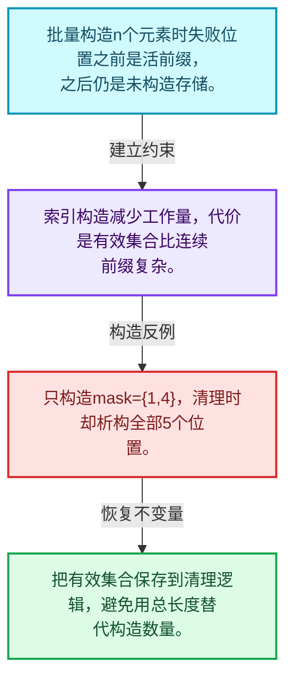
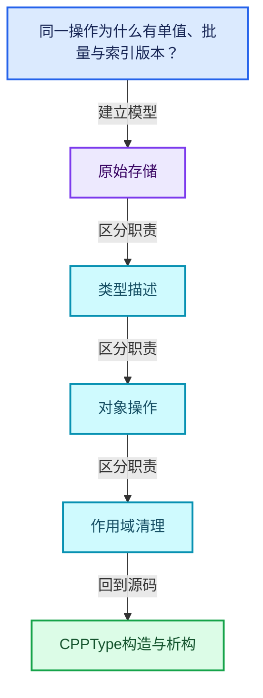
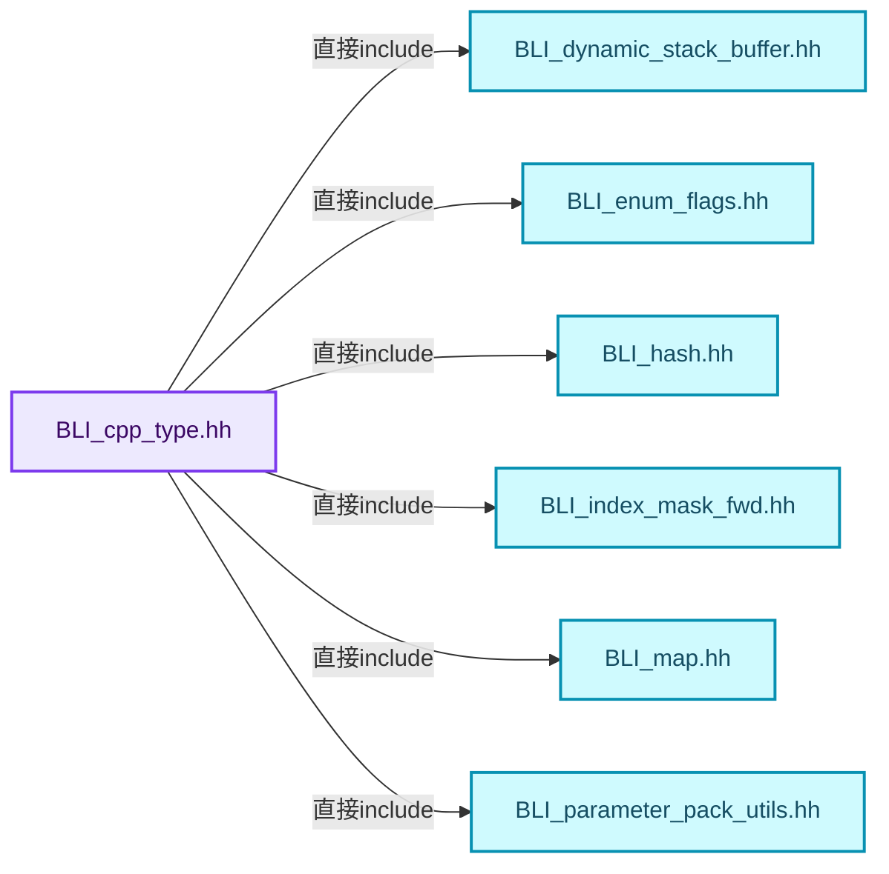
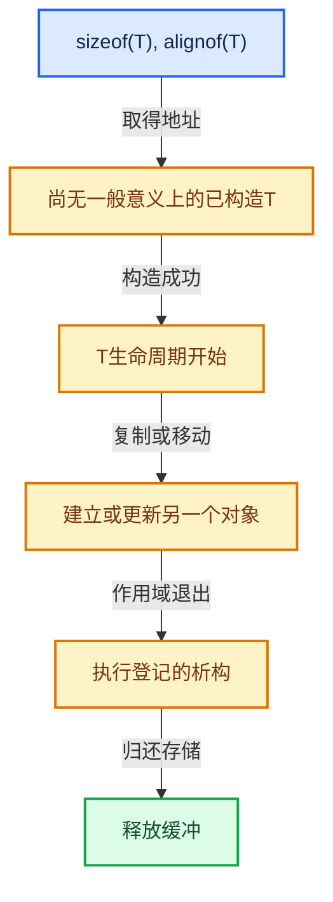

# 03-08 CPPType构造与析构

[方向导航](README.md) · [总目录](../README.md) · [覆盖索引](../%E6%BA%90%E7%A0%81%E7%89%88%E6%9C%AC%E4%B8%8E%E8%A6%86%E7%9B%96%E7%B4%A2%E5%BC%95.md)

> 阅读顺序：问题与数据模型 → 语法与类型 → 源码逐行 → 调用线索 → 历史与取舍 → 推演和练习。

- 基准 HEAD：`cbda6b96c26c0dee3c3b5cbb93960c4ac06a6b30`。
- 记录日期：2026-10-14。
- 教学示例状态：正文中的推演不是本机性能实测；已运行练习见验收报告。

## 一、从问题到设计

同一操作为什么有单值、批量与索引版本？

批量接口减少分派开销，索引接口只处理选中元素；未选位置不能被当作已构造对象。

本篇把语法、数据语义和系统取舍连接起来。把存储分配、对象构造、类型操作和最终清理拆开建模。

### 本篇独立模型与设计推理

批量构造n个元素时失败位置之前是活前缀，之后仍是未构造存储。

设计取舍：索引构造减少工作量，代价是有效集合比连续前缀复杂。

最小反例：只构造mask={1,4}，清理时却析构全部5个位置。

推导与处理：把有效集合保存到清理逻辑，避免用总长度替代构造数量。



### 源码范围与相邻篇章

| 文件 | 本篇逐行范围 | 基准SHA-256 |
|---|---|---|
| [source/blender/blenlib/BLI_cpp_type.hh](../../../../../source/blender/blenlib/BLI_cpp_type.hh) | L270—L540 | `c60368fa9ddd6891cb2063b203dc846355fc17d86f16005763354999d5beb1e2` |

同一主讲文件可能分多篇覆盖；超出本篇范围的符号通过覆盖索引定位。空行与纯注释保留在源码摘录中，逐行表解释有效语句与语法边界；许可证头统一保留。

前篇：[CPPType操作生成](07-CPPType%E6%93%8D%E4%BD%9C%E7%94%9F%E6%88%90.md).

后篇：[CPPType复制移动重定位](09-CPPType%E5%A4%8D%E5%88%B6%E7%A7%BB%E5%8A%A8%E9%87%8D%E5%AE%9A%E4%BD%8D.md).

## 二、类型、数据与阅读地图



这是概念依赖图，边表示阅读关系，不声称是运行时调用顺序。

### 直接编译依赖



箭头只表示头文件包含关系；完整调用线索见后面的符号定位表。

## 三、关键词、语法与类型角色

### 模板 template

模板把类型或常量作为生成实现的参数。读声明时先列出类型参数、非类型参数和默认值，再看使用者实际实例化了什么。模板声明本身不意味着每种T都支持其全部成员。

具体检查：把T替换为int、string、只能移动的类型，分别检查每个被调用操作是否成立。

### 依赖名称 typename

typename既可引入类型模板参数，也可告诉编译器某个依赖名称是类型。它不创建运行时对象；解析期确认语法类别与实例化期检查具体类型是不同阶段。

具体检查：区分typename T::value_type和T::size()，前者标记类型，后者是表达式。

### 只读限定 const

const约束当前访问路径可做的修改。const指针、指向const的指针、const视图对象、const元素是不同位置的限定；其他别名可能仍可修改原对象。

具体检查：分别写T* const、const T*与const T* const，并画出不可修改的层次。

### 移动转换 std::move

std::move把表达式转换为可供移动重载选择的值类别，实际资源转移发生在被选中的构造或赋值中。对const对象move可能仍调用复制，对视图move也不会获得底层数据所有权。

具体检查：记录移动构造调用次数，不用变量名或std::move的出现次数替代测量。

### 异常边界 try与catch

try定义异常传播的局部边界。失败路径需要销毁已经成功构造的部分并释放相应存储；未构造的对象不能被析构。

具体检查：在第k次构造失败，列出已经存在的对象集合与待释放缓冲。

### 构造与new表达式

普通new可能分配并构造；placement new在给定地址构造，存储由其他机制提供。失败回滚应区分两类责任。

具体检查：追踪地址来自哪里、构造何时成功、由谁析构、由谁释放。

### 内部断言 assert

断言表达开发者预期成立的内部契约，发布构建可能关闭。它不能替代对不可信输入的完整错误处理，也不保证后续操作被运行时保护。

具体检查：对每条断言构造违反条件的输入，区分调用者错误与应向用户报告的错误。

### 类型别名 using

类型别名为已有类型建立名字，不创建运行期对象。它常把模板内部使用的类型统一暴露给泛型调用者。

具体检查：展开别名直到基础类型，区分类型别名和变量声明。

## 四、真实源码与逐行讲解

源码块保持原行内容，原始行号由小节标题及逐行表给出。表中的调用定位是静态阅读辅助；重载、模板实例化、宏展开和虚调用需结合完整声明，不能仅凭词法出现证明动态调用。

### BLI_cpp_type.hh：L270—L317

<!-- source:source/blender/blenlib/BLI_cpp_type.hh:270:317 -->

```cpp

  /**
   * Same as #default_construct, but does zero initialization for trivial types.
   *
   * C++ equivalent:
   *   `new (ptr) T();`
   */
  void value_initialize(void *ptr) const;
  void value_initialize_n(void *ptr, int64_t n) const;
  void value_initialize_indices(void *ptr, const IndexMask &mask) const;

  /**
   * Call the destructor on the given instance of this type. The pointer must not be nullptr.
   *
   * For some trivial types, this does nothing.
   *
   * C++ equivalent:
   *   `ptr->~T();`
   */
  void destruct(void *ptr) const;
  void destruct_n(void *ptr, int64_t n) const;
  void destruct_indices(void *ptr, const IndexMask &mask) const;

  /**
   * Copy an instance of this type from src to dst.
   *
   * C++ equivalent:
   *   `dst = src;`
   */
  void copy_assign(const void *src, void *dst) const;
  void copy_assign_n(const void *src, void *dst, int64_t n) const;
  void copy_assign_indices(const void *src, void *dst, const IndexMask &mask) const;

  /**
   * Similar to #copy_assign_indices, but does not leave gaps in the #dst array.
   */
  void copy_assign_compressed(const void *src, void *dst, const IndexMask &mask) const;

  /**
   * Copy an instance of this type from src to dst.
   *
   * The memory pointed to by dst should be uninitialized.
   *
   * C++ equivalent:
   *   `new (dst) T(src);`
   */
  void copy_construct(const void *src, void *dst) const;
  void copy_construct_n(const void *src, void *dst, int64_t n) const;
```

本段语义重点：

- `destruct_n`：对已构造的元素区间执行析构；计数必须对应真实存活对象，释放原始内存是另一操作。
- `value_initialize_n`：按值初始化对象；对基本类型的初始化行为不同于未初始化分配。

| 原始行 | 语义、约束与检查 |
|---|---|
| L277 | 声明接口 `void value_initialize(void *ptr) const`，本行没有对应函数体；返回类型、参数限定和const/noexcept共同组成调用契约，实际行为需继续定位实现。 |
| L278 | 声明接口 `void value_initialize_n(void *ptr, int64_t n) const`，本行没有对应函数体；返回类型、参数限定和const/noexcept共同组成调用契约，实际行为需继续定位实现。 |
| L279 | 声明接口 `void value_initialize_indices(void *ptr, const IndexMask &mask) const`，本行没有对应函数体；返回类型、参数限定和const/noexcept共同组成调用契约，实际行为需继续定位实现。 |
| L289 | 声明接口 `void destruct(void *ptr) const`，本行没有对应函数体；返回类型、参数限定和const/noexcept共同组成调用契约，实际行为需继续定位实现。 |
| L290 | 声明接口 `void destruct_n(void *ptr, int64_t n) const`，本行没有对应函数体；返回类型、参数限定和const/noexcept共同组成调用契约，实际行为需继续定位实现。 |
| L291 | 声明接口 `void destruct_indices(void *ptr, const IndexMask &mask) const`，本行没有对应函数体；返回类型、参数限定和const/noexcept共同组成调用契约，实际行为需继续定位实现。 |
| L299 | 声明接口 `void copy_assign(const void *src, void *dst) const`，本行没有对应函数体；返回类型、参数限定和const/noexcept共同组成调用契约，实际行为需继续定位实现。 |
| L300 | 声明接口 `void copy_assign_n(const void *src, void *dst, int64_t n) const`，本行没有对应函数体；返回类型、参数限定和const/noexcept共同组成调用契约，实际行为需继续定位实现。 |
| L301 | 声明接口 `void copy_assign_indices(const void *src, void *dst, const IndexMask &mask) const`，本行没有对应函数体；返回类型、参数限定和const/noexcept共同组成调用契约，实际行为需继续定位实现。 |
| L306 | 声明接口 `void copy_assign_compressed(const void *src, void *dst, const IndexMask &mask) const`，本行没有对应函数体；返回类型、参数限定和const/noexcept共同组成调用契约，实际行为需继续定位实现。 |
| L316 | 声明接口 `void copy_construct(const void *src, void *dst) const`，本行没有对应函数体；返回类型、参数限定和const/noexcept共同组成调用契约，实际行为需继续定位实现。 |
| L317 | 声明接口 `void copy_construct_n(const void *src, void *dst, int64_t n) const`，本行没有对应函数体；返回类型、参数限定和const/noexcept共同组成调用契约，实际行为需继续定位实现。 |

### BLI_cpp_type.hh：L318—L369

<!-- source:source/blender/blenlib/BLI_cpp_type.hh:318:369 -->

```cpp
  void copy_construct_indices(const void *src, void *dst, const IndexMask &mask) const;

  /**
   * Similar to #copy_construct_indices, but does not leave gaps in the #dst array.
   */
  void copy_construct_compressed(const void *src, void *dst, const IndexMask &mask) const;

  /**
   * Move an instance of this type from src to dst.
   *
   * The memory pointed to by dst should be initialized.
   *
   * C++ equivalent:
   *   `dst = std::move(src);`
   */
  void move_assign(void *src, void *dst) const;
  void move_assign_n(void *src, void *dst, int64_t n) const;
  void move_assign_indices(void *src, void *dst, const IndexMask &mask) const;

  /**
   * Move an instance of this type from src to dst.
   *
   * The memory pointed to by dst should be uninitialized.
   *
   * C++ equivalent:
   *   `new (dst) T(std::move(src));`
   */
  void move_construct(void *src, void *dst) const;
  void move_construct_n(void *src, void *dst, int64_t n) const;
  void move_construct_indices(void *src, void *dst, const IndexMask &mask) const;

  /**
   * Relocates an instance of this type from src to dst. src will point to uninitialized memory
   * afterwards.
   *
   * C++ equivalent:
   *   `dst = std::move(src);`
   *   `src->~T();`
   */
  void relocate_assign(void *src, void *dst) const;
  void relocate_assign_n(void *src, void *dst, int64_t n) const;
  void relocate_assign_indices(void *src, void *dst, const IndexMask &mask) const;

  /**
   * Relocates an instance of this type from src to dst. src will point to uninitialized memory
   * afterwards.
   *
   * C++ equivalent:
   *   `new (dst) T(std::move(src))`
   *   `src->~T();`
   */
  void relocate_construct(void *src, void *dst) const;
```

| 原始行 | 语义、约束与检查 |
|---|---|
| L318 | 声明接口 `void copy_construct_indices(const void *src, void *dst, const IndexMask &mask) const`，本行没有对应函数体；返回类型、参数限定和const/noexcept共同组成调用契约，实际行为需继续定位实现。 |
| L323 | 声明接口 `void copy_construct_compressed(const void *src, void *dst, const IndexMask &mask) const`，本行没有对应函数体；返回类型、参数限定和const/noexcept共同组成调用契约，实际行为需继续定位实现。 |
| L333 | 声明接口 `void move_assign(void *src, void *dst) const`，本行没有对应函数体；返回类型、参数限定和const/noexcept共同组成调用契约，实际行为需继续定位实现。 |
| L334 | 声明接口 `void move_assign_n(void *src, void *dst, int64_t n) const`，本行没有对应函数体；返回类型、参数限定和const/noexcept共同组成调用契约，实际行为需继续定位实现。 |
| L335 | 声明接口 `void move_assign_indices(void *src, void *dst, const IndexMask &mask) const`，本行没有对应函数体；返回类型、参数限定和const/noexcept共同组成调用契约，实际行为需继续定位实现。 |
| L345 | 声明接口 `void move_construct(void *src, void *dst) const`，本行没有对应函数体；返回类型、参数限定和const/noexcept共同组成调用契约，实际行为需继续定位实现。 |
| L346 | 声明接口 `void move_construct_n(void *src, void *dst, int64_t n) const`，本行没有对应函数体；返回类型、参数限定和const/noexcept共同组成调用契约，实际行为需继续定位实现。 |
| L347 | 声明接口 `void move_construct_indices(void *src, void *dst, const IndexMask &mask) const`，本行没有对应函数体；返回类型、参数限定和const/noexcept共同组成调用契约，实际行为需继续定位实现。 |
| L357 | 声明接口 `void relocate_assign(void *src, void *dst) const`，本行没有对应函数体；返回类型、参数限定和const/noexcept共同组成调用契约，实际行为需继续定位实现。 |
| L358 | 声明接口 `void relocate_assign_n(void *src, void *dst, int64_t n) const`，本行没有对应函数体；返回类型、参数限定和const/noexcept共同组成调用契约，实际行为需继续定位实现。 |
| L359 | 声明接口 `void relocate_assign_indices(void *src, void *dst, const IndexMask &mask) const`，本行没有对应函数体；返回类型、参数限定和const/noexcept共同组成调用契约，实际行为需继续定位实现。 |
| L369 | 声明接口 `void relocate_construct(void *src, void *dst) const`，本行没有对应函数体；返回类型、参数限定和const/noexcept共同组成调用契约，实际行为需继续定位实现。 |

### BLI_cpp_type.hh：L370—L414

<!-- source:source/blender/blenlib/BLI_cpp_type.hh:370:414 -->

```cpp
  void relocate_construct_n(void *src, void *dst, int64_t n) const;
  void relocate_construct_indices(void *src, void *dst, const IndexMask &mask) const;

  /**
   * Copy the given value to the first n elements in an array starting at dst.
   *
   * Other instances of the same type should live in the array before this method is called.
   */
  void fill_assign_n(const void *value, void *dst, int64_t n) const;
  void fill_assign_indices(const void *value, void *dst, const IndexMask &mask) const;

  /**
   * Copy the given value to the first n elements in an array starting at dst.
   *
   * The array should be uninitialized before this method is called.
   */
  void fill_construct_n(const void *value, void *dst, int64_t n) const;
  void fill_construct_indices(const void *value, void *dst, const IndexMask &mask) const;

  bool can_exist_in_buffer(const int64_t buffer_size, const int64_t buffer_alignment) const;

  void print(const void *value, std::stringstream &ss) const;
  std::string to_string(const void *value) const;
  void print_or_default(const void *value, std::stringstream &ss, StringRef default_value) const;

  bool is_equal(const void *a, const void *b) const;
  bool is_equal_or_false(const void *a, const void *b) const;

  uint64_t hash(const void *value) const;
  uint64_t hash_or_fallback(const void *value, uint64_t fallback_hash) const;
  void hash_unique(const void *value, UniqueHashBytes &hash) const;

  /**
   * Get a pointer to a constant value of this type. The specific value depends on the type.
   * It is usually a zero-initialized or default constructed value.
   */
  const void *default_value() const;

  uint64_t hash() const;

  void (*destruct_fn() const)(void *);

  template<typename T> bool is() const;

  template<typename... T> bool is_any() const;
```

| 原始行 | 语义、约束与检查 |
|---|---|
| L370 | 声明接口 `void relocate_construct_n(void *src, void *dst, int64_t n) const`，本行没有对应函数体；返回类型、参数限定和const/noexcept共同组成调用契约，实际行为需继续定位实现。 |
| L371 | 声明接口 `void relocate_construct_indices(void *src, void *dst, const IndexMask &mask) const`，本行没有对应函数体；返回类型、参数限定和const/noexcept共同组成调用契约，实际行为需继续定位实现。 |
| L378 | 声明接口 `void fill_assign_n(const void *value, void *dst, int64_t n) const`，本行没有对应函数体；返回类型、参数限定和const/noexcept共同组成调用契约，实际行为需继续定位实现。 |
| L379 | 声明接口 `void fill_assign_indices(const void *value, void *dst, const IndexMask &mask) const`，本行没有对应函数体；返回类型、参数限定和const/noexcept共同组成调用契约，实际行为需继续定位实现。 |
| L386 | 声明接口 `void fill_construct_n(const void *value, void *dst, int64_t n) const`，本行没有对应函数体；返回类型、参数限定和const/noexcept共同组成调用契约，实际行为需继续定位实现。 |
| L387 | 声明接口 `void fill_construct_indices(const void *value, void *dst, const IndexMask &mask) const`，本行没有对应函数体；返回类型、参数限定和const/noexcept共同组成调用契约，实际行为需继续定位实现。 |
| L389 | 声明接口 `bool can_exist_in_buffer(const int64_t buffer_size, const int64_t buffer_alignment) const`，本行没有对应函数体；返回类型、参数限定和const/noexcept共同组成调用契约，实际行为需继续定位实现。 |
| L391 | 声明接口 `void print(const void *value, std::stringstream &ss) const`，本行没有对应函数体；返回类型、参数限定和const/noexcept共同组成调用契约，实际行为需继续定位实现。 |
| L392 | 声明接口 `std::string to_string(const void *value) const`，本行没有对应函数体；返回类型、参数限定和const/noexcept共同组成调用契约，实际行为需继续定位实现。 |
| L393 | 声明接口 `void print_or_default(const void *value, std::stringstream &ss, StringRef default_value) const`，本行没有对应函数体；返回类型、参数限定和const/noexcept共同组成调用契约，实际行为需继续定位实现。 |
| L395 | 声明接口 `bool is_equal(const void *a, const void *b) const`，本行没有对应函数体；返回类型、参数限定和const/noexcept共同组成调用契约，实际行为需继续定位实现。 |
| L396 | 声明接口 `bool is_equal_or_false(const void *a, const void *b) const`，本行没有对应函数体；返回类型、参数限定和const/noexcept共同组成调用契约，实际行为需继续定位实现。 |
| L398 | 声明接口 `uint64_t hash(const void *value) const`，本行没有对应函数体；返回类型、参数限定和const/noexcept共同组成调用契约，实际行为需继续定位实现。 |
| L399 | 声明接口 `uint64_t hash_or_fallback(const void *value, uint64_t fallback_hash) const`，本行没有对应函数体；返回类型、参数限定和const/noexcept共同组成调用契约，实际行为需继续定位实现。 |
| L400 | 声明接口 `void hash_unique(const void *value, UniqueHashBytes &hash) const`，本行没有对应函数体；返回类型、参数限定和const/noexcept共同组成调用契约，实际行为需继续定位实现。 |
| L406 | 声明接口 `const void *default_value() const`，本行没有对应函数体；返回类型、参数限定和const/noexcept共同组成调用契约，实际行为需继续定位实现。 |
| L408 | 声明接口 `uint64_t hash() const`，本行没有对应函数体；返回类型、参数限定和const/noexcept共同组成调用契约，实际行为需继续定位实现。 |
| L410 | 声明接口 `void (*destruct_fn() const)(void *)`，本行没有对应函数体；返回类型、参数限定和const/noexcept共同组成调用契约，实际行为需继续定位实现。 |
| L412 | 声明模板参数 `template<typename T> bool is() const;`。类型参数决定生成操作的类型，非类型参数可决定内嵌容量或编译期分支。 |
| L414 | 声明模板参数 `template<typename... T> bool is_any() const;`。类型参数决定生成操作的类型，非类型参数可决定内嵌容量或编译期分支。 |

### BLI_cpp_type.hh：L415—L462

<!-- source:source/blender/blenlib/BLI_cpp_type.hh:415:462 -->

```cpp

  /**
   * Convert a #CPPType that is only known at run-time, to a static type that is known at
   * compile-time. This allows the compiler to optimize a function for specific types, while all
   * other types can still use a generic fallback function.
   *
   * \tparam Types: The types that code should be generated for.
   * \param fn: The function object to call. This is expected to have a templated `operator()` and
   * a non-templated `operator()`. The templated version will be called if the current #CPPType
   *   matches any of the given types.
   * \return True if the function was called.
   */
  template<typename... Types, typename Fn> bool to_static_type_try(Fn &&fn) const;

  /** Same as #to_static_type_try, but asserts if the type is valid. */
  template<typename... Types, typename Fn> void to_static_type(Fn &&fn) const;

 private:
  /**
   * Helper used in #to_static_type_try as a typed function pointer for each type in the list.
   * A named static function is used instead of a lambda to avoid a known MSVC bug where a
   * non-capturing lambda inside a comma fold expression that references the pack parameter
   * causes MSVC to generate zero iterations, leaving the map empty.
   */
  template<typename T, typename Fn> static void call_with_type_impl_(const Fn &fn)
  {
    fn.template operator()<T>();
  }
};

namespace detail {
/**
 * Global static variable that contains the #CPPType for a given type after it has been registered
 * with #BLI_CPP_TYPE_REGISTER. This should generally be accessed through #CPPType::get<T>.
 */
template<typename T> inline TypedBuffer<CPPType> cpp_type_impl{};
template<typename T> inline bool is_cpp_type_registered = false;
}  // namespace detail

/**
 * Initialize and register basic cpp types.
 */
void register_cpp_types();

/* Utility for allocating an uninitialized buffer for a single value of the given #CPPType. */
#define BUFFER_FOR_CPP_TYPE_VALUE(type, variable_name) \
  DynamicStackBuffer<64, 64> stack_buffer_for_##variable_name((type).size, (type).alignment); \
  void *variable_name = stack_buffer_for_##variable_name.buffer();
```

| 原始行 | 语义、约束与检查 |
|---|---|
| L427 | 声明模板参数 `template<typename... Types, typename Fn> bool to_static_type_try(Fn &&fn) const;`。类型参数决定生成操作的类型，非类型参数可决定内嵌容量或编译期分支。 |
| L430 | 声明模板参数 `template<typename... Types, typename Fn> void to_static_type(Fn &&fn) const;`。类型参数决定生成操作的类型，非类型参数可决定内嵌容量或编译期分支。 |
| L432 | 切换成员访问权限为 private；它是编译期接口边界，不是线程同步或内存保护。 |
| L439 | 声明模板参数 `template<typename T, typename Fn> static void call_with_type_impl_(const Fn &fn)`。类型参数决定生成操作的类型，非类型参数可决定内嵌容量或编译期分支。 |
| L440 | 连接上一行的声明或控制结构与其语句块；后续行在这个作用域中执行或声明。 |
| L441 | 运算符重载声明、定义或显式调用：`fn.template operator()<T>();`。结合参数和返回类型判断是赋值、索引、比较还是转换；operator=声明中的等号不是在给名为operator的变量赋值。 |
| L442 | 结束当前语法单元。局部自动对象在离开其作用域时按规则销毁；这不等于所有被引用的外部数据也被释放。 |
| L443 | 结束当前语法单元。局部自动对象在离开其作用域时按规则销毁；这不等于所有被引用的外部数据也被释放。 |
| L445 | 把后续声明放入 detail 命名空间，影响名称查找和符号归属，不创建运行时对象。 |
| L450 | 声明模板参数 `template<typename T> inline TypedBuffer<CPPType> cpp_type_impl{};`。类型参数决定生成操作的类型，非类型参数可决定内嵌容量或编译期分支。 |
| L451 | 声明模板参数 `template<typename T> inline bool is_cpp_type_registered = false;`。类型参数决定生成操作的类型，非类型参数可决定内嵌容量或编译期分支。 |
| L452 | 结束当前语法单元。局部自动对象在离开其作用域时按规则销毁；这不等于所有被引用的外部数据也被释放。 |
| L457 | 声明接口 `void register_cpp_types()`，本行没有对应函数体；返回类型、参数限定和const/noexcept共同组成调用契约，实际行为需继续定位实现。 |
| L460 | 预处理阶段处理 #define BUFFER_FOR_CPP_TYPE_VALUE(type, variable_name) \。它决定哪些代码进入编译，不是运行时分支；阅读行为时必须结合实际构建宏。 |
| L461 | 出现调用或函数声明 `variable_name`，对应表达式为 `DynamicStackBuffer<64, 64> stack_buffer_for_##variable_name((type).size, (type).alignment); \`。参数求值、返回类型与重载需结合前后完整语句；静态文本引用不能证明动态目标。 |
| L462 | 把右侧 `stack_buffer_for_##variable_name.buffer()` 用于初始化或更新左侧 `void *variable_name`。声明初始化与已有对象赋值应按上下文区分；有资源的类型会调用相应特殊成员。 |

### BLI_cpp_type.hh：L463—L510

<!-- source:source/blender/blenlib/BLI_cpp_type.hh:463:510 -->

```cpp

/* Give a compile error instead of a link error when type information is missing. */
template<> const CPPType &CPPType::get<void>() = delete;

/**
 * Two types only compare equal when their pointer is equal. No two instances of CPPType for the
 * same C++ type should be created.
 */
inline bool operator==(const CPPType &a, const CPPType &b)
{
  return &a == &b;
}

inline bool operator!=(const CPPType &a, const CPPType &b)
{
  return !(&a == &b);
}

template<typename T> inline const CPPType &CPPType::get()
{
  using DecayT = std::decay_t<T>;
  /* Should have been initialized by #BLI_CPP_TYPE_REGISTER.
   * If this is hit in test code, make sure the test calls `register_cpp_types` (for blenlib
   * tests) or `BKE_cpp_types_init` (for general tests). */
  BLI_assert(detail::is_cpp_type_registered<DecayT>);
  const CPPType &type = detail::cpp_type_impl<DecayT>.ref();
  return type;
}

template<typename T> inline const CPPType *CPPType::get_pre_register()
{
  return detail::cpp_type_impl<std::decay_t<T>>.ptr();
}

inline StringRefNull CPPType::name() const
{
  return debug_name_;
}

inline bool CPPType::is_printable() const
{
  return print_ != nullptr;
}

inline bool CPPType::is_equality_comparable() const
{
  return is_equal_ != nullptr;
}
```

| 原始行 | 语义、约束与检查 |
|---|---|
| L465 | 显式禁止接口：`template<> const CPPType &CPPType::get<void>() = delete;`。调用会在编译期被拒绝，常用于禁止复制或移动；这里没有释放对象或删除文件的运行时动作。 |
| L471 | 运算符重载声明、定义或显式调用：`inline bool operator==(const CPPType &a, const CPPType &b)`。结合参数和返回类型判断是赋值、索引、比较还是转换；operator=声明中的等号不是在给名为operator的变量赋值。 |
| L472 | 连接上一行的声明或控制结构与其语句块；后续行在这个作用域中执行或声明。 |
| L473 | 返回表达式 `&a == &b`。 |
| L474 | 结束当前语法单元。局部自动对象在离开其作用域时按规则销毁；这不等于所有被引用的外部数据也被释放。 |
| L476 | 运算符重载声明、定义或显式调用：`inline bool operator!=(const CPPType &a, const CPPType &b)`。结合参数和返回类型判断是赋值、索引、比较还是转换；operator=声明中的等号不是在给名为operator的变量赋值。 |
| L477 | 连接上一行的声明或控制结构与其语句块；后续行在这个作用域中执行或声明。 |
| L478 | 返回表达式 `!(&a == &b)`。 |
| L479 | 结束当前语法单元。局部自动对象在离开其作用域时按规则销毁；这不等于所有被引用的外部数据也被释放。 |
| L481 | 声明模板参数 `template<typename T> inline const CPPType &CPPType::get()`。类型参数决定生成操作的类型，非类型参数可决定内嵌容量或编译期分支。 |
| L482 | 连接上一行的声明或控制结构与其语句块；后续行在这个作用域中执行或声明。 |
| L483 | 定义类型别名 `using DecayT = std::decay_t<T>`，为模板接口或内部实现统一命名；本行不分配该类型对象。 |
| L487 | 断言约束 `BLI_assert(detail::is_cpp_type_registered<DecayT>);`。条件是后续访问的内部前置条件；发布构建可能不执行，不能把断言当作输入修复。 |
| L488 | 把右侧 `detail::cpp_type_impl<DecayT>.ref()` 用于初始化或更新左侧 `const CPPType &type`。声明初始化与已有对象赋值应按上下文区分；有资源的类型会调用相应特殊成员。 |
| L489 | 返回表达式 `type`。结合函数声明检查返回值是否借用原存储，借用值不会自动延长其寿命。 |
| L490 | 结束当前语法单元。局部自动对象在离开其作用域时按规则销毁；这不等于所有被引用的外部数据也被释放。 |
| L492 | 声明模板参数 `template<typename T> inline const CPPType *CPPType::get_pre_register()`。类型参数决定生成操作的类型，非类型参数可决定内嵌容量或编译期分支。 |
| L493 | 连接上一行的声明或控制结构与其语句块；后续行在这个作用域中执行或声明。 |
| L494 | 返回表达式 `detail::cpp_type_impl<std::decay_t<T>>.ptr()`。 |
| L495 | 结束当前语法单元。局部自动对象在离开其作用域时按规则销毁；这不等于所有被引用的外部数据也被释放。 |
| L497 | 出现调用或函数声明 `CPPType::name`，对应表达式为 `inline StringRefNull CPPType::name() const`。参数求值、返回类型与重载需结合前后完整语句；静态文本引用不能证明动态目标。 |
| L498 | 连接上一行的声明或控制结构与其语句块；后续行在这个作用域中执行或声明。 |
| L499 | 返回表达式 `debug_name_`。 |
| L500 | 结束当前语法单元。局部自动对象在离开其作用域时按规则销毁；这不等于所有被引用的外部数据也被释放。 |
| L502 | 出现调用或函数声明 `CPPType::is_printable`，对应表达式为 `inline bool CPPType::is_printable() const`。参数求值、返回类型与重载需结合前后完整语句；静态文本引用不能证明动态目标。 |
| L503 | 连接上一行的声明或控制结构与其语句块；后续行在这个作用域中执行或声明。 |
| L504 | 返回表达式 `print_ != nullptr`。 |
| L505 | 结束当前语法单元。局部自动对象在离开其作用域时按规则销毁；这不等于所有被引用的外部数据也被释放。 |
| L507 | 出现调用或函数声明 `CPPType::is_equality_comparable`，对应表达式为 `inline bool CPPType::is_equality_comparable() const`。参数求值、返回类型与重载需结合前后完整语句；静态文本引用不能证明动态目标。 |
| L508 | 连接上一行的声明或控制结构与其语句块；后续行在这个作用域中执行或声明。 |
| L509 | 返回表达式 `is_equal_ != nullptr`。 |
| L510 | 结束当前语法单元。局部自动对象在离开其作用域时按规则销毁；这不等于所有被引用的外部数据也被释放。 |

### BLI_cpp_type.hh：L511—L540

<!-- source:source/blender/blenlib/BLI_cpp_type.hh:511:540 -->

```cpp

inline bool CPPType::is_hashable() const
{
  return hash_ != nullptr;
}

inline bool CPPType::pointer_has_valid_alignment(const void *ptr) const
{
  return (uintptr_t(ptr) & alignment_mask_) == 0;
}

inline bool CPPType::pointer_can_point_to_instance(const void *ptr) const
{
  return ptr != nullptr && pointer_has_valid_alignment(ptr);
}

inline void CPPType::default_construct(void *ptr) const
{
  default_construct_(ptr);
}

inline void CPPType::default_construct_n(void *ptr, int64_t n) const
{
  default_construct_n_(ptr, n);
}

inline void CPPType::default_construct_indices(void *ptr, const IndexMask &mask) const
{
  default_construct_indices_(ptr, mask);
}
```

本段语义重点：

- `default_construct_n`：为目标区间建立默认构造对象；基本类型默认初始化未必给出可读取的零。

| 原始行 | 语义、约束与检查 |
|---|---|
| L512 | 出现调用或函数声明 `CPPType::is_hashable`，对应表达式为 `inline bool CPPType::is_hashable() const`。参数求值、返回类型与重载需结合前后完整语句；静态文本引用不能证明动态目标。 |
| L513 | 连接上一行的声明或控制结构与其语句块；后续行在这个作用域中执行或声明。 |
| L514 | 返回表达式 `hash_ != nullptr`。 |
| L515 | 结束当前语法单元。局部自动对象在离开其作用域时按规则销毁；这不等于所有被引用的外部数据也被释放。 |
| L517 | 出现调用或函数声明 `CPPType::pointer_has_valid_alignment`，对应表达式为 `inline bool CPPType::pointer_has_valid_alignment(const void *ptr) const`。参数求值、返回类型与重载需结合前后完整语句；静态文本引用不能证明动态目标。 |
| L518 | 连接上一行的声明或控制结构与其语句块；后续行在这个作用域中执行或声明。 |
| L519 | 纯虚接口声明：`return (uintptr_t(ptr) & alignment_mask_) == 0;`。等号零标记抽象接口，需要按继承约定提供覆写；不表示执行函数并把结果设为零。 |
| L520 | 结束当前语法单元。局部自动对象在离开其作用域时按规则销毁；这不等于所有被引用的外部数据也被释放。 |
| L522 | 出现调用或函数声明 `CPPType::pointer_can_point_to_instance`，对应表达式为 `inline bool CPPType::pointer_can_point_to_instance(const void *ptr) const`。参数求值、返回类型与重载需结合前后完整语句；静态文本引用不能证明动态目标。 |
| L523 | 连接上一行的声明或控制结构与其语句块；后续行在这个作用域中执行或声明。 |
| L524 | 返回表达式 `ptr != nullptr && pointer_has_valid_alignment(ptr)`。 |
| L525 | 结束当前语法单元。局部自动对象在离开其作用域时按规则销毁；这不等于所有被引用的外部数据也被释放。 |
| L527 | 出现调用或函数声明 `CPPType::default_construct`，对应表达式为 `inline void CPPType::default_construct(void *ptr) const`。参数求值、返回类型与重载需结合前后完整语句；静态文本引用不能证明动态目标。 |
| L528 | 连接上一行的声明或控制结构与其语句块；后续行在这个作用域中执行或声明。 |
| L529 | 出现调用或函数声明 `default_construct_`，对应表达式为 `default_construct_(ptr);`。参数求值、返回类型与重载需结合前后完整语句；静态文本引用不能证明动态目标。 |
| L530 | 结束当前语法单元。局部自动对象在离开其作用域时按规则销毁；这不等于所有被引用的外部数据也被释放。 |
| L532 | 本行使用 `default_construct_n`：为目标区间建立默认构造对象；基本类型默认初始化未必给出可读取的零。 |
| L533 | 连接上一行的声明或控制结构与其语句块；后续行在这个作用域中执行或声明。 |
| L534 | 出现调用或函数声明 `default_construct_n_`，对应表达式为 `default_construct_n_(ptr, n);`。参数求值、返回类型与重载需结合前后完整语句；静态文本引用不能证明动态目标。 |
| L535 | 结束当前语法单元。局部自动对象在离开其作用域时按规则销毁；这不等于所有被引用的外部数据也被释放。 |
| L537 | 出现调用或函数声明 `CPPType::default_construct_indices`，对应表达式为 `inline void CPPType::default_construct_indices(void *ptr, const IndexMask &mask) const`。参数求值、返回类型与重载需结合前后完整语句；静态文本引用不能证明动态目标。 |
| L538 | 连接上一行的声明或控制结构与其语句块；后续行在这个作用域中执行或声明。 |
| L539 | 出现调用或函数声明 `default_construct_indices_`，对应表达式为 `default_construct_indices_(ptr, mask);`。参数求值、返回类型与重载需结合前后完整语句；静态文本引用不能证明动态目标。 |
| L540 | 结束当前语法单元。局部自动对象在离开其作用域时按规则销毁；这不等于所有被引用的外部数据也被释放。 |

## 五、接口定位、调用线索与生命周期

### 本篇声明与实现入口

| 源码位置 | 实际声明片段 |
|---|---|
| [BLI_cpp_type.hh:L277](../../../../../source/blender/blenlib/BLI_cpp_type.hh#L277) | `void value_initialize(void *ptr) const;` |
| [BLI_cpp_type.hh:L278](../../../../../source/blender/blenlib/BLI_cpp_type.hh#L278) | `void value_initialize_n(void *ptr, int64_t n) const;` |
| [BLI_cpp_type.hh:L279](../../../../../source/blender/blenlib/BLI_cpp_type.hh#L279) | `void value_initialize_indices(void *ptr, const IndexMask &mask) const;` |
| [BLI_cpp_type.hh:L289](../../../../../source/blender/blenlib/BLI_cpp_type.hh#L289) | `void destruct(void *ptr) const;` |
| [BLI_cpp_type.hh:L290](../../../../../source/blender/blenlib/BLI_cpp_type.hh#L290) | `void destruct_n(void *ptr, int64_t n) const;` |
| [BLI_cpp_type.hh:L291](../../../../../source/blender/blenlib/BLI_cpp_type.hh#L291) | `void destruct_indices(void *ptr, const IndexMask &mask) const;` |
| [BLI_cpp_type.hh:L299](../../../../../source/blender/blenlib/BLI_cpp_type.hh#L299) | `void copy_assign(const void *src, void *dst) const;` |
| [BLI_cpp_type.hh:L300](../../../../../source/blender/blenlib/BLI_cpp_type.hh#L300) | `void copy_assign_n(const void *src, void *dst, int64_t n) const;` |
| [BLI_cpp_type.hh:L301](../../../../../source/blender/blenlib/BLI_cpp_type.hh#L301) | `void copy_assign_indices(const void *src, void *dst, const IndexMask &mask) const;` |
| [BLI_cpp_type.hh:L306](../../../../../source/blender/blenlib/BLI_cpp_type.hh#L306) | `void copy_assign_compressed(const void *src, void *dst, const IndexMask &mask) const;` |
| [BLI_cpp_type.hh:L316](../../../../../source/blender/blenlib/BLI_cpp_type.hh#L316) | `void copy_construct(const void *src, void *dst) const;` |
| [BLI_cpp_type.hh:L317](../../../../../source/blender/blenlib/BLI_cpp_type.hh#L317) | `void copy_construct_n(const void *src, void *dst, int64_t n) const;` |
| [BLI_cpp_type.hh:L318](../../../../../source/blender/blenlib/BLI_cpp_type.hh#L318) | `void copy_construct_indices(const void *src, void *dst, const IndexMask &mask) const;` |
| [BLI_cpp_type.hh:L323](../../../../../source/blender/blenlib/BLI_cpp_type.hh#L323) | `void copy_construct_compressed(const void *src, void *dst, const IndexMask &mask) const;` |
| [BLI_cpp_type.hh:L333](../../../../../source/blender/blenlib/BLI_cpp_type.hh#L333) | `void move_assign(void *src, void *dst) const;` |
| [BLI_cpp_type.hh:L334](../../../../../source/blender/blenlib/BLI_cpp_type.hh#L334) | `void move_assign_n(void *src, void *dst, int64_t n) const;` |
| [BLI_cpp_type.hh:L335](../../../../../source/blender/blenlib/BLI_cpp_type.hh#L335) | `void move_assign_indices(void *src, void *dst, const IndexMask &mask) const;` |
| [BLI_cpp_type.hh:L345](../../../../../source/blender/blenlib/BLI_cpp_type.hh#L345) | `void move_construct(void *src, void *dst) const;` |
| [BLI_cpp_type.hh:L346](../../../../../source/blender/blenlib/BLI_cpp_type.hh#L346) | `void move_construct_n(void *src, void *dst, int64_t n) const;` |
| [BLI_cpp_type.hh:L347](../../../../../source/blender/blenlib/BLI_cpp_type.hh#L347) | `void move_construct_indices(void *src, void *dst, const IndexMask &mask) const;` |
| [BLI_cpp_type.hh:L357](../../../../../source/blender/blenlib/BLI_cpp_type.hh#L357) | `void relocate_assign(void *src, void *dst) const;` |
| [BLI_cpp_type.hh:L358](../../../../../source/blender/blenlib/BLI_cpp_type.hh#L358) | `void relocate_assign_n(void *src, void *dst, int64_t n) const;` |
| [BLI_cpp_type.hh:L359](../../../../../source/blender/blenlib/BLI_cpp_type.hh#L359) | `void relocate_assign_indices(void *src, void *dst, const IndexMask &mask) const;` |
| [BLI_cpp_type.hh:L369](../../../../../source/blender/blenlib/BLI_cpp_type.hh#L369) | `void relocate_construct(void *src, void *dst) const;` |
| [BLI_cpp_type.hh:L370](../../../../../source/blender/blenlib/BLI_cpp_type.hh#L370) | `void relocate_construct_n(void *src, void *dst, int64_t n) const;` |
| [BLI_cpp_type.hh:L371](../../../../../source/blender/blenlib/BLI_cpp_type.hh#L371) | `void relocate_construct_indices(void *src, void *dst, const IndexMask &mask) const;` |
| [BLI_cpp_type.hh:L378](../../../../../source/blender/blenlib/BLI_cpp_type.hh#L378) | `void fill_assign_n(const void *value, void *dst, int64_t n) const;` |
| [BLI_cpp_type.hh:L379](../../../../../source/blender/blenlib/BLI_cpp_type.hh#L379) | `void fill_assign_indices(const void *value, void *dst, const IndexMask &mask) const;` |
| [BLI_cpp_type.hh:L386](../../../../../source/blender/blenlib/BLI_cpp_type.hh#L386) | `void fill_construct_n(const void *value, void *dst, int64_t n) const;` |
| [BLI_cpp_type.hh:L387](../../../../../source/blender/blenlib/BLI_cpp_type.hh#L387) | `void fill_construct_indices(const void *value, void *dst, const IndexMask &mask) const;` |
| [BLI_cpp_type.hh:L389](../../../../../source/blender/blenlib/BLI_cpp_type.hh#L389) | `bool can_exist_in_buffer(const int64_t buffer_size, const int64_t buffer_alignment) const;` |
| [BLI_cpp_type.hh:L391](../../../../../source/blender/blenlib/BLI_cpp_type.hh#L391) | `void print(const void *value, std::stringstream &ss) const;` |
| [BLI_cpp_type.hh:L392](../../../../../source/blender/blenlib/BLI_cpp_type.hh#L392) | `std::string to_string(const void *value) const;` |
| [BLI_cpp_type.hh:L393](../../../../../source/blender/blenlib/BLI_cpp_type.hh#L393) | `void print_or_default(const void *value, std::stringstream &ss, StringRef default_value) const;` |
| [BLI_cpp_type.hh:L395](../../../../../source/blender/blenlib/BLI_cpp_type.hh#L395) | `bool is_equal(const void *a, const void *b) const;` |
| [BLI_cpp_type.hh:L396](../../../../../source/blender/blenlib/BLI_cpp_type.hh#L396) | `bool is_equal_or_false(const void *a, const void *b) const;` |
| [BLI_cpp_type.hh:L398](../../../../../source/blender/blenlib/BLI_cpp_type.hh#L398) | `uint64_t hash(const void *value) const;` |
| [BLI_cpp_type.hh:L399](../../../../../source/blender/blenlib/BLI_cpp_type.hh#L399) | `uint64_t hash_or_fallback(const void *value, uint64_t fallback_hash) const;` |
| [BLI_cpp_type.hh:L400](../../../../../source/blender/blenlib/BLI_cpp_type.hh#L400) | `void hash_unique(const void *value, UniqueHashBytes &hash) const;` |
| [BLI_cpp_type.hh:L406](../../../../../source/blender/blenlib/BLI_cpp_type.hh#L406) | `const void *default_value() const;` |
| [BLI_cpp_type.hh:L408](../../../../../source/blender/blenlib/BLI_cpp_type.hh#L408) | `uint64_t hash() const;` |
| [BLI_cpp_type.hh:L412](../../../../../source/blender/blenlib/BLI_cpp_type.hh#L412) | `template<typename T> bool is() const;` |
| [BLI_cpp_type.hh:L457](../../../../../source/blender/blenlib/BLI_cpp_type.hh#L457) | `void register_cpp_types();` |
| [BLI_cpp_type.hh:L481](../../../../../source/blender/blenlib/BLI_cpp_type.hh#L481) | `template<typename T> inline const CPPType &CPPType::get()` |
| [BLI_cpp_type.hh:L492](../../../../../source/blender/blenlib/BLI_cpp_type.hh#L492) | `template<typename T> inline const CPPType *CPPType::get_pre_register()` |
| [BLI_cpp_type.hh:L497](../../../../../source/blender/blenlib/BLI_cpp_type.hh#L497) | `inline StringRefNull CPPType::name() const` |
| [BLI_cpp_type.hh:L502](../../../../../source/blender/blenlib/BLI_cpp_type.hh#L502) | `inline bool CPPType::is_printable() const` |
| [BLI_cpp_type.hh:L507](../../../../../source/blender/blenlib/BLI_cpp_type.hh#L507) | `inline bool CPPType::is_equality_comparable() const` |
| [BLI_cpp_type.hh:L512](../../../../../source/blender/blenlib/BLI_cpp_type.hh#L512) | `inline bool CPPType::is_hashable() const` |
| [BLI_cpp_type.hh:L517](../../../../../source/blender/blenlib/BLI_cpp_type.hh#L517) | `inline bool CPPType::pointer_has_valid_alignment(const void *ptr) const` |
| [BLI_cpp_type.hh:L522](../../../../../source/blender/blenlib/BLI_cpp_type.hh#L522) | `inline bool CPPType::pointer_can_point_to_instance(const void *ptr) const` |
| [BLI_cpp_type.hh:L527](../../../../../source/blender/blenlib/BLI_cpp_type.hh#L527) | `inline void CPPType::default_construct(void *ptr) const` |
| [BLI_cpp_type.hh:L532](../../../../../source/blender/blenlib/BLI_cpp_type.hh#L532) | `inline void CPPType::default_construct_n(void *ptr, int64_t n) const` |
| [BLI_cpp_type.hh:L537](../../../../../source/blender/blenlib/BLI_cpp_type.hh#L537) | `inline void CPPType::default_construct_indices(void *ptr, const IndexMask &mask) const` |

### 同名符号出现位置

以下表提供跨文件阅读入口，包含声明、调用或测试使用；没有经过完整C++名称解析，不把它命名为已证明的运行时调用图。

| 符号 | 位置 | 文本证据 |
|---|---|---|
| `value_initialize` | [field_evaluation.cc:L511](../../../../../source/blender/functions/intern/field_evaluation.cc#L511) | `type.value_initialize(r_value);` |
| `value_initialize_indices` | [geometry_fields.cc:L661](../../../../../source/blender/blenkernel/intern/geometry_fields.cc#L661) | `dst_array.type().value_initialize_indices(dst_array.data(), valid_mask.complement(mask, memory));` |
| `value_initialize_indices` | [geometry_fields.cc:L745](../../../../../source/blender/blenkernel/intern/geometry_fields.cc#L745) | `type.value_initialize_indices(dst.data(), mask);` |
| `value_initialize_indices` | [geometry_fields.cc:L753](../../../../../source/blender/blenkernel/intern/geometry_fields.cc#L753) | `dst.type().value_initialize_indices(dst.data(), valid_mask.complement(mask, memory));` |
| `destruct` | [geometry_fields.cc:L440](../../../../../source/blender/blenkernel/intern/geometry_fields.cc#L440) | `BLI_SCOPED_DEFER([&]() { cpp_type.destruct(value); });` |
| `destruct` | [geometry_fields.cc:L796](../../../../../source/blender/blenkernel/intern/geometry_fields.cc#L796) | `BLI_SCOPED_DEFER([&]() { cpp_type.destruct(value); });` |
| `destruct` | [BLI_any.hh:L223](../../../../../source/blender/blenlib/BLI_any.hh#L223) | `info_->destruct(&buffer_);` |
| `destruct_n` | [BLI_array.hh:L202](../../../../../source/blender/blenlib/BLI_array.hh#L202) | `destruct_n(data_, size_);` |
| `destruct_n` | [BLI_array.hh:L435](../../../../../source/blender/blenlib/BLI_array.hh#L435) | `destruct_n(data_, size_);` |
| `destruct_n` | [BLI_generic_array.hh:L123](../../../../../source/blender/blenlib/BLI_generic_array.hh#L123) | `type_->destruct_n(data_, size_);` |
| `destruct_indices` | [field_evaluation.cc:L411](../../../../../source/blender/functions/intern/field_evaluation.cc#L411) | `[buffer, mask, &type]() { type.destruct_indices(buffer, mask); });` |
| `destruct_indices` | [multi_function_params.cc:L21](../../../../../source/blender/functions/intern/multi_function_params.cc#L21) | `[&type, buffer, mask = mask_]() { type.destruct_indices(buffer, mask); });` |
| `destruct_indices` | [multi_function_procedure_executor.cc:L715](../../../../../source/blender/functions/intern/multi_function_procedure_executor.cc#L715) | `type.destruct_indices(this->value_as<VariableValue_Span>()->data, mask);` |
| `copy_assign` | [BLI_cpp_type_make.hh:L96](../../../../../source/blender/blenlib/BLI_cpp_type_make.hh#L96) | `index_mask::detail::copy_assign(static_cast<const T *>(src), mask, static_cast<T *>(dst));` |
| `copy_assign` | [BLI_index_mask.hh:L613](../../../../../source/blender/blenlib/BLI_index_mask.hh#L613) | `inline void copy_assign(const Span<T> src, const IndexMask &mask, const MutableSpan<T> dst);` |
| `copy_assign` | [BLI_index_mask.hh:L1232](../../../../../source/blender/blenlib/BLI_index_mask.hh#L1232) | `BLI_NOINLINE void copy_assign(const T *__restrict src, const IndexMask &mask, T *__restrict dst)` |
| `copy_assign_n` | [BLI_generic_array.hh:L102](../../../../../source/blender/blenlib/BLI_generic_array.hh#L102) | `type_->copy_assign_n(span.data(), data_, size_);` |
| `copy_assign_n` | [BLI_generic_span.hh:L277](../../../../../source/blender/blenlib/BLI_generic_span.hh#L277) | `type_->copy_assign_n(values.data(), data_, size_);` |
| `copy_assign_n` | [generic_virtual_array.cc:L95](../../../../../source/blender/blenlib/intern/generic_virtual_array.cc#L95) | `type_->copy_assign_n(src, const_cast<void *>(info.data), size_);` |
| `copy_assign_indices` | [generic_virtual_array.cc:L166](../../../../../source/blender/blenlib/intern/generic_virtual_array.cc#L166) | `type_->copy_assign_indices(data_, dst, mask);` |
| `copy_assign_compressed` | [generic_virtual_array.cc:L178](../../../../../source/blender/blenlib/intern/generic_virtual_array.cc#L178) | `type_->copy_assign_compressed(data_, dst, mask);` |
| `copy_construct` | [mesh.cc:L1006](../../../../../source/blender/blenkernel/intern/mesh.cc#L1006) | `type.copy_construct(attribute_data[old_face_idx], new_values[new_face_idx]);` |
| `copy_construct` | [mesh.cc:L1020](../../../../../source/blender/blenkernel/intern/mesh.cc#L1020) | `type.copy_construct(attribute_data[old_vert_idx], new_values[new_vert_idx]);` |
| `copy_construct` | [mesh.cc:L1036](../../../../../source/blender/blenkernel/intern/mesh.cc#L1036) | `type.copy_construct(attribute_data[old_corner_idx], new_values[new_corner_idx]);` |
| `copy_construct_indices` | [generic_virtual_array.cc:L163](../../../../../source/blender/blenlib/intern/generic_virtual_array.cc#L163) | `type_->copy_construct_indices(data_, dst, mask);` |
| `copy_construct_compressed` | [generic_virtual_array.cc:L175](../../../../../source/blender/blenlib/intern/generic_virtual_array.cc#L175) | `type_->copy_construct_compressed(data_, dst, mask);` |
| `move_construct` | [BLI_any.hh:L189](../../../../../source/blender/blenlib/BLI_any.hh#L189) | `info_->move_construct(&buffer_, &other.buffer_);` |
| `move_construct` | [generic_virtual_array.cc:L145](../../../../../source/blender/blenlib/intern/generic_virtual_array.cc#L145) | `type_->move_construct(value, POINTER_OFFSET(data_, element_size_ * index));` |
| `move_construct` | [lazy_function_graph_executor_generic.hh:L702](../../../../../source/blender/functions/intern/lazy_function_graph_executor_generic.hh#L702) | `type.move_construct(input_data, buffer);` |
| `relocate_assign` | [BLI_generic_pointer.hh:L71](../../../../../source/blender/blenlib/BLI_generic_pointer.hh#L71) | `type_->relocate_assign(data_, &value);` |
| `relocate_assign` | [generic_virtual_array.cc:L150](../../../../../source/blender/blenlib/intern/generic_virtual_array.cc#L150) | `type_->relocate_assign(value, POINTER_OFFSET(data_, element_size_ * index));` |

### 生命周期推理图


这是审查生命周期的通用模型。具体类是否拥有数据由本篇成员、构造、析构和调用者一起证明；任何箭头都不自动代表shared_ptr。

## 六、把代码放进具体数据中推演

本方向的共同数值模型如下。本篇的专门检查是：在带空洞的选择上构造和析构，逐索引记录存活状态。

| 步骤 | 数据或状态 | 为什么需要这一步 |
|---|---|---|
| 请求存储 | sizeof(T), alignof(T) | 空间和地址都满足类型要求 |
| 取得地址 | 尚无一般意义上的已构造T | 不能先调用T成员 |
| 构造成功 | T生命周期开始 | 登记相应清理责任 |
| 复制或移动 | 建立或更新另一个对象 | 区分初始化和赋值 |
| 作用域退出 | 执行登记的析构 | 只销毁已构造部分 |
| 归还存储 | 释放缓冲 | 与分配器来源匹配 |



图是教学推演模型；精确分支与状态更新以本篇摘录及调用契约为准。

### 本篇独立练习与参考思路

在带空洞的选择上构造和析构，逐索引记录存活状态。

参考思路：批量接口减少分派开销，索引接口只处理选中元素；未选位置不能被当作已构造对象。

将输入、预期结果和资源责任分成三张清单。先用最直接的实现给出可核对的答案，再替换成对应源码使用的表示；比较结果不变的条件，而不是只比较接口名字。

验收依据：所有存活对象地址满足对齐；构造失败不会被当作成功对象登记；所有资源均有唯一或明确共享的清理责任。

## 七、复杂度、设计取舍与其他基础库

与std::pmr::monotonic_buffer_resource比较批量存储回收，与std::any比较拥有型类型擦除；CPPType描述类型操作，本身不保存每个值。

本篇的具体取舍：批量接口减少分派开销，索引接口只处理选中元素；未选位置不能被当作已构造对象。

| 观察维度 | 从源码取得证据的方法 | 本篇要避免的误判 |
|---|---|---|
| 时间 | 对循环次数、分派次数和重建频率分别计数 | 看到单次常数操作就断定整个操作序列是常数成本 |
| 内存 | 区分对象本体、容量存储、间接资源和共享控制块 | 用sizeof代替总内存 |
| 安全 | 沿构造、失败回滚、销毁与失效逐路径检查 | 把断言或非空指针当作完整安全证明 |
| 并发 | 逐字段确认锁、发布顺序和借用寿命 | 把引用计数线程安全等同数据读写线程安全 |

相关一手资料：

- [C++公开工作草案](https://eel.is/c++draft/)：持续更新的工作草案；语言与标准库语义以相应章节为准。
- [LLVM Programmer’s Manual](https://llvm.org/docs/ProgrammersManual.html)：在线版，2026-10-14查阅；仅比较设计思路，不保证与本地LLVM版本一致。

资料用于核对契约和进一步阅读；这里没有声称外部库与Blender实现相同，也没有把上游性能数字当作本机实测。

## 八、历史提交与设计演化

### 2026-04-28 · Jacques Lucke

[BLI: optimize CPPType::get and simplify registration](https://projects.blender.org/blender/blender/commit/0dce18612ad43fdce0d00c5be8ec1056905ef2d3)

完整哈希：`0dce18612ad43fdce0d00c5be8ec1056905ef2d3`。提交标题与作者日期来自本地Git对象。

提交说明原文（历史证据，不能直接作为当前API说明）：

```text
BLI: optimize CPPType::get and simplify registration

This uses the fact that we require `BLI_CPP_TYPE_REGISTER` to be called before
the corresponding `CPPType` is used. This allows the `CPPType::get` method to
just return the pointer without having to optionally lazily initialize the type.
This results in significantly less code and can potentially also improve
performance.

Due to the way this is implemented now with a global static variable, it is not
necessary to have `BLI_CPP_TYPE_MAKE` now. So only a single line is necessary to
create a `CPPType` now instead of two.

Since the types are not lazily initialized anymore, it is important to call the
register functions before tests start now. This was kind of a soft requirement
before but often worked without. Now there is an assert that checks when the
register call is missing.

This results in a 472kb smaller stripped binary size.

Pull Request: https://projects.blender.org/blender/blender/pulls/157760
```

阅读任务：先根据说明复述旧问题，提出一个自己的修复方案，再对照diff。结合本篇重点“同一操作为什么有单值、批量与索引版本？”判断方案改变的是表示、接口、生命周期还是调度。

## 九、反例、测试入口与掌握标准

仓库测试入口：

- [BLI_cpp_type_test.cc](../../../../../source/blender/blenlib/tests/BLI_cpp_type_test.cc)：阅读输入、断言与覆盖边界；本篇不把“存在测试”写成“本轮已运行”。

需要实际构造的反例：

- 空输入或没有结果需求：确认接口允许的空状态与不允许访问的操作。
- 边界位置和退化结构：把长度为1、末尾位置、重复值或深链代入真实分支。
- 生命周期结束或修改之后：检查保存的指针、引用、结果视图是否仍有效。
- 与本篇核心不变量相冲突的输入：在带空洞的选择上构造和析构，逐索引记录存活状态。

### 可运行的教学参考程序

[reference_exercises.cc](../_tools/reference_exercises.cc)包含独立于Blender的C++20参考检查：视图、简化SmallVector、异常回滚、哈希碰撞与删除、偏移数组、拓扑映射、共享缓存、表达式、惰性分支、闭包和暴力最近邻。

参考程序有意省略生产实现的完整能力。例如SmallVector禁止复制移动容器，不支持只能移动的元素，并禁止append参数别名到自身元素；TinyMap固定8槽，不提供增长。程序通过不能替代Blender实现测试。实际运行结果、编译器与命令见验收报告。

掌握标准：离开源码解释“同一操作为什么有单值、批量与索引版本？”；独立完成上述练习；能指出一个会破坏原始存储相关约束的最小反例，并用具体代码行说明检查或修复应放在哪里。
