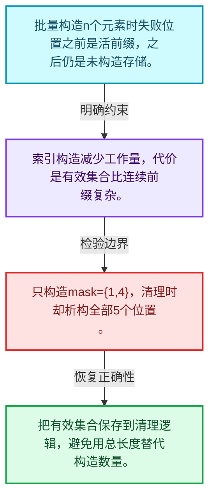
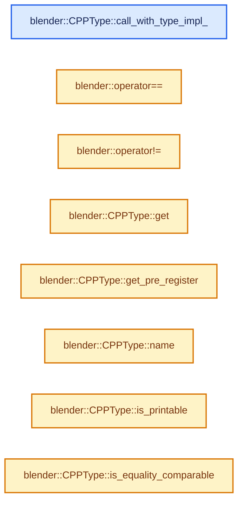
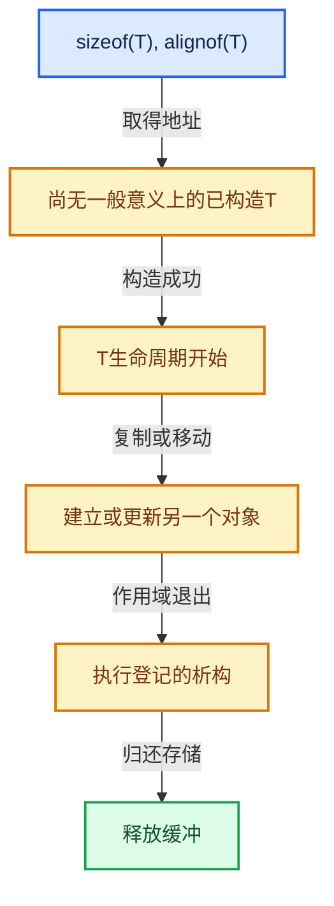

# 03-08 CPPType构造与析构

[方向导航](README.md) · [总目录](../README.md) · [实现索引](../%E7%AC%A6%E5%8F%B7%E4%BE%9D%E8%B5%96%E4%B8%8E%E5%AE%9E%E7%8E%B0%E7%B4%A2%E5%BC%95.md)

## 从问题到实现

同一操作为什么有单值、批量与索引版本？

批量接口减少分派开销，索引接口只处理选中元素；未选位置不能被当作已构造对象。

**数据模型**

批量构造n个元素时失败位置之前是活前缀，之后仍是未构造存储。

**设计取舍**

索引构造减少工作量，代价是有效集合比连续前缀复杂。

**最小反例**

只构造mask={1,4}，清理时却析构全部5个位置。

**推导**

把有效集合保存到清理逻辑，避免用总长度替代构造数量。

## 阅读地图与执行推演








图中的数值推演是本方向的教学模型；实际函数之间的调用边与概念分析边分别标注，不能把概念关系当作运行时调度顺序。

## 完整源码单元与就地讲解

中文讲解直接放在相关代码旁，复杂机制在代码下展开。原文折叠区保留基准行号；不需要在行号表和函数之间来回查找。类布局可分段展示，函数实现不按固定行数切开。

<a id="f-0e42941532ee4cee"></a>

### `blender::CPPType::call_with_type_impl_`

实现位置：[source/blender/blenlib/BLI_cpp_type.hh](../../../../../source/blender/blenlib/BLI_cpp_type.hh) · L439—L442。

接口参数：

- `const Fn &fn`

**教学注释版**

<!-- annotated:adaf1e407abc17 -->

```cpp
  template<typename T, typename Fn> static void call_with_type_impl_(const Fn &fn)
  {
    fn.template operator()<T>();
  }
```

<details>
<summary>核对原始源码：source/blender/blenlib/BLI_cpp_type.hh · L439—L442</summary>

<!-- original:adaf1e407abc17:source/blender/blenlib/BLI_cpp_type.hh:439:442 -->

```cpp
  template<typename T, typename Fn> static void call_with_type_impl_(const Fn &fn)
  {
    fn.template operator()<T>();
  }
```

</details>

**继续追踪实现**

- `fn.template operator()<T>` → [调用协议](../%E6%A8%A1%E6%9D%BF%E5%AE%8F%E4%B8%8E%E5%8A%A8%E6%80%81%E5%88%86%E6%B4%BE%E5%8D%8F%E8%AE%AE.md)：Fn模板参数提供的操作协议。调用位置L441。

### 类型布局、声明与编译条件 · BLI_cpp_type.hh L443—L470

<!-- annotated:b48aa91d5cfa63 -->

```cpp
};

namespace detail {
/**
 * Global static variable that contains the #CPPType for a given type after it has been registered
 * with #BLI_CPP_TYPE_REGISTER. This should generally be accessed through #CPPType::get<T>.
 */
template<typename T> inline TypedBuffer<CPPType> cpp_type_impl{};
template<typename T> inline bool is_cpp_type_registered = false;
}  // namespace detail

/**
 * Initialize and register basic cpp types.
 */
void register_cpp_types();

/* Utility for allocating an uninitialized buffer for a single value of the given #CPPType. */
#define BUFFER_FOR_CPP_TYPE_VALUE(type, variable_name) \
  DynamicStackBuffer<64, 64> stack_buffer_for_##variable_name((type).size, (type).alignment); \
  void *variable_name = stack_buffer_for_##variable_name.buffer();

/* Give a compile error instead of a link error when type information is missing. */
template<> const CPPType &CPPType::get<void>() = delete;

/**
 * Two types only compare equal when their pointer is equal. No two instances of CPPType for the
 * same C++ type should be created.
 */
```

<details>
<summary>核对原始源码：source/blender/blenlib/BLI_cpp_type.hh · L443—L470</summary>

<!-- original:b48aa91d5cfa63:source/blender/blenlib/BLI_cpp_type.hh:443:470 -->

```cpp
};

namespace detail {
/**
 * Global static variable that contains the #CPPType for a given type after it has been registered
 * with #BLI_CPP_TYPE_REGISTER. This should generally be accessed through #CPPType::get<T>.
 */
template<typename T> inline TypedBuffer<CPPType> cpp_type_impl{};
template<typename T> inline bool is_cpp_type_registered = false;
}  // namespace detail

/**
 * Initialize and register basic cpp types.
 */
void register_cpp_types();

/* Utility for allocating an uninitialized buffer for a single value of the given #CPPType. */
#define BUFFER_FOR_CPP_TYPE_VALUE(type, variable_name) \
  DynamicStackBuffer<64, 64> stack_buffer_for_##variable_name((type).size, (type).alignment); \
  void *variable_name = stack_buffer_for_##variable_name.buffer();

/* Give a compile error instead of a link error when type information is missing. */
template<> const CPPType &CPPType::get<void>() = delete;

/**
 * Two types only compare equal when their pointer is equal. No two instances of CPPType for the
 * same C++ type should be created.
 */
```

</details>

<a id="f-2ddebda237412e70"></a>

### `blender::operator==`

实现位置：[source/blender/blenlib/BLI_cpp_type.hh](../../../../../source/blender/blenlib/BLI_cpp_type.hh) · L471—L474。

接口参数：

- `const CPPType &a`
- `const CPPType &b`

**教学注释版**

<!-- annotated:2d111dbf470ffb -->

```cpp
inline bool operator==(const CPPType &a, const CPPType &b)
{
  return &a == &b;
}
```

<details>
<summary>核对原始源码：source/blender/blenlib/BLI_cpp_type.hh · L471—L474</summary>

<!-- original:2d111dbf470ffb:source/blender/blenlib/BLI_cpp_type.hh:471:474 -->

```cpp
inline bool operator==(const CPPType &a, const CPPType &b)
{
  return &a == &b;
}
```

</details>

**结果出口**

- `return &a == &b;`

**继续追踪实现**

本实现没有需要继续展开的显式调用；检查返回表达式、对象转换和调用者前置条件。

<!-- annotated:7abc02d0dbc11f -->

```cpp

```

<details>
<summary>核对原始源码：source/blender/blenlib/BLI_cpp_type.hh · L475—L475</summary>

<!-- original:7abc02d0dbc11f:source/blender/blenlib/BLI_cpp_type.hh:475:475 -->

```cpp

```

</details>

<a id="f-034dabd977b9935c"></a>

### `blender::operator!=`

实现位置：[source/blender/blenlib/BLI_cpp_type.hh](../../../../../source/blender/blenlib/BLI_cpp_type.hh) · L476—L479。

接口参数：

- `const CPPType &a`
- `const CPPType &b`

**教学注释版**

<!-- annotated:0e479deaf636bf -->

```cpp
inline bool operator!=(const CPPType &a, const CPPType &b)
{
  return !(&a == &b);
}
```

<details>
<summary>核对原始源码：source/blender/blenlib/BLI_cpp_type.hh · L476—L479</summary>

<!-- original:0e479deaf636bf:source/blender/blenlib/BLI_cpp_type.hh:476:479 -->

```cpp
inline bool operator!=(const CPPType &a, const CPPType &b)
{
  return !(&a == &b);
}
```

</details>

**结果出口**

- `return !(&a == &b);`

**继续追踪实现**

本实现没有需要继续展开的显式调用；检查返回表达式、对象转换和调用者前置条件。

<!-- annotated:612b652a1fea64 -->

```cpp

```

<details>
<summary>核对原始源码：source/blender/blenlib/BLI_cpp_type.hh · L480—L480</summary>

<!-- original:612b652a1fea64:source/blender/blenlib/BLI_cpp_type.hh:480:480 -->

```cpp

```

</details>

<a id="f-0cc10a3783d6abdb"></a>

### `blender::CPPType::get`

实现位置：[source/blender/blenlib/BLI_cpp_type.hh](../../../../../source/blender/blenlib/BLI_cpp_type.hh) · L481—L490。

**教学注释版**

<!-- annotated:f125b0cd438349 -->

```cpp
template<typename T> inline const CPPType &CPPType::get()
{
  using DecayT = std::decay_t<T>;
  /* Should have been initialized by #BLI_CPP_TYPE_REGISTER.
   * If this is hit in test code, make sure the test calls `register_cpp_types` (for blenlib
   * tests) or `BKE_cpp_types_init` (for general tests). */
  BLI_assert(detail::is_cpp_type_registered<DecayT>);
  const CPPType &type = detail::cpp_type_impl<DecayT>.ref();
  return type;
}
```

<details>
<summary>核对原始源码：source/blender/blenlib/BLI_cpp_type.hh · L481—L490</summary>

<!-- original:f125b0cd438349:source/blender/blenlib/BLI_cpp_type.hh:481:490 -->

```cpp
template<typename T> inline const CPPType &CPPType::get()
{
  using DecayT = std::decay_t<T>;
  /* Should have been initialized by #BLI_CPP_TYPE_REGISTER.
   * If this is hit in test code, make sure the test calls `register_cpp_types` (for blenlib
   * tests) or `BKE_cpp_types_init` (for general tests). */
  BLI_assert(detail::is_cpp_type_registered<DecayT>);
  const CPPType &type = detail::cpp_type_impl<DecayT>.ref();
  return type;
}
```

</details>

**结果出口**

- `return type;`

**继续追踪实现**

- `BLI_assert` → [BLI_assert · L48](../01-%E5%9F%BA%E7%A1%80%E5%AE%B9%E5%99%A8%E4%B8%8E%E7%8E%B0%E4%BB%A3CPP/%E4%BE%9D%E8%B5%96-BLI_assert-cc98e8.md#m-57a88495704d)；[BLI_assert · L63](../01-%E5%9F%BA%E7%A1%80%E5%AE%B9%E5%99%A8%E4%B8%8E%E7%8E%B0%E4%BB%A3CPP/%E4%BE%9D%E8%B5%96-BLI_assert-cc98e8.md#m-d07050020cb5)。宏定义由构建条件选择。
- `detail::cpp_type_impl<DecayT>.ref` → [调用协议](../%E6%A8%A1%E6%9D%BF%E5%AE%8F%E4%B8%8E%E5%8A%A8%E6%80%81%E5%88%86%E6%B4%BE%E5%8D%8F%E8%AE%AE.md)：接收对象类型依赖auto、返回值或模板实例；不按同名猜测目标。调用位置L488。

<!-- annotated:14550d3d91e101 -->

```cpp

```

<details>
<summary>核对原始源码：source/blender/blenlib/BLI_cpp_type.hh · L491—L491</summary>

<!-- original:14550d3d91e101:source/blender/blenlib/BLI_cpp_type.hh:491:491 -->

```cpp

```

</details>

<a id="f-10afb648db5332e1"></a>

### `blender::CPPType::get_pre_register`

实现位置：[source/blender/blenlib/BLI_cpp_type.hh](../../../../../source/blender/blenlib/BLI_cpp_type.hh) · L492—L495。

**教学注释版**

<!-- annotated:5fbc47ba70ccb2 -->

```cpp
template<typename T> inline const CPPType *CPPType::get_pre_register()
{
  return detail::cpp_type_impl<std::decay_t<T>>.ptr();
}
```

<details>
<summary>核对原始源码：source/blender/blenlib/BLI_cpp_type.hh · L492—L495</summary>

<!-- original:5fbc47ba70ccb2:source/blender/blenlib/BLI_cpp_type.hh:492:495 -->

```cpp
template<typename T> inline const CPPType *CPPType::get_pre_register()
{
  return detail::cpp_type_impl<std::decay_t<T>>.ptr();
}
```

</details>

**结果出口**

- `return detail::cpp_type_impl<std::decay_t<T>>.ptr();`

**继续追踪实现**

- `detail::cpp_type_impl<std::decay_t<T>>.ptr` → [调用协议](../%E6%A8%A1%E6%9D%BF%E5%AE%8F%E4%B8%8E%E5%8A%A8%E6%80%81%E5%88%86%E6%B4%BE%E5%8D%8F%E8%AE%AE.md)：接收对象类型依赖auto、返回值或模板实例；不按同名猜测目标。调用位置L494。

<!-- annotated:4378a944b0bae7 -->

```cpp

```

<details>
<summary>核对原始源码：source/blender/blenlib/BLI_cpp_type.hh · L496—L496</summary>

<!-- original:4378a944b0bae7:source/blender/blenlib/BLI_cpp_type.hh:496:496 -->

```cpp

```

</details>

<a id="f-e5ab6239f7e97c8e"></a>

### `blender::CPPType::name`

实现位置：[source/blender/blenlib/BLI_cpp_type.hh](../../../../../source/blender/blenlib/BLI_cpp_type.hh) · L497—L500。

**教学注释版**

<!-- annotated:7fe30dfffb8445 -->

```cpp
inline StringRefNull CPPType::name() const
{
  return debug_name_;
}
```

<details>
<summary>核对原始源码：source/blender/blenlib/BLI_cpp_type.hh · L497—L500</summary>

<!-- original:7fe30dfffb8445:source/blender/blenlib/BLI_cpp_type.hh:497:500 -->

```cpp
inline StringRefNull CPPType::name() const
{
  return debug_name_;
}
```

</details>

**结果出口**

- `return debug_name_;`

**继续追踪实现**

本实现没有需要继续展开的显式调用；检查返回表达式、对象转换和调用者前置条件。

<!-- annotated:42c54d5728890d -->

```cpp

```

<details>
<summary>核对原始源码：source/blender/blenlib/BLI_cpp_type.hh · L501—L501</summary>

<!-- original:42c54d5728890d:source/blender/blenlib/BLI_cpp_type.hh:501:501 -->

```cpp

```

</details>

<a id="f-0fa397dd1eec40af"></a>

### `blender::CPPType::is_printable`

实现位置：[source/blender/blenlib/BLI_cpp_type.hh](../../../../../source/blender/blenlib/BLI_cpp_type.hh) · L502—L505。

**教学注释版**

<!-- annotated:71134cf3a33623 -->

```cpp
inline bool CPPType::is_printable() const
{
  return print_ != nullptr;
}
```

<details>
<summary>核对原始源码：source/blender/blenlib/BLI_cpp_type.hh · L502—L505</summary>

<!-- original:71134cf3a33623:source/blender/blenlib/BLI_cpp_type.hh:502:505 -->

```cpp
inline bool CPPType::is_printable() const
{
  return print_ != nullptr;
}
```

</details>

**结果出口**

- `return print_ != nullptr;`

**继续追踪实现**

本实现没有需要继续展开的显式调用；检查返回表达式、对象转换和调用者前置条件。

<!-- annotated:7189cfd274bbec -->

```cpp

```

<details>
<summary>核对原始源码：source/blender/blenlib/BLI_cpp_type.hh · L506—L506</summary>

<!-- original:7189cfd274bbec:source/blender/blenlib/BLI_cpp_type.hh:506:506 -->

```cpp

```

</details>

<a id="f-ed982afd031c9775"></a>

### `blender::CPPType::is_equality_comparable`

实现位置：[source/blender/blenlib/BLI_cpp_type.hh](../../../../../source/blender/blenlib/BLI_cpp_type.hh) · L507—L510。

**教学注释版**

<!-- annotated:1284a054b8cf8d -->

```cpp
inline bool CPPType::is_equality_comparable() const
{
  return is_equal_ != nullptr;
}
```

<details>
<summary>核对原始源码：source/blender/blenlib/BLI_cpp_type.hh · L507—L510</summary>

<!-- original:1284a054b8cf8d:source/blender/blenlib/BLI_cpp_type.hh:507:510 -->

```cpp
inline bool CPPType::is_equality_comparable() const
{
  return is_equal_ != nullptr;
}
```

</details>

**结果出口**

- `return is_equal_ != nullptr;`

**继续追踪实现**

本实现没有需要继续展开的显式调用；检查返回表达式、对象转换和调用者前置条件。

<!-- annotated:b4d1770484cee6 -->

```cpp

```

<details>
<summary>核对原始源码：source/blender/blenlib/BLI_cpp_type.hh · L511—L511</summary>

<!-- original:b4d1770484cee6:source/blender/blenlib/BLI_cpp_type.hh:511:511 -->

```cpp

```

</details>

<a id="f-b34f129b9afb9992"></a>

### `blender::CPPType::is_hashable`

实现位置：[source/blender/blenlib/BLI_cpp_type.hh](../../../../../source/blender/blenlib/BLI_cpp_type.hh) · L512—L515。

**教学注释版**

<!-- annotated:821995db0973cb -->

```cpp
inline bool CPPType::is_hashable() const
{
  return hash_ != nullptr;
}
```

<details>
<summary>核对原始源码：source/blender/blenlib/BLI_cpp_type.hh · L512—L515</summary>

<!-- original:821995db0973cb:source/blender/blenlib/BLI_cpp_type.hh:512:515 -->

```cpp
inline bool CPPType::is_hashable() const
{
  return hash_ != nullptr;
}
```

</details>

**结果出口**

- `return hash_ != nullptr;`

**继续追踪实现**

本实现没有需要继续展开的显式调用；检查返回表达式、对象转换和调用者前置条件。

<!-- annotated:be9478a72865e5 -->

```cpp

```

<details>
<summary>核对原始源码：source/blender/blenlib/BLI_cpp_type.hh · L516—L516</summary>

<!-- original:be9478a72865e5:source/blender/blenlib/BLI_cpp_type.hh:516:516 -->

```cpp

```

</details>

<a id="f-e6c3071a36daaa2d"></a>

### `blender::CPPType::pointer_has_valid_alignment`

实现位置：[source/blender/blenlib/BLI_cpp_type.hh](../../../../../source/blender/blenlib/BLI_cpp_type.hh) · L517—L520。

接口参数：

- `const void *ptr`

**教学注释版**

<!-- annotated:16bf52fca7d865 -->

```cpp
inline bool CPPType::pointer_has_valid_alignment(const void *ptr) const
{
  return (uintptr_t(ptr) & alignment_mask_) == 0;
}
```

<details>
<summary>核对原始源码：source/blender/blenlib/BLI_cpp_type.hh · L517—L520</summary>

<!-- original:16bf52fca7d865:source/blender/blenlib/BLI_cpp_type.hh:517:520 -->

```cpp
inline bool CPPType::pointer_has_valid_alignment(const void *ptr) const
{
  return (uintptr_t(ptr) & alignment_mask_) == 0;
}
```

</details>

**结果出口**

- `return (uintptr_t(ptr) & alignment_mask_) == 0;`

**继续追踪实现**

本实现没有需要继续展开的显式调用；检查返回表达式、对象转换和调用者前置条件。

<!-- annotated:b8077c84d05ce7 -->

```cpp

```

<details>
<summary>核对原始源码：source/blender/blenlib/BLI_cpp_type.hh · L521—L521</summary>

<!-- original:b8077c84d05ce7:source/blender/blenlib/BLI_cpp_type.hh:521:521 -->

```cpp

```

</details>

<a id="f-2e5140a882358ea2"></a>

### `blender::CPPType::pointer_can_point_to_instance`

实现位置：[source/blender/blenlib/BLI_cpp_type.hh](../../../../../source/blender/blenlib/BLI_cpp_type.hh) · L522—L525。

接口参数：

- `const void *ptr`

**教学注释版**

<!-- annotated:8c0c829eff4085 -->

```cpp
inline bool CPPType::pointer_can_point_to_instance(const void *ptr) const
{
  return ptr != nullptr && pointer_has_valid_alignment(ptr);
}
```

<details>
<summary>核对原始源码：source/blender/blenlib/BLI_cpp_type.hh · L522—L525</summary>

<!-- original:8c0c829eff4085:source/blender/blenlib/BLI_cpp_type.hh:522:525 -->

```cpp
inline bool CPPType::pointer_can_point_to_instance(const void *ptr) const
{
  return ptr != nullptr && pointer_has_valid_alignment(ptr);
}
```

</details>

**结果出口**

- `return ptr != nullptr && pointer_has_valid_alignment(ptr);`

**继续追踪实现**

- `pointer_has_valid_alignment` → [blender::CPPType::pointer_has_valid_alignment · L517](08-CPPType%E6%9E%84%E9%80%A0%E4%B8%8E%E6%9E%90%E6%9E%84.md#f-e6c3071a36daaa2d)。

<!-- annotated:1a5d8744e8e712 -->

```cpp

```

<details>
<summary>核对原始源码：source/blender/blenlib/BLI_cpp_type.hh · L526—L526</summary>

<!-- original:1a5d8744e8e712:source/blender/blenlib/BLI_cpp_type.hh:526:526 -->

```cpp

```

</details>

<a id="f-7ed74c0abe93df1c"></a>

### `blender::CPPType::default_construct`

实现位置：[source/blender/blenlib/BLI_cpp_type.hh](../../../../../source/blender/blenlib/BLI_cpp_type.hh) · L527—L530。

接口参数：

- `void *ptr`

**教学注释版**

<!-- annotated:5840a0467c26d4 -->

```cpp
inline void CPPType::default_construct(void *ptr) const
{
  default_construct_(ptr);
}
```

<details>
<summary>核对原始源码：source/blender/blenlib/BLI_cpp_type.hh · L527—L530</summary>

<!-- original:5840a0467c26d4:source/blender/blenlib/BLI_cpp_type.hh:527:530 -->

```cpp
inline void CPPType::default_construct(void *ptr) const
{
  default_construct_(ptr);
}
```

</details>

**继续追踪实现**

- `default_construct_` → [调用协议](../%E6%A8%A1%E6%9D%BF%E5%AE%8F%E4%B8%8E%E5%8A%A8%E6%80%81%E5%88%86%E6%B4%BE%E5%8D%8F%E8%AE%AE.md)：函数指针、局部可调用对象或未展开的宏；必须结合调用者环境。调用位置L529。

<!-- annotated:2e59a035b6d2e1 -->

```cpp

```

<details>
<summary>核对原始源码：source/blender/blenlib/BLI_cpp_type.hh · L531—L531</summary>

<!-- original:2e59a035b6d2e1:source/blender/blenlib/BLI_cpp_type.hh:531:531 -->

```cpp

```

</details>

<a id="f-ffb51b59521d5579"></a>

### `blender::CPPType::default_construct_n`

实现位置：[source/blender/blenlib/BLI_cpp_type.hh](../../../../../source/blender/blenlib/BLI_cpp_type.hh) · L532—L535。

接口参数：

- `void *ptr`
- `int64_t n`

**教学注释版**

<!-- annotated:3e7a54aa06fe76 -->

```cpp
inline void CPPType::default_construct_n(void *ptr, int64_t n) const
{
  default_construct_n_(ptr, n);
}
```

<details>
<summary>核对原始源码：source/blender/blenlib/BLI_cpp_type.hh · L532—L535</summary>

<!-- original:3e7a54aa06fe76:source/blender/blenlib/BLI_cpp_type.hh:532:535 -->

```cpp
inline void CPPType::default_construct_n(void *ptr, int64_t n) const
{
  default_construct_n_(ptr, n);
}
```

</details>

**继续追踪实现**

- `default_construct_n_` → [调用协议](../%E6%A8%A1%E6%9D%BF%E5%AE%8F%E4%B8%8E%E5%8A%A8%E6%80%81%E5%88%86%E6%B4%BE%E5%8D%8F%E8%AE%AE.md)：函数指针、局部可调用对象或未展开的宏；必须结合调用者环境。调用位置L534。

<!-- annotated:e8c8ff37998fdf -->

```cpp

```

<details>
<summary>核对原始源码：source/blender/blenlib/BLI_cpp_type.hh · L536—L536</summary>

<!-- original:e8c8ff37998fdf:source/blender/blenlib/BLI_cpp_type.hh:536:536 -->

```cpp

```

</details>

<a id="f-2273e9c1cf32179e"></a>

### `blender::CPPType::default_construct_indices`

实现位置：[source/blender/blenlib/BLI_cpp_type.hh](../../../../../source/blender/blenlib/BLI_cpp_type.hh) · L537—L540。

接口参数：

- `void *ptr`
- `const IndexMask &mask`

**教学注释版**

<!-- annotated:d77d779b15cd52 -->

```cpp
inline void CPPType::default_construct_indices(void *ptr, const IndexMask &mask) const
{
  default_construct_indices_(ptr, mask);
}
```

<details>
<summary>核对原始源码：source/blender/blenlib/BLI_cpp_type.hh · L537—L540</summary>

<!-- original:d77d779b15cd52:source/blender/blenlib/BLI_cpp_type.hh:537:540 -->

```cpp
inline void CPPType::default_construct_indices(void *ptr, const IndexMask &mask) const
{
  default_construct_indices_(ptr, mask);
}
```

</details>

**继续追踪实现**

- `default_construct_indices_` → [调用协议](../%E6%A8%A1%E6%9D%BF%E5%AE%8F%E4%B8%8E%E5%8A%A8%E6%80%81%E5%88%86%E6%B4%BE%E5%8D%8F%E8%AE%AE.md)：函数指针、局部可调用对象或未展开的宏；必须结合调用者环境。调用位置L539。

## 语法与相关类型

### 模板 template

模板把类型或常量作为生成实现的参数。读声明时先列出类型参数、非类型参数和默认值，再看使用者实际实例化了什么。模板声明本身不意味着每种T都支持其全部成员。

把T替换为int、string、只能移动的类型，分别检查每个被调用操作是否成立。

### 依赖名称 typename

typename既可引入类型模板参数，也可告诉编译器某个依赖名称是类型。它不创建运行时对象；解析期确认语法类别与实例化期检查具体类型是不同阶段。

区分typename T::value_type和T::size()，前者标记类型，后者是表达式。

### 只读限定 const

const约束当前访问路径可做的修改。const指针、指向const的指针、const视图对象、const元素是不同位置的限定；其他别名可能仍可修改原对象。

分别写T* const、const T*与const T* const，并画出不可修改的层次。

### 内部断言 assert

断言表达开发者预期成立的内部契约，发布构建可能关闭。它不能替代对不可信输入的完整错误处理，也不保证后续操作被运行时保护。

对每条断言构造违反条件的输入，区分调用者错误与应向用户报告的错误。

### 类型别名 using

类型别名为已有类型建立名字，不创建运行期对象。它常把模板内部使用的类型统一暴露给泛型调用者。

展开别名直到基础类型，区分类型别名和变量声明。

## 实现练习与验证

在带空洞的选择上构造和析构，逐索引记录存活状态。

参考推理：把有效集合保存到清理逻辑，避免用总长度替代构造数量。

所有存活对象地址满足对齐；构造失败不会被当作成功对象登记；所有资源均有唯一或明确共享的清理责任。

## 历史、跨库比较与证据

与std::pmr::monotonic_buffer_resource比较批量存储回收，与std::any比较拥有型类型擦除；CPPType描述类型操作，本身不保存每个值。

[历史提交索引](../%E5%8E%86%E5%8F%B2%E6%8F%90%E4%BA%A4%E4%B8%8E%E8%AE%BE%E8%AE%A1%E6%BC%94%E5%8C%96%E7%B4%A2%E5%BC%95.md) · [源码基准](../%E6%BA%90%E7%A0%81%E7%89%88%E6%9C%AC%E4%B8%8E%E8%A6%86%E7%9B%96%E7%B4%A2%E5%BC%95.md) · [验收报告](../%E9%AA%8C%E6%94%B6%E6%8A%A5%E5%91%8A.md)
